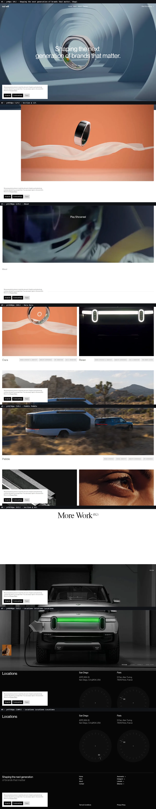
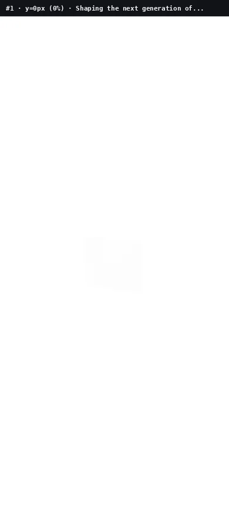

# UI Design System & Master Generation Blueprint: www-ouiwill-com

> **Oui Will · Brand Transformation & Digital Experiences** (https://www.ouiwill.com/) — Oui Will is an independent digital agency shaping ambitious brands through strategy, identity, digital experiences, and technology.





---

## 1. Executive Visual Persona & Design Archetype

- **Brand Essence & Persona**: **Oui Will · Brand Transformation & Digital Experiences** (`https://www.ouiwill.com/`). Oui Will is an independent digital agency shaping ambitious brands through strategy, identity, digital experiences, and technology.
- **Capture Provenance**: Live browser capture (`tier1_fast`, HTTP `200`, captured `2026-11-24`).
- **Visual Archetype**: **Light-Gallery WebGL / Canvas Interactive Experience (`#ffffff` / `#33ff96`)**.
- **Anti-AI-Slop Differentiators**:
  - **Live-Computed Chromatic Polarity**: Anchors the viewport in `#ffffff` (live computed `body` `background-color` (`computed_styles.json`)) paired with `#060606` primary typography and `#33ff96` accents.
  - **Grounded Typographic Hierarchy**: Uses `base` across display (`Shaping the next generation of brand`) and body copy, paired with `mono` for monospace/code.
  - **Calibrated Spatial Grid & Motion**: Combines `1400px` container bounds (`gap: 2rem`, padding `var(--padgrid)`) with `cubic-bezier(.771,.029,.189,1.007)` easing and Three.js / WebGL Canvas Pipeline.

---

## 2. Spatial Architecture & Modular Grid Mathematics

### Viewport Allocation & Container Geometry
- **Captured Journey Filmstrips**: Desktop `1280×6624px` (`assets/desktop-journey.webp`, `8` keyframes up to `y=7358px` / doc `8258px`), Mobile `390×872px` (`assets/mobile-journey.webp`, `1` keyframes).
- **Master Container Bounds**: `1400px` (measured widest bounded `<section>` landmark width on `1440px` desktop).
- **Canvas Lateral Padding & Spacing**: `var(--padgrid)` lateral canvas padding with `2rem` grid gap.
- **Border Radius Scale**: `2px`, `50%`, `9999px`, `.4rem`.

### Responsive Breakpoint Architecture
- **Desktop Layout**: Multi-column CSS Grid / Flexbox layout at `1440px` (`max-width: 1400px`, `gap: 2rem`).
- **Mobile Layout**: Single-column vertical stack at `390px` viewport width with `var(--padgrid)` horizontal padding.
- **Extracted CSS Media Queries**: `@media (width>=1194.02px),(width<=1194px) and (orientation:lands...`, `@media (width<=1194px) and (orientation:portrait)`, `@media (width<=375px)`, `@media (width>=1194.02px)`.

---

## 3. Color System, Materiality & Atmospheric Lighting

### Semantic Palette & Source Grounding
| Semantic Role | Ground-Truth Value | Extracted Live / CSS Source |
|---|---|---|
| **Primary Canvas Substrate** | `#ffffff` | live computed `body` `background-color` (`computed_styles.json`) |
| **Primary Typography Ink** | `#060606` | live computed `main` `color` (`computed_styles.json`) |
| **Elevated Surface / Card Substrate** | `#00ffff` | `.HLP_GD .GRI-CL div:before { background: #00ffff }` |
| **Interactive Accent / Highlight** | `#33ff96` | `.aBtn.A { background-color: #33ff96 }` |
| **Secondary / Muted Copy** | `#878787` | live computed `p` `color` (`computed_styles.json`) |
| **Structural Hairline Border** | `#d9d9d9` | `.aBtn-dkB { border: #d9d9d9 }` |

### Sanitized Root CSS Variables (`ui-ux.md` Ground Truth)
| Variable Name | Extracted Value | Semantic Role |
|---|---|---|
| `--csk-rev` | `"csk-ffec67d3-72a4-404e-9353-3cf2742cdeb5"` | Design System Custom Token |
| `--mobileMax` | `834` | Design System Custom Token |
| `--resp` | `1194` | Design System Custom Token |
| `--padgrid` | `4rem` | Layout / Spatial Grid Token |
| `--multi` | `calc(((100vw - 1440px) / 1440 * -5))` | Dimension / Scale Token |
| `--prg1` | `1` | Design System Custom Token |
| `--prg2` | `1` | Design System Custom Token |
| `--bndB` | `calc(100% * var(--bnd,.15))` | Dimension / Scale Token |
| `--bndS` | `calc(100% + 2 * var(--bndB))` | Dimension / Scale Token |
| `--hovS` | `calc(var(--hovt,.7) * var(--hovd,1))` | Design System Custom Token |
| `--hovO` | `min(0, var(--hovS))` | Design System Custom Token |
| `--hovd` | `-1` | Design System Custom Token |
| `--padgut` | `calc(var(--gutgrid) + var(--padgrid))` | Layout / Spatial Grid Token |
| `--padgut-s` | `calc(var(--gutgrid) + var(--padgrid-s))` | Layout / Spatial Grid Token |
| `--sizegrid` | `calc(100vw - ((var(--padgut)) * 2))` | Layout / Spatial Grid Token |
| `--gutgrid` | `1rem` | Layout / Spatial Grid Token |

---

## 4. Typographic Scale & Editorial Hierarchy

### Font Family Stacks
- **Display Typography**: `base`.
- **Primary Body Stack**: `base`.
- **Technical / Metadata Stack**: `mono`.

### Typographic Scale & Rules (Live Computed & Stylesheet Grounded)
- **Hero Display (`H1`)**: observed font-size ladder: `60px`, `50px`, `14px`, `12px`, `2.66667vw`.
- **Section Heading (`H2`)**: live computed `h2` (`font-size: 60px`, `line-height: 63px`, `font-weight: 400`, `letter-spacing: -1.2px`).
- **Body Copy**: live computed `body` (`font-size: 14px`, `line-height: 14px`, `font-weight: 400`); rule `p` (`font-size: 1.2rem`, `line-height: 1.3`, `letter-spacing: -.02em`).
- **Metadata & Navigation Labels**: live computed `nav/a` (`font-size: 14px`, `line-height: 14px`, `font-weight: 400`).

---

## 5. Choreographed Motion & Interaction Physics

### Primary Easing Curves
- **Extracted Timing Functions**: `cubic-bezier(.771,.029,.189,1.007)`, `cubic-bezier(.19,1,.22,1)`.

### Per-Element Transition & Choreography Rules
- **Selector `.HLP_GD`**: `transition: max-height 2s cubic-bezier(.771,.029,.189,1.007)` extracted from `www-ouiwill-com` stylesheet.
- **Selector `.HLP_GD .GRI-CL div:before`**: `transition: transform .4s cubic-bezier(.771,.029,.189,1.007)` extracted from `www-ouiwill-com` stylesheet.
- **Selector `.HLP_GD.A div:before`**: `transition: transform 1s cubic-bezier(.771,.029,.189,1.007) .1s` extracted from `www-ouiwill-com` stylesheet.
- **Extracted Easing Curve (`cubic-bezier(.771,.029,.189,1.007)`)**: Governs interactive state transitions across `<nav.nav>` and `<section.home_reel>`.
- **Runtime Interaction Engine**: Integrates Three.js / WebGL Canvas Pipeline with `prefers-reduced-motion: reduce` fallback guards.
### Measured Runtime Scroll & Interaction Telemetry (`behavioral_journey_v2`)
- **Scroll Driver Mode**: `native` (max document height `8258px`, deepest scrollY reached `7358px` across `8` desktop keyframes).
- **Detected Scroll / Motion Libraries**: `WebGL/Canvas`.
- **Route Transition Architecture**: First internal navigation (`/work`) measured as `SPA` in `1166ms`.

---

## 6. Component Wireframe & Structural DOM Map

### Visual Layout Schematic — Desktop (`1440px`, Grounded in `dom.html` & Landmark Bounding Boxes)
```
┌────────────────────────────────────────────────────────────────────────┐
│ DESKTOP VIEWPORT (1440px) — Oui Will · Brand Transformation & Digital  │
│ ====================================================================== │
│ [ <nav.nav> (1440x900px)              | Home Home · Work Work · Abou ] │
│ ---------------------------------------------------------------------- │
│ | HERO STAGE: <section.home_intro> (w=1440px)                        | │
│ | H1: Shaping the next generation of brands that matter...           | │
│ | Substrate: #ffffff | Ink: #060606 | Accent: #33ff96                | │
│ ---------------------------------------------------------------------- │
│ | SHOWCASE GRID (<section.home_reel>) max-w: 1400px                  | │
│ | +------------------------------+  +------------------------------+ | │
│ | | Selected Work Selected Work  |  | About                        | | │
│ | +------------------------------+  +------------------------------+ | │
│ ---------------------------------------------------------------------- │
│ | DETAIL MODULE (<section.home_aboutlog>) — Oura                     | │
│ ---------------------------------------------------------------------- │
│ [ FOOTER (<footer.foot>       ) | https://www.ouiwill.com/             │
└────────────────────────────────────────────────────────────────────────┘
```

### Visual Layout Schematic — Mobile Reflow (`390px`)
```
┌────────────────────────────────────────────────────────────────────────┐
│ MOBILE VIEWPORT REFLOW (390px) — Single-Column Stack (gap: 2rem)       │
│ ====================================================================== │
│ [ HEADER BAR (<nav.nav>               ) | Compact Menu (390px)         │
│ ---------------------------------------------------------------------- │
│ | HERO STAGE (<section.home_intro>) — 390px Vertical Lead            | │
│ | H1: Shaping the next generation of brands that matter...           | │
│ ---------------------------------------------------------------------- │
│ | SHOWCASE STACK (<section.home_reel>) — 1-Col Stack                 | │
│ | [ Item 1: Selected Work Selected Work                            ] | │
│ | [ Item 2: About                                                  ] | │
│ ---------------------------------------------------------------------- │
│ | DETAIL STACK (<section.home_aboutlog>) — 1-Col (Oura)              | │
│ ---------------------------------------------------------------------- │
│ [ FOOTER (<footer.foot>       ) | Stacked 390px Colophon               │
└────────────────────────────────────────────────────────────────────────┘
```

### Granular DOM Region Breakdown
1. **Brand Header & Navigation Bar (<nav.nav> — `www-ouiwill-com`)**:
   - Landmark `<nav class="nav">` (`1440x900px`) hosting `Oui Will · Brand Transformation & Di` navigation (`Home Home · Work Work · About About · Careers Careers · Awwwards`), DOM attributes (`data-deck="[("lg":"/uploads/fina..."`, `data-req="true"`, `data-engine="three.js r182 webgpu"`, `data-id="contact"`), and stylesheet rule `root { --csk-rev:"csk-ffec67d3-72a4-404e-9353-3cf2742cdeb5" }`.
2. **Hero Stage & Focal Lead (<section.home_intro> — `Shaping the next generation of bra`)**:
   - Landmark `<section class="home_intro">` presenting display lead `Shaping the next generation of brands that matter...` and copy excerpt *"We use essential cookies to make this site work. Analytics and ad"* over `#ffffff` canvas and `#060606` ink.
3. **Primary Showcase & Content Grid (<section.home_reel> — `Selected Work Selected Work`)**:
   - Landmark `<section class="home_reel GRI-vw">` rendering section `Selected Work Selected Work` with copy *"Shaping the next generation of brands that matter."*, asset references (`favicon.svg`, `favicon.ico`, `apple-touch-icon.png`, `site.webmanifest`), and grid rule `after { box-sizing:border-box }`.
4. **Interactive Detail & Feature Matrix (<section.home_aboutlog> — `About`)**:
   - Landmark `<section class="home_aboutlog GRI">` framing `About` and `Oura` (*"Play Showreel Play Showreel"*) with `#00ffff` surface cards, `#33ff96` accents, and `html { -webkit-text-size-adjust:none;-moz-text-size-adjust:none;text-size-adjus... }`.
5. **Colophon & Global Directory Footer (<footer.foot> — `https://www.ouiwill.com/`)**:
   - Landmark `<footer class="foot">` anchoring `Oui Will · Brand Transformation ` footer links (`Home Home · Work Work · About About · Careers Careers · Awwwards`), copy *"0 0 : 0 0 / 0 0 : 0 0"*, and `#d9d9d9` structural dividers.
### Full Vertical Scroll Sequence (Desktop `1440×900` Keyframes)
- **Step 01** (`y=0px`, `0%`): Active landmark `Shaping the next generation of brands that matter...` · sticky/fixed elements: `4`
- **Step 02** (`y=850px`, `12%`): Active landmark `Section @ 12%` · sticky/fixed elements: `2`
- **Step 03** (`y=1700px`, `23%`): Active landmark `About` · sticky/fixed elements: `2`
- **Step 04** (`y=3400px`, `46%`): Active landmark `Oura Oura` · sticky/fixed elements: `1`
- **Step 05** (`y=4250px`, `58%`): Active landmark `Pebble Pebble` · sticky/fixed elements: `1`
- **Step 06** (`y=5950px`, `81%`): Active landmark `Section @ 81%` · sticky/fixed elements: `1`
- **Step 07** (`y=6800px`, `92%`): Active landmark `Locations Locations Locations` · sticky/fixed elements: `1`
- **Step 08** (`y=7358px`, `100%`): Active landmark `Locations Locations Locations` · sticky/fixed elements: `1`

### Multi-Page Internal Route Map
- **Listing Route (`/work`)**: `https://www.ouiwill.com/work` — H1: `Selected Work · Brand & Digital Experiences · Oui...`, scrollHeight `901px`, transition `SPA` (`1166ms`)
- **About Route (`/about`)**: `https://www.ouiwill.com/about` — H1: `About Oui Will · Independent Digital Agency`, scrollHeight `11273px`, transition `direct` (`661ms`)
- **About Route (`/careers`)**: `https://www.ouiwill.com/careers` — H1: `Open Positions Open Positions`, scrollHeight `1800px`, transition `direct` (`775ms`)

---

## 7. Master Zero-Shot AI Generation Prompt

```markdown
# Master Zero-Shot Frontend Generation Prompt: www-ouiwill-com (Oui Will · Brand Transformation & Digital Experiences)

You are a principal frontend architect and design systems engineer. Build a complete, production-ready web application replicating the exact design system, DOM landmarks, typographic hierarchy, color tokens, and motion physics of `www-ouiwill-com` (**Oui Will · Brand Transformation & Digital Experiences** — `https://www.ouiwill.com/`).

### 1. Visual Archetype & Anti-AI-Slop Mandates
- **Archetype**: Light-Gallery WebGL / Canvas Interactive Experience (`#ffffff` / `#33ff96`).
- **Identity & Domain Context**: Oui Will is an independent digital agency shaping ambitious brands through strategy, identity, digital experiences, and technology.
- **Primary Substrate**: `#ffffff` (live computed `body` `background-color` (`computed_styles.json`)), **Primary Ink**: `#060606`, **Accent / Highlight**: `#33ff96`.
- **Site-Specific Differentiators**:
  - **Live-Computed Chromatic Polarity**: Anchors the viewport in `#ffffff` (live computed `body` `background-color` (`computed_styles.json`)) paired with `#060606` primary typography and `#33ff96` accents.
  - **Grounded Typographic Hierarchy**: Uses `base` across display (`Shaping the next generation of brand`) and body copy, paired with `mono` for monospace/code.
  - **Calibrated Spatial Grid & Motion**: Combines `1400px` container bounds (`gap: 2rem`, padding `var(--padgrid)`) with `cubic-bezier(.771,.029,.189,1.007)` easing and Three.js / WebGL Canvas Pipeline.

### 2. Ground-Truth CSS Variables (`:root` Token Contract)
Declare and consume these exact custom properties extracted from `www-ouiwill-com` in your global stylesheet:

:root {
  /* Oui Will · Brand Transformation & Digital Experiences (www-ouiwill-com) — Live-Grounded CSS Variables */
  --csk-rev: "csk-ffec67d3-72a4-404e-9353-3cf2742cdeb5"; /* Design System Custom Token (www-ouiwill-com) */
  --mobileMax: 834; /* Design System Custom Token (www-ouiwill-com) */
  --resp: 1194; /* Design System Custom Token (www-ouiwill-com) */
  --padgrid: 4rem; /* Layout / Spatial Grid Token (www-ouiwill-com) */
  --multi: calc(((100vw - 1440px) / 1440 * -5)); /* Dimension / Scale Token (www-ouiwill-com) */
  --prg1: 1; /* Design System Custom Token (www-ouiwill-com) */
  --prg2: 1; /* Design System Custom Token (www-ouiwill-com) */
  --bndB: calc(100% * var(--bnd,.15)); /* Dimension / Scale Token (www-ouiwill-com) */
  --bndS: calc(100% + 2 * var(--bndB)); /* Dimension / Scale Token (www-ouiwill-com) */
  --hovS: calc(var(--hovt,.7) * var(--hovd,1)); /* Design System Custom Token (www-ouiwill-com) */
  --hovO: min(0, var(--hovS)); /* Design System Custom Token (www-ouiwill-com) */
  --hovd: -1; /* Design System Custom Token (www-ouiwill-com) */
  --padgut: calc(var(--gutgrid) + var(--padgrid)); /* Layout / Spatial Grid Token (www-ouiwill-com) */
  --padgut-s: calc(var(--gutgrid) + var(--padgrid-s)); /* Layout / Spatial Grid Token (www-ouiwill-com) */
  --sizegrid: calc(100vw - ((var(--padgut)) * 2)); /* Layout / Spatial Grid Token (www-ouiwill-com) */
  --gutgrid: 1rem; /* Layout / Spatial Grid Token (www-ouiwill-com) */
}

### 3. Semantic Color & Materiality Contract
Map every surface, ink, and border strictly to these source-grounded tokens:
- **Primary Canvas Substrate**: `#ffffff` — grounded in live computed `body` `background-color` (`computed_styles.json`)
- **Primary Typography Ink**: `#060606` — grounded in live computed `main` `color` (`computed_styles.json`)
- **Elevated Surface / Card Substrate**: `#00ffff` — grounded in `.HLP_GD .GRI-CL div:before { background: #00ffff }`
- **Interactive Accent / Highlight**: `#33ff96` — grounded in `.aBtn.A { background-color: #33ff96 }`
- **Secondary / Muted Copy**: `#878787` — grounded in live computed `p` `color` (`computed_styles.json`)
- **Structural Hairline Border**: `#d9d9d9` — grounded in `.aBtn-dkB { border: #d9d9d9 }`

### 4. Spatial Grid, Container Bounds & Responsive Breakpoints
- **Desktop Viewport Reference**: `1280×6624px` (multi-frame vertical journey filmstrip (6624px), `1440px` standard desktop width).
- **Mobile Viewport Reference**: `390×872px` (full-page live capture (872px), `390px` standard mobile width).
- **Container Max-Width**: `1400px` (measured widest bounded `<section>` landmark width on `1440px` desktop)
- **Padding & Gutters**: `var(--padgrid)` lateral canvas padding with `2rem` grid gap
- **Desktop Grid**: Multi-column CSS Grid / Flexbox layout at `1440px` (`max-width: 1400px`, `gap: 2rem`)
- **Mobile Adaptation**: Single-column vertical stack at `390px` viewport width with `var(--padgrid)` horizontal padding
- **Media Queries**: `@media (width>=1194.02px),(width<=1194px) and (orientation:lands...`, `@media (width<=1194px) and (orientation:portrait)`, `@media (width<=375px)`, `@media (width>=1194.02px)`
- **Corner Radii**: `2px`, `50%`, `9999px`, `.4rem`

### 5. Typography & Editorial Scale Contract
- **Display Font Stack**: `base`
- **Body Font Stack**: `base`
- **Monospace / Technical Font Stack**: `mono`
- **H1 Display Rule**: observed font-size ladder: `60px`, `50px`, `14px`, `12px`, `2.66667vw`
- **H2 Section Rule**: live computed `h2` (`font-size: 60px`, `line-height: 63px`, `font-weight: 400`, `letter-spacing: -1.2px`)
- **Body Copy Rule**: live computed `body` (`font-size: 14px`, `line-height: 14px`, `font-weight: 400`); rule `p` (`font-size: 1.2rem`, `line-height: 1.3`, `letter-spacing: -.02em`)
- **Metadata & Index Rule**: live computed `nav/a` (`font-size: 14px`, `line-height: 14px`, `font-weight: 400`)

### 6. Component Hierarchy, Verbatim Copy & Real DOM Landmarks
Scaffold `www-ouiwill-com` (`Oui Will · Brand Transformation & Digital Experiences`) with these exact structural regions, extracted copy, and CSS rules from `dom.html`:
1. **Brand Header & Navigation Bar (<nav.nav> — `www-ouiwill-com`)**:
   - DOM & Selectors: Landmark `<nav class="nav">` (`1440x900px`) hosting `Oui Will · Brand Transformation & Di` navigation (`Home Home · Work Work · About About · Careers Careers · Awwwards`), DOM attributes (`data-deck="[("lg":"/uploads/fina..."`, `data-req="true"`, `data-engine="three.js r182 webgpu"`, `data-id="contact"`), and stylesheet rule `root { --csk-rev:"csk-ffec67d3-72a4-404e-9353-3cf2742cdeb5" }`.
   - Responsive Contract: Header `Brand Header & Navigation Bar (<nav.nav> — `www-ouiwill-com`)` (`www-ouiwill-com`) adapts across `@media (width>=1194.02px),(width<=1194px) and (orientation:lands...`, `@media (width<=1194px) and (orientation:portrait)`, `@media (width<=375px)`, `@media (width>=1194.02px)` with `cubic-bezier(.771,.029,.189,1.007)`, `cubic-bezier(.19,1,.22,1)` transitions and links `Home Home · Work Work · About About · Careers Careers · Awwwards`.
2. **Hero Stage & Focal Lead (<section.home_intro> — `Shaping the next generation of bra`)**:
   - DOM & Selectors: Landmark `<section class="home_intro">` presenting display lead `Shaping the next generation of brands that matter...` and copy excerpt *"We use essential cookies to make this site work. Analytics and ad"* over `#ffffff` canvas and `#060606` ink.
   - Responsive Contract: Hero stage (`1280×6624px` desktop / `390×872px` mobile) sets `#ffffff` background with `#060606` headline `Shaping the next generation of brands that matter...`.
3. **Primary Showcase & Content Grid (<section.home_reel> — `Selected Work Selected Work`)**:
   - DOM & Selectors: Landmark `<section class="home_reel GRI-vw">` rendering section `Selected Work Selected Work` with copy *"Shaping the next generation of brands that matter."*, asset references (`favicon.svg`, `favicon.ico`, `apple-touch-icon.png`, `site.webmanifest`), and grid rule `after { box-sizing:border-box }`.
   - Responsive Contract: Showcase grid `Primary Showcase & Content Grid (<section.home_reel> — `Selected Work Selected Work`)` applies Multi-column CSS Grid / Flexbox layout at `1440px` (`max-width: 1400px`, `gap: 2rem`) on desktop and Single-column vertical stack at `390px` viewport width with `var(--padgrid)` horizontal padding on mobile.
4. **Interactive Detail & Feature Matrix (<section.home_aboutlog> — `About`)**:
   - DOM & Selectors: Landmark `<section class="home_aboutlog GRI">` framing `About` and `Oura` (*"Play Showreel Play Showreel"*) with `#00ffff` surface cards, `#33ff96` accents, and `html { -webkit-text-size-adjust:none;-moz-text-size-adjust:none;text-size-adjus... }`.
   - Responsive Contract: Detail module `Interactive Detail & Feature Matrix (<section.home_aboutlog> — `About`)` uses `2px`, `50%`, `9999px`, `.4rem` radii, `#33ff96` highlights, and assets (favicon.svg, favicon.ico, apple-touch-icon.png).
5. **Colophon & Global Directory Footer (<footer.foot> — `https://www.ouiwill.com/`)**:
   - DOM & Selectors: Landmark `<footer class="foot">` anchoring `Oui Will · Brand Transformation ` footer links (`Home Home · Work Work · About About · Careers Careers · Awwwards`), copy *"0 0 : 0 0 / 0 0 : 0 0"*, and `#d9d9d9` structural dividers.
   - Responsive Contract: Footer `Colophon & Global Directory Footer (<footer.foot> — `https://www.ouiwill.com/`)` aligns to `1400px` (measured widest bounded `<section>` landmark width on `1440px` desktop) with `var(--padgrid)` lateral canvas padding with `2rem` grid gap and attributes (data-deck="[("lg":"/uploads/fina...", data-req="true", data-engine="three.js r182 webgpu").

#### Verbatim DOM Copy Excerpts (`dom.html`)
- Copy Excerpt 1: *"We use essential cookies to make this site work. Analytics and advertising cookies..."*
- Copy Excerpt 2: *"Shaping the next generation of brands that matter."*
- Copy Excerpt 3: *"Play Showreel Play Showreel"*
- Copy Excerpt 4: *"0 0 : 0 0 / 0 0 : 0 0"*

### 7. Motion, Extracted Stylesheet Rules & Interaction Choreography
- **Primary Easing Functions**: `cubic-bezier(.771,.029,.189,1.007)`, `cubic-bezier(.19,1,.22,1)`
- **Extracted Stylesheet Rules (`www-ouiwill-com`)**:
- `root { --csk-rev:"csk-ffec67d3-72a4-404e-9353-3cf2742cdeb5" }`
- `after { box-sizing:border-box }`
- `html { -webkit-text-size-adjust:none;-moz-text-size-adjust:none;text-size-adjus... }`
- `button { cursor:revert }`
- `summary { list-style:none }`
- **Per-Selector Transition Rules**:
- **Selector `.HLP_GD`**: `transition: max-height 2s cubic-bezier(.771,.029,.189,1.007)` extracted from `www-ouiwill-com` stylesheet.
- **Selector `.HLP_GD .GRI-CL div:before`**: `transition: transform .4s cubic-bezier(.771,.029,.189,1.007)` extracted from `www-ouiwill-com` stylesheet.
- **Selector `.HLP_GD.A div:before`**: `transition: transform 1s cubic-bezier(.771,.029,.189,1.007) .1s` extracted from `www-ouiwill-com` stylesheet.
- **Extracted Easing Curve (`cubic-bezier(.771,.029,.189,1.007)`)**: Governs interactive state transitions across `<nav.nav>` and `<section.home_reel>`.
- **Runtime Interaction Engine**: Integrates Three.js / WebGL Canvas Pipeline with `prefers-reduced-motion: reduce` fallback guards.
### 7b. Full-Page Scroll Choreography, Interactive States & Multi-Page Routes
- **Scroll Mechanics**: Implement `native` vertical progression up to `8258px` across 8 distinct viewport chapters using WebGL/Canvas.
- **Vertical Chapter Sequence**: Shaping the next generation... (0%) -> Section @ 12% (12%) -> About (23%) -> Oura Oura (46%) -> Pebble Pebble (58%) -> Section @ 81% (81%) -> Locations Locations Locations (92%) -> Locations Locations Locations (100%).
- **Multi-Page Routes**: Scaffold internal routes `/work` (listing, SPA), `/about` (about, direct), `/careers` (about, direct) sharing the global header/footer shell and design tokens.

### 8. Technical Deliverables
- Implement in Next.js (App Router) with TypeScript and Tailwind CSS consuming the `:root` custom properties defined above for `www-ouiwill-com`.
- Reproduce both the `1440px` desktop architecture and `390px` mobile breakpoint transitions, preserving semantic HTML5 landmarks (`<header>`, `<nav>`, `<main>`, `<section>`, `<footer>`) and `prefers-reduced-motion` accessibility guards.
```
---

## 8. Full-Page Scroll Journey, Interactive States & Subpage Inventory

### Desktop Scroll Keyframes (`1440×900` WebP)
| Step | Scroll Y | Progress | Active Landmark / Section | Sticky/Fixed | Visual Asset |
| :---: | :---: | :---: | :--- | :---: | :--- |
| `#01` | `0px` | `0%` | Shaping the next generation of brands that ma... | `4` | [desktop-step-01.webp](assets/desktop-step-01.webp) |
| `#02` | `850px` | `12%` | Section @ 12% | `2` | [desktop-step-02.webp](assets/desktop-step-02.webp) |
| `#03` | `1700px` | `23%` | About | `2` | [desktop-step-03.webp](assets/desktop-step-03.webp) |
| `#04` | `3400px` | `46%` | Oura Oura | `1` | [desktop-step-04.webp](assets/desktop-step-04.webp) |
| `#05` | `4250px` | `58%` | Pebble Pebble | `1` | [desktop-step-05.webp](assets/desktop-step-05.webp) |
| `#06` | `5950px` | `81%` | Section @ 81% | `1` | [desktop-step-06.webp](assets/desktop-step-06.webp) |
| `#07` | `6800px` | `92%` | Locations Locations Locations | `1` | [desktop-step-07.webp](assets/desktop-step-07.webp) |
| `#08` | `7358px` | `100%` | Locations Locations Locations | `1` | [desktop-step-08.webp](assets/desktop-step-08.webp) |

### Mobile Condensed Keyframes (`390×844` WebP)
| Step | Scroll Y | Progress | Active Landmark | Visual Asset |
| :---: | :---: | :---: | :--- | :--- |
| `#01` | `0px` | `0%` | Shaping the next generation of brands tha... | [mobile-step-01.webp](assets/mobile-step-01.webp) |

### Internal Subpage Filmstrips (`1080px` Wide WebP)
| # | Template | Route URL | H1 / Title | Scroll Height | Transition | Filmstrip Asset |
| :-: | :---: | :--- | :--- | :---: | :---: | :--- |
| `1` | `listing` | `https://www.ouiwill.com/work` | Selected Work · Brand & Digital Exper... | `901px` | `SPA` (`1166ms`) | [subpage-01-work.webp](assets/subpage-01-work.webp) |
| `2` | `about` | `https://www.ouiwill.com/about` | About Oui Will · Independent Digital... | `11273px` | `direct` (`661ms`) | [subpage-02-about.webp](assets/subpage-02-about.webp) |
| `3` | `about` | `https://www.ouiwill.com/careers` | Open Positions Open Positions | `1800px` | `direct` (`775ms`) | [subpage-03-careers.webp](assets/subpage-03-careers.webp) |

