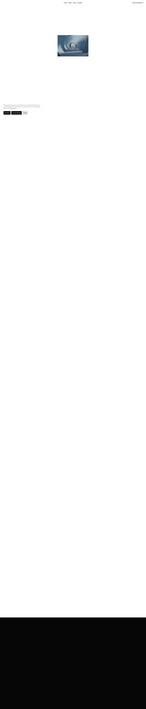
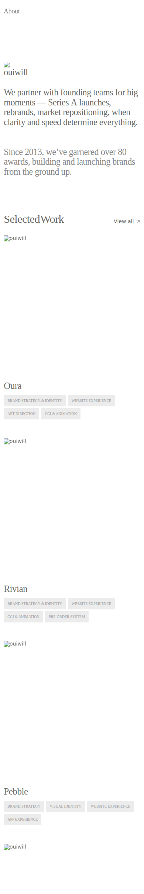

# UI Design System & Master Generation Blueprint: www-ouiwill-com

> **Oui Will · Brand Transformation & Digital Experiences** (https://www.ouiwill.com/) — Oui Will is an independent digital agency shaping ambitious brands through strategy, identity, digital experiences, and technology.



---

## 1. Executive Visual Persona & Design Archetype

- **Brand Essence & Persona**: **Oui Will · Brand Transformation & Digital Experiences** (`https://www.ouiwill.com/`). Oui Will is an independent digital agency shaping ambitious brands through strategy, identity, digital experiences, and technology.
- **Visual Archetype**: **Light-Gallery WebGL / Canvas Interactive Experience (`#fff` / `#878787`)**.
- **Anti-AI-Slop Differentiators**:
  - **Source-Grounded Chromatic Polarity**: Anchors the viewport in `#fff` (`var(--aClkInk)` in `:root`) paired with `#060606` primary typography and `#878787` accents.
  - **Extracted Typographic Hierarchy**: Pairs `base` for display copy (`Shaping the next generation of brand`) with `sf` and `mono`.
  - **Calibrated Spatial Grid & Motion**: Combines `32rem` container bounds (`gap: 2rem`, padding `.8rem`) with `cubic-bezier(.771,.029,.189,1.007)` easing and Three.js / WebGL Canvas Pipeline.

---

## 2. Spatial Architecture & Modular Grid Mathematics



### Viewport Allocation & Container Geometry
- **Captured Viewport Dimensions**: Desktop `1440×6970px` (`assets/desktop.png`, full-page scroll capture), Mobile `390×2400px` (`assets/mobile.png`, capped at 2400px multi-section capture).
- **Master Container Bounds**: `32rem` extracted from `www-ouiwill-com` stylesheet.
- **Canvas Lateral Padding & Spacing**: `.8rem` lateral canvas padding with `2rem` grid gap.
- **Border Radius Scale**: `2px`, `3px`, `4px`, `100px`.

### Responsive Breakpoint Architecture
- **Desktop Layout**: Multi-column CSS Grid / Flexbox layout at `1440px` (`max-width: 32rem`, `gap: 2rem`).
- **Mobile Layout**: Single-column vertical stack at `390px` viewport width with `.8rem` horizontal padding.
- **Extracted CSS Media Queries**: `@media (width>=1024px),(width<=1024px) and (orientation:landscape)`, `@media (width<=1194px) and (orientation:portrait)`, `@media (width<=375px)`, `@media (width>=1194px)`.

---

## 3. Color System, Materiality & Atmospheric Lighting

### Semantic Palette & Source Grounding
| Semantic Role | Ground-Truth Value | Extracted CSS Source / Selector |
|---|---|---|
| **Primary Canvas Substrate** | `#fff` | `var(--aClkInk)` in `:root` |
| **Primary Typography Ink** | `#6b6c68` | `var(--aTitBase)` in `:root` |
| **Elevated Surface / Card Substrate** | `#060606` | `var(--autoTX)` in `:root` |
| **Interactive Accent / Highlight** | `#878787` | `var(--autoLI)` in `:root` |
| **Secondary / Muted Copy** | `#9f9f9f` | `var(--autoL)` in `:root` |
| **Structural Hairline Border** | `#6b6c69` | `.sizes { background: #6b6c69 }` |

### Sanitized Root CSS Variables (`ui-ux.md` Ground Truth)
| Variable Name | Extracted Value | Semantic Role |
|---|---|---|
| `--csk-rev` | `"csk-ffec67d3-72a4-404e-9353-3cf2742cdeb5"` | Design System Custom Token |
| `--Tprg` | `0` | Design System Custom Token |
| `--mobileMax` | `834` | Design System Custom Token |
| `--resp` | `1194` | Design System Custom Token |
| `--padgrid` | `4rem` | Layout / Spatial Grid Token |
| `--multi` | `calc(((100vw - 1440px) / 1440 * -5))` | Dimension / Scale Token |
| `--prg1` | `1` | Design System Custom Token |
| `--prg2` | `1` | Design System Custom Token |
| `--bndB` | `calc(100% * var(--bnd,.15))` | Dimension / Scale Token |
| `--bndS` | `calc(100% + 2 * var(--bndB))` | Dimension / Scale Token |
| `--hovS` | `calc(var(--hovt,.7) * var(--hovd,1))` | Design System Custom Token |
| `--hovO` | `min(0, var(--hovS))` | Design System Custom Token |
| `--hovd` | `-1` | Design System Custom Token |
| `--padgut` | `calc(var(--gutgrid) + var(--padgrid))` | Layout / Spatial Grid Token |
| `--padgut-s` | `calc(var(--gutgrid) + var(--padgrid-s))` | Layout / Spatial Grid Token |
| `--sizegrid` | `calc(100vw - ((var(--padgut)) * 2))` | Layout / Spatial Grid Token |

---

## 4. Typographic Scale & Editorial Hierarchy

### Font Family Stacks
- **Display Typography**: `base`.
- **Primary Body Stack**: `sf`.
- **Technical / Metadata Stack**: `mono`.

### Typographic Scale & Rules (Extracted from Stylesheet & Variables)
- **Hero Display (`H1`)**: not explicitly declared on tag in static CSS (stylesheet font-size ladder: `18px`, `1.2rem`, `12px`, `13px`, `10px`).
- **Section Heading (`H2`)**: not explicitly declared on tag in static CSS (stylesheet font-size ladder: `18px`, `1.2rem`, `12px`, `13px`, `10px`).
- **Body Copy**: rule `p` (`font-size: 1.2rem`, `line-height: 1.3`, `letter-spacing: -.02em`).
- **Metadata & Navigation Labels**: not explicitly declared on tag in static CSS (stylesheet font-size ladder: `18px`, `1.2rem`, `12px`, `13px`, `10px`).

---

## 5. Choreographed Motion & Interaction Physics

### Primary Easing Curves
- **Extracted Timing Functions**: `cubic-bezier(.771,.029,.189,1.007)`, `cubic-bezier(.19,1,.22,1)`.

### Per-Element Transition & Choreography Rules
- **Selector `.sizes`**: `transition: opacity .4s cubic-bezier(.771,.029,.189,1.007)` extracted from `www-ouiwill-com` stylesheet.
- **Selector `.guides_rem_box`**: `transition: background .3s cubic-bezier(.771,.029,.189,1.007)` extracted from `www-ouiwill-com` stylesheet.
- **Selector `.guides_rem_pt_box`**: `transition: background .3s cubic-bezier(.771,.029,.189,1.007)` extracted from `www-ouiwill-com` stylesheet.
- **Extracted Easing Curve (`cubic-bezier(.771,.029,.189,1.007)`)**: Governs interactive state transitions across `<nav.nav>` and `<section.home_reel>`.
- **Runtime Interaction Engine**: Integrates Three.js / WebGL Canvas Pipeline with `prefers-reduced-motion: reduce` fallback guards.

---

## 6. Component Wireframe & Structural DOM Map

### Visual Layout Schematic (Grounded in `dom.html` — `1440px` Desktop & `390px` Mobile Reflow)
```
┌────────────────────────────────────────────────────────────────────────┐
│ DESKTOP VIEWPORT (1440px) — Oui Will · Brand Transformation & Digital  │
│ ====================================================================== │
│ [ <nav.nav>                | Home Home · Work Work · About About ·  ]  │
│ ---------------------------------------------------------------------- │
│ | HERO STAGE: <section.home_intro>                                 |   │
│ | H1: Shaping the next generation of brands that matter...         |   │
│ | Substrate: #fff       | Ink: #060606    | Accent: #878787        |   │
│ ---------------------------------------------------------------------- │
│ | SHOWCASE GRID (<section.home_reel>       ) max-w: 32rem          |   │
│ | +------------------------------+  +------------------------------+ | │
│ | | About                        |  | Selected Work Selected Work  | | │
│ | +------------------------------+  +------------------------------+ | │
│ ---------------------------------------------------------------------- │
│ | MOBILE VIEWPORT REFLOW (390px) — Single-Column Stack (gap: 2rem  ) | │
│ | [<nav.nav>] -> [<section.home_intr] -> [<section.home_reel] |        │
│ ---------------------------------------------------------------------- │
│ [ FOOTER (<footer.foot>         ) | https://www.ouiwill.com/           │
└────────────────────────────────────────────────────────────────────────┘
```

### Granular DOM Region Breakdown
1. **Brand Header & Navigation Bar (<nav.nav> — `www-ouiwill-com`)**:
   - Landmark `<nav class="nav">` hosting `Oui Will · Brand Transformation & Di` navigation (`Home Home · Work Work · About About · Careers Careers · Awwwards`), DOM attributes (`data-deck="[("lg":"/uploads/fina..."`, `data-req="true"`, `data-engine="three.js r182 webgpu"`, `data-id="contact"`), and stylesheet rule `root { --csk-rev:"csk-ffec67d3-72a4-404e-9353-3cf2742cdeb5" }`.
2. **Hero Stage & Focal Lead (<section.home_intro> — `Shaping the next generation of bra`)**:
   - Landmark `<section class="home_intro">` presenting display lead `Shaping the next generation of brands that matter...` and copy excerpt *"We use essential cookies to make this site work. Analytics and ad"* over `#fff` canvas and `#060606` ink.
3. **Primary Showcase & Content Grid (<section.home_reel> — `About`)**:
   - Landmark `<section class="home_reel GRI-vw">` rendering section `About` with copy *"Accept all Accept all"*, asset references (`favicon.svg`, `favicon.ico`, `apple-touch-icon.png`, `site.webmanifest`), and grid rule `after { box-sizing:border-box }`.
4. **Interactive Detail & Feature Matrix (<section.home_aboutlog> — `Selected Work Selected Work`)**:
   - Landmark `<section class="home_aboutlog GRI">` framing `Selected Work Selected Work` and `Oura` (*"Cookie settings Cookie settings"*) with `#060606` surface cards, `#878787` accents, and `html { -webkit-text-size-adjust:none;-moz-text-size-adjust:none;text-size-adjus... }`.
5. **Colophon & Global Directory Footer (<footer.foot> — `https://www.ouiwill.com/`)**:
   - Landmark `<footer class="foot">` anchoring `Oui Will · Brand Transformation ` footer links (`Home Home · Work Work · About About · Careers Careers · Awwwards`), copy *"They make the site work: session, security and your preferen"*, and `#6b6c69` structural dividers.

---

## 7. Master Zero-Shot AI Generation Prompt

```markdown
# Master Zero-Shot Frontend Generation Prompt: www-ouiwill-com (Oui Will · Brand Transformation & Digital Experiences)

You are a principal frontend architect and design systems engineer. Build a complete, production-ready web application replicating the exact design system, DOM landmarks, typographic hierarchy, color tokens, and motion physics of `www-ouiwill-com` (**Oui Will · Brand Transformation & Digital Experiences** — `https://www.ouiwill.com/`).

### 1. Visual Archetype & Anti-AI-Slop Mandates
- **Archetype**: Light-Gallery WebGL / Canvas Interactive Experience (`#fff` / `#878787`).
- **Identity & Domain Context**: Oui Will is an independent digital agency shaping ambitious brands through strategy, identity, digital experiences, and technology.
- **Primary Substrate**: `#fff` (`var(--aClkInk)` in `:root`), **Primary Ink**: `#060606`, **Accent / Highlight**: `#878787`.
- **Site-Specific Differentiators**:
  - **Source-Grounded Chromatic Polarity**: Anchors the viewport in `#fff` (`var(--aClkInk)` in `:root`) paired with `#060606` primary typography and `#878787` accents.
  - **Extracted Typographic Hierarchy**: Pairs `base` for display copy (`Shaping the next generation of brand`) with `sf` and `mono`.
  - **Calibrated Spatial Grid & Motion**: Combines `32rem` container bounds (`gap: 2rem`, padding `.8rem`) with `cubic-bezier(.771,.029,.189,1.007)` easing and Three.js / WebGL Canvas Pipeline.

### 2. Ground-Truth CSS Variables (`:root` Token Contract)
Declare and consume these exact custom properties extracted from `www-ouiwill-com` in your global stylesheet:

:root {
  /* Oui Will · Brand Transformation & Digital Experiences (www-ouiwill-com) — Ground-Truth Extracted CSS Variables */
  --csk-rev: "csk-ffec67d3-72a4-404e-9353-3cf2742cdeb5"; /* Design System Custom Token (www-ouiwill-com) */
  --Tprg: 0; /* Design System Custom Token (www-ouiwill-com) */
  --mobileMax: 834; /* Design System Custom Token (www-ouiwill-com) */
  --resp: 1194; /* Design System Custom Token (www-ouiwill-com) */
  --padgrid: 4rem; /* Layout / Spatial Grid Token (www-ouiwill-com) */
  --multi: calc(((100vw - 1440px) / 1440 * -5)); /* Dimension / Scale Token (www-ouiwill-com) */
  --prg1: 1; /* Design System Custom Token (www-ouiwill-com) */
  --prg2: 1; /* Design System Custom Token (www-ouiwill-com) */
  --bndB: calc(100% * var(--bnd,.15)); /* Dimension / Scale Token (www-ouiwill-com) */
  --bndS: calc(100% + 2 * var(--bndB)); /* Dimension / Scale Token (www-ouiwill-com) */
  --hovS: calc(var(--hovt,.7) * var(--hovd,1)); /* Design System Custom Token (www-ouiwill-com) */
  --hovO: min(0, var(--hovS)); /* Design System Custom Token (www-ouiwill-com) */
  --hovd: -1; /* Design System Custom Token (www-ouiwill-com) */
  --padgut: calc(var(--gutgrid) + var(--padgrid)); /* Layout / Spatial Grid Token (www-ouiwill-com) */
  --padgut-s: calc(var(--gutgrid) + var(--padgrid-s)); /* Layout / Spatial Grid Token (www-ouiwill-com) */
  --sizegrid: calc(100vw - ((var(--padgut)) * 2)); /* Layout / Spatial Grid Token (www-ouiwill-com) */
}

### 3. Semantic Color & Materiality Contract
Map every surface, ink, and border strictly to these source-grounded tokens:
- **Primary Canvas Substrate**: `#fff` — grounded in `var(--aClkInk)` in `:root`
- **Primary Typography Ink**: `#6b6c68` — grounded in `var(--aTitBase)` in `:root`
- **Elevated Surface / Card Substrate**: `#060606` — grounded in `var(--autoTX)` in `:root`
- **Interactive Accent / Highlight**: `#878787` — grounded in `var(--autoLI)` in `:root`
- **Secondary / Muted Copy**: `#9f9f9f` — grounded in `var(--autoL)` in `:root`
- **Structural Hairline Border**: `#6b6c69` — grounded in `.sizes { background: #6b6c69 }`

### 4. Spatial Grid, Container Bounds & Responsive Breakpoints
- **Desktop Viewport Reference**: `1440×6970px` (full-page scroll capture, `1440px` standard desktop width).
- **Mobile Viewport Reference**: `390×2400px` (capped at 2400px multi-section capture, `390px` standard mobile width).
- **Container Max-Width**: `32rem` extracted from `www-ouiwill-com` stylesheet
- **Padding & Gutters**: `.8rem` lateral canvas padding with `2rem` grid gap
- **Desktop Grid**: Multi-column CSS Grid / Flexbox layout at `1440px` (`max-width: 32rem`, `gap: 2rem`)
- **Mobile Adaptation**: Single-column vertical stack at `390px` viewport width with `.8rem` horizontal padding
- **Media Queries**: `@media (width>=1024px),(width<=1024px) and (orientation:landscape)`, `@media (width<=1194px) and (orientation:portrait)`, `@media (width<=375px)`, `@media (width>=1194px)`
- **Corner Radii**: `2px`, `3px`, `4px`, `100px`

### 5. Typography & Editorial Scale Contract
- **Display Font Stack**: `base`
- **Body Font Stack**: `sf`
- **Monospace / Technical Font Stack**: `mono`
- **H1 Display Rule**: not explicitly declared on tag in static CSS (stylesheet font-size ladder: `18px`, `1.2rem`, `12px`, `13px`, `10px`)
- **H2 Section Rule**: not explicitly declared on tag in static CSS (stylesheet font-size ladder: `18px`, `1.2rem`, `12px`, `13px`, `10px`)
- **Body Copy Rule**: rule `p` (`font-size: 1.2rem`, `line-height: 1.3`, `letter-spacing: -.02em`)
- **Metadata & Index Rule**: not explicitly declared on tag in static CSS (stylesheet font-size ladder: `18px`, `1.2rem`, `12px`, `13px`, `10px`)

### 6. Component Hierarchy, Verbatim Copy & Real DOM Landmarks
Scaffold `www-ouiwill-com` (`Oui Will · Brand Transformation & Digital Experiences`) with these exact structural regions, extracted copy, and CSS rules from `dom.html`:
1. **Brand Header & Navigation Bar (<nav.nav> — `www-ouiwill-com`)**:
   - DOM & Selectors: Landmark `<nav class="nav">` hosting `Oui Will · Brand Transformation & Di` navigation (`Home Home · Work Work · About About · Careers Careers · Awwwards`), DOM attributes (`data-deck="[("lg":"/uploads/fina..."`, `data-req="true"`, `data-engine="three.js r182 webgpu"`, `data-id="contact"`), and stylesheet rule `root { --csk-rev:"csk-ffec67d3-72a4-404e-9353-3cf2742cdeb5" }`.
   - Responsive Contract: Header `Brand Header & Navigation Bar (<nav.nav> — `www-ouiwill-com`)` (`www-ouiwill-com`) adapts across `@media (width>=1024px),(width<=1024px) and (orientation:landscape)`, `@media (width<=1194px) and (orientation:portrait)`, `@media (width<=375px)`, `@media (width>=1194px)` with `cubic-bezier(.771,.029,.189,1.007)`, `cubic-bezier(.19,1,.22,1)` transitions and links `Home Home · Work Work · About About · Careers Careers · Awwwards`.
2. **Hero Stage & Focal Lead (<section.home_intro> — `Shaping the next generation of bra`)**:
   - DOM & Selectors: Landmark `<section class="home_intro">` presenting display lead `Shaping the next generation of brands that matter...` and copy excerpt *"We use essential cookies to make this site work. Analytics and ad"* over `#fff` canvas and `#060606` ink.
   - Responsive Contract: Hero stage (`1440×6970px` desktop / `390×2400px` mobile) sets `#fff` background with `#060606` headline `Shaping the next generation of brands that matter...`.
3. **Primary Showcase & Content Grid (<section.home_reel> — `About`)**:
   - DOM & Selectors: Landmark `<section class="home_reel GRI-vw">` rendering section `About` with copy *"Accept all Accept all"*, asset references (`favicon.svg`, `favicon.ico`, `apple-touch-icon.png`, `site.webmanifest`), and grid rule `after { box-sizing:border-box }`.
   - Responsive Contract: Showcase grid `Primary Showcase & Content Grid (<section.home_reel> — `About`)` applies Multi-column CSS Grid / Flexbox layout at `1440px` (`max-width: 32rem`, `gap: 2rem`) on desktop and Single-column vertical stack at `390px` viewport width with `.8rem` horizontal padding on mobile.
4. **Interactive Detail & Feature Matrix (<section.home_aboutlog> — `Selected Work Selected Work`)**:
   - DOM & Selectors: Landmark `<section class="home_aboutlog GRI">` framing `Selected Work Selected Work` and `Oura` (*"Cookie settings Cookie settings"*) with `#060606` surface cards, `#878787` accents, and `html { -webkit-text-size-adjust:none;-moz-text-size-adjust:none;text-size-adjus... }`.
   - Responsive Contract: Detail module `Interactive Detail & Feature Matrix (<section.home_aboutlog> — `Selected Work Selected Work`)` uses `2px`, `3px`, `4px`, `100px` radii, `#878787` highlights, and assets (favicon.svg, favicon.ico, apple-touch-icon.png).
5. **Colophon & Global Directory Footer (<footer.foot> — `https://www.ouiwill.com/`)**:
   - DOM & Selectors: Landmark `<footer class="foot">` anchoring `Oui Will · Brand Transformation ` footer links (`Home Home · Work Work · About About · Careers Careers · Awwwards`), copy *"They make the site work: session, security and your preferen"*, and `#6b6c69` structural dividers.
   - Responsive Contract: Footer `Colophon & Global Directory Footer (<footer.foot> — `https://www.ouiwill.com/`)` aligns to `32rem` extracted from `www-ouiwill-com` stylesheet with `.8rem` lateral canvas padding with `2rem` grid gap and attributes (data-deck="[("lg":"/uploads/fina...", data-req="true", data-engine="three.js r182 webgpu").

#### Verbatim DOM Copy Excerpts (`dom.html`)
- Copy Excerpt 1: *"We use essential cookies to make this site work. Analytics and advertising cookies..."*
- Copy Excerpt 2: *"Accept all Accept all"*
- Copy Excerpt 3: *"Cookie settings Cookie settings"*
- Copy Excerpt 4: *"They make the site work: session, security and your preferences. The site cannot r..."*

### 7. Motion, Extracted Stylesheet Rules & Interaction Choreography
- **Primary Easing Functions**: `cubic-bezier(.771,.029,.189,1.007)`, `cubic-bezier(.19,1,.22,1)`
- **Extracted Stylesheet Rules (`www-ouiwill-com`)**:
- `root { --csk-rev:"csk-ffec67d3-72a4-404e-9353-3cf2742cdeb5" }`
- `after { box-sizing:border-box }`
- `html { -webkit-text-size-adjust:none;-moz-text-size-adjust:none;text-size-adjus... }`
- `button { cursor:revert }`
- `summary { list-style:none }`
- **Per-Selector Transition Rules**:
- **Selector `.sizes`**: `transition: opacity .4s cubic-bezier(.771,.029,.189,1.007)` extracted from `www-ouiwill-com` stylesheet.
- **Selector `.guides_rem_box`**: `transition: background .3s cubic-bezier(.771,.029,.189,1.007)` extracted from `www-ouiwill-com` stylesheet.
- **Selector `.guides_rem_pt_box`**: `transition: background .3s cubic-bezier(.771,.029,.189,1.007)` extracted from `www-ouiwill-com` stylesheet.
- **Extracted Easing Curve (`cubic-bezier(.771,.029,.189,1.007)`)**: Governs interactive state transitions across `<nav.nav>` and `<section.home_reel>`.
- **Runtime Interaction Engine**: Integrates Three.js / WebGL Canvas Pipeline with `prefers-reduced-motion: reduce` fallback guards.

### 8. Technical Deliverables
- Implement in Next.js (App Router) with TypeScript and Tailwind CSS consuming the `:root` custom properties defined above for `www-ouiwill-com`.
- Reproduce both the `1440px` desktop architecture and `390px` mobile breakpoint transitions, preserving semantic HTML5 landmarks (`<header>`, `<nav>`, `<main>`, `<section>`, `<footer>`) and `prefers-reduced-motion` accessibility guards.
```
