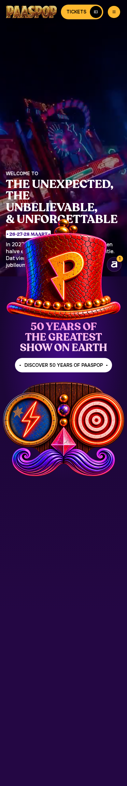

# UI Design System & Master Generation Blueprint: www-paaspop-nl

> **Paaspop 2027 · 26, 27 & 28 maart** (https://www.paaspop.nl/) — Op 26, 27 en 28 maart vieren we 50 jaar Paaspop. Verschillende generaties, verschillende smaken, dezelfde mentaliteit. Dat vieren we groo...


---

## 1. Executive Visual Persona & Design Archetype

- **Brand Essence & Persona**: **Paaspop 2027 · 26, 27 & 28 maart** (`https://www.paaspop.nl/`). Op 26, 27 en 28 maart vieren we 50 jaar Paaspop. Verschillende generaties, verschillende smaken, dezelfde mentaliteit. Dat vieren we groo...
- **Capture Provenance**: Live browser capture (`tier1_fast`, HTTP `200`, captured `2026-11-23`).
- **Visual Archetype**: **Dark-Substrate WebGL / Canvas Interactive Experience (`#100026` / `#0082f3`)**.
- **Anti-AI-Slop Differentiators**:
  - **Live-Computed Chromatic Polarity**: Anchors the viewport in `#100026` (live computed `body` `background-color` (`computed_styles.json`)) paired with `#ffffff` primary typography and `#0082f3` accents.
  - **Grounded Typographic Hierarchy**: Pairs `Recoleta` for display copy (`THE UNEXPECTED, THE UNBELIEVABLE, & `) with `Onest` and not declared in live computed styles (uses primary stack / `ui-monospace`).
  - **Calibrated Spatial Grid & Motion**: Combines `69.875rem` container bounds (`gap: 8px 16px`, padding `9px`) with `cubic-bezier(.625,.05,0,1)` easing and Lenis Smooth Scroll (`data-lenis`), GSAP Timeline & ScrollTrigger.

---

## 2. Spatial Architecture & Modular Grid Mathematics



### Viewport Allocation & Container Geometry
- **Captured Viewport Dimensions**: Desktop `1440×2400px` (`assets/desktop.png`, clamped at 2400px live multi-section capture), Mobile `390×2400px` (`assets/mobile.png`, clamped at 2400px live multi-section capture).
- **Master Container Bounds**: `69.875rem` (non-`@media` desktop container stylesheet rule).
- **Canvas Lateral Padding & Spacing**: `9px` lateral canvas padding with `8px 16px` grid gap.
- **Border Radius Scale**: `1600px`, `3px`, `100%`, `50%`.

### Responsive Breakpoint Architecture
- **Desktop Layout**: Multi-column CSS Grid / Flexbox layout at `1440px` (`max-width: 69.875rem`, `gap: 8px 16px`).
- **Mobile Layout**: Single-column vertical stack at `390px` viewport width with `9px` horizontal padding.
- **Extracted CSS Media Queries**: `@media screen and (max-width:991px)`, `@media screen and (max-width:767px)`, `@media screen and (max-width:479px)`, `@media (min-width:768px)`.

---

## 3. Color System, Materiality & Atmospheric Lighting

### Semantic Palette & Source Grounding
| Semantic Role | Ground-Truth Value | Extracted Live / CSS Source |
|---|---|---|
| **Primary Canvas Substrate** | `#100026` | live computed `body` `background-color` (`computed_styles.json`) |
| **Primary Typography Ink** | `#ffffff` | live computed `h1` `color` (`computed_styles.json`) |
| **Elevated Surface / Card Substrate** | `#222222` | `.w-slider-nav-invert>div.w-active { background-color: #222222 }` |
| **Interactive Accent / Highlight** | `#0082f3` | `.w-dropdown-link.w--current { color: #0082f3 }` |
| **Secondary / Muted Copy** | `#ff87e1` | `var(--_colors---pink--100)` in `:root` |
| **Structural Hairline Border** | `#3898ec` | `.w-select:focus { border-color: #3898ec }` |

### Sanitized Root CSS Variables (`ui-ux.md` Ground Truth)
| Variable Name | Extracted Value | Semantic Role |
|---|---|---|
| `--_colors---midnight--100` | `#100026` | Brand / Palette Token |
| `--_typography---fonts--primary-font` | `Onest,sans-serif` | Brand / Palette Token |
| `--_colors---black--100` | `black` | Canvas / Surface Token |
| `--_typography---body-size--regular` | `1rem` | Layout / Spatial Grid Token |
| `--_typography---line-height--body` | `1.3` | Typography / Scale Token |
| `--_typography---fonts--heading-font` | `Recoleta,Arial,sans-serif` | Typography Ink Token |
| `--_typography---heading-size--xlarge` | `5rem` | Typography Ink Token |
| `--_typography---line-height--heading` | `1` | Typography Ink Token |
| `--_typography---heading-size--large` | `4.5rem` | Typography Ink Token |
| `--_typography---heading-size--medium` | `2.5rem` | Typography Ink Token |
| `--_typography---heading-size--small` | `1.5rem` | Typography Ink Token |
| `--_typography---heading-size--xsmall` | `1.25rem` | Typography Ink Token |
| `--_typography---button-size--regular` | `.875rem` | Layout / Spatial Grid Token |
| `--_typography---line-height--button` | `1.2` | Typography / Scale Token |
| `--_typography---body-size--large` | `1.5rem` | Layout / Spatial Grid Token |
| `--gap-spacing--small` | `1rem` | Layout / Spatial Grid Token |

---

## 4. Typographic Scale & Editorial Hierarchy

### Font Family Stacks
- **Display Typography**: `Recoleta`.
- **Primary Body Stack**: `Onest`.
- **Technical / Metadata Stack**: not declared in live computed styles (uses primary stack / `ui-monospace`).

### Typographic Scale & Rules (Live Computed & Stylesheet Grounded)
- **Hero Display (`H1`)**: live computed `h1` (`font-size: 80px`, `line-height: 80px`, `font-weight: 700`); CSS variables `--_typography---rich-text--h1: 6rem`; rule `h1` (`font-size: var(--_typography---rich-text...`, `line-height: var(--_typography---l...`).
- **Section Heading (`H2`)**: live computed `h2` (`font-size: 72px`, `line-height: 72px`, `font-weight: 700`); CSS variables `--_typography---rich-text--h2: 4rem`; rule `h2` (`font-size: var(--_typography---rich-text...`, `line-height: var(--_typography---l...`).
- **Body Copy**: live computed `body` (`font-size: 16px`, `line-height: 20.8px`, `font-weight: 500`); CSS variables `--_typography---body-size--regular: 1rem`, `--_typography---line-height--body: 1.3`, `--_typography---body-size--large: 1.5rem`; rule `p` (`font-size: var(--_typography---body-size...`).
- **Metadata & Navigation Labels**: live computed `nav/a` (`font-size: 16px`, `line-height: 20.8px`, `font-weight: 500`); CSS variables `--_typography---heading-size--small: 1.5rem`, `--_typography---heading-size--xsmall: 1.25rem`, `--gap-spacing--small: 1rem`.

---

## 5. Choreographed Motion & Interaction Physics

### Primary Easing Curves
- **Extracted Timing Functions**: `cubic-bezier(.625,.05,0,1)`, `cubic-bezier(.5,0,.5,1)`, `cubic-bezier(0.16,1,0.3,1)`.

### Per-Element Transition & Choreography Rules
- **Selector `.w-webflow-badge>img`**: `transition: unset` extracted from `www-paaspop-nl` stylesheet.
- **Selector `.w-slider-dot`**: `transition: background-color .1s,color .1s` extracted from `www-paaspop-nl` stylesheet.
- **Selector `.w-lightbox-control`**: `transition: all .3s` extracted from `www-paaspop-nl` stylesheet.
- **Extracted Easing Curve (`cubic-bezier(.625,.05,0,1)`)**: Governs interactive state transitions across `<header.navbar_component>` and `<section.section_fifty-years>`.
- **Runtime Interaction Engine**: Integrates Lenis Smooth Scroll (`data-lenis`), GSAP Timeline & ScrollTrigger, Three.js / WebGL Canvas Pipeline, Barba.js Page Transition Router with `prefers-reduced-motion: reduce` fallback guards.

---

## 6. Component Wireframe & Structural DOM Map

### Visual Layout Schematic — Desktop (`1440px`, Grounded in `dom.html` & Landmark Bounding Boxes)
```
┌────────────────────────────────────────────────────────────────────────┐
│ DESKTOP VIEWPORT (1440px) — Paaspop 2027 · 26, 27 & 28 maart           │
│ ====================================================================== │
│ [ <header.navbar_compone (1440x92px)  | Home · Line-up · Tickets · V ] │
│ ---------------------------------------------------------------------- │
│ | HERO STAGE: <section.section_hero> (w=1440px)                      | │
│ | H1: THE UNEXPECTED, THE UNBELIEVABLE, & UNFORGETTABLE              | │
│ | Substrate: #100026 | Ink: #ffffff | Accent: #0082f3                | │
│ ---------------------------------------------------------------------- │
│ | SHOWCASE GRID (<section.section_fifty-yea) max-w: 69.875rem        | │
│ | +------------------------------+  +------------------------------+ | │
│ | | The unexpected, the unbeliev |  | 50 years of the greatest sho | | │
│ | +------------------------------+  +------------------------------+ | │
│ ---------------------------------------------------------------------- │
│ | DETAIL MODULE (<section.section_line-up>) — the first 50 names     | │
│ ---------------------------------------------------------------------- │
│ [ FOOTER (<footer.footer_compo) | https://www.paaspop.nl/              │
└────────────────────────────────────────────────────────────────────────┘
```

### Visual Layout Schematic — Mobile Reflow (`390px`)
```
┌────────────────────────────────────────────────────────────────────────┐
│ MOBILE VIEWPORT REFLOW (390px) — Single-Column Stack (gap: 8px 16px)   │
│ ====================================================================== │
│ [ HEADER BAR (<header.navbar_component) | Compact Menu (390px)         │
│ ---------------------------------------------------------------------- │
│ | HERO STAGE (<section.section_hero>) — 390px Vertical Lead          | │
│ | H1: THE UNEXPECTED, THE UNBELIEVABLE, & UNFORGETTABLE              | │
│ ---------------------------------------------------------------------- │
│ | SHOWCASE STACK (<section.section_fifty) — 1-Col Stack              | │
│ | [ Item 1: The unexpected, the unbelievable, & unforgettable      ] | │
│ | [ Item 2: 50 years of the greatest show on earth                 ] | │
│ ---------------------------------------------------------------------- │
│ | DETAIL STACK (<section.section_line-up) — 1-Col (the first 50 names) │
│ ---------------------------------------------------------------------- │
│ [ FOOTER (<footer.footer_compo) | Stacked 390px Colophon               │
└────────────────────────────────────────────────────────────────────────┘
```

### Granular DOM Region Breakdown
1. **Brand Header & Navigation Bar (<header.navbar_component> — `www-paaspop-nl`)**:
   - Landmark `<header class="navbar_component">` (`1440x92px`) hosting `Paaspop 2027 · 26, 27 & 28 maart` navigation (`Home · Line-up · Tickets · Veelgestelde vragen · Paradise City`), DOM attributes (`data-wf-domain="www.paaspop.nl"`, `data-wf-page="6ac63e14514945d47eafbb94"`, `data-wf-site="6ac63e14514945d47eafbb98"`, `data-page-load-state="done"`), and stylesheet rule `html { -webkit-text-size-adjust:100%;-ms-text-size-adjust:100%;font-family:sans... }`.
2. **Hero Stage & Focal Lead (<section.section_hero> — `THE UNEXPECTED, THE UNBELIEVABLE, `)**:
   - Landmark `<section class="section_hero">` presenting display lead `THE UNEXPECTED, THE UNBELIEVABLE, & UNFORGETTABLE` and copy excerpt *"In 2027 vieren we vijftig jaar Paaspop. Een halve eeuw vol muziek"* over `#100026` canvas and `#ffffff` ink.
3. **Primary Showcase & Content Grid (<section.section_fifty-years> — `The unexpected, the unbelievable, `)**:
   - Landmark `<section class="section_fifty-years">` rendering section `The unexpected, the unbelievable, & unforgettable` with copy *"Met deze eerste 50 namen duiken we head first de 50e editie in! C"*, asset references (`cdn.prod.website-files.com`, `paaspop.webflow.shared.7aa3d0213....`, `fonts.googleapis.com`, `fonts.gstatic.com`), and grid rule `summary { display:block }`.
4. **Interactive Detail & Feature Matrix (<section.section_line-up> — `50 years of the greatest show on e`)**:
   - Landmark `<section class="section_line-up">` framing `50 years of the greatest show on earth` and `the first 50 names` (*"The full Paaspop experience begint wanneer je de weg oversteekt n"*) with `#222222` surface cards, `#0082f3` accents, and `video { vertical-align:baseline;display:inline-block }`.
5. **Colophon & Global Directory Footer (<footer.footer_component> — `https://www.paaspop.nl/`)**:
   - Landmark `<footer class="footer_component">` anchoring `Paaspop 2027 · 26, 27 & 28 maart` footer links (`Home · Line-up · Tickets · Veelgestelde vragen · Paradise City`), copy *"Ontdek ze allemaal! Van hard-hitting gitaarwerk tot disco en"*, and `#3898ec` structural dividers.

---

## 7. Master Zero-Shot AI Generation Prompt

```markdown
# Master Zero-Shot Frontend Generation Prompt: www-paaspop-nl (Paaspop 2027 · 26, 27 & 28 maart)

You are a principal frontend architect and design systems engineer. Build a complete, production-ready web application replicating the exact design system, DOM landmarks, typographic hierarchy, color tokens, and motion physics of `www-paaspop-nl` (**Paaspop 2027 · 26, 27 & 28 maart** — `https://www.paaspop.nl/`).

### 1. Visual Archetype & Anti-AI-Slop Mandates
- **Archetype**: Dark-Substrate WebGL / Canvas Interactive Experience (`#100026` / `#0082f3`).
- **Identity & Domain Context**: Op 26, 27 en 28 maart vieren we 50 jaar Paaspop. Verschillende generaties, verschillende smaken, dezelfde mentaliteit. Dat vieren we groo...
- **Primary Substrate**: `#100026` (live computed `body` `background-color` (`computed_styles.json`)), **Primary Ink**: `#ffffff`, **Accent / Highlight**: `#0082f3`.
- **Site-Specific Differentiators**:
  - **Live-Computed Chromatic Polarity**: Anchors the viewport in `#100026` (live computed `body` `background-color` (`computed_styles.json`)) paired with `#ffffff` primary typography and `#0082f3` accents.
  - **Grounded Typographic Hierarchy**: Pairs `Recoleta` for display copy (`THE UNEXPECTED, THE UNBELIEVABLE, & `) with `Onest` and not declared in live computed styles (uses primary stack / `ui-monospace`).
  - **Calibrated Spatial Grid & Motion**: Combines `69.875rem` container bounds (`gap: 8px 16px`, padding `9px`) with `cubic-bezier(.625,.05,0,1)` easing and Lenis Smooth Scroll (`data-lenis`), GSAP Timeline & ScrollTrigger.

### 2. Ground-Truth CSS Variables (`:root` Token Contract)
Declare and consume these exact custom properties extracted from `www-paaspop-nl` in your global stylesheet:

:root {
  /* Paaspop 2027 · 26, 27 & 28 maart (www-paaspop-nl) — Live-Grounded CSS Variables */
  --_colors---midnight--100: #100026; /* Brand / Palette Token (www-paaspop-nl) */
  --_typography---fonts--primary-font: Onest,sans-serif; /* Brand / Palette Token (www-paaspop-nl) */
  --_colors---black--100: black; /* Canvas / Surface Token (www-paaspop-nl) */
  --_typography---body-size--regular: 1rem; /* Layout / Spatial Grid Token (www-paaspop-nl) */
  --_typography---line-height--body: 1.3; /* Typography / Scale Token (www-paaspop-nl) */
  --_typography---fonts--heading-font: Recoleta,Arial,sans-serif; /* Typography Ink Token (www-paaspop-nl) */
  --_typography---heading-size--xlarge: 5rem; /* Typography Ink Token (www-paaspop-nl) */
  --_typography---line-height--heading: 1; /* Typography Ink Token (www-paaspop-nl) */
  --_typography---heading-size--large: 4.5rem; /* Typography Ink Token (www-paaspop-nl) */
  --_typography---heading-size--medium: 2.5rem; /* Typography Ink Token (www-paaspop-nl) */
  --_typography---heading-size--small: 1.5rem; /* Typography Ink Token (www-paaspop-nl) */
  --_typography---heading-size--xsmall: 1.25rem; /* Typography Ink Token (www-paaspop-nl) */
  --_typography---button-size--regular: .875rem; /* Layout / Spatial Grid Token (www-paaspop-nl) */
  --_typography---line-height--button: 1.2; /* Typography / Scale Token (www-paaspop-nl) */
  --_typography---body-size--large: 1.5rem; /* Layout / Spatial Grid Token (www-paaspop-nl) */
  --gap-spacing--small: 1rem; /* Layout / Spatial Grid Token (www-paaspop-nl) */
}

### 3. Semantic Color & Materiality Contract
Map every surface, ink, and border strictly to these source-grounded tokens:
- **Primary Canvas Substrate**: `#100026` — grounded in live computed `body` `background-color` (`computed_styles.json`)
- **Primary Typography Ink**: `#ffffff` — grounded in live computed `h1` `color` (`computed_styles.json`)
- **Elevated Surface / Card Substrate**: `#222222` — grounded in `.w-slider-nav-invert>div.w-active { background-color: #222222 }`
- **Interactive Accent / Highlight**: `#0082f3` — grounded in `.w-dropdown-link.w--current { color: #0082f3 }`
- **Secondary / Muted Copy**: `#ff87e1` — grounded in `var(--_colors---pink--100)` in `:root`
- **Structural Hairline Border**: `#3898ec` — grounded in `.w-select:focus { border-color: #3898ec }`

### 4. Spatial Grid, Container Bounds & Responsive Breakpoints
- **Desktop Viewport Reference**: `1440×2400px` (clamped at 2400px live multi-section capture, `1440px` standard desktop width).
- **Mobile Viewport Reference**: `390×2400px` (clamped at 2400px live multi-section capture, `390px` standard mobile width).
- **Container Max-Width**: `69.875rem` (non-`@media` desktop container stylesheet rule)
- **Padding & Gutters**: `9px` lateral canvas padding with `8px 16px` grid gap
- **Desktop Grid**: Multi-column CSS Grid / Flexbox layout at `1440px` (`max-width: 69.875rem`, `gap: 8px 16px`)
- **Mobile Adaptation**: Single-column vertical stack at `390px` viewport width with `9px` horizontal padding
- **Media Queries**: `@media screen and (max-width:991px)`, `@media screen and (max-width:767px)`, `@media screen and (max-width:479px)`, `@media (min-width:768px)`
- **Corner Radii**: `1600px`, `3px`, `100%`, `50%`

### 5. Typography & Editorial Scale Contract
- **Display Font Stack**: `Recoleta`
- **Body Font Stack**: `Onest`
- **Monospace / Technical Font Stack**: not declared in live computed styles (uses primary stack / `ui-monospace`)
- **H1 Display Rule**: live computed `h1` (`font-size: 80px`, `line-height: 80px`, `font-weight: 700`); CSS variables `--_typography---rich-text--h1: 6rem`; rule `h1` (`font-size: var(--_typography---rich-text...`, `line-height: var(--_typography---l...`)
- **H2 Section Rule**: live computed `h2` (`font-size: 72px`, `line-height: 72px`, `font-weight: 700`); CSS variables `--_typography---rich-text--h2: 4rem`; rule `h2` (`font-size: var(--_typography---rich-text...`, `line-height: var(--_typography---l...`)
- **Body Copy Rule**: live computed `body` (`font-size: 16px`, `line-height: 20.8px`, `font-weight: 500`); CSS variables `--_typography---body-size--regular: 1rem`, `--_typography---line-height--body: 1.3`, `--_typography---body-size--large: 1.5rem`; rule `p` (`font-size: var(--_typography---body-size...`)
- **Metadata & Index Rule**: live computed `nav/a` (`font-size: 16px`, `line-height: 20.8px`, `font-weight: 500`); CSS variables `--_typography---heading-size--small: 1.5rem`, `--_typography---heading-size--xsmall: 1.25rem`, `--gap-spacing--small: 1rem`

### 6. Component Hierarchy, Verbatim Copy & Real DOM Landmarks
Scaffold `www-paaspop-nl` (`Paaspop 2027 · 26, 27 & 28 maart`) with these exact structural regions, extracted copy, and CSS rules from `dom.html`:
1. **Brand Header & Navigation Bar (<header.navbar_component> — `www-paaspop-nl`)**:
   - DOM & Selectors: Landmark `<header class="navbar_component">` (`1440x92px`) hosting `Paaspop 2027 · 26, 27 & 28 maart` navigation (`Home · Line-up · Tickets · Veelgestelde vragen · Paradise City`), DOM attributes (`data-wf-domain="www.paaspop.nl"`, `data-wf-page="6ac63e14514945d47eafbb94"`, `data-wf-site="6ac63e14514945d47eafbb98"`, `data-page-load-state="done"`), and stylesheet rule `html { -webkit-text-size-adjust:100%;-ms-text-size-adjust:100%;font-family:sans... }`.
   - Responsive Contract: Header `Brand Header & Navigation Bar (<header.navbar_component> — `www-paaspop-nl`)` (`www-paaspop-nl`) adapts across `@media screen and (max-width:991px)`, `@media screen and (max-width:767px)`, `@media screen and (max-width:479px)`, `@media (min-width:768px)` with `cubic-bezier(.625,.05,0,1)`, `cubic-bezier(.5,0,.5,1)`, `cubic-bezier(0.16,1,0.3,1)` transitions and links `Home · Line-up · Tickets · Veelgestelde vragen · Paradise City`.
2. **Hero Stage & Focal Lead (<section.section_hero> — `THE UNEXPECTED, THE UNBELIEVABLE, `)**:
   - DOM & Selectors: Landmark `<section class="section_hero">` presenting display lead `THE UNEXPECTED, THE UNBELIEVABLE, & UNFORGETTABLE` and copy excerpt *"In 2027 vieren we vijftig jaar Paaspop. Een halve eeuw vol muziek"* over `#100026` canvas and `#ffffff` ink.
   - Responsive Contract: Hero stage (`1440×2400px` desktop / `390×2400px` mobile) sets `#100026` background with `#ffffff` headline `THE UNEXPECTED, THE UNBELIEVABLE, & UNFORGETTABLE`.
3. **Primary Showcase & Content Grid (<section.section_fifty-years> — `The unexpected, the unbelievable, `)**:
   - DOM & Selectors: Landmark `<section class="section_fifty-years">` rendering section `The unexpected, the unbelievable, & unforgettable` with copy *"Met deze eerste 50 namen duiken we head first de 50e editie in! C"*, asset references (`cdn.prod.website-files.com`, `paaspop.webflow.shared.7aa3d0213....`, `fonts.googleapis.com`, `fonts.gstatic.com`), and grid rule `summary { display:block }`.
   - Responsive Contract: Showcase grid `Primary Showcase & Content Grid (<section.section_fifty-years> — `The unexpected, the unbelievable, `)` applies Multi-column CSS Grid / Flexbox layout at `1440px` (`max-width: 69.875rem`, `gap: 8px 16px`) on desktop and Single-column vertical stack at `390px` viewport width with `9px` horizontal padding on mobile.
4. **Interactive Detail & Feature Matrix (<section.section_line-up> — `50 years of the greatest show on e`)**:
   - DOM & Selectors: Landmark `<section class="section_line-up">` framing `50 years of the greatest show on earth` and `the first 50 names` (*"The full Paaspop experience begint wanneer je de weg oversteekt n"*) with `#222222` surface cards, `#0082f3` accents, and `video { vertical-align:baseline;display:inline-block }`.
   - Responsive Contract: Detail module `Interactive Detail & Feature Matrix (<section.section_line-up> — `50 years of the greatest show on e`)` uses `1600px`, `3px`, `100%`, `50%` radii, `#0082f3` highlights, and assets (cdn.prod.website-files.com, paaspop.webflow.shared.7aa3d0213...., fonts.googleapis.com).
5. **Colophon & Global Directory Footer (<footer.footer_component> — `https://www.paaspop.nl/`)**:
   - DOM & Selectors: Landmark `<footer class="footer_component">` anchoring `Paaspop 2027 · 26, 27 & 28 maart` footer links (`Home · Line-up · Tickets · Veelgestelde vragen · Paradise City`), copy *"Ontdek ze allemaal! Van hard-hitting gitaarwerk tot disco en"*, and `#3898ec` structural dividers.
   - Responsive Contract: Footer `Colophon & Global Directory Footer (<footer.footer_component> — `https://www.paaspop.nl/`)` aligns to `69.875rem` (non-`@media` desktop container stylesheet rule) with `9px` lateral canvas padding with `8px 16px` grid gap and attributes (data-wf-domain="www.paaspop.nl", data-wf-page="6ac63e14514945d47eafbb94", data-wf-site="6ac63e14514945d47eafbb98").

#### Verbatim DOM Copy Excerpts (`dom.html`)
- Copy Excerpt 1: *"In 2027 vieren we vijftig jaar Paaspop. Een halve eeuw vol muziek, spektakel & tra..."*
- Copy Excerpt 2: *"Met deze eerste 50 namen duiken we head first de 50e editie in! Check alle eerste..."*
- Copy Excerpt 3: *"The full Paaspop experience begint wanneer je de weg oversteekt naar Paradise City..."*
- Copy Excerpt 4: *"Ontdek ze allemaal! Van hard-hitting gitaarwerk tot disco en urban. Why choose whe..."*

### 7. Motion, Extracted Stylesheet Rules & Interaction Choreography
- **Primary Easing Functions**: `cubic-bezier(.625,.05,0,1)`, `cubic-bezier(.5,0,.5,1)`, `cubic-bezier(0.16,1,0.3,1)`
- **Extracted Stylesheet Rules (`www-paaspop-nl`)**:
- `html { -webkit-text-size-adjust:100%;-ms-text-size-adjust:100%;font-family:sans... }`
- `summary { display:block }`
- `video { vertical-align:baseline;display:inline-block }`
- `template { display:none }`
- `strong { font-weight:700 }`
- **Per-Selector Transition Rules**:
- **Selector `.w-webflow-badge>img`**: `transition: unset` extracted from `www-paaspop-nl` stylesheet.
- **Selector `.w-slider-dot`**: `transition: background-color .1s,color .1s` extracted from `www-paaspop-nl` stylesheet.
- **Selector `.w-lightbox-control`**: `transition: all .3s` extracted from `www-paaspop-nl` stylesheet.
- **Extracted Easing Curve (`cubic-bezier(.625,.05,0,1)`)**: Governs interactive state transitions across `<header.navbar_component>` and `<section.section_fifty-years>`.
- **Runtime Interaction Engine**: Integrates Lenis Smooth Scroll (`data-lenis`), GSAP Timeline & ScrollTrigger, Three.js / WebGL Canvas Pipeline, Barba.js Page Transition Router with `prefers-reduced-motion: reduce` fallback guards.

### 8. Technical Deliverables
- Implement in Next.js (App Router) with TypeScript and Tailwind CSS consuming the `:root` custom properties defined above for `www-paaspop-nl`.
- Reproduce both the `1440px` desktop architecture and `390px` mobile breakpoint transitions, preserving semantic HTML5 landmarks (`<header>`, `<nav>`, `<main>`, `<section>`, `<footer>`) and `prefers-reduced-motion` accessibility guards.
```
