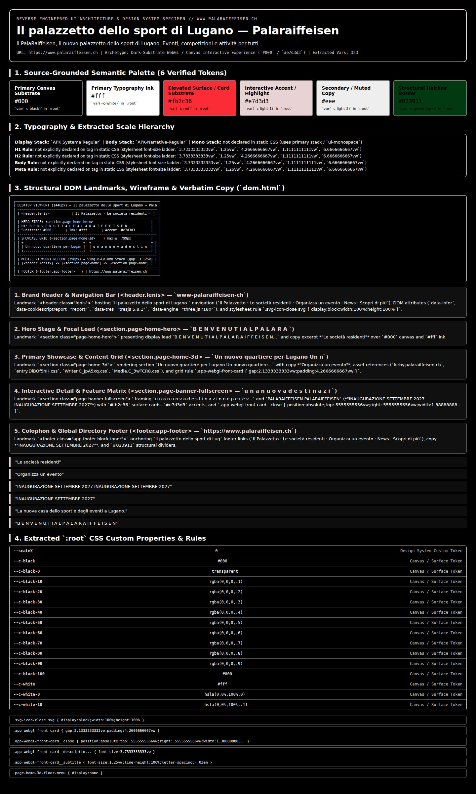

# UI Design System & Master Generation Blueprint: www-palaraiffeisen-ch

> **Il palazzetto dello sport di Lugano — Palaraiffeisen** (https://www.palaraiffeisen.ch) — Il PalaRaiffeisen, il nuovo palazzetto dello sport di Lugano. Eventi, competizioni e attività per tutti.



---

## 1. Executive Visual Persona & Design Archetype

- **Brand Essence & Persona**: **Il palazzetto dello sport di Lugano — Palaraiffeisen** (`https://www.palaraiffeisen.ch`). Il PalaRaiffeisen, il nuovo palazzetto dello sport di Lugano. Eventi, competizioni e attività per tutti.
- **Visual Archetype**: **Dark-Substrate WebGL / Canvas Interactive Experience (`#000` / `#e7d3d3`)**.
- **Anti-AI-Slop Differentiators**:
  - **Source-Grounded Chromatic Polarity**: Anchors the viewport in `#000` (`var(--c-black)` in `:root`) paired with `#fff` primary typography and `#e7d3d3` accents.
  - **Extracted Typographic Hierarchy**: Pairs `APK Systema Regular` for display copy (`B E N V E N U T I A L P A L A R A I `) with `APK-Narrative-Regular` and not declared in static CSS (uses primary stack / `ui-monospace`).
  - **Calibrated Spatial Grid & Motion**: Combines `799px` container bounds (`gap: 3.125vw`, padding `.5555555556vw`) with `cubic-bezier(.51,.92,.24,1)` easing and Lenis Smooth Scroll (`data-lenis`), Three.js / WebGL Canvas Pipeline.

---

## 2. Spatial Architecture & Modular Grid Mathematics


### Viewport Allocation & Container Geometry
- **Captured Viewport Dimensions**: Desktop `1440×2400px` (`assets/desktop.png`, capped at 2400px multi-section capture), Mobile `390×2400px` (`assets/mobile.png`, capped at 2400px multi-section capture).
- **Master Container Bounds**: `799px` extracted from `www-palaraiffeisen-ch` stylesheet.
- **Canvas Lateral Padding & Spacing**: `.5555555556vw` lateral canvas padding with `3.125vw` grid gap.
- **Border Radius Scale**: `4px`, `2px`, `0px`.

### Responsive Breakpoint Architecture
- **Desktop Layout**: Multi-column CSS Grid / Flexbox layout at `1440px` (`max-width: 799px`, `gap: 3.125vw`).
- **Mobile Layout**: Single-column vertical stack at `390px` viewport width with `.5555555556vw` horizontal padding.
- **Extracted CSS Media Queries**: `@media (max-width:799px)`, `@media (min-width:800px)`.

---

## 3. Color System, Materiality & Atmospheric Lighting

### Semantic Palette & Source Grounding
| Semantic Role | Ground-Truth Value | Extracted CSS Source / Selector |
|---|---|---|
| **Primary Canvas Substrate** | `#000` | `var(--c-black)` in `:root` |
| **Primary Typography Ink** | `#fff` | `var(--c-white)` in `:root` |
| **Elevated Surface / Card Substrate** | `#fb2c36` | `var(--c-red)` in `:root` |
| **Interactive Accent / Highlight** | `#e7d3d3` | `var(--c-light-1)` in `:root` |
| **Secondary / Muted Copy** | `#eee` | `var(--c-light-2)` in `:root` |
| **Structural Hairline Border** | `#023911` | `var(--c-green-dark)` in `:root` |

### Sanitized Root CSS Variables (`ui-ux.md` Ground Truth)
| Variable Name | Extracted Value | Semantic Role |
|---|---|---|
| `--scaleX` | `0` | Design System Custom Token |
| `--c-black` | `#000` | Canvas / Surface Token |
| `--c-black-0` | `transparent` | Canvas / Surface Token |
| `--c-black-10` | `rgba(0,0,0,.1)` | Canvas / Surface Token |
| `--c-black-20` | `rgba(0,0,0,.2)` | Canvas / Surface Token |
| `--c-black-30` | `rgba(0,0,0,.3)` | Canvas / Surface Token |
| `--c-black-40` | `rgba(0,0,0,.4)` | Canvas / Surface Token |
| `--c-black-50` | `rgba(0,0,0,.5)` | Canvas / Surface Token |
| `--c-black-60` | `rgba(0,0,0,.6)` | Canvas / Surface Token |
| `--c-black-70` | `rgba(0,0,0,.7)` | Canvas / Surface Token |
| `--c-black-80` | `rgba(0,0,0,.8)` | Canvas / Surface Token |
| `--c-black-90` | `rgba(0,0,0,.9)` | Canvas / Surface Token |
| `--c-black-100` | `#000` | Canvas / Surface Token |
| `--c-white` | `#fff` | Canvas / Surface Token |
| `--c-white-0` | `hsla(0,0%,100%,0)` | Canvas / Surface Token |
| `--c-white-10` | `hsla(0,0%,100%,.1)` | Canvas / Surface Token |

---

## 4. Typographic Scale & Editorial Hierarchy

### Font Family Stacks
- **Display Typography**: `APK Systema Regular`.
- **Primary Body Stack**: `APK-Narrative-Regular`.
- **Technical / Metadata Stack**: not declared in static CSS (uses primary stack / `ui-monospace`).

### Typographic Scale & Rules (Extracted from Stylesheet & Variables)
- **Hero Display (`H1`)**: not explicitly declared on tag in static CSS (stylesheet font-size ladder: `3.7333333333vw`, `1.25vw`, `4.2666666667vw`, `1.1111111111vw`, `6.6666666667vw`).
- **Section Heading (`H2`)**: not explicitly declared on tag in static CSS (stylesheet font-size ladder: `3.7333333333vw`, `1.25vw`, `4.2666666667vw`, `1.1111111111vw`, `6.6666666667vw`).
- **Body Copy**: not explicitly declared on tag in static CSS (stylesheet font-size ladder: `3.7333333333vw`, `1.25vw`, `4.2666666667vw`, `1.1111111111vw`, `6.6666666667vw`).
- **Metadata & Navigation Labels**: not explicitly declared on tag in static CSS (stylesheet font-size ladder: `3.7333333333vw`, `1.25vw`, `4.2666666667vw`, `1.1111111111vw`, `6.6666666667vw`).

---

## 5. Choreographed Motion & Interaction Physics

### Primary Easing Curves
- **Extracted Timing Functions**: `cubic-bezier(.51,.92,.24,1)`, `cubic-bezier(.55,.085,.68,.53)`, `cubic-bezier(.55,.055,.675,.19)`.

### Per-Element Transition & Choreography Rules
- **Selector `.page-home-3d-floor-menu__row__info`**: `transition: background .2s var(--ease-out-cubic)` extracted from `www-palaraiffeisen-ch` stylesheet.
- **Selector `.page-home-3d-floor-menu__row__ac...`**: `transition: opacity .2s var(--ease-out-cubic)` extracted from `www-palaraiffeisen-ch` stylesheet.
- **Selector `.page-home-3d-floor-menu__activity`**: `transition: opacity .15s var(--ease-out-cubic)` extracted from `www-palaraiffeisen-ch` stylesheet.
- **Extracted Easing Curve (`cubic-bezier(.51,.92,.24,1)`)**: Governs interactive state transitions across `<header.lenis>` and `<section.page-home-3d>`.
- **Runtime Interaction Engine**: Integrates Lenis Smooth Scroll (`data-lenis`), Three.js / WebGL Canvas Pipeline with `prefers-reduced-motion: reduce` fallback guards.

---

## 6. Component Wireframe & Structural DOM Map

### Visual Layout Schematic (Grounded in `dom.html` — `1440px` Desktop & `390px` Mobile Reflow)
```
┌────────────────────────────────────────────────────────────────────────┐
│ DESKTOP VIEWPORT (1440px) — Il palazzetto dello sport di Lugano — Pala │
│ ====================================================================== │
│ [ <header.lenis>           | Il Palazzetto · Le società residenti · ]  │
│ ---------------------------------------------------------------------- │
│ | HERO STAGE: <section.page-home-hero>                             |   │
│ | H1: B E N V E N U T I A L P A L A R A I F F E I S E N...         |   │
│ | Substrate: #000       | Ink: #fff       | Accent: #e7d3d3        |   │
│ ---------------------------------------------------------------------- │
│ | SHOWCASE GRID (<section.page-home-3d>    ) max-w: 799px          |   │
│ | +------------------------------+  +------------------------------+ | │
│ | | Un nuovo quartiere per Lugan |  | u n a n u o v a d e s t i n  | | │
│ | +------------------------------+  +------------------------------+ | │
│ ---------------------------------------------------------------------- │
│ | MOBILE VIEWPORT REFLOW (390px) — Single-Column Stack (gap: 3.125v) | │
│ | [<header.lenis>] -> [<section.page-home] -> [<section.page-home] |   │
│ ---------------------------------------------------------------------- │
│ [ FOOTER (<footer.app-footer>   ) | https://www.palaraiffeisen.ch      │
└────────────────────────────────────────────────────────────────────────┘
```

### Granular DOM Region Breakdown
1. **Brand Header & Navigation Bar (<header.lenis> — `www-palaraiffeisen-ch`)**:
   - Landmark `<header class="lenis">` hosting `Il palazzetto dello sport di Lugano ` navigation (`Il Palazzetto · Le società residenti · Organizza un evento · News · Scopri di più`), DOM attributes (`data-infer`, `data-cookiescriptreport="report"`, `data-tres="tresjs 5.8.1"`, `data-engine="three.js r180"`), and stylesheet rule `.svg-icon-close svg { display:block;width:100%;height:100% }`.
2. **Hero Stage & Focal Lead (<section.page-home-hero> — `B E N V E N U T I A L P A L A R A `)**:
   - Landmark `<section class="page-home-hero">` presenting display lead `B E N V E N U T I A L P A L A R A I F F E I S E N...` and copy excerpt *"Le società residenti"* over `#000` canvas and `#fff` ink.
3. **Primary Showcase & Content Grid (<section.page-home-3d> — `Un nuovo quartiere per Lugano Un n`)**:
   - Landmark `<section class="page-home-3d">` rendering section `Un nuovo quartiere per Lugano Un nuovo quartiere...` with copy *"Organizza un evento"*, asset references (`kirby.palaraiffeisen.ch`, `entry.DiBOf5nH.css`, `Writer.C_JpA5xq.css`, `Media.C_3wTCR8.css`), and grid rule `.app-webgl-front-card { gap:2.1333333333vw;padding:4.2666666667vw }`.
4. **Interactive Detail & Feature Matrix (<section.page-banner-fullscreen> — `u n a n u o v a d e s t i n a z i `)**:
   - Landmark `<section class="page-banner-fullscreen">` framing `u n a n u o v a d e s t i n a z i o n e p e r e v...` and `PALARAIFFEISEN PALARAIFFEISEN` (*"INAUGURAZIONE SETTEMBRE 2027 INAUGURAZIONE SETTEMBRE 2027"*) with `#fb2c36` surface cards, `#e7d3d3` accents, and `.app-webgl-front-card__close { position:absolute;top:.5555555556vw;right:.5555555556vw;width:1.38888888... }`.
5. **Colophon & Global Directory Footer (<footer.app-footer> — `https://www.palaraiffeisen.ch`)**:
   - Landmark `<footer class="app-footer block-inner">` anchoring `Il palazzetto dello sport di Lug` footer links (`Il Palazzetto · Le società residenti · Organizza un evento · News · Scopri di più`), copy *"INAUGURAZIONE SETTEMBRE 2027"*, and `#023911` structural dividers.

---

## 7. Master Zero-Shot AI Generation Prompt

```markdown
# Master Zero-Shot Frontend Generation Prompt: www-palaraiffeisen-ch (Il palazzetto dello sport di Lugano — Palaraiffeisen)

You are a principal frontend architect and design systems engineer. Build a complete, production-ready web application replicating the exact design system, DOM landmarks, typographic hierarchy, color tokens, and motion physics of `www-palaraiffeisen-ch` (**Il palazzetto dello sport di Lugano — Palaraiffeisen** — `https://www.palaraiffeisen.ch`).

### 1. Visual Archetype & Anti-AI-Slop Mandates
- **Archetype**: Dark-Substrate WebGL / Canvas Interactive Experience (`#000` / `#e7d3d3`).
- **Identity & Domain Context**: Il PalaRaiffeisen, il nuovo palazzetto dello sport di Lugano. Eventi, competizioni e attività per tutti.
- **Primary Substrate**: `#000` (`var(--c-black)` in `:root`), **Primary Ink**: `#fff`, **Accent / Highlight**: `#e7d3d3`.
- **Site-Specific Differentiators**:
  - **Source-Grounded Chromatic Polarity**: Anchors the viewport in `#000` (`var(--c-black)` in `:root`) paired with `#fff` primary typography and `#e7d3d3` accents.
  - **Extracted Typographic Hierarchy**: Pairs `APK Systema Regular` for display copy (`B E N V E N U T I A L P A L A R A I `) with `APK-Narrative-Regular` and not declared in static CSS (uses primary stack / `ui-monospace`).
  - **Calibrated Spatial Grid & Motion**: Combines `799px` container bounds (`gap: 3.125vw`, padding `.5555555556vw`) with `cubic-bezier(.51,.92,.24,1)` easing and Lenis Smooth Scroll (`data-lenis`), Three.js / WebGL Canvas Pipeline.

### 2. Ground-Truth CSS Variables (`:root` Token Contract)
Declare and consume these exact custom properties extracted from `www-palaraiffeisen-ch` in your global stylesheet:

:root {
  /* Il palazzetto dello sport di Lugano — Palaraiffeisen (www-palaraiffeisen-ch) — Ground-Truth Extracted CSS Variables */
  --scaleX: 0; /* Design System Custom Token (www-palaraiffeisen-ch) */
  --c-black: #000; /* Canvas / Surface Token (www-palaraiffeisen-ch) */
  --c-black-0: transparent; /* Canvas / Surface Token (www-palaraiffeisen-ch) */
  --c-black-10: rgba(0,0,0,.1); /* Canvas / Surface Token (www-palaraiffeisen-ch) */
  --c-black-20: rgba(0,0,0,.2); /* Canvas / Surface Token (www-palaraiffeisen-ch) */
  --c-black-30: rgba(0,0,0,.3); /* Canvas / Surface Token (www-palaraiffeisen-ch) */
  --c-black-40: rgba(0,0,0,.4); /* Canvas / Surface Token (www-palaraiffeisen-ch) */
  --c-black-50: rgba(0,0,0,.5); /* Canvas / Surface Token (www-palaraiffeisen-ch) */
  --c-black-60: rgba(0,0,0,.6); /* Canvas / Surface Token (www-palaraiffeisen-ch) */
  --c-black-70: rgba(0,0,0,.7); /* Canvas / Surface Token (www-palaraiffeisen-ch) */
  --c-black-80: rgba(0,0,0,.8); /* Canvas / Surface Token (www-palaraiffeisen-ch) */
  --c-black-90: rgba(0,0,0,.9); /* Canvas / Surface Token (www-palaraiffeisen-ch) */
  --c-black-100: #000; /* Canvas / Surface Token (www-palaraiffeisen-ch) */
  --c-white: #fff; /* Canvas / Surface Token (www-palaraiffeisen-ch) */
  --c-white-0: hsla(0,0%,100%,0); /* Canvas / Surface Token (www-palaraiffeisen-ch) */
  --c-white-10: hsla(0,0%,100%,.1); /* Canvas / Surface Token (www-palaraiffeisen-ch) */
}

### 3. Semantic Color & Materiality Contract
Map every surface, ink, and border strictly to these source-grounded tokens:
- **Primary Canvas Substrate**: `#000` — grounded in `var(--c-black)` in `:root`
- **Primary Typography Ink**: `#fff` — grounded in `var(--c-white)` in `:root`
- **Elevated Surface / Card Substrate**: `#fb2c36` — grounded in `var(--c-red)` in `:root`
- **Interactive Accent / Highlight**: `#e7d3d3` — grounded in `var(--c-light-1)` in `:root`
- **Secondary / Muted Copy**: `#eee` — grounded in `var(--c-light-2)` in `:root`
- **Structural Hairline Border**: `#023911` — grounded in `var(--c-green-dark)` in `:root`

### 4. Spatial Grid, Container Bounds & Responsive Breakpoints
- **Desktop Viewport Reference**: `1440×2400px` (capped at 2400px multi-section capture, `1440px` standard desktop width).
- **Mobile Viewport Reference**: `390×2400px` (capped at 2400px multi-section capture, `390px` standard mobile width).
- **Container Max-Width**: `799px` extracted from `www-palaraiffeisen-ch` stylesheet
- **Padding & Gutters**: `.5555555556vw` lateral canvas padding with `3.125vw` grid gap
- **Desktop Grid**: Multi-column CSS Grid / Flexbox layout at `1440px` (`max-width: 799px`, `gap: 3.125vw`)
- **Mobile Adaptation**: Single-column vertical stack at `390px` viewport width with `.5555555556vw` horizontal padding
- **Media Queries**: `@media (max-width:799px)`, `@media (min-width:800px)`
- **Corner Radii**: `4px`, `2px`, `0px`

### 5. Typography & Editorial Scale Contract
- **Display Font Stack**: `APK Systema Regular`
- **Body Font Stack**: `APK-Narrative-Regular`
- **Monospace / Technical Font Stack**: not declared in static CSS (uses primary stack / `ui-monospace`)
- **H1 Display Rule**: not explicitly declared on tag in static CSS (stylesheet font-size ladder: `3.7333333333vw`, `1.25vw`, `4.2666666667vw`, `1.1111111111vw`, `6.6666666667vw`)
- **H2 Section Rule**: not explicitly declared on tag in static CSS (stylesheet font-size ladder: `3.7333333333vw`, `1.25vw`, `4.2666666667vw`, `1.1111111111vw`, `6.6666666667vw`)
- **Body Copy Rule**: not explicitly declared on tag in static CSS (stylesheet font-size ladder: `3.7333333333vw`, `1.25vw`, `4.2666666667vw`, `1.1111111111vw`, `6.6666666667vw`)
- **Metadata & Index Rule**: not explicitly declared on tag in static CSS (stylesheet font-size ladder: `3.7333333333vw`, `1.25vw`, `4.2666666667vw`, `1.1111111111vw`, `6.6666666667vw`)

### 6. Component Hierarchy, Verbatim Copy & Real DOM Landmarks
Scaffold `www-palaraiffeisen-ch` (`Il palazzetto dello sport di Lugano — Palaraiffeisen`) with these exact structural regions, extracted copy, and CSS rules from `dom.html`:
1. **Brand Header & Navigation Bar (<header.lenis> — `www-palaraiffeisen-ch`)**:
   - DOM & Selectors: Landmark `<header class="lenis">` hosting `Il palazzetto dello sport di Lugano ` navigation (`Il Palazzetto · Le società residenti · Organizza un evento · News · Scopri di più`), DOM attributes (`data-infer`, `data-cookiescriptreport="report"`, `data-tres="tresjs 5.8.1"`, `data-engine="three.js r180"`), and stylesheet rule `.svg-icon-close svg { display:block;width:100%;height:100% }`.
   - Responsive Contract: Header `Brand Header & Navigation Bar (<header.lenis> — `www-palaraiffeisen-ch`)` (`www-palaraiffeisen-ch`) adapts across `@media (max-width:799px)`, `@media (min-width:800px)` with `cubic-bezier(.51,.92,.24,1)`, `cubic-bezier(.55,.085,.68,.53)`, `cubic-bezier(.55,.055,.675,.19)` transitions and links `Il Palazzetto · Le società residenti · Organizza un evento · News · Scopri di più`.
2. **Hero Stage & Focal Lead (<section.page-home-hero> — `B E N V E N U T I A L P A L A R A `)**:
   - DOM & Selectors: Landmark `<section class="page-home-hero">` presenting display lead `B E N V E N U T I A L P A L A R A I F F E I S E N...` and copy excerpt *"Le società residenti"* over `#000` canvas and `#fff` ink.
   - Responsive Contract: Hero stage (`1440×2400px` desktop / `390×2400px` mobile) sets `#000` background with `#fff` headline `B E N V E N U T I A L P A L A R A I F F E I S E N...`.
3. **Primary Showcase & Content Grid (<section.page-home-3d> — `Un nuovo quartiere per Lugano Un n`)**:
   - DOM & Selectors: Landmark `<section class="page-home-3d">` rendering section `Un nuovo quartiere per Lugano Un nuovo quartiere...` with copy *"Organizza un evento"*, asset references (`kirby.palaraiffeisen.ch`, `entry.DiBOf5nH.css`, `Writer.C_JpA5xq.css`, `Media.C_3wTCR8.css`), and grid rule `.app-webgl-front-card { gap:2.1333333333vw;padding:4.2666666667vw }`.
   - Responsive Contract: Showcase grid `Primary Showcase & Content Grid (<section.page-home-3d> — `Un nuovo quartiere per Lugano Un n`)` applies Multi-column CSS Grid / Flexbox layout at `1440px` (`max-width: 799px`, `gap: 3.125vw`) on desktop and Single-column vertical stack at `390px` viewport width with `.5555555556vw` horizontal padding on mobile.
4. **Interactive Detail & Feature Matrix (<section.page-banner-fullscreen> — `u n a n u o v a d e s t i n a z i `)**:
   - DOM & Selectors: Landmark `<section class="page-banner-fullscreen">` framing `u n a n u o v a d e s t i n a z i o n e p e r e v...` and `PALARAIFFEISEN PALARAIFFEISEN` (*"INAUGURAZIONE SETTEMBRE 2027 INAUGURAZIONE SETTEMBRE 2027"*) with `#fb2c36` surface cards, `#e7d3d3` accents, and `.app-webgl-front-card__close { position:absolute;top:.5555555556vw;right:.5555555556vw;width:1.38888888... }`.
   - Responsive Contract: Detail module `Interactive Detail & Feature Matrix (<section.page-banner-fullscreen> — `u n a n u o v a d e s t i n a z i `)` uses `4px`, `2px`, `0px` radii, `#e7d3d3` highlights, and assets (kirby.palaraiffeisen.ch, entry.DiBOf5nH.css, Writer.C_JpA5xq.css).
5. **Colophon & Global Directory Footer (<footer.app-footer> — `https://www.palaraiffeisen.ch`)**:
   - DOM & Selectors: Landmark `<footer class="app-footer block-inner">` anchoring `Il palazzetto dello sport di Lug` footer links (`Il Palazzetto · Le società residenti · Organizza un evento · News · Scopri di più`), copy *"INAUGURAZIONE SETTEMBRE 2027"*, and `#023911` structural dividers.
   - Responsive Contract: Footer `Colophon & Global Directory Footer (<footer.app-footer> — `https://www.palaraiffeisen.ch`)` aligns to `799px` extracted from `www-palaraiffeisen-ch` stylesheet with `.5555555556vw` lateral canvas padding with `3.125vw` grid gap and attributes (data-infer, data-cookiescriptreport="report", data-tres="tresjs 5.8.1").

#### Verbatim DOM Copy Excerpts (`dom.html`)
- Copy Excerpt 1: *"Le società residenti"*
- Copy Excerpt 2: *"Organizza un evento"*
- Copy Excerpt 3: *"INAUGURAZIONE SETTEMBRE 2027 INAUGURAZIONE SETTEMBRE 2027"*
- Copy Excerpt 4: *"INAUGURAZIONE SETTEMBRE 2027"*

### 7. Motion, Extracted Stylesheet Rules & Interaction Choreography
- **Primary Easing Functions**: `cubic-bezier(.51,.92,.24,1)`, `cubic-bezier(.55,.085,.68,.53)`, `cubic-bezier(.55,.055,.675,.19)`
- **Extracted Stylesheet Rules (`www-palaraiffeisen-ch`)**:
- `.svg-icon-close svg { display:block;width:100%;height:100% }`
- `.app-webgl-front-card { gap:2.1333333333vw;padding:4.2666666667vw }`
- `.app-webgl-front-card__close { position:absolute;top:.5555555556vw;right:.5555555556vw;width:1.38888888... }`
- `.app-webgl-front-card__descriptio... { font-size:3.7333333333vw }`
- `.app-webgl-front-card__subtitle { font-size:1.25vw;line-height:100%;letter-spacing:-.03em }`
- **Per-Selector Transition Rules**:
- **Selector `.page-home-3d-floor-menu__row__info`**: `transition: background .2s var(--ease-out-cubic)` extracted from `www-palaraiffeisen-ch` stylesheet.
- **Selector `.page-home-3d-floor-menu__row__ac...`**: `transition: opacity .2s var(--ease-out-cubic)` extracted from `www-palaraiffeisen-ch` stylesheet.
- **Selector `.page-home-3d-floor-menu__activity`**: `transition: opacity .15s var(--ease-out-cubic)` extracted from `www-palaraiffeisen-ch` stylesheet.
- **Extracted Easing Curve (`cubic-bezier(.51,.92,.24,1)`)**: Governs interactive state transitions across `<header.lenis>` and `<section.page-home-3d>`.
- **Runtime Interaction Engine**: Integrates Lenis Smooth Scroll (`data-lenis`), Three.js / WebGL Canvas Pipeline with `prefers-reduced-motion: reduce` fallback guards.

### 8. Technical Deliverables
- Implement in Next.js (App Router) with TypeScript and Tailwind CSS consuming the `:root` custom properties defined above for `www-palaraiffeisen-ch`.
- Reproduce both the `1440px` desktop architecture and `390px` mobile breakpoint transitions, preserving semantic HTML5 landmarks (`<header>`, `<nav>`, `<main>`, `<section>`, `<footer>`) and `prefers-reduced-motion` accessibility guards.
```
