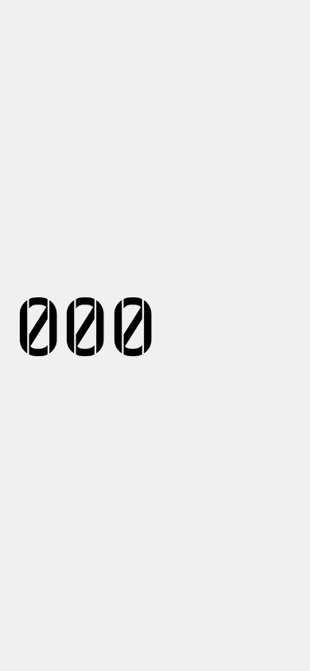

# UI Design System & Master Generation Blueprint: www-palaraiffeisen-ch

> **Il palazzetto dello sport di Lugano — Palaraiffeisen** (https://www.palaraiffeisen.ch) — Il PalaRaiffeisen, il nuovo palazzetto dello sport di Lugano. Eventi, competizioni e attività per tutti.


---

## 1. Executive Visual Persona & Design Archetype

- **Brand Essence & Persona**: **Il palazzetto dello sport di Lugano — Palaraiffeisen** (`https://www.palaraiffeisen.ch`). Il PalaRaiffeisen, il nuovo palazzetto dello sport di Lugano. Eventi, competizioni e attività per tutti.
- **Final Redirected URL**: [https://palaraiffeisen.ch/](https://palaraiffeisen.ch/)
- **Capture Provenance**: Live browser capture (`tier2_webgl`, HTTP `200`, captured `2026-11-23`).
- **Visual Archetype**: **Light-Gallery WebGL / Canvas Interactive Experience (`#ffffff` / `#e52528`)**.
- **Anti-AI-Slop Differentiators**:
  - **Live-Computed Chromatic Polarity**: Anchors the viewport in `#ffffff` (live computed `body` `background-color` (`computed_styles.json`)) paired with `#000000` primary typography and `#e52528` accents.
  - **Grounded Typographic Hierarchy**: Pairs `APK Systema Regular` for display copy (`BENVENUTI AL PALARAIFFEISEN BENVENUT`) with `APK-Narrative-Regular` and not declared in live computed styles (uses primary stack / `ui-monospace`).
  - **Calibrated Spatial Grid & Motion**: Combines `1440px` container bounds (`gap: 2.0833333333vw`, padding `16px`) with `cubic-bezier(.55,.085,.68,.53)` easing and Lenis Smooth Scroll (`data-lenis`), Three.js / WebGL Canvas Pipeline.

---

## 2. Spatial Architecture & Modular Grid Mathematics



### Viewport Allocation & Container Geometry
- **Captured Viewport Dimensions**: Desktop `1440×900px` (`assets/desktop.png`, single-viewport 100vh live capture (900px)), Mobile `390×844px` (`assets/mobile.png`, single-viewport 100vh live capture (844px)).
- **Master Container Bounds**: `1440px` (full-bleed `100%` desktop stage measured on `1440px` viewport).
- **Canvas Lateral Padding & Spacing**: `16px` lateral canvas padding with `2.0833333333vw` grid gap.
- **Border Radius Scale**: `4px`, `2px`, `0px`.

### Responsive Breakpoint Architecture
- **Desktop Layout**: Multi-column CSS Grid / Flexbox layout at `1440px` (`max-width: 1440px`, `gap: 2.0833333333vw`).
- **Mobile Layout**: Single-column vertical stack at `390px` viewport width with `16px` horizontal padding.
- **Extracted CSS Media Queries**: `@media (max-width:799px)`, `@media (min-width:800px)`.

---

## 3. Color System, Materiality & Atmospheric Lighting

### Semantic Palette & Source Grounding
| Semantic Role | Ground-Truth Value | Extracted Live / CSS Source |
|---|---|---|
| **Primary Canvas Substrate** | `#ffffff` | live computed `body` `background-color` (`computed_styles.json`) |
| **Primary Typography Ink** | `#000000` | live computed `h1` `color` (`computed_styles.json`) |
| **Elevated Surface / Card Substrate** | `#f0f0f0` | `.page-home-3d { background-color: #f0f0f0 }` |
| **Interactive Accent / Highlight** | `#e52528` | `var(--c-primary-300)` in `:root` |
| **Secondary / Muted Copy** | `#000000` | secondary opacity step of live computed `h1` `color` (`computed_styles.json`) |
| **Structural Hairline Border** | `#000000` | `.app-elements-list li { border: #000000 }` |

### Sanitized Root CSS Variables (`ui-ux.md` Ground Truth)
| Variable Name | Extracted Value | Semantic Role |
|---|---|---|
| `--c-black` | `#000` | Canvas / Surface Token |
| `--c-black-0` | `transparent` | Canvas / Surface Token |
| `--c-black-10` | `rgba(0,0,0,.1)` | Canvas / Surface Token |
| `--c-black-20` | `rgba(0,0,0,.2)` | Canvas / Surface Token |
| `--c-black-30` | `rgba(0,0,0,.3)` | Canvas / Surface Token |
| `--c-black-40` | `rgba(0,0,0,.4)` | Canvas / Surface Token |
| `--c-black-50` | `rgba(0,0,0,.5)` | Canvas / Surface Token |
| `--c-black-60` | `rgba(0,0,0,.6)` | Canvas / Surface Token |
| `--c-black-70` | `rgba(0,0,0,.7)` | Canvas / Surface Token |
| `--c-black-80` | `rgba(0,0,0,.8)` | Canvas / Surface Token |
| `--c-black-90` | `rgba(0,0,0,.9)` | Canvas / Surface Token |
| `--c-black-100` | `#000` | Canvas / Surface Token |
| `--c-white` | `#fff` | Canvas / Surface Token |
| `--c-white-0` | `hsla(0,0%,100%,0)` | Canvas / Surface Token |
| `--c-white-10` | `hsla(0,0%,100%,.1)` | Canvas / Surface Token |
| `--c-white-20` | `hsla(0,0%,100%,.2)` | Canvas / Surface Token |

---

## 4. Typographic Scale & Editorial Hierarchy

### Font Family Stacks
- **Display Typography**: `APK Systema Regular`.
- **Primary Body Stack**: `APK-Narrative-Regular`.
- **Technical / Metadata Stack**: not declared in live computed styles (uses primary stack / `ui-monospace`).

### Typographic Scale & Rules (Live Computed & Stylesheet Grounded)
- **Hero Display (`H1`)**: live computed `h1` (`font-size: 56px`, `line-height: 56px`, `font-weight: 400`, `letter-spacing: -0.84px`).
- **Section Heading (`H2`)**: live computed `h2` (`font-size: 16px`, `line-height: 16px`, `font-weight: 400`).
- **Body Copy**: live computed `body` (`font-size: 16px`, `line-height: normal`, `font-weight: 400`).
- **Metadata & Navigation Labels**: live computed `nav/a` (`font-size: 16px`, `line-height: normal`, `font-weight: 400`).

---

## 5. Choreographed Motion & Interaction Physics

### Primary Easing Curves
- **Extracted Timing Functions**: `cubic-bezier(.55,.085,.68,.53)`, `cubic-bezier(.55,.055,.675,.19)`, `cubic-bezier(.895,.03,.685,.22)`.

### Per-Element Transition & Choreography Rules
- **Selector `.home-news-widget-leave-active`**: `transition: opacity .3s ease,transform .3s ease` extracted from `www-palaraiffeisen-ch` stylesheet.
- **Selector `.page-home-3d-floor-menu__row__info`**: `transition: background .2s var(--ease-out-cubic)` extracted from `www-palaraiffeisen-ch` stylesheet.
- **Selector `.page-home-3d-floor-menu__row__ac...`**: `transition: opacity .2s var(--ease-out-cubic)` extracted from `www-palaraiffeisen-ch` stylesheet.
- **Extracted Easing Curve (`cubic-bezier(.55,.085,.68,.53)`)**: Governs interactive state transitions across `<header.lenis>` and `<section.page-home-3d>`.
- **Runtime Interaction Engine**: Integrates Lenis Smooth Scroll (`data-lenis`), Three.js / WebGL Canvas Pipeline with `prefers-reduced-motion: reduce` fallback guards.

---

## 6. Component Wireframe & Structural DOM Map

### Visual Layout Schematic — Desktop (`1440px`, Grounded in `dom.html` & Landmark Bounding Boxes)
```
┌────────────────────────────────────────────────────────────────────────┐
│ DESKTOP VIEWPORT (1440px) — Il palazzetto dello sport di Lugano — Pala │
│ ====================================================================== │
│ [ <header.lenis> (1440px)             | Il Palazzetto · Le società r ] │
│ ---------------------------------------------------------------------- │
│ | HERO STAGE: <section.page-home-hero> (w=1440px)                    | │
│ | H1: BENVENUTI AL PALARAIFFEISEN BENVENUTI AL PALARAIF...           | │
│ | Substrate: #ffffff | Ink: #000000 | Accent: #e52528                | │
│ ---------------------------------------------------------------------- │
│ | SHOWCASE GRID (<section.page-home-3d>) max-w: 1440px               | │
│ | +------------------------------+  +------------------------------+ | │
│ | | B E N V E N U T I A L P A L  |  | Un nuovo quartiere per Lugan | | │
│ | +------------------------------+  +------------------------------+ | │
│ ---------------------------------------------------------------------- │
│ | DETAIL MODULE (<section.page-banner-fulls) — u n a n u o v a d e s | │
│ ---------------------------------------------------------------------- │
│ [ FOOTER (<footer.app-footer> ) | https://www.palaraiffeisen.ch        │
└────────────────────────────────────────────────────────────────────────┘
```

### Visual Layout Schematic — Mobile Reflow (`390px`)
```
┌────────────────────────────────────────────────────────────────────────┐
│ MOBILE VIEWPORT REFLOW (390px) — Single-Column Stack (gap: 2.083333)   │
│ ====================================================================== │
│ [ HEADER BAR (<header.lenis>          ) | Compact Menu (390px)         │
│ ---------------------------------------------------------------------- │
│ | HERO STAGE (<section.page-home-hero>) — 390px Vertical Lead        | │
│ | H1: BENVENUTI AL PALARAIFFEISEN BENVENUTI AL PALARAIF...           | │
│ ---------------------------------------------------------------------- │
│ | SHOWCASE STACK (<section.page-home-3d>) — 1-Col Stack              | │
│ | [ Item 1: B E N V E N U T I A L P A L A R A I F F E I S E N...   ] | │
│ | [ Item 2: Un nuovo quartiere per Lugano Un nuovo quartiere...    ] | │
│ ---------------------------------------------------------------------- │
│ | DETAIL STACK (<section.page-banner-ful) — 1-Col (u n a n u o v a d ) │
│ ---------------------------------------------------------------------- │
│ [ FOOTER (<footer.app-footer> ) | Stacked 390px Colophon               │
└────────────────────────────────────────────────────────────────────────┘
```

### Granular DOM Region Breakdown
1. **Brand Header & Navigation Bar (<header.lenis> — `www-palaraiffeisen-ch`)**:
   - Landmark `<header class="lenis">` (`1440px`) hosting `Il palazzetto dello sport di Lugano ` navigation (`Il Palazzetto · Le società residenti · Organizza un evento · News · Scopri di più`), DOM attributes (`data-infer`, `data-cookiescriptreport="report"`, `data-tres="tresjs 5.8.1"`, `data-engine="three.js r180"`), and stylesheet rule `.P2.no-selectable { -webkit-user-select:none;-moz-user-select:none;user-select:none }`.
2. **Hero Stage & Focal Lead (<section.page-home-hero> — `BENVENUTI AL PALARAIFFEISEN BENVEN`)**:
   - Landmark `<section class="page-home-hero">` presenting display lead `BENVENUTI AL PALARAIFFEISEN BENVENUTI AL PALARAIF...` and copy excerpt *"La nuova casa dello sport e degli eventi a Lugano."* over `#ffffff` canvas and `#000000` ink.
3. **Primary Showcase & Content Grid (<section.page-home-3d> — `B E N V E N U T I A L P A L A R A `)**:
   - Landmark `<section class="page-home-3d">` rendering section `B E N V E N U T I A L P A L A R A I F F E I S E N...` with copy *"INAUGURAZIONE SETTEMBRE 2027 INAUGURAZIONE SETTEMBRE 2027"*, asset references (`kirby.palaraiffeisen.ch`, `entry.DiBOf5nH.css`, `Writer.C_JpA5xq.css`, `Media.C_3wTCR8.css`), and grid rule `.app-elements-list { display:flex;flex-direction:column;list-style:none;padding:0;margin:0 }`.
4. **Interactive Detail & Feature Matrix (<section.page-banner-fullscreen> — `Un nuovo quartiere per Lugano Un n`)**:
   - Landmark `<section class="page-banner-fullscreen">` framing `Un nuovo quartiere per Lugano Un nuovo quartiere...` and `u n a n u o v a d e s t i n a z i o n e p e r e v...` (*"INAUGURAZIONE SETTEMBRE 2027"*) with `#f0f0f0` surface cards, `#e52528` accents, and `.app-elements-list li { border:1px solid var(--c-black);margin-top:-1px;padding:.2777777778vw;di... }`.
5. **Colophon & Global Directory Footer (<footer.app-footer> — `https://www.palaraiffeisen.ch`)**:
   - Landmark `<footer class="app-footer block-inner">` anchoring `Il palazzetto dello sport di Lug` footer links (`Il Palazzetto · Le società residenti · Organizza un evento · News · Scopri di più`), copy *"B E N V E N U T I A L P A L A R A I F F E I S E N"*, and `#000000` structural dividers.

---

## 7. Master Zero-Shot AI Generation Prompt

```markdown
# Master Zero-Shot Frontend Generation Prompt: www-palaraiffeisen-ch (Il palazzetto dello sport di Lugano — Palaraiffeisen)

You are a principal frontend architect and design systems engineer. Build a complete, production-ready web application replicating the exact design system, DOM landmarks, typographic hierarchy, color tokens, and motion physics of `www-palaraiffeisen-ch` (**Il palazzetto dello sport di Lugano — Palaraiffeisen** — `https://www.palaraiffeisen.ch`).

### 1. Visual Archetype & Anti-AI-Slop Mandates
- **Archetype**: Light-Gallery WebGL / Canvas Interactive Experience (`#ffffff` / `#e52528`).
- **Identity & Domain Context**: Il PalaRaiffeisen, il nuovo palazzetto dello sport di Lugano. Eventi, competizioni e attività per tutti.
- **Primary Substrate**: `#ffffff` (live computed `body` `background-color` (`computed_styles.json`)), **Primary Ink**: `#000000`, **Accent / Highlight**: `#e52528`.
- **Site-Specific Differentiators**:
  - **Live-Computed Chromatic Polarity**: Anchors the viewport in `#ffffff` (live computed `body` `background-color` (`computed_styles.json`)) paired with `#000000` primary typography and `#e52528` accents.
  - **Grounded Typographic Hierarchy**: Pairs `APK Systema Regular` for display copy (`BENVENUTI AL PALARAIFFEISEN BENVENUT`) with `APK-Narrative-Regular` and not declared in live computed styles (uses primary stack / `ui-monospace`).
  - **Calibrated Spatial Grid & Motion**: Combines `1440px` container bounds (`gap: 2.0833333333vw`, padding `16px`) with `cubic-bezier(.55,.085,.68,.53)` easing and Lenis Smooth Scroll (`data-lenis`), Three.js / WebGL Canvas Pipeline.

### 2. Ground-Truth CSS Variables (`:root` Token Contract)
Declare and consume these exact custom properties extracted from `www-palaraiffeisen-ch` in your global stylesheet:

:root {
  /* Il palazzetto dello sport di Lugano — Palaraiffeisen (www-palaraiffeisen-ch) — Live-Grounded CSS Variables */
  --c-black: #000; /* Canvas / Surface Token (www-palaraiffeisen-ch) */
  --c-black-0: transparent; /* Canvas / Surface Token (www-palaraiffeisen-ch) */
  --c-black-10: rgba(0,0,0,.1); /* Canvas / Surface Token (www-palaraiffeisen-ch) */
  --c-black-20: rgba(0,0,0,.2); /* Canvas / Surface Token (www-palaraiffeisen-ch) */
  --c-black-30: rgba(0,0,0,.3); /* Canvas / Surface Token (www-palaraiffeisen-ch) */
  --c-black-40: rgba(0,0,0,.4); /* Canvas / Surface Token (www-palaraiffeisen-ch) */
  --c-black-50: rgba(0,0,0,.5); /* Canvas / Surface Token (www-palaraiffeisen-ch) */
  --c-black-60: rgba(0,0,0,.6); /* Canvas / Surface Token (www-palaraiffeisen-ch) */
  --c-black-70: rgba(0,0,0,.7); /* Canvas / Surface Token (www-palaraiffeisen-ch) */
  --c-black-80: rgba(0,0,0,.8); /* Canvas / Surface Token (www-palaraiffeisen-ch) */
  --c-black-90: rgba(0,0,0,.9); /* Canvas / Surface Token (www-palaraiffeisen-ch) */
  --c-black-100: #000; /* Canvas / Surface Token (www-palaraiffeisen-ch) */
  --c-white: #fff; /* Canvas / Surface Token (www-palaraiffeisen-ch) */
  --c-white-0: hsla(0,0%,100%,0); /* Canvas / Surface Token (www-palaraiffeisen-ch) */
  --c-white-10: hsla(0,0%,100%,.1); /* Canvas / Surface Token (www-palaraiffeisen-ch) */
  --c-white-20: hsla(0,0%,100%,.2); /* Canvas / Surface Token (www-palaraiffeisen-ch) */
}

### 3. Semantic Color & Materiality Contract
Map every surface, ink, and border strictly to these source-grounded tokens:
- **Primary Canvas Substrate**: `#ffffff` — grounded in live computed `body` `background-color` (`computed_styles.json`)
- **Primary Typography Ink**: `#000000` — grounded in live computed `h1` `color` (`computed_styles.json`)
- **Elevated Surface / Card Substrate**: `#f0f0f0` — grounded in `.page-home-3d { background-color: #f0f0f0 }`
- **Interactive Accent / Highlight**: `#e52528` — grounded in `var(--c-primary-300)` in `:root`
- **Secondary / Muted Copy**: `#000000` — grounded in secondary opacity step of live computed `h1` `color` (`computed_styles.json`)
- **Structural Hairline Border**: `#000000` — grounded in `.app-elements-list li { border: #000000 }`

### 4. Spatial Grid, Container Bounds & Responsive Breakpoints
- **Desktop Viewport Reference**: `1440×900px` (single-viewport 100vh live capture (900px), `1440px` standard desktop width).
- **Mobile Viewport Reference**: `390×844px` (single-viewport 100vh live capture (844px), `390px` standard mobile width).
- **Container Max-Width**: `1440px` (full-bleed `100%` desktop stage measured on `1440px` viewport)
- **Padding & Gutters**: `16px` lateral canvas padding with `2.0833333333vw` grid gap
- **Desktop Grid**: Multi-column CSS Grid / Flexbox layout at `1440px` (`max-width: 1440px`, `gap: 2.0833333333vw`)
- **Mobile Adaptation**: Single-column vertical stack at `390px` viewport width with `16px` horizontal padding
- **Media Queries**: `@media (max-width:799px)`, `@media (min-width:800px)`
- **Corner Radii**: `4px`, `2px`, `0px`

### 5. Typography & Editorial Scale Contract
- **Display Font Stack**: `APK Systema Regular`
- **Body Font Stack**: `APK-Narrative-Regular`
- **Monospace / Technical Font Stack**: not declared in live computed styles (uses primary stack / `ui-monospace`)
- **H1 Display Rule**: live computed `h1` (`font-size: 56px`, `line-height: 56px`, `font-weight: 400`, `letter-spacing: -0.84px`)
- **H2 Section Rule**: live computed `h2` (`font-size: 16px`, `line-height: 16px`, `font-weight: 400`)
- **Body Copy Rule**: live computed `body` (`font-size: 16px`, `line-height: normal`, `font-weight: 400`)
- **Metadata & Index Rule**: live computed `nav/a` (`font-size: 16px`, `line-height: normal`, `font-weight: 400`)

### 6. Component Hierarchy, Verbatim Copy & Real DOM Landmarks
Scaffold `www-palaraiffeisen-ch` (`Il palazzetto dello sport di Lugano — Palaraiffeisen`) with these exact structural regions, extracted copy, and CSS rules from `dom.html`:
1. **Brand Header & Navigation Bar (<header.lenis> — `www-palaraiffeisen-ch`)**:
   - DOM & Selectors: Landmark `<header class="lenis">` (`1440px`) hosting `Il palazzetto dello sport di Lugano ` navigation (`Il Palazzetto · Le società residenti · Organizza un evento · News · Scopri di più`), DOM attributes (`data-infer`, `data-cookiescriptreport="report"`, `data-tres="tresjs 5.8.1"`, `data-engine="three.js r180"`), and stylesheet rule `.P2.no-selectable { -webkit-user-select:none;-moz-user-select:none;user-select:none }`.
   - Responsive Contract: Header `Brand Header & Navigation Bar (<header.lenis> — `www-palaraiffeisen-ch`)` (`www-palaraiffeisen-ch`) adapts across `@media (max-width:799px)`, `@media (min-width:800px)` with `cubic-bezier(.55,.085,.68,.53)`, `cubic-bezier(.55,.055,.675,.19)`, `cubic-bezier(.895,.03,.685,.22)` transitions and links `Il Palazzetto · Le società residenti · Organizza un evento · News · Scopri di più`.
2. **Hero Stage & Focal Lead (<section.page-home-hero> — `BENVENUTI AL PALARAIFFEISEN BENVEN`)**:
   - DOM & Selectors: Landmark `<section class="page-home-hero">` presenting display lead `BENVENUTI AL PALARAIFFEISEN BENVENUTI AL PALARAIF...` and copy excerpt *"La nuova casa dello sport e degli eventi a Lugano."* over `#ffffff` canvas and `#000000` ink.
   - Responsive Contract: Hero stage (`1440×900px` desktop / `390×844px` mobile) sets `#ffffff` background with `#000000` headline `BENVENUTI AL PALARAIFFEISEN BENVENUTI AL PALARAIF...`.
3. **Primary Showcase & Content Grid (<section.page-home-3d> — `B E N V E N U T I A L P A L A R A `)**:
   - DOM & Selectors: Landmark `<section class="page-home-3d">` rendering section `B E N V E N U T I A L P A L A R A I F F E I S E N...` with copy *"INAUGURAZIONE SETTEMBRE 2027 INAUGURAZIONE SETTEMBRE 2027"*, asset references (`kirby.palaraiffeisen.ch`, `entry.DiBOf5nH.css`, `Writer.C_JpA5xq.css`, `Media.C_3wTCR8.css`), and grid rule `.app-elements-list { display:flex;flex-direction:column;list-style:none;padding:0;margin:0 }`.
   - Responsive Contract: Showcase grid `Primary Showcase & Content Grid (<section.page-home-3d> — `B E N V E N U T I A L P A L A R A `)` applies Multi-column CSS Grid / Flexbox layout at `1440px` (`max-width: 1440px`, `gap: 2.0833333333vw`) on desktop and Single-column vertical stack at `390px` viewport width with `16px` horizontal padding on mobile.
4. **Interactive Detail & Feature Matrix (<section.page-banner-fullscreen> — `Un nuovo quartiere per Lugano Un n`)**:
   - DOM & Selectors: Landmark `<section class="page-banner-fullscreen">` framing `Un nuovo quartiere per Lugano Un nuovo quartiere...` and `u n a n u o v a d e s t i n a z i o n e p e r e v...` (*"INAUGURAZIONE SETTEMBRE 2027"*) with `#f0f0f0` surface cards, `#e52528` accents, and `.app-elements-list li { border:1px solid var(--c-black);margin-top:-1px;padding:.2777777778vw;di... }`.
   - Responsive Contract: Detail module `Interactive Detail & Feature Matrix (<section.page-banner-fullscreen> — `Un nuovo quartiere per Lugano Un n`)` uses `4px`, `2px`, `0px` radii, `#e52528` highlights, and assets (kirby.palaraiffeisen.ch, entry.DiBOf5nH.css, Writer.C_JpA5xq.css).
5. **Colophon & Global Directory Footer (<footer.app-footer> — `https://www.palaraiffeisen.ch`)**:
   - DOM & Selectors: Landmark `<footer class="app-footer block-inner">` anchoring `Il palazzetto dello sport di Lug` footer links (`Il Palazzetto · Le società residenti · Organizza un evento · News · Scopri di più`), copy *"B E N V E N U T I A L P A L A R A I F F E I S E N"*, and `#000000` structural dividers.
   - Responsive Contract: Footer `Colophon & Global Directory Footer (<footer.app-footer> — `https://www.palaraiffeisen.ch`)` aligns to `1440px` (full-bleed `100%` desktop stage measured on `1440px` viewport) with `16px` lateral canvas padding with `2.0833333333vw` grid gap and attributes (data-infer, data-cookiescriptreport="report", data-tres="tresjs 5.8.1").

#### Verbatim DOM Copy Excerpts (`dom.html`)
- Copy Excerpt 1: *"La nuova casa dello sport e degli eventi a Lugano."*
- Copy Excerpt 2: *"INAUGURAZIONE SETTEMBRE 2027 INAUGURAZIONE SETTEMBRE 2027"*
- Copy Excerpt 3: *"INAUGURAZIONE SETTEMBRE 2027"*
- Copy Excerpt 4: *"B E N V E N U T I A L P A L A R A I F F E I S E N"*

### 7. Motion, Extracted Stylesheet Rules & Interaction Choreography
- **Primary Easing Functions**: `cubic-bezier(.55,.085,.68,.53)`, `cubic-bezier(.55,.055,.675,.19)`, `cubic-bezier(.895,.03,.685,.22)`
- **Extracted Stylesheet Rules (`www-palaraiffeisen-ch`)**:
- `.P2.no-selectable { -webkit-user-select:none;-moz-user-select:none;user-select:none }`
- `.app-elements-list { display:flex;flex-direction:column;list-style:none;padding:0;margin:0 }`
- `.app-elements-list li { border:1px solid var(--c-black);margin-top:-1px;padding:.2777777778vw;di... }`
- `.kirby-writer { display:flex;flex-direction:column;gap:2.0833333333vw }`
- `.kirby-writer .H4 { margin-top:1.3888888889vw }`
- **Per-Selector Transition Rules**:
- **Selector `.home-news-widget-leave-active`**: `transition: opacity .3s ease,transform .3s ease` extracted from `www-palaraiffeisen-ch` stylesheet.
- **Selector `.page-home-3d-floor-menu__row__info`**: `transition: background .2s var(--ease-out-cubic)` extracted from `www-palaraiffeisen-ch` stylesheet.
- **Selector `.page-home-3d-floor-menu__row__ac...`**: `transition: opacity .2s var(--ease-out-cubic)` extracted from `www-palaraiffeisen-ch` stylesheet.
- **Extracted Easing Curve (`cubic-bezier(.55,.085,.68,.53)`)**: Governs interactive state transitions across `<header.lenis>` and `<section.page-home-3d>`.
- **Runtime Interaction Engine**: Integrates Lenis Smooth Scroll (`data-lenis`), Three.js / WebGL Canvas Pipeline with `prefers-reduced-motion: reduce` fallback guards.

### 8. Technical Deliverables
- Implement in Next.js (App Router) with TypeScript and Tailwind CSS consuming the `:root` custom properties defined above for `www-palaraiffeisen-ch`.
- Reproduce both the `1440px` desktop architecture and `390px` mobile breakpoint transitions, preserving semantic HTML5 landmarks (`<header>`, `<nav>`, `<main>`, `<section>`, `<footer>`) and `prefers-reduced-motion` accessibility guards.
```
