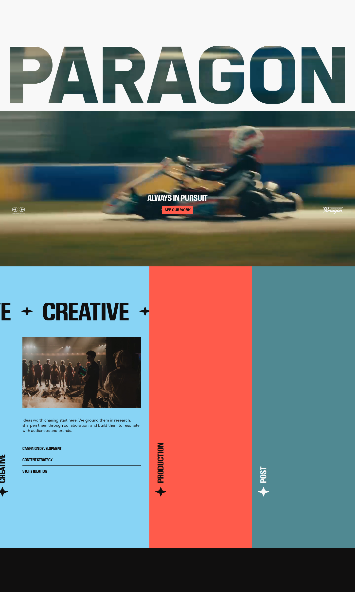
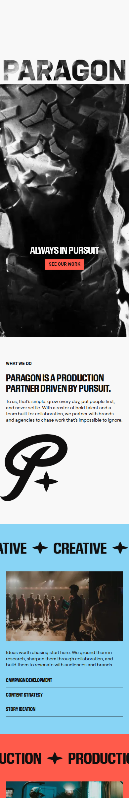

# UI Design System & Master Generation Blueprint: www-paragonproductions-co

> **PARAGON · Creative Production Studio** (https://www.paragonproductions.co/) — PARAGON is a production partner driven by pursuit. We team up with brands and agencies to craft commercials, branded films, and campaigns...



---

## 1. Executive Visual Persona & Design Archetype

- **Brand Essence & Persona**: **PARAGON · Creative Production Studio** (`https://www.paragonproductions.co/`). PARAGON is a production partner driven by pursuit. We team up with brands and agencies to craft commercials, branded films, and campaigns...
- **Capture Provenance**: Live browser capture (`tier1_fast`, HTTP `200`, captured `2026-11-23`).
- **Visual Archetype**: **High-Contrast Obsidian / Atmospheric Design System (`#100f0f` canvas, `#f8f8f8` ink, `#ff0000` accent)**.
- **Anti-AI-Slop Differentiators**:
  - **Live-Computed Chromatic Polarity**: Anchors the viewport in `#100f0f` (live computed `body` `background-color` (`computed_styles.json`)) paired with `#f8f8f8` primary typography and `#ff0000` accents.
  - **Grounded Typographic Hierarchy**: Pairs `Review Condensed` for display copy (`ALWAYS IN PURSUIT`) with `Roobert` and not declared in live computed styles (uses primary stack / `ui-monospace`).
  - **Calibrated Spatial Grid & Motion**: Combines `1440px` container bounds (`gap: 16px`, padding `9px`) with `cubic-bezier(.23,1,.32,1)` easing and Lenis Smooth Scroll (`data-lenis`), GSAP Timeline & ScrollTrigger.

---

## 2. Spatial Architecture & Modular Grid Mathematics



### Viewport Allocation & Container Geometry
- **Captured Viewport Dimensions**: Desktop `1440×2400px` (`assets/desktop.png`, clamped at 2400px live multi-section capture), Mobile `390×2400px` (`assets/mobile.png`, clamped at 2400px live multi-section capture).
- **Master Container Bounds**: `1440px` (full-bleed `100%` desktop stage measured on `1440px` viewport).
- **Canvas Lateral Padding & Spacing**: `9px` lateral canvas padding with `16px` grid gap.
- **Border Radius Scale**: `3px`, `100%`, `50%`.

### Responsive Breakpoint Architecture
- **Desktop Layout**: Multi-column CSS Grid / Flexbox layout at `1440px` (`max-width: 1440px`, `gap: 16px`).
- **Mobile Layout**: Single-column vertical stack at `390px` viewport width with `9px` horizontal padding.
- **Extracted CSS Media Queries**: `@media screen and (max-width:991px)`, `@media screen and (max-width:767px)`, `@media screen and (max-width:479px)`, `@media (min-width:768px)`.

---

## 3. Color System, Materiality & Atmospheric Lighting

### Semantic Palette & Source Grounding
| Semantic Role | Ground-Truth Value | Extracted Live / CSS Source |
|---|---|---|
| **Primary Canvas Substrate** | `#100f0f` | live computed `body` `background-color` (`computed_styles.json`) |
| **Primary Typography Ink** | `#f8f8f8` | live computed `h1` `color` (`computed_styles.json`) |
| **Elevated Surface / Card Substrate** | `#222222` | `.w-slider-nav-invert>div.w-active { background-color: #222222 }` |
| **Interactive Accent / Highlight** | `#ff0000` | `.nav_mobile_link.w--current { color: red }` (`#ff0000`) |
| **Secondary / Muted Copy** | `#0082f3` | `.w-dropdown-link.w--current { color: #0082f3 }` |
| **Structural Hairline Border** | `#3898ec` | `.w-select:focus { border-color: #3898ec }` |
| **Variable Token (`--_color---swatch--red`)** | `#ff5b4b` | `var(--_color---swatch--red)` in `:root` |

### Sanitized Root CSS Variables (`ui-ux.md` Ground Truth)
| Variable Name | Extracted Value | Semantic Role |
|---|---|---|
| `--_theme---background--primary` | `var(--_color---swatch--white)` | Canvas / Surface Token |
| `--_text-style---font-family` | `var(--_typography---font-family--tertiary)` | Typography Ink Token |
| `--_theme---text--primary` | `var(--_color---swatch--black)` | Typography Ink Token |
| `--_text-style---font-size` | `var(--_typography---font-size--text-main)` | Typography Ink Token |
| `--_text-style---line-height` | `var(--_typography---line-height--131-5)` | Typography Ink Token |
| `--_text-style---font-weight` | `var(--_typography---font-weight--normal)` | Typography Ink Token |
| `--_text-style---letter-spacing` | `var(--_typography---letter-spacing--0em)` | Typography Ink Token |
| `--_typography---font-family--secondary` | `"Review Condensed",Arial,sans-serif` | Brand / Palette Token |
| `--_typography---font-weight--medium` | `500` | Typography / Scale Token |
| `--_text-style---margin-top` | `var(--_spacing---space--4)` | Typography Ink Token |
| `--_text-style---margin-bottom` | `var(--_spacing---space--5)` | Typography Ink Token |
| `--_color---swatch--red` | `#ff5b4b` | Brand / Palette Token |
| `--_typography---font-family--primary` | `"Proxima Nova",Arial,sans-serif` | Brand / Palette Token |
| `--_theme---text--secondary` | `var(--_color---swatch--grey-500)` | Typography Ink Token |
| `--_typography---font-weight--thin` | `100` | Typography / Scale Token |
| `--_typography---font-weight--extra-light` | `200` | Canvas / Surface Token |

---

## 4. Typographic Scale & Editorial Hierarchy

### Font Family Stacks
- **Display Typography**: `Review Condensed`.
- **Primary Body Stack**: `Roobert`.
- **Technical / Metadata Stack**: not declared in live computed styles (uses primary stack / `ui-monospace`).

### Typographic Scale & Rules (Live Computed & Stylesheet Grounded)
- **Hero Display (`H1`)**: live computed `h1` (`font-size: 32px`, `line-height: 35.2px`, `font-weight: 500`); rule `h1` (`font-size: var(--_text-style---font-size)`, `line-height: var(--_text-style---l...`, `letter-spacing: var(--_typography---l...`, `font-weight: var(--_text-s...`).
- **Section Heading (`H2`)**: live computed `h3 (primary section heading)` (`font-size: 32px`, `line-height: 35.2px`, `font-weight: 500`); rule `h2` (`font-size: var(--_text-style---font-size)`, `line-height: var(--_text-style---l...`, `letter-spacing: var(--_typography---l...`, `font-weight: var(--_text-s...`).
- **Body Copy**: live computed `body` (`font-size: 16px`, `line-height: 20.96px`, `font-weight: 400`); rule `p` (`font-size: var(--_text-style---font-size)`, `line-height: var(--_text-style---l...`, `letter-spacing: var(--_typography---l...`, `font-weight: var(--_text-s...`).
- **Metadata & Navigation Labels**: live computed `nav/a` (`font-size: 16px`, `line-height: 20.96px`, `font-weight: 400`); CSS variables `--_text-style---letter-spacing: var(--_typography---letter-spacing--0em)`, `--max-width--small: 80rem`, `--max-width--extra-small: 50rem`.

---

## 5. Choreographed Motion & Interaction Physics

### Primary Easing Curves
- **Extracted Timing Functions**: `cubic-bezier(.23,1,.32,1)`, `cubic-bezier(.215,.61,.355,1)`, `cubic-bezier(.165,.84,.44,1)`.

### Per-Element Transition & Choreography Rules
- **Selector `.w-webflow-badge>img`**: `transition: unset` extracted from `www-paragonproductions-co` stylesheet.
- **Selector `.w-slider-dot`**: `transition: background-color .1s,color .1s` extracted from `www-paragonproductions-co` stylesheet.
- **Selector `.w-lightbox-control`**: `transition: all .3s` extracted from `www-paragonproductions-co` stylesheet.
- **Extracted Easing Curve (`cubic-bezier(.23,1,.32,1)`)**: Governs interactive state transitions across `<nav.nav_wrap>` and `<section.home-services_wrap>`.
- **Runtime Interaction Engine**: Integrates Lenis Smooth Scroll (`data-lenis`), GSAP Timeline & ScrollTrigger, Three.js / WebGL Canvas Pipeline, Swiper Touch Carousel Engine with `prefers-reduced-motion: reduce` fallback guards.

---

## 6. Component Wireframe & Structural DOM Map

### Visual Layout Schematic — Desktop (`1440px`, Grounded in `dom.html` & Landmark Bounding Boxes)
```
┌────────────────────────────────────────────────────────────────────────┐
│ DESKTOP VIEWPORT (1440px) — PARAGON · Creative Production Studio       │
│ ====================================================================== │
│ [ <nav.nav_wrap> (1440x114px)         | Work · Who We Are · News · C ] │
│ ---------------------------------------------------------------------- │
│ | HERO STAGE: <section.home-hero_wrap> (w=1440px)                    | │
│ | H1: ALWAYS IN PURSUIT                                              | │
│ | Substrate: #100f0f | Ink: #f8f8f8 | Accent: #ff0000                | │
│ ---------------------------------------------------------------------- │
│ | SHOWCASE GRID (<section.home-services_wra) max-w: 1440px           | │
│ | +------------------------------+  +------------------------------+ | │
│ | | Always In PURSUIT            |  | PARAGON is a production part | | │
│ | +------------------------------+  +------------------------------+ | │
│ ---------------------------------------------------------------------- │
│ | DETAIL MODULE (<section.featured-work_wra) — BUILT FOR THE CHASE   | │
│ ---------------------------------------------------------------------- │
│ [ FOOTER (<footer.footer_wrap>) | https://www.paragonproductions.co/   │
└────────────────────────────────────────────────────────────────────────┘
```

### Visual Layout Schematic — Mobile Reflow (`390px`)
```
┌────────────────────────────────────────────────────────────────────────┐
│ MOBILE VIEWPORT REFLOW (390px) — Single-Column Stack (gap: 16px)       │
│ ====================================================================== │
│ [ HEADER BAR (<nav.nav_wrap>          ) | Compact Menu (390px)         │
│ ---------------------------------------------------------------------- │
│ | HERO STAGE (<section.home-hero_wrap>) — 390px Vertical Lead        | │
│ | H1: ALWAYS IN PURSUIT                                              | │
│ ---------------------------------------------------------------------- │
│ | SHOWCASE STACK (<section.home-services) — 1-Col Stack              | │
│ | [ Item 1: Always In PURSUIT                                      ] | │
│ | [ Item 2: PARAGON is a production partner driven by pursuit.     ] | │
│ ---------------------------------------------------------------------- │
│ | DETAIL STACK (<section.featured-work_w) — 1-Col (BUILT FOR THE CHAS) │
│ ---------------------------------------------------------------------- │
│ [ FOOTER (<footer.footer_wrap>) | Stacked 390px Colophon               │
└────────────────────────────────────────────────────────────────────────┘
```

### Granular DOM Region Breakdown
1. **Brand Header & Navigation Bar (<nav.nav_wrap> — `www-paragonproductions-co`)**:
   - Landmark `<nav class="nav_wrap">` (`1440x114px`) hosting `PARAGON · Creative Production Studio` navigation (`Work · Who We Are · News · Contact Us · Vimeo`), DOM attributes (`data-wf-domain="www.paragonproduction..."`, `data-wf-page="68be24b22b086720602bcd26"`, `data-wf-site="68be24b22b086720602bcd38"`, `data-wf-intellimize-customer-id="117787750"`), and stylesheet rule `html { -webkit-text-size-adjust:100%;-ms-text-size-adjust:100%;font-family:sans... }`.
2. **Hero Stage & Focal Lead (<section.home-hero_wrap> — `ALWAYS IN PURSUIT`)**:
   - Landmark `<section class="home-hero_wrap">` presenting display lead `ALWAYS IN PURSUIT` and copy excerpt *"To us, that’s simple: grow every day, put people first, and never"* over `#100f0f` canvas and `#f8f8f8` ink.
3. **Primary Showcase & Content Grid (<section.home-services_wrap> — `Always In PURSUIT`)**:
   - Landmark `<section class="home-services_wrap">` rendering section `Always In PURSUIT` with copy *"Creative Creative Creative Creative Creative Creative Creative Cr"*, asset references (`cdn.prod.website-files.com`, `paragonproductions.webflow.shared...`, `paragonproductions.webflow.68be24...`, `gtm.js`), and grid rule `summary { display:block }`.
4. **Interactive Detail & Feature Matrix (<section.featured-work_wrap> — `PARAGON is a production partner dr`)**:
   - Landmark `<section class="featured-work_wrap">` framing `PARAGON is a production partner driven by pursuit.` and `BUILT FOR THE CHASE` (*"Ideas worth chasing start here. We ground them in research, sharp"*) with `#222222` surface cards, `#ff0000` accents, and `video { vertical-align:baseline;display:inline-block }`.
5. **Colophon & Global Directory Footer (<footer.footer_wrap> — `https://www.paragonproductions.co/`)**:
   - Landmark `<footer class="footer_wrap">` anchoring `PARAGON · Creative Production St` footer links (`Work · Who We Are · News · Contact Us · Vimeo`), copy *"Campaign Development"*, and `#3898ec` structural dividers.

---

## 7. Master Zero-Shot AI Generation Prompt

```markdown
# Master Zero-Shot Frontend Generation Prompt: www-paragonproductions-co (PARAGON · Creative Production Studio)

You are a principal frontend architect and design systems engineer. Build a complete, production-ready web application replicating the exact design system, DOM landmarks, typographic hierarchy, color tokens, and motion physics of `www-paragonproductions-co` (**PARAGON · Creative Production Studio** — `https://www.paragonproductions.co/`).

### 1. Visual Archetype & Anti-AI-Slop Mandates
- **Archetype**: High-Contrast Obsidian / Atmospheric Design System (`#100f0f` canvas, `#f8f8f8` ink, `#ff0000` accent).
- **Identity & Domain Context**: PARAGON is a production partner driven by pursuit. We team up with brands and agencies to craft commercials, branded films, and campaigns...
- **Primary Substrate**: `#100f0f` (live computed `body` `background-color` (`computed_styles.json`)), **Primary Ink**: `#f8f8f8`, **Accent / Highlight**: `#ff0000`.
- **Site-Specific Differentiators**:
  - **Live-Computed Chromatic Polarity**: Anchors the viewport in `#100f0f` (live computed `body` `background-color` (`computed_styles.json`)) paired with `#f8f8f8` primary typography and `#ff0000` accents.
  - **Grounded Typographic Hierarchy**: Pairs `Review Condensed` for display copy (`ALWAYS IN PURSUIT`) with `Roobert` and not declared in live computed styles (uses primary stack / `ui-monospace`).
  - **Calibrated Spatial Grid & Motion**: Combines `1440px` container bounds (`gap: 16px`, padding `9px`) with `cubic-bezier(.23,1,.32,1)` easing and Lenis Smooth Scroll (`data-lenis`), GSAP Timeline & ScrollTrigger.

### 2. Ground-Truth CSS Variables (`:root` Token Contract)
Declare and consume these exact custom properties extracted from `www-paragonproductions-co` in your global stylesheet:

:root {
  /* PARAGON · Creative Production Studio (www-paragonproductions-co) — Live-Grounded CSS Variables */
  --_theme---background--primary: var(--_color---swatch--white); /* Canvas / Surface Token (www-paragonproductions-co) */
  --_text-style---font-family: var(--_typography---font-family--tertiary); /* Typography Ink Token (www-paragonproductions-co) */
  --_theme---text--primary: var(--_color---swatch--black); /* Typography Ink Token (www-paragonproductions-co) */
  --_text-style---font-size: var(--_typography---font-size--text-main); /* Typography Ink Token (www-paragonproductions-co) */
  --_text-style---line-height: var(--_typography---line-height--131-5); /* Typography Ink Token (www-paragonproductions-co) */
  --_text-style---font-weight: var(--_typography---font-weight--normal); /* Typography Ink Token (www-paragonproductions-co) */
  --_text-style---letter-spacing: var(--_typography---letter-spacing--0em); /* Typography Ink Token (www-paragonproductions-co) */
  --_typography---font-family--secondary: "Review Condensed",Arial,sans-serif; /* Brand / Palette Token (www-paragonproductions-co) */
  --_typography---font-weight--medium: 500; /* Typography / Scale Token (www-paragonproductions-co) */
  --_text-style---margin-top: var(--_spacing---space--4); /* Typography Ink Token (www-paragonproductions-co) */
  --_text-style---margin-bottom: var(--_spacing---space--5); /* Typography Ink Token (www-paragonproductions-co) */
  --_color---swatch--red: #ff5b4b; /* Brand / Palette Token (www-paragonproductions-co) */
  --_typography---font-family--primary: "Proxima Nova",Arial,sans-serif; /* Brand / Palette Token (www-paragonproductions-co) */
  --_theme---text--secondary: var(--_color---swatch--grey-500); /* Typography Ink Token (www-paragonproductions-co) */
  --_typography---font-weight--thin: 100; /* Typography / Scale Token (www-paragonproductions-co) */
  --_typography---font-weight--extra-light: 200; /* Canvas / Surface Token (www-paragonproductions-co) */
}

### 3. Semantic Color & Materiality Contract
Map every surface, ink, and border strictly to these source-grounded tokens:
- **Primary Canvas Substrate**: `#100f0f` — grounded in live computed `body` `background-color` (`computed_styles.json`)
- **Primary Typography Ink**: `#f8f8f8` — grounded in live computed `h1` `color` (`computed_styles.json`)
- **Elevated Surface / Card Substrate**: `#222222` — grounded in `.w-slider-nav-invert>div.w-active { background-color: #222222 }`
- **Interactive Accent / Highlight**: `#ff0000` — grounded in `.nav_mobile_link.w--current { color: red }` (`#ff0000`)
- **Secondary / Muted Copy**: `#0082f3` — grounded in `.w-dropdown-link.w--current { color: #0082f3 }`
- **Structural Hairline Border**: `#3898ec` — grounded in `.w-select:focus { border-color: #3898ec }`
- **Variable Token (`--_color---swatch--red`)**: `#ff5b4b` — grounded in `var(--_color---swatch--red)` in `:root`

### 4. Spatial Grid, Container Bounds & Responsive Breakpoints
- **Desktop Viewport Reference**: `1440×2400px` (clamped at 2400px live multi-section capture, `1440px` standard desktop width).
- **Mobile Viewport Reference**: `390×2400px` (clamped at 2400px live multi-section capture, `390px` standard mobile width).
- **Container Max-Width**: `1440px` (full-bleed `100%` desktop stage measured on `1440px` viewport)
- **Padding & Gutters**: `9px` lateral canvas padding with `16px` grid gap
- **Desktop Grid**: Multi-column CSS Grid / Flexbox layout at `1440px` (`max-width: 1440px`, `gap: 16px`)
- **Mobile Adaptation**: Single-column vertical stack at `390px` viewport width with `9px` horizontal padding
- **Media Queries**: `@media screen and (max-width:991px)`, `@media screen and (max-width:767px)`, `@media screen and (max-width:479px)`, `@media (min-width:768px)`
- **Corner Radii**: `3px`, `100%`, `50%`

### 5. Typography & Editorial Scale Contract
- **Display Font Stack**: `Review Condensed`
- **Body Font Stack**: `Roobert`
- **Monospace / Technical Font Stack**: not declared in live computed styles (uses primary stack / `ui-monospace`)
- **H1 Display Rule**: live computed `h1` (`font-size: 32px`, `line-height: 35.2px`, `font-weight: 500`); rule `h1` (`font-size: var(--_text-style---font-size)`, `line-height: var(--_text-style---l...`, `letter-spacing: var(--_typography---l...`, `font-weight: var(--_text-s...`)
- **H2 Section Rule**: live computed `h3 (primary section heading)` (`font-size: 32px`, `line-height: 35.2px`, `font-weight: 500`); rule `h2` (`font-size: var(--_text-style---font-size)`, `line-height: var(--_text-style---l...`, `letter-spacing: var(--_typography---l...`, `font-weight: var(--_text-s...`)
- **Body Copy Rule**: live computed `body` (`font-size: 16px`, `line-height: 20.96px`, `font-weight: 400`); rule `p` (`font-size: var(--_text-style---font-size)`, `line-height: var(--_text-style---l...`, `letter-spacing: var(--_typography---l...`, `font-weight: var(--_text-s...`)
- **Metadata & Index Rule**: live computed `nav/a` (`font-size: 16px`, `line-height: 20.96px`, `font-weight: 400`); CSS variables `--_text-style---letter-spacing: var(--_typography---letter-spacing--0em)`, `--max-width--small: 80rem`, `--max-width--extra-small: 50rem`

### 6. Component Hierarchy, Verbatim Copy & Real DOM Landmarks
Scaffold `www-paragonproductions-co` (`PARAGON · Creative Production Studio`) with these exact structural regions, extracted copy, and CSS rules from `dom.html`:
1. **Brand Header & Navigation Bar (<nav.nav_wrap> — `www-paragonproductions-co`)**:
   - DOM & Selectors: Landmark `<nav class="nav_wrap">` (`1440x114px`) hosting `PARAGON · Creative Production Studio` navigation (`Work · Who We Are · News · Contact Us · Vimeo`), DOM attributes (`data-wf-domain="www.paragonproduction..."`, `data-wf-page="68be24b22b086720602bcd26"`, `data-wf-site="68be24b22b086720602bcd38"`, `data-wf-intellimize-customer-id="117787750"`), and stylesheet rule `html { -webkit-text-size-adjust:100%;-ms-text-size-adjust:100%;font-family:sans... }`.
   - Responsive Contract: Header `Brand Header & Navigation Bar (<nav.nav_wrap> — `www-paragonproductions-co`)` (`www-paragonproductions-co`) adapts across `@media screen and (max-width:991px)`, `@media screen and (max-width:767px)`, `@media screen and (max-width:479px)`, `@media (min-width:768px)` with `cubic-bezier(.23,1,.32,1)`, `cubic-bezier(.215,.61,.355,1)`, `cubic-bezier(.165,.84,.44,1)` transitions and links `Work · Who We Are · News · Contact Us · Vimeo`.
2. **Hero Stage & Focal Lead (<section.home-hero_wrap> — `ALWAYS IN PURSUIT`)**:
   - DOM & Selectors: Landmark `<section class="home-hero_wrap">` presenting display lead `ALWAYS IN PURSUIT` and copy excerpt *"To us, that’s simple: grow every day, put people first, and never"* over `#100f0f` canvas and `#f8f8f8` ink.
   - Responsive Contract: Hero stage (`1440×2400px` desktop / `390×2400px` mobile) sets `#100f0f` background with `#f8f8f8` headline `ALWAYS IN PURSUIT`.
3. **Primary Showcase & Content Grid (<section.home-services_wrap> — `Always In PURSUIT`)**:
   - DOM & Selectors: Landmark `<section class="home-services_wrap">` rendering section `Always In PURSUIT` with copy *"Creative Creative Creative Creative Creative Creative Creative Cr"*, asset references (`cdn.prod.website-files.com`, `paragonproductions.webflow.shared...`, `paragonproductions.webflow.68be24...`, `gtm.js`), and grid rule `summary { display:block }`.
   - Responsive Contract: Showcase grid `Primary Showcase & Content Grid (<section.home-services_wrap> — `Always In PURSUIT`)` applies Multi-column CSS Grid / Flexbox layout at `1440px` (`max-width: 1440px`, `gap: 16px`) on desktop and Single-column vertical stack at `390px` viewport width with `9px` horizontal padding on mobile.
4. **Interactive Detail & Feature Matrix (<section.featured-work_wrap> — `PARAGON is a production partner dr`)**:
   - DOM & Selectors: Landmark `<section class="featured-work_wrap">` framing `PARAGON is a production partner driven by pursuit.` and `BUILT FOR THE CHASE` (*"Ideas worth chasing start here. We ground them in research, sharp"*) with `#222222` surface cards, `#ff0000` accents, and `video { vertical-align:baseline;display:inline-block }`.
   - Responsive Contract: Detail module `Interactive Detail & Feature Matrix (<section.featured-work_wrap> — `PARAGON is a production partner dr`)` uses `3px`, `100%`, `50%` radii, `#ff0000` highlights, and assets (cdn.prod.website-files.com, paragonproductions.webflow.shared..., paragonproductions.webflow.68be24...).
5. **Colophon & Global Directory Footer (<footer.footer_wrap> — `https://www.paragonproductions.co/`)**:
   - DOM & Selectors: Landmark `<footer class="footer_wrap">` anchoring `PARAGON · Creative Production St` footer links (`Work · Who We Are · News · Contact Us · Vimeo`), copy *"Campaign Development"*, and `#3898ec` structural dividers.
   - Responsive Contract: Footer `Colophon & Global Directory Footer (<footer.footer_wrap> — `https://www.paragonproductions.co/`)` aligns to `1440px` (full-bleed `100%` desktop stage measured on `1440px` viewport) with `9px` lateral canvas padding with `16px` grid gap and attributes (data-wf-domain="www.paragonproduction...", data-wf-page="68be24b22b086720602bcd26", data-wf-site="68be24b22b086720602bcd38").

#### Verbatim DOM Copy Excerpts (`dom.html`)
- Copy Excerpt 1: *"To us, that’s simple: grow every day, put people first, and never settle. With a r..."*
- Copy Excerpt 2: *"Creative Creative Creative Creative Creative Creative Creative Creative Creative C..."*
- Copy Excerpt 3: *"Ideas worth chasing start here. We ground them in research, sharpen them through c..."*
- Copy Excerpt 4: *"Campaign Development"*

### 7. Motion, Extracted Stylesheet Rules & Interaction Choreography
- **Primary Easing Functions**: `cubic-bezier(.23,1,.32,1)`, `cubic-bezier(.215,.61,.355,1)`, `cubic-bezier(.165,.84,.44,1)`
- **Extracted Stylesheet Rules (`www-paragonproductions-co`)**:
- `html { -webkit-text-size-adjust:100%;-ms-text-size-adjust:100%;font-family:sans... }`
- `summary { display:block }`
- `video { vertical-align:baseline;display:inline-block }`
- `template { display:none }`
- `strong { font-weight:700 }`
- **Per-Selector Transition Rules**:
- **Selector `.w-webflow-badge>img`**: `transition: unset` extracted from `www-paragonproductions-co` stylesheet.
- **Selector `.w-slider-dot`**: `transition: background-color .1s,color .1s` extracted from `www-paragonproductions-co` stylesheet.
- **Selector `.w-lightbox-control`**: `transition: all .3s` extracted from `www-paragonproductions-co` stylesheet.
- **Extracted Easing Curve (`cubic-bezier(.23,1,.32,1)`)**: Governs interactive state transitions across `<nav.nav_wrap>` and `<section.home-services_wrap>`.
- **Runtime Interaction Engine**: Integrates Lenis Smooth Scroll (`data-lenis`), GSAP Timeline & ScrollTrigger, Three.js / WebGL Canvas Pipeline, Swiper Touch Carousel Engine with `prefers-reduced-motion: reduce` fallback guards.

### 8. Technical Deliverables
- Implement in Next.js (App Router) with TypeScript and Tailwind CSS consuming the `:root` custom properties defined above for `www-paragonproductions-co`.
- Reproduce both the `1440px` desktop architecture and `390px` mobile breakpoint transitions, preserving semantic HTML5 landmarks (`<header>`, `<nav>`, `<main>`, `<section>`, `<footer>`) and `prefers-reduced-motion` accessibility guards.
```
