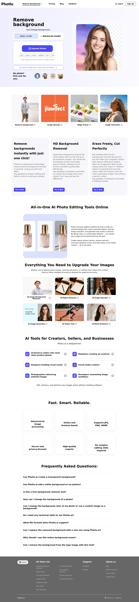
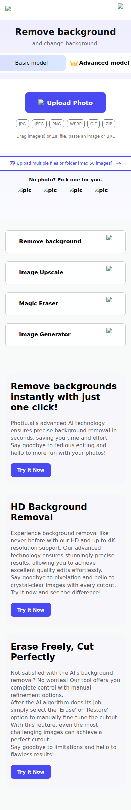

# UI Design System & Master Generation Blueprint: www-photiu-ai

> **Remove Background, Upscale & Erase Objects – Photiu.ai** (https://www.photiu.ai) — Discover Photiu.ai's AI tools: remove backgrounds, upscale images, and erase unwanted objects. Achieve stunning photo edits online quickl...



---

## 1. Executive Visual Persona & Design Archetype

- **Brand Essence & Persona**: **Remove Background, Upscale & Erase Objects – Photiu.ai** (`https://www.photiu.ai`). Discover Photiu.ai's AI tools: remove backgrounds, upscale images, and erase unwanted objects. Achieve stunning photo edits online quickl...
- **Visual Archetype**: **Light-Substrate Editorial & Modular Grid System (`#f8f9f9` canvas, `#000000` ink, `#000000` accent)**.
- **Anti-AI-Slop Differentiators**:
  - **Source-Grounded Chromatic Polarity**: Anchors the viewport in `#f8f9f9` (`var(--board-black-color)` in `:root`) paired with `#000000` primary typography and `#000000` accents.
  - **Extracted Typographic Hierarchy**: Pairs `Roboto` for display copy (`Remove background`) with `Segoe UI` and `SFMono-Regular`.
  - **Calibrated Spatial Grid & Motion**: Combines `640px` container bounds (`gap: 1rem`, padding `.25rem`) with `cubic-bezier(.4,0,.2,1)` easing.

---

## 2. Spatial Architecture & Modular Grid Mathematics



### Viewport Allocation & Container Geometry
- **Captured Viewport Dimensions**: Desktop `1440×6227px` (`assets/desktop.png`, full-page scroll capture), Mobile `390×2400px` (`assets/mobile.png`, capped at 2400px multi-section capture).
- **Master Container Bounds**: `640px` extracted from `www-photiu-ai` stylesheet.
- **Canvas Lateral Padding & Spacing**: `.25rem` lateral canvas padding with `1rem` grid gap.
- **Border Radius Scale**: `.5rem`, `8px`, `.25rem`, `1rem`.

### Responsive Breakpoint Architecture
- **Desktop Layout**: Multi-column CSS Grid / Flexbox layout at `1440px` (`max-width: 640px`, `gap: 1rem`).
- **Mobile Layout**: Single-column vertical stack at `390px` viewport width with `.25rem` horizontal padding.
- **Extracted CSS Media Queries**: `@media (min-width:640px)`, `@media (min-width:768px)`, `@media (min-width:1024px)`, `@media (min-width:1280px)`.

---

## 3. Color System, Materiality & Atmospheric Lighting

### Semantic Palette & Source Grounding
| Semantic Role | Ground-Truth Value | Extracted CSS Source / Selector |
|---|---|---|
| **Primary Canvas Substrate** | `#f8f9f9` | `var(--board-black-color)` in `:root` |
| **Primary Typography Ink** | `#ffffff` | `var(--termly-theme-background-color)` in `:root` |
| **Elevated Surface / Card Substrate** | `#003afa` | `var(--termly-theme-button-background-color)` in `:root` |
| **Interactive Accent / Highlight** | `#000000` | `var(--termly-theme-color)` in `:root` |
| **Secondary / Muted Copy** | `#e5e7eb` | `:before { border: #e5e7eb }` |
| **Structural Hairline Border** | `#9ca3af` | `textarea::-moz-placeholder { color: #9ca3af }` |

### Sanitized Root CSS Variables (`ui-ux.md` Ground Truth)
| Variable Name | Extracted Value | Semantic Role |
|---|---|---|
| `--container-width` | `1200px` | Layout / Spatial Grid Token |
| `--header-h` | `80px` | Layout / Spatial Grid Token |
| `--header-h-sm` | `60px` | Layout / Spatial Grid Token |
| `--footer-h` | `200px` | Dimension / Scale Token |
| `--board-black-color` | `#f8f9f9` | Canvas / Surface Token |
| `--board-white-color` | `transparent` | Canvas / Surface Token |
| `--termly-prompt-padding` | `2.5em` | Layout / Spatial Grid Token |
| `--termly-theme-background-color` | `#ffffff` | Canvas / Surface Token |
| `--termly-theme-button-background-color` | `#003afa` | Canvas / Surface Token |
| `--termly-theme-button-text-color` | `#ffffff` | Typography Ink Token |
| `--termly-theme-color` | `#000000` | Brand / Palette Token |
| `--termly-theme-font-family` | `Roboto, "Open Sans", Arial, Helvetica` | Brand / Palette Token |
| `--termly-theme-font-size` | `12px` | Brand / Palette Token |
| `--termly-z-index` | `var(--termly-override-z-index, 999999)` | Elevation / Border Token |
| `--www-photiu-ai-bg` | `#f8f9f9` | Canvas Substrate (from `var(--board-black-color)` in `:root`) |
| `--www-photiu-ai-ink` | `#000000` | Primary Typography Ink (stylesheet-derived) |

---

## 4. Typographic Scale & Editorial Hierarchy

### Font Family Stacks
- **Display Typography**: `Roboto`.
- **Primary Body Stack**: `Segoe UI`.
- **Technical / Metadata Stack**: `SFMono-Regular`.

### Typographic Scale & Rules (Extracted from Stylesheet & Variables)
- **Hero Display (`H1`)**: rule `h1` (`font-size: 2.25rem`, `line-height: 2.5rem`, `font-weight: 700`).
- **Section Heading (`H2`)**: rule `h2` (`font-size: 1.875rem`, `line-height: 2.25rem`, `font-weight: 700`).
- **Body Copy**: rule `p` (`line-height: 1.625`).
- **Metadata & Navigation Labels**: not explicitly declared on tag in static CSS (stylesheet font-size ladder: `1em`, `80%`, `75%`, `100%`, `1rem`).

---

## 5. Choreographed Motion & Interaction Physics

### Primary Easing Curves
- **Extracted Timing Functions**: `cubic-bezier(.4,0,.2,1)`, `cubic-bezier(.4,0,.6,1)`, `cubic-bezier(0,0,.2,1)`.

### Per-Element Transition & Choreography Rules
- **Selector `.main-button`**: `transition: cubic-bezier(.4,0,.2,1)` extracted from `www-photiu-ai` stylesheet.
- **Selector `.transition`**: `transition: cubic-bezier(.4,0,.2,1)` extracted from `www-photiu-ai` stylesheet.
- **Selector `.transition-\[color\2c background...`**: `transition: cubic-bezier(.4,0,.2,1)` extracted from `www-photiu-ai` stylesheet.
- **Extracted Easing Curve (`cubic-bezier(.4,0,.2,1)`)**: Governs interactive state transitions across `<nav.hidden>` and `<section.w-full>`.
- **State & Hover Choreography**: Opacity and transform transitions on `<section.w-full>` and `<section.w-full>` interactive targets.

---

## 6. Component Wireframe & Structural DOM Map

### Visual Layout Schematic (Grounded in `dom.html` — `1440px` Desktop & `390px` Mobile Reflow)
```
┌────────────────────────────────────────────────────────────────────────┐
│ DESKTOP VIEWPORT (1440px) — Remove Background, Upscale & Erase Objects │
│ ====================================================================== │
│ [ <nav.hidden>             | Pricing · Blog · feedback              ]  │
│ ---------------------------------------------------------------------- │
│ | HERO STAGE: <section.w-full>                                     |   │
│ | H1: Remove background                                            |   │
│ | Substrate: #f8f9f9    | Ink: #000000    | Accent: #000000        |   │
│ ---------------------------------------------------------------------- │
│ | SHOWCASE GRID (<section.w-full>          ) max-w: 640px          |   │
│ | +------------------------------+  +------------------------------+ | │
│ | | Remove backgrounds instantly |  | HD Background Removal        | | │
│ | +------------------------------+  +------------------------------+ | │
│ ---------------------------------------------------------------------- │
│ | MOBILE VIEWPORT REFLOW (390px) — Single-Column Stack (gap: 1rem  ) | │
│ | [<nav.hidden>] -> [<section.w-full>] -> [<section.w-full>] |         │
│ ---------------------------------------------------------------------- │
│ [ FOOTER (<footer.flex>         ) | https://www.photiu.ai              │
└────────────────────────────────────────────────────────────────────────┘
```

### Granular DOM Region Breakdown
1. **Brand Header & Navigation Bar (<nav.hidden> — `www-photiu-ai`)**:
   - Landmark `<nav class="hidden">` hosting `Remove Background, Upscale & Erase O` navigation (`Pricing · Blog · feedback`), DOM attributes (`data-precedence="next"`, `data-termly-part="consent-banner"`, `data-termly-position="bottom"`, `data-termly-size="compact"`), and stylesheet rule `before { box-sizing:border-box;border:0 solid e5e7eb }`.
2. **Hero Stage & Focal Lead (<section.w-full> — `Remove background`)**:
   - Landmark `<section class="w-full">` presenting display lead `Remove background` and copy excerpt *"Remove Background Remove Background Instantly remove the backgrou"* over `#f8f9f9` canvas and `#000000` ink.
3. **Primary Showcase & Content Grid (<section.w-full> — `Remove backgrounds instantly with `)**:
   - Landmark `<section class="w-full">` rendering section `Remove backgrounds instantly with just one click!` with copy *"Remove Background Instantly remove the background of your photos."*, asset references (`gtm.js`, `eTI4g9fAtUixpHto8YooHCfeUPdUHEz0P...`, `3b524ee0-b2d0-46e4-acf0-3df4c2d8edb5`, `www.googletagmanager.com`), and grid rule `body { margin:0;line-height:inherit }`.
4. **Interactive Detail & Feature Matrix (<section.w-full> — `HD Background Removal`)**:
   - Landmark `<section class="w-full">` framing `HD Background Removal` and `Erase Freely, Cut Perfectly` (*"Instantly remove the background of your photos."*) with `#003afa` surface cards, `#000000` accents, and `strong { font-weight:bolder }`.
5. **Colophon & Global Directory Footer (<footer.flex> — `https://www.photiu.ai`)**:
   - Landmark `<footer class="flex w-full">` anchoring `Remove Background, Upscale & Era` footer links (`Pricing · Blog · feedback`), copy *"Image Upscale Effortlessly enhance your image quality."*, and `#9ca3af` structural dividers.

---

## 7. Master Zero-Shot AI Generation Prompt

```markdown
# Master Zero-Shot Frontend Generation Prompt: www-photiu-ai (Remove Background, Upscale & Erase Objects – Photiu.ai)

You are a principal frontend architect and design systems engineer. Build a complete, production-ready web application replicating the exact design system, DOM landmarks, typographic hierarchy, color tokens, and motion physics of `www-photiu-ai` (**Remove Background, Upscale & Erase Objects – Photiu.ai** — `https://www.photiu.ai`).

### 1. Visual Archetype & Anti-AI-Slop Mandates
- **Archetype**: Light-Substrate Editorial & Modular Grid System (`#f8f9f9` canvas, `#000000` ink, `#000000` accent).
- **Identity & Domain Context**: Discover Photiu.ai's AI tools: remove backgrounds, upscale images, and erase unwanted objects. Achieve stunning photo edits online quickl...
- **Primary Substrate**: `#f8f9f9` (`var(--board-black-color)` in `:root`), **Primary Ink**: `#000000`, **Accent / Highlight**: `#000000`.
- **Site-Specific Differentiators**:
  - **Source-Grounded Chromatic Polarity**: Anchors the viewport in `#f8f9f9` (`var(--board-black-color)` in `:root`) paired with `#000000` primary typography and `#000000` accents.
  - **Extracted Typographic Hierarchy**: Pairs `Roboto` for display copy (`Remove background`) with `Segoe UI` and `SFMono-Regular`.
  - **Calibrated Spatial Grid & Motion**: Combines `640px` container bounds (`gap: 1rem`, padding `.25rem`) with `cubic-bezier(.4,0,.2,1)` easing.

### 2. Ground-Truth CSS Variables (`:root` Token Contract)
Declare and consume these exact custom properties extracted from `www-photiu-ai` in your global stylesheet:

:root {
  /* Remove Background, Upscale & Erase Objects – Photiu.ai (www-photiu-ai) — Ground-Truth Extracted CSS Variables */
  --container-width: 1200px; /* Layout / Spatial Grid Token (www-photiu-ai) */
  --header-h: 80px; /* Layout / Spatial Grid Token (www-photiu-ai) */
  --header-h-sm: 60px; /* Layout / Spatial Grid Token (www-photiu-ai) */
  --footer-h: 200px; /* Dimension / Scale Token (www-photiu-ai) */
  --board-black-color: #f8f9f9; /* Canvas / Surface Token (www-photiu-ai) */
  --board-white-color: transparent; /* Canvas / Surface Token (www-photiu-ai) */
  --termly-prompt-padding: 2.5em; /* Layout / Spatial Grid Token (www-photiu-ai) */
  --termly-theme-background-color: #ffffff; /* Canvas / Surface Token (www-photiu-ai) */
  --termly-theme-button-background-color: #003afa; /* Canvas / Surface Token (www-photiu-ai) */
  --termly-theme-button-text-color: #ffffff; /* Typography Ink Token (www-photiu-ai) */
  --termly-theme-color: #000000; /* Brand / Palette Token (www-photiu-ai) */
  --termly-theme-font-family: Roboto, "Open Sans", Arial, Helvetica; /* Brand / Palette Token (www-photiu-ai) */
  --termly-theme-font-size: 12px; /* Brand / Palette Token (www-photiu-ai) */
  --termly-z-index: var(--termly-override-z-index, 999999); /* Elevation / Border Token (www-photiu-ai) */
  --www-photiu-ai-bg: #f8f9f9; /* Canvas Substrate (from `var(--board-black-color)` in `:root`) (www-photiu-ai) */
  --www-photiu-ai-ink: #000000; /* Primary Typography Ink (stylesheet-derived) (www-photiu-ai) */
}

### 3. Semantic Color & Materiality Contract
Map every surface, ink, and border strictly to these source-grounded tokens:
- **Primary Canvas Substrate**: `#f8f9f9` — grounded in `var(--board-black-color)` in `:root`
- **Primary Typography Ink**: `#ffffff` — grounded in `var(--termly-theme-background-color)` in `:root`
- **Elevated Surface / Card Substrate**: `#003afa` — grounded in `var(--termly-theme-button-background-color)` in `:root`
- **Interactive Accent / Highlight**: `#000000` — grounded in `var(--termly-theme-color)` in `:root`
- **Secondary / Muted Copy**: `#e5e7eb` — grounded in `:before { border: #e5e7eb }`
- **Structural Hairline Border**: `#9ca3af` — grounded in `textarea::-moz-placeholder { color: #9ca3af }`

### 4. Spatial Grid, Container Bounds & Responsive Breakpoints
- **Desktop Viewport Reference**: `1440×6227px` (full-page scroll capture, `1440px` standard desktop width).
- **Mobile Viewport Reference**: `390×2400px` (capped at 2400px multi-section capture, `390px` standard mobile width).
- **Container Max-Width**: `640px` extracted from `www-photiu-ai` stylesheet
- **Padding & Gutters**: `.25rem` lateral canvas padding with `1rem` grid gap
- **Desktop Grid**: Multi-column CSS Grid / Flexbox layout at `1440px` (`max-width: 640px`, `gap: 1rem`)
- **Mobile Adaptation**: Single-column vertical stack at `390px` viewport width with `.25rem` horizontal padding
- **Media Queries**: `@media (min-width:640px)`, `@media (min-width:768px)`, `@media (min-width:1024px)`, `@media (min-width:1280px)`
- **Corner Radii**: `.5rem`, `8px`, `.25rem`, `1rem`

### 5. Typography & Editorial Scale Contract
- **Display Font Stack**: `Roboto`
- **Body Font Stack**: `Segoe UI`
- **Monospace / Technical Font Stack**: `SFMono-Regular`
- **H1 Display Rule**: rule `h1` (`font-size: 2.25rem`, `line-height: 2.5rem`, `font-weight: 700`)
- **H2 Section Rule**: rule `h2` (`font-size: 1.875rem`, `line-height: 2.25rem`, `font-weight: 700`)
- **Body Copy Rule**: rule `p` (`line-height: 1.625`)
- **Metadata & Index Rule**: not explicitly declared on tag in static CSS (stylesheet font-size ladder: `1em`, `80%`, `75%`, `100%`, `1rem`)

### 6. Component Hierarchy, Verbatim Copy & Real DOM Landmarks
Scaffold `www-photiu-ai` (`Remove Background, Upscale & Erase Objects – Photiu.ai`) with these exact structural regions, extracted copy, and CSS rules from `dom.html`:
1. **Brand Header & Navigation Bar (<nav.hidden> — `www-photiu-ai`)**:
   - DOM & Selectors: Landmark `<nav class="hidden">` hosting `Remove Background, Upscale & Erase O` navigation (`Pricing · Blog · feedback`), DOM attributes (`data-precedence="next"`, `data-termly-part="consent-banner"`, `data-termly-position="bottom"`, `data-termly-size="compact"`), and stylesheet rule `before { box-sizing:border-box;border:0 solid e5e7eb }`.
   - Responsive Contract: Header `Brand Header & Navigation Bar (<nav.hidden> — `www-photiu-ai`)` (`www-photiu-ai`) adapts across `@media (min-width:640px)`, `@media (min-width:768px)`, `@media (min-width:1024px)`, `@media (min-width:1280px)` with `cubic-bezier(.4,0,.2,1)`, `cubic-bezier(.4,0,.6,1)`, `cubic-bezier(0,0,.2,1)` transitions and links `Pricing · Blog · feedback`.
2. **Hero Stage & Focal Lead (<section.w-full> — `Remove background`)**:
   - DOM & Selectors: Landmark `<section class="w-full">` presenting display lead `Remove background` and copy excerpt *"Remove Background Remove Background Instantly remove the backgrou"* over `#f8f9f9` canvas and `#000000` ink.
   - Responsive Contract: Hero stage (`1440×6227px` desktop / `390×2400px` mobile) sets `#f8f9f9` background with `#000000` headline `Remove background`.
3. **Primary Showcase & Content Grid (<section.w-full> — `Remove backgrounds instantly with `)**:
   - DOM & Selectors: Landmark `<section class="w-full">` rendering section `Remove backgrounds instantly with just one click!` with copy *"Remove Background Instantly remove the background of your photos."*, asset references (`gtm.js`, `eTI4g9fAtUixpHto8YooHCfeUPdUHEz0P...`, `3b524ee0-b2d0-46e4-acf0-3df4c2d8edb5`, `www.googletagmanager.com`), and grid rule `body { margin:0;line-height:inherit }`.
   - Responsive Contract: Showcase grid `Primary Showcase & Content Grid (<section.w-full> — `Remove backgrounds instantly with `)` applies Multi-column CSS Grid / Flexbox layout at `1440px` (`max-width: 640px`, `gap: 1rem`) on desktop and Single-column vertical stack at `390px` viewport width with `.25rem` horizontal padding on mobile.
4. **Interactive Detail & Feature Matrix (<section.w-full> — `HD Background Removal`)**:
   - DOM & Selectors: Landmark `<section class="w-full">` framing `HD Background Removal` and `Erase Freely, Cut Perfectly` (*"Instantly remove the background of your photos."*) with `#003afa` surface cards, `#000000` accents, and `strong { font-weight:bolder }`.
   - Responsive Contract: Detail module `Interactive Detail & Feature Matrix (<section.w-full> — `HD Background Removal`)` uses `.5rem`, `8px`, `.25rem`, `1rem` radii, `#000000` highlights, and assets (gtm.js, eTI4g9fAtUixpHto8YooHCfeUPdUHEz0P..., 3b524ee0-b2d0-46e4-acf0-3df4c2d8edb5).
5. **Colophon & Global Directory Footer (<footer.flex> — `https://www.photiu.ai`)**:
   - DOM & Selectors: Landmark `<footer class="flex w-full">` anchoring `Remove Background, Upscale & Era` footer links (`Pricing · Blog · feedback`), copy *"Image Upscale Effortlessly enhance your image quality."*, and `#9ca3af` structural dividers.
   - Responsive Contract: Footer `Colophon & Global Directory Footer (<footer.flex> — `https://www.photiu.ai`)` aligns to `640px` extracted from `www-photiu-ai` stylesheet with `.25rem` lateral canvas padding with `1rem` grid gap and attributes (data-precedence="next", data-termly-part="consent-banner", data-termly-position="bottom").

#### Verbatim DOM Copy Excerpts (`dom.html`)
- Copy Excerpt 1: *"Remove Background Remove Background Instantly remove the background of your photos..."*
- Copy Excerpt 2: *"Remove Background Instantly remove the background of your photos."*
- Copy Excerpt 3: *"Instantly remove the background of your photos."*
- Copy Excerpt 4: *"Image Upscale Effortlessly enhance your image quality."*

### 7. Motion, Extracted Stylesheet Rules & Interaction Choreography
- **Primary Easing Functions**: `cubic-bezier(.4,0,.2,1)`, `cubic-bezier(.4,0,.6,1)`, `cubic-bezier(0,0,.2,1)`
- **Extracted Stylesheet Rules (`www-photiu-ai`)**:
- `before { box-sizing:border-box;border:0 solid e5e7eb }`
- `body { margin:0;line-height:inherit }`
- `strong { font-weight:bolder }`
- `small { font-size:80% }`
- `sup { font-size:75%;line-height:0;position:relative;vertical-align:baseline }`
- **Per-Selector Transition Rules**:
- **Selector `.main-button`**: `transition: cubic-bezier(.4,0,.2,1)` extracted from `www-photiu-ai` stylesheet.
- **Selector `.transition`**: `transition: cubic-bezier(.4,0,.2,1)` extracted from `www-photiu-ai` stylesheet.
- **Selector `.transition-\[color\2c background...`**: `transition: cubic-bezier(.4,0,.2,1)` extracted from `www-photiu-ai` stylesheet.
- **Extracted Easing Curve (`cubic-bezier(.4,0,.2,1)`)**: Governs interactive state transitions across `<nav.hidden>` and `<section.w-full>`.
- **State & Hover Choreography**: Opacity and transform transitions on `<section.w-full>` and `<section.w-full>` interactive targets.

### 8. Technical Deliverables
- Implement in Next.js (App Router) with TypeScript and Tailwind CSS consuming the `:root` custom properties defined above for `www-photiu-ai`.
- Reproduce both the `1440px` desktop architecture and `390px` mobile breakpoint transitions, preserving semantic HTML5 landmarks (`<header>`, `<nav>`, `<main>`, `<section>`, `<footer>`) and `prefers-reduced-motion` accessibility guards.
```
