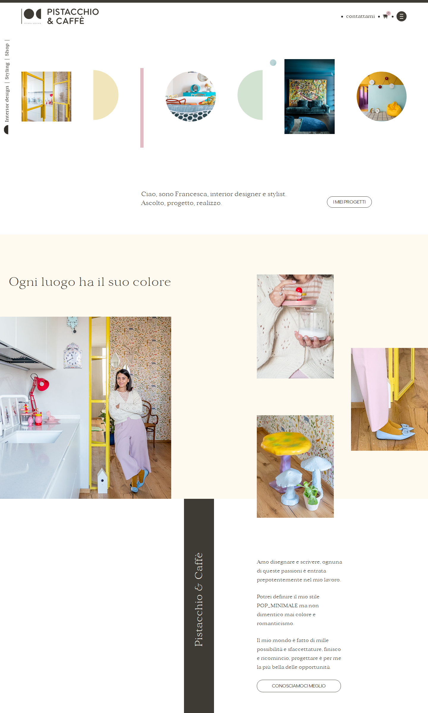
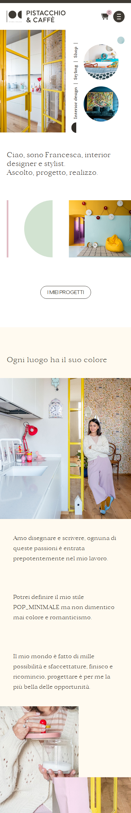

# UI Design System & Master Generation Blueprint: www-pistacchioecaffe-it

> **Pistacchio & Caffè** (http://www.pistacchioecaffe.it) — Scopri il mondo di Francesca, interior designer e stylist. Dal design d'interni allo styling personalizzato, troverai soluzioni creative...



---

## 1. Executive Visual Persona & Design Archetype

- **Brand Essence & Persona**: **Pistacchio & Caffè** (`http://www.pistacchioecaffe.it`). Scopri il mondo di Francesca, interior designer e stylist. Dal design d'interni allo styling personalizzato, troverai soluzioni creative...
- **Final Redirected URL**: [https://pistacchioecaffe.it/](https://pistacchioecaffe.it/)
- **Capture Provenance**: Live browser capture (`tier1_fast`, HTTP `200`, captured `2026-11-23`).
- **Visual Archetype**: **Light-Substrate Editorial & Modular Grid System (`#ffffff` canvas, `#302c27` ink, `#ff0000` accent)**.
- **Anti-AI-Slop Differentiators**:
  - **Live-Computed Chromatic Polarity**: Anchors the viewport in `#ffffff` (live computed `body` `background-color` (`computed_styles.json`)) paired with `#302c27` primary typography and `#ff0000` accents.
  - **Grounded Typographic Hierarchy**: Pairs `velourlight` for display copy (`Benvenuti nel mio mondo!`) with `velourlight` and not declared in live computed styles (uses primary stack / `ui-monospace`).
  - **Calibrated Spatial Grid & Motion**: Combines `100vw` container bounds (`gap: 0px 10px`, padding `72px`) with `cubic-bezier(0.645,0.045,0.355,1)` easing and GSAP Timeline & ScrollTrigger, Three.js / WebGL Canvas Pipeline.

---

## 2. Spatial Architecture & Modular Grid Mathematics



### Viewport Allocation & Container Geometry
- **Captured Viewport Dimensions**: Desktop `1440×2400px` (`assets/desktop.png`, clamped at 2400px live multi-section capture), Mobile `390×2400px` (`assets/mobile.png`, clamped at 2400px live multi-section capture).
- **Master Container Bounds**: `100vw` (non-`@media` desktop container stylesheet rule).
- **Canvas Lateral Padding & Spacing**: `72px` lateral canvas padding with `0px 10px` grid gap.
- **Border Radius Scale**: `100%`, `1px`, `4px`, `3px`.

### Responsive Breakpoint Architecture
- **Desktop Layout**: Multi-column CSS Grid / Flexbox layout at `1440px` (`max-width: 100vw`, `gap: 0px 10px`).
- **Mobile Layout**: Single-column vertical stack at `390px` viewport width with `72px` horizontal padding.
- **Extracted CSS Media Queries**: `@media only screen and (min-width:768px)`, `@media only screen and (min-width:1168px)`, `@media screen and (min-width:673px)`, `@media screen and (min-width:1040px)`.

---

## 3. Color System, Materiality & Atmospheric Lighting

### Semantic Palette & Source Grounding
| Semantic Role | Ground-Truth Value | Extracted Live / CSS Source |
|---|---|---|
| **Primary Canvas Substrate** | `#ffffff` | live computed `body` `background-color` (`computed_styles.json`) |
| **Primary Typography Ink** | `#302c27` | live computed `main` `color` (`computed_styles.json`) |
| **Elevated Surface / Card Substrate** | `#dddddd` | `var(--wp-editor-canvas-background)` in `:root` |
| **Interactive Accent / Highlight** | `#ff0000` | `.woocommerce a.remove { color: red }` (`#ff0000`) |
| **Secondary / Muted Copy** | `#767676` | `var(--wc-subtext)` in `:root` |
| **Structural Hairline Border** | `#ebebeb` | `var(--iub-granular-border)` in `:root` (`rgba(0, 0, 0, 0.08)`) |
| **Variable Token (`--text-main-color`)** | `#465565` | `var(--text-main-color)` in `:root` |
| **Variable Token (`--wp-block-synced-color`)** | `#7a00df` | `var(--wp-block-synced-color)` in `:root` |
| **Variable Token (`--wp-admin-theme-color`)** | `#007cba` | `var(--wp-admin-theme-color)` in `:root` |
| **Variable Token (`--wp-admin-theme-color-darker-10`)** | `#006ba1` | `var(--wp-admin-theme-color-darker-10)` in `:root` |
| **Variable Token (`--wp-admin-theme-color-darker-20`)** | `#005a87` | `var(--wp-admin-theme-color-darker-20)` in `:root` |
| **Variable Token (`--woocommerce`)** | `#720eec` | `var(--woocommerce)` in `:root` |
| **Variable Token (`--wc-green`)** | `#007518` | `var(--wc-green)` in `:root` |

### Sanitized Root CSS Variables (`ui-ux.md` Ground Truth)
| Variable Name | Extracted Value | Semantic Role |
|---|---|---|
| `--text-main-color` | `#465565` | Typography Ink Token |
| `--app-height` | `100%` | Layout / Spatial Grid Token |
| `--wp-block-synced-color` | `#7a00df` | Brand / Palette Token |
| `--wp-block-synced-color--rgb` | `122,0,223` | Brand / Palette Token |
| `--wp-bound-block-color` | `var(--wp-block-synced-color)` | Brand / Palette Token |
| `--wp-editor-canvas-background` | `#ddd` | Canvas / Surface Token |
| `--wp-admin-theme-color` | `#007cba` | Brand / Palette Token |
| `--wp-admin-theme-color--rgb` | `0,124,186` | Brand / Palette Token |
| `--wp-admin-theme-color-darker-10` | `#006ba1` | Canvas / Surface Token |
| `--wp-admin-theme-color-darker-10--rgb` | `0,107,160.5` | Canvas / Surface Token |
| `--wp-admin-theme-color-darker-20` | `#005a87` | Canvas / Surface Token |
| `--wp-admin-theme-color-darker-20--rgb` | `0,90,135` | Canvas / Surface Token |
| `--wp-admin-border-width-focus` | `2px` | Layout / Spatial Grid Token |
| `--wp-admin--admin-bar--position-offset` | `var(--wp-admin--admin-bar--height,0px)` | Dimension / Scale Token |
| `--woocommerce` | `#720eec` | Color / Atmospheric Token |
| `--wc-green` | `#007518` | Color / Atmospheric Token |

---

## 4. Typographic Scale & Editorial Hierarchy

### Font Family Stacks
- **Display Typography**: `velourlight`.
- **Primary Body Stack**: `velourlight`.
- **Technical / Metadata Stack**: not declared in live computed styles (uses primary stack / `ui-monospace`).

### Typographic Scale & Rules (Live Computed & Stylesheet Grounded)
- **Hero Display (`H1`)**: rule `h1` (`font-size: 3vw`, `line-height: 1.2`, `font-weight: normal`).
- **Section Heading (`H2`)**: live computed `h2` (`font-size: 43.2px`, `line-height: 51.84px`, `font-weight: 400`); rule `h2` (`font-size: 2.5vw`).
- **Body Copy**: live computed `body` (`font-size: 18px`, `line-height: 30px`, `font-weight: 400`); rule `body` (`font-size: 18px`, `line-height: 30px`, `font-weight: normal`).
- **Metadata & Navigation Labels**: live computed `nav/a` (`font-size: 18px`, `line-height: 30px`, `font-weight: 400`); rule `small` (`font-size: 15px`).

---

## 5. Choreographed Motion & Interaction Physics

### Primary Easing Curves
- **Extracted Timing Functions**: `cubic-bezier(0.645,0.045,0.355,1)`, `cubic-bezier(0.165,0.84,0.44,1)`, `cubic-bezier(0.895,0.03,0.685,0.22)`.

### Per-Element Transition & Choreography Rules
- **Selector `.hamburger`**: `transition: 0.15s` extracted from `www-pistacchioecaffe-it` stylesheet.
- **Selector `.hamburger-inner::after`**: `transition: 0.15s` extracted from `www-pistacchioecaffe-it` stylesheet.
- **Selector `.hamburger--3dx .hamburger-inner`**: `transition: transform 0.15s cubic-bezier(0.645,0.045,0.355,1), backgrou...` extracted from `www-pistacchioecaffe-it` stylesheet.
- **Extracted Easing Curve (`cubic-bezier(0.645,0.045,0.355,1)`)**: Governs interactive state transitions across `<header.site-header>` and `<article.page>`.
- **Runtime Interaction Engine**: Integrates GSAP Timeline & ScrollTrigger, Three.js / WebGL Canvas Pipeline with `prefers-reduced-motion: reduce` fallback guards.

---

## 6. Component Wireframe & Structural DOM Map

### Visual Layout Schematic — Desktop (`1440px`, Grounded in `dom.html` & Landmark Bounding Boxes)
```
┌────────────────────────────────────────────────────────────────────────┐
│ DESKTOP VIEWPORT (1440px) — Pistacchio & Caffè                         │
│ ====================================================================== │
│ [ <header.site-header> (1440x101px)   | contattami · 0,00 €          ] │
│ ---------------------------------------------------------------------- │
│ | HERO STAGE: <article.post-7> (w=1440px)                            | │
│ | H1: Benvenuti nel mio mondo!                                       | │
│ | Substrate: #ffffff | Ink: #302c27 | Accent: #ff0000                | │
│ ---------------------------------------------------------------------- │
│ | SHOWCASE GRID (<article.page>) max-w: 100vw                        | │
│ | +------------------------------+  +------------------------------+ | │
│ | | E colore sia.                |  | Progetto per te.             | | │
│ | +------------------------------+  +------------------------------+ | │
│ ---------------------------------------------------------------------- │
│ | DETAIL MODULE (<article.type-page>) — Ogni luogo ha il suo         | │
│ ---------------------------------------------------------------------- │
│ [ FOOTER (<footer.site-footer>) | http://www.pistacchioecaffe.it       │
└────────────────────────────────────────────────────────────────────────┘
```

### Visual Layout Schematic — Mobile Reflow (`390px`)
```
┌────────────────────────────────────────────────────────────────────────┐
│ MOBILE VIEWPORT REFLOW (390px) — Single-Column Stack (gap: 0px 10px)   │
│ ====================================================================== │
│ [ HEADER BAR (<header.site-header>    ) | Compact Menu (390px)         │
│ ---------------------------------------------------------------------- │
│ | HERO STAGE (<article.post-7>) — 390px Vertical Lead                | │
│ | H1: Benvenuti nel mio mondo!                                       | │
│ ---------------------------------------------------------------------- │
│ | SHOWCASE STACK (<article.page>) — 1-Col Stack                      | │
│ | [ Item 1: E colore sia.                                          ] | │
│ | [ Item 2: Progetto per te.                                       ] | │
│ ---------------------------------------------------------------------- │
│ | DETAIL STACK (<article.type-page>) — 1-Col (Ogni luogo ha il s)    | │
│ ---------------------------------------------------------------------- │
│ [ FOOTER (<footer.site-footer>) | Stacked 390px Colophon               │
└────────────────────────────────────────────────────────────────────────┘
```

### Granular DOM Region Breakdown
1. **Brand Header & Navigation Bar (<header.site-header> — `www-pistacchioecaffe-it`)**:
   - Landmark `<header class="site-header">` (`1440x101px`) hosting `Pistacchio & Caffè` navigation (`contattami · 0,00 €`), DOM attributes (`data-cmp-ab="2"`, `data-cmp-info="10"`, `data-cmp-vendor="289"`, `data-cmp-info="2"`), and stylesheet rule `urger.is-active .hamburger-inner:... { background-color: FFFAF0; }`.
2. **Hero Stage & Focal Lead (<article.post-7> — `Benvenuti nel mio mondo!`)**:
   - Landmark `<article class="post-7 page">` presenting display lead `Benvenuti nel mio mondo!` and copy excerpt *"Ciao, sono Francesca, interior designer e stylist. Ascolto, proge"* over `#ffffff` canvas and `#302c27` ink.
3. **Primary Showcase & Content Grid (<article.page> — `E colore sia.`)**:
   - Landmark `<article class="post-7 page">` rendering section `E colore sia.` with copy *"Amo disegnare e scrivere, ognuna di queste passioni è entrata pre"*, asset references (`recaptcha__en.js`, `30300652.js`, `core-it.js`, `jquery.min.js`), and grid rule `.hamburger-inner { display: block; top: 50%; margin-top: -1px; }`.
4. **Interactive Detail & Feature Matrix (<article.type-page> — `Progetto per te.`)**:
   - Landmark `<article class="post-7 page">` framing `Progetto per te.` and `Ogni luogo ha il suo colore` (*"Potrei definire il mio stile POP_MINIMALE ma non dimentico mai co"*) with `#dddddd` surface cards, `#ff0000` accents, and `.hamburger-inner::after { content: ""; display: block; }`.
5. **Colophon & Global Directory Footer (<footer.site-footer> — `http://www.pistacchioecaffe.it`)**:
   - Landmark `<footer class="site-footer contenitore-flex">` anchoring `Pistacchio & Caffè` footer links (`contattami · 0,00 €`), copy *"Il mio mondo è fatto di mille possibilità e sfaccettature, f"*, and `#ebebeb` structural dividers.

---

## 7. Master Zero-Shot AI Generation Prompt

```markdown
# Master Zero-Shot Frontend Generation Prompt: www-pistacchioecaffe-it (Pistacchio & Caffè)

You are a principal frontend architect and design systems engineer. Build a complete, production-ready web application replicating the exact design system, DOM landmarks, typographic hierarchy, color tokens, and motion physics of `www-pistacchioecaffe-it` (**Pistacchio & Caffè** — `http://www.pistacchioecaffe.it`).

### 1. Visual Archetype & Anti-AI-Slop Mandates
- **Archetype**: Light-Substrate Editorial & Modular Grid System (`#ffffff` canvas, `#302c27` ink, `#ff0000` accent).
- **Identity & Domain Context**: Scopri il mondo di Francesca, interior designer e stylist. Dal design d'interni allo styling personalizzato, troverai soluzioni creative...
- **Primary Substrate**: `#ffffff` (live computed `body` `background-color` (`computed_styles.json`)), **Primary Ink**: `#302c27`, **Accent / Highlight**: `#ff0000`.
- **Site-Specific Differentiators**:
  - **Live-Computed Chromatic Polarity**: Anchors the viewport in `#ffffff` (live computed `body` `background-color` (`computed_styles.json`)) paired with `#302c27` primary typography and `#ff0000` accents.
  - **Grounded Typographic Hierarchy**: Pairs `velourlight` for display copy (`Benvenuti nel mio mondo!`) with `velourlight` and not declared in live computed styles (uses primary stack / `ui-monospace`).
  - **Calibrated Spatial Grid & Motion**: Combines `100vw` container bounds (`gap: 0px 10px`, padding `72px`) with `cubic-bezier(0.645,0.045,0.355,1)` easing and GSAP Timeline & ScrollTrigger, Three.js / WebGL Canvas Pipeline.

### 2. Ground-Truth CSS Variables (`:root` Token Contract)
Declare and consume these exact custom properties extracted from `www-pistacchioecaffe-it` in your global stylesheet:

:root {
  /* Pistacchio & Caffè (www-pistacchioecaffe-it) — Live-Grounded CSS Variables */
  --text-main-color: #465565; /* Typography Ink Token (www-pistacchioecaffe-it) */
  --app-height: 100%; /* Layout / Spatial Grid Token (www-pistacchioecaffe-it) */
  --wp-block-synced-color: #7a00df; /* Brand / Palette Token (www-pistacchioecaffe-it) */
  --wp-block-synced-color--rgb: 122,0,223; /* Brand / Palette Token (www-pistacchioecaffe-it) */
  --wp-bound-block-color: var(--wp-block-synced-color); /* Brand / Palette Token (www-pistacchioecaffe-it) */
  --wp-editor-canvas-background: #ddd; /* Canvas / Surface Token (www-pistacchioecaffe-it) */
  --wp-admin-theme-color: #007cba; /* Brand / Palette Token (www-pistacchioecaffe-it) */
  --wp-admin-theme-color--rgb: 0,124,186; /* Brand / Palette Token (www-pistacchioecaffe-it) */
  --wp-admin-theme-color-darker-10: #006ba1; /* Canvas / Surface Token (www-pistacchioecaffe-it) */
  --wp-admin-theme-color-darker-10--rgb: 0,107,160.5; /* Canvas / Surface Token (www-pistacchioecaffe-it) */
  --wp-admin-theme-color-darker-20: #005a87; /* Canvas / Surface Token (www-pistacchioecaffe-it) */
  --wp-admin-theme-color-darker-20--rgb: 0,90,135; /* Canvas / Surface Token (www-pistacchioecaffe-it) */
  --wp-admin-border-width-focus: 2px; /* Layout / Spatial Grid Token (www-pistacchioecaffe-it) */
  --wp-admin--admin-bar--position-offset: var(--wp-admin--admin-bar--height,0px); /* Dimension / Scale Token (www-pistacchioecaffe-it) */
  --woocommerce: #720eec; /* Color / Atmospheric Token (www-pistacchioecaffe-it) */
  --wc-green: #007518; /* Color / Atmospheric Token (www-pistacchioecaffe-it) */
}

### 3. Semantic Color & Materiality Contract
Map every surface, ink, and border strictly to these source-grounded tokens:
- **Primary Canvas Substrate**: `#ffffff` — grounded in live computed `body` `background-color` (`computed_styles.json`)
- **Primary Typography Ink**: `#302c27` — grounded in live computed `main` `color` (`computed_styles.json`)
- **Elevated Surface / Card Substrate**: `#dddddd` — grounded in `var(--wp-editor-canvas-background)` in `:root`
- **Interactive Accent / Highlight**: `#ff0000` — grounded in `.woocommerce a.remove { color: red }` (`#ff0000`)
- **Secondary / Muted Copy**: `#767676` — grounded in `var(--wc-subtext)` in `:root`
- **Structural Hairline Border**: `#ebebeb` — grounded in `var(--iub-granular-border)` in `:root` (`rgba(0, 0, 0, 0.08)`)
- **Variable Token (`--text-main-color`)**: `#465565` — grounded in `var(--text-main-color)` in `:root`
- **Variable Token (`--wp-block-synced-color`)**: `#7a00df` — grounded in `var(--wp-block-synced-color)` in `:root`
- **Variable Token (`--wp-admin-theme-color`)**: `#007cba` — grounded in `var(--wp-admin-theme-color)` in `:root`
- **Variable Token (`--wp-admin-theme-color-darker-10`)**: `#006ba1` — grounded in `var(--wp-admin-theme-color-darker-10)` in `:root`
- **Variable Token (`--wp-admin-theme-color-darker-20`)**: `#005a87` — grounded in `var(--wp-admin-theme-color-darker-20)` in `:root`
- **Variable Token (`--woocommerce`)**: `#720eec` — grounded in `var(--woocommerce)` in `:root`
- **Variable Token (`--wc-green`)**: `#007518` — grounded in `var(--wc-green)` in `:root`

### 4. Spatial Grid, Container Bounds & Responsive Breakpoints
- **Desktop Viewport Reference**: `1440×2400px` (clamped at 2400px live multi-section capture, `1440px` standard desktop width).
- **Mobile Viewport Reference**: `390×2400px` (clamped at 2400px live multi-section capture, `390px` standard mobile width).
- **Container Max-Width**: `100vw` (non-`@media` desktop container stylesheet rule)
- **Padding & Gutters**: `72px` lateral canvas padding with `0px 10px` grid gap
- **Desktop Grid**: Multi-column CSS Grid / Flexbox layout at `1440px` (`max-width: 100vw`, `gap: 0px 10px`)
- **Mobile Adaptation**: Single-column vertical stack at `390px` viewport width with `72px` horizontal padding
- **Media Queries**: `@media only screen and (min-width:768px)`, `@media only screen and (min-width:1168px)`, `@media screen and (min-width:673px)`, `@media screen and (min-width:1040px)`
- **Corner Radii**: `100%`, `1px`, `4px`, `3px`

### 5. Typography & Editorial Scale Contract
- **Display Font Stack**: `velourlight`
- **Body Font Stack**: `velourlight`
- **Monospace / Technical Font Stack**: not declared in live computed styles (uses primary stack / `ui-monospace`)
- **H1 Display Rule**: rule `h1` (`font-size: 3vw`, `line-height: 1.2`, `font-weight: normal`)
- **H2 Section Rule**: live computed `h2` (`font-size: 43.2px`, `line-height: 51.84px`, `font-weight: 400`); rule `h2` (`font-size: 2.5vw`)
- **Body Copy Rule**: live computed `body` (`font-size: 18px`, `line-height: 30px`, `font-weight: 400`); rule `body` (`font-size: 18px`, `line-height: 30px`, `font-weight: normal`)
- **Metadata & Index Rule**: live computed `nav/a` (`font-size: 18px`, `line-height: 30px`, `font-weight: 400`); rule `small` (`font-size: 15px`)

### 6. Component Hierarchy, Verbatim Copy & Real DOM Landmarks
Scaffold `www-pistacchioecaffe-it` (`Pistacchio & Caffè`) with these exact structural regions, extracted copy, and CSS rules from `dom.html`:
1. **Brand Header & Navigation Bar (<header.site-header> — `www-pistacchioecaffe-it`)**:
   - DOM & Selectors: Landmark `<header class="site-header">` (`1440x101px`) hosting `Pistacchio & Caffè` navigation (`contattami · 0,00 €`), DOM attributes (`data-cmp-ab="2"`, `data-cmp-info="10"`, `data-cmp-vendor="289"`, `data-cmp-info="2"`), and stylesheet rule `urger.is-active .hamburger-inner:... { background-color: FFFAF0; }`.
   - Responsive Contract: Header `Brand Header & Navigation Bar (<header.site-header> — `www-pistacchioecaffe-it`)` (`www-pistacchioecaffe-it`) adapts across `@media only screen and (min-width:768px)`, `@media only screen and (min-width:1168px)`, `@media screen and (min-width:673px)`, `@media screen and (min-width:1040px)` with `cubic-bezier(0.645,0.045,0.355,1)`, `cubic-bezier(0.165,0.84,0.44,1)`, `cubic-bezier(0.895,0.03,0.685,0.22)` transitions and links `contattami · 0,00 €`.
2. **Hero Stage & Focal Lead (<article.post-7> — `Benvenuti nel mio mondo!`)**:
   - DOM & Selectors: Landmark `<article class="post-7 page">` presenting display lead `Benvenuti nel mio mondo!` and copy excerpt *"Ciao, sono Francesca, interior designer e stylist. Ascolto, proge"* over `#ffffff` canvas and `#302c27` ink.
   - Responsive Contract: Hero stage (`1440×2400px` desktop / `390×2400px` mobile) sets `#ffffff` background with `#302c27` headline `Benvenuti nel mio mondo!`.
3. **Primary Showcase & Content Grid (<article.page> — `E colore sia.`)**:
   - DOM & Selectors: Landmark `<article class="post-7 page">` rendering section `E colore sia.` with copy *"Amo disegnare e scrivere, ognuna di queste passioni è entrata pre"*, asset references (`recaptcha__en.js`, `30300652.js`, `core-it.js`, `jquery.min.js`), and grid rule `.hamburger-inner { display: block; top: 50%; margin-top: -1px; }`.
   - Responsive Contract: Showcase grid `Primary Showcase & Content Grid (<article.page> — `E colore sia.`)` applies Multi-column CSS Grid / Flexbox layout at `1440px` (`max-width: 100vw`, `gap: 0px 10px`) on desktop and Single-column vertical stack at `390px` viewport width with `72px` horizontal padding on mobile.
4. **Interactive Detail & Feature Matrix (<article.type-page> — `Progetto per te.`)**:
   - DOM & Selectors: Landmark `<article class="post-7 page">` framing `Progetto per te.` and `Ogni luogo ha il suo colore` (*"Potrei definire il mio stile POP_MINIMALE ma non dimentico mai co"*) with `#dddddd` surface cards, `#ff0000` accents, and `.hamburger-inner::after { content: ""; display: block; }`.
   - Responsive Contract: Detail module `Interactive Detail & Feature Matrix (<article.type-page> — `Progetto per te.`)` uses `100%`, `1px`, `4px`, `3px` radii, `#ff0000` highlights, and assets (recaptcha__en.js, 30300652.js, core-it.js).
5. **Colophon & Global Directory Footer (<footer.site-footer> — `http://www.pistacchioecaffe.it`)**:
   - DOM & Selectors: Landmark `<footer class="site-footer contenitore-flex">` anchoring `Pistacchio & Caffè` footer links (`contattami · 0,00 €`), copy *"Il mio mondo è fatto di mille possibilità e sfaccettature, f"*, and `#ebebeb` structural dividers.
   - Responsive Contract: Footer `Colophon & Global Directory Footer (<footer.site-footer> — `http://www.pistacchioecaffe.it`)` aligns to `100vw` (non-`@media` desktop container stylesheet rule) with `72px` lateral canvas padding with `0px 10px` grid gap and attributes (data-cmp-ab="2", data-cmp-info="10", data-cmp-vendor="289").

#### Verbatim DOM Copy Excerpts (`dom.html`)
- Copy Excerpt 1: *"Ciao, sono Francesca, interior designer e stylist. Ascolto, progetto, realizzo."*
- Copy Excerpt 2: *"Amo disegnare e scrivere, ognuna di queste passioni è entrata prepotentemente nel..."*
- Copy Excerpt 3: *"Potrei definire il mio stile POP_MINIMALE ma non dimentico mai colore e romanticismo."*
- Copy Excerpt 4: *"Il mio mondo è fatto di mille possibilità e sfaccettature, finisco e ricomincio, p..."*

### 7. Motion, Extracted Stylesheet Rules & Interaction Choreography
- **Primary Easing Functions**: `cubic-bezier(0.645,0.045,0.355,1)`, `cubic-bezier(0.165,0.84,0.44,1)`, `cubic-bezier(0.895,0.03,0.685,0.22)`
- **Extracted Stylesheet Rules (`www-pistacchioecaffe-it`)**:
- `urger.is-active .hamburger-inner:... { background-color: FFFAF0; }`
- `.hamburger-inner { display: block; top: 50%; margin-top: -1px; }`
- `.hamburger-inner::after { content: ""; display: block; }`
- `.hamburger-inner::before { top: -7px; }`
- `.hamburger--3dx .hamburger-box { perspective: 80px; }`
- **Per-Selector Transition Rules**:
- **Selector `.hamburger`**: `transition: 0.15s` extracted from `www-pistacchioecaffe-it` stylesheet.
- **Selector `.hamburger-inner::after`**: `transition: 0.15s` extracted from `www-pistacchioecaffe-it` stylesheet.
- **Selector `.hamburger--3dx .hamburger-inner`**: `transition: transform 0.15s cubic-bezier(0.645,0.045,0.355,1), backgrou...` extracted from `www-pistacchioecaffe-it` stylesheet.
- **Extracted Easing Curve (`cubic-bezier(0.645,0.045,0.355,1)`)**: Governs interactive state transitions across `<header.site-header>` and `<article.page>`.
- **Runtime Interaction Engine**: Integrates GSAP Timeline & ScrollTrigger, Three.js / WebGL Canvas Pipeline with `prefers-reduced-motion: reduce` fallback guards.

### 8. Technical Deliverables
- Implement in Next.js (App Router) with TypeScript and Tailwind CSS consuming the `:root` custom properties defined above for `www-pistacchioecaffe-it`.
- Reproduce both the `1440px` desktop architecture and `390px` mobile breakpoint transitions, preserving semantic HTML5 landmarks (`<header>`, `<nav>`, `<main>`, `<section>`, `<footer>`) and `prefers-reduced-motion` accessibility guards.
```
