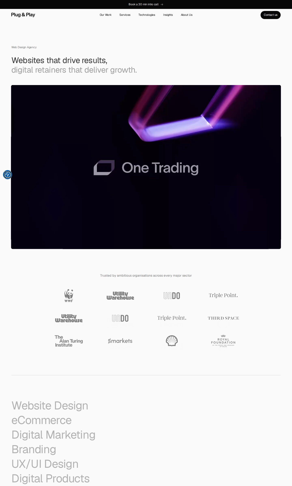

# UI Design System & Master Generation Blueprint: www-plugandplaydesign-co-uk

> **Web Design Agency London & Guildford · Plug & Play** (https://www.plugandplaydesign.co.uk/) — Award-winning web design agency in London and Guildford. High-performance websites and digital retainers that drive measurable growth.



---

## 1. Executive Visual Persona & Design Archetype

- **Brand Essence & Persona**: **Web Design Agency London & Guildford · Plug & Play** (`https://www.plugandplaydesign.co.uk/`). Award-winning web design agency in London and Guildford. High-performance websites and digital retainers that drive measurable growth.
- **Capture Provenance**: Live browser capture (`tier1_fast`, HTTP `200`, captured `2026-11-23`).
- **Visual Archetype**: **Light-Substrate Editorial & Modular Grid System (`#fafafa` canvas, `#080808` ink, `#1863dc` accent)**.
- **Anti-AI-Slop Differentiators**:
  - **Live-Computed Chromatic Polarity**: Anchors the viewport in `#fafafa` (live computed `body` `background-color` (`computed_styles.json`)) paired with `#080808` primary typography and `#1863dc` accents.
  - **Grounded Typographic Hierarchy**: Pairs `Geist` for display copy (`Web Design Agency in London and Surr`) with `Geist` and `Geist Mono`.
  - **Calibrated Spatial Grid & Motion**: Combines `1328px` container bounds (`gap: 8px`, padding `48px`) with `cubic-bezier(0,0,.2,1)` easing and Three.js / WebGL Canvas Pipeline, Swiper Touch Carousel Engine.

---

## 2. Spatial Architecture & Modular Grid Mathematics


### Viewport Allocation & Container Geometry
- **Captured Viewport Dimensions**: Desktop `1440×2400px` (`assets/desktop.png`, clamped at 2400px live multi-section capture), Mobile `390×2400px` (`assets/mobile.png`, clamped at 2400px live multi-section capture).
- **Master Container Bounds**: `1328px` (measured widest bounded `<section>` landmark width on `1440px` desktop).
- **Canvas Lateral Padding & Spacing**: `48px` lateral canvas padding with `8px` grid gap.
- **Border Radius Scale**: `3.35544e+07px`, `.25rem`, `var(--radius-cursor-tooltip)`, `var(--radius-full)`.

### Responsive Breakpoint Architecture
- **Desktop Layout**: Multi-column CSS Grid / Flexbox layout at `1440px` (`max-width: 1328px`, `gap: 8px`).
- **Mobile Layout**: Single-column vertical stack at `390px` viewport width with `48px` horizontal padding.
- **Extracted CSS Media Queries**: `@media (min-width:40rem)`, `@media (min-width:48rem)`, `@media (min-width:64rem)`, `@media (min-width:67.5rem)`.

---

## 3. Color System, Materiality & Atmospheric Lighting

### Semantic Palette & Source Grounding
| Semantic Role | Ground-Truth Value | Extracted Live / CSS Source |
|---|---|---|
| **Primary Canvas Substrate** | `#fafafa` | live computed `body` `background-color` (`computed_styles.json`) |
| **Primary Typography Ink** | `#080808` | live computed `main` `color` (`computed_styles.json`) |
| **Elevated Surface / Card Substrate** | `#ffffff` | `.bg-white { background-color: white }` (`#ffffff`) |
| **Interactive Accent / Highlight** | `#1863dc` | `.cky-dma-content-wrapper button... { color: #1863dc }` |
| **Secondary / Muted Copy** | `#808080` | live computed `p` `color` (`computed_styles.json`) |
| **Structural Hairline Border** | `#1863dc` | `.cky-btn-customize { border: #1863dc }` |

### Sanitized Root CSS Variables (`ui-ux.md` Ground Truth)
| Variable Name | Extracted Value | Semantic Role |
|---|---|---|
| `--page-margin` | `1rem` | Layout / Spatial Grid Token |
| `--content-width` | `calc(100vw - 2rem)` | Layout / Spatial Grid Token |
| `--spacing-scrolling-copy` | `calc((var(--scrolling-items-width) - 2.5rem) * 6 / 10)` | Typography Ink Token |
| `--spacing-scrolling-media` | `calc((var(--scrolling-items-width) - 2.5rem) * 4 / 10)` | Layout / Spatial Grid Token |
| `--spacing-scrolling-media-adjacent` | `calc((var(--scrolling-items-width) - 2.5rem) * 4.5 / 10)` | Layout / Spatial Grid Token |
| `--spacing-scrolling-expanded` | `calc((var(--scrolling-items-width) - 2.5rem) * 5.5 / 10)` | Layout / Spatial Grid Token |
| `--background` | `var(--color-grey-50)` | Canvas / Surface Token |
| `--background-secondary` | `var(--color-grey-100)` | Canvas / Surface Token |
| `--background-tertiary` | `var(--color-grey-200)` | Canvas / Surface Token |
| `--background-raised` | `var(--color-white)` | Canvas / Surface Token |
| `--background-glass` | `#fafafa01` | Canvas / Surface Token |
| `--foreground` | `var(--color-grey-950)` | Typography Ink Token |
| `--foreground-secondary` | `var(--color-grey-700)` | Typography Ink Token |
| `--foreground-tertiary` | `var(--color-grey-500)` | Typography Ink Token |
| `--foreground-inactive` | `var(--color-grey-400)` | Typography Ink Token |
| `--foreground-muted` | `var(--color-grey-600)` | Typography Ink Token |

---

## 4. Typographic Scale & Editorial Hierarchy

### Font Family Stacks
- **Display Typography**: `Geist`.
- **Primary Body Stack**: `Geist`.
- **Technical / Metadata Stack**: `Geist Mono`.

### Typographic Scale & Rules (Live Computed & Stylesheet Grounded)
- **Hero Display (`H1`)**: live computed `h1` (`font-size: 14px`, `line-height: 19.6px`, `font-weight: 400`, `letter-spacing: -0.28px`); rule `h1` (`font-size: var(--text-body-sm)`, `line-height: var(--tw-leading,var(...`, `letter-spacing: var(--tw-tracking,var...`).
- **Section Heading (`H2`)**: live computed `h2` (`font-size: 14px`, `line-height: 19.6px`, `font-weight: 400`, `letter-spacing: -0.28px`); rule `h2` (`font-size: var(--text-body-sm)`, `line-height: var(--tw-leading,var(...`, `letter-spacing: var(--tw-tracking,var...`).
- **Body Copy**: live computed `body` (`font-size: 16px`, `line-height: 24px`, `font-weight: 400`); CSS variables `--text-body-sm: .875rem`, `--text-body-sm--line-height: 1.4`, `--text-body-sm--letter-spacing: -.02em`.
- **Metadata & Navigation Labels**: live computed `nav/a` (`font-size: 16px`, `line-height: 24px`, `font-weight: 400`); CSS variables `--font-mono: "Geist Mono",ui-monospace,"SF Mono",Menlo,monospace`, `--default-mono-font-family: var(--font-mono)`, `--text-caption: .75rem`.

---

## 5. Choreographed Motion & Interaction Physics

### Primary Easing Curves
- **Extracted Timing Functions**: `cubic-bezier(0,0,.2,1)`, `cubic-bezier(.4,0,.2,1)`, `cubic-bezier(.7,.2,.18,.85)`.

### Per-Element Transition & Choreography Rules
- **Selector `layer theme`**: `transition: .15s` extracted from `www-plugandplaydesign-co-uk` stylesheet.
- **Selector `.transition`**: `transition: var(--tw-ease,var(--default-transition-timing-function))` extracted from `www-plugandplaydesign-co-uk` stylesheet.
- **Selector `opacity\]`**: `transition: var(--tw-ease,var(--default-transition-timing-function))` extracted from `www-plugandplaydesign-co-uk` stylesheet.
- **Extracted Easing Curve (`cubic-bezier(0,0,.2,1)`)**: Governs interactive state transitions across `<header.inset-x-0>` and `<section.bg-background>`.
- **Runtime Interaction Engine**: Integrates Three.js / WebGL Canvas Pipeline, Swiper Touch Carousel Engine with `prefers-reduced-motion: reduce` fallback guards.

---

## 6. Component Wireframe & Structural DOM Map

### Visual Layout Schematic — Desktop (`1440px`, Grounded in `dom.html` & Landmark Bounding Boxes)
```
┌────────────────────────────────────────────────────────────────────────┐
│ DESKTOP VIEWPORT (1440px) — Web Design Agency London & Guildford · Plu │
│ ====================================================================== │
│ [ <header.inset-x-0> (1440x60px)      | Web Design · Branding · Digi ] │
│ ---------------------------------------------------------------------- │
│ | HERO STAGE: <section.px-page> (w=1440px)                           | │
│ | H1: Web Design Agency in London and Surrey                         | │
│ | Substrate: #fafafa | Ink: #080808 | Accent: #1863dc                | │
│ ---------------------------------------------------------------------- │
│ | SHOWCASE GRID (<section.bg-background>) max-w: 1328px              | │
│ | +------------------------------+  +------------------------------+ | │
│ | | Web Design Agency            |  | Websites that drive results, | | │
│ | +------------------------------+  +------------------------------+ | │
│ ---------------------------------------------------------------------- │
│ | DETAIL MODULE (<section.w-screen>) — Critical thinking. Cr         | │
│ ---------------------------------------------------------------------- │
│ [ FOOTER (<footer.bg-backgroun) | https://www.plugandplaydesign.co.uk  │
└────────────────────────────────────────────────────────────────────────┘
```

### Visual Layout Schematic — Mobile Reflow (`390px`)
```
┌────────────────────────────────────────────────────────────────────────┐
│ MOBILE VIEWPORT REFLOW (390px) — Single-Column Stack (gap: 8px)        │
│ ====================================================================== │
│ [ HEADER BAR (<header.inset-x-0>      ) | Compact Menu (390px)         │
│ ---------------------------------------------------------------------- │
│ | HERO STAGE (<section.px-page>) — 390px Vertical Lead               | │
│ | H1: Web Design Agency in London and Surrey                         | │
│ ---------------------------------------------------------------------- │
│ | SHOWCASE STACK (<section.bg-background) — 1-Col Stack              | │
│ | [ Item 1: Web Design Agency                                      ] | │
│ | [ Item 2: Websites that drive results, digital retainers th...   ] | │
│ ---------------------------------------------------------------------- │
│ | DETAIL STACK (<section.w-screen>) — 1-Col (Critical thinking.)     | │
│ ---------------------------------------------------------------------- │
│ [ FOOTER (<footer.bg-backgroun) | Stacked 390px Colophon               │
└────────────────────────────────────────────────────────────────────────┘
```

### Granular DOM Region Breakdown
1. **Brand Header & Navigation Bar (<header.inset-x-0> — `www-plugandplaydesign-co-uk`)**:
   - Landmark `<header class="inset-x-0 z-40">` (`1440x60px`) hosting `Web Design Agency London & Guildford` navigation (`Web Design · Branding · Digital Marketing · UX / UI Design · eCommerce`), DOM attributes (`data-hero-enter`, `data-precedence="next"`, `data-precedence="next"`, `data-domain="plugandplaydesign.co.uk"`), and stylesheet rule `before { box-sizing:border-box;border:0 solid;margin:0;padding:0 }`.
2. **Hero Stage & Focal Lead (<section.px-page> — `Web Design Agency in London and Su`)**:
   - Landmark `<section class="px-page pt-section">` presenting display lead `Web Design Agency in London and Surrey` and copy excerpt *"Plug and Play is a creative web design agency based in Guildford,"* over `#fafafa` canvas and `#080808` ink.
3. **Primary Showcase & Content Grid (<section.bg-background> — `Web Design Agency`)**:
   - Landmark `<section class="bg-background px-page">` rendering section `Web Design Agency` with copy *"Websites that drive results,"*, asset references (`ca4cfa437ae45d18.css`, `dd5d352a082118c1.css`, `webpack-43624c9fe997cbf4.js`, `clarity.js`), and grid rule `file-selector-button { box-sizing:border-box;border:0 solid;margin:0;padding:0 }`.
4. **Interactive Detail & Feature Matrix (<section.w-screen> — `Websites that drive results, digit`)**:
   - Landmark `<section class="w-screen">` framing `Websites that drive results, digital retainers th...` and `Critical thinking. Creativity. Innovation.` (*"digital retainers that deliver growth."*) with `#ffffff` surface cards, `#1863dc` accents, and `strong { font-weight:bolder }`.
5. **Colophon & Global Directory Footer (<footer.bg-background> — `https://www.plugandplaydesign.co.uk/`)**:
   - Landmark `<footer class="bg-background px-page">` anchoring `Web Design Agency London & Guild` footer links (`Web Design · Branding · Digital Marketing · UX / UI Design · eCommerce`), copy *"Trusted by ambitious organisations across every major sector"*, and `#1863dc` structural dividers.

---

## 7. Master Zero-Shot AI Generation Prompt

```markdown
# Master Zero-Shot Frontend Generation Prompt: www-plugandplaydesign-co-uk (Web Design Agency London & Guildford · Plug & Play)

You are a principal frontend architect and design systems engineer. Build a complete, production-ready web application replicating the exact design system, DOM landmarks, typographic hierarchy, color tokens, and motion physics of `www-plugandplaydesign-co-uk` (**Web Design Agency London & Guildford · Plug & Play** — `https://www.plugandplaydesign.co.uk/`).

### 1. Visual Archetype & Anti-AI-Slop Mandates
- **Archetype**: Light-Substrate Editorial & Modular Grid System (`#fafafa` canvas, `#080808` ink, `#1863dc` accent).
- **Identity & Domain Context**: Award-winning web design agency in London and Guildford. High-performance websites and digital retainers that drive measurable growth.
- **Primary Substrate**: `#fafafa` (live computed `body` `background-color` (`computed_styles.json`)), **Primary Ink**: `#080808`, **Accent / Highlight**: `#1863dc`.
- **Site-Specific Differentiators**:
  - **Live-Computed Chromatic Polarity**: Anchors the viewport in `#fafafa` (live computed `body` `background-color` (`computed_styles.json`)) paired with `#080808` primary typography and `#1863dc` accents.
  - **Grounded Typographic Hierarchy**: Pairs `Geist` for display copy (`Web Design Agency in London and Surr`) with `Geist` and `Geist Mono`.
  - **Calibrated Spatial Grid & Motion**: Combines `1328px` container bounds (`gap: 8px`, padding `48px`) with `cubic-bezier(0,0,.2,1)` easing and Three.js / WebGL Canvas Pipeline, Swiper Touch Carousel Engine.

### 2. Ground-Truth CSS Variables (`:root` Token Contract)
Declare and consume these exact custom properties extracted from `www-plugandplaydesign-co-uk` in your global stylesheet:

:root {
  /* Web Design Agency London & Guildford · Plug & Play (www-plugandplaydesign-co-uk) — Live-Grounded CSS Variables */
  --page-margin: 1rem; /* Layout / Spatial Grid Token (www-plugandplaydesign-co-uk) */
  --content-width: calc(100vw - 2rem); /* Layout / Spatial Grid Token (www-plugandplaydesign-co-uk) */
  --spacing-scrolling-copy: calc((var(--scrolling-items-width) - 2.5rem) * 6 / 10); /* Typography Ink Token (www-plugandplaydesign-co-uk) */
  --spacing-scrolling-media: calc((var(--scrolling-items-width) - 2.5rem) * 4 / 10); /* Layout / Spatial Grid Token (www-plugandplaydesign-co-uk) */
  --spacing-scrolling-media-adjacent: calc((var(--scrolling-items-width) - 2.5rem) * 4.5 / 10); /* Layout / Spatial Grid Token (www-plugandplaydesign-co-uk) */
  --spacing-scrolling-expanded: calc((var(--scrolling-items-width) - 2.5rem) * 5.5 / 10); /* Layout / Spatial Grid Token (www-plugandplaydesign-co-uk) */
  --background: var(--color-grey-50); /* Canvas / Surface Token (www-plugandplaydesign-co-uk) */
  --background-secondary: var(--color-grey-100); /* Canvas / Surface Token (www-plugandplaydesign-co-uk) */
  --background-tertiary: var(--color-grey-200); /* Canvas / Surface Token (www-plugandplaydesign-co-uk) */
  --background-raised: var(--color-white); /* Canvas / Surface Token (www-plugandplaydesign-co-uk) */
  --background-glass: #fafafa01; /* Canvas / Surface Token (www-plugandplaydesign-co-uk) */
  --foreground: var(--color-grey-950); /* Typography Ink Token (www-plugandplaydesign-co-uk) */
  --foreground-secondary: var(--color-grey-700); /* Typography Ink Token (www-plugandplaydesign-co-uk) */
  --foreground-tertiary: var(--color-grey-500); /* Typography Ink Token (www-plugandplaydesign-co-uk) */
  --foreground-inactive: var(--color-grey-400); /* Typography Ink Token (www-plugandplaydesign-co-uk) */
  --foreground-muted: var(--color-grey-600); /* Typography Ink Token (www-plugandplaydesign-co-uk) */
}

### 3. Semantic Color & Materiality Contract
Map every surface, ink, and border strictly to these source-grounded tokens:
- **Primary Canvas Substrate**: `#fafafa` — grounded in live computed `body` `background-color` (`computed_styles.json`)
- **Primary Typography Ink**: `#080808` — grounded in live computed `main` `color` (`computed_styles.json`)
- **Elevated Surface / Card Substrate**: `#ffffff` — grounded in `.bg-white { background-color: white }` (`#ffffff`)
- **Interactive Accent / Highlight**: `#1863dc` — grounded in `.cky-dma-content-wrapper button... { color: #1863dc }`
- **Secondary / Muted Copy**: `#808080` — grounded in live computed `p` `color` (`computed_styles.json`)
- **Structural Hairline Border**: `#1863dc` — grounded in `.cky-btn-customize { border: #1863dc }`

### 4. Spatial Grid, Container Bounds & Responsive Breakpoints
- **Desktop Viewport Reference**: `1440×2400px` (clamped at 2400px live multi-section capture, `1440px` standard desktop width).
- **Mobile Viewport Reference**: `390×2400px` (clamped at 2400px live multi-section capture, `390px` standard mobile width).
- **Container Max-Width**: `1328px` (measured widest bounded `<section>` landmark width on `1440px` desktop)
- **Padding & Gutters**: `48px` lateral canvas padding with `8px` grid gap
- **Desktop Grid**: Multi-column CSS Grid / Flexbox layout at `1440px` (`max-width: 1328px`, `gap: 8px`)
- **Mobile Adaptation**: Single-column vertical stack at `390px` viewport width with `48px` horizontal padding
- **Media Queries**: `@media (min-width:40rem)`, `@media (min-width:48rem)`, `@media (min-width:64rem)`, `@media (min-width:67.5rem)`
- **Corner Radii**: `3.35544e+07px`, `.25rem`, `var(--radius-cursor-tooltip)`, `var(--radius-full)`

### 5. Typography & Editorial Scale Contract
- **Display Font Stack**: `Geist`
- **Body Font Stack**: `Geist`
- **Monospace / Technical Font Stack**: `Geist Mono`
- **H1 Display Rule**: live computed `h1` (`font-size: 14px`, `line-height: 19.6px`, `font-weight: 400`, `letter-spacing: -0.28px`); rule `h1` (`font-size: var(--text-body-sm)`, `line-height: var(--tw-leading,var(...`, `letter-spacing: var(--tw-tracking,var...`)
- **H2 Section Rule**: live computed `h2` (`font-size: 14px`, `line-height: 19.6px`, `font-weight: 400`, `letter-spacing: -0.28px`); rule `h2` (`font-size: var(--text-body-sm)`, `line-height: var(--tw-leading,var(...`, `letter-spacing: var(--tw-tracking,var...`)
- **Body Copy Rule**: live computed `body` (`font-size: 16px`, `line-height: 24px`, `font-weight: 400`); CSS variables `--text-body-sm: .875rem`, `--text-body-sm--line-height: 1.4`, `--text-body-sm--letter-spacing: -.02em`
- **Metadata & Index Rule**: live computed `nav/a` (`font-size: 16px`, `line-height: 24px`, `font-weight: 400`); CSS variables `--font-mono: "Geist Mono",ui-monospace,"SF Mono",Menlo,monospace`, `--default-mono-font-family: var(--font-mono)`, `--text-caption: .75rem`

### 6. Component Hierarchy, Verbatim Copy & Real DOM Landmarks
Scaffold `www-plugandplaydesign-co-uk` (`Web Design Agency London & Guildford · Plug & Play`) with these exact structural regions, extracted copy, and CSS rules from `dom.html`:
1. **Brand Header & Navigation Bar (<header.inset-x-0> — `www-plugandplaydesign-co-uk`)**:
   - DOM & Selectors: Landmark `<header class="inset-x-0 z-40">` (`1440x60px`) hosting `Web Design Agency London & Guildford` navigation (`Web Design · Branding · Digital Marketing · UX / UI Design · eCommerce`), DOM attributes (`data-hero-enter`, `data-precedence="next"`, `data-precedence="next"`, `data-domain="plugandplaydesign.co.uk"`), and stylesheet rule `before { box-sizing:border-box;border:0 solid;margin:0;padding:0 }`.
   - Responsive Contract: Header `Brand Header & Navigation Bar (<header.inset-x-0> — `www-plugandplaydesign-co-uk`)` (`www-plugandplaydesign-co-uk`) adapts across `@media (min-width:40rem)`, `@media (min-width:48rem)`, `@media (min-width:64rem)`, `@media (min-width:67.5rem)` with `cubic-bezier(0,0,.2,1)`, `cubic-bezier(.4,0,.2,1)`, `cubic-bezier(.7,.2,.18,.85)` transitions and links `Web Design · Branding · Digital Marketing · UX / UI Design · eCommerce`.
2. **Hero Stage & Focal Lead (<section.px-page> — `Web Design Agency in London and Su`)**:
   - DOM & Selectors: Landmark `<section class="px-page pt-section">` presenting display lead `Web Design Agency in London and Surrey` and copy excerpt *"Plug and Play is a creative web design agency based in Guildford,"* over `#fafafa` canvas and `#080808` ink.
   - Responsive Contract: Hero stage (`1440×2400px` desktop / `390×2400px` mobile) sets `#fafafa` background with `#080808` headline `Web Design Agency in London and Surrey`.
3. **Primary Showcase & Content Grid (<section.bg-background> — `Web Design Agency`)**:
   - DOM & Selectors: Landmark `<section class="bg-background px-page">` rendering section `Web Design Agency` with copy *"Websites that drive results,"*, asset references (`ca4cfa437ae45d18.css`, `dd5d352a082118c1.css`, `webpack-43624c9fe997cbf4.js`, `clarity.js`), and grid rule `file-selector-button { box-sizing:border-box;border:0 solid;margin:0;padding:0 }`.
   - Responsive Contract: Showcase grid `Primary Showcase & Content Grid (<section.bg-background> — `Web Design Agency`)` applies Multi-column CSS Grid / Flexbox layout at `1440px` (`max-width: 1328px`, `gap: 8px`) on desktop and Single-column vertical stack at `390px` viewport width with `48px` horizontal padding on mobile.
4. **Interactive Detail & Feature Matrix (<section.w-screen> — `Websites that drive results, digit`)**:
   - DOM & Selectors: Landmark `<section class="w-screen">` framing `Websites that drive results, digital retainers th...` and `Critical thinking. Creativity. Innovation.` (*"digital retainers that deliver growth."*) with `#ffffff` surface cards, `#1863dc` accents, and `strong { font-weight:bolder }`.
   - Responsive Contract: Detail module `Interactive Detail & Feature Matrix (<section.w-screen> — `Websites that drive results, digit`)` uses `3.35544e+07px`, `.25rem`, `var(--radius-cursor-tooltip)`, `var(--radius-full)` radii, `#1863dc` highlights, and assets (ca4cfa437ae45d18.css, dd5d352a082118c1.css, webpack-43624c9fe997cbf4.js).
5. **Colophon & Global Directory Footer (<footer.bg-background> — `https://www.plugandplaydesign.co.uk/`)**:
   - DOM & Selectors: Landmark `<footer class="bg-background px-page">` anchoring `Web Design Agency London & Guild` footer links (`Web Design · Branding · Digital Marketing · UX / UI Design · eCommerce`), copy *"Trusted by ambitious organisations across every major sector"*, and `#1863dc` structural dividers.
   - Responsive Contract: Footer `Colophon & Global Directory Footer (<footer.bg-background> — `https://www.plugandplaydesign.co.uk/`)` aligns to `1328px` (measured widest bounded `<section>` landmark width on `1440px` desktop) with `48px` lateral canvas padding with `8px` grid gap and attributes (data-hero-enter, data-precedence="next", data-precedence="next").

#### Verbatim DOM Copy Excerpts (`dom.html`)
- Copy Excerpt 1: *"Plug and Play is a creative web design agency based in Guildford, Surrey, serving..."*
- Copy Excerpt 2: *"Websites that drive results,"*
- Copy Excerpt 3: *"digital retainers that deliver growth."*
- Copy Excerpt 4: *"Trusted by ambitious organisations across every major sector"*

### 7. Motion, Extracted Stylesheet Rules & Interaction Choreography
- **Primary Easing Functions**: `cubic-bezier(0,0,.2,1)`, `cubic-bezier(.4,0,.2,1)`, `cubic-bezier(.7,.2,.18,.85)`
- **Extracted Stylesheet Rules (`www-plugandplaydesign-co-uk`)**:
- `before { box-sizing:border-box;border:0 solid;margin:0;padding:0 }`
- `file-selector-button { box-sizing:border-box;border:0 solid;margin:0;padding:0 }`
- `strong { font-weight:bolder }`
- `small { font-size:80% }`
- `sup { vertical-align:baseline;font-size:75%;line-height:0;position:relative }`
- **Per-Selector Transition Rules**:
- **Selector `layer theme`**: `transition: .15s` extracted from `www-plugandplaydesign-co-uk` stylesheet.
- **Selector `.transition`**: `transition: var(--tw-ease,var(--default-transition-timing-function))` extracted from `www-plugandplaydesign-co-uk` stylesheet.
- **Selector `opacity\]`**: `transition: var(--tw-ease,var(--default-transition-timing-function))` extracted from `www-plugandplaydesign-co-uk` stylesheet.
- **Extracted Easing Curve (`cubic-bezier(0,0,.2,1)`)**: Governs interactive state transitions across `<header.inset-x-0>` and `<section.bg-background>`.
- **Runtime Interaction Engine**: Integrates Three.js / WebGL Canvas Pipeline, Swiper Touch Carousel Engine with `prefers-reduced-motion: reduce` fallback guards.

### 8. Technical Deliverables
- Implement in Next.js (App Router) with TypeScript and Tailwind CSS consuming the `:root` custom properties defined above for `www-plugandplaydesign-co-uk`.
- Reproduce both the `1440px` desktop architecture and `390px` mobile breakpoint transitions, preserving semantic HTML5 landmarks (`<header>`, `<nav>`, `<main>`, `<section>`, `<footer>`) and `prefers-reduced-motion` accessibility guards.
```
