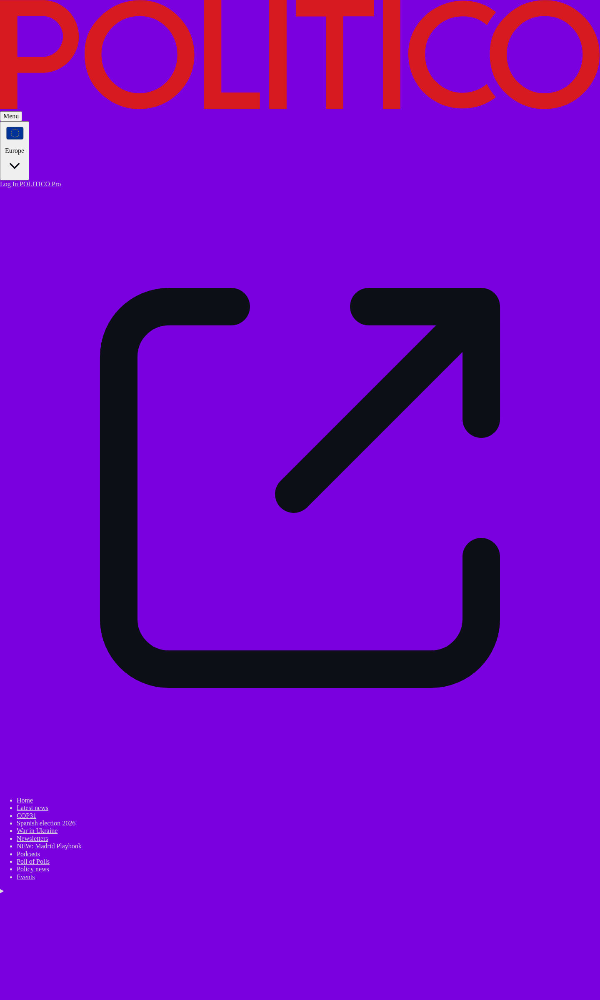

# UI Design System & Master Generation Blueprint: www-politico-eu_sponsored-content-saving-costs-and-improving-lives

> **Saving costs and improving lives – POLITICO** (https://www.politico.eu/sponsored-content/saving-costs-and-improving-lives/) — Visit the post for more.



---

## 1. Executive Visual Persona & Design Archetype

- **Brand Essence & Persona**: **Saving costs and improving lives – POLITICO** (`https://www.politico.eu/sponsored-content/saving-costs-and-improving-lives/`). Visit the post for more.
- **Visual Archetype**: **High-Contrast Obsidian / Atmospheric Design System (`#7a00df` canvas, `#CCE5F4` ink, `#006ba1` accent)**.
- **Anti-AI-Slop Differentiators**:
  - **Source-Grounded Chromatic Polarity**: Anchors the viewport in `#7a00df` (`var(--wp-block-synced-color)` in `:root`) paired with `#CCE5F4` primary typography and `#006ba1` accents.
  - **Extracted Typographic Hierarchy**: Pairs `NSI` for display copy (`Our readers read next`) with `Martina Plantijn fallback` and not declared in static CSS (uses primary stack / `ui-monospace`).
  - **Calibrated Spatial Grid & Motion**: Combines `var(--width-page)` container bounds (`gap: 2.5rem`, padding `var(--wp--custom--spacing--6)`) with `cubic-bezier(.215,.61,.355,1)` easing and Three.js / WebGL Canvas Pipeline.

---

## 2. Spatial Architecture & Modular Grid Mathematics


### Viewport Allocation & Container Geometry
- **Captured Viewport Dimensions**: Desktop `1440×2400px` (`assets/desktop.png`, capped at 2400px multi-section capture), Mobile `390×2400px` (`assets/mobile.png`, capped at 2400px multi-section capture).
- **Master Container Bounds**: `var(--width-page)` extracted from `www-politico-eu_sponsored-content-saving-costs-and-improving-lives` stylesheet.
- **Canvas Lateral Padding & Spacing**: `var(--wp--custom--spacing--6)` lateral canvas padding with `2.5rem` grid gap.
- **Border Radius Scale**: `var(--wp--custom--radius--round-8)`, `50%`, `var(--wp--custom--radius--round-4)`, `var(--wp--custom--radius--full)`.

### Responsive Breakpoint Architecture
- **Desktop Layout**: Multi-column CSS Grid / Flexbox layout at `1440px` (`max-width: var(--width-page)`, `gap: 2.5rem`).
- **Mobile Layout**: Single-column vertical stack at `390px` viewport width with `var(--wp--custom--spacing--6)` horizontal padding.
- **Extracted CSS Media Queries**: `@media (min-width:48em)`, `@media (prefers-reduced-motion:reduce)`, `@media (min-width:80em)`, `@media (max-width:47.9375em)`.

---

## 3. Color System, Materiality & Atmospheric Lighting

### Semantic Palette & Source Grounding
| Semantic Role | Ground-Truth Value | Extracted CSS Source / Selector |
|---|---|---|
| **Primary Canvas Substrate** | `#7a00df` | `var(--wp-block-synced-color)` in `:root` |
| **Primary Typography Ink** | `#ddd` | `var(--wp-editor-canvas-background)` in `:root` |
| **Elevated Surface / Card Substrate** | `#007cba` | `var(--wp-admin-theme-color)` in `:root` |
| **Interactive Accent / Highlight** | `#006ba1` | `var(--wp-admin-theme-color-darker-10)` in `:root` |
| **Secondary / Muted Copy** | `#005a87` | `var(--wp-admin-theme-color-darker-20)` in `:root` |
| **Structural Hairline Border** | `#CCE5F4` | `var(--wp--custom--color--blue--100)` in `:root` |

### Sanitized Root CSS Variables (`ui-ux.md` Ground Truth)
| Variable Name | Extracted Value | Semantic Role |
|---|---|---|
| `--card-image-ratio` | `3/2` | Design System Custom Token |
| `--button-padding-block` | `var(--wp--custom--spacing--6)` | Layout / Spatial Grid Token |
| `--button-padding-inline` | `var(--wp--custom--spacing--6)` | Layout / Spatial Grid Token |
| `--button-outline-color` | `var(--color-border)` | Brand / Palette Token |
| `--button-background-color` | `var(--color-background-inverse)` | Canvas / Surface Token |
| `--button-text-color` | `var(--color-text-inverse)` | Typography Ink Token |
| `--button-hover-background-color` | `var(--wp--custom--color--grey--800)` | Canvas / Surface Token |
| `--button-hover-text-color` | `var(--color-text-inverse)` | Typography Ink Token |
| `--button-focus-background-color` | `var(--color-background-inverse)` | Canvas / Surface Token |
| `--button-focus-text-color` | `var(--color-text-inverse)` | Typography Ink Token |
| `--button-active-background-color` | `var(--wp--custom--color--grey--800)` | Canvas / Surface Token |
| `--button-active-text-color` | `var(--color-text-inverse-50pc)` | Typography Ink Token |
| `--button-plain-background-color` | `transparent` | Canvas / Surface Token |
| `--button-plain-text-color` | `var(--color-text-primary)` | Typography Ink Token |
| `--button-plain-hover-text-color` | `var(--color-link)` | Typography Ink Token |
| `--button-plain-focus-text-color` | `var(--color-text-primary)` | Typography Ink Token |

---

## 4. Typographic Scale & Editorial Hierarchy

### Font Family Stacks
- **Display Typography**: `NSI`.
- **Primary Body Stack**: `Martina Plantijn fallback`.
- **Technical / Metadata Stack**: not declared in static CSS (uses primary stack / `ui-monospace`).

### Typographic Scale & Rules (Extracted from Stylesheet & Variables)
- **Hero Display (`H1`)**: rule `h1` (`font-weight: var(--font-we...`).
- **Section Heading (`H2`)**: rule `h2` (`font-weight: var(--font-we...`).
- **Body Copy**: rule `p` (`font-size: var(--wp--custom--type-scale-...`, `line-height: var(--wp--custom--typ...`, `font-weight: var(--font-we...`).
- **Metadata & Navigation Labels**: CSS variables `--wp--custom--animation--duration--small: 100ms`, `--wp--custom--animation--duration--extra-small: 50ms`, `--wp--custom--stroke--small: 1px`.

---

## 5. Choreographed Motion & Interaction Physics

### Primary Easing Curves
- **Extracted Timing Functions**: `cubic-bezier(.215,.61,.355,1)`, `cubic-bezier(0.215,0.61,0.355,1)`.

### Per-Element Transition & Choreography Rules
- **Selector `media (prefers-reduced-motion:red...`**: `transition: 1ms!important` extracted from `www-politico-eu_sponsored-content-saving-costs-and-improving-lives` stylesheet.
- **Selector `a:where(:not(.wp-element-button))`**: `transition: color var(--transition-style-link-out),background-color var(--...` extracted from `www-politico-eu_sponsored-content-saving-costs-and-improving-lives` stylesheet.
- **Selector `a:where(:not(.wp-element-button))...`**: `transition: color var(--transition-style-link-in),background-color var(--t...` extracted from `www-politico-eu_sponsored-content-saving-costs-and-improving-lives` stylesheet.
- **Extracted Easing Curve (`cubic-bezier(.215,.61,.355,1)`)**: Governs interactive state transitions across `<header.header>` and `<article.article>`.
- **Runtime Interaction Engine**: Integrates Three.js / WebGL Canvas Pipeline with `prefers-reduced-motion: reduce` fallback guards.

---

## 6. Component Wireframe & Structural DOM Map

### Visual Layout Schematic (Grounded in `dom.html` — `1440px` Desktop & `390px` Mobile Reflow)
```
┌────────────────────────────────────────────────────────────────────────┐
│ DESKTOP VIEWPORT (1440px) — Saving costs and improving lives – POLITIC │
│ ====================================================================== │
│ [ <header.header>          | Europe · UK · France · Germany · Spain ]  │
│ ---------------------------------------------------------------------- │
│ | HERO STAGE: <article.article>                                    |   │
│ | H1: Our readers read next                                        |   │
│ | Substrate: #7a00df    | Ink: #CCE5F4    | Accent: #006ba1        |   │
│ ---------------------------------------------------------------------- │
│ | SHOWCASE GRID (<article.article>         ) max-w: var(--width-pa |   │
│ | +------------------------------+  +------------------------------+ | │
│ | | US suggested Ukraine could g |  | Finland rejects reported Rus | | │
│ | +------------------------------+  +------------------------------+ | │
│ ---------------------------------------------------------------------- │
│ | MOBILE VIEWPORT REFLOW (390px) — Single-Column Stack (gap: 2.5rem) | │
│ | [<header.header>] -> [<article.article>] -> [<article.article>] |    │
│ ---------------------------------------------------------------------- │
│ [ FOOTER (<footer.article__foote) | https://www.politico.eu/sponsored- │
└────────────────────────────────────────────────────────────────────────┘
```

### Granular DOM Region Breakdown
1. **Brand Header & Navigation Bar (<header.header> — `www-politico-eu_sponsored-content-saving-costs-and-improving-lives`)**:
   - Landmark `<header class="header">` hosting `Saving costs and improving lives – P` navigation (`Europe · UK · France · Germany · Spain`), DOM attributes (`data-previous-scroll-y="-0px"`, `data-wp-strategy="async"`, `data-id="adlibScripts"`, `data-focus-first="false"`), and stylesheet rule `html { -webkit-font-smoothing:antialiased;-moz-osx-font-smoothing:grayscale }`.
2. **Hero Stage & Focal Lead (<article.article> — `Our readers read next`)**:
   - Landmark `<article class="article article--no-top-margin">` presenting display lead `Our readers read next` and copy excerpt *"Skip to main content"* over `#7a00df` canvas and `#CCE5F4` ink.
3. **Primary Showcase & Content Grid (<article.article> — `US suggested Ukraine could give up`)**:
   - Landmark `<article class="article article--no-top-margin">` rendering section `US suggested Ukraine could give up Donbas for NAT...` with copy *"Policy areas Agriculture and Food Central Banker Competition and "*, asset references (`destination`, `favicon.ico`, `apple-touch-icon.png`, `favicon-32x32.png`), and grid rule `before { box-sizing:border-box }`.
4. **Interactive Detail & Feature Matrix (<article.article> — `Finland rejects reported Russian d`)**:
   - Landmark `<article class="article article--no-top-margin">` framing `Finland rejects reported Russian demand to leave...` and `EU deal on Ukraine talks overshadows AI-focused s...` (*"Agriculture and Food"*) with `#007cba` surface cards, `#006ba1` accents, and `strong { font-weight:bolder }`.
5. **Colophon & Global Directory Footer (<footer.article__footer-inline> — `https://www.politico.eu/sponsored-content/saving-costs-and-improving-lives/`)**:
   - Landmark `<footer class="article__footer-inline">` anchoring `Saving costs and improving lives` footer links (`Europe · UK · France · Germany · Spain`), copy *"Competition and Industrial Policy"*, and `#CCE5F4` structural dividers.

---

## 7. Master Zero-Shot AI Generation Prompt

```markdown
# Master Zero-Shot Frontend Generation Prompt: www-politico-eu_sponsored-content-saving-costs-and-improving-lives (Saving costs and improving lives – POLITICO)

You are a principal frontend architect and design systems engineer. Build a complete, production-ready web application replicating the exact design system, DOM landmarks, typographic hierarchy, color tokens, and motion physics of `www-politico-eu_sponsored-content-saving-costs-and-improving-lives` (**Saving costs and improving lives – POLITICO** — `https://www.politico.eu/sponsored-content/saving-costs-and-improving-lives/`).

### 1. Visual Archetype & Anti-AI-Slop Mandates
- **Archetype**: High-Contrast Obsidian / Atmospheric Design System (`#7a00df` canvas, `#CCE5F4` ink, `#006ba1` accent).
- **Identity & Domain Context**: Visit the post for more.
- **Primary Substrate**: `#7a00df` (`var(--wp-block-synced-color)` in `:root`), **Primary Ink**: `#CCE5F4`, **Accent / Highlight**: `#006ba1`.
- **Site-Specific Differentiators**:
  - **Source-Grounded Chromatic Polarity**: Anchors the viewport in `#7a00df` (`var(--wp-block-synced-color)` in `:root`) paired with `#CCE5F4` primary typography and `#006ba1` accents.
  - **Extracted Typographic Hierarchy**: Pairs `NSI` for display copy (`Our readers read next`) with `Martina Plantijn fallback` and not declared in static CSS (uses primary stack / `ui-monospace`).
  - **Calibrated Spatial Grid & Motion**: Combines `var(--width-page)` container bounds (`gap: 2.5rem`, padding `var(--wp--custom--spacing--6)`) with `cubic-bezier(.215,.61,.355,1)` easing and Three.js / WebGL Canvas Pipeline.

### 2. Ground-Truth CSS Variables (`:root` Token Contract)
Declare and consume these exact custom properties extracted from `www-politico-eu_sponsored-content-saving-costs-and-improving-lives` in your global stylesheet:

:root {
  /* Saving costs and improving lives – POLITICO (www-politico-eu_sponsored-content-saving-costs-and-improving-lives) — Ground-Truth Extracted CSS Variables */
  --card-image-ratio: 3/2; /* Design System Custom Token (www-politico-eu_sponsored-content-saving-costs-and-improving-lives) */
  --button-padding-block: var(--wp--custom--spacing--6); /* Layout / Spatial Grid Token (www-politico-eu_sponsored-content-saving-costs-and-improving-lives) */
  --button-padding-inline: var(--wp--custom--spacing--6); /* Layout / Spatial Grid Token (www-politico-eu_sponsored-content-saving-costs-and-improving-lives) */
  --button-outline-color: var(--color-border); /* Brand / Palette Token (www-politico-eu_sponsored-content-saving-costs-and-improving-lives) */
  --button-background-color: var(--color-background-inverse); /* Canvas / Surface Token (www-politico-eu_sponsored-content-saving-costs-and-improving-lives) */
  --button-text-color: var(--color-text-inverse); /* Typography Ink Token (www-politico-eu_sponsored-content-saving-costs-and-improving-lives) */
  --button-hover-background-color: var(--wp--custom--color--grey--800); /* Canvas / Surface Token (www-politico-eu_sponsored-content-saving-costs-and-improving-lives) */
  --button-hover-text-color: var(--color-text-inverse); /* Typography Ink Token (www-politico-eu_sponsored-content-saving-costs-and-improving-lives) */
  --button-focus-background-color: var(--color-background-inverse); /* Canvas / Surface Token (www-politico-eu_sponsored-content-saving-costs-and-improving-lives) */
  --button-focus-text-color: var(--color-text-inverse); /* Typography Ink Token (www-politico-eu_sponsored-content-saving-costs-and-improving-lives) */
  --button-active-background-color: var(--wp--custom--color--grey--800); /* Canvas / Surface Token (www-politico-eu_sponsored-content-saving-costs-and-improving-lives) */
  --button-active-text-color: var(--color-text-inverse-50pc); /* Typography Ink Token (www-politico-eu_sponsored-content-saving-costs-and-improving-lives) */
  --button-plain-background-color: transparent; /* Canvas / Surface Token (www-politico-eu_sponsored-content-saving-costs-and-improving-lives) */
  --button-plain-text-color: var(--color-text-primary); /* Typography Ink Token (www-politico-eu_sponsored-content-saving-costs-and-improving-lives) */
  --button-plain-hover-text-color: var(--color-link); /* Typography Ink Token (www-politico-eu_sponsored-content-saving-costs-and-improving-lives) */
  --button-plain-focus-text-color: var(--color-text-primary); /* Typography Ink Token (www-politico-eu_sponsored-content-saving-costs-and-improving-lives) */
}

### 3. Semantic Color & Materiality Contract
Map every surface, ink, and border strictly to these source-grounded tokens:
- **Primary Canvas Substrate**: `#7a00df` — grounded in `var(--wp-block-synced-color)` in `:root`
- **Primary Typography Ink**: `#ddd` — grounded in `var(--wp-editor-canvas-background)` in `:root`
- **Elevated Surface / Card Substrate**: `#007cba` — grounded in `var(--wp-admin-theme-color)` in `:root`
- **Interactive Accent / Highlight**: `#006ba1` — grounded in `var(--wp-admin-theme-color-darker-10)` in `:root`
- **Secondary / Muted Copy**: `#005a87` — grounded in `var(--wp-admin-theme-color-darker-20)` in `:root`
- **Structural Hairline Border**: `#CCE5F4` — grounded in `var(--wp--custom--color--blue--100)` in `:root`

### 4. Spatial Grid, Container Bounds & Responsive Breakpoints
- **Desktop Viewport Reference**: `1440×2400px` (capped at 2400px multi-section capture, `1440px` standard desktop width).
- **Mobile Viewport Reference**: `390×2400px` (capped at 2400px multi-section capture, `390px` standard mobile width).
- **Container Max-Width**: `var(--width-page)` extracted from `www-politico-eu_sponsored-content-saving-costs-and-improving-lives` stylesheet
- **Padding & Gutters**: `var(--wp--custom--spacing--6)` lateral canvas padding with `2.5rem` grid gap
- **Desktop Grid**: Multi-column CSS Grid / Flexbox layout at `1440px` (`max-width: var(--width-page)`, `gap: 2.5rem`)
- **Mobile Adaptation**: Single-column vertical stack at `390px` viewport width with `var(--wp--custom--spacing--6)` horizontal padding
- **Media Queries**: `@media (min-width:48em)`, `@media (prefers-reduced-motion:reduce)`, `@media (min-width:80em)`, `@media (max-width:47.9375em)`
- **Corner Radii**: `var(--wp--custom--radius--round-8)`, `50%`, `var(--wp--custom--radius--round-4)`, `var(--wp--custom--radius--full)`

### 5. Typography & Editorial Scale Contract
- **Display Font Stack**: `NSI`
- **Body Font Stack**: `Martina Plantijn fallback`
- **Monospace / Technical Font Stack**: not declared in static CSS (uses primary stack / `ui-monospace`)
- **H1 Display Rule**: rule `h1` (`font-weight: var(--font-we...`)
- **H2 Section Rule**: rule `h2` (`font-weight: var(--font-we...`)
- **Body Copy Rule**: rule `p` (`font-size: var(--wp--custom--type-scale-...`, `line-height: var(--wp--custom--typ...`, `font-weight: var(--font-we...`)
- **Metadata & Index Rule**: CSS variables `--wp--custom--animation--duration--small: 100ms`, `--wp--custom--animation--duration--extra-small: 50ms`, `--wp--custom--stroke--small: 1px`

### 6. Component Hierarchy, Verbatim Copy & Real DOM Landmarks
Scaffold `www-politico-eu_sponsored-content-saving-costs-and-improving-lives` (`Saving costs and improving lives – POLITICO`) with these exact structural regions, extracted copy, and CSS rules from `dom.html`:
1. **Brand Header & Navigation Bar (<header.header> — `www-politico-eu_sponsored-content-saving-costs-and-improving-lives`)**:
   - DOM & Selectors: Landmark `<header class="header">` hosting `Saving costs and improving lives – P` navigation (`Europe · UK · France · Germany · Spain`), DOM attributes (`data-previous-scroll-y="-0px"`, `data-wp-strategy="async"`, `data-id="adlibScripts"`, `data-focus-first="false"`), and stylesheet rule `html { -webkit-font-smoothing:antialiased;-moz-osx-font-smoothing:grayscale }`.
   - Responsive Contract: Header `Brand Header & Navigation Bar (<header.header> — `www-politico-eu_sponsored-content-saving-costs-and-improving-lives`)` (`www-politico-eu_sponsored-content-saving-costs-and-improving-lives`) adapts across `@media (min-width:48em)`, `@media (prefers-reduced-motion:reduce)`, `@media (min-width:80em)`, `@media (max-width:47.9375em)` with `cubic-bezier(.215,.61,.355,1)`, `cubic-bezier(0.215,0.61,0.355,1)` transitions and links `Europe · UK · France · Germany · Spain`.
2. **Hero Stage & Focal Lead (<article.article> — `Our readers read next`)**:
   - DOM & Selectors: Landmark `<article class="article article--no-top-margin">` presenting display lead `Our readers read next` and copy excerpt *"Skip to main content"* over `#7a00df` canvas and `#CCE5F4` ink.
   - Responsive Contract: Hero stage (`1440×2400px` desktop / `390×2400px` mobile) sets `#7a00df` background with `#CCE5F4` headline `Our readers read next`.
3. **Primary Showcase & Content Grid (<article.article> — `US suggested Ukraine could give up`)**:
   - DOM & Selectors: Landmark `<article class="article article--no-top-margin">` rendering section `US suggested Ukraine could give up Donbas for NAT...` with copy *"Policy areas Agriculture and Food Central Banker Competition and "*, asset references (`destination`, `favicon.ico`, `apple-touch-icon.png`, `favicon-32x32.png`), and grid rule `before { box-sizing:border-box }`.
   - Responsive Contract: Showcase grid `Primary Showcase & Content Grid (<article.article> — `US suggested Ukraine could give up`)` applies Multi-column CSS Grid / Flexbox layout at `1440px` (`max-width: var(--width-page)`, `gap: 2.5rem`) on desktop and Single-column vertical stack at `390px` viewport width with `var(--wp--custom--spacing--6)` horizontal padding on mobile.
4. **Interactive Detail & Feature Matrix (<article.article> — `Finland rejects reported Russian d`)**:
   - DOM & Selectors: Landmark `<article class="article article--no-top-margin">` framing `Finland rejects reported Russian demand to leave...` and `EU deal on Ukraine talks overshadows AI-focused s...` (*"Agriculture and Food"*) with `#007cba` surface cards, `#006ba1` accents, and `strong { font-weight:bolder }`.
   - Responsive Contract: Detail module `Interactive Detail & Feature Matrix (<article.article> — `Finland rejects reported Russian d`)` uses `var(--wp--custom--radius--round-8)`, `50%`, `var(--wp--custom--radius--round-4)`, `var(--wp--custom--radius--full)` radii, `#006ba1` highlights, and assets (destination, favicon.ico, apple-touch-icon.png).
5. **Colophon & Global Directory Footer (<footer.article__footer-inline> — `https://www.politico.eu/sponsored-content/saving-costs-and-improving-lives/`)**:
   - DOM & Selectors: Landmark `<footer class="article__footer-inline">` anchoring `Saving costs and improving lives` footer links (`Europe · UK · France · Germany · Spain`), copy *"Competition and Industrial Policy"*, and `#CCE5F4` structural dividers.
   - Responsive Contract: Footer `Colophon & Global Directory Footer (<footer.article__footer-inline> — `https://www.politico.eu/sponsored-content/saving-costs-and-improving-lives/`)` aligns to `var(--width-page)` extracted from `www-politico-eu_sponsored-content-saving-costs-and-improving-lives` stylesheet with `var(--wp--custom--spacing--6)` lateral canvas padding with `2.5rem` grid gap and attributes (data-previous-scroll-y="-0px", data-wp-strategy="async", data-id="adlibScripts").

#### Verbatim DOM Copy Excerpts (`dom.html`)
- Copy Excerpt 1: *"Skip to main content"*
- Copy Excerpt 2: *"Policy areas Agriculture and Food Central Banker Competition and Industrial Policy..."*
- Copy Excerpt 3: *"Agriculture and Food"*
- Copy Excerpt 4: *"Competition and Industrial Policy"*

### 7. Motion, Extracted Stylesheet Rules & Interaction Choreography
- **Primary Easing Functions**: `cubic-bezier(.215,.61,.355,1)`, `cubic-bezier(0.215,0.61,0.355,1)`
- **Extracted Stylesheet Rules (`www-politico-eu_sponsored-content-saving-costs-and-improving-lives`)**:
- `html { -webkit-font-smoothing:antialiased;-moz-osx-font-smoothing:grayscale }`
- `before { box-sizing:border-box }`
- `strong { font-weight:bolder }`
- `samp { font-family:ui-monospace,SFMono-Regular,Consolas,Liberation Mono,Menlo,m... }`
- `small { font-size:80% }`
- **Per-Selector Transition Rules**:
- **Selector `media (prefers-reduced-motion:red...`**: `transition: 1ms!important` extracted from `www-politico-eu_sponsored-content-saving-costs-and-improving-lives` stylesheet.
- **Selector `a:where(:not(.wp-element-button))`**: `transition: color var(--transition-style-link-out),background-color var(--...` extracted from `www-politico-eu_sponsored-content-saving-costs-and-improving-lives` stylesheet.
- **Selector `a:where(:not(.wp-element-button))...`**: `transition: color var(--transition-style-link-in),background-color var(--t...` extracted from `www-politico-eu_sponsored-content-saving-costs-and-improving-lives` stylesheet.
- **Extracted Easing Curve (`cubic-bezier(.215,.61,.355,1)`)**: Governs interactive state transitions across `<header.header>` and `<article.article>`.
- **Runtime Interaction Engine**: Integrates Three.js / WebGL Canvas Pipeline with `prefers-reduced-motion: reduce` fallback guards.

### 8. Technical Deliverables
- Implement in Next.js (App Router) with TypeScript and Tailwind CSS consuming the `:root` custom properties defined above for `www-politico-eu_sponsored-content-saving-costs-and-improving-lives`.
- Reproduce both the `1440px` desktop architecture and `390px` mobile breakpoint transitions, preserving semantic HTML5 landmarks (`<header>`, `<nav>`, `<main>`, `<section>`, `<footer>`) and `prefers-reduced-motion` accessibility guards.
```
