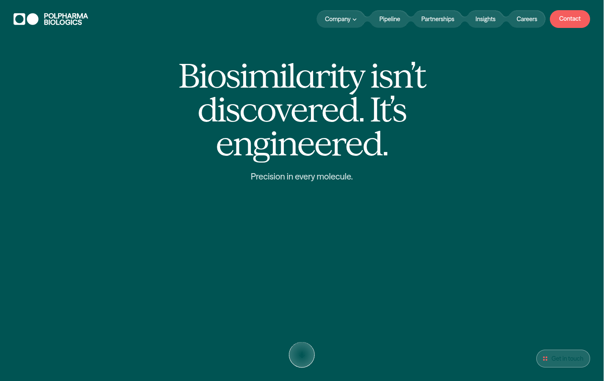
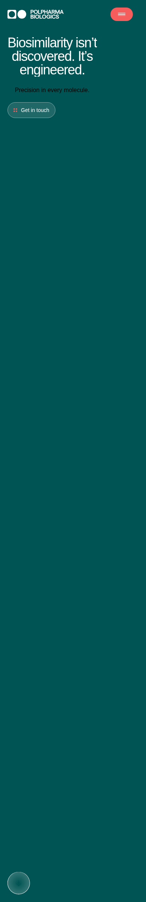

# UI Design System & Master Generation Blueprint: www-polpharmabiologics-com

> **Polpharma Biologics · Global Biosimilar Developer & Manufacturer** (https://www.polpharmabiologics.com/) — Polpharma Biologics is a global biosimilar developer and manufacturer, taking biosimilars from cell to sell with an international track r...



---

## 1. Executive Visual Persona & Design Archetype

- **Brand Essence & Persona**: **Polpharma Biologics · Global Biosimilar Developer & Manufacturer** (`https://www.polpharmabiologics.com/`). Polpharma Biologics is a global biosimilar developer and manufacturer, taking biosimilars from cell to sell with an international track r...
- **Visual Archetype**: **Light-Gallery WebGL / Canvas Interactive Experience (`#0000` / `#333`)**.
- **Anti-AI-Slop Differentiators**:
  - **Source-Grounded Chromatic Polarity**: Anchors the viewport in `#0000` (`a { background-color: #0000 }`) paired with `#000` primary typography and `#333` accents.
  - **Extracted Typographic Hierarchy**: Pairs `Seasonsans` for display copy (`Biosimilarity isn’t discovered. It’s`) with `Concrettem` and not declared in static CSS (uses primary stack / `ui-monospace`).
  - **Calibrated Spatial Grid & Motion**: Combines `940px` container bounds (`gap: 16px`, padding `9px`) with `cubic-bezier(0.22,1,0.36,1)` easing and Lenis Smooth Scroll (`data-lenis`), GSAP Timeline & ScrollTrigger.

---

## 2. Spatial Architecture & Modular Grid Mathematics



### Viewport Allocation & Container Geometry
- **Captured Viewport Dimensions**: Desktop `1440×2400px` (`assets/desktop.png`, capped at 2400px multi-section capture), Mobile `390×2400px` (`assets/mobile.png`, capped at 2400px multi-section capture).
- **Master Container Bounds**: `940px` extracted from `www-polpharmabiologics-com` stylesheet.
- **Canvas Lateral Padding & Spacing**: `9px` lateral canvas padding with `16px` grid gap.
- **Border Radius Scale**: `3px`, `100%`, `50%`, `2px`.

### Responsive Breakpoint Architecture
- **Desktop Layout**: Multi-column CSS Grid / Flexbox layout at `1440px` (`max-width: 940px`, `gap: 16px`).
- **Mobile Layout**: Single-column vertical stack at `390px` viewport width with `9px` horizontal padding.
- **Extracted CSS Media Queries**: `@media screen and (max-width:991px)`, `@media screen and (max-width:767px)`, `@media screen and (max-width:479px)`, `@media (min-width:768px)`.

---

## 3. Color System, Materiality & Atmospheric Lighting

### Semantic Palette & Source Grounding
| Semantic Role | Ground-Truth Value | Extracted CSS Source / Selector |
|---|---|---|
| **Primary Canvas Substrate** | `#0000` | `a { background-color: #0000 }` |
| **Primary Typography Ink** | `#000` | `mark { color: #000 }` |
| **Elevated Surface / Card Substrate** | `#ff0` | `mark { background: #ff0 }` |
| **Interactive Accent / Highlight** | `#333` | `body { color: #333 }` |
| **Secondary / Muted Copy** | `#fff` | `body { background-color: #fff }` |
| **Structural Hairline Border** | `#3898ec` | `.w-button { background-color: #3898ec }` |
| **Variable Token (`--_rich---rich-body--body-font-color`)** | `#16151780` | `var(--_rich---rich-body--body-font-color)` in `:root` |

### Sanitized Root CSS Variables (`ui-ux.md` Ground Truth)
| Variable Name | Extracted Value | Semantic Role |
|---|---|---|
| `--w-backdrop-animation` | `initial` | Motion / Easing Token |
| `--body` | `Seasonsans,Arial,sans-serif` | Design System Custom Token |
| `--heading-family` | `Concrettem,Arial,sans-serif` | Typography Ink Token |
| `--title-family` | `Seasonsans,Arial,sans-serif` | Typography / Scale Token |
| `--_rich---rich-body--body-font-family` | `var(--body)` | Typography / Scale Token |
| `--_rich---rich-body--body-font-color` | `#16151780` | Brand / Palette Token |
| `--_rich---rich-body--body-size` | `var(--_🟢-typography---body-large--font-size)` | Layout / Spatial Grid Token |
| `--_rich---rich-body--body-line-height` | `var(--_🟢-typography---body-large--line-height)` | Typography / Scale Token |
| `--_rich---rich-body--body-weight` | `var(--_🟢-typography---body-large--font-weight)` | Design System Custom Token |
| `--_rich---rich-body--body-letter-spacing` | `var(--_🟢-typography---body-large--letter-spacing)` | Typography / Scale Token |
| `--_rich---rich-spacing--body-margin-bottom` | `1.25rem` | Layout / Spatial Grid Token |
| `--_rich---rich-spacing--quote-margin-vertical` | `2rem` | Layout / Spatial Grid Token |
| `--_rich---rich-quote--quote-border-color` | `var(--_🟢-colors---primary--red)` | Brand / Palette Token |
| `--_rich---rich-quote--quote-font-color` | `var(--_🟢-colors---primary--deep-green)` | Brand / Palette Token |
| `--_sizing---padding-section--zero` | `0rem` | Layout / Spatial Grid Token |
| `--_sizing---padding-section--large-160` | `10rem` | Layout / Spatial Grid Token |

---

## 4. Typographic Scale & Editorial Hierarchy

### Font Family Stacks
- **Display Typography**: `Seasonsans`.
- **Primary Body Stack**: `Concrettem`.
- **Technical / Metadata Stack**: not declared in static CSS (uses primary stack / `ui-monospace`).

### Typographic Scale & Rules (Extracted from Stylesheet & Variables)
- **Hero Display (`H1`)**: not explicitly declared on tag in static CSS (stylesheet font-size ladder: `2em`, `80%`, `75%`, `1em`, `14px`).
- **Section Heading (`H2`)**: not explicitly declared on tag in static CSS (stylesheet font-size ladder: `2em`, `80%`, `75%`, `1em`, `14px`).
- **Body Copy**: CSS variables `--body: Seasonsans,Arial,sans-serif`, `--_rich---rich-body--body-font-family: var(--body)`, `--_rich---rich-body--body-font-color: #16151780`.
- **Metadata & Navigation Labels**: CSS variables `--_rich---rich-body--body-letter-spacing: var(--_🟢-typography---body-large--letter-spacing)`, `--caption-family: Seasonsans,Arial,sans-serif`, `--_rich---rich-heading--heading-letter-spacing: var(--_🟢-typography---title-small--letter-spacing)`.

---

## 5. Choreographed Motion & Interaction Physics

### Primary Easing Curves
- **Extracted Timing Functions**: `cubic-bezier(0.22,1,0.36,1)`, `cubic-bezier(0.25,1,0.5,1)`, `cubic-bezier(0.4,0,0.2,1)`.

### Per-Element Transition & Choreography Rules
- **Selector `.w-webflow-badge>img`**: `transition: unset` extracted from `www-polpharmabiologics-com` stylesheet.
- **Selector `.w-slider-dot`**: `transition: background-color .1s,color .1s` extracted from `www-polpharmabiologics-com` stylesheet.
- **Selector `.w-lightbox-control`**: `transition: all .3s` extracted from `www-polpharmabiologics-com` stylesheet.
- **Extracted Easing Curve (`cubic-bezier(0.22,1,0.36,1)`)**: Governs interactive state transitions across `<header.nav_component>` and `<section.section>`.
- **Runtime Interaction Engine**: Integrates Lenis Smooth Scroll (`data-lenis`), GSAP Timeline & ScrollTrigger, Swiper Touch Carousel Engine, Lottie Vector Animation Player, Barba.js Page Transition Router, HTML5 `<canvas>` Interactive Viewport Surface with `prefers-reduced-motion: reduce` fallback guards.

---

## 6. Component Wireframe & Structural DOM Map

### Visual Layout Schematic (Grounded in `dom.html` — `1440px` Desktop & `390px` Mobile Reflow)
```
┌────────────────────────────────────────────────────────────────────────┐
│ DESKTOP VIEWPORT (1440px) — Polpharma Biologics · Global Biosimilar De │
│ ====================================================================== │
│ [ <header.nav_component>   | Company · About us · What we do · Pipe ]  │
│ ---------------------------------------------------------------------- │
│ | HERO STAGE: <section.section>                                    |   │
│ | H1: Biosimilarity isn’t discovered. It’s engineered.             |   │
│ | Substrate: #0000      | Ink: #000       | Accent: #333           |   │
│ ---------------------------------------------------------------------- │
│ | SHOWCASE GRID (<section.section>         ) max-w: 940px          |   │
│ | +------------------------------+  +------------------------------+ | │
│ | | A pure-play biosimilar compa |  | We produce impact-driven bio | | │
│ | +------------------------------+  +------------------------------+ | │
│ ---------------------------------------------------------------------- │
│ | MOBILE VIEWPORT REFLOW (390px) — Single-Column Stack (gap: 16px  ) | │
│ | [<header.nav_compon] -> [<section.section>] -> [<section.section>] | │
│ ---------------------------------------------------------------------- │
│ [ FOOTER (<footer.section>      ) | https://www.polpharmabiologics.com │
└────────────────────────────────────────────────────────────────────────┘
```

### Granular DOM Region Breakdown
1. **Brand Header & Navigation Bar (<header.nav_component> — `www-polpharmabiologics-com`)**:
   - Landmark `<header class="nav_component">` hosting `Polpharma Biologics · Global Biosimi` navigation (`Company · About us · What we do · Pipeline · Partnerships`), DOM attributes (`data-wf-domain="www.polpharmabiologic..."`, `data-wf-page="6a55f3be4b824306906ca2f0"`, `data-wf-site="6a55f3bb4b824306906ca274"`, `data-barba="wrapper"`), and stylesheet rule `html { -webkit-text-size-adjust:100%;-ms-text-size-adjust:100%;font-family:sans... }`.
2. **Hero Stage & Focal Lead (<section.section> — `Biosimilarity isn’t discovered. It`)**:
   - Landmark `<section class="section is-home-hero">` presenting display lead `Biosimilarity isn’t discovered. It’s engineered.` and copy excerpt *"Precision in every molecule."* over `#0000` canvas and `#000` ink.
3. **Primary Showcase & Content Grid (<section.section> — `A pure-play biosimilar company wit`)**:
   - Landmark `<section class="section is-home-how-it-works">` rendering section `A pure-play biosimilar company with an internatio...` with copy *"Built to accelerate biosimilars development – cell to sell."*, asset references (`cdn.prod.website-files.com`, `polpharmaxwidehue-staging.webflow...`, `insight.min.js`, `6aaa7fea366a958e0f892178_webclip.png`), and grid rule `summary { display:block }`.
4. **Interactive Detail & Feature Matrix (<section.section> — `We produce impact-driven biosimila`)**:
   - Landmark `<section class="section is-home-we-know">` framing `We produce impact-driven biosimilars. From concep...` and `We know` (*"Approved biosimilars"*) with `#ff0` surface cards, `#333` accents, and `video { vertical-align:baseline;display:inline-block }`.
5. **Colophon & Global Directory Footer (<footer.section> — `https://www.polpharmabiologics.com/`)**:
   - Landmark `<footer class="section is-dark">` anchoring `Polpharma Biologics · Global Bio` footer links (`Company · About us · What we do · Pipeline · Partnerships`), copy *"Years biologics expertise"*, and `#3898ec` structural dividers.

---

## 7. Master Zero-Shot AI Generation Prompt

```markdown
# Master Zero-Shot Frontend Generation Prompt: www-polpharmabiologics-com (Polpharma Biologics · Global Biosimilar Developer & Manufacturer)

You are a principal frontend architect and design systems engineer. Build a complete, production-ready web application replicating the exact design system, DOM landmarks, typographic hierarchy, color tokens, and motion physics of `www-polpharmabiologics-com` (**Polpharma Biologics · Global Biosimilar Developer & Manufacturer** — `https://www.polpharmabiologics.com/`).

### 1. Visual Archetype & Anti-AI-Slop Mandates
- **Archetype**: Light-Gallery WebGL / Canvas Interactive Experience (`#0000` / `#333`).
- **Identity & Domain Context**: Polpharma Biologics is a global biosimilar developer and manufacturer, taking biosimilars from cell to sell with an international track r...
- **Primary Substrate**: `#0000` (`a { background-color: #0000 }`), **Primary Ink**: `#000`, **Accent / Highlight**: `#333`.
- **Site-Specific Differentiators**:
  - **Source-Grounded Chromatic Polarity**: Anchors the viewport in `#0000` (`a { background-color: #0000 }`) paired with `#000` primary typography and `#333` accents.
  - **Extracted Typographic Hierarchy**: Pairs `Seasonsans` for display copy (`Biosimilarity isn’t discovered. It’s`) with `Concrettem` and not declared in static CSS (uses primary stack / `ui-monospace`).
  - **Calibrated Spatial Grid & Motion**: Combines `940px` container bounds (`gap: 16px`, padding `9px`) with `cubic-bezier(0.22,1,0.36,1)` easing and Lenis Smooth Scroll (`data-lenis`), GSAP Timeline & ScrollTrigger.

### 2. Ground-Truth CSS Variables (`:root` Token Contract)
Declare and consume these exact custom properties extracted from `www-polpharmabiologics-com` in your global stylesheet:

:root {
  /* Polpharma Biologics · Global Biosimilar Developer & Manufacturer (www-polpharmabiologics-com) — Ground-Truth Extracted CSS Variables */
  --w-backdrop-animation: initial; /* Motion / Easing Token (www-polpharmabiologics-com) */
  --body: Seasonsans,Arial,sans-serif; /* Design System Custom Token (www-polpharmabiologics-com) */
  --heading-family: Concrettem,Arial,sans-serif; /* Typography Ink Token (www-polpharmabiologics-com) */
  --title-family: Seasonsans,Arial,sans-serif; /* Typography / Scale Token (www-polpharmabiologics-com) */
  --_rich---rich-body--body-font-family: var(--body); /* Typography / Scale Token (www-polpharmabiologics-com) */
  --_rich---rich-body--body-font-color: #16151780; /* Brand / Palette Token (www-polpharmabiologics-com) */
  --_rich---rich-body--body-size: var(--_🟢-typography---body-large--font-size); /* Layout / Spatial Grid Token (www-polpharmabiologics-com) */
  --_rich---rich-body--body-line-height: var(--_🟢-typography---body-large--line-height); /* Typography / Scale Token (www-polpharmabiologics-com) */
  --_rich---rich-body--body-weight: var(--_🟢-typography---body-large--font-weight); /* Design System Custom Token (www-polpharmabiologics-com) */
  --_rich---rich-body--body-letter-spacing: var(--_🟢-typography---body-large--letter-spacing); /* Typography / Scale Token (www-polpharmabiologics-com) */
  --_rich---rich-spacing--body-margin-bottom: 1.25rem; /* Layout / Spatial Grid Token (www-polpharmabiologics-com) */
  --_rich---rich-spacing--quote-margin-vertical: 2rem; /* Layout / Spatial Grid Token (www-polpharmabiologics-com) */
  --_rich---rich-quote--quote-border-color: var(--_🟢-colors---primary--red); /* Brand / Palette Token (www-polpharmabiologics-com) */
  --_rich---rich-quote--quote-font-color: var(--_🟢-colors---primary--deep-green); /* Brand / Palette Token (www-polpharmabiologics-com) */
  --_sizing---padding-section--zero: 0rem; /* Layout / Spatial Grid Token (www-polpharmabiologics-com) */
  --_sizing---padding-section--large-160: 10rem; /* Layout / Spatial Grid Token (www-polpharmabiologics-com) */
}

### 3. Semantic Color & Materiality Contract
Map every surface, ink, and border strictly to these source-grounded tokens:
- **Primary Canvas Substrate**: `#0000` — grounded in `a { background-color: #0000 }`
- **Primary Typography Ink**: `#000` — grounded in `mark { color: #000 }`
- **Elevated Surface / Card Substrate**: `#ff0` — grounded in `mark { background: #ff0 }`
- **Interactive Accent / Highlight**: `#333` — grounded in `body { color: #333 }`
- **Secondary / Muted Copy**: `#fff` — grounded in `body { background-color: #fff }`
- **Structural Hairline Border**: `#3898ec` — grounded in `.w-button { background-color: #3898ec }`
- **Variable Token (`--_rich---rich-body--body-font-color`)**: `#16151780` — grounded in `var(--_rich---rich-body--body-font-color)` in `:root`

### 4. Spatial Grid, Container Bounds & Responsive Breakpoints
- **Desktop Viewport Reference**: `1440×2400px` (capped at 2400px multi-section capture, `1440px` standard desktop width).
- **Mobile Viewport Reference**: `390×2400px` (capped at 2400px multi-section capture, `390px` standard mobile width).
- **Container Max-Width**: `940px` extracted from `www-polpharmabiologics-com` stylesheet
- **Padding & Gutters**: `9px` lateral canvas padding with `16px` grid gap
- **Desktop Grid**: Multi-column CSS Grid / Flexbox layout at `1440px` (`max-width: 940px`, `gap: 16px`)
- **Mobile Adaptation**: Single-column vertical stack at `390px` viewport width with `9px` horizontal padding
- **Media Queries**: `@media screen and (max-width:991px)`, `@media screen and (max-width:767px)`, `@media screen and (max-width:479px)`, `@media (min-width:768px)`
- **Corner Radii**: `3px`, `100%`, `50%`, `2px`

### 5. Typography & Editorial Scale Contract
- **Display Font Stack**: `Seasonsans`
- **Body Font Stack**: `Concrettem`
- **Monospace / Technical Font Stack**: not declared in static CSS (uses primary stack / `ui-monospace`)
- **H1 Display Rule**: not explicitly declared on tag in static CSS (stylesheet font-size ladder: `2em`, `80%`, `75%`, `1em`, `14px`)
- **H2 Section Rule**: not explicitly declared on tag in static CSS (stylesheet font-size ladder: `2em`, `80%`, `75%`, `1em`, `14px`)
- **Body Copy Rule**: CSS variables `--body: Seasonsans,Arial,sans-serif`, `--_rich---rich-body--body-font-family: var(--body)`, `--_rich---rich-body--body-font-color: #16151780`
- **Metadata & Index Rule**: CSS variables `--_rich---rich-body--body-letter-spacing: var(--_🟢-typography---body-large--letter-spacing)`, `--caption-family: Seasonsans,Arial,sans-serif`, `--_rich---rich-heading--heading-letter-spacing: var(--_🟢-typography---title-small--letter-spacing)`

### 6. Component Hierarchy, Verbatim Copy & Real DOM Landmarks
Scaffold `www-polpharmabiologics-com` (`Polpharma Biologics · Global Biosimilar Developer & Manufacturer`) with these exact structural regions, extracted copy, and CSS rules from `dom.html`:
1. **Brand Header & Navigation Bar (<header.nav_component> — `www-polpharmabiologics-com`)**:
   - DOM & Selectors: Landmark `<header class="nav_component">` hosting `Polpharma Biologics · Global Biosimi` navigation (`Company · About us · What we do · Pipeline · Partnerships`), DOM attributes (`data-wf-domain="www.polpharmabiologic..."`, `data-wf-page="6a55f3be4b824306906ca2f0"`, `data-wf-site="6a55f3bb4b824306906ca274"`, `data-barba="wrapper"`), and stylesheet rule `html { -webkit-text-size-adjust:100%;-ms-text-size-adjust:100%;font-family:sans... }`.
   - Responsive Contract: Header `Brand Header & Navigation Bar (<header.nav_component> — `www-polpharmabiologics-com`)` (`www-polpharmabiologics-com`) adapts across `@media screen and (max-width:991px)`, `@media screen and (max-width:767px)`, `@media screen and (max-width:479px)`, `@media (min-width:768px)` with `cubic-bezier(0.22,1,0.36,1)`, `cubic-bezier(0.25,1,0.5,1)`, `cubic-bezier(0.4,0,0.2,1)` transitions and links `Company · About us · What we do · Pipeline · Partnerships`.
2. **Hero Stage & Focal Lead (<section.section> — `Biosimilarity isn’t discovered. It`)**:
   - DOM & Selectors: Landmark `<section class="section is-home-hero">` presenting display lead `Biosimilarity isn’t discovered. It’s engineered.` and copy excerpt *"Precision in every molecule."* over `#0000` canvas and `#000` ink.
   - Responsive Contract: Hero stage (`1440×2400px` desktop / `390×2400px` mobile) sets `#0000` background with `#000` headline `Biosimilarity isn’t discovered. It’s engineered.`.
3. **Primary Showcase & Content Grid (<section.section> — `A pure-play biosimilar company wit`)**:
   - DOM & Selectors: Landmark `<section class="section is-home-how-it-works">` rendering section `A pure-play biosimilar company with an internatio...` with copy *"Built to accelerate biosimilars development – cell to sell."*, asset references (`cdn.prod.website-files.com`, `polpharmaxwidehue-staging.webflow...`, `insight.min.js`, `6aaa7fea366a958e0f892178_webclip.png`), and grid rule `summary { display:block }`.
   - Responsive Contract: Showcase grid `Primary Showcase & Content Grid (<section.section> — `A pure-play biosimilar company wit`)` applies Multi-column CSS Grid / Flexbox layout at `1440px` (`max-width: 940px`, `gap: 16px`) on desktop and Single-column vertical stack at `390px` viewport width with `9px` horizontal padding on mobile.
4. **Interactive Detail & Feature Matrix (<section.section> — `We produce impact-driven biosimila`)**:
   - DOM & Selectors: Landmark `<section class="section is-home-we-know">` framing `We produce impact-driven biosimilars. From concep...` and `We know` (*"Approved biosimilars"*) with `#ff0` surface cards, `#333` accents, and `video { vertical-align:baseline;display:inline-block }`.
   - Responsive Contract: Detail module `Interactive Detail & Feature Matrix (<section.section> — `We produce impact-driven biosimila`)` uses `3px`, `100%`, `50%`, `2px` radii, `#333` highlights, and assets (cdn.prod.website-files.com, polpharmaxwidehue-staging.webflow..., insight.min.js).
5. **Colophon & Global Directory Footer (<footer.section> — `https://www.polpharmabiologics.com/`)**:
   - DOM & Selectors: Landmark `<footer class="section is-dark">` anchoring `Polpharma Biologics · Global Bio` footer links (`Company · About us · What we do · Pipeline · Partnerships`), copy *"Years biologics expertise"*, and `#3898ec` structural dividers.
   - Responsive Contract: Footer `Colophon & Global Directory Footer (<footer.section> — `https://www.polpharmabiologics.com/`)` aligns to `940px` extracted from `www-polpharmabiologics-com` stylesheet with `9px` lateral canvas padding with `16px` grid gap and attributes (data-wf-domain="www.polpharmabiologic...", data-wf-page="6a55f3be4b824306906ca2f0", data-wf-site="6a55f3bb4b824306906ca274").

#### Verbatim DOM Copy Excerpts (`dom.html`)
- Copy Excerpt 1: *"Precision in every molecule."*
- Copy Excerpt 2: *"Built to accelerate biosimilars development – cell to sell."*
- Copy Excerpt 3: *"Approved biosimilars"*
- Copy Excerpt 4: *"Years biologics expertise"*

### 7. Motion, Extracted Stylesheet Rules & Interaction Choreography
- **Primary Easing Functions**: `cubic-bezier(0.22,1,0.36,1)`, `cubic-bezier(0.25,1,0.5,1)`, `cubic-bezier(0.4,0,0.2,1)`
- **Extracted Stylesheet Rules (`www-polpharmabiologics-com`)**:
- `html { -webkit-text-size-adjust:100%;-ms-text-size-adjust:100%;font-family:sans... }`
- `summary { display:block }`
- `video { vertical-align:baseline;display:inline-block }`
- `template { display:none }`
- `strong { font-weight:700 }`
- **Per-Selector Transition Rules**:
- **Selector `.w-webflow-badge>img`**: `transition: unset` extracted from `www-polpharmabiologics-com` stylesheet.
- **Selector `.w-slider-dot`**: `transition: background-color .1s,color .1s` extracted from `www-polpharmabiologics-com` stylesheet.
- **Selector `.w-lightbox-control`**: `transition: all .3s` extracted from `www-polpharmabiologics-com` stylesheet.
- **Extracted Easing Curve (`cubic-bezier(0.22,1,0.36,1)`)**: Governs interactive state transitions across `<header.nav_component>` and `<section.section>`.
- **Runtime Interaction Engine**: Integrates Lenis Smooth Scroll (`data-lenis`), GSAP Timeline & ScrollTrigger, Swiper Touch Carousel Engine, Lottie Vector Animation Player, Barba.js Page Transition Router, HTML5 `<canvas>` Interactive Viewport Surface with `prefers-reduced-motion: reduce` fallback guards.

### 8. Technical Deliverables
- Implement in Next.js (App Router) with TypeScript and Tailwind CSS consuming the `:root` custom properties defined above for `www-polpharmabiologics-com`.
- Reproduce both the `1440px` desktop architecture and `390px` mobile breakpoint transitions, preserving semantic HTML5 landmarks (`<header>`, `<nav>`, `<main>`, `<section>`, `<footer>`) and `prefers-reduced-motion` accessibility guards.
```
