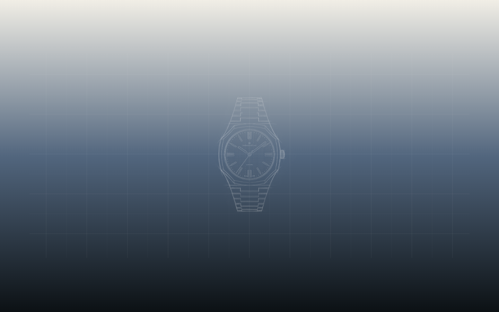
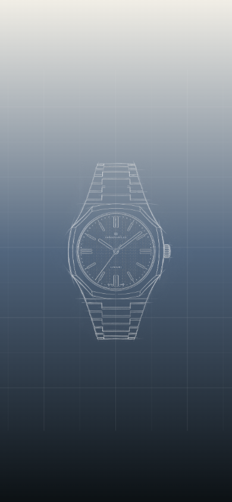

# UI Design System & Master Generation Blueprint: www-pragenhatlen-com

> **Prägen Hätlen · Swiss watchmaking for the crypto community.** (https://www.pragenhatlen.com/) — Trust, precision, resilience and uncompromising attention to detail.



---

## 1. Executive Visual Persona & Design Archetype

- **Brand Essence & Persona**: **Prägen Hätlen · Swiss watchmaking for the crypto community.** (`https://www.pragenhatlen.com/`). Trust, precision, resilience and uncompromising attention to detail.
- **Capture Provenance**: Live browser capture (`tier2_webgl`, HTTP `200`, captured `2026-11-23`).
- **Visual Archetype**: **Light-Gallery WebGL / Canvas Interactive Experience (`#ecebea` / `#0000ff`)**.
- **Anti-AI-Slop Differentiators**:
  - **Live-Computed Chromatic Polarity**: Anchors the viewport in `#ecebea` (live computed `body` `background-color` (`computed_styles.json`)) paired with `#0c1114` primary typography and `#0000ff` accents.
  - **Grounded Typographic Hierarchy**: Pairs `Manrope` for display copy (`The scarcest asset, on your wrist`) with `Manrope` and `RedHatMono`.
  - **Calibrated Spatial Grid & Motion**: Combines `1440px` container bounds (`gap: 12px 168px`, padding `32px`) with `cubic-bezier(.215,.61,.355,1)` easing and Lenis Smooth Scroll (`data-lenis`), Three.js / WebGL Canvas Pipeline.

---

## 2. Spatial Architecture & Modular Grid Mathematics



### Viewport Allocation & Container Geometry
- **Captured Viewport Dimensions**: Desktop `1440×900px` (`assets/desktop.png`, single-viewport 100vh live capture (900px)), Mobile `390×844px` (`assets/mobile.png`, single-viewport 100vh live capture (844px)).
- **Master Container Bounds**: `1440px` (full-bleed `100%` desktop stage measured on `1440px` viewport).
- **Canvas Lateral Padding & Spacing**: `32px` lateral canvas padding with `12px 168px` grid gap.
- **Border Radius Scale**: `var(--border-radius)`, `100%`, `1rem`, `4px`.

### Responsive Breakpoint Architecture
- **Desktop Layout**: Multi-column CSS Grid / Flexbox layout at `1440px` (`max-width: 1440px`, `gap: 12px 168px`).
- **Mobile Layout**: Single-column vertical stack at `390px` viewport width with `32px` horizontal padding.
- **Extracted CSS Media Queries**: `@media (min-width: 768px) and (min-height: 500px) and (orientati...`, `@media (max-width: 768px)`, `@media (max-width: 768px) and (min-width: 768px) and (min-height...`, `@media (min-width: 768px)`.

---

## 3. Color System, Materiality & Atmospheric Lighting

### Semantic Palette & Source Grounding
| Semantic Role | Ground-Truth Value | Extracted Live / CSS Source |
|---|---|---|
| **Primary Canvas Substrate** | `#ecebea` | live computed `body` `background-color` (`computed_styles.json`) |
| **Primary Typography Ink** | `#0c1114` | live computed `main` `color` (`computed_styles.json`) |
| **Elevated Surface / Card Substrate** | `#ffffff` | `.BaseButton-module__white__qygOa { background-color: white }` (`#ffffff`) |
| **Interactive Accent / Highlight** | `#0000ff` | `.App-module__link__jsQ7Z:hover { color: blue }` (`#0000ff`) |
| **Secondary / Muted Copy** | `#ffffff` | live computed `p` `color` (`computed_styles.json`) |
| **Structural Hairline Border** | `#ffffff` | `.StickyModal-module__header__LViCK { border-bottom: #ffffff }` |
| **Variable Token (`--color-black`)** | `#000000` | `var(--color-black)` in `:root` |

### Sanitized Root CSS Variables (`ui-ux.md` Ground Truth)
| Variable Name | Extracted Value | Semantic Role |
|---|---|---|
| `--breakpoint-mobile` | `320px` | Dimension / Scale Token |
| `--breakpoint-mobile-horizontal` | `500px` | Dimension / Scale Token |
| `--breakpoint-tablet` | `768px` | Dimension / Scale Token |
| `--breakpoint-tablet-height` | `950px` | Layout / Spatial Grid Token |
| `--breakpoint-laptop` | `1024px` | Dimension / Scale Token |
| `--breakpoint-bigLaptop-min` | `1366px` | Dimension / Scale Token |
| `--breakpoint-bigLaptop` | `1440px` | Dimension / Scale Token |
| `--breakpoint-desktop` | `1680px` | Dimension / Scale Token |
| `--color-white` | `#fff` | Canvas / Surface Token |
| `--color-white--40` | `#ffffff66` | Canvas / Surface Token |
| `--color-white--16` | `#ffffff29` | Canvas / Surface Token |
| `--color-white--4` | `#ffffff0a` | Canvas / Surface Token |
| `--color-black` | `#000` | Canvas / Surface Token |
| `--color-black--50` | `#00000080` | Canvas / Surface Token |
| `--color-black--30` | `#0000004d` | Canvas / Surface Token |
| `--color-black--24` | `#0000003d` | Canvas / Surface Token |

---

## 4. Typographic Scale & Editorial Hierarchy

### Font Family Stacks
- **Display Typography**: `Manrope`.
- **Primary Body Stack**: `Manrope`.
- **Technical / Metadata Stack**: `RedHatMono`.

### Typographic Scale & Rules (Live Computed & Stylesheet Grounded)
- **Hero Display (`H1`)**: live computed `h1` (`font-size: 48px`, `line-height: 48px`, `font-weight: 500`).
- **Section Heading (`H2`)**: live computed `h2` (`font-size: 36px`, `line-height: 39.6px`, `font-weight: 500`).
- **Body Copy**: live computed `body` (`font-size: 16px`, `line-height: 18.4px`, `font-weight: 400`).
- **Metadata & Navigation Labels**: live computed `nav/a` (`font-size: 16px`, `line-height: 18.4px`, `font-weight: 400`).

---

## 5. Choreographed Motion & Interaction Physics

### Primary Easing Curves
- **Extracted Timing Functions**: `cubic-bezier(.215,.61,.355,1)`.

### Per-Element Transition & Choreography Rules
- **Selector `.Header-module__top__mJsjm`**: `transition: .5s ease color` extracted from `www-pragenhatlen-com` stylesheet.
- **Selector `.Header-module__top_open__BgPji`**: `transition: unset` extracted from `www-pragenhatlen-com` stylesheet.
- **Selector `media (hover: hover)`**: `transition: .25s cubic-bezier(.215,.61,.355,1) opacity` extracted from `www-pragenhatlen-com` stylesheet.
- **Extracted Easing Curve (`cubic-bezier(.215,.61,.355,1)`)**: Governs interactive state transitions across `<header.Header-module__top__mJsjm>` and `<section.App-module__root__JTuhI>`.
- **Runtime Interaction Engine**: Integrates Lenis Smooth Scroll (`data-lenis`), Three.js / WebGL Canvas Pipeline with `prefers-reduced-motion: reduce` fallback guards.

---

## 6. Component Wireframe & Structural DOM Map

### Visual Layout Schematic — Desktop (`1440px`, Grounded in `dom.html` & Landmark Bounding Boxes)
```
┌────────────────────────────────────────────────────────────────────────┐
│ DESKTOP VIEWPORT (1440px) — Prägen Hätlen · Swiss watchmaking for the  │
│ ====================================================================== │
│ [ <header.Header-module_ (1440x76px)  | [02] A b o u t · [04] F A Q  ] │
│ ---------------------------------------------------------------------- │
│ | HERO STAGE: <section.HeroVideo-module__root__FiO (w=1440px)        | │
│ | H1: The scarcest asset, on your wrist                              | │
│ | Substrate: #ecebea | Ink: #0c1114 | Accent: #0000ff                | │
│ ---------------------------------------------------------------------- │
│ | SHOWCASE GRID (<section.App-module__root_) max-w: 1440px           | │
│ | +------------------------------+  +------------------------------+ | │
│ | | Precision in every layer     |  | Plate Customization          | | │
│ | +------------------------------+  +------------------------------+ | │
│ ---------------------------------------------------------------------- │
│ | DETAIL MODULE (<section.RotateScreen-modu) — Screw-Down Crown      | │
│ ---------------------------------------------------------------------- │
│ [ FOOTER (<footer.Footer-modul) | https://www.pragenhatlen.com/        │
└────────────────────────────────────────────────────────────────────────┘
```

### Visual Layout Schematic — Mobile Reflow (`390px`)
```
┌────────────────────────────────────────────────────────────────────────┐
│ MOBILE VIEWPORT REFLOW (390px) — Single-Column Stack (gap: 12px 168)   │
│ ====================================================================== │
│ [ HEADER BAR (<header.Header-module__t) | Compact Menu (390px)         │
│ ---------------------------------------------------------------------- │
│ | HERO STAGE (<section.HeroVideo-modul) — 390px Vertical Lead        | │
│ | H1: The scarcest asset, on your wrist                              | │
│ ---------------------------------------------------------------------- │
│ | SHOWCASE STACK (<section.App-module__r) — 1-Col Stack              | │
│ | [ Item 1: Precision in every layer                               ] | │
│ | [ Item 2: Plate Customization                                    ] | │
│ ---------------------------------------------------------------------- │
│ | DETAIL STACK (<section.RotateScreen-mo) — 1-Col (Screw-Down Crown) | │
│ ---------------------------------------------------------------------- │
│ [ FOOTER (<footer.Footer-modul) | Stacked 390px Colophon               │
└────────────────────────────────────────────────────────────────────────┘
```

### Granular DOM Region Breakdown
1. **Brand Header & Navigation Bar (<header.Header-module__top__mJsjm> — `www-pragenhatlen-com`)**:
   - Landmark `<header class="Header-module__top__mJsjm">` (`1440x76px`) hosting `Prägen Hätlen · Swiss watchmaking fo` navigation (`[02] A b o u t · [04] F A Q`), DOM attributes (`data-modal-id="cart"`, `data-lenis-prevent="true"`, `data-lenis-prevent="true"`, `data-lenis-prevent="true"`), and stylesheet rule `.App-module__root__JTuhI { background-color:var(--color-bg) }`.
2. **Hero Stage & Focal Lead (<section.HeroVideo-module__root__FiOC1> — `The scarcest asset, on your wrist`)**:
   - Landmark `<section class="HeroVideo-module__root__FiOC1">` presenting display lead `The scarcest asset, on your wrist` and copy excerpt *"Limited Edition. Swiss-made. Crypto Native"* over `#ecebea` canvas and `#0c1114` ink.
3. **Primary Showcase & Content Grid (<section.App-module__root__JTuhI> — `Precision in every layer`)**:
   - Landmark `<section class="App-module__root__JTuhI">` rendering section `Precision in every layer` with copy *"Prägen Hätlen introduces a new relationship between craftsmanship"*, asset references (`watch-background-drawing-D_cIL0zr...`, `cart-DdlU5Vpi.png`, `engrave_blue-Bx6rooYN.jpg`, `www.pragenhatlen.com`), and grid rule `.App-module__link__jsQ7Z { color:var(--color-black) }`.
4. **Interactive Detail & Feature Matrix (<section.RotateScreen-module__root__m8vUV> — `Plate Customization`)**:
   - Landmark `<section class="RotateScreen-module__root__m8vUV">` framing `Plate Customization` and `Screw-Down Crown` (*"By scanning the watch crystal with a smartphone, collectors are c"*) with `#ffffff` surface cards, `#0000ff` accents, and `.App-module__link__jsQ7Z:hover { color:var(--color-blue-cher-ami) }`.
5. **Colophon & Global Directory Footer (<footer.Footer-module__root__oib9b> — `https://www.pragenhatlen.com/`)**:
   - Landmark `<footer class="Footer-module__root__oib9b">` anchoring `Prägen Hätlen · Swiss watchmakin` footer links (`[02] A b o u t · [04] F A Q`), copy *"Through this interaction, they can access the associated Pro"*, and `#ffffff` structural dividers.

---

## 7. Master Zero-Shot AI Generation Prompt

```markdown
# Master Zero-Shot Frontend Generation Prompt: www-pragenhatlen-com (Prägen Hätlen · Swiss watchmaking for the crypto community.)

You are a principal frontend architect and design systems engineer. Build a complete, production-ready web application replicating the exact design system, DOM landmarks, typographic hierarchy, color tokens, and motion physics of `www-pragenhatlen-com` (**Prägen Hätlen · Swiss watchmaking for the crypto community.** — `https://www.pragenhatlen.com/`).

### 1. Visual Archetype & Anti-AI-Slop Mandates
- **Archetype**: Light-Gallery WebGL / Canvas Interactive Experience (`#ecebea` / `#0000ff`).
- **Identity & Domain Context**: Trust, precision, resilience and uncompromising attention to detail.
- **Primary Substrate**: `#ecebea` (live computed `body` `background-color` (`computed_styles.json`)), **Primary Ink**: `#0c1114`, **Accent / Highlight**: `#0000ff`.
- **Site-Specific Differentiators**:
  - **Live-Computed Chromatic Polarity**: Anchors the viewport in `#ecebea` (live computed `body` `background-color` (`computed_styles.json`)) paired with `#0c1114` primary typography and `#0000ff` accents.
  - **Grounded Typographic Hierarchy**: Pairs `Manrope` for display copy (`The scarcest asset, on your wrist`) with `Manrope` and `RedHatMono`.
  - **Calibrated Spatial Grid & Motion**: Combines `1440px` container bounds (`gap: 12px 168px`, padding `32px`) with `cubic-bezier(.215,.61,.355,1)` easing and Lenis Smooth Scroll (`data-lenis`), Three.js / WebGL Canvas Pipeline.

### 2. Ground-Truth CSS Variables (`:root` Token Contract)
Declare and consume these exact custom properties extracted from `www-pragenhatlen-com` in your global stylesheet:

:root {
  /* Prägen Hätlen · Swiss watchmaking for the crypto community. (www-pragenhatlen-com) — Live-Grounded CSS Variables */
  --breakpoint-mobile: 320px; /* Dimension / Scale Token (www-pragenhatlen-com) */
  --breakpoint-mobile-horizontal: 500px; /* Dimension / Scale Token (www-pragenhatlen-com) */
  --breakpoint-tablet: 768px; /* Dimension / Scale Token (www-pragenhatlen-com) */
  --breakpoint-tablet-height: 950px; /* Layout / Spatial Grid Token (www-pragenhatlen-com) */
  --breakpoint-laptop: 1024px; /* Dimension / Scale Token (www-pragenhatlen-com) */
  --breakpoint-bigLaptop-min: 1366px; /* Dimension / Scale Token (www-pragenhatlen-com) */
  --breakpoint-bigLaptop: 1440px; /* Dimension / Scale Token (www-pragenhatlen-com) */
  --breakpoint-desktop: 1680px; /* Dimension / Scale Token (www-pragenhatlen-com) */
  --color-white: #fff; /* Canvas / Surface Token (www-pragenhatlen-com) */
  --color-white--40: #ffffff66; /* Canvas / Surface Token (www-pragenhatlen-com) */
  --color-white--16: #ffffff29; /* Canvas / Surface Token (www-pragenhatlen-com) */
  --color-white--4: #ffffff0a; /* Canvas / Surface Token (www-pragenhatlen-com) */
  --color-black: #000; /* Canvas / Surface Token (www-pragenhatlen-com) */
  --color-black--50: #00000080; /* Canvas / Surface Token (www-pragenhatlen-com) */
  --color-black--30: #0000004d; /* Canvas / Surface Token (www-pragenhatlen-com) */
  --color-black--24: #0000003d; /* Canvas / Surface Token (www-pragenhatlen-com) */
}

### 3. Semantic Color & Materiality Contract
Map every surface, ink, and border strictly to these source-grounded tokens:
- **Primary Canvas Substrate**: `#ecebea` — grounded in live computed `body` `background-color` (`computed_styles.json`)
- **Primary Typography Ink**: `#0c1114` — grounded in live computed `main` `color` (`computed_styles.json`)
- **Elevated Surface / Card Substrate**: `#ffffff` — grounded in `.BaseButton-module__white__qygOa { background-color: white }` (`#ffffff`)
- **Interactive Accent / Highlight**: `#0000ff` — grounded in `.App-module__link__jsQ7Z:hover { color: blue }` (`#0000ff`)
- **Secondary / Muted Copy**: `#ffffff` — grounded in live computed `p` `color` (`computed_styles.json`)
- **Structural Hairline Border**: `#ffffff` — grounded in `.StickyModal-module__header__LViCK { border-bottom: #ffffff }`
- **Variable Token (`--color-black`)**: `#000000` — grounded in `var(--color-black)` in `:root`

### 4. Spatial Grid, Container Bounds & Responsive Breakpoints
- **Desktop Viewport Reference**: `1440×900px` (single-viewport 100vh live capture (900px), `1440px` standard desktop width).
- **Mobile Viewport Reference**: `390×844px` (single-viewport 100vh live capture (844px), `390px` standard mobile width).
- **Container Max-Width**: `1440px` (full-bleed `100%` desktop stage measured on `1440px` viewport)
- **Padding & Gutters**: `32px` lateral canvas padding with `12px 168px` grid gap
- **Desktop Grid**: Multi-column CSS Grid / Flexbox layout at `1440px` (`max-width: 1440px`, `gap: 12px 168px`)
- **Mobile Adaptation**: Single-column vertical stack at `390px` viewport width with `32px` horizontal padding
- **Media Queries**: `@media (min-width: 768px) and (min-height: 500px) and (orientati...`, `@media (max-width: 768px)`, `@media (max-width: 768px) and (min-width: 768px) and (min-height...`, `@media (min-width: 768px)`
- **Corner Radii**: `var(--border-radius)`, `100%`, `1rem`, `4px`

### 5. Typography & Editorial Scale Contract
- **Display Font Stack**: `Manrope`
- **Body Font Stack**: `Manrope`
- **Monospace / Technical Font Stack**: `RedHatMono`
- **H1 Display Rule**: live computed `h1` (`font-size: 48px`, `line-height: 48px`, `font-weight: 500`)
- **H2 Section Rule**: live computed `h2` (`font-size: 36px`, `line-height: 39.6px`, `font-weight: 500`)
- **Body Copy Rule**: live computed `body` (`font-size: 16px`, `line-height: 18.4px`, `font-weight: 400`)
- **Metadata & Index Rule**: live computed `nav/a` (`font-size: 16px`, `line-height: 18.4px`, `font-weight: 400`)

### 6. Component Hierarchy, Verbatim Copy & Real DOM Landmarks
Scaffold `www-pragenhatlen-com` (`Prägen Hätlen · Swiss watchmaking for the crypto community.`) with these exact structural regions, extracted copy, and CSS rules from `dom.html`:
1. **Brand Header & Navigation Bar (<header.Header-module__top__mJsjm> — `www-pragenhatlen-com`)**:
   - DOM & Selectors: Landmark `<header class="Header-module__top__mJsjm">` (`1440x76px`) hosting `Prägen Hätlen · Swiss watchmaking fo` navigation (`[02] A b o u t · [04] F A Q`), DOM attributes (`data-modal-id="cart"`, `data-lenis-prevent="true"`, `data-lenis-prevent="true"`, `data-lenis-prevent="true"`), and stylesheet rule `.App-module__root__JTuhI { background-color:var(--color-bg) }`.
   - Responsive Contract: Header `Brand Header & Navigation Bar (<header.Header-module__top__mJsjm> — `www-pragenhatlen-com`)` (`www-pragenhatlen-com`) adapts across `@media (min-width: 768px) and (min-height: 500px) and (orientati...`, `@media (max-width: 768px)`, `@media (max-width: 768px) and (min-width: 768px) and (min-height...`, `@media (min-width: 768px)` with `cubic-bezier(.215,.61,.355,1)` transitions and links `[02] A b o u t · [04] F A Q`.
2. **Hero Stage & Focal Lead (<section.HeroVideo-module__root__FiOC1> — `The scarcest asset, on your wrist`)**:
   - DOM & Selectors: Landmark `<section class="HeroVideo-module__root__FiOC1">` presenting display lead `The scarcest asset, on your wrist` and copy excerpt *"Limited Edition. Swiss-made. Crypto Native"* over `#ecebea` canvas and `#0c1114` ink.
   - Responsive Contract: Hero stage (`1440×900px` desktop / `390×844px` mobile) sets `#ecebea` background with `#0c1114` headline `The scarcest asset, on your wrist`.
3. **Primary Showcase & Content Grid (<section.App-module__root__JTuhI> — `Precision in every layer`)**:
   - DOM & Selectors: Landmark `<section class="App-module__root__JTuhI">` rendering section `Precision in every layer` with copy *"Prägen Hätlen introduces a new relationship between craftsmanship"*, asset references (`watch-background-drawing-D_cIL0zr...`, `cart-DdlU5Vpi.png`, `engrave_blue-Bx6rooYN.jpg`, `www.pragenhatlen.com`), and grid rule `.App-module__link__jsQ7Z { color:var(--color-black) }`.
   - Responsive Contract: Showcase grid `Primary Showcase & Content Grid (<section.App-module__root__JTuhI> — `Precision in every layer`)` applies Multi-column CSS Grid / Flexbox layout at `1440px` (`max-width: 1440px`, `gap: 12px 168px`) on desktop and Single-column vertical stack at `390px` viewport width with `32px` horizontal padding on mobile.
4. **Interactive Detail & Feature Matrix (<section.RotateScreen-module__root__m8vUV> — `Plate Customization`)**:
   - DOM & Selectors: Landmark `<section class="RotateScreen-module__root__m8vUV">` framing `Plate Customization` and `Screw-Down Crown` (*"By scanning the watch crystal with a smartphone, collectors are c"*) with `#ffffff` surface cards, `#0000ff` accents, and `.App-module__link__jsQ7Z:hover { color:var(--color-blue-cher-ami) }`.
   - Responsive Contract: Detail module `Interactive Detail & Feature Matrix (<section.RotateScreen-module__root__m8vUV> — `Plate Customization`)` uses `var(--border-radius)`, `100%`, `1rem`, `4px` radii, `#0000ff` highlights, and assets (watch-background-drawing-D_cIL0zr..., cart-DdlU5Vpi.png, engrave_blue-Bx6rooYN.jpg).
5. **Colophon & Global Directory Footer (<footer.Footer-module__root__oib9b> — `https://www.pragenhatlen.com/`)**:
   - DOM & Selectors: Landmark `<footer class="Footer-module__root__oib9b">` anchoring `Prägen Hätlen · Swiss watchmakin` footer links (`[02] A b o u t · [04] F A Q`), copy *"Through this interaction, they can access the associated Pro"*, and `#ffffff` structural dividers.
   - Responsive Contract: Footer `Colophon & Global Directory Footer (<footer.Footer-module__root__oib9b> — `https://www.pragenhatlen.com/`)` aligns to `1440px` (full-bleed `100%` desktop stage measured on `1440px` viewport) with `32px` lateral canvas padding with `12px 168px` grid gap and attributes (data-modal-id="cart", data-lenis-prevent="true", data-lenis-prevent="true").

#### Verbatim DOM Copy Excerpts (`dom.html`)
- Copy Excerpt 1: *"Limited Edition. Swiss-made. Crypto Native"*
- Copy Excerpt 2: *"Prägen Hätlen introduces a new relationship between craftsmanship, digital identit..."*
- Copy Excerpt 3: *"By scanning the watch crystal with a smartphone, collectors are connected to its d..."*
- Copy Excerpt 4: *"Through this interaction, they can access the associated Proof of Collection NFT,..."*

### 7. Motion, Extracted Stylesheet Rules & Interaction Choreography
- **Primary Easing Functions**: `cubic-bezier(.215,.61,.355,1)`
- **Extracted Stylesheet Rules (`www-pragenhatlen-com`)**:
- `.App-module__root__JTuhI { background-color:var(--color-bg) }`
- `.App-module__link__jsQ7Z { color:var(--color-black) }`
- `.App-module__link__jsQ7Z:hover { color:var(--color-blue-cher-ami) }`
- `.Loader-module__background__Nbt4d { position:absolute;top:50%;left:50%;-webkit-transform:translate(-50%,-50%... }`
- `.Loader-module__background__Nbt4d... { width:auto;height:72vh }`
- **Per-Selector Transition Rules**:
- **Selector `.Header-module__top__mJsjm`**: `transition: .5s ease color` extracted from `www-pragenhatlen-com` stylesheet.
- **Selector `.Header-module__top_open__BgPji`**: `transition: unset` extracted from `www-pragenhatlen-com` stylesheet.
- **Selector `media (hover: hover)`**: `transition: .25s cubic-bezier(.215,.61,.355,1) opacity` extracted from `www-pragenhatlen-com` stylesheet.
- **Extracted Easing Curve (`cubic-bezier(.215,.61,.355,1)`)**: Governs interactive state transitions across `<header.Header-module__top__mJsjm>` and `<section.App-module__root__JTuhI>`.
- **Runtime Interaction Engine**: Integrates Lenis Smooth Scroll (`data-lenis`), Three.js / WebGL Canvas Pipeline with `prefers-reduced-motion: reduce` fallback guards.

### 8. Technical Deliverables
- Implement in Next.js (App Router) with TypeScript and Tailwind CSS consuming the `:root` custom properties defined above for `www-pragenhatlen-com`.
- Reproduce both the `1440px` desktop architecture and `390px` mobile breakpoint transitions, preserving semantic HTML5 landmarks (`<header>`, `<nav>`, `<main>`, `<section>`, `<footer>`) and `prefers-reduced-motion` accessibility guards.
```
