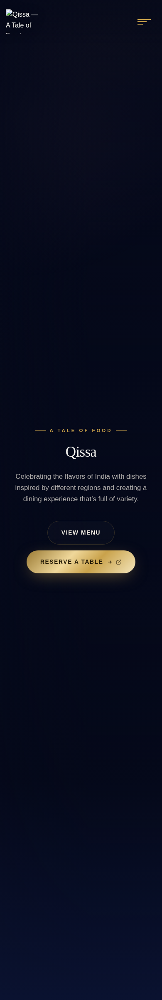

# UI Design System & Master Generation Blueprint: www-qissa-co-uk

> **Indian Restaurant in Sevenoaks, Kent · Qissa** (https://www.qissa.co.uk/) — Qissa — A Tale of Food. Modern Indian dining beneath the blossoms in the heart of Sevenoaks, Kent. Reserve a table or order takeaway. Rat...


---

## 1. Executive Visual Persona & Design Archetype

- **Brand Essence & Persona**: **Indian Restaurant in Sevenoaks, Kent · Qissa** (`https://www.qissa.co.uk/`). Qissa — A Tale of Food. Modern Indian dining beneath the blossoms in the heart of Sevenoaks, Kent. Reserve a table or order takeaway. Rat...
- **Visual Archetype**: **Dark-Substrate WebGL / Canvas Interactive Experience (`#05091A` / `#16224A`)**.
- **Anti-AI-Slop Differentiators**:
  - **Source-Grounded Chromatic Polarity**: Anchors the viewport in `#05091A` (`var(--ink)` in `:root`) paired with `#C9A24B` primary typography and `#16224A` accents.
  - **Extracted Typographic Hierarchy**: Pairs `Cormorant Garamond` for display copy (`Qissa`) with `Manrope` and not declared in static CSS (uses primary stack / `ui-monospace`).
  - **Calibrated Spatial Grid & Motion**: Combines `52ch` container bounds (`gap: 22px`, padding `var(--gutter)`) with `cubic-bezier(.22,.61,.36,1)` easing and HTML5 `<canvas>` Interactive Viewport Surface.

---

## 2. Spatial Architecture & Modular Grid Mathematics



### Viewport Allocation & Container Geometry
- **Captured Viewport Dimensions**: Desktop `1440×11835px` (`assets/desktop.png`, full-page scroll capture), Mobile `390×2400px` (`assets/mobile.png`, capped at 2400px multi-section capture).
- **Master Container Bounds**: `52ch` extracted from `www-qissa-co-uk` stylesheet.
- **Canvas Lateral Padding & Spacing**: `var(--gutter)` lateral canvas padding with `22px` grid gap.
- **Border Radius Scale**: `100px`, `50%`, `var(--radius)`, `4px`.

### Responsive Breakpoint Architecture
- **Desktop Layout**: Multi-column CSS Grid / Flexbox layout at `1440px` (`max-width: 52ch`, `gap: 22px`).
- **Mobile Layout**: Single-column vertical stack at `390px` viewport width with `var(--gutter)` horizontal padding.
- **Extracted CSS Media Queries**: `@media (prefers-reduced-motion:reduce)`, `@media (max-width:560px)`, `@media (max-width:820px)`, `@media (max-width:460px)`.

---

## 3. Color System, Materiality & Atmospheric Lighting

### Semantic Palette & Source Grounding
| Semantic Role | Ground-Truth Value | Extracted CSS Source / Selector |
|---|---|---|
| **Primary Canvas Substrate** | `#05091A` | `var(--ink)` in `:root` |
| **Primary Typography Ink** | `#0A1230` | `var(--navy)` in `:root` |
| **Elevated Surface / Card Substrate** | `#0E1838` | `var(--navy-2)` in `:root` |
| **Interactive Accent / Highlight** | `#16224A` | `var(--navy-3)` in `:root` |
| **Secondary / Muted Copy** | `#1E2C57` | `var(--navy-line)` in `:root` |
| **Structural Hairline Border** | `#C9A24B` | `var(--gold)` in `:root` |
| **Variable Token (`--gold-hi`)** | `#EFD79A` | `var(--gold-hi)` in `:root` |
| **Variable Token (`--gold-deep`)** | `#9A7A34` | `var(--gold-deep)` in `:root` |
| **Variable Token (`--amber`)** | `#E9A85C` | `var(--amber)` in `:root` |
| **Variable Token (`--blossom`)** | `#E7A6C4` | `var(--blossom)` in `:root` |
| **Variable Token (`--blossom-2`)** | `#F2C6D9` | `var(--blossom-2)` in `:root` |
| **Variable Token (`--cream`)** | `#F6F1E7` | `var(--cream)` in `:root` |

### Sanitized Root CSS Variables (`ui-ux.md` Ground Truth)
| Variable Name | Extracted Value | Semantic Role |
|---|---|---|
| `--ink` | `#05091A` | Typography Ink Token |
| `--navy` | `#0A1230` | Layout / Spatial Grid Token |
| `--navy-2` | `#0E1838` | Layout / Spatial Grid Token |
| `--navy-3` | `#16224A` | Layout / Spatial Grid Token |
| `--navy-line` | `#1E2C57` | Layout / Spatial Grid Token |
| `--gold` | `#C9A24B` | Color / Atmospheric Token |
| `--gold-hi` | `#EFD79A` | Color / Atmospheric Token |
| `--gold-deep` | `#9A7A34` | Color / Atmospheric Token |
| `--amber` | `#E9A85C` | Color / Atmospheric Token |
| `--blossom` | `#E7A6C4` | Color / Atmospheric Token |
| `--blossom-2` | `#F2C6D9` | Color / Atmospheric Token |
| `--cream` | `#F6F1E7` | Color / Atmospheric Token |
| `--cream-dim` | `rgba(246,241,231,.70)` | Color / Atmospheric Token |
| `--cream-faint` | `rgba(246,241,231,.42)` | Color / Atmospheric Token |
| `--line` | `rgba(201,162,75,.22)` | Color / Atmospheric Token |
| `--line-soft` | `rgba(246,241,231,.10)` | Color / Atmospheric Token |

---

## 4. Typographic Scale & Editorial Hierarchy

### Font Family Stacks
- **Display Typography**: `Cormorant Garamond`.
- **Primary Body Stack**: `Manrope`.
- **Technical / Metadata Stack**: not declared in static CSS (uses primary stack / `ui-monospace`).

### Typographic Scale & Rules (Extracted from Stylesheet & Variables)
- **Hero Display (`H1`)**: CSS variables `--f-display: 'Cormorant Garamond', 'Times New Roman', serif`; rule `.hero-title` (`font-size: clamp(2rem,9vw,7.6rem)`, `letter-spacing: -.02em`).
- **Section Heading (`H2`)**: rule `.h2` (`font-size: clamp(2rem,4.6vw,3.6rem)`, `letter-spacing: -.015em`, `font-weight: 340`).
- **Body Copy**: CSS variables `--f-body: 'Manrope', -apple-system, BlinkMacSystemFont, 'Segoe UI', sans-serif`; rule `body` (`line-height: 1.6`, `font-weight: 350`).
- **Metadata & Navigation Labels**: rule `small` (`font-size: .7rem`).

---

## 5. Choreographed Motion & Interaction Physics

### Primary Easing Curves
- **Extracted Timing Functions**: `cubic-bezier(.22,.61,.36,1)`, `cubic-bezier(.65,.05,.36,1)`, `cubic-bezier(0.22,1,0.36,1)`.

### Per-Element Transition & Choreography Rules
- **Selector `.btn`**: `transition: transform .5s var(--ease),box-shadow .5s var(--ease),backgroun...` extracted from `www-qissa-co-uk` stylesheet.
- **Selector `.btn svg`**: `transition: transform .5s var(--ease)` extracted from `www-qissa-co-uk` stylesheet.
- **Selector `.site-header`**: `transition: padding .5s var(--ease),background .5s var(--ease),backdrop-fi...` extracted from `www-qissa-co-uk` stylesheet.
- **Extracted Easing Curve (`cubic-bezier(.22,.61,.36,1)`)**: Governs interactive state transitions across `<header.site-header>` and `<section.section>`.
- **Runtime Interaction Engine**: Integrates HTML5 `<canvas>` Interactive Viewport Surface with `prefers-reduced-motion: reduce` fallback guards.

---

## 6. Component Wireframe & Structural DOM Map

### Visual Layout Schematic (Grounded in `dom.html` — `1440px` Desktop & `390px` Mobile Reflow)
```
┌────────────────────────────────────────────────────────────────────────┐
│ DESKTOP VIEWPORT (1440px) — Indian Restaurant in Sevenoaks, Kent · Qis │
│ ====================================================================== │
│ [ <header.site-header>     | 00 Home · 01 Our Story · 02 The Menu · ]  │
│ ---------------------------------------------------------------------- │
│ | HERO STAGE: <section.hero>                                       |   │
│ | H1: Qissa                                                        |   │
│ | Substrate: #05091A    | Ink: #C9A24B    | Accent: #16224A        |   │
│ ---------------------------------------------------------------------- │
│ | SHOWCASE GRID (<section.section>         ) max-w: 52ch           |   │
│ | +------------------------------+  +------------------------------+ | │
│ | | A word that means a tale.    |  | Crafted icons & signature pl | | │
│ | +------------------------------+  +------------------------------+ | │
│ ---------------------------------------------------------------------- │
│ | MOBILE VIEWPORT REFLOW (390px) — Single-Column Stack (gap: 22px  ) | │
│ | [<header.site-heade] -> [<section.hero>] -> [<section.section>] |    │
│ ---------------------------------------------------------------------- │
│ [ FOOTER (<footer.site-footer>  ) | https://www.qissa.co.uk/           │
└────────────────────────────────────────────────────────────────────────┘
```

### Granular DOM Region Breakdown
1. **Brand Header & Navigation Bar (<header.site-header> — `www-qissa-co-uk`)**:
   - Landmark `<header class="site-header">` hosting `Indian Restaurant in Sevenoaks, Kent` navigation (`00 Home · 01 Our Story · 02 The Menu · Food Menu · Drinks Menu`), DOM attributes (`data-u="contact"`, `data-d="qissa.co.uk"`, `data-tilt`, `data-count="4.8"`), and stylesheet rule `after { box-sizing:border-box;margin:0;padding:0 }`.
2. **Hero Stage & Focal Lead (<section.hero> — `Qissa`)**:
   - Landmark `<section class="hero">` presenting display lead `Qissa` and copy excerpt *"06 Visit & Contact"* over `#05091A` canvas and `#C9A24B` ink.
3. **Primary Showcase & Content Grid (<section.section> — `A word that means a tale.`)**:
   - Landmark `<section class="section">` rendering section `A word that means a tale.` with copy *"4 Carlton Parade, St John's Hill Sevenoaks, TN13 3NZ, Kent"*, asset references (`gtm.js`, `hero-poster.webp`, `favicon-96.png`, `favicon-32.png`), and grid rule `html { scroll-behavior:smooth;-webkit-text-size-adjust:100% }`.
4. **Interactive Detail & Feature Matrix (<section.section> — `Crafted icons & signature plates.`)**:
   - Landmark `<section class="section masterpieces">` framing `Crafted icons & signature plates.` and `Explore the menu, course by course.` (*"01732 74 09 74 contact qissa.co.uk"*) with `#0E1838` surface cards, `#16224A` accents, and `img { display:block;max-width:100%;height:auto }`.
5. **Colophon & Global Directory Footer (<footer.site-footer> — `https://www.qissa.co.uk/`)**:
   - Landmark `<footer class="site-footer">` anchoring `Indian Restaurant in Sevenoaks, ` footer links (`00 Home · 01 Our Story · 02 The Menu · Food Menu · Drinks Menu`), copy *"contact qissa.co.uk"*, and `#C9A24B` structural dividers.

---

## 7. Master Zero-Shot AI Generation Prompt

```markdown
# Master Zero-Shot Frontend Generation Prompt: www-qissa-co-uk (Indian Restaurant in Sevenoaks, Kent · Qissa)

You are a principal frontend architect and design systems engineer. Build a complete, production-ready web application replicating the exact design system, DOM landmarks, typographic hierarchy, color tokens, and motion physics of `www-qissa-co-uk` (**Indian Restaurant in Sevenoaks, Kent · Qissa** — `https://www.qissa.co.uk/`).

### 1. Visual Archetype & Anti-AI-Slop Mandates
- **Archetype**: Dark-Substrate WebGL / Canvas Interactive Experience (`#05091A` / `#16224A`).
- **Identity & Domain Context**: Qissa — A Tale of Food. Modern Indian dining beneath the blossoms in the heart of Sevenoaks, Kent. Reserve a table or order takeaway. Rat...
- **Primary Substrate**: `#05091A` (`var(--ink)` in `:root`), **Primary Ink**: `#C9A24B`, **Accent / Highlight**: `#16224A`.
- **Site-Specific Differentiators**:
  - **Source-Grounded Chromatic Polarity**: Anchors the viewport in `#05091A` (`var(--ink)` in `:root`) paired with `#C9A24B` primary typography and `#16224A` accents.
  - **Extracted Typographic Hierarchy**: Pairs `Cormorant Garamond` for display copy (`Qissa`) with `Manrope` and not declared in static CSS (uses primary stack / `ui-monospace`).
  - **Calibrated Spatial Grid & Motion**: Combines `52ch` container bounds (`gap: 22px`, padding `var(--gutter)`) with `cubic-bezier(.22,.61,.36,1)` easing and HTML5 `<canvas>` Interactive Viewport Surface.

### 2. Ground-Truth CSS Variables (`:root` Token Contract)
Declare and consume these exact custom properties extracted from `www-qissa-co-uk` in your global stylesheet:

:root {
  /* Indian Restaurant in Sevenoaks, Kent · Qissa (www-qissa-co-uk) — Ground-Truth Extracted CSS Variables */
  --ink: #05091A; /* Typography Ink Token (www-qissa-co-uk) */
  --navy: #0A1230; /* Layout / Spatial Grid Token (www-qissa-co-uk) */
  --navy-2: #0E1838; /* Layout / Spatial Grid Token (www-qissa-co-uk) */
  --navy-3: #16224A; /* Layout / Spatial Grid Token (www-qissa-co-uk) */
  --navy-line: #1E2C57; /* Layout / Spatial Grid Token (www-qissa-co-uk) */
  --gold: #C9A24B; /* Color / Atmospheric Token (www-qissa-co-uk) */
  --gold-hi: #EFD79A; /* Color / Atmospheric Token (www-qissa-co-uk) */
  --gold-deep: #9A7A34; /* Color / Atmospheric Token (www-qissa-co-uk) */
  --amber: #E9A85C; /* Color / Atmospheric Token (www-qissa-co-uk) */
  --blossom: #E7A6C4; /* Color / Atmospheric Token (www-qissa-co-uk) */
  --blossom-2: #F2C6D9; /* Color / Atmospheric Token (www-qissa-co-uk) */
  --cream: #F6F1E7; /* Color / Atmospheric Token (www-qissa-co-uk) */
  --cream-dim: rgba(246,241,231,.70); /* Color / Atmospheric Token (www-qissa-co-uk) */
  --cream-faint: rgba(246,241,231,.42); /* Color / Atmospheric Token (www-qissa-co-uk) */
  --line: rgba(201,162,75,.22); /* Color / Atmospheric Token (www-qissa-co-uk) */
  --line-soft: rgba(246,241,231,.10); /* Color / Atmospheric Token (www-qissa-co-uk) */
}

### 3. Semantic Color & Materiality Contract
Map every surface, ink, and border strictly to these source-grounded tokens:
- **Primary Canvas Substrate**: `#05091A` — grounded in `var(--ink)` in `:root`
- **Primary Typography Ink**: `#0A1230` — grounded in `var(--navy)` in `:root`
- **Elevated Surface / Card Substrate**: `#0E1838` — grounded in `var(--navy-2)` in `:root`
- **Interactive Accent / Highlight**: `#16224A` — grounded in `var(--navy-3)` in `:root`
- **Secondary / Muted Copy**: `#1E2C57` — grounded in `var(--navy-line)` in `:root`
- **Structural Hairline Border**: `#C9A24B` — grounded in `var(--gold)` in `:root`
- **Variable Token (`--gold-hi`)**: `#EFD79A` — grounded in `var(--gold-hi)` in `:root`
- **Variable Token (`--gold-deep`)**: `#9A7A34` — grounded in `var(--gold-deep)` in `:root`
- **Variable Token (`--amber`)**: `#E9A85C` — grounded in `var(--amber)` in `:root`
- **Variable Token (`--blossom`)**: `#E7A6C4` — grounded in `var(--blossom)` in `:root`
- **Variable Token (`--blossom-2`)**: `#F2C6D9` — grounded in `var(--blossom-2)` in `:root`
- **Variable Token (`--cream`)**: `#F6F1E7` — grounded in `var(--cream)` in `:root`

### 4. Spatial Grid, Container Bounds & Responsive Breakpoints
- **Desktop Viewport Reference**: `1440×11835px` (full-page scroll capture, `1440px` standard desktop width).
- **Mobile Viewport Reference**: `390×2400px` (capped at 2400px multi-section capture, `390px` standard mobile width).
- **Container Max-Width**: `52ch` extracted from `www-qissa-co-uk` stylesheet
- **Padding & Gutters**: `var(--gutter)` lateral canvas padding with `22px` grid gap
- **Desktop Grid**: Multi-column CSS Grid / Flexbox layout at `1440px` (`max-width: 52ch`, `gap: 22px`)
- **Mobile Adaptation**: Single-column vertical stack at `390px` viewport width with `var(--gutter)` horizontal padding
- **Media Queries**: `@media (prefers-reduced-motion:reduce)`, `@media (max-width:560px)`, `@media (max-width:820px)`, `@media (max-width:460px)`
- **Corner Radii**: `100px`, `50%`, `var(--radius)`, `4px`

### 5. Typography & Editorial Scale Contract
- **Display Font Stack**: `Cormorant Garamond`
- **Body Font Stack**: `Manrope`
- **Monospace / Technical Font Stack**: not declared in static CSS (uses primary stack / `ui-monospace`)
- **H1 Display Rule**: CSS variables `--f-display: 'Cormorant Garamond', 'Times New Roman', serif`; rule `.hero-title` (`font-size: clamp(2rem,9vw,7.6rem)`, `letter-spacing: -.02em`)
- **H2 Section Rule**: rule `.h2` (`font-size: clamp(2rem,4.6vw,3.6rem)`, `letter-spacing: -.015em`, `font-weight: 340`)
- **Body Copy Rule**: CSS variables `--f-body: 'Manrope', -apple-system, BlinkMacSystemFont, 'Segoe UI', sans-serif`; rule `body` (`line-height: 1.6`, `font-weight: 350`)
- **Metadata & Index Rule**: rule `small` (`font-size: .7rem`)

### 6. Component Hierarchy, Verbatim Copy & Real DOM Landmarks
Scaffold `www-qissa-co-uk` (`Indian Restaurant in Sevenoaks, Kent · Qissa`) with these exact structural regions, extracted copy, and CSS rules from `dom.html`:
1. **Brand Header & Navigation Bar (<header.site-header> — `www-qissa-co-uk`)**:
   - DOM & Selectors: Landmark `<header class="site-header">` hosting `Indian Restaurant in Sevenoaks, Kent` navigation (`00 Home · 01 Our Story · 02 The Menu · Food Menu · Drinks Menu`), DOM attributes (`data-u="contact"`, `data-d="qissa.co.uk"`, `data-tilt`, `data-count="4.8"`), and stylesheet rule `after { box-sizing:border-box;margin:0;padding:0 }`.
   - Responsive Contract: Header `Brand Header & Navigation Bar (<header.site-header> — `www-qissa-co-uk`)` (`www-qissa-co-uk`) adapts across `@media (prefers-reduced-motion:reduce)`, `@media (max-width:560px)`, `@media (max-width:820px)`, `@media (max-width:460px)` with `cubic-bezier(.22,.61,.36,1)`, `cubic-bezier(.65,.05,.36,1)`, `cubic-bezier(0.22,1,0.36,1)` transitions and links `00 Home · 01 Our Story · 02 The Menu · Food Menu · Drinks Menu`.
2. **Hero Stage & Focal Lead (<section.hero> — `Qissa`)**:
   - DOM & Selectors: Landmark `<section class="hero">` presenting display lead `Qissa` and copy excerpt *"06 Visit & Contact"* over `#05091A` canvas and `#C9A24B` ink.
   - Responsive Contract: Hero stage (`1440×11835px` desktop / `390×2400px` mobile) sets `#05091A` background with `#C9A24B` headline `Qissa`.
3. **Primary Showcase & Content Grid (<section.section> — `A word that means a tale.`)**:
   - DOM & Selectors: Landmark `<section class="section">` rendering section `A word that means a tale.` with copy *"4 Carlton Parade, St John's Hill Sevenoaks, TN13 3NZ, Kent"*, asset references (`gtm.js`, `hero-poster.webp`, `favicon-96.png`, `favicon-32.png`), and grid rule `html { scroll-behavior:smooth;-webkit-text-size-adjust:100% }`.
   - Responsive Contract: Showcase grid `Primary Showcase & Content Grid (<section.section> — `A word that means a tale.`)` applies Multi-column CSS Grid / Flexbox layout at `1440px` (`max-width: 52ch`, `gap: 22px`) on desktop and Single-column vertical stack at `390px` viewport width with `var(--gutter)` horizontal padding on mobile.
4. **Interactive Detail & Feature Matrix (<section.section> — `Crafted icons & signature plates.`)**:
   - DOM & Selectors: Landmark `<section class="section masterpieces">` framing `Crafted icons & signature plates.` and `Explore the menu, course by course.` (*"01732 74 09 74 contact qissa.co.uk"*) with `#0E1838` surface cards, `#16224A` accents, and `img { display:block;max-width:100%;height:auto }`.
   - Responsive Contract: Detail module `Interactive Detail & Feature Matrix (<section.section> — `Crafted icons & signature plates.`)` uses `100px`, `50%`, `var(--radius)`, `4px` radii, `#16224A` highlights, and assets (gtm.js, hero-poster.webp, favicon-96.png).
5. **Colophon & Global Directory Footer (<footer.site-footer> — `https://www.qissa.co.uk/`)**:
   - DOM & Selectors: Landmark `<footer class="site-footer">` anchoring `Indian Restaurant in Sevenoaks, ` footer links (`00 Home · 01 Our Story · 02 The Menu · Food Menu · Drinks Menu`), copy *"contact qissa.co.uk"*, and `#C9A24B` structural dividers.
   - Responsive Contract: Footer `Colophon & Global Directory Footer (<footer.site-footer> — `https://www.qissa.co.uk/`)` aligns to `52ch` extracted from `www-qissa-co-uk` stylesheet with `var(--gutter)` lateral canvas padding with `22px` grid gap and attributes (data-u="contact", data-d="qissa.co.uk", data-tilt).

#### Verbatim DOM Copy Excerpts (`dom.html`)
- Copy Excerpt 1: *"06 Visit & Contact"*
- Copy Excerpt 2: *"4 Carlton Parade, St John's Hill Sevenoaks, TN13 3NZ, Kent"*
- Copy Excerpt 3: *"01732 74 09 74 contact qissa.co.uk"*
- Copy Excerpt 4: *"contact qissa.co.uk"*

### 7. Motion, Extracted Stylesheet Rules & Interaction Choreography
- **Primary Easing Functions**: `cubic-bezier(.22,.61,.36,1)`, `cubic-bezier(.65,.05,.36,1)`, `cubic-bezier(0.22,1,0.36,1)`
- **Extracted Stylesheet Rules (`www-qissa-co-uk`)**:
- `after { box-sizing:border-box;margin:0;padding:0 }`
- `html { scroll-behavior:smooth;-webkit-text-size-adjust:100% }`
- `img { display:block;max-width:100%;height:auto }`
- `button { font-family:inherit;cursor:pointer;border:none;background:none;color:inh... }`
- `selection { background:rgba(201,162,75,.32);color:fff }`
- **Per-Selector Transition Rules**:
- **Selector `.btn`**: `transition: transform .5s var(--ease),box-shadow .5s var(--ease),backgroun...` extracted from `www-qissa-co-uk` stylesheet.
- **Selector `.btn svg`**: `transition: transform .5s var(--ease)` extracted from `www-qissa-co-uk` stylesheet.
- **Selector `.site-header`**: `transition: padding .5s var(--ease),background .5s var(--ease),backdrop-fi...` extracted from `www-qissa-co-uk` stylesheet.
- **Extracted Easing Curve (`cubic-bezier(.22,.61,.36,1)`)**: Governs interactive state transitions across `<header.site-header>` and `<section.section>`.
- **Runtime Interaction Engine**: Integrates HTML5 `<canvas>` Interactive Viewport Surface with `prefers-reduced-motion: reduce` fallback guards.

### 8. Technical Deliverables
- Implement in Next.js (App Router) with TypeScript and Tailwind CSS consuming the `:root` custom properties defined above for `www-qissa-co-uk`.
- Reproduce both the `1440px` desktop architecture and `390px` mobile breakpoint transitions, preserving semantic HTML5 landmarks (`<header>`, `<nav>`, `<main>`, `<section>`, `<footer>`) and `prefers-reduced-motion` accessibility guards.
```
