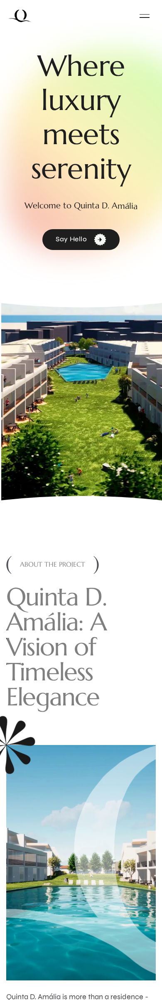

# UI Design System & Master Generation Blueprint: www-quintadamalia-com

> **Quinta D. Amália - Redefining Luxury Living in Portugal** (https://www.quintadamalia.com/) — Set in the heart of Vila Nova de Gaia, Quinta D. Amália is more than a residence - it’s a lifestyle defined by exclusivity, wellness & na...


---

## 1. Executive Visual Persona & Design Archetype

- **Brand Essence & Persona**: **Quinta D. Amália - Redefining Luxury Living in Portugal** (`https://www.quintadamalia.com/`). Set in the heart of Vila Nova de Gaia, Quinta D. Amália is more than a residence - it’s a lifestyle defined by exclusivity, wellness & na...
- **Visual Archetype**: **High-Contrast Obsidian / Atmospheric Design System (`#0d6efd` canvas, `#6610f2` ink, `#d63384` accent)**.
- **Anti-AI-Slop Differentiators**:
  - **Source-Grounded Chromatic Polarity**: Anchors the viewport in `#0d6efd` (`var(--bs-blue)` in `:root`) paired with `#6610f2` primary typography and `#d63384` accents.
  - **Extracted Typographic Hierarchy**: Pairs `Aladin` for display copy (`W h e r e l u x u r y m e e t s s e `) with `Big Shoulders Display` and not declared in static CSS (uses primary stack / `ui-monospace`).
  - **Calibrated Spatial Grid & Motion**: Combines `540px` container bounds (`gap: 1rem`, padding `2rem`) with `cubic-bezier(.28,.84,.42,1)` easing and GSAP Timeline & ScrollTrigger, Three.js / WebGL Canvas Pipeline.

---

## 2. Spatial Architecture & Modular Grid Mathematics



### Viewport Allocation & Container Geometry
- **Captured Viewport Dimensions**: Desktop `1440×17067px` (`assets/desktop.png`, full-page scroll capture), Mobile `390×2400px` (`assets/mobile.png`, capped at 2400px multi-section capture).
- **Master Container Bounds**: `540px` extracted from `www-quintadamalia-com` stylesheet.
- **Canvas Lateral Padding & Spacing**: `2rem` lateral canvas padding with `1rem` grid gap.
- **Border Radius Scale**: `0.375rem`, `.25rem`, `var(--bs-border-radius)`, `var(--bs-border-radius-sm)`.

### Responsive Breakpoint Architecture
- **Desktop Layout**: Multi-column CSS Grid / Flexbox layout at `1440px` (`max-width: 540px`, `gap: 1rem`).
- **Mobile Layout**: Single-column vertical stack at `390px` viewport width with `2rem` horizontal padding.
- **Extracted CSS Media Queries**: `@media (prefers-reduced-motion:no-preference)`, `@media (min-width:1200px)`, `@media (min-width:576px)`, `@media (min-width:768px)`.

---

## 3. Color System, Materiality & Atmospheric Lighting

### Semantic Palette & Source Grounding
| Semantic Role | Ground-Truth Value | Extracted CSS Source / Selector |
|---|---|---|
| **Primary Canvas Substrate** | `#0d6efd` | `var(--bs-blue)` in `:root` |
| **Primary Typography Ink** | `#6610f2` | `var(--bs-indigo)` in `:root` |
| **Elevated Surface / Card Substrate** | `#6f42c1` | `var(--bs-purple)` in `:root` |
| **Interactive Accent / Highlight** | `#d63384` | `var(--bs-pink)` in `:root` |
| **Secondary / Muted Copy** | `#dc3545` | `var(--bs-red)` in `:root` |
| **Structural Hairline Border** | `#fd7e14` | `var(--bs-orange)` in `:root` |
| **Variable Token (`--bs-yellow`)** | `#ffc107` | `var(--bs-yellow)` in `:root` |
| **Variable Token (`--bs-green`)** | `#198754` | `var(--bs-green)` in `:root` |
| **Variable Token (`--bs-teal`)** | `#20c997` | `var(--bs-teal)` in `:root` |
| **Variable Token (`--bs-cyan`)** | `#0dcaf0` | `var(--bs-cyan)` in `:root` |
| **Variable Token (`--bs-black`)** | `#000` | `var(--bs-black)` in `:root` |
| **Variable Token (`--bs-white`)** | `#fff` | `var(--bs-white)` in `:root` |
| **Variable Token (`--bs-gray`)** | `#6c757d` | `var(--bs-gray)` in `:root` |
| **Variable Token (`--bs-gray-dark`)** | `#343a40` | `var(--bs-gray-dark)` in `:root` |
| **Variable Token (`--bs-gray-100`)** | `#f8f9fa` | `var(--bs-gray-100)` in `:root` |
| **Variable Token (`--bs-gray-200`)** | `#e9ecef` | `var(--bs-gray-200)` in `:root` |

### Sanitized Root CSS Variables (`ui-ux.md` Ground Truth)
| Variable Name | Extracted Value | Semantic Role |
|---|---|---|
| `--bs-blue` | `#0d6efd` | Color / Atmospheric Token |
| `--bs-indigo` | `#6610f2` | Color / Atmospheric Token |
| `--bs-purple` | `#6f42c1` | Color / Atmospheric Token |
| `--bs-pink` | `#d63384` | Typography Ink Token |
| `--bs-red` | `#dc3545` | Color / Atmospheric Token |
| `--bs-orange` | `#fd7e14` | Color / Atmospheric Token |
| `--bs-yellow` | `#ffc107` | Color / Atmospheric Token |
| `--bs-green` | `#198754` | Color / Atmospheric Token |
| `--bs-teal` | `#20c997` | Color / Atmospheric Token |
| `--bs-cyan` | `#0dcaf0` | Color / Atmospheric Token |
| `--bs-black` | `#000` | Canvas / Surface Token |
| `--bs-white` | `#fff` | Canvas / Surface Token |
| `--bs-gray` | `#6c757d` | Color / Atmospheric Token |
| `--bs-gray-dark` | `#343a40` | Canvas / Surface Token |
| `--bs-gray-100` | `#f8f9fa` | Color / Atmospheric Token |
| `--bs-gray-200` | `#e9ecef` | Color / Atmospheric Token |

---

## 4. Typographic Scale & Editorial Hierarchy

### Font Family Stacks
- **Display Typography**: `Aladin`.
- **Primary Body Stack**: `Big Shoulders Display`.
- **Technical / Metadata Stack**: not declared in static CSS (uses primary stack / `ui-monospace`).

### Typographic Scale & Rules (Extracted from Stylesheet & Variables)
- **Hero Display (`H1`)**: CSS variables `--page-title-display: block`, `--display: flex`; rule `,h1` (`font-size: calc(1.375rem + 1.5vw)`).
- **Section Heading (`H2`)**: rule `,h2` (`font-size: calc(1.325rem + .9vw)`).
- **Body Copy**: CSS variables `--bs-body-font-family: var(--bs-font-sans-serif)`, `--bs-body-font-size: 1rem`, `--bs-body-font-weight: 400`; rule `p` (`font-size: 16px`, `line-height: 24px`, `font-weight: 400`).
- **Metadata & Navigation Labels**: rule `,small` (`font-size: .875em`).

---

## 5. Choreographed Motion & Interaction Physics

### Primary Easing Curves
- **Extracted Timing Functions**: `cubic-bezier(.28,.84,.42,1)`, `cubic-bezier(.4,0,.6,1)`, `cubic-bezier(.25,1,.5,1)`.

### Per-Element Transition & Choreography Rules
- **Selector `.form-control`**: `transition: border-color .15s ease-in-out,box-shadow .15s ease-in-out` extracted from `www-quintadamalia-com` stylesheet.
- **Selector `media (prefers-reduced-motion:red...`**: `transition: none` extracted from `www-quintadamalia-com` stylesheet.
- **Selector `.form-control::-webkit-file-uploa...`**: `transition: color .15s ease-in-out,background-color .15s ease-in-out,borde...` extracted from `www-quintadamalia-com` stylesheet.
- **Extracted Easing Curve (`cubic-bezier(.28,.84,.42,1)`)**: Governs interactive state transitions across `<header.qda-header>` and `<div.elementor>`.
- **Runtime Interaction Engine**: Integrates GSAP Timeline & ScrollTrigger, Three.js / WebGL Canvas Pipeline, Swiper Touch Carousel Engine with `prefers-reduced-motion: reduce` fallback guards.

---

## 6. Component Wireframe & Structural DOM Map

### Visual Layout Schematic (Grounded in `dom.html` — `1440px` Desktop & `390px` Mobile Reflow)
```
┌────────────────────────────────────────────────────────────────────────┐
│ DESKTOP VIEWPORT (1440px) — Quinta D. Amália - Redefining Luxury Livin │
│ ====================================================================== │
│ [ <header.qda-header>      | Home · About · Apartments · Lifestyle  ]  │
│ ---------------------------------------------------------------------- │
│ | HERO STAGE: <div.elementor>                                      |   │
│ | H1: W h e r e l u x u r y m e e t s s e r e n i t y              |   │
│ | Substrate: #0d6efd    | Ink: #6610f2    | Accent: #d63384        |   │
│ ---------------------------------------------------------------------- │
│ | SHOWCASE GRID (<div.elementor>           ) max-w: 540px          |   │
│ | +------------------------------+  +------------------------------+ | │
│ | | W e l c o m e t o Q u i n t  |  | Quinta D. Amália: A Vision o | | │
│ | +------------------------------+  +------------------------------+ | │
│ ---------------------------------------------------------------------- │
│ | MOBILE VIEWPORT REFLOW (390px) — Single-Column Stack (gap: 1rem  ) | │
│ | [<header.qda-header] -> [<div.elementor>] -> [<div.elementor>] |     │
│ ---------------------------------------------------------------------- │
│ [ FOOTER (<footer.home>         ) | https://www.quintadamalia.com/     │
└────────────────────────────────────────────────────────────────────────┘
```

### Granular DOM Region Breakdown
1. **Brand Header & Navigation Bar (<header.qda-header> — `www-quintadamalia-com`)**:
   - Landmark `<header class="qda-header">` hosting `Quinta D. Amália - Redefining Luxury` navigation (`Home · About · Apartments · Lifestyle · Contact`), DOM attributes (`data-rocket-preload`, `data-wpr-hosted-gf-parameters="family=Big+Shoulders+..."`, `data-wpr-hosted-gf-parameters="family=Big+Shoulders+..."`, `data-wpr-hosted-gf-parameters`), and stylesheet rule `.fadeIn { -webkit-animation-name:fadeIn;animation-name:fadeIn }`.
2. **Hero Stage & Focal Lead (<div.elementor> — `W h e r e l u x u r y m e e t s s `)**:
   - Landmark `<div class="elementor elementor-385">` presenting display lead `W h e r e l u x u r y m e e t s s e r e n i t y` and copy excerpt *"Quinta D. Amália is more than a residence - it’s a lifestyle defi"* over `#0d6efd` canvas and `#6610f2` ink.
3. **Primary Showcase & Content Grid (<div.elementor> — `W e l c o m e t o Q u i n t a D . `)**:
   - Landmark `<div class="elementor elementor-385">` rendering section `W e l c o m e t o Q u i n t a D . A m á l i a` with copy *"Every residence is a masterpiece of craftsmanship, featuring prem"*, asset references (`a61f2901ff646b2ab74adf1962144.css`, `8vIH7w4qzmVxm2BL9A.woff2`, `marcellus-weo_ebrok8hqldviaf81vvo...`, `css2`), and grid rule `.fadeInDown { -webkit-animation-name:fadeInDown;animation-name:fadeInDown }`.
4. **Interactive Detail & Feature Matrix (<div.elementor> — `Quinta D. Amália: A Vision of Time`)**:
   - Landmark `<div class="elementor elementor-385">` framing `Quinta D. Amália: A Vision of Timeless Elegance` and `V a r i o u s O p t i o n s` (*"With construction beginning in Q4 2026, Quinta D. Amália is poise"*) with `#6f42c1` surface cards, `#d63384` accents, and `.fadeInLeft { -webkit-animation-name:fadeInLeft;animation-name:fadeInLeft }`.
5. **Colophon & Global Directory Footer (<footer.home> — `https://www.quintadamalia.com/`)**:
   - Landmark `<footer class="home">` anchoring `Quinta D. Amália - Redefining Lu` footer links (`Home · About · Apartments · Lifestyle · Contact`), copy *"Elegant Simplicity"*, and `#fd7e14` structural dividers.

---

## 7. Master Zero-Shot AI Generation Prompt

```markdown
# Master Zero-Shot Frontend Generation Prompt: www-quintadamalia-com (Quinta D. Amália - Redefining Luxury Living in Portugal)

You are a principal frontend architect and design systems engineer. Build a complete, production-ready web application replicating the exact design system, DOM landmarks, typographic hierarchy, color tokens, and motion physics of `www-quintadamalia-com` (**Quinta D. Amália - Redefining Luxury Living in Portugal** — `https://www.quintadamalia.com/`).

### 1. Visual Archetype & Anti-AI-Slop Mandates
- **Archetype**: High-Contrast Obsidian / Atmospheric Design System (`#0d6efd` canvas, `#6610f2` ink, `#d63384` accent).
- **Identity & Domain Context**: Set in the heart of Vila Nova de Gaia, Quinta D. Amália is more than a residence - it’s a lifestyle defined by exclusivity, wellness & na...
- **Primary Substrate**: `#0d6efd` (`var(--bs-blue)` in `:root`), **Primary Ink**: `#6610f2`, **Accent / Highlight**: `#d63384`.
- **Site-Specific Differentiators**:
  - **Source-Grounded Chromatic Polarity**: Anchors the viewport in `#0d6efd` (`var(--bs-blue)` in `:root`) paired with `#6610f2` primary typography and `#d63384` accents.
  - **Extracted Typographic Hierarchy**: Pairs `Aladin` for display copy (`W h e r e l u x u r y m e e t s s e `) with `Big Shoulders Display` and not declared in static CSS (uses primary stack / `ui-monospace`).
  - **Calibrated Spatial Grid & Motion**: Combines `540px` container bounds (`gap: 1rem`, padding `2rem`) with `cubic-bezier(.28,.84,.42,1)` easing and GSAP Timeline & ScrollTrigger, Three.js / WebGL Canvas Pipeline.

### 2. Ground-Truth CSS Variables (`:root` Token Contract)
Declare and consume these exact custom properties extracted from `www-quintadamalia-com` in your global stylesheet:

:root {
  /* Quinta D. Amália - Redefining Luxury Living in Portugal (www-quintadamalia-com) — Ground-Truth Extracted CSS Variables */
  --bs-blue: #0d6efd; /* Color / Atmospheric Token (www-quintadamalia-com) */
  --bs-indigo: #6610f2; /* Color / Atmospheric Token (www-quintadamalia-com) */
  --bs-purple: #6f42c1; /* Color / Atmospheric Token (www-quintadamalia-com) */
  --bs-pink: #d63384; /* Typography Ink Token (www-quintadamalia-com) */
  --bs-red: #dc3545; /* Color / Atmospheric Token (www-quintadamalia-com) */
  --bs-orange: #fd7e14; /* Color / Atmospheric Token (www-quintadamalia-com) */
  --bs-yellow: #ffc107; /* Color / Atmospheric Token (www-quintadamalia-com) */
  --bs-green: #198754; /* Color / Atmospheric Token (www-quintadamalia-com) */
  --bs-teal: #20c997; /* Color / Atmospheric Token (www-quintadamalia-com) */
  --bs-cyan: #0dcaf0; /* Color / Atmospheric Token (www-quintadamalia-com) */
  --bs-black: #000; /* Canvas / Surface Token (www-quintadamalia-com) */
  --bs-white: #fff; /* Canvas / Surface Token (www-quintadamalia-com) */
  --bs-gray: #6c757d; /* Color / Atmospheric Token (www-quintadamalia-com) */
  --bs-gray-dark: #343a40; /* Canvas / Surface Token (www-quintadamalia-com) */
  --bs-gray-100: #f8f9fa; /* Color / Atmospheric Token (www-quintadamalia-com) */
  --bs-gray-200: #e9ecef; /* Color / Atmospheric Token (www-quintadamalia-com) */
}

### 3. Semantic Color & Materiality Contract
Map every surface, ink, and border strictly to these source-grounded tokens:
- **Primary Canvas Substrate**: `#0d6efd` — grounded in `var(--bs-blue)` in `:root`
- **Primary Typography Ink**: `#6610f2` — grounded in `var(--bs-indigo)` in `:root`
- **Elevated Surface / Card Substrate**: `#6f42c1` — grounded in `var(--bs-purple)` in `:root`
- **Interactive Accent / Highlight**: `#d63384` — grounded in `var(--bs-pink)` in `:root`
- **Secondary / Muted Copy**: `#dc3545` — grounded in `var(--bs-red)` in `:root`
- **Structural Hairline Border**: `#fd7e14` — grounded in `var(--bs-orange)` in `:root`
- **Variable Token (`--bs-yellow`)**: `#ffc107` — grounded in `var(--bs-yellow)` in `:root`
- **Variable Token (`--bs-green`)**: `#198754` — grounded in `var(--bs-green)` in `:root`
- **Variable Token (`--bs-teal`)**: `#20c997` — grounded in `var(--bs-teal)` in `:root`
- **Variable Token (`--bs-cyan`)**: `#0dcaf0` — grounded in `var(--bs-cyan)` in `:root`
- **Variable Token (`--bs-black`)**: `#000` — grounded in `var(--bs-black)` in `:root`
- **Variable Token (`--bs-white`)**: `#fff` — grounded in `var(--bs-white)` in `:root`
- **Variable Token (`--bs-gray`)**: `#6c757d` — grounded in `var(--bs-gray)` in `:root`
- **Variable Token (`--bs-gray-dark`)**: `#343a40` — grounded in `var(--bs-gray-dark)` in `:root`
- **Variable Token (`--bs-gray-100`)**: `#f8f9fa` — grounded in `var(--bs-gray-100)` in `:root`
- **Variable Token (`--bs-gray-200`)**: `#e9ecef` — grounded in `var(--bs-gray-200)` in `:root`

### 4. Spatial Grid, Container Bounds & Responsive Breakpoints
- **Desktop Viewport Reference**: `1440×17067px` (full-page scroll capture, `1440px` standard desktop width).
- **Mobile Viewport Reference**: `390×2400px` (capped at 2400px multi-section capture, `390px` standard mobile width).
- **Container Max-Width**: `540px` extracted from `www-quintadamalia-com` stylesheet
- **Padding & Gutters**: `2rem` lateral canvas padding with `1rem` grid gap
- **Desktop Grid**: Multi-column CSS Grid / Flexbox layout at `1440px` (`max-width: 540px`, `gap: 1rem`)
- **Mobile Adaptation**: Single-column vertical stack at `390px` viewport width with `2rem` horizontal padding
- **Media Queries**: `@media (prefers-reduced-motion:no-preference)`, `@media (min-width:1200px)`, `@media (min-width:576px)`, `@media (min-width:768px)`
- **Corner Radii**: `0.375rem`, `.25rem`, `var(--bs-border-radius)`, `var(--bs-border-radius-sm)`

### 5. Typography & Editorial Scale Contract
- **Display Font Stack**: `Aladin`
- **Body Font Stack**: `Big Shoulders Display`
- **Monospace / Technical Font Stack**: not declared in static CSS (uses primary stack / `ui-monospace`)
- **H1 Display Rule**: CSS variables `--page-title-display: block`, `--display: flex`; rule `,h1` (`font-size: calc(1.375rem + 1.5vw)`)
- **H2 Section Rule**: rule `,h2` (`font-size: calc(1.325rem + .9vw)`)
- **Body Copy Rule**: CSS variables `--bs-body-font-family: var(--bs-font-sans-serif)`, `--bs-body-font-size: 1rem`, `--bs-body-font-weight: 400`; rule `p` (`font-size: 16px`, `line-height: 24px`, `font-weight: 400`)
- **Metadata & Index Rule**: rule `,small` (`font-size: .875em`)

### 6. Component Hierarchy, Verbatim Copy & Real DOM Landmarks
Scaffold `www-quintadamalia-com` (`Quinta D. Amália - Redefining Luxury Living in Portugal`) with these exact structural regions, extracted copy, and CSS rules from `dom.html`:
1. **Brand Header & Navigation Bar (<header.qda-header> — `www-quintadamalia-com`)**:
   - DOM & Selectors: Landmark `<header class="qda-header">` hosting `Quinta D. Amália - Redefining Luxury` navigation (`Home · About · Apartments · Lifestyle · Contact`), DOM attributes (`data-rocket-preload`, `data-wpr-hosted-gf-parameters="family=Big+Shoulders+..."`, `data-wpr-hosted-gf-parameters="family=Big+Shoulders+..."`, `data-wpr-hosted-gf-parameters`), and stylesheet rule `.fadeIn { -webkit-animation-name:fadeIn;animation-name:fadeIn }`.
   - Responsive Contract: Header `Brand Header & Navigation Bar (<header.qda-header> — `www-quintadamalia-com`)` (`www-quintadamalia-com`) adapts across `@media (prefers-reduced-motion:no-preference)`, `@media (min-width:1200px)`, `@media (min-width:576px)`, `@media (min-width:768px)` with `cubic-bezier(.28,.84,.42,1)`, `cubic-bezier(.4,0,.6,1)`, `cubic-bezier(.25,1,.5,1)` transitions and links `Home · About · Apartments · Lifestyle · Contact`.
2. **Hero Stage & Focal Lead (<div.elementor> — `W h e r e l u x u r y m e e t s s `)**:
   - DOM & Selectors: Landmark `<div class="elementor elementor-385">` presenting display lead `W h e r e l u x u r y m e e t s s e r e n i t y` and copy excerpt *"Quinta D. Amália is more than a residence - it’s a lifestyle defi"* over `#0d6efd` canvas and `#6610f2` ink.
   - Responsive Contract: Hero stage (`1440×17067px` desktop / `390×2400px` mobile) sets `#0d6efd` background with `#6610f2` headline `W h e r e l u x u r y m e e t s s e r e n i t y`.
3. **Primary Showcase & Content Grid (<div.elementor> — `W e l c o m e t o Q u i n t a D . `)**:
   - DOM & Selectors: Landmark `<div class="elementor elementor-385">` rendering section `W e l c o m e t o Q u i n t a D . A m á l i a` with copy *"Every residence is a masterpiece of craftsmanship, featuring prem"*, asset references (`a61f2901ff646b2ab74adf1962144.css`, `8vIH7w4qzmVxm2BL9A.woff2`, `marcellus-weo_ebrok8hqldviaf81vvo...`, `css2`), and grid rule `.fadeInDown { -webkit-animation-name:fadeInDown;animation-name:fadeInDown }`.
   - Responsive Contract: Showcase grid `Primary Showcase & Content Grid (<div.elementor> — `W e l c o m e t o Q u i n t a D . `)` applies Multi-column CSS Grid / Flexbox layout at `1440px` (`max-width: 540px`, `gap: 1rem`) on desktop and Single-column vertical stack at `390px` viewport width with `2rem` horizontal padding on mobile.
4. **Interactive Detail & Feature Matrix (<div.elementor> — `Quinta D. Amália: A Vision of Time`)**:
   - DOM & Selectors: Landmark `<div class="elementor elementor-385">` framing `Quinta D. Amália: A Vision of Timeless Elegance` and `V a r i o u s O p t i o n s` (*"With construction beginning in Q4 2026, Quinta D. Amália is poise"*) with `#6f42c1` surface cards, `#d63384` accents, and `.fadeInLeft { -webkit-animation-name:fadeInLeft;animation-name:fadeInLeft }`.
   - Responsive Contract: Detail module `Interactive Detail & Feature Matrix (<div.elementor> — `Quinta D. Amália: A Vision of Time`)` uses `0.375rem`, `.25rem`, `var(--bs-border-radius)`, `var(--bs-border-radius-sm)` radii, `#d63384` highlights, and assets (a61f2901ff646b2ab74adf1962144.css, 8vIH7w4qzmVxm2BL9A.woff2, marcellus-weo_ebrok8hqldviaf81vvo...).
5. **Colophon & Global Directory Footer (<footer.home> — `https://www.quintadamalia.com/`)**:
   - DOM & Selectors: Landmark `<footer class="home">` anchoring `Quinta D. Amália - Redefining Lu` footer links (`Home · About · Apartments · Lifestyle · Contact`), copy *"Elegant Simplicity"*, and `#fd7e14` structural dividers.
   - Responsive Contract: Footer `Colophon & Global Directory Footer (<footer.home> — `https://www.quintadamalia.com/`)` aligns to `540px` extracted from `www-quintadamalia-com` stylesheet with `2rem` lateral canvas padding with `1rem` grid gap and attributes (data-rocket-preload, data-wpr-hosted-gf-parameters="family=Big+Shoulders+...", data-wpr-hosted-gf-parameters="family=Big+Shoulders+...").

#### Verbatim DOM Copy Excerpts (`dom.html`)
- Copy Excerpt 1: *"Quinta D. Amália is more than a residence - it’s a lifestyle defined by exclusivit..."*
- Copy Excerpt 2: *"Every residence is a masterpiece of craftsmanship, featuring premium materials lik..."*
- Copy Excerpt 3: *"With construction beginning in Q4 2026, Quinta D. Amália is poised to become the r..."*
- Copy Excerpt 4: *"Elegant Simplicity"*

### 7. Motion, Extracted Stylesheet Rules & Interaction Choreography
- **Primary Easing Functions**: `cubic-bezier(.28,.84,.42,1)`, `cubic-bezier(.4,0,.6,1)`, `cubic-bezier(.25,1,.5,1)`
- **Extracted Stylesheet Rules (`www-quintadamalia-com`)**:
- `.fadeIn { -webkit-animation-name:fadeIn;animation-name:fadeIn }`
- `.fadeInDown { -webkit-animation-name:fadeInDown;animation-name:fadeInDown }`
- `.fadeInLeft { -webkit-animation-name:fadeInLeft;animation-name:fadeInLeft }`
- `.fadeInRight { -webkit-animation-name:fadeInRight;animation-name:fadeInRight }`
- `.fadeInUp { -webkit-animation-name:tp-title-right;animation-name:tp-title-right }`
- **Per-Selector Transition Rules**:
- **Selector `.form-control`**: `transition: border-color .15s ease-in-out,box-shadow .15s ease-in-out` extracted from `www-quintadamalia-com` stylesheet.
- **Selector `media (prefers-reduced-motion:red...`**: `transition: none` extracted from `www-quintadamalia-com` stylesheet.
- **Selector `.form-control::-webkit-file-uploa...`**: `transition: color .15s ease-in-out,background-color .15s ease-in-out,borde...` extracted from `www-quintadamalia-com` stylesheet.
- **Extracted Easing Curve (`cubic-bezier(.28,.84,.42,1)`)**: Governs interactive state transitions across `<header.qda-header>` and `<div.elementor>`.
- **Runtime Interaction Engine**: Integrates GSAP Timeline & ScrollTrigger, Three.js / WebGL Canvas Pipeline, Swiper Touch Carousel Engine with `prefers-reduced-motion: reduce` fallback guards.

### 8. Technical Deliverables
- Implement in Next.js (App Router) with TypeScript and Tailwind CSS consuming the `:root` custom properties defined above for `www-quintadamalia-com`.
- Reproduce both the `1440px` desktop architecture and `390px` mobile breakpoint transitions, preserving semantic HTML5 landmarks (`<header>`, `<nav>`, `<main>`, `<section>`, `<footer>`) and `prefers-reduced-motion` accessibility guards.
```
