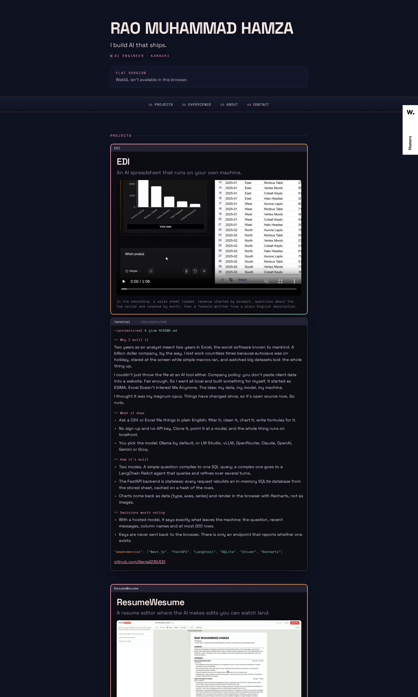
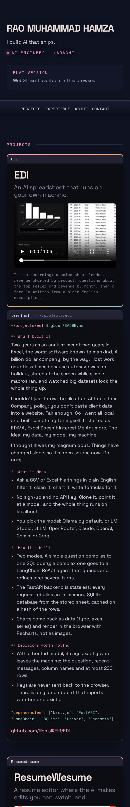

# UI Design System & Master Generation Blueprint: www-raomuhammadhamza-tech

> **Rao Muhammad Hamza, AI Engineer** (https://www.raomuhammadhamza.tech/) — Rao Muhammad Hamza, AI Engineer. RAG pipelines, LLM orchestration and agentic workflows, built to hold up in production.



---

## 1. Executive Visual Persona & Design Archetype

- **Brand Essence & Persona**: **Rao Muhammad Hamza, AI Engineer** (`https://www.raomuhammadhamza.tech/`). Rao Muhammad Hamza, AI Engineer. RAG pipelines, LLM orchestration and agentic workflows, built to hold up in production.
- **Capture Provenance**: Live browser capture (`tier1_fast`, HTTP `200`, captured `2026-11-23`).
- **Visual Archetype**: **Dark-Substrate WebGL / Canvas Interactive Experience (`#0f1220` / `#ff9ebb`)**.
- **Anti-AI-Slop Differentiators**:
  - **Live-Computed Chromatic Polarity**: Anchors the viewport in `#0f1220` (live computed `body` `background-color` (`computed_styles.json`)) paired with `#f4e7e2` primary typography and `#ff9ebb` accents.
  - **Grounded Typographic Hierarchy**: Pairs `Space Grotesk` for display copy (`R A O M U H A M M A D H A M Z A`) with `Space Grotesk` and `Space Mono`.
  - **Calibrated Spatial Grid & Motion**: Combines `1440px` container bounds (`gap: 14px`, padding `20px`) with `cubic-bezier(.2,.7,.2,1)` easing and Three.js / WebGL Canvas Pipeline.

---

## 2. Spatial Architecture & Modular Grid Mathematics



### Viewport Allocation & Container Geometry
- **Captured Viewport Dimensions**: Desktop `1440×2400px` (`assets/desktop.png`, clamped at 2400px live multi-section capture), Mobile `390×2400px` (`assets/mobile.png`, clamped at 2400px live multi-section capture).
- **Master Container Bounds**: `1440px` (full-bleed `100%` desktop stage measured on `1440px` viewport).
- **Canvas Lateral Padding & Spacing**: `20px` lateral canvas padding with `14px` grid gap.
- **Border Radius Scale**: `8px`, `var(--tv-radius)`, `50%`, `11px`.

### Responsive Breakpoint Architecture
- **Desktop Layout**: Multi-column CSS Grid / Flexbox layout at `1440px` (`max-width: 1440px`, `gap: 14px`).
- **Mobile Layout**: Single-column vertical stack at `390px` viewport width with `20px` horizontal padding.
- **Extracted CSS Media Queries**: `@media (width<=700px),(height<=500px)`, `@media (width<=480px)`, `@media (prefers-reduced-motion:reduce)`, `@media (width<=700px)`.

---

## 3. Color System, Materiality & Atmospheric Lighting

### Semantic Palette & Source Grounding
| Semantic Role | Ground-Truth Value | Extracted Live / CSS Source |
|---|---|---|
| **Primary Canvas Substrate** | `#0f1220` | live computed `body` `background-color` (`computed_styles.json`) |
| **Primary Typography Ink** | `#f4e7e2` | live computed `h1` `color` (`computed_styles.json`) |
| **Elevated Surface / Card Substrate** | `#0b0e17` | `.surface { background: #0b0e17 }` |
| **Interactive Accent / Highlight** | `#ff9ebb` | live computed `a` `color` (`computed_styles.json`) |
| **Secondary / Muted Copy** | `#b9b2c4` | `var(--muted)` in `:root` |
| **Structural Hairline Border** | `#1d202d` | `var(--grid-line)` in `:root` (`linear-gradient(ffffff0f, ffffff0f)`) |
| **Variable Token (`--screen-ink`)** | `#1b1f33` | `var(--screen-ink)` in `:root` |
| **Variable Token (`--tv-bg`)** | `#161a30` | `var(--tv-bg)` in `:root` |
| **Variable Token (`--tv-bg`)** | `#0c0e1c` | `var(--tv-bg)` in `:root` |
| **Variable Token (`--tv-glow`)** | `#ffffff` | `var(--tv-glow)` in `:root` |
| **Variable Token (`--tv-glow`)** | `#000000` | `var(--tv-glow)` in `:root` |
| **Variable Token (`--d-surf`)** | `#1a1a26` | `var(--d-surf)` in `:root` |
| **Variable Token (`--d-surf2`)** | `#222232` | `var(--d-surf2)` in `:root` |
| **Variable Token (`--d-ink`)** | `#e9e3ef` | `var(--d-ink)` in `:root` |

### Sanitized Root CSS Variables (`ui-ux.md` Ground Truth)
| Variable Name | Extracted Value | Semantic Role |
|---|---|---|
| `--ink` | `#0f1220` | Typography Ink Token |
| `--screen` | `#ff9ebb` | Color / Atmospheric Token |
| `--screen-ink` | `#1b1f33` | Typography Ink Token |
| `--text` | `#f4e7e2` | Typography Ink Token |
| `--muted` | `#b9b2c4` | Color / Atmospheric Token |
| `--tv-edge` | `#ff9ebb33` | Color / Atmospheric Token |
| `--tv-bg` | `linear-gradient(180deg, #161a30db, #0c0e1ce6)` | Canvas / Surface Token |
| `--tv-glow` | `inset 0 0 0 1px #ffffff08, inset 0 0 22px #ff9ebb12, 0 12px 40px #00000073` | Color / Atmospheric Token |
| `--scan` | `repeating-linear-gradient(0deg, #ffffff09 0 1px, transparent 1px 3px)` | Color / Atmospheric Token |
| `--tv-radius` | `12px` | Elevation / Border Token |
| `--grid-line` | `linear-gradient(#ffffff0f, #ffffff0f)` | Layout / Spatial Grid Token |
| `--sheet-bottom` | `84px` | Dimension / Scale Token |
| `--d-surf` | `#1a1a26` | Color / Atmospheric Token |
| `--d-surf2` | `#222232` | Color / Atmospheric Token |
| `--d-line` | `#ffffff14` | Color / Atmospheric Token |
| `--d-ink` | `#e9e3ef` | Typography Ink Token |

---

## 4. Typographic Scale & Editorial Hierarchy

### Font Family Stacks
- **Display Typography**: `Space Grotesk`.
- **Primary Body Stack**: `Space Grotesk`.
- **Technical / Metadata Stack**: `Space Mono`.

### Typographic Scale & Rules (Live Computed & Stylesheet Grounded)
- **Hero Display (`H1`)**: live computed `h1` (`font-size: 56px`, `line-height: 50.4px`, `font-weight: 700`, `letter-spacing: -1.96px`).
- **Section Heading (`H2`)**: live computed `h3 (primary section heading)` (`font-size: 31.5px`, `line-height: 31.5px`, `font-weight: 600`, `letter-spacing: -1.1025px`).
- **Body Copy**: live computed `body` (`font-size: 16px`, `line-height: normal`, `font-weight: 400`); rule `p` (`letter-spacing: .16em`).
- **Metadata & Navigation Labels**: live computed `nav/a` (`font-size: 16px`, `line-height: normal`, `font-weight: 400`); CSS variables `--d-mono: "Space Mono", ui-monospace, monospace`, `--l-mono: "Space Mono", ui-monospace, monospace`.

---

## 5. Choreographed Motion & Interaction Physics

### Primary Easing Curves
- **Extracted Timing Functions**: `cubic-bezier(.2,.7,.2,1)`, `cubic-bezier(.65,0,.35,1)`, `cubic-bezier(.2,.8,.2,1)`.

### Per-Element Transition & Choreography Rules
- **Selector `.loader`**: `transition: opacity .45s,visibility 0s .45s` extracted from `www-raomuhammadhamza-tech` stylesheet.
- **Selector `#awwwards`**: `transition: opacity .45s` extracted from `www-raomuhammadhamza-tech` stylesheet.
- **Selector `.enter button`**: `transition: background .2s,border-color .2s` extracted from `www-raomuhammadhamza-tech` stylesheet.
- **Extracted Easing Curve (`cubic-bezier(.2,.7,.2,1)`)**: Governs interactive state transitions across `<header.ui>` and `<article.case>`.
- **Runtime Interaction Engine**: Integrates Three.js / WebGL Canvas Pipeline with `prefers-reduced-motion: reduce` fallback guards.

---

## 6. Component Wireframe & Structural DOM Map

### Visual Layout Schematic — Desktop (`1440px`, Grounded in `dom.html` & Landmark Bounding Boxes)
```
┌────────────────────────────────────────────────────────────────────────┐
│ DESKTOP VIEWPORT (1440px) — Rao Muhammad Hamza, AI Engineer            │
│ ====================================================================== │
│ [ <header.ui> (680x228px)             | Overview · Index · Archive · ] │
│ ---------------------------------------------------------------------- │
│ | HERO STAGE: <section.surface> (w=1440px)                           | │
│ | H1: R A O M U H A M M A D H A M Z A                                | │
│ | Substrate: #0f1220 | Ink: #f4e7e2 | Accent: #ff9ebb                | │
│ ---------------------------------------------------------------------- │
│ | SHOWCASE GRID (<article.case>) max-w: 1440px                       | │
│ | +------------------------------+  +------------------------------+ | │
│ | | R a o M u h a m m a d H a m  |  | ResumeWesume                 | | │
│ | +------------------------------+  +------------------------------+ | │
│ ---------------------------------------------------------------------- │
│ | DETAIL MODULE (<article.case:nth(2)>) — Rao Muhammad Hamza         | │
│ ---------------------------------------------------------------------- │
│ [ FOOTER (<footer.train-chart>) | https://www.raomuhammadhamza.tech/   │
└────────────────────────────────────────────────────────────────────────┘
```

### Visual Layout Schematic — Mobile Reflow (`390px`)
```
┌────────────────────────────────────────────────────────────────────────┐
│ MOBILE VIEWPORT REFLOW (390px) — Single-Column Stack (gap: 14px)       │
│ ====================================================================== │
│ [ HEADER BAR (<header.ui>             ) | Compact Menu (390px)         │
│ ---------------------------------------------------------------------- │
│ | HERO STAGE (<section.surface>) — 390px Vertical Lead               | │
│ | H1: R A O M U H A M M A D H A M Z A                                | │
│ ---------------------------------------------------------------------- │
│ | SHOWCASE STACK (<article.case>) — 1-Col Stack                      | │
│ | [ Item 1: R a o M u h a m m a d H a m z a                        ] | │
│ | [ Item 2: ResumeWesume                                           ] | │
│ ---------------------------------------------------------------------- │
│ | DETAIL STACK (<article.case:nth(2)>) — 1-Col (Rao Muhammad Hamza)  | │
│ ---------------------------------------------------------------------- │
│ [ FOOTER (<footer.train-chart>) | Stacked 390px Colophon               │
└────────────────────────────────────────────────────────────────────────┘
```

### Granular DOM Region Breakdown
1. **Brand Header & Navigation Bar (<header.ui> — `www-raomuhammadhamza-tech`)**:
   - Landmark `<header class="ui sig">` (`680x228px`) hosting `Rao Muhammad Hamza, AI Engineer` navigation (`Overview · Index · Archive · About · Contact`), DOM attributes (`data-sound="on"`, `data-sound="off"`, `data-go="projects"`, `data-go="experience"`), and stylesheet rule `font-face { font-family:Space Mono;src:url(/fonts/SpaceMono-400.woff2)format("woff2"... }`.
2. **Hero Stage & Focal Lead (<section.surface> — `R A O M U H A M M A D H A M Z A`)**:
   - Landmark `<section class="surface desk">` presenting display lead `R A O M U H A M M A D H A M Z A` and copy excerpt *"I build AI that ships."* over `#0f1220` canvas and `#f4e7e2` ink.
3. **Primary Showcase & Content Grid (<article.case> — `R a o M u h a m m a d H a m z a`)**:
   - Landmark `<article class="case">` rendering section `R a o M u h a m m a d H a m z a` with copy *"Drag to look around"*, asset references (`favicon.svg`, `SpaceGrotesk-Variable.woff2`, `index.BGUfTFpU.css`, `edi-poster.webp`), and grid rule `body { color:f4e7e2;background:0f1220;height:100%;font-family:Space Grotesk,sys... }`.
4. **Interactive Detail & Feature Matrix (<article.case:nth(2)> — `ResumeWesume`)**:
   - Landmark `<article class="case">` framing `ResumeWesume` and `Rao Muhammad Hamza` (*"AI Engineer · Karachi"*) with `#0b0e17` surface cards, `#ff9ebb` accents, and `.loader.done { opacity:0;visibility:hidden }`.
5. **Colophon & Global Directory Footer (<footer.train-chart> — `https://www.raomuhammadhamza.tech/`)**:
   - Landmark `<footer class="train-chart">` anchoring `Rao Muhammad Hamza, AI Engineer` footer links (`Overview · Index · Archive · About · Contact`), copy *"Flat version WebGL isn't available in this browser."*, and `#1d202d` structural dividers.

---

## 7. Master Zero-Shot AI Generation Prompt

```markdown
# Master Zero-Shot Frontend Generation Prompt: www-raomuhammadhamza-tech (Rao Muhammad Hamza, AI Engineer)

You are a principal frontend architect and design systems engineer. Build a complete, production-ready web application replicating the exact design system, DOM landmarks, typographic hierarchy, color tokens, and motion physics of `www-raomuhammadhamza-tech` (**Rao Muhammad Hamza, AI Engineer** — `https://www.raomuhammadhamza.tech/`).

### 1. Visual Archetype & Anti-AI-Slop Mandates
- **Archetype**: Dark-Substrate WebGL / Canvas Interactive Experience (`#0f1220` / `#ff9ebb`).
- **Identity & Domain Context**: Rao Muhammad Hamza, AI Engineer. RAG pipelines, LLM orchestration and agentic workflows, built to hold up in production.
- **Primary Substrate**: `#0f1220` (live computed `body` `background-color` (`computed_styles.json`)), **Primary Ink**: `#f4e7e2`, **Accent / Highlight**: `#ff9ebb`.
- **Site-Specific Differentiators**:
  - **Live-Computed Chromatic Polarity**: Anchors the viewport in `#0f1220` (live computed `body` `background-color` (`computed_styles.json`)) paired with `#f4e7e2` primary typography and `#ff9ebb` accents.
  - **Grounded Typographic Hierarchy**: Pairs `Space Grotesk` for display copy (`R A O M U H A M M A D H A M Z A`) with `Space Grotesk` and `Space Mono`.
  - **Calibrated Spatial Grid & Motion**: Combines `1440px` container bounds (`gap: 14px`, padding `20px`) with `cubic-bezier(.2,.7,.2,1)` easing and Three.js / WebGL Canvas Pipeline.

### 2. Ground-Truth CSS Variables (`:root` Token Contract)
Declare and consume these exact custom properties extracted from `www-raomuhammadhamza-tech` in your global stylesheet:

:root {
  /* Rao Muhammad Hamza, AI Engineer (www-raomuhammadhamza-tech) — Live-Grounded CSS Variables */
  --ink: #0f1220; /* Typography Ink Token (www-raomuhammadhamza-tech) */
  --screen: #ff9ebb; /* Color / Atmospheric Token (www-raomuhammadhamza-tech) */
  --screen-ink: #1b1f33; /* Typography Ink Token (www-raomuhammadhamza-tech) */
  --text: #f4e7e2; /* Typography Ink Token (www-raomuhammadhamza-tech) */
  --muted: #b9b2c4; /* Color / Atmospheric Token (www-raomuhammadhamza-tech) */
  --tv-edge: #ff9ebb33; /* Color / Atmospheric Token (www-raomuhammadhamza-tech) */
  --tv-bg: linear-gradient(180deg, #161a30db, #0c0e1ce6); /* Canvas / Surface Token (www-raomuhammadhamza-tech) */
  --tv-glow: inset 0 0 0 1px #ffffff08, inset 0 0 22px #ff9ebb12, 0 12px 40px #00000073; /* Color / Atmospheric Token (www-raomuhammadhamza-tech) */
  --scan: repeating-linear-gradient(0deg, #ffffff09 0 1px, transparent 1px 3px); /* Color / Atmospheric Token (www-raomuhammadhamza-tech) */
  --tv-radius: 12px; /* Elevation / Border Token (www-raomuhammadhamza-tech) */
  --grid-line: linear-gradient(#ffffff0f, #ffffff0f); /* Layout / Spatial Grid Token (www-raomuhammadhamza-tech) */
  --sheet-bottom: 84px; /* Dimension / Scale Token (www-raomuhammadhamza-tech) */
  --d-surf: #1a1a26; /* Color / Atmospheric Token (www-raomuhammadhamza-tech) */
  --d-surf2: #222232; /* Color / Atmospheric Token (www-raomuhammadhamza-tech) */
  --d-line: #ffffff14; /* Color / Atmospheric Token (www-raomuhammadhamza-tech) */
  --d-ink: #e9e3ef; /* Typography Ink Token (www-raomuhammadhamza-tech) */
}

### 3. Semantic Color & Materiality Contract
Map every surface, ink, and border strictly to these source-grounded tokens:
- **Primary Canvas Substrate**: `#0f1220` — grounded in live computed `body` `background-color` (`computed_styles.json`)
- **Primary Typography Ink**: `#f4e7e2` — grounded in live computed `h1` `color` (`computed_styles.json`)
- **Elevated Surface / Card Substrate**: `#0b0e17` — grounded in `.surface { background: #0b0e17 }`
- **Interactive Accent / Highlight**: `#ff9ebb` — grounded in live computed `a` `color` (`computed_styles.json`)
- **Secondary / Muted Copy**: `#b9b2c4` — grounded in `var(--muted)` in `:root`
- **Structural Hairline Border**: `#1d202d` — grounded in `var(--grid-line)` in `:root` (`linear-gradient(ffffff0f, ffffff0f)`)
- **Variable Token (`--screen-ink`)**: `#1b1f33` — grounded in `var(--screen-ink)` in `:root`
- **Variable Token (`--tv-bg`)**: `#161a30` — grounded in `var(--tv-bg)` in `:root`
- **Variable Token (`--tv-bg`)**: `#0c0e1c` — grounded in `var(--tv-bg)` in `:root`
- **Variable Token (`--tv-glow`)**: `#ffffff` — grounded in `var(--tv-glow)` in `:root`
- **Variable Token (`--tv-glow`)**: `#000000` — grounded in `var(--tv-glow)` in `:root`
- **Variable Token (`--d-surf`)**: `#1a1a26` — grounded in `var(--d-surf)` in `:root`
- **Variable Token (`--d-surf2`)**: `#222232` — grounded in `var(--d-surf2)` in `:root`
- **Variable Token (`--d-ink`)**: `#e9e3ef` — grounded in `var(--d-ink)` in `:root`

### 4. Spatial Grid, Container Bounds & Responsive Breakpoints
- **Desktop Viewport Reference**: `1440×2400px` (clamped at 2400px live multi-section capture, `1440px` standard desktop width).
- **Mobile Viewport Reference**: `390×2400px` (clamped at 2400px live multi-section capture, `390px` standard mobile width).
- **Container Max-Width**: `1440px` (full-bleed `100%` desktop stage measured on `1440px` viewport)
- **Padding & Gutters**: `20px` lateral canvas padding with `14px` grid gap
- **Desktop Grid**: Multi-column CSS Grid / Flexbox layout at `1440px` (`max-width: 1440px`, `gap: 14px`)
- **Mobile Adaptation**: Single-column vertical stack at `390px` viewport width with `20px` horizontal padding
- **Media Queries**: `@media (width<=700px),(height<=500px)`, `@media (width<=480px)`, `@media (prefers-reduced-motion:reduce)`, `@media (width<=700px)`
- **Corner Radii**: `8px`, `var(--tv-radius)`, `50%`, `11px`

### 5. Typography & Editorial Scale Contract
- **Display Font Stack**: `Space Grotesk`
- **Body Font Stack**: `Space Grotesk`
- **Monospace / Technical Font Stack**: `Space Mono`
- **H1 Display Rule**: live computed `h1` (`font-size: 56px`, `line-height: 50.4px`, `font-weight: 700`, `letter-spacing: -1.96px`)
- **H2 Section Rule**: live computed `h3 (primary section heading)` (`font-size: 31.5px`, `line-height: 31.5px`, `font-weight: 600`, `letter-spacing: -1.1025px`)
- **Body Copy Rule**: live computed `body` (`font-size: 16px`, `line-height: normal`, `font-weight: 400`); rule `p` (`letter-spacing: .16em`)
- **Metadata & Index Rule**: live computed `nav/a` (`font-size: 16px`, `line-height: normal`, `font-weight: 400`); CSS variables `--d-mono: "Space Mono", ui-monospace, monospace`, `--l-mono: "Space Mono", ui-monospace, monospace`

### 6. Component Hierarchy, Verbatim Copy & Real DOM Landmarks
Scaffold `www-raomuhammadhamza-tech` (`Rao Muhammad Hamza, AI Engineer`) with these exact structural regions, extracted copy, and CSS rules from `dom.html`:
1. **Brand Header & Navigation Bar (<header.ui> — `www-raomuhammadhamza-tech`)**:
   - DOM & Selectors: Landmark `<header class="ui sig">` (`680x228px`) hosting `Rao Muhammad Hamza, AI Engineer` navigation (`Overview · Index · Archive · About · Contact`), DOM attributes (`data-sound="on"`, `data-sound="off"`, `data-go="projects"`, `data-go="experience"`), and stylesheet rule `font-face { font-family:Space Mono;src:url(/fonts/SpaceMono-400.woff2)format("woff2"... }`.
   - Responsive Contract: Header `Brand Header & Navigation Bar (<header.ui> — `www-raomuhammadhamza-tech`)` (`www-raomuhammadhamza-tech`) adapts across `@media (width<=700px),(height<=500px)`, `@media (width<=480px)`, `@media (prefers-reduced-motion:reduce)`, `@media (width<=700px)` with `cubic-bezier(.2,.7,.2,1)`, `cubic-bezier(.65,0,.35,1)`, `cubic-bezier(.2,.8,.2,1)` transitions and links `Overview · Index · Archive · About · Contact`.
2. **Hero Stage & Focal Lead (<section.surface> — `R A O M U H A M M A D H A M Z A`)**:
   - DOM & Selectors: Landmark `<section class="surface desk">` presenting display lead `R A O M U H A M M A D H A M Z A` and copy excerpt *"I build AI that ships."* over `#0f1220` canvas and `#f4e7e2` ink.
   - Responsive Contract: Hero stage (`1440×2400px` desktop / `390×2400px` mobile) sets `#0f1220` background with `#f4e7e2` headline `R A O M U H A M M A D H A M Z A`.
3. **Primary Showcase & Content Grid (<article.case> — `R a o M u h a m m a d H a m z a`)**:
   - DOM & Selectors: Landmark `<article class="case">` rendering section `R a o M u h a m m a d H a m z a` with copy *"Drag to look around"*, asset references (`favicon.svg`, `SpaceGrotesk-Variable.woff2`, `index.BGUfTFpU.css`, `edi-poster.webp`), and grid rule `body { color:f4e7e2;background:0f1220;height:100%;font-family:Space Grotesk,sys... }`.
   - Responsive Contract: Showcase grid `Primary Showcase & Content Grid (<article.case> — `R a o M u h a m m a d H a m z a`)` applies Multi-column CSS Grid / Flexbox layout at `1440px` (`max-width: 1440px`, `gap: 14px`) on desktop and Single-column vertical stack at `390px` viewport width with `20px` horizontal padding on mobile.
4. **Interactive Detail & Feature Matrix (<article.case:nth(2)> — `ResumeWesume`)**:
   - DOM & Selectors: Landmark `<article class="case">` framing `ResumeWesume` and `Rao Muhammad Hamza` (*"AI Engineer · Karachi"*) with `#0b0e17` surface cards, `#ff9ebb` accents, and `.loader.done { opacity:0;visibility:hidden }`.
   - Responsive Contract: Detail module `Interactive Detail & Feature Matrix (<article.case:nth(2)> — `ResumeWesume`)` uses `8px`, `var(--tv-radius)`, `50%`, `11px` radii, `#ff9ebb` highlights, and assets (favicon.svg, SpaceGrotesk-Variable.woff2, index.BGUfTFpU.css).
5. **Colophon & Global Directory Footer (<footer.train-chart> — `https://www.raomuhammadhamza.tech/`)**:
   - DOM & Selectors: Landmark `<footer class="train-chart">` anchoring `Rao Muhammad Hamza, AI Engineer` footer links (`Overview · Index · Archive · About · Contact`), copy *"Flat version WebGL isn't available in this browser."*, and `#1d202d` structural dividers.
   - Responsive Contract: Footer `Colophon & Global Directory Footer (<footer.train-chart> — `https://www.raomuhammadhamza.tech/`)` aligns to `1440px` (full-bleed `100%` desktop stage measured on `1440px` viewport) with `20px` lateral canvas padding with `14px` grid gap and attributes (data-sound="on", data-sound="off", data-go="projects").

#### Verbatim DOM Copy Excerpts (`dom.html`)
- Copy Excerpt 1: *"I build AI that ships."*
- Copy Excerpt 2: *"Drag to look around"*
- Copy Excerpt 3: *"AI Engineer · Karachi"*
- Copy Excerpt 4: *"Flat version WebGL isn't available in this browser."*

### 7. Motion, Extracted Stylesheet Rules & Interaction Choreography
- **Primary Easing Functions**: `cubic-bezier(.2,.7,.2,1)`, `cubic-bezier(.65,0,.35,1)`, `cubic-bezier(.2,.8,.2,1)`
- **Extracted Stylesheet Rules (`www-raomuhammadhamza-tech`)**:
- `font-face { font-family:Space Mono;src:url(/fonts/SpaceMono-400.woff2)format("woff2"... }`
- `body { color:f4e7e2;background:0f1220;height:100%;font-family:Space Grotesk,sys... }`
- `.loader.done { opacity:0;visibility:hidden }`
- `awwwards { transition:opacity .45s }`
- `.loader:after { content:"";background:var(--scan);pointer-events:none;position:absolute;... }`
- **Per-Selector Transition Rules**:
- **Selector `.loader`**: `transition: opacity .45s,visibility 0s .45s` extracted from `www-raomuhammadhamza-tech` stylesheet.
- **Selector `#awwwards`**: `transition: opacity .45s` extracted from `www-raomuhammadhamza-tech` stylesheet.
- **Selector `.enter button`**: `transition: background .2s,border-color .2s` extracted from `www-raomuhammadhamza-tech` stylesheet.
- **Extracted Easing Curve (`cubic-bezier(.2,.7,.2,1)`)**: Governs interactive state transitions across `<header.ui>` and `<article.case>`.
- **Runtime Interaction Engine**: Integrates Three.js / WebGL Canvas Pipeline with `prefers-reduced-motion: reduce` fallback guards.

### 8. Technical Deliverables
- Implement in Next.js (App Router) with TypeScript and Tailwind CSS consuming the `:root` custom properties defined above for `www-raomuhammadhamza-tech`.
- Reproduce both the `1440px` desktop architecture and `390px` mobile breakpoint transitions, preserving semantic HTML5 landmarks (`<header>`, `<nav>`, `<main>`, `<section>`, `<footer>`) and `prefers-reduced-motion` accessibility guards.
```
