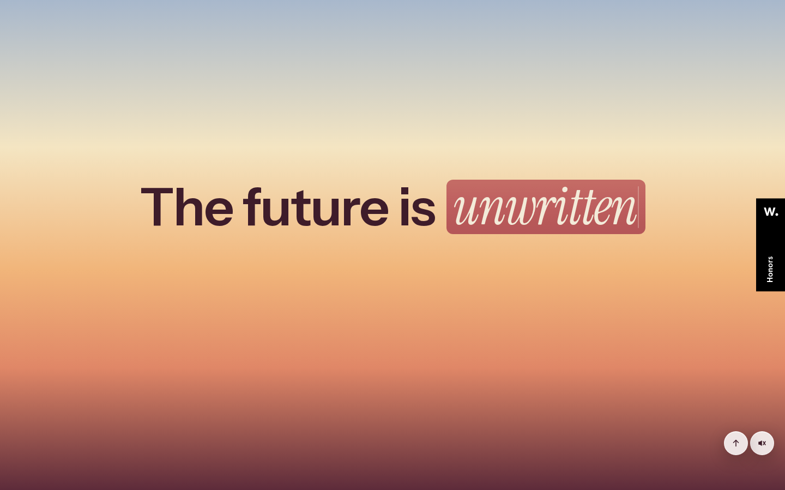
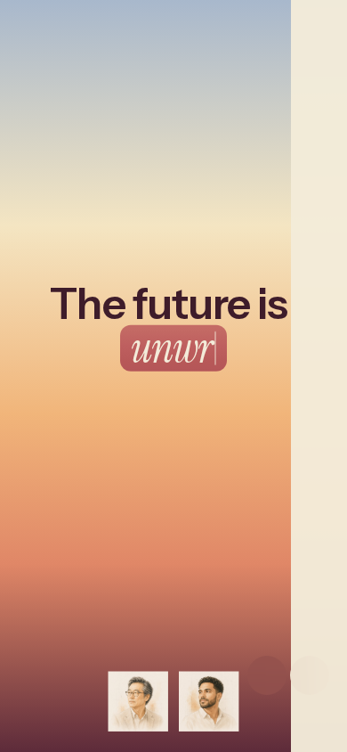

# UI Design System & Master Generation Blueprint: www-rebelliously-optimistic-com

> **Rebelliously Optimistic — A movement for the human future** (https://www.rebelliously-optimistic.com/) — A movement for the human future in the age of AI. Quarterly gatherings and Human Notes for people who refuse to let progress be anything...



---

## 1. Executive Visual Persona & Design Archetype

- **Brand Essence & Persona**: **Rebelliously Optimistic — A movement for the human future** (`https://www.rebelliously-optimistic.com/`). A movement for the human future in the age of AI. Quarterly gatherings and Human Notes for people who refuse to let progress be anything...
- **Capture Provenance**: Live browser capture (`tier1_fast`, HTTP `200`, captured `2026-11-23`).
- **Visual Archetype**: **Light-Gallery WebGL / Canvas Interactive Experience (`#ffffff` / `#0a66c2`)**.
- **Anti-AI-Slop Differentiators**:
  - **Live-Computed Chromatic Polarity**: Anchors the viewport in `#ffffff` (live computed `browser-default` `background-color` (`computed_styles.json`)) paired with `#000000` primary typography and `#0a66c2` accents.
  - **Grounded Typographic Hierarchy**: Pairs `Instrument Sans` for display copy (`Rebelliously Optimistic — A movement`) with `Instrument Sans` and `SFMono-Regular`.
  - **Calibrated Spatial Grid & Motion**: Combines `1536px` container bounds (`gap: 24px`, padding `.25rem`) with `cubic-bezier(.4,0,.6,1)` easing and Three.js / WebGL Canvas Pipeline.

---

## 2. Spatial Architecture & Modular Grid Mathematics



### Viewport Allocation & Container Geometry
- **Captured Viewport Dimensions**: Desktop `1440×900px` (`assets/desktop.png`, single-viewport 100vh live capture (900px)), Mobile `390×844px` (`assets/mobile.png`, single-viewport 100vh live capture (844px)).
- **Master Container Bounds**: `1536px` (non-`@media` desktop container stylesheet rule).
- **Canvas Lateral Padding & Spacing**: `.25rem` lateral canvas padding with `24px` grid gap.
- **Border Radius Scale**: `.25rem`, `1rem`, `14px`, `20px`.

### Responsive Breakpoint Architecture
- **Desktop Layout**: Multi-column CSS Grid / Flexbox layout at `1440px` (`max-width: 1536px`, `gap: 24px`).
- **Mobile Layout**: Single-column vertical stack at `390px` viewport width with `.25rem` horizontal padding.
- **Extracted CSS Media Queries**: `@media (width>=640px)`, `@media (width>=768px)`, `@media (width>=1024px)`, `@media (width>=1280px)`.

---

## 3. Color System, Materiality & Atmospheric Lighting

### Semantic Palette & Source Grounding
| Semantic Role | Ground-Truth Value | Extracted Live / CSS Source |
|---|---|---|
| **Primary Canvas Substrate** | `#ffffff` | live computed `browser-default` `background-color` (`computed_styles.json`) |
| **Primary Typography Ink** | `#000000` | live computed `body` `color` (`computed_styles.json`) |
| **Elevated Surface / Card Substrate** | `#f7f0e1` | `.ro-voices-dialog { background: #f7f0e1 }` |
| **Interactive Accent / Highlight** | `#0a66c2` | `.sign-studio .btn-li { background: #0a66c2 }` |
| **Secondary / Muted Copy** | `#b9a39f` | `var(--muted)` in `:root` |
| **Structural Hairline Border** | `#cfc6ca` | `var(--line)` in `:root` (`3e1c2a40`) |
| **Variable Token (`--line`)** | `#3e1c2a` | `var(--line)` in `:root` |
| **Variable Token (`--line-cream`)** | `#f3ebd9` | `var(--line-cream)` in `:root` |
| **Variable Token (`--bg`)** | `#1c0c14` | `var(--bg)` in `:root` |
| **Variable Token (`--accent`)** | `#c2676a` | `var(--accent)` in `:root` |
| **Variable Token (`--accent-ink`)** | `#fff6e8` | `var(--accent-ink)` in `:root` |
| **Variable Token (`--focus`)** | `#f0b3a6` | `var(--focus)` in `:root` |

### Sanitized Root CSS Variables (`ui-ux.md` Ground Truth)
| Variable Name | Extracted Value | Semantic Role |
|---|---|---|
| `--line` | `#3e1c2a40` | Color / Atmospheric Token |
| `--line-soft` | `#3e1c2a1f` | Color / Atmospheric Token |
| `--line-faint` | `#3e1c2a14` | Color / Atmospheric Token |
| `--line-cream` | `#f3ebd938` | Color / Atmospheric Token |
| `--line-cream-soft` | `#f3ebd91f` | Color / Atmospheric Token |
| `--bg` | `#1c0c14` | Canvas / Surface Token |
| `--ink` | `#f3ebd9` | Typography Ink Token |
| `--muted` | `#b9a39f` | Color / Atmospheric Token |
| `--faint` | `#f3ebd924` | Color / Atmospheric Token |
| `--chip` | `#f3ebd912` | Color / Atmospheric Token |
| `--accent` | `#c2676a` | Brand / Palette Token |
| `--accent-ink` | `#fff6e8` | Typography Ink Token |
| `--focus` | `#f0b3a6` | Color / Atmospheric Token |
| `--sans` | `"Instrument Sans", "Helvetica Neue", Arial, sans-serif` | Typography / Scale Token |
| `--serif` | `"Instrument Serif", Georgia, "Times New Roman", serif` | Typography / Scale Token |
| `--lightningcss-dark` | `initial` | Canvas / Surface Token |

---

## 4. Typographic Scale & Editorial Hierarchy

### Font Family Stacks
- **Display Typography**: `Instrument Sans`.
- **Primary Body Stack**: `Instrument Sans`.
- **Technical / Metadata Stack**: `SFMono-Regular`.

### Typographic Scale & Rules (Live Computed & Stylesheet Grounded)
- **Hero Display (`H1`)**: rule `h1` (`font-size: clamp(38px,5vw,56px)`, `line-height: 1.05`, `font-weight: 400`).
- **Section Heading (`H2`)**: live computed `h2` (`font-size: 96px`, `line-height: 96px`, `font-weight: 600`).
- **Body Copy**: live computed `body` (`font-size: 16px`, `line-height: 24px`, `font-weight: 400`); rule `p` (`font-size: calc(6em + 13.3px)`, `font-weight: 400`).
- **Metadata & Navigation Labels**: live computed `nav/a` (`font-size: 16px`, `line-height: 24px`, `font-weight: 400`); rule `.meta` (`font-size: 13px`).

---

## 5. Choreographed Motion & Interaction Physics

### Primary Easing Curves
- **Extracted Timing Functions**: `cubic-bezier(.4,0,.6,1)`, `cubic-bezier(.4,0,.2,1)`, `cubic-bezier(.22,1,.36,1)`.

### Per-Element Transition & Choreography Rules
- **Selector `.transition`**: `transition: .15s` extracted from `www-rebelliously-optimistic-com` stylesheet.
- **Selector `box-shadow\]`**: `transition: .15s` extracted from `www-rebelliously-optimistic-com` stylesheet.
- **Selector `.transition-all`**: `transition: .15s` extracted from `www-rebelliously-optimistic-com` stylesheet.
- **Extracted Easing Curve (`cubic-bezier(.4,0,.6,1)`)**: Governs interactive state transitions across `<header.top-0>` and `<section.bg-background>`.
- **Runtime Interaction Engine**: Integrates Three.js / WebGL Canvas Pipeline with `prefers-reduced-motion: reduce` fallback guards.

---

## 6. Component Wireframe & Structural DOM Map

### Visual Layout Schematic — Desktop (`1440px`, Grounded in `dom.html` & Landmark Bounding Boxes)
```
┌────────────────────────────────────────────────────────────────────────┐
│ DESKTOP VIEWPORT (1440px) — Rebelliously Optimistic — A movement for t │
│ ====================================================================== │
│ [ <header.top-0> (1440x67px)          | The Experience · Human Notes ] │
│ ---------------------------------------------------------------------- │
│ | HERO STAGE: <section.hidden> (w=1440px)                            | │
│ | H1: Rebelliously Optimistic — A movement for the hum               | │
│ | Substrate: #ffffff | Ink: #000000 | Accent: #0a66c2                | │
│ ---------------------------------------------------------------------- │
│ | SHOWCASE GRID (<section.bg-background>) max-w: 1536px              | │
│ | +------------------------------+  +------------------------------+ | │
│ | | Featured Work & Interactive  |  | Technical Architecture & Nar | | │
│ | +------------------------------+  +------------------------------+ | │
│ ---------------------------------------------------------------------- │
│ | DETAIL MODULE (<section.relative>) — Global Directory & Co         | │
│ ---------------------------------------------------------------------- │
│ [ FOOTER (<footer.bottom-0>   ) | https://www.rebelliously-optimistic  │
└────────────────────────────────────────────────────────────────────────┘
```

### Visual Layout Schematic — Mobile Reflow (`390px`)
```
┌────────────────────────────────────────────────────────────────────────┐
│ MOBILE VIEWPORT REFLOW (390px) — Single-Column Stack (gap: 24px)       │
│ ====================================================================== │
│ [ HEADER BAR (<header.top-0>          ) | Compact Menu (390px)         │
│ ---------------------------------------------------------------------- │
│ | HERO STAGE (<section.hidden>) — 390px Vertical Lead                | │
│ | H1: Rebelliously Optimistic — A movement for the hum               | │
│ ---------------------------------------------------------------------- │
│ | SHOWCASE STACK (<section.bg-background) — 1-Col Stack              | │
│ | [ Item 1: Featured Work & Interactive Showcase                   ] | │
│ | [ Item 2: Technical Architecture & Narrative                     ] | │
│ ---------------------------------------------------------------------- │
│ | DETAIL STACK (<section.relative>) — 1-Col (Global Directory &)     | │
│ ---------------------------------------------------------------------- │
│ [ FOOTER (<footer.bottom-0>   ) | Stacked 390px Colophon               │
└────────────────────────────────────────────────────────────────────────┘
```

### Granular DOM Region Breakdown
1. **Brand Header & Navigation Bar (<header.top-0> — `www-rebelliously-optimistic-com`)**:
   - Landmark `<header class="top-0 left-0">` (`1440x67px`) hosting `Rebelliously Optimistic — A movement` navigation (`The Experience · Human Notes · Sign manifesto`), DOM attributes (`data-sdkn="@vercel/analytics/react"`, `data-sdkv="2.0.1"`, `data-engine="three.js r184"`), and stylesheet rule `after { box-sizing:border-box;border:0 solid e5e7eb }`.
2. **Hero Stage & Focal Lead (<section.hidden> — `Rebelliously Optimistic — A moveme`)**:
   - Landmark `<section class="hidden relative">` presenting display lead `Rebelliously Optimistic — A movement for the hum` and copy excerpt *"Rebelliously Optimistic is an ongoing quarterly leadership experi"* over `#ffffff` canvas and `#000000` ink.
3. **Primary Showcase & Content Grid (<section.bg-background> — `Featured Work & Interactive Showca`)**:
   - Landmark `<section class="bg-background text-foreground">` rendering section `Featured Work & Interactive Showcase` with copy *"Elevating shared humanity in the age of AI."*, asset references (`favicon.svg`, `favicon-32.png`, `favicon-16.png`, `apple-touch-icon.png`), and grid rule `body { line-height:inherit;margin:0 }`.
4. **Interactive Detail & Feature Matrix (<section.relative> — `Technical Architecture & Narrative`)**:
   - Landmark `<section class="relative z-10">` framing `Technical Architecture & Narrative` and `Global Directory & Contact` (*"W r i t e i t i n a h u m a n v o i c e ."*) with `#f7f0e1` surface cards, `#0a66c2` accents, and `strong { font-weight:bolder }`.
5. **Colophon & Global Directory Footer (<footer.bottom-0> — `https://www.rebelliously-optimistic.com/`)**:
   - Landmark `<footer class="bottom-0 left-0">` anchoring `Rebelliously Optimistic — A move` footer links (`The Experience · Human Notes · Sign manifesto`), copy *"A leadership experience and people movement for those who be"*, and `#cfc6ca` structural dividers.

---

## 7. Master Zero-Shot AI Generation Prompt

```markdown
# Master Zero-Shot Frontend Generation Prompt: www-rebelliously-optimistic-com (Rebelliously Optimistic — A movement for the human future)

You are a principal frontend architect and design systems engineer. Build a complete, production-ready web application replicating the exact design system, DOM landmarks, typographic hierarchy, color tokens, and motion physics of `www-rebelliously-optimistic-com` (**Rebelliously Optimistic — A movement for the human future** — `https://www.rebelliously-optimistic.com/`).

### 1. Visual Archetype & Anti-AI-Slop Mandates
- **Archetype**: Light-Gallery WebGL / Canvas Interactive Experience (`#ffffff` / `#0a66c2`).
- **Identity & Domain Context**: A movement for the human future in the age of AI. Quarterly gatherings and Human Notes for people who refuse to let progress be anything...
- **Primary Substrate**: `#ffffff` (live computed `browser-default` `background-color` (`computed_styles.json`)), **Primary Ink**: `#000000`, **Accent / Highlight**: `#0a66c2`.
- **Site-Specific Differentiators**:
  - **Live-Computed Chromatic Polarity**: Anchors the viewport in `#ffffff` (live computed `browser-default` `background-color` (`computed_styles.json`)) paired with `#000000` primary typography and `#0a66c2` accents.
  - **Grounded Typographic Hierarchy**: Pairs `Instrument Sans` for display copy (`Rebelliously Optimistic — A movement`) with `Instrument Sans` and `SFMono-Regular`.
  - **Calibrated Spatial Grid & Motion**: Combines `1536px` container bounds (`gap: 24px`, padding `.25rem`) with `cubic-bezier(.4,0,.6,1)` easing and Three.js / WebGL Canvas Pipeline.

### 2. Ground-Truth CSS Variables (`:root` Token Contract)
Declare and consume these exact custom properties extracted from `www-rebelliously-optimistic-com` in your global stylesheet:

:root {
  /* Rebelliously Optimistic — A movement for the human future (www-rebelliously-optimistic-com) — Live-Grounded CSS Variables */
  --line: #3e1c2a40; /* Color / Atmospheric Token (www-rebelliously-optimistic-com) */
  --line-soft: #3e1c2a1f; /* Color / Atmospheric Token (www-rebelliously-optimistic-com) */
  --line-faint: #3e1c2a14; /* Color / Atmospheric Token (www-rebelliously-optimistic-com) */
  --line-cream: #f3ebd938; /* Color / Atmospheric Token (www-rebelliously-optimistic-com) */
  --line-cream-soft: #f3ebd91f; /* Color / Atmospheric Token (www-rebelliously-optimistic-com) */
  --bg: #1c0c14; /* Canvas / Surface Token (www-rebelliously-optimistic-com) */
  --ink: #f3ebd9; /* Typography Ink Token (www-rebelliously-optimistic-com) */
  --muted: #b9a39f; /* Color / Atmospheric Token (www-rebelliously-optimistic-com) */
  --faint: #f3ebd924; /* Color / Atmospheric Token (www-rebelliously-optimistic-com) */
  --chip: #f3ebd912; /* Color / Atmospheric Token (www-rebelliously-optimistic-com) */
  --accent: #c2676a; /* Brand / Palette Token (www-rebelliously-optimistic-com) */
  --accent-ink: #fff6e8; /* Typography Ink Token (www-rebelliously-optimistic-com) */
  --focus: #f0b3a6; /* Color / Atmospheric Token (www-rebelliously-optimistic-com) */
  --sans: "Instrument Sans", "Helvetica Neue", Arial, sans-serif; /* Typography / Scale Token (www-rebelliously-optimistic-com) */
  --serif: "Instrument Serif", Georgia, "Times New Roman", serif; /* Typography / Scale Token (www-rebelliously-optimistic-com) */
  --lightningcss-dark: initial; /* Canvas / Surface Token (www-rebelliously-optimistic-com) */
}

### 3. Semantic Color & Materiality Contract
Map every surface, ink, and border strictly to these source-grounded tokens:
- **Primary Canvas Substrate**: `#ffffff` — grounded in live computed `browser-default` `background-color` (`computed_styles.json`)
- **Primary Typography Ink**: `#000000` — grounded in live computed `body` `color` (`computed_styles.json`)
- **Elevated Surface / Card Substrate**: `#f7f0e1` — grounded in `.ro-voices-dialog { background: #f7f0e1 }`
- **Interactive Accent / Highlight**: `#0a66c2` — grounded in `.sign-studio .btn-li { background: #0a66c2 }`
- **Secondary / Muted Copy**: `#b9a39f` — grounded in `var(--muted)` in `:root`
- **Structural Hairline Border**: `#cfc6ca` — grounded in `var(--line)` in `:root` (`3e1c2a40`)
- **Variable Token (`--line`)**: `#3e1c2a` — grounded in `var(--line)` in `:root`
- **Variable Token (`--line-cream`)**: `#f3ebd9` — grounded in `var(--line-cream)` in `:root`
- **Variable Token (`--bg`)**: `#1c0c14` — grounded in `var(--bg)` in `:root`
- **Variable Token (`--accent`)**: `#c2676a` — grounded in `var(--accent)` in `:root`
- **Variable Token (`--accent-ink`)**: `#fff6e8` — grounded in `var(--accent-ink)` in `:root`
- **Variable Token (`--focus`)**: `#f0b3a6` — grounded in `var(--focus)` in `:root`

### 4. Spatial Grid, Container Bounds & Responsive Breakpoints
- **Desktop Viewport Reference**: `1440×900px` (single-viewport 100vh live capture (900px), `1440px` standard desktop width).
- **Mobile Viewport Reference**: `390×844px` (single-viewport 100vh live capture (844px), `390px` standard mobile width).
- **Container Max-Width**: `1536px` (non-`@media` desktop container stylesheet rule)
- **Padding & Gutters**: `.25rem` lateral canvas padding with `24px` grid gap
- **Desktop Grid**: Multi-column CSS Grid / Flexbox layout at `1440px` (`max-width: 1536px`, `gap: 24px`)
- **Mobile Adaptation**: Single-column vertical stack at `390px` viewport width with `.25rem` horizontal padding
- **Media Queries**: `@media (width>=640px)`, `@media (width>=768px)`, `@media (width>=1024px)`, `@media (width>=1280px)`
- **Corner Radii**: `.25rem`, `1rem`, `14px`, `20px`

### 5. Typography & Editorial Scale Contract
- **Display Font Stack**: `Instrument Sans`
- **Body Font Stack**: `Instrument Sans`
- **Monospace / Technical Font Stack**: `SFMono-Regular`
- **H1 Display Rule**: rule `h1` (`font-size: clamp(38px,5vw,56px)`, `line-height: 1.05`, `font-weight: 400`)
- **H2 Section Rule**: live computed `h2` (`font-size: 96px`, `line-height: 96px`, `font-weight: 600`)
- **Body Copy Rule**: live computed `body` (`font-size: 16px`, `line-height: 24px`, `font-weight: 400`); rule `p` (`font-size: calc(6em + 13.3px)`, `font-weight: 400`)
- **Metadata & Index Rule**: live computed `nav/a` (`font-size: 16px`, `line-height: 24px`, `font-weight: 400`); rule `.meta` (`font-size: 13px`)

### 6. Component Hierarchy, Verbatim Copy & Real DOM Landmarks
Scaffold `www-rebelliously-optimistic-com` (`Rebelliously Optimistic — A movement for the human future`) with these exact structural regions, extracted copy, and CSS rules from `dom.html`:
1. **Brand Header & Navigation Bar (<header.top-0> — `www-rebelliously-optimistic-com`)**:
   - DOM & Selectors: Landmark `<header class="top-0 left-0">` (`1440x67px`) hosting `Rebelliously Optimistic — A movement` navigation (`The Experience · Human Notes · Sign manifesto`), DOM attributes (`data-sdkn="@vercel/analytics/react"`, `data-sdkv="2.0.1"`, `data-engine="three.js r184"`), and stylesheet rule `after { box-sizing:border-box;border:0 solid e5e7eb }`.
   - Responsive Contract: Header `Brand Header & Navigation Bar (<header.top-0> — `www-rebelliously-optimistic-com`)` (`www-rebelliously-optimistic-com`) adapts across `@media (width>=640px)`, `@media (width>=768px)`, `@media (width>=1024px)`, `@media (width>=1280px)` with `cubic-bezier(.4,0,.6,1)`, `cubic-bezier(.4,0,.2,1)`, `cubic-bezier(.22,1,.36,1)` transitions and links `The Experience · Human Notes · Sign manifesto`.
2. **Hero Stage & Focal Lead (<section.hidden> — `Rebelliously Optimistic — A moveme`)**:
   - DOM & Selectors: Landmark `<section class="hidden relative">` presenting display lead `Rebelliously Optimistic — A movement for the hum` and copy excerpt *"Rebelliously Optimistic is an ongoing quarterly leadership experi"* over `#ffffff` canvas and `#000000` ink.
   - Responsive Contract: Hero stage (`1440×900px` desktop / `390×844px` mobile) sets `#ffffff` background with `#000000` headline `Rebelliously Optimistic — A movement for the hum`.
3. **Primary Showcase & Content Grid (<section.bg-background> — `Featured Work & Interactive Showca`)**:
   - DOM & Selectors: Landmark `<section class="bg-background text-foreground">` rendering section `Featured Work & Interactive Showcase` with copy *"Elevating shared humanity in the age of AI."*, asset references (`favicon.svg`, `favicon-32.png`, `favicon-16.png`, `apple-touch-icon.png`), and grid rule `body { line-height:inherit;margin:0 }`.
   - Responsive Contract: Showcase grid `Primary Showcase & Content Grid (<section.bg-background> — `Featured Work & Interactive Showca`)` applies Multi-column CSS Grid / Flexbox layout at `1440px` (`max-width: 1536px`, `gap: 24px`) on desktop and Single-column vertical stack at `390px` viewport width with `.25rem` horizontal padding on mobile.
4. **Interactive Detail & Feature Matrix (<section.relative> — `Technical Architecture & Narrative`)**:
   - DOM & Selectors: Landmark `<section class="relative z-10">` framing `Technical Architecture & Narrative` and `Global Directory & Contact` (*"W r i t e i t i n a h u m a n v o i c e ."*) with `#f7f0e1` surface cards, `#0a66c2` accents, and `strong { font-weight:bolder }`.
   - Responsive Contract: Detail module `Interactive Detail & Feature Matrix (<section.relative> — `Technical Architecture & Narrative`)` uses `.25rem`, `1rem`, `14px`, `20px` radii, `#0a66c2` highlights, and assets (favicon.svg, favicon-32.png, favicon-16.png).
5. **Colophon & Global Directory Footer (<footer.bottom-0> — `https://www.rebelliously-optimistic.com/`)**:
   - DOM & Selectors: Landmark `<footer class="bottom-0 left-0">` anchoring `Rebelliously Optimistic — A move` footer links (`The Experience · Human Notes · Sign manifesto`), copy *"A leadership experience and people movement for those who be"*, and `#cfc6ca` structural dividers.
   - Responsive Contract: Footer `Colophon & Global Directory Footer (<footer.bottom-0> — `https://www.rebelliously-optimistic.com/`)` aligns to `1536px` (non-`@media` desktop container stylesheet rule) with `.25rem` lateral canvas padding with `24px` grid gap and attributes (data-sdkn="@vercel/analytics/react", data-sdkv="2.0.1", data-engine="three.js r184").

#### Verbatim DOM Copy Excerpts (`dom.html`)
- Copy Excerpt 1: *"Rebelliously Optimistic is an ongoing quarterly leadership experience and communit..."*
- Copy Excerpt 2: *"Elevating shared humanity in the age of AI."*
- Copy Excerpt 3: *"W r i t e i t i n a h u m a n v o i c e ."*
- Copy Excerpt 4: *"A leadership experience and people movement for those who believe that progress sh..."*

### 7. Motion, Extracted Stylesheet Rules & Interaction Choreography
- **Primary Easing Functions**: `cubic-bezier(.4,0,.6,1)`, `cubic-bezier(.4,0,.2,1)`, `cubic-bezier(.22,1,.36,1)`
- **Extracted Stylesheet Rules (`www-rebelliously-optimistic-com`)**:
- `after { box-sizing:border-box;border:0 solid e5e7eb }`
- `body { line-height:inherit;margin:0 }`
- `strong { font-weight:bolder }`
- `small { font-size:80% }`
- `sup { vertical-align:baseline;font-size:75%;line-height:0;position:relative }`
- **Per-Selector Transition Rules**:
- **Selector `.transition`**: `transition: .15s` extracted from `www-rebelliously-optimistic-com` stylesheet.
- **Selector `box-shadow\]`**: `transition: .15s` extracted from `www-rebelliously-optimistic-com` stylesheet.
- **Selector `.transition-all`**: `transition: .15s` extracted from `www-rebelliously-optimistic-com` stylesheet.
- **Extracted Easing Curve (`cubic-bezier(.4,0,.6,1)`)**: Governs interactive state transitions across `<header.top-0>` and `<section.bg-background>`.
- **Runtime Interaction Engine**: Integrates Three.js / WebGL Canvas Pipeline with `prefers-reduced-motion: reduce` fallback guards.

### 8. Technical Deliverables
- Implement in Next.js (App Router) with TypeScript and Tailwind CSS consuming the `:root` custom properties defined above for `www-rebelliously-optimistic-com`.
- Reproduce both the `1440px` desktop architecture and `390px` mobile breakpoint transitions, preserving semantic HTML5 landmarks (`<header>`, `<nav>`, `<main>`, `<section>`, `<footer>`) and `prefers-reduced-motion` accessibility guards.
```
