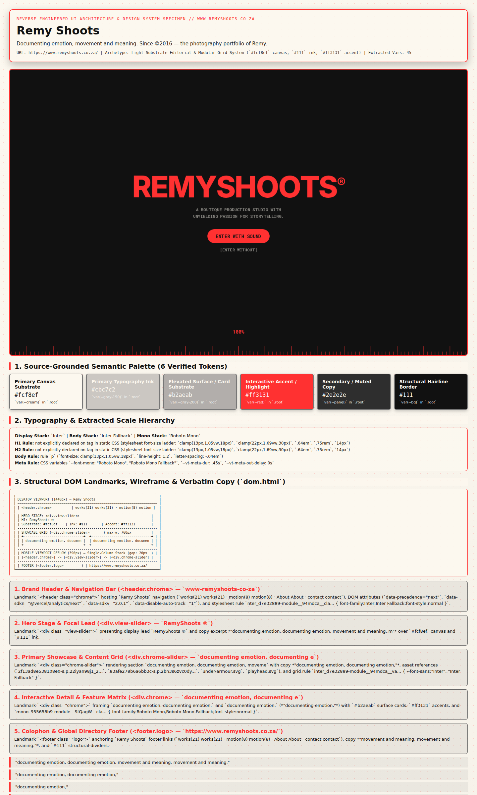
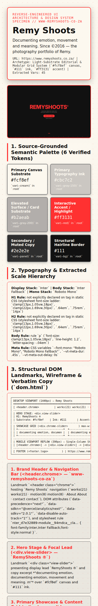

# UI Design System & Master Generation Blueprint: www-remyshoots-co-za

> **Remy Shoots** (https://www.remyshoots.co.za/) — Documenting emotion, movement and meaning. Since ©2016 — the photography portfolio of Remy.



---

## 1. Executive Visual Persona & Design Archetype

- **Brand Essence & Persona**: **Remy Shoots** (`https://www.remyshoots.co.za/`). Documenting emotion, movement and meaning. Since ©2016 — the photography portfolio of Remy.
- **Visual Archetype**: **Light-Substrate Editorial & Modular Grid System (`#fcf8ef` canvas, `#111` ink, `#ff3131` accent)**.
- **Anti-AI-Slop Differentiators**:
  - **Source-Grounded Chromatic Polarity**: Anchors the viewport in `#fcf8ef` (`var(--cream)` in `:root`) paired with `#111` primary typography and `#ff3131` accents.
  - **Extracted Typographic Hierarchy**: Pairs `Inter` for display copy (`RemyShoots ®`) with `Inter Fallback` and `Roboto Mono`.
  - **Calibrated Spatial Grid & Motion**: Combines `760px` container bounds (`gap: 20px`, padding `var(--nav-caret-lane)`) with `cubic-bezier(.4,0,.15,1)` easing.

---

## 2. Spatial Architecture & Modular Grid Mathematics



### Viewport Allocation & Container Geometry
- **Captured Viewport Dimensions**: Desktop `1440×2400px` (`assets/desktop.png`, capped at 2400px multi-section capture), Mobile `390×2400px` (`assets/mobile.png`, capped at 2400px multi-section capture).
- **Master Container Bounds**: `760px` extracted from `www-remyshoots-co-za` stylesheet.
- **Canvas Lateral Padding & Spacing**: `var(--nav-caret-lane)` lateral canvas padding with `20px` grid gap.
- **Border Radius Scale**: `50%`, `1000px`, `999px`.

### Responsive Breakpoint Architecture
- **Desktop Layout**: Multi-column CSS Grid / Flexbox layout at `1440px` (`max-width: 760px`, `gap: 20px`).
- **Mobile Layout**: Single-column vertical stack at `390px` viewport width with `var(--nav-caret-lane)` horizontal padding.
- **Extracted CSS Media Queries**: `@media (max-width:760px)`, `@media (min-width:761px)`, `@media (prefers-reduced-motion:reduce)`, `@media (min-width:1101px)`.

---

## 3. Color System, Materiality & Atmospheric Lighting

### Semantic Palette & Source Grounding
| Semantic Role | Ground-Truth Value | Extracted CSS Source / Selector |
|---|---|---|
| **Primary Canvas Substrate** | `#fcf8ef` | `var(--cream)` in `:root` |
| **Primary Typography Ink** | `#cbc7c2` | `var(--gray-150)` in `:root` |
| **Elevated Surface / Card Substrate** | `#b2aeab` | `var(--gray-200)` in `:root` |
| **Interactive Accent / Highlight** | `#ff3131` | `var(--red)` in `:root` |
| **Secondary / Muted Copy** | `#2e2e2e` | `var(--panel)` in `:root` |
| **Structural Hairline Border** | `#111` | `var(--bg)` in `:root` |

### Sanitized Root CSS Variables (`ui-ux.md` Ground Truth)
| Variable Name | Extracted Value | Semantic Role |
|---|---|---|
| `--font-sans` | `"Inter", "Inter Fallback"` | Typography / Scale Token |
| `--font-mono` | `"Roboto Mono", "Roboto Mono Fallback"` | Typography / Scale Token |
| `--cream` | `#fcf8ef` | Color / Atmospheric Token |
| `--gray-150` | `#cbc7c2` | Color / Atmospheric Token |
| `--gray-200` | `#b2aeab` | Color / Atmospheric Token |
| `--red` | `#ff3131` | Color / Atmospheric Token |
| `--panel` | `#2e2e2e` | Color / Atmospheric Token |
| `--bg` | `#111` | Canvas / Surface Token |
| `--stage-lift` | `24px` | Dimension / Scale Token |
| `--vcaret-x` | `calc(8.33vw + 219px)` | Dimension / Scale Token |
| `--vig-size` | `45%` | Layout / Spatial Grid Token |
| `--vig-radius` | `min(114vh, 114vw)` | Elevation / Border Token |
| `--vig-open` | `1.2` | Design System Custom Token |
| `--nav-caret-lane` | `28px` | Layout / Spatial Grid Token |
| `--nav-caret-gap` | `8px` | Layout / Spatial Grid Token |
| `--nav-caret-size` | `.9em` | Layout / Spatial Grid Token |

---

## 4. Typographic Scale & Editorial Hierarchy

### Font Family Stacks
- **Display Typography**: `Inter`.
- **Primary Body Stack**: `Inter Fallback`.
- **Technical / Metadata Stack**: `Roboto Mono`.

### Typographic Scale & Rules (Extracted from Stylesheet & Variables)
- **Hero Display (`H1`)**: not explicitly declared on tag in static CSS (stylesheet font-size ladder: `clamp(13px,1.05vw,18px)`, `clamp(22px,1.69vw,30px)`, `.64em`, `.75rem`, `14px`).
- **Section Heading (`H2`)**: not explicitly declared on tag in static CSS (stylesheet font-size ladder: `clamp(13px,1.05vw,18px)`, `clamp(22px,1.69vw,30px)`, `.64em`, `.75rem`, `14px`).
- **Body Copy**: rule `p` (`font-size: clamp(13px,1.05vw,18px)`, `line-height: 1.2`, `letter-spacing: -.04em`).
- **Metadata & Navigation Labels**: CSS variables `--font-mono: "Roboto Mono", "Roboto Mono Fallback"`, `--vt-meta-dur: .45s`, `--vt-meta-out-delay: 0s`.

---

## 5. Choreographed Motion & Interaction Physics

### Primary Easing Curves
- **Extracted Timing Functions**: `cubic-bezier(.4,0,.15,1)`, `cubic-bezier(.4,0,.2,1)`, `cubic-bezier(.887,0,.113,1)`.

### Per-Element Transition & Choreography Rules
- **Selector `.hand-control`**: `transition: opacity .25s` extracted from `www-remyshoots-co-za` stylesheet.
- **Selector `.vticker`**: `transition: transform .45s cubic-bezier(.4,0,.15,1)` extracted from `www-remyshoots-co-za` stylesheet.
- **Selector `.vticker-caret`**: `transition: transform .45s cubic-bezier(.4,0,.15,1)` extracted from `www-remyshoots-co-za` stylesheet.
- **Extracted Easing Curve (`cubic-bezier(.4,0,.15,1)`)**: Governs interactive state transitions across `<header.chrome>` and `<div.chrome-slider>`.
- **State & Hover Choreography**: Opacity and transform transitions on `<div.view-slider>` and `<div.chrome-slider>` interactive targets.

---

## 6. Component Wireframe & Structural DOM Map

### Visual Layout Schematic (Grounded in `dom.html` — `1440px` Desktop & `390px` Mobile Reflow)
```
┌────────────────────────────────────────────────────────────────────────┐
│ DESKTOP VIEWPORT (1440px) — Remy Shoots                                │
│ ====================================================================== │
│ [ <header.chrome>          | works(21) works(21) · motion(8) motion ]  │
│ ---------------------------------------------------------------------- │
│ | HERO STAGE: <div.view-slider>                                    |   │
│ | H1: RemyShoots ®                                                 |   │
│ | Substrate: #fcf8ef    | Ink: #111       | Accent: #ff3131        |   │
│ ---------------------------------------------------------------------- │
│ | SHOWCASE GRID (<div.chrome-slider>       ) max-w: 760px          |   │
│ | +------------------------------+  +------------------------------+ | │
│ | | documenting emotion, documen |  | documenting emotion, documen | | │
│ | +------------------------------+  +------------------------------+ | │
│ ---------------------------------------------------------------------- │
│ | MOBILE VIEWPORT REFLOW (390px) — Single-Column Stack (gap: 20px  ) | │
│ | [<header.chrome>] -> [<div.view-slider>] -> [<div.chrome-slider] |   │
│ ---------------------------------------------------------------------- │
│ [ FOOTER (<footer.logo>         ) | https://www.remyshoots.co.za/      │
└────────────────────────────────────────────────────────────────────────┘
```

### Granular DOM Region Breakdown
1. **Brand Header & Navigation Bar (<header.chrome> — `www-remyshoots-co-za`)**:
   - Landmark `<header class="chrome">` hosting `Remy Shoots` navigation (`works(21) works(21) · motion(8) motion(8) · About About · contact contact`), DOM attributes (`data-precedence="next"`, `data-sdkn="@vercel/analytics/next"`, `data-sdkv="2.0.1"`, `data-disable-auto-track="1"`), and stylesheet rule `nter_d7e32889-module__94mdca__cla... { font-family:Inter,Inter Fallback;font-style:normal }`.
2. **Hero Stage & Focal Lead (<div.view-slider> — `RemyShoots ®`)**:
   - Landmark `<div class="view-slider">` presenting display lead `RemyShoots ®` and copy excerpt *"documenting emotion, documenting emotion, movement and meaning. m"* over `#fcf8ef` canvas and `#111` ink.
3. **Primary Showcase & Content Grid (<div.chrome-slider> — `documenting emotion, documenting e`)**:
   - Landmark `<div class="chrome-slider">` rendering section `documenting emotion, documenting emotion, moveme` with copy *"documenting emotion, documenting emotion,"*, asset references (`2f13ad8e538108e0-s.p.22iyan98j1_2...`, `83afe278b6a6bb3c-s.p.2bn3s6zvc0dy...`, `under-armour.svg`, `playhead.svg`), and grid rule `inter_d7e32889-module__94mdca__va... { --font-sans:"Inter", "Inter Fallback" }`.
4. **Interactive Detail & Feature Matrix (<div.chrome> — `documenting emotion, documenting e`)**:
   - Landmark `<div class="chrome">` framing `documenting emotion, documenting emotion,` and `documenting emotion,` (*"documenting emotion,"*) with `#b2aeab` surface cards, `#ff3131` accents, and `mono_955658b9-module__SfQagW__cla... { font-family:Roboto Mono,Roboto Mono Fallback;font-style:normal }`.
5. **Colophon & Global Directory Footer (<footer.logo> — `https://www.remyshoots.co.za/`)**:
   - Landmark `<footer class="logo">` anchoring `Remy Shoots` footer links (`works(21) works(21) · motion(8) motion(8) · About About · contact contact`), copy *"movement and meaning. movement and meaning."*, and `#111` structural dividers.

---

## 7. Master Zero-Shot AI Generation Prompt

```markdown
# Master Zero-Shot Frontend Generation Prompt: www-remyshoots-co-za (Remy Shoots)

You are a principal frontend architect and design systems engineer. Build a complete, production-ready web application replicating the exact design system, DOM landmarks, typographic hierarchy, color tokens, and motion physics of `www-remyshoots-co-za` (**Remy Shoots** — `https://www.remyshoots.co.za/`).

### 1. Visual Archetype & Anti-AI-Slop Mandates
- **Archetype**: Light-Substrate Editorial & Modular Grid System (`#fcf8ef` canvas, `#111` ink, `#ff3131` accent).
- **Identity & Domain Context**: Documenting emotion, movement and meaning. Since ©2016 — the photography portfolio of Remy.
- **Primary Substrate**: `#fcf8ef` (`var(--cream)` in `:root`), **Primary Ink**: `#111`, **Accent / Highlight**: `#ff3131`.
- **Site-Specific Differentiators**:
  - **Source-Grounded Chromatic Polarity**: Anchors the viewport in `#fcf8ef` (`var(--cream)` in `:root`) paired with `#111` primary typography and `#ff3131` accents.
  - **Extracted Typographic Hierarchy**: Pairs `Inter` for display copy (`RemyShoots ®`) with `Inter Fallback` and `Roboto Mono`.
  - **Calibrated Spatial Grid & Motion**: Combines `760px` container bounds (`gap: 20px`, padding `var(--nav-caret-lane)`) with `cubic-bezier(.4,0,.15,1)` easing.

### 2. Ground-Truth CSS Variables (`:root` Token Contract)
Declare and consume these exact custom properties extracted from `www-remyshoots-co-za` in your global stylesheet:

:root {
  /* Remy Shoots (www-remyshoots-co-za) — Ground-Truth Extracted CSS Variables */
  --font-sans: "Inter", "Inter Fallback"; /* Typography / Scale Token (www-remyshoots-co-za) */
  --font-mono: "Roboto Mono", "Roboto Mono Fallback"; /* Typography / Scale Token (www-remyshoots-co-za) */
  --cream: #fcf8ef; /* Color / Atmospheric Token (www-remyshoots-co-za) */
  --gray-150: #cbc7c2; /* Color / Atmospheric Token (www-remyshoots-co-za) */
  --gray-200: #b2aeab; /* Color / Atmospheric Token (www-remyshoots-co-za) */
  --red: #ff3131; /* Color / Atmospheric Token (www-remyshoots-co-za) */
  --panel: #2e2e2e; /* Color / Atmospheric Token (www-remyshoots-co-za) */
  --bg: #111; /* Canvas / Surface Token (www-remyshoots-co-za) */
  --stage-lift: 24px; /* Dimension / Scale Token (www-remyshoots-co-za) */
  --vcaret-x: calc(8.33vw + 219px); /* Dimension / Scale Token (www-remyshoots-co-za) */
  --vig-size: 45%; /* Layout / Spatial Grid Token (www-remyshoots-co-za) */
  --vig-radius: min(114vh, 114vw); /* Elevation / Border Token (www-remyshoots-co-za) */
  --vig-open: 1.2; /* Design System Custom Token (www-remyshoots-co-za) */
  --nav-caret-lane: 28px; /* Layout / Spatial Grid Token (www-remyshoots-co-za) */
  --nav-caret-gap: 8px; /* Layout / Spatial Grid Token (www-remyshoots-co-za) */
  --nav-caret-size: .9em; /* Layout / Spatial Grid Token (www-remyshoots-co-za) */
}

### 3. Semantic Color & Materiality Contract
Map every surface, ink, and border strictly to these source-grounded tokens:
- **Primary Canvas Substrate**: `#fcf8ef` — grounded in `var(--cream)` in `:root`
- **Primary Typography Ink**: `#cbc7c2` — grounded in `var(--gray-150)` in `:root`
- **Elevated Surface / Card Substrate**: `#b2aeab` — grounded in `var(--gray-200)` in `:root`
- **Interactive Accent / Highlight**: `#ff3131` — grounded in `var(--red)` in `:root`
- **Secondary / Muted Copy**: `#2e2e2e` — grounded in `var(--panel)` in `:root`
- **Structural Hairline Border**: `#111` — grounded in `var(--bg)` in `:root`

### 4. Spatial Grid, Container Bounds & Responsive Breakpoints
- **Desktop Viewport Reference**: `1440×2400px` (capped at 2400px multi-section capture, `1440px` standard desktop width).
- **Mobile Viewport Reference**: `390×2400px` (capped at 2400px multi-section capture, `390px` standard mobile width).
- **Container Max-Width**: `760px` extracted from `www-remyshoots-co-za` stylesheet
- **Padding & Gutters**: `var(--nav-caret-lane)` lateral canvas padding with `20px` grid gap
- **Desktop Grid**: Multi-column CSS Grid / Flexbox layout at `1440px` (`max-width: 760px`, `gap: 20px`)
- **Mobile Adaptation**: Single-column vertical stack at `390px` viewport width with `var(--nav-caret-lane)` horizontal padding
- **Media Queries**: `@media (max-width:760px)`, `@media (min-width:761px)`, `@media (prefers-reduced-motion:reduce)`, `@media (min-width:1101px)`
- **Corner Radii**: `50%`, `1000px`, `999px`

### 5. Typography & Editorial Scale Contract
- **Display Font Stack**: `Inter`
- **Body Font Stack**: `Inter Fallback`
- **Monospace / Technical Font Stack**: `Roboto Mono`
- **H1 Display Rule**: not explicitly declared on tag in static CSS (stylesheet font-size ladder: `clamp(13px,1.05vw,18px)`, `clamp(22px,1.69vw,30px)`, `.64em`, `.75rem`, `14px`)
- **H2 Section Rule**: not explicitly declared on tag in static CSS (stylesheet font-size ladder: `clamp(13px,1.05vw,18px)`, `clamp(22px,1.69vw,30px)`, `.64em`, `.75rem`, `14px`)
- **Body Copy Rule**: rule `p` (`font-size: clamp(13px,1.05vw,18px)`, `line-height: 1.2`, `letter-spacing: -.04em`)
- **Metadata & Index Rule**: CSS variables `--font-mono: "Roboto Mono", "Roboto Mono Fallback"`, `--vt-meta-dur: .45s`, `--vt-meta-out-delay: 0s`

### 6. Component Hierarchy, Verbatim Copy & Real DOM Landmarks
Scaffold `www-remyshoots-co-za` (`Remy Shoots`) with these exact structural regions, extracted copy, and CSS rules from `dom.html`:
1. **Brand Header & Navigation Bar (<header.chrome> — `www-remyshoots-co-za`)**:
   - DOM & Selectors: Landmark `<header class="chrome">` hosting `Remy Shoots` navigation (`works(21) works(21) · motion(8) motion(8) · About About · contact contact`), DOM attributes (`data-precedence="next"`, `data-sdkn="@vercel/analytics/next"`, `data-sdkv="2.0.1"`, `data-disable-auto-track="1"`), and stylesheet rule `nter_d7e32889-module__94mdca__cla... { font-family:Inter,Inter Fallback;font-style:normal }`.
   - Responsive Contract: Header `Brand Header & Navigation Bar (<header.chrome> — `www-remyshoots-co-za`)` (`www-remyshoots-co-za`) adapts across `@media (max-width:760px)`, `@media (min-width:761px)`, `@media (prefers-reduced-motion:reduce)`, `@media (min-width:1101px)` with `cubic-bezier(.4,0,.15,1)`, `cubic-bezier(.4,0,.2,1)`, `cubic-bezier(.887,0,.113,1)` transitions and links `works(21) works(21) · motion(8) motion(8) · About About · contact contact`.
2. **Hero Stage & Focal Lead (<div.view-slider> — `RemyShoots ®`)**:
   - DOM & Selectors: Landmark `<div class="view-slider">` presenting display lead `RemyShoots ®` and copy excerpt *"documenting emotion, documenting emotion, movement and meaning. m"* over `#fcf8ef` canvas and `#111` ink.
   - Responsive Contract: Hero stage (`1440×2400px` desktop / `390×2400px` mobile) sets `#fcf8ef` background with `#111` headline `RemyShoots ®`.
3. **Primary Showcase & Content Grid (<div.chrome-slider> — `documenting emotion, documenting e`)**:
   - DOM & Selectors: Landmark `<div class="chrome-slider">` rendering section `documenting emotion, documenting emotion, moveme` with copy *"documenting emotion, documenting emotion,"*, asset references (`2f13ad8e538108e0-s.p.22iyan98j1_2...`, `83afe278b6a6bb3c-s.p.2bn3s6zvc0dy...`, `under-armour.svg`, `playhead.svg`), and grid rule `inter_d7e32889-module__94mdca__va... { --font-sans:"Inter", "Inter Fallback" }`.
   - Responsive Contract: Showcase grid `Primary Showcase & Content Grid (<div.chrome-slider> — `documenting emotion, documenting e`)` applies Multi-column CSS Grid / Flexbox layout at `1440px` (`max-width: 760px`, `gap: 20px`) on desktop and Single-column vertical stack at `390px` viewport width with `var(--nav-caret-lane)` horizontal padding on mobile.
4. **Interactive Detail & Feature Matrix (<div.chrome> — `documenting emotion, documenting e`)**:
   - DOM & Selectors: Landmark `<div class="chrome">` framing `documenting emotion, documenting emotion,` and `documenting emotion,` (*"documenting emotion,"*) with `#b2aeab` surface cards, `#ff3131` accents, and `mono_955658b9-module__SfQagW__cla... { font-family:Roboto Mono,Roboto Mono Fallback;font-style:normal }`.
   - Responsive Contract: Detail module `Interactive Detail & Feature Matrix (<div.chrome> — `documenting emotion, documenting e`)` uses `50%`, `1000px`, `999px` radii, `#ff3131` highlights, and assets (2f13ad8e538108e0-s.p.22iyan98j1_2..., 83afe278b6a6bb3c-s.p.2bn3s6zvc0dy..., under-armour.svg).
5. **Colophon & Global Directory Footer (<footer.logo> — `https://www.remyshoots.co.za/`)**:
   - DOM & Selectors: Landmark `<footer class="logo">` anchoring `Remy Shoots` footer links (`works(21) works(21) · motion(8) motion(8) · About About · contact contact`), copy *"movement and meaning. movement and meaning."*, and `#111` structural dividers.
   - Responsive Contract: Footer `Colophon & Global Directory Footer (<footer.logo> — `https://www.remyshoots.co.za/`)` aligns to `760px` extracted from `www-remyshoots-co-za` stylesheet with `var(--nav-caret-lane)` lateral canvas padding with `20px` grid gap and attributes (data-precedence="next", data-sdkn="@vercel/analytics/next", data-sdkv="2.0.1").

#### Verbatim DOM Copy Excerpts (`dom.html`)
- Copy Excerpt 1: *"documenting emotion, documenting emotion, movement and meaning. movement and meaning."*
- Copy Excerpt 2: *"documenting emotion, documenting emotion,"*
- Copy Excerpt 3: *"documenting emotion,"*
- Copy Excerpt 4: *"movement and meaning. movement and meaning."*

### 7. Motion, Extracted Stylesheet Rules & Interaction Choreography
- **Primary Easing Functions**: `cubic-bezier(.4,0,.15,1)`, `cubic-bezier(.4,0,.2,1)`, `cubic-bezier(.887,0,.113,1)`
- **Extracted Stylesheet Rules (`www-remyshoots-co-za`)**:
- `nter_d7e32889-module__94mdca__cla... { font-family:Inter,Inter Fallback;font-style:normal }`
- `inter_d7e32889-module__94mdca__va... { --font-sans:"Inter", "Inter Fallback" }`
- `mono_955658b9-module__SfQagW__cla... { font-family:Roboto Mono,Roboto Mono Fallback;font-style:normal }`
- `mono_955658b9-module__SfQagW__var... { --font-mono:"Roboto Mono", "Roboto Mono Fallback" }`
- `root { --cream:fcf8ef;--gray-150:cbc7c2;--gray-200:b2aeab;--red:ff3131;--panel:... }`
- **Per-Selector Transition Rules**:
- **Selector `.hand-control`**: `transition: opacity .25s` extracted from `www-remyshoots-co-za` stylesheet.
- **Selector `.vticker`**: `transition: transform .45s cubic-bezier(.4,0,.15,1)` extracted from `www-remyshoots-co-za` stylesheet.
- **Selector `.vticker-caret`**: `transition: transform .45s cubic-bezier(.4,0,.15,1)` extracted from `www-remyshoots-co-za` stylesheet.
- **Extracted Easing Curve (`cubic-bezier(.4,0,.15,1)`)**: Governs interactive state transitions across `<header.chrome>` and `<div.chrome-slider>`.
- **State & Hover Choreography**: Opacity and transform transitions on `<div.view-slider>` and `<div.chrome-slider>` interactive targets.

### 8. Technical Deliverables
- Implement in Next.js (App Router) with TypeScript and Tailwind CSS consuming the `:root` custom properties defined above for `www-remyshoots-co-za`.
- Reproduce both the `1440px` desktop architecture and `390px` mobile breakpoint transitions, preserving semantic HTML5 landmarks (`<header>`, `<nav>`, `<main>`, `<section>`, `<footer>`) and `prefers-reduced-motion` accessibility guards.
```
