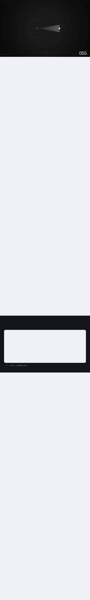
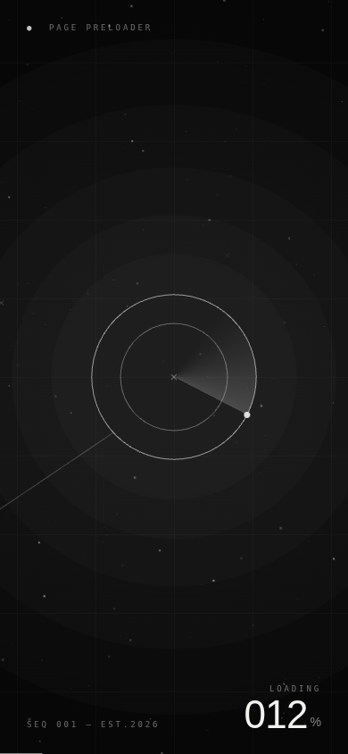

# UI Design System & Master Generation Blueprint: www-rikoutaku-work

> **Rikoutaku（リコウタク）— RI.Studio · Interaction & UI/UX Design Portfolio** (https://www.rikoutaku.work/) — Rikoutaku（リコウタク）のポートフォリオサイト「RI.Studio」。東京を拠点とするインタラクション／UI・UXデザイナー。3Dスクロール体験、アプリUI、Web、AR、モーションの作品集。Interaction & UI/UX Designer based in...



---

## 1. Executive Visual Persona & Design Archetype

- **Brand Essence & Persona**: **Rikoutaku（リコウタク）— RI.Studio · Interaction & UI/UX Design Portfolio** (`https://www.rikoutaku.work/`). Rikoutaku（リコウタク）のポートフォリオサイト「RI.Studio」。東京を拠点とするインタラクション／UI・UXデザイナー。3Dスクロール体験、アプリUI、Web、AR、モーションの作品集。Interaction & UI/UX Designer based in...
- **Visual Archetype**: **Dark-Substrate WebGL / Canvas Interactive Experience (`#2e3bff` / `#e9e4d8`)**.
- **Anti-AI-Slop Differentiators**:
  - **Source-Grounded Chromatic Polarity**: Anchors the viewport in `#2e3bff` (`var(--ri-curtain-bg)` in `:root`) paired with `#f0f0f7` primary typography and `#e9e4d8` accents.
  - **Extracted Typographic Hierarchy**: Pairs `Instrument Serif` for display copy (`Rikoutaku（リコウタク）— RI.Studio · Intera`) with `Inter` and `SF Mono`.
  - **Calibrated Spatial Grid & Motion**: Combines `700px` container bounds (`gap: 20px`, padding `36px`) with `cubic-bezier(.16,1,.3,1)` easing and GSAP Timeline & ScrollTrigger, Three.js / WebGL Canvas Pipeline.

---

## 2. Spatial Architecture & Modular Grid Mathematics



### Viewport Allocation & Container Geometry
- **Captured Viewport Dimensions**: Desktop `1440×9495px` (`assets/desktop.png`, full-page scroll capture), Mobile `390×2400px` (`assets/mobile.png`, capped at 2400px multi-section capture).
- **Master Container Bounds**: `700px` extracted from `www-rikoutaku-work` stylesheet.
- **Canvas Lateral Padding & Spacing**: `36px` lateral canvas padding with `20px` grid gap.
- **Border Radius Scale**: `999px`, `50%`, `8px`, `6px`.

### Responsive Breakpoint Architecture
- **Desktop Layout**: Multi-column CSS Grid / Flexbox layout at `1440px` (`max-width: 700px`, `gap: 20px`).
- **Mobile Layout**: Single-column vertical stack at `390px` viewport width with `36px` horizontal padding.
- **Extracted CSS Media Queries**: `@media (max-width: 700px)`, `@media (prefers-reduced-motion: reduce)`, `@media (max-width: 820px)`, `@media (min-width: 1800px)`.

---

## 3. Color System, Materiality & Atmospheric Lighting

### Semantic Palette & Source Grounding
| Semantic Role | Ground-Truth Value | Extracted CSS Source / Selector |
|---|---|---|
| **Primary Canvas Substrate** | `#2e3bff` | `var(--ri-curtain-bg)` in `:root` |
| **Primary Typography Ink** | `#f0f0f7` | `var(--ri-curtain-ink)` in `:root` |
| **Elevated Surface / Card Substrate** | `#0b0b0c` | `var(--bg)` in `:root` |
| **Interactive Accent / Highlight** | `#e9e4d8` | `var(--text)` in `:root` |
| **Secondary / Muted Copy** | `#2a2926` | `var(--faint)` in `:root` |
| **Structural Hairline Border** | `#ff3b24` | `var(--accent)` in `:root` |
| **Variable Token (`--accent-2`)** | `#d92c18` | `var(--accent-2)` in `:root` |
| **Variable Token (`--circle-outline`)** | `#505050` | `var(--circle-outline)` in `:root` |

### Sanitized Root CSS Variables (`ui-ux.md` Ground Truth)
| Variable Name | Extracted Value | Semantic Role |
|---|---|---|
| `--ri-ease` | `cubic-bezier(.16, 1, .3, 1)` | Motion / Easing Token |
| `--ri-ease-io` | `cubic-bezier(.76, 0, .24, 1)` | Motion / Easing Token |
| `--ri-ease-in` | `cubic-bezier(.7, 0, .84, 0)` | Motion / Easing Token |
| `--ri-curtain-bg` | `#2e3bff` | Canvas / Surface Token |
| `--ri-curtain-ink` | `#f0f0f7` | Typography Ink Token |
| `--ri-curtain-z` | `2147483000` | Design System Custom Token |
| `--bg` | `#0b0b0c` | Canvas / Surface Token |
| `--text` | `#e9e4d8` | Typography Ink Token |
| `--dim` | `#e9e4d8` | Color / Atmospheric Token |
| `--faint` | `#2a2926` | Color / Atmospheric Token |
| `--accent` | `#ff3b24` | Brand / Palette Token |
| `--accent-2` | `#d92c18` | Brand / Palette Token |
| `--circle-outline` | `#505050` | Elevation / Border Token |
| `--ease` | `cubic-bezier(.16, 1, .3, 1)` | Motion / Easing Token |
| `--ease-soft` | `cubic-bezier(.4, 0, .2, 1)` | Motion / Easing Token |
| `--pad` | `clamp(1.4rem, 2.4vw, 2.8rem)` | Layout / Spatial Grid Token |

---

## 4. Typographic Scale & Editorial Hierarchy

### Font Family Stacks
- **Display Typography**: `Instrument Serif`.
- **Primary Body Stack**: `Inter`.
- **Technical / Metadata Stack**: `SF Mono`.

### Typographic Scale & Rules (Extracted from Stylesheet & Variables)
- **Hero Display (`H1`)**: rule `h1` (`font-size: clamp(29px,2.5vw,40px)`, `line-height: 1.36`, `letter-spacing: -.055em`, `font-weight: 500`).
- **Section Heading (`H2`)**: rule `h2` (`font-size: clamp(94px,10.2vw,164px)`, `line-height: .94`).
- **Body Copy**: rule `p` (`font-size: 12px`, `line-height: 1.65`, `letter-spacing: -.01em`).
- **Metadata & Navigation Labels**: not explicitly declared on tag in static CSS (stylesheet font-size ladder: `11px`, `22px`, `clamp(64px,11.5vw,210px)`, `20px`, `clamp(54px,16vw,110px)`).

---

## 5. Choreographed Motion & Interaction Physics

### Primary Easing Curves
- **Extracted Timing Functions**: `cubic-bezier(.16,1,.3,1)`, `cubic-bezier(.76,0,.24,1)`, `cubic-bezier(.7,0,.84,0)`.

### Per-Element Transition & Choreography Rules
- **Selector `.ri-curtain.is-anim .ri-curtain-s...`**: `transition: transform .72s var(--ri-ease-io)` extracted from `www-rikoutaku-work` stylesheet.
- **Selector `.ri-curtain-label>span>span`**: `transition: transform .6s cubic-bezier(.16,1,.3,1)` extracted from `www-rikoutaku-work` stylesheet.
- **Selector `is-label-static .ri-curtain-label...`**: `transition: none` extracted from `www-rikoutaku-work` stylesheet.
- **Extracted Easing Curve (`cubic-bezier(.16,1,.3,1)`)**: Governs interactive state transitions across `<header.c2n-header>` and `<section.c2n-hero>`.
- **Runtime Interaction Engine**: Integrates GSAP Timeline & ScrollTrigger, Three.js / WebGL Canvas Pipeline with `prefers-reduced-motion: reduce` fallback guards.

---

## 6. Component Wireframe & Structural DOM Map

### Visual Layout Schematic (Grounded in `dom.html` — `1440px` Desktop & `390px` Mobile Reflow)
```
┌────────────────────────────────────────────────────────────────────────┐
│ DESKTOP VIEWPORT (1440px) — Rikoutaku（リコウタク）— RI.Studio · Interaction  │
│ ====================================================================== │
│ [ <header.c2n-header>      | 01 Intro ↗ · 02 About me ↗ · 03 Projec ]  │
│ ---------------------------------------------------------------------- │
│ | HERO STAGE: <section.composition-two>                            |   │
│ | H1: Rikoutaku（リコウタク）— RI.Studio · Interaction & UI/UX...         |   │
│ | Substrate: #2e3bff    | Ink: #f0f0f7    | Accent: #e9e4d8        |   │
│ ---------------------------------------------------------------------- │
│ | SHOWCASE GRID (<section.c2n-hero>        ) max-w: 700px          |   │
│ | +------------------------------+  +------------------------------+ | │
│ | | 技術と感性で、 記憶に残る体験を。            |  | A SPACE FOR IDEAS. A S P A C | | │
│ | +------------------------------+  +------------------------------+ | │
│ ---------------------------------------------------------------------- │
│ | MOBILE VIEWPORT REFLOW (390px) — Single-Column Stack (gap: 20px  ) | │
│ | [<header.c2n-header] -> [<section.compositi] -> [<section.c2n-hero>] │
│ ---------------------------------------------------------------------- │
│ [ FOOTER (<footer.c2n-contact>  ) | https://www.rikoutaku.work/        │
└────────────────────────────────────────────────────────────────────────┘
```

### Granular DOM Region Breakdown
1. **Brand Header & Navigation Bar (<header.c2n-header> — `www-rikoutaku-work`)**:
   - Landmark `<header class="c2n-header c2n-navigation-simple">` hosting `Rikoutaku（リコウタク）— RI.Studio · Intera` navigation (`01 Intro ↗ · 02 About me ↗ · 03 Projects ↗ · 04 Contact ↗`), DOM attributes (`data-composition="two"`, `data-c2n-room="hero"`, `data-engine="three.js r165"`, `data-motion-system="studio"`), and stylesheet rule `.ri-curtain { position:fixed;top:0;right:0;bottom:0;left:0;z-index:var(--ri-curtain-z)... }`.
2. **Hero Stage & Focal Lead (<section.composition-two> — `Rikoutaku（リコウタク）— RI.Studio · Inte`)**:
   - Landmark `<section class="composition-two">` presenting display lead `Rikoutaku（リコウタク）— RI.Studio · Interaction & UI/UX...` and copy excerpt *"seq 001 — est.2026"* over `#2e3bff` canvas and `#f0f0f7` ink.
3. **Primary Showcase & Content Grid (<section.c2n-hero> — `技術と感性で、 記憶に残る体験を。`)**:
   - Landmark `<section class="c2n-hero">` rendering section `技術と感性で、 記憶に残る体験を。` with copy *"INDEPENDENT DESIGNERTOKYO, JAPAN I N D E P E N D E N T D E S I G "*, asset references (`favicon.svg`, `theme-boot.js`, `2026-8-10-white.glb`, `fonts.googleapis.com`), and grid rule `.ri-curtain.is-on { visibility:visible;pointer-events:auto }`.
4. **Interactive Detail & Feature Matrix (<section.c2n-thinking> — `A SPACE FOR IDEAS. A S P A C E F O`)**:
   - Landmark `<section class="c2n-thinking c2n-paper">` framing `A SPACE FOR IDEAS. A S P A C E F O R I D E A S .` and `Beyond the frame. B e y o n d t h e f r a m e . I...` (*"INDEPENDENT DESIGNERTOKYO, JAPAN"*) with `#0b0b0c` surface cards, `#e9e4d8` accents, and `.ri-curtain-shade { position:absolute;top:0;right:0;bottom:0;left:0;background:111219;transf... }`.
5. **Colophon & Global Directory Footer (<footer.c2n-contact> — `https://www.rikoutaku.work/`)**:
   - Landmark `<footer class="c2n-contact c2n-paper">` anchoring `Rikoutaku（リコウタク）— RI.Studio · In` footer links (`01 Intro ↗ · 02 About me ↗ · 03 Projects ↗ · 04 Contact ↗`), copy *"I N D E P E N D E N T D E S I G N E R T O K Y O , J A P A N"*, and `#ff3b24` structural dividers.

---

## 7. Master Zero-Shot AI Generation Prompt

```markdown
# Master Zero-Shot Frontend Generation Prompt: www-rikoutaku-work (Rikoutaku（リコウタク）— RI.Studio · Interaction & UI/UX Design Portfolio)

You are a principal frontend architect and design systems engineer. Build a complete, production-ready web application replicating the exact design system, DOM landmarks, typographic hierarchy, color tokens, and motion physics of `www-rikoutaku-work` (**Rikoutaku（リコウタク）— RI.Studio · Interaction & UI/UX Design Portfolio** — `https://www.rikoutaku.work/`).

### 1. Visual Archetype & Anti-AI-Slop Mandates
- **Archetype**: Dark-Substrate WebGL / Canvas Interactive Experience (`#2e3bff` / `#e9e4d8`).
- **Identity & Domain Context**: Rikoutaku（リコウタク）のポートフォリオサイト「RI.Studio」。東京を拠点とするインタラクション／UI・UXデザイナー。3Dスクロール体験、アプリUI、Web、AR、モーションの作品集。Interaction & UI/UX Designer based in...
- **Primary Substrate**: `#2e3bff` (`var(--ri-curtain-bg)` in `:root`), **Primary Ink**: `#f0f0f7`, **Accent / Highlight**: `#e9e4d8`.
- **Site-Specific Differentiators**:
  - **Source-Grounded Chromatic Polarity**: Anchors the viewport in `#2e3bff` (`var(--ri-curtain-bg)` in `:root`) paired with `#f0f0f7` primary typography and `#e9e4d8` accents.
  - **Extracted Typographic Hierarchy**: Pairs `Instrument Serif` for display copy (`Rikoutaku（リコウタク）— RI.Studio · Intera`) with `Inter` and `SF Mono`.
  - **Calibrated Spatial Grid & Motion**: Combines `700px` container bounds (`gap: 20px`, padding `36px`) with `cubic-bezier(.16,1,.3,1)` easing and GSAP Timeline & ScrollTrigger, Three.js / WebGL Canvas Pipeline.

### 2. Ground-Truth CSS Variables (`:root` Token Contract)
Declare and consume these exact custom properties extracted from `www-rikoutaku-work` in your global stylesheet:

:root {
  /* Rikoutaku（リコウタク）— RI.Studio · Interaction & UI/UX Design Portfolio (www-rikoutaku-work) — Ground-Truth Extracted CSS Variables */
  --ri-ease: cubic-bezier(.16, 1, .3, 1); /* Motion / Easing Token (www-rikoutaku-work) */
  --ri-ease-io: cubic-bezier(.76, 0, .24, 1); /* Motion / Easing Token (www-rikoutaku-work) */
  --ri-ease-in: cubic-bezier(.7, 0, .84, 0); /* Motion / Easing Token (www-rikoutaku-work) */
  --ri-curtain-bg: #2e3bff; /* Canvas / Surface Token (www-rikoutaku-work) */
  --ri-curtain-ink: #f0f0f7; /* Typography Ink Token (www-rikoutaku-work) */
  --ri-curtain-z: 2147483000; /* Design System Custom Token (www-rikoutaku-work) */
  --bg: #0b0b0c; /* Canvas / Surface Token (www-rikoutaku-work) */
  --text: #e9e4d8; /* Typography Ink Token (www-rikoutaku-work) */
  --dim: #e9e4d8; /* Color / Atmospheric Token (www-rikoutaku-work) */
  --faint: #2a2926; /* Color / Atmospheric Token (www-rikoutaku-work) */
  --accent: #ff3b24; /* Brand / Palette Token (www-rikoutaku-work) */
  --accent-2: #d92c18; /* Brand / Palette Token (www-rikoutaku-work) */
  --circle-outline: #505050; /* Elevation / Border Token (www-rikoutaku-work) */
  --ease: cubic-bezier(.16, 1, .3, 1); /* Motion / Easing Token (www-rikoutaku-work) */
  --ease-soft: cubic-bezier(.4, 0, .2, 1); /* Motion / Easing Token (www-rikoutaku-work) */
  --pad: clamp(1.4rem, 2.4vw, 2.8rem); /* Layout / Spatial Grid Token (www-rikoutaku-work) */
}

### 3. Semantic Color & Materiality Contract
Map every surface, ink, and border strictly to these source-grounded tokens:
- **Primary Canvas Substrate**: `#2e3bff` — grounded in `var(--ri-curtain-bg)` in `:root`
- **Primary Typography Ink**: `#f0f0f7` — grounded in `var(--ri-curtain-ink)` in `:root`
- **Elevated Surface / Card Substrate**: `#0b0b0c` — grounded in `var(--bg)` in `:root`
- **Interactive Accent / Highlight**: `#e9e4d8` — grounded in `var(--text)` in `:root`
- **Secondary / Muted Copy**: `#2a2926` — grounded in `var(--faint)` in `:root`
- **Structural Hairline Border**: `#ff3b24` — grounded in `var(--accent)` in `:root`
- **Variable Token (`--accent-2`)**: `#d92c18` — grounded in `var(--accent-2)` in `:root`
- **Variable Token (`--circle-outline`)**: `#505050` — grounded in `var(--circle-outline)` in `:root`

### 4. Spatial Grid, Container Bounds & Responsive Breakpoints
- **Desktop Viewport Reference**: `1440×9495px` (full-page scroll capture, `1440px` standard desktop width).
- **Mobile Viewport Reference**: `390×2400px` (capped at 2400px multi-section capture, `390px` standard mobile width).
- **Container Max-Width**: `700px` extracted from `www-rikoutaku-work` stylesheet
- **Padding & Gutters**: `36px` lateral canvas padding with `20px` grid gap
- **Desktop Grid**: Multi-column CSS Grid / Flexbox layout at `1440px` (`max-width: 700px`, `gap: 20px`)
- **Mobile Adaptation**: Single-column vertical stack at `390px` viewport width with `36px` horizontal padding
- **Media Queries**: `@media (max-width: 700px)`, `@media (prefers-reduced-motion: reduce)`, `@media (max-width: 820px)`, `@media (min-width: 1800px)`
- **Corner Radii**: `999px`, `50%`, `8px`, `6px`

### 5. Typography & Editorial Scale Contract
- **Display Font Stack**: `Instrument Serif`
- **Body Font Stack**: `Inter`
- **Monospace / Technical Font Stack**: `SF Mono`
- **H1 Display Rule**: rule `h1` (`font-size: clamp(29px,2.5vw,40px)`, `line-height: 1.36`, `letter-spacing: -.055em`, `font-weight: 500`)
- **H2 Section Rule**: rule `h2` (`font-size: clamp(94px,10.2vw,164px)`, `line-height: .94`)
- **Body Copy Rule**: rule `p` (`font-size: 12px`, `line-height: 1.65`, `letter-spacing: -.01em`)
- **Metadata & Index Rule**: not explicitly declared on tag in static CSS (stylesheet font-size ladder: `11px`, `22px`, `clamp(64px,11.5vw,210px)`, `20px`, `clamp(54px,16vw,110px)`)

### 6. Component Hierarchy, Verbatim Copy & Real DOM Landmarks
Scaffold `www-rikoutaku-work` (`Rikoutaku（リコウタク）— RI.Studio · Interaction & UI/UX Design Portfolio`) with these exact structural regions, extracted copy, and CSS rules from `dom.html`:
1. **Brand Header & Navigation Bar (<header.c2n-header> — `www-rikoutaku-work`)**:
   - DOM & Selectors: Landmark `<header class="c2n-header c2n-navigation-simple">` hosting `Rikoutaku（リコウタク）— RI.Studio · Intera` navigation (`01 Intro ↗ · 02 About me ↗ · 03 Projects ↗ · 04 Contact ↗`), DOM attributes (`data-composition="two"`, `data-c2n-room="hero"`, `data-engine="three.js r165"`, `data-motion-system="studio"`), and stylesheet rule `.ri-curtain { position:fixed;top:0;right:0;bottom:0;left:0;z-index:var(--ri-curtain-z)... }`.
   - Responsive Contract: Header `Brand Header & Navigation Bar (<header.c2n-header> — `www-rikoutaku-work`)` (`www-rikoutaku-work`) adapts across `@media (max-width: 700px)`, `@media (prefers-reduced-motion: reduce)`, `@media (max-width: 820px)`, `@media (min-width: 1800px)` with `cubic-bezier(.16,1,.3,1)`, `cubic-bezier(.76,0,.24,1)`, `cubic-bezier(.7,0,.84,0)` transitions and links `01 Intro ↗ · 02 About me ↗ · 03 Projects ↗ · 04 Contact ↗`.
2. **Hero Stage & Focal Lead (<section.composition-two> — `Rikoutaku（リコウタク）— RI.Studio · Inte`)**:
   - DOM & Selectors: Landmark `<section class="composition-two">` presenting display lead `Rikoutaku（リコウタク）— RI.Studio · Interaction & UI/UX...` and copy excerpt *"seq 001 — est.2026"* over `#2e3bff` canvas and `#f0f0f7` ink.
   - Responsive Contract: Hero stage (`1440×9495px` desktop / `390×2400px` mobile) sets `#2e3bff` background with `#f0f0f7` headline `Rikoutaku（リコウタク）— RI.Studio · Interaction & UI/UX...`.
3. **Primary Showcase & Content Grid (<section.c2n-hero> — `技術と感性で、 記憶に残る体験を。`)**:
   - DOM & Selectors: Landmark `<section class="c2n-hero">` rendering section `技術と感性で、 記憶に残る体験を。` with copy *"INDEPENDENT DESIGNERTOKYO, JAPAN I N D E P E N D E N T D E S I G "*, asset references (`favicon.svg`, `theme-boot.js`, `2026-8-10-white.glb`, `fonts.googleapis.com`), and grid rule `.ri-curtain.is-on { visibility:visible;pointer-events:auto }`.
   - Responsive Contract: Showcase grid `Primary Showcase & Content Grid (<section.c2n-hero> — `技術と感性で、 記憶に残る体験を。`)` applies Multi-column CSS Grid / Flexbox layout at `1440px` (`max-width: 700px`, `gap: 20px`) on desktop and Single-column vertical stack at `390px` viewport width with `36px` horizontal padding on mobile.
4. **Interactive Detail & Feature Matrix (<section.c2n-thinking> — `A SPACE FOR IDEAS. A S P A C E F O`)**:
   - DOM & Selectors: Landmark `<section class="c2n-thinking c2n-paper">` framing `A SPACE FOR IDEAS. A S P A C E F O R I D E A S .` and `Beyond the frame. B e y o n d t h e f r a m e . I...` (*"INDEPENDENT DESIGNERTOKYO, JAPAN"*) with `#0b0b0c` surface cards, `#e9e4d8` accents, and `.ri-curtain-shade { position:absolute;top:0;right:0;bottom:0;left:0;background:111219;transf... }`.
   - Responsive Contract: Detail module `Interactive Detail & Feature Matrix (<section.c2n-thinking> — `A SPACE FOR IDEAS. A S P A C E F O`)` uses `999px`, `50%`, `8px`, `6px` radii, `#e9e4d8` highlights, and assets (favicon.svg, theme-boot.js, 2026-8-10-white.glb).
5. **Colophon & Global Directory Footer (<footer.c2n-contact> — `https://www.rikoutaku.work/`)**:
   - DOM & Selectors: Landmark `<footer class="c2n-contact c2n-paper">` anchoring `Rikoutaku（リコウタク）— RI.Studio · In` footer links (`01 Intro ↗ · 02 About me ↗ · 03 Projects ↗ · 04 Contact ↗`), copy *"I N D E P E N D E N T D E S I G N E R T O K Y O , J A P A N"*, and `#ff3b24` structural dividers.
   - Responsive Contract: Footer `Colophon & Global Directory Footer (<footer.c2n-contact> — `https://www.rikoutaku.work/`)` aligns to `700px` extracted from `www-rikoutaku-work` stylesheet with `36px` lateral canvas padding with `20px` grid gap and attributes (data-composition="two", data-c2n-room="hero", data-engine="three.js r165").

#### Verbatim DOM Copy Excerpts (`dom.html`)
- Copy Excerpt 1: *"seq 001 — est.2026"*
- Copy Excerpt 2: *"INDEPENDENT DESIGNERTOKYO, JAPAN I N D E P E N D E N T D E S I G N E R T O K Y O ,..."*
- Copy Excerpt 3: *"INDEPENDENT DESIGNERTOKYO, JAPAN"*
- Copy Excerpt 4: *"I N D E P E N D E N T D E S I G N E R T O K Y O , J A P A N"*

### 7. Motion, Extracted Stylesheet Rules & Interaction Choreography
- **Primary Easing Functions**: `cubic-bezier(.16,1,.3,1)`, `cubic-bezier(.76,0,.24,1)`, `cubic-bezier(.7,0,.84,0)`
- **Extracted Stylesheet Rules (`www-rikoutaku-work`)**:
- `.ri-curtain { position:fixed;top:0;right:0;bottom:0;left:0;z-index:var(--ri-curtain-z)... }`
- `.ri-curtain.is-on { visibility:visible;pointer-events:auto }`
- `.ri-curtain-shade { position:absolute;top:0;right:0;bottom:0;left:0;background:111219;transf... }`
- `.ri-curtain.is-cover .ri-curtain-... { transform:none }`
- `.ri-curtain.is-lift .ri-curtain-s... { transform:translateY(-100%) }`
- **Per-Selector Transition Rules**:
- **Selector `.ri-curtain.is-anim .ri-curtain-s...`**: `transition: transform .72s var(--ri-ease-io)` extracted from `www-rikoutaku-work` stylesheet.
- **Selector `.ri-curtain-label>span>span`**: `transition: transform .6s cubic-bezier(.16,1,.3,1)` extracted from `www-rikoutaku-work` stylesheet.
- **Selector `is-label-static .ri-curtain-label...`**: `transition: none` extracted from `www-rikoutaku-work` stylesheet.
- **Extracted Easing Curve (`cubic-bezier(.16,1,.3,1)`)**: Governs interactive state transitions across `<header.c2n-header>` and `<section.c2n-hero>`.
- **Runtime Interaction Engine**: Integrates GSAP Timeline & ScrollTrigger, Three.js / WebGL Canvas Pipeline with `prefers-reduced-motion: reduce` fallback guards.

### 8. Technical Deliverables
- Implement in Next.js (App Router) with TypeScript and Tailwind CSS consuming the `:root` custom properties defined above for `www-rikoutaku-work`.
- Reproduce both the `1440px` desktop architecture and `390px` mobile breakpoint transitions, preserving semantic HTML5 landmarks (`<header>`, `<nav>`, `<main>`, `<section>`, `<footer>`) and `prefers-reduced-motion` accessibility guards.
```
