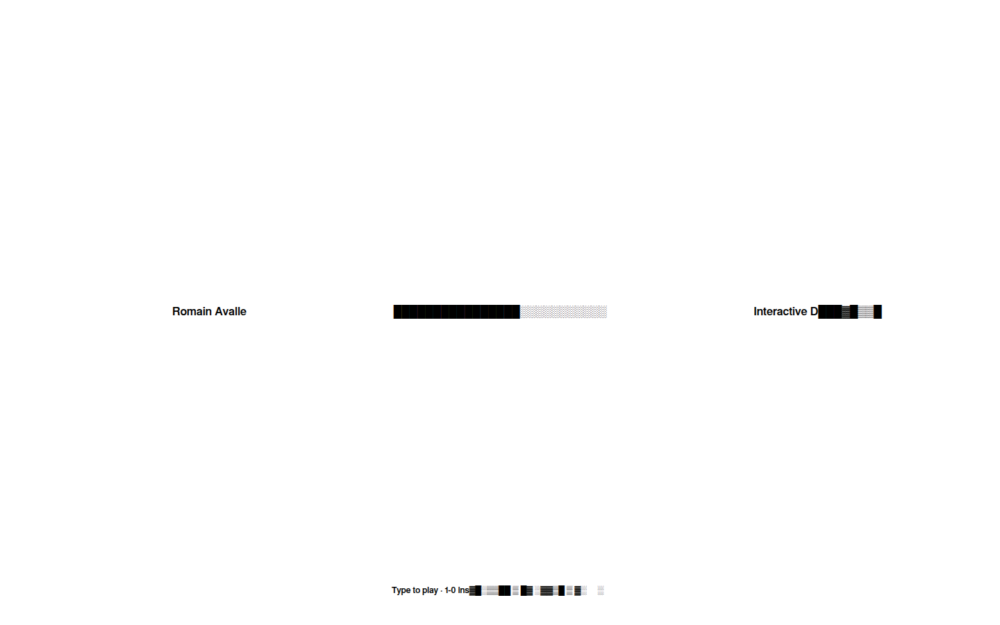
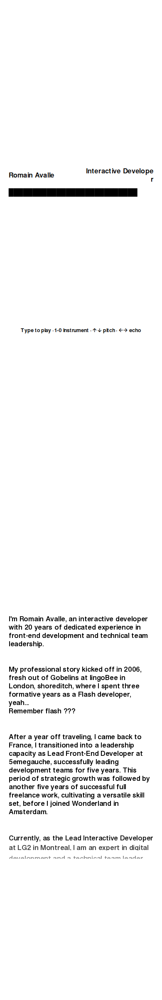

# UI Design System & Master Generation Blueprint: www-romainavalle-dev

> **Romain Avalle - Interactive developper** (https://www.romainavalle.dev/) — Romain Avalle, interactive developer since 2006. Team Lead & Tech Lead at REF Digital in Montréal. Awwwards jury member, 40+ Awwwards and...



---

## 1. Executive Visual Persona & Design Archetype

- **Brand Essence & Persona**: **Romain Avalle - Interactive developper** (`https://www.romainavalle.dev/`). Romain Avalle, interactive developer since 2006. Team Lead & Tech Lead at REF Digital in Montréal. Awwwards jury member, 40+ Awwwards and...
- **Visual Archetype**: **Light-Gallery WebGL / Canvas Interactive Experience (`#fff` / `#000000`)**.
- **Anti-AI-Slop Differentiators**:
  - **Source-Grounded Chromatic Polarity**: Anchors the viewport in `#fff` (`var(--color-white)` in `:root`) paired with `#000` primary typography and `#000000` accents.
  - **Extracted Typographic Hierarchy**: Pairs `RemusVariableVF` for display copy (`R o m a i n A v a l l e`) with `andale-mono` and `andale-mono`.
  - **Calibrated Spatial Grid & Motion**: Combines `none (full-bleed `100%` viewport stage)` container bounds (`gap: 0px (flush layout)`, padding `0px`) with `cubic-bezier(.23,1,.32,1)` easing and Lenis Smooth Scroll (`data-lenis`), Three.js / WebGL Canvas Pipeline.

---

## 2. Spatial Architecture & Modular Grid Mathematics



### Viewport Allocation & Container Geometry
- **Captured Viewport Dimensions**: Desktop `1440×7040px` (`assets/desktop.png`, full-page scroll capture), Mobile `390×2400px` (`assets/mobile.png`, capped at 2400px multi-section capture).
- **Master Container Bounds**: `none (full-bleed `100%` viewport stage)` extracted from `www-romainavalle-dev` stylesheet.
- **Canvas Lateral Padding & Spacing**: `0px` lateral canvas padding with `0px (flush layout)` grid gap.
- **Border Radius Scale**: `.3rem`.

### Responsive Breakpoint Architecture
- **Desktop Layout**: Multi-column CSS Grid / Flexbox layout at `1440px` (`max-width: none (full-bleed `100%` viewport stage)`, `gap: 0px (flush layout)`).
- **Mobile Layout**: Single-column vertical stack at `390px` viewport width with `0px` horizontal padding.
- **Extracted CSS Media Queries**: `@media (width>=650px)`, `@media (width>=1024px)`, `@media (width>=800px)`.

---

## 3. Color System, Materiality & Atmospheric Lighting

### Semantic Palette & Source Grounding
| Semantic Role | Ground-Truth Value | Extracted CSS Source / Selector |
|---|---|---|
| **Primary Canvas Substrate** | `#fff` | `var(--color-white)` in `:root` |
| **Primary Typography Ink** | `#000` | `var(--color-black)` in `:root` |
| **Elevated Surface / Card Substrate** | `#0000` | `textarea { background-color: #0000 }` |
| **Interactive Accent / Highlight** | `#000000` | `.bg-black { background-color: black }` (`#000000`) |
| **Secondary / Muted Copy** | `#ffffff` | `.text-white { color: white }` (`#ffffff`) |
| **Structural Hairline Border** | `#f3f2f1` | `<meta name="theme-color" content="#f3f2f1">` in `dom.html` |

### Sanitized Root CSS Variables (`ui-ux.md` Ground Truth)
| Variable Name | Extracted Value | Semantic Role |
|---|---|---|
| `--spacing` | `.1rem` | Layout / Spatial Grid Token |
| `--default-transition-duration` | `.15s` | Motion / Easing Token |
| `--default-transition-timing-function` | `cubic-bezier(.23, 1, .32, 1)` | Motion / Easing Token |
| `--default-font-family` | `var(--font-sans)` | Typography / Scale Token |
| `--default-mono-font-family` | `var(--font-mono)` | Typography / Scale Token |
| `--color-white` | `#fff` | Canvas / Surface Token |
| `--color-black` | `#000` | Canvas / Surface Token |
| `--size` | `375` | Layout / Spatial Grid Token |
| `--lvh` | `1lvh` | Layout / Spatial Grid Token |
| `--dvh` | `1dvh` | Layout / Spatial Grid Token |
| `--svh` | `1svh` | Layout / Spatial Grid Token |
| `--tw-translate-x` | `0` | Design System Custom Token |
| `--tw-translate-y` | `0` | Design System Custom Token |
| `--tw-translate-z` | `0` | Design System Custom Token |
| `--www-romainavalle-bg` | `#fff` | Canvas Substrate (from `var(--color-white)` in `:root`) |
| `--www-romainavalle-ink` | `#000` | Primary Typography Ink (stylesheet-derived) |

---

## 4. Typographic Scale & Editorial Hierarchy

### Font Family Stacks
- **Display Typography**: `RemusVariableVF`.
- **Primary Body Stack**: `andale-mono`.
- **Technical / Metadata Stack**: `andale-mono`.

### Typographic Scale & Rules (Extracted from Stylesheet & Variables)
- **Hero Display (`H1`)**: not explicitly declared on tag in static CSS (stylesheet font-size ladder: `1em`, `80%`, `75%`, `1.2rem`, `1.6rem`).
- **Section Heading (`H2`)**: not explicitly declared on tag in static CSS (stylesheet font-size ladder: `1em`, `80%`, `75%`, `1.2rem`, `1.6rem`).
- **Body Copy**: rule `,body` (`font-size: 1.6rem`, `line-height: 1.2`, `letter-spacing: -.03rem`, `font-weight: 600`).
- **Metadata & Navigation Labels**: CSS variables `--default-mono-font-family: var(--font-mono)`.

---

## 5. Choreographed Motion & Interaction Physics

### Primary Easing Curves
- **Extracted Timing Functions**: `cubic-bezier(.23,1,.32,1)`.

### Per-Element Transition & Choreography Rules
- **Selector `.home-work[data-v-187357cc]:before`**: `transition: transform .7s ease-out .11s` extracted from `www-romainavalle-dev` stylesheet.
- **Selector `.lenis.lenis-autoToggle`**: `transition: 1ms` extracted from `www-romainavalle-dev` stylesheet.
- **Selector `.back .arrow[data-v-9e8fb527]`**: `transition: transform .3s` extracted from `www-romainavalle-dev` stylesheet.
- **Extracted Easing Curve (`cubic-bezier(.23,1,.32,1)`)**: Governs interactive state transitions across `<header.bg-black>` and `<section.bg-black>`.
- **Runtime Interaction Engine**: Integrates Lenis Smooth Scroll (`data-lenis`), Three.js / WebGL Canvas Pipeline with `prefers-reduced-motion: reduce` fallback guards.

---

## 6. Component Wireframe & Structural DOM Map

### Visual Layout Schematic (Grounded in `dom.html` — `1440px` Desktop & `390px` Mobile Reflow)
```
┌────────────────────────────────────────────────────────────────────────┐
│ DESKTOP VIEWPORT (1440px) — Romain Avalle - Interactive developper     │
│ ====================================================================== │
│ [ <header.bg-black>        | Let's talk                             ]  │
│ ---------------------------------------------------------------------- │
│ | HERO STAGE: <section.white>                                      |   │
│ | H1: R o m a i n A v a l l e                                      |   │
│ | Substrate: #fff       | Ink: #000       | Accent: #000000        |   │
│ ---------------------------------------------------------------------- │
│ | SHOWCASE GRID (<section.bg-black>        ) max-w: none (full-ble |   │
│ | +------------------------------+  +------------------------------+ | │
│ | | I n t e r a c t i v e D e v  |  | █ █ █ █ █ █ █ █ █ █ ░ ░ ░ ░  | | │
│ | +------------------------------+  +------------------------------+ | │
│ ---------------------------------------------------------------------- │
│ | MOBILE VIEWPORT REFLOW (390px) — Single-Column Stack (gap: 0px (f) | │
│ | [<header.bg-black>] -> [<section.white>] -> [<section.bg-black>] |   │
│ ---------------------------------------------------------------------- │
│ [ FOOTER (<footer.h-screen>     ) | https://www.romainavalle.dev/      │
└────────────────────────────────────────────────────────────────────────┘
```

### Granular DOM Region Breakdown
1. **Brand Header & Navigation Bar (<header.bg-black> — `www-romainavalle-dev`)**:
   - Landmark `<header class="bg-black text-white">` hosting `Romain Avalle - Interactive developp` navigation (`Let's talk`), DOM attributes (`data-v-54411a74`, `data-char="R"`, `data-char="o"`, `data-char="m"`), and stylesheet rule `.common-scene { height:100lvh }`.
2. **Hero Stage & Focal Lead (<section.white> — `R o m a i n A v a l l e`)**:
   - Landmark `<section class="white">` presenting display lead `R o m a i n A v a l l e` and copy excerpt *"Interactive Developer"* over `#fff` canvas and `#000` ink.
3. **Primary Showcase & Content Grid (<section.bg-black> — `I n t e r a c t i v e D e v e l o `)**:
   - Landmark `<section class="bg-black">` rendering section `I n t e r a c t i v e D e v e l o p e r` with copy *"█ █ █ █ █ █ █ █ █ █ ░ ░ ░ ░ ░ ░ ░ ░ ░ ░ ░ ░ ░ ░ ░ ░ ░"*, asset references (`gtm.js`, `_payload.json`, `BC66KIH3.js`, `B3W-aES6.js`), and grid rule `before { transform:scaleX(1) }`.
4. **Interactive Detail & Feature Matrix (<section.text-white> — `█ █ █ █ █ █ █ █ █ █ ░ ░ ░ ░ ░ ░ ░ `)**:
   - Landmark `<section class="text-white">` framing `█ █ █ █ █ █ █ █ █ █ ░ ░ ░ ░ ░ ░ ░ ░ ░ ░ ░ ░ ░ ░ ` and `R o m a i n A v a l l e` (*"R o m a i n A v a l l e"*) with `#0000` surface cards, `#000000` accents, and `html.lenis body { height:auto }`.
5. **Colophon & Global Directory Footer (<footer.h-screen> — `https://www.romainavalle.dev/`)**:
   - Landmark `<footer class="h-screen relative">` anchoring `Romain Avalle - Interactive deve` footer links (`Let's talk`), copy *"I n t e r a c t i v e D e v e l o p e r"*, and `#f3f2f1` structural dividers.

---

## 7. Master Zero-Shot AI Generation Prompt

```markdown
# Master Zero-Shot Frontend Generation Prompt: www-romainavalle-dev (Romain Avalle - Interactive developper)

You are a principal frontend architect and design systems engineer. Build a complete, production-ready web application replicating the exact design system, DOM landmarks, typographic hierarchy, color tokens, and motion physics of `www-romainavalle-dev` (**Romain Avalle - Interactive developper** — `https://www.romainavalle.dev/`).

### 1. Visual Archetype & Anti-AI-Slop Mandates
- **Archetype**: Light-Gallery WebGL / Canvas Interactive Experience (`#fff` / `#000000`).
- **Identity & Domain Context**: Romain Avalle, interactive developer since 2006. Team Lead & Tech Lead at REF Digital in Montréal. Awwwards jury member, 40+ Awwwards and...
- **Primary Substrate**: `#fff` (`var(--color-white)` in `:root`), **Primary Ink**: `#000`, **Accent / Highlight**: `#000000`.
- **Site-Specific Differentiators**:
  - **Source-Grounded Chromatic Polarity**: Anchors the viewport in `#fff` (`var(--color-white)` in `:root`) paired with `#000` primary typography and `#000000` accents.
  - **Extracted Typographic Hierarchy**: Pairs `RemusVariableVF` for display copy (`R o m a i n A v a l l e`) with `andale-mono` and `andale-mono`.
  - **Calibrated Spatial Grid & Motion**: Combines `none (full-bleed `100%` viewport stage)` container bounds (`gap: 0px (flush layout)`, padding `0px`) with `cubic-bezier(.23,1,.32,1)` easing and Lenis Smooth Scroll (`data-lenis`), Three.js / WebGL Canvas Pipeline.

### 2. Ground-Truth CSS Variables (`:root` Token Contract)
Declare and consume these exact custom properties extracted from `www-romainavalle-dev` in your global stylesheet:

:root {
  /* Romain Avalle - Interactive developper (www-romainavalle-dev) — Ground-Truth Extracted CSS Variables */
  --spacing: .1rem; /* Layout / Spatial Grid Token (www-romainavalle-dev) */
  --default-transition-duration: .15s; /* Motion / Easing Token (www-romainavalle-dev) */
  --default-transition-timing-function: cubic-bezier(.23, 1, .32, 1); /* Motion / Easing Token (www-romainavalle-dev) */
  --default-font-family: var(--font-sans); /* Typography / Scale Token (www-romainavalle-dev) */
  --default-mono-font-family: var(--font-mono); /* Typography / Scale Token (www-romainavalle-dev) */
  --color-white: #fff; /* Canvas / Surface Token (www-romainavalle-dev) */
  --color-black: #000; /* Canvas / Surface Token (www-romainavalle-dev) */
  --size: 375; /* Layout / Spatial Grid Token (www-romainavalle-dev) */
  --lvh: 1lvh; /* Layout / Spatial Grid Token (www-romainavalle-dev) */
  --dvh: 1dvh; /* Layout / Spatial Grid Token (www-romainavalle-dev) */
  --svh: 1svh; /* Layout / Spatial Grid Token (www-romainavalle-dev) */
  --tw-translate-x: 0; /* Design System Custom Token (www-romainavalle-dev) */
  --tw-translate-y: 0; /* Design System Custom Token (www-romainavalle-dev) */
  --tw-translate-z: 0; /* Design System Custom Token (www-romainavalle-dev) */
  --www-romainavalle-bg: #fff; /* Canvas Substrate (from `var(--color-white)` in `:root`) (www-romainavalle-dev) */
  --www-romainavalle-ink: #000; /* Primary Typography Ink (stylesheet-derived) (www-romainavalle-dev) */
}

### 3. Semantic Color & Materiality Contract
Map every surface, ink, and border strictly to these source-grounded tokens:
- **Primary Canvas Substrate**: `#fff` — grounded in `var(--color-white)` in `:root`
- **Primary Typography Ink**: `#000` — grounded in `var(--color-black)` in `:root`
- **Elevated Surface / Card Substrate**: `#0000` — grounded in `textarea { background-color: #0000 }`
- **Interactive Accent / Highlight**: `#000000` — grounded in `.bg-black { background-color: black }` (`#000000`)
- **Secondary / Muted Copy**: `#ffffff` — grounded in `.text-white { color: white }` (`#ffffff`)
- **Structural Hairline Border**: `#f3f2f1` — grounded in `<meta name="theme-color" content="#f3f2f1">` in `dom.html`

### 4. Spatial Grid, Container Bounds & Responsive Breakpoints
- **Desktop Viewport Reference**: `1440×7040px` (full-page scroll capture, `1440px` standard desktop width).
- **Mobile Viewport Reference**: `390×2400px` (capped at 2400px multi-section capture, `390px` standard mobile width).
- **Container Max-Width**: `none (full-bleed `100%` viewport stage)` extracted from `www-romainavalle-dev` stylesheet
- **Padding & Gutters**: `0px` lateral canvas padding with `0px (flush layout)` grid gap
- **Desktop Grid**: Multi-column CSS Grid / Flexbox layout at `1440px` (`max-width: none (full-bleed `100%` viewport stage)`, `gap: 0px (flush layout)`)
- **Mobile Adaptation**: Single-column vertical stack at `390px` viewport width with `0px` horizontal padding
- **Media Queries**: `@media (width>=650px)`, `@media (width>=1024px)`, `@media (width>=800px)`
- **Corner Radii**: `.3rem`

### 5. Typography & Editorial Scale Contract
- **Display Font Stack**: `RemusVariableVF`
- **Body Font Stack**: `andale-mono`
- **Monospace / Technical Font Stack**: `andale-mono`
- **H1 Display Rule**: not explicitly declared on tag in static CSS (stylesheet font-size ladder: `1em`, `80%`, `75%`, `1.2rem`, `1.6rem`)
- **H2 Section Rule**: not explicitly declared on tag in static CSS (stylesheet font-size ladder: `1em`, `80%`, `75%`, `1.2rem`, `1.6rem`)
- **Body Copy Rule**: rule `,body` (`font-size: 1.6rem`, `line-height: 1.2`, `letter-spacing: -.03rem`, `font-weight: 600`)
- **Metadata & Index Rule**: CSS variables `--default-mono-font-family: var(--font-mono)`

### 6. Component Hierarchy, Verbatim Copy & Real DOM Landmarks
Scaffold `www-romainavalle-dev` (`Romain Avalle - Interactive developper`) with these exact structural regions, extracted copy, and CSS rules from `dom.html`:
1. **Brand Header & Navigation Bar (<header.bg-black> — `www-romainavalle-dev`)**:
   - DOM & Selectors: Landmark `<header class="bg-black text-white">` hosting `Romain Avalle - Interactive developp` navigation (`Let's talk`), DOM attributes (`data-v-54411a74`, `data-char="R"`, `data-char="o"`, `data-char="m"`), and stylesheet rule `.common-scene { height:100lvh }`.
   - Responsive Contract: Header `Brand Header & Navigation Bar (<header.bg-black> — `www-romainavalle-dev`)` (`www-romainavalle-dev`) adapts across `@media (width>=650px)`, `@media (width>=1024px)`, `@media (width>=800px)` with `cubic-bezier(.23,1,.32,1)` transitions and links `Let's talk`.
2. **Hero Stage & Focal Lead (<section.white> — `R o m a i n A v a l l e`)**:
   - DOM & Selectors: Landmark `<section class="white">` presenting display lead `R o m a i n A v a l l e` and copy excerpt *"Interactive Developer"* over `#fff` canvas and `#000` ink.
   - Responsive Contract: Hero stage (`1440×7040px` desktop / `390×2400px` mobile) sets `#fff` background with `#000` headline `R o m a i n A v a l l e`.
3. **Primary Showcase & Content Grid (<section.bg-black> — `I n t e r a c t i v e D e v e l o `)**:
   - DOM & Selectors: Landmark `<section class="bg-black">` rendering section `I n t e r a c t i v e D e v e l o p e r` with copy *"█ █ █ █ █ █ █ █ █ █ ░ ░ ░ ░ ░ ░ ░ ░ ░ ░ ░ ░ ░ ░ ░ ░ ░"*, asset references (`gtm.js`, `_payload.json`, `BC66KIH3.js`, `B3W-aES6.js`), and grid rule `before { transform:scaleX(1) }`.
   - Responsive Contract: Showcase grid `Primary Showcase & Content Grid (<section.bg-black> — `I n t e r a c t i v e D e v e l o `)` applies Multi-column CSS Grid / Flexbox layout at `1440px` (`max-width: none (full-bleed `100%` viewport stage)`, `gap: 0px (flush layout)`) on desktop and Single-column vertical stack at `390px` viewport width with `0px` horizontal padding on mobile.
4. **Interactive Detail & Feature Matrix (<section.text-white> — `█ █ █ █ █ █ █ █ █ █ ░ ░ ░ ░ ░ ░ ░ `)**:
   - DOM & Selectors: Landmark `<section class="text-white">` framing `█ █ █ █ █ █ █ █ █ █ ░ ░ ░ ░ ░ ░ ░ ░ ░ ░ ░ ░ ░ ░ ` and `R o m a i n A v a l l e` (*"R o m a i n A v a l l e"*) with `#0000` surface cards, `#000000` accents, and `html.lenis body { height:auto }`.
   - Responsive Contract: Detail module `Interactive Detail & Feature Matrix (<section.text-white> — `█ █ █ █ █ █ █ █ █ █ ░ ░ ░ ░ ░ ░ ░ `)` uses `.3rem` radii, `#000000` highlights, and assets (gtm.js, _payload.json, BC66KIH3.js).
5. **Colophon & Global Directory Footer (<footer.h-screen> — `https://www.romainavalle.dev/`)**:
   - DOM & Selectors: Landmark `<footer class="h-screen relative">` anchoring `Romain Avalle - Interactive deve` footer links (`Let's talk`), copy *"I n t e r a c t i v e D e v e l o p e r"*, and `#f3f2f1` structural dividers.
   - Responsive Contract: Footer `Colophon & Global Directory Footer (<footer.h-screen> — `https://www.romainavalle.dev/`)` aligns to `none (full-bleed `100%` viewport stage)` extracted from `www-romainavalle-dev` stylesheet with `0px` lateral canvas padding with `0px (flush layout)` grid gap and attributes (data-v-54411a74, data-char="R", data-char="o").

#### Verbatim DOM Copy Excerpts (`dom.html`)
- Copy Excerpt 1: *"Interactive Developer"*
- Copy Excerpt 2: *"█ █ █ █ █ █ █ █ █ █ ░ ░ ░ ░ ░ ░ ░ ░ ░ ░ ░ ░ ░ ░ ░ ░ ░"*
- Copy Excerpt 3: *"R o m a i n A v a l l e"*
- Copy Excerpt 4: *"I n t e r a c t i v e D e v e l o p e r"*

### 7. Motion, Extracted Stylesheet Rules & Interaction Choreography
- **Primary Easing Functions**: `cubic-bezier(.23,1,.32,1)`
- **Extracted Stylesheet Rules (`www-romainavalle-dev`)**:
- `.common-scene { height:100lvh }`
- `before { transform:scaleX(1) }`
- `html.lenis body { height:auto }`
- `.lenis-stopped { overflow:clip }`
- `.lenis.lenis-smooth iframe { pointer-events:none }`
- **Per-Selector Transition Rules**:
- **Selector `.home-work[data-v-187357cc]:before`**: `transition: transform .7s ease-out .11s` extracted from `www-romainavalle-dev` stylesheet.
- **Selector `.lenis.lenis-autoToggle`**: `transition: 1ms` extracted from `www-romainavalle-dev` stylesheet.
- **Selector `.back .arrow[data-v-9e8fb527]`**: `transition: transform .3s` extracted from `www-romainavalle-dev` stylesheet.
- **Extracted Easing Curve (`cubic-bezier(.23,1,.32,1)`)**: Governs interactive state transitions across `<header.bg-black>` and `<section.bg-black>`.
- **Runtime Interaction Engine**: Integrates Lenis Smooth Scroll (`data-lenis`), Three.js / WebGL Canvas Pipeline with `prefers-reduced-motion: reduce` fallback guards.

### 8. Technical Deliverables
- Implement in Next.js (App Router) with TypeScript and Tailwind CSS consuming the `:root` custom properties defined above for `www-romainavalle-dev`.
- Reproduce both the `1440px` desktop architecture and `390px` mobile breakpoint transitions, preserving semantic HTML5 landmarks (`<header>`, `<nav>`, `<main>`, `<section>`, `<footer>`) and `prefers-reduced-motion` accessibility guards.
```
