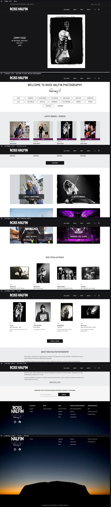
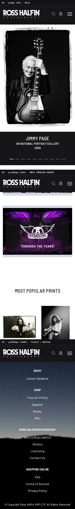

# UI Design System & Master Generation Blueprint: www-rosshalfin-com

> **Ross Halfin Photography · Music Images + Fine Art Prints** (https://www.rosshalfin.com) — Unparalleled music photography by Ross Halfin - Limited edition Fine-Art prints, signed & embossed. Worldwide shipping





---

## 1. Executive Visual Persona & Design Archetype

- **Brand Essence & Persona**: **Ross Halfin Photography · Music Images + Fine Art Prints** (`https://www.rosshalfin.com`). Unparalleled music photography by Ross Halfin - Limited edition Fine-Art prints, signed & embossed. Worldwide shipping
- **Capture Provenance**: Live browser capture (`tier1_fast`, HTTP `200`, captured `2026-11-24`).
- **Visual Archetype**: **High-Contrast Obsidian / Atmospheric Design System (`#161618` canvas, `#c1c5cb` ink, `#0073e6` accent)**.
- **Anti-AI-Slop Differentiators**:
  - **Live-Computed Chromatic Polarity**: Anchors the viewport in `#161618` (live computed `body` `background-color` (`computed_styles.json`)) paired with `#c1c5cb` primary typography and `#0073e6` accents.
  - **Grounded Typographic Hierarchy**: Pairs `Barlow Semi Condensed` for display copy (`Welcome To Ross Halfin Photography`) with `Barlow` and `SFMono-Regular`.
  - **Calibrated Spatial Grid & Motion**: Combines `1210px` container bounds (`gap: 2rem`, padding `10px`) with `cubic-bezier(.33,0,.2,1)` easing and Three.js / WebGL Canvas Pipeline, Swiper Touch Carousel Engine.

---

## 2. Spatial Architecture & Modular Grid Mathematics

### Viewport Allocation & Container Geometry
- **Captured Journey Filmstrips**: Desktop `1280×5796px` (`assets/desktop-journey.webp`, `7` keyframes up to `y=4828px` / doc `5728px`), Mobile `390×2616px` (`assets/mobile-journey.webp`, `3` keyframes).
- **Master Container Bounds**: `1210px` (non-`@media` desktop container stylesheet rule).
- **Canvas Lateral Padding & Spacing**: `10px` lateral canvas padding with `2rem` grid gap.
- **Border Radius Scale**: `.3rem`, `4px`, `.25rem`, `2px`.

### Responsive Breakpoint Architecture
- **Desktop Layout**: Multi-column CSS Grid / Flexbox layout at `1440px` (`max-width: 1210px`, `gap: 2rem`).
- **Mobile Layout**: Single-column vertical stack at `390px` viewport width with `10px` horizontal padding.
- **Extracted CSS Media Queries**: `@media (prefers-reduced-motion:reduce)`, `@media (min-width:993px)`, `@media only screen and (min-width:1070px)`, `@media (max-width:768px)`.

---

## 3. Color System, Materiality & Atmospheric Lighting

### Semantic Palette & Source Grounding
| Semantic Role | Ground-Truth Value | Extracted Live / CSS Source |
|---|---|---|
| **Primary Canvas Substrate** | `#161618` | live computed `body` `background-color` (`computed_styles.json`) |
| **Primary Typography Ink** | `#c1c5cb` | live computed `a` `color` (`computed_styles.json`) |
| **Elevated Surface / Card Substrate** | `#222222` | `.menu-toggle .bar { background-color: #222222 }` |
| **Interactive Accent / Highlight** | `#0073e6` | `var(--wc-stripe-accent-color)` in `:root` |
| **Secondary / Muted Copy** | `#333333` | `var(--cmplz_button_settings_text_color)` in `:root` |
| **Structural Hairline Border** | `#e6e6e6` | `var(--wc-stripe-saved-token-border-color)` in `:root` |
| **Variable Token (`--wp-block-synced-color`)** | `#7a00df` | `var(--wp-block-synced-color)` in `:root` |
| **Variable Token (`--wp-editor-canvas-background`)** | `#dddddd` | `var(--wp-editor-canvas-background)` in `:root` |
| **Variable Token (`--wp-admin-theme-color`)** | `#007cba` | `var(--wp-admin-theme-color)` in `:root` |
| **Variable Token (`--wp-admin-theme-color-darker-10`)** | `#006ba1` | `var(--wp-admin-theme-color-darker-10)` in `:root` |
| **Variable Token (`--wp-admin-theme-color-darker-20`)** | `#005a87` | `var(--wp-admin-theme-color-darker-20)` in `:root` |

### Sanitized Root CSS Variables (`ui-ux.md` Ground Truth)
| Variable Name | Extracted Value | Semantic Role |
|---|---|---|
| `--wp-block-synced-color` | `#7a00df` | Brand / Palette Token |
| `--wp-block-synced-color--rgb` | `122,0,223` | Brand / Palette Token |
| `--wp-bound-block-color` | `var(--wp-block-synced-color)` | Brand / Palette Token |
| `--wp-editor-canvas-background` | `#ddd` | Canvas / Surface Token |
| `--wp-admin-theme-color` | `#007cba` | Brand / Palette Token |
| `--wp-admin-theme-color--rgb` | `0,124,186` | Brand / Palette Token |
| `--wp-admin-theme-color-darker-10` | `#006ba1` | Canvas / Surface Token |
| `--wp-admin-theme-color-darker-10--rgb` | `0,107,160.5` | Canvas / Surface Token |
| `--wp-admin-theme-color-darker-20` | `#005a87` | Canvas / Surface Token |
| `--wp-admin-theme-color-darker-20--rgb` | `0,90,135` | Canvas / Surface Token |
| `--wp-admin-border-width-focus` | `2px` | Layout / Spatial Grid Token |
| `--wp-admin--admin-bar--position-offset` | `var(--wp-admin--admin-bar--height,0px)` | Dimension / Scale Token |
| `--wp--custom--line-height--none` | `1` | Typography / Scale Token |
| `--wp--custom--line-height--tight` | `1.1` | Typography / Scale Token |
| `--wp--custom--line-height--snug` | `1.2` | Typography / Scale Token |
| `--wp--custom--line-height--normal` | `1.5` | Typography / Scale Token |

---

## 4. Typographic Scale & Editorial Hierarchy

### Font Family Stacks
- **Display Typography**: `Barlow Semi Condensed`.
- **Primary Body Stack**: `Barlow`.
- **Technical / Metadata Stack**: `SFMono-Regular`.

### Typographic Scale & Rules (Live Computed & Stylesheet Grounded)
- **Hero Display (`H1`)**: rule `h1` (`font-size: 30px`, `letter-spacing: -.01em`).
- **Section Heading (`H2`)**: live computed `h2` (`font-size: 40px`, `line-height: 56px`, `font-weight: 500`, `letter-spacing: 1.2px`); rule `h2` (`font-size: clamp(1.375rem,.9939rem + 1.2...`, `letter-spacing: -.01em`).
- **Body Copy**: live computed `body` (`font-size: 14px`, `line-height: 19.6px`, `font-weight: 400`, `letter-spacing: 0.7px`); CSS variables `--wp--custom--line-height--body: 1.618`, `--cmplz_category_body_font_size: 12px`; rule `p` (`font-size: 12px`).
- **Metadata & Navigation Labels**: live computed `nav/a` (`font-size: 14px`, `line-height: 19.6px`, `font-weight: 400`, `letter-spacing: 0.7px`); rule `small` (`font-size: 11px`).

---

## 5. Choreographed Motion & Interaction Physics

### Primary Easing Curves
- **Extracted Timing Functions**: `cubic-bezier(.33,0,.2,1)`, `cubic-bezier(.28,.75,.22,.95)`, `cubic-bezier(.4,0,.2,1)`.

### Per-Element Transition & Choreography Rules
- **Selector `media (prefers-reduced-motion:red...`**: `transition: 0s!important` extracted from `www-rosshalfin-com` stylesheet.
- **Selector `input[type=submit]`**: `transition: .2s all` extracted from `www-rosshalfin-com` stylesheet.
- **Selector `.menu-toggle .bar`**: `transition: transform .15s ease-in 0s,margin .15s ease-in .2s,opacity 0s e...` extracted from `www-rosshalfin-com` stylesheet.
- **Extracted Easing Curve (`cubic-bezier(.33,0,.2,1)`)**: Governs interactive state transitions across `<header.site-header>` and `<section.home__sec__latest_news>`.
- **Runtime Interaction Engine**: Integrates Three.js / WebGL Canvas Pipeline, Swiper Touch Carousel Engine with `prefers-reduced-motion: reduce` fallback guards.
### Measured Runtime Scroll & Interaction Telemetry (`behavioral_journey_v2`)
- **Scroll Driver Mode**: `native` (max document height `5728px`, deepest scrollY reached `4828px` across `7` desktop keyframes).
- **Detected Scroll / Motion Libraries**: Native browser scroll / standard CSS transitions.
- **Interactive Control Probe (`tab` · `1 of 10`)**: Triggered visual diff `14.26` (attr ` -> true`, captured in `assets/state-interactive.webp`).
- **Route Transition Architecture**: First internal navigation (`/shop/travel/`) measured as `MPA` in `1905ms`.

---

## 6. Component Wireframe & Structural DOM Map

### Visual Layout Schematic — Desktop (`1440px`, Grounded in `dom.html` & Landmark Bounding Boxes)
```
┌────────────────────────────────────────────────────────────────────────┐
│ DESKTOP VIEWPORT (1440px) — Ross Halfin Photography · Music Images + F │
│ ====================================================================== │
│ [ <header.site-header> (234x50px)     | € 0.00 0                     ] │
│ ---------------------------------------------------------------------- │
│ | HERO STAGE: <section.pageSection> (w=1440px)                       | │
│ | H1: Welcome To Ross Halfin Photography                             | │
│ | Substrate: #161618 | Ink: #c1c5cb | Accent: #0073e6                | │
│ ---------------------------------------------------------------------- │
│ | SHOWCASE GRID (<section.home__sec__latest) max-w: 1210px           | │
│ | +------------------------------+  +------------------------------+ | │
│ | | No products in the basket.   |  | Functional Always active     | | │
│ | +------------------------------+  +------------------------------+ | │
│ ---------------------------------------------------------------------- │
│ | DETAIL MODULE (<section.home__sec__text>) — Required to enable co  | │
│ ---------------------------------------------------------------------- │
│ [ FOOTER (<footer.page-templat) | https://www.rosshalfin.com           │
└────────────────────────────────────────────────────────────────────────┘
```

### Visual Layout Schematic — Mobile Reflow (`390px`)
```
┌────────────────────────────────────────────────────────────────────────┐
│ MOBILE VIEWPORT REFLOW (390px) — Single-Column Stack (gap: 2rem)       │
│ ====================================================================== │
│ [ HEADER BAR (<header.site-header>    ) | Compact Menu (390px)         │
│ ---------------------------------------------------------------------- │
│ | HERO STAGE (<section.pageSection>) — 390px Vertical Lead           | │
│ | H1: Welcome To Ross Halfin Photography                             | │
│ ---------------------------------------------------------------------- │
│ | SHOWCASE STACK (<section.home__sec__la) — 1-Col Stack              | │
│ | [ Item 1: No products in the basket.                             ] | │
│ | [ Item 2: Functional Always active                               ] | │
│ ---------------------------------------------------------------------- │
│ | DETAIL STACK (<section.home__sec__text) — 1-Col (Required to enable) │
│ ---------------------------------------------------------------------- │
│ [ FOOTER (<footer.page-templat) | Stacked 390px Colophon               │
└────────────────────────────────────────────────────────────────────────┘
```

### Granular DOM Region Breakdown
1. **Brand Header & Navigation Bar (<header.site-header> — `www-rosshalfin-com`)**:
   - Landmark `<header class="site-header">` (`234x50px`) hosting `Ross Halfin Photography · Music Imag` navigation (`€ 0.00 0`), DOM attributes (`data-partner-attribution-id="PaymentPlugins_PCP"`, `data-uid-auto="uid_znuqasiucahxrfuik..."`, `data-wp-strategy="defer"`, `data-wp-strategy="defer"`), and stylesheet rule `before { box-sizing:border-box }`.
2. **Hero Stage & Focal Lead (<section.pageSection> — `Welcome To Ross Halfin Photography`)**:
   - Landmark `<section class="pageSection home__sec__hl">` presenting display lead `Welcome To Ross Halfin Photography` and copy excerpt *"No products in the basket."* over `#161618` canvas and `#c1c5cb` ink.
3. **Primary Showcase & Content Grid (<section.home__sec__latest_news> — `No products in the basket.`)**:
   - Landmark `<section class="pageSection home__sec__latest_news">` rendering section `No products in the basket.` with copy *"Functional Always active"*, asset references (`recaptcha__en.js`, `xmlrpc.php`, `banner-2-optin.css`, `banner-2-optout.css`), and grid rule `strong { font-weight:bolder }`.
4. **Interactive Detail & Feature Matrix (<section.home__sec__text> — `Functional Always active`)**:
   - Landmark `<section class="pageSection home__sec__text">` framing `Functional Always active` and `Required to enable core site functionality and s` (*"Required to enable core site functionality and services you reque"*) with `#222222` surface cards, `#0073e6` accents, and `samp { font-family:ui-monospace,SFMono-Regular,Consolas,'Liberation Mono',Menlo... }`.
5. **Colophon & Global Directory Footer (<footer.page-template-template-homepage> — `https://www.rosshalfin.com`)**:
   - Landmark `<footer class="page-template-template-homepage">` anchoring `Ross Halfin Photography · Music ` footer links (`€ 0.00 0`), copy *"Used to store your preferences, such as language or display "*, and `#e6e6e6` structural dividers.
### Full Vertical Scroll Sequence (Desktop `1440×900` Keyframes)
- **Step 01** (`y=0px`, `0%`): Active landmark `Hero` · sticky/fixed elements: `2`
- **Step 02** (`y=850px`, `18%`): Active landmark `WELCOME TO ROSS HALFIN PHOTOGRAPHY` · sticky/fixed elements: `2`
- **Step 03** (`y=1700px`, `35%`): Active landmark `Section @ 35%` · sticky/fixed elements: `2`
- **Step 04** (`y=2550px`, `53%`): Active landmark `MOST POPULAR PRINTS` · sticky/fixed elements: `2`
- **Step 05** (`y=3400px`, `70%`): Active landmark `AC/DC` · sticky/fixed elements: `2`
- **Step 06** (`y=4250px`, `88%`): Active landmark `Section @ 88%` · sticky/fixed elements: `2`
- **Step 07** (`y=4828px`, `100%`): Active landmark `Footer / Bottom` · sticky/fixed elements: `1`

### Multi-Page Internal Route Map
- **Detail Route (`/shop/travel/`)**: `https://www.rosshalfin.com/shop/travel/` — H1: `NATIONAL PORTRAIT GALLERY`, scrollHeight `5879px`, transition `MPA` (`1905ms`)
- **About Route (`/about/`)**: `https://www.rosshalfin.com/about/` — H1: `MR ROSS HALFIN,`, scrollHeight `2751px`, transition `direct` (`2268ms`)
- **Detail Route (`/shop/prints/`)**: `https://www.rosshalfin.com/shop/prints/` — H1: `FINE ART PRINTS`, scrollHeight `6431px`, transition `direct` (`2487ms`)

---

## 7. Master Zero-Shot AI Generation Prompt

```markdown
# Master Zero-Shot Frontend Generation Prompt: www-rosshalfin-com (Ross Halfin Photography · Music Images + Fine Art Prints)

You are a principal frontend architect and design systems engineer. Build a complete, production-ready web application replicating the exact design system, DOM landmarks, typographic hierarchy, color tokens, and motion physics of `www-rosshalfin-com` (**Ross Halfin Photography · Music Images + Fine Art Prints** — `https://www.rosshalfin.com`).

### 1. Visual Archetype & Anti-AI-Slop Mandates
- **Archetype**: High-Contrast Obsidian / Atmospheric Design System (`#161618` canvas, `#c1c5cb` ink, `#0073e6` accent).
- **Identity & Domain Context**: Unparalleled music photography by Ross Halfin - Limited edition Fine-Art prints, signed & embossed. Worldwide shipping
- **Primary Substrate**: `#161618` (live computed `body` `background-color` (`computed_styles.json`)), **Primary Ink**: `#c1c5cb`, **Accent / Highlight**: `#0073e6`.
- **Site-Specific Differentiators**:
  - **Live-Computed Chromatic Polarity**: Anchors the viewport in `#161618` (live computed `body` `background-color` (`computed_styles.json`)) paired with `#c1c5cb` primary typography and `#0073e6` accents.
  - **Grounded Typographic Hierarchy**: Pairs `Barlow Semi Condensed` for display copy (`Welcome To Ross Halfin Photography`) with `Barlow` and `SFMono-Regular`.
  - **Calibrated Spatial Grid & Motion**: Combines `1210px` container bounds (`gap: 2rem`, padding `10px`) with `cubic-bezier(.33,0,.2,1)` easing and Three.js / WebGL Canvas Pipeline, Swiper Touch Carousel Engine.

### 2. Ground-Truth CSS Variables (`:root` Token Contract)
Declare and consume these exact custom properties extracted from `www-rosshalfin-com` in your global stylesheet:

:root {
  /* Ross Halfin Photography · Music Images + Fine Art Prints (www-rosshalfin-com) — Live-Grounded CSS Variables */
  --wp-block-synced-color: #7a00df; /* Brand / Palette Token (www-rosshalfin-com) */
  --wp-block-synced-color--rgb: 122,0,223; /* Brand / Palette Token (www-rosshalfin-com) */
  --wp-bound-block-color: var(--wp-block-synced-color); /* Brand / Palette Token (www-rosshalfin-com) */
  --wp-editor-canvas-background: #ddd; /* Canvas / Surface Token (www-rosshalfin-com) */
  --wp-admin-theme-color: #007cba; /* Brand / Palette Token (www-rosshalfin-com) */
  --wp-admin-theme-color--rgb: 0,124,186; /* Brand / Palette Token (www-rosshalfin-com) */
  --wp-admin-theme-color-darker-10: #006ba1; /* Canvas / Surface Token (www-rosshalfin-com) */
  --wp-admin-theme-color-darker-10--rgb: 0,107,160.5; /* Canvas / Surface Token (www-rosshalfin-com) */
  --wp-admin-theme-color-darker-20: #005a87; /* Canvas / Surface Token (www-rosshalfin-com) */
  --wp-admin-theme-color-darker-20--rgb: 0,90,135; /* Canvas / Surface Token (www-rosshalfin-com) */
  --wp-admin-border-width-focus: 2px; /* Layout / Spatial Grid Token (www-rosshalfin-com) */
  --wp-admin--admin-bar--position-offset: var(--wp-admin--admin-bar--height,0px); /* Dimension / Scale Token (www-rosshalfin-com) */
  --wp--custom--line-height--none: 1; /* Typography / Scale Token (www-rosshalfin-com) */
  --wp--custom--line-height--tight: 1.1; /* Typography / Scale Token (www-rosshalfin-com) */
  --wp--custom--line-height--snug: 1.2; /* Typography / Scale Token (www-rosshalfin-com) */
  --wp--custom--line-height--normal: 1.5; /* Typography / Scale Token (www-rosshalfin-com) */
}

### 3. Semantic Color & Materiality Contract
Map every surface, ink, and border strictly to these source-grounded tokens:
- **Primary Canvas Substrate**: `#161618` — grounded in live computed `body` `background-color` (`computed_styles.json`)
- **Primary Typography Ink**: `#c1c5cb` — grounded in live computed `a` `color` (`computed_styles.json`)
- **Elevated Surface / Card Substrate**: `#222222` — grounded in `.menu-toggle .bar { background-color: #222222 }`
- **Interactive Accent / Highlight**: `#0073e6` — grounded in `var(--wc-stripe-accent-color)` in `:root`
- **Secondary / Muted Copy**: `#333333` — grounded in `var(--cmplz_button_settings_text_color)` in `:root`
- **Structural Hairline Border**: `#e6e6e6` — grounded in `var(--wc-stripe-saved-token-border-color)` in `:root`
- **Variable Token (`--wp-block-synced-color`)**: `#7a00df` — grounded in `var(--wp-block-synced-color)` in `:root`
- **Variable Token (`--wp-editor-canvas-background`)**: `#dddddd` — grounded in `var(--wp-editor-canvas-background)` in `:root`
- **Variable Token (`--wp-admin-theme-color`)**: `#007cba` — grounded in `var(--wp-admin-theme-color)` in `:root`
- **Variable Token (`--wp-admin-theme-color-darker-10`)**: `#006ba1` — grounded in `var(--wp-admin-theme-color-darker-10)` in `:root`
- **Variable Token (`--wp-admin-theme-color-darker-20`)**: `#005a87` — grounded in `var(--wp-admin-theme-color-darker-20)` in `:root`

### 4. Spatial Grid, Container Bounds & Responsive Breakpoints
- **Desktop Viewport Reference**: `1280×5796px` (multi-frame vertical journey filmstrip (5796px), `1440px` standard desktop width).
- **Mobile Viewport Reference**: `390×2616px` (multi-frame vertical journey filmstrip (2616px), `390px` standard mobile width).
- **Container Max-Width**: `1210px` (non-`@media` desktop container stylesheet rule)
- **Padding & Gutters**: `10px` lateral canvas padding with `2rem` grid gap
- **Desktop Grid**: Multi-column CSS Grid / Flexbox layout at `1440px` (`max-width: 1210px`, `gap: 2rem`)
- **Mobile Adaptation**: Single-column vertical stack at `390px` viewport width with `10px` horizontal padding
- **Media Queries**: `@media (prefers-reduced-motion:reduce)`, `@media (min-width:993px)`, `@media only screen and (min-width:1070px)`, `@media (max-width:768px)`
- **Corner Radii**: `.3rem`, `4px`, `.25rem`, `2px`

### 5. Typography & Editorial Scale Contract
- **Display Font Stack**: `Barlow Semi Condensed`
- **Body Font Stack**: `Barlow`
- **Monospace / Technical Font Stack**: `SFMono-Regular`
- **H1 Display Rule**: rule `h1` (`font-size: 30px`, `letter-spacing: -.01em`)
- **H2 Section Rule**: live computed `h2` (`font-size: 40px`, `line-height: 56px`, `font-weight: 500`, `letter-spacing: 1.2px`); rule `h2` (`font-size: clamp(1.375rem,.9939rem + 1.2...`, `letter-spacing: -.01em`)
- **Body Copy Rule**: live computed `body` (`font-size: 14px`, `line-height: 19.6px`, `font-weight: 400`, `letter-spacing: 0.7px`); CSS variables `--wp--custom--line-height--body: 1.618`, `--cmplz_category_body_font_size: 12px`; rule `p` (`font-size: 12px`)
- **Metadata & Index Rule**: live computed `nav/a` (`font-size: 14px`, `line-height: 19.6px`, `font-weight: 400`, `letter-spacing: 0.7px`); rule `small` (`font-size: 11px`)

### 6. Component Hierarchy, Verbatim Copy & Real DOM Landmarks
Scaffold `www-rosshalfin-com` (`Ross Halfin Photography · Music Images + Fine Art Prints`) with these exact structural regions, extracted copy, and CSS rules from `dom.html`:
1. **Brand Header & Navigation Bar (<header.site-header> — `www-rosshalfin-com`)**:
   - DOM & Selectors: Landmark `<header class="site-header">` (`234x50px`) hosting `Ross Halfin Photography · Music Imag` navigation (`€ 0.00 0`), DOM attributes (`data-partner-attribution-id="PaymentPlugins_PCP"`, `data-uid-auto="uid_znuqasiucahxrfuik..."`, `data-wp-strategy="defer"`, `data-wp-strategy="defer"`), and stylesheet rule `before { box-sizing:border-box }`.
   - Responsive Contract: Header `Brand Header & Navigation Bar (<header.site-header> — `www-rosshalfin-com`)` (`www-rosshalfin-com`) adapts across `@media (prefers-reduced-motion:reduce)`, `@media (min-width:993px)`, `@media only screen and (min-width:1070px)`, `@media (max-width:768px)` with `cubic-bezier(.33,0,.2,1)`, `cubic-bezier(.28,.75,.22,.95)`, `cubic-bezier(.4,0,.2,1)` transitions and links `€ 0.00 0`.
2. **Hero Stage & Focal Lead (<section.pageSection> — `Welcome To Ross Halfin Photography`)**:
   - DOM & Selectors: Landmark `<section class="pageSection home__sec__hl">` presenting display lead `Welcome To Ross Halfin Photography` and copy excerpt *"No products in the basket."* over `#161618` canvas and `#c1c5cb` ink.
   - Responsive Contract: Hero stage (`1280×5796px` desktop / `390×2616px` mobile) sets `#161618` background with `#c1c5cb` headline `Welcome To Ross Halfin Photography`.
3. **Primary Showcase & Content Grid (<section.home__sec__latest_news> — `No products in the basket.`)**:
   - DOM & Selectors: Landmark `<section class="pageSection home__sec__latest_news">` rendering section `No products in the basket.` with copy *"Functional Always active"*, asset references (`recaptcha__en.js`, `xmlrpc.php`, `banner-2-optin.css`, `banner-2-optout.css`), and grid rule `strong { font-weight:bolder }`.
   - Responsive Contract: Showcase grid `Primary Showcase & Content Grid (<section.home__sec__latest_news> — `No products in the basket.`)` applies Multi-column CSS Grid / Flexbox layout at `1440px` (`max-width: 1210px`, `gap: 2rem`) on desktop and Single-column vertical stack at `390px` viewport width with `10px` horizontal padding on mobile.
4. **Interactive Detail & Feature Matrix (<section.home__sec__text> — `Functional Always active`)**:
   - DOM & Selectors: Landmark `<section class="pageSection home__sec__text">` framing `Functional Always active` and `Required to enable core site functionality and s` (*"Required to enable core site functionality and services you reque"*) with `#222222` surface cards, `#0073e6` accents, and `samp { font-family:ui-monospace,SFMono-Regular,Consolas,'Liberation Mono',Menlo... }`.
   - Responsive Contract: Detail module `Interactive Detail & Feature Matrix (<section.home__sec__text> — `Functional Always active`)` uses `.3rem`, `4px`, `.25rem`, `2px` radii, `#0073e6` highlights, and assets (recaptcha__en.js, xmlrpc.php, banner-2-optin.css).
5. **Colophon & Global Directory Footer (<footer.page-template-template-homepage> — `https://www.rosshalfin.com`)**:
   - DOM & Selectors: Landmark `<footer class="page-template-template-homepage">` anchoring `Ross Halfin Photography · Music ` footer links (`€ 0.00 0`), copy *"Used to store your preferences, such as language or display "*, and `#e6e6e6` structural dividers.
   - Responsive Contract: Footer `Colophon & Global Directory Footer (<footer.page-template-template-homepage> — `https://www.rosshalfin.com`)` aligns to `1210px` (non-`@media` desktop container stylesheet rule) with `10px` lateral canvas padding with `2rem` grid gap and attributes (data-partner-attribution-id="PaymentPlugins_PCP", data-uid-auto="uid_znuqasiucahxrfuik...", data-wp-strategy="defer").

#### Verbatim DOM Copy Excerpts (`dom.html`)
- Copy Excerpt 1: *"No products in the basket."*
- Copy Excerpt 2: *"Functional Always active"*
- Copy Excerpt 3: *"Required to enable core site functionality and services you request."*
- Copy Excerpt 4: *"Used to store your preferences, such as language or display settings."*

### 7. Motion, Extracted Stylesheet Rules & Interaction Choreography
- **Primary Easing Functions**: `cubic-bezier(.33,0,.2,1)`, `cubic-bezier(.28,.75,.22,.95)`, `cubic-bezier(.4,0,.2,1)`
- **Extracted Stylesheet Rules (`www-rosshalfin-com`)**:
- `before { box-sizing:border-box }`
- `strong { font-weight:bolder }`
- `samp { font-family:ui-monospace,SFMono-Regular,Consolas,'Liberation Mono',Menlo... }`
- `small { font-size:80% }`
- `sup { font-size:75%;line-height:0;position:relative;vertical-align:baseline }`
- **Per-Selector Transition Rules**:
- **Selector `media (prefers-reduced-motion:red...`**: `transition: 0s!important` extracted from `www-rosshalfin-com` stylesheet.
- **Selector `input[type=submit]`**: `transition: .2s all` extracted from `www-rosshalfin-com` stylesheet.
- **Selector `.menu-toggle .bar`**: `transition: transform .15s ease-in 0s,margin .15s ease-in .2s,opacity 0s e...` extracted from `www-rosshalfin-com` stylesheet.
- **Extracted Easing Curve (`cubic-bezier(.33,0,.2,1)`)**: Governs interactive state transitions across `<header.site-header>` and `<section.home__sec__latest_news>`.
- **Runtime Interaction Engine**: Integrates Three.js / WebGL Canvas Pipeline, Swiper Touch Carousel Engine with `prefers-reduced-motion: reduce` fallback guards.
### 7b. Full-Page Scroll Choreography, Interactive States & Multi-Page Routes
- **Scroll Mechanics**: Implement `native` vertical progression up to `5728px` across 7 distinct viewport chapters.
- **Vertical Chapter Sequence**: Hero (0%) -> WELCOME TO ROSS HALFIN PHOT... (18%) -> Section @ 35% (35%) -> MOST POPULAR PRINTS (53%) -> AC/DC (70%) -> Section @ 88% (88%) -> Footer / Bottom (100%).
- **Multi-Page Routes**: Scaffold internal routes `/shop/travel/` (detail, MPA), `/about/` (about, direct), `/shop/prints/` (detail, direct) sharing the global header/footer shell and design tokens.

### 8. Technical Deliverables
- Implement in Next.js (App Router) with TypeScript and Tailwind CSS consuming the `:root` custom properties defined above for `www-rosshalfin-com`.
- Reproduce both the `1440px` desktop architecture and `390px` mobile breakpoint transitions, preserving semantic HTML5 landmarks (`<header>`, `<nav>`, `<main>`, `<section>`, `<footer>`) and `prefers-reduced-motion` accessibility guards.
```
---

## 8. Full-Page Scroll Journey, Interactive States & Subpage Inventory

### Desktop Scroll Keyframes (`1440×900` WebP)
| Step | Scroll Y | Progress | Active Landmark / Section | Sticky/Fixed | Visual Asset |
| :---: | :---: | :---: | :--- | :---: | :--- |
| `#01` | `0px` | `0%` | Hero | `2` | [desktop-step-01.webp](assets/desktop-step-01.webp) |
| `#02` | `850px` | `18%` | WELCOME TO ROSS HALFIN PHOTOGRAPHY | `2` | [desktop-step-02.webp](assets/desktop-step-02.webp) |
| `#03` | `1700px` | `35%` | Section @ 35% | `2` | [desktop-step-03.webp](assets/desktop-step-03.webp) |
| `#04` | `2550px` | `53%` | MOST POPULAR PRINTS | `2` | [desktop-step-04.webp](assets/desktop-step-04.webp) |
| `#05` | `3400px` | `70%` | AC/DC | `2` | [desktop-step-05.webp](assets/desktop-step-05.webp) |
| `#06` | `4250px` | `88%` | Section @ 88% | `2` | [desktop-step-06.webp](assets/desktop-step-06.webp) |
| `#07` | `4828px` | `100%` | Footer / Bottom | `1` | [desktop-step-07.webp](assets/desktop-step-07.webp) |

### Mobile Condensed Keyframes (`390×844` WebP)
| Step | Scroll Y | Progress | Active Landmark | Visual Asset |
| :---: | :---: | :---: | :--- | :--- |
| `#01` | `0px` | `0%` | Hero | [mobile-step-01.webp](assets/mobile-step-01.webp) |
| `#02` | `3481px` | `50%` | MOST POPULAR PRINTS | [mobile-step-02.webp](assets/mobile-step-02.webp) |
| `#03` | `6963px` | `100%` | Footer / Bottom | [mobile-step-03.webp](assets/mobile-step-03.webp) |

### Interactive UI State Captures (`1440×900` WebP)
| State Type | Trigger / Observation | Visual Asset |
| :--- | :--- | :--- |
| `interactive_control` | Control `tab` (`1 of 10`, diff `14.26`) | [state-interactive.webp](assets/state-interactive.webp) |

### Internal Subpage Filmstrips (`1080px` Wide WebP)
| # | Template | Route URL | H1 / Title | Scroll Height | Transition | Filmstrip Asset |
| :-: | :---: | :--- | :--- | :---: | :---: | :--- |
| `1` | `detail` | `https://www.rosshalfin.com/shop/travel/` | NATIONAL PORTRAIT GALLERY | `5879px` | `MPA` (`1905ms`) | [subpage-01-shop-travel.webp](assets/subpage-01-shop-travel.webp) |
| `2` | `about` | `https://www.rosshalfin.com/about/` | MR ROSS HALFIN, | `2751px` | `direct` (`2268ms`) | [subpage-02-about.webp](assets/subpage-02-about.webp) |
| `3` | `detail` | `https://www.rosshalfin.com/shop/prints/` | FINE ART PRINTS | `6431px` | `direct` (`2487ms`) | [subpage-03-shop-prints.webp](assets/subpage-03-shop-prints.webp) |

