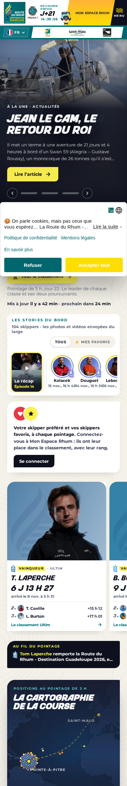

# UI Design System & Master Generation Blueprint: www-routedurhum-com

> **Route du Rhum 2026 – Destination Guadeloupe · Site Officiel** (https://www.routedurhum.com/) — Suivez la Route du Rhum, course légendaire entre Saint-Malo et la Guadeloupe. Skippers, actualités, villages de Saint-Malo à la Guadeloupe.


---

## 1. Executive Visual Persona & Design Archetype

- **Brand Essence & Persona**: **Route du Rhum 2026 – Destination Guadeloupe · Site Officiel** (`https://www.routedurhum.com/`). Suivez la Route du Rhum, course légendaire entre Saint-Malo et la Guadeloupe. Skippers, actualités, villages de Saint-Malo à la Guadeloupe.
- **Visual Archetype**: **Light-Substrate Editorial & Modular Grid System (`#fff` canvas, `#0E111D` ink, `#006F7B` accent)**.
- **Anti-AI-Slop Differentiators**:
  - **Source-Grounded Chromatic Polarity**: Anchors the viewport in `#fff` (`var(--sqb)` in `:root`) paired with `#0E111D` primary typography and `#006F7B` accents.
  - **Extracted Typographic Hierarchy**: Pairs `Varien` for display copy (`Route du Rhum, Destination Guadeloup`) with `wf_1e5b9ef92f5440db968e5ef2f` and not declared in static CSS (uses primary stack / `ui-monospace`).
  - **Calibrated Spatial Grid & Motion**: Combines `9999px` container bounds (`gap: 8px`, padding `12px`) with `cubic-bezier(.83,0,.17,1)` easing and Swiper Touch Carousel Engine, Lottie Vector Animation Player.

---

## 2. Spatial Architecture & Modular Grid Mathematics



### Viewport Allocation & Container Geometry
- **Captured Viewport Dimensions**: Desktop `1440×11359px` (`assets/desktop.png`, full-page scroll capture), Mobile `390×2400px` (`assets/mobile.png`, capped at 2400px multi-section capture).
- **Master Container Bounds**: `9999px` extracted from `www-routedurhum-com` stylesheet.
- **Canvas Lateral Padding & Spacing**: `12px` lateral canvas padding with `8px` grid gap.
- **Border Radius Scale**: `var(--corvid-border-radius)`, `24px`, `var(--overflow-wrapper-border-radius)`, `50%`.

### Responsive Breakpoint Architecture
- **Desktop Layout**: Multi-column CSS Grid / Flexbox layout at `1440px` (`max-width: 9999px`, `gap: 8px`).
- **Mobile Layout**: Single-column vertical stack at `390px` viewport width with `12px` horizontal padding.
- **Extracted CSS Media Queries**: `@media (prefers-reduced-motion:reduce)`, `@media (min-width:1025px)`, `@media (max-width:750px)`, `@media (max-width:760px)`.

---

## 3. Color System, Materiality & Atmospheric Lighting

### Semantic Palette & Source Grounding
| Semantic Role | Ground-Truth Value | Extracted CSS Source / Selector |
|---|---|---|
| **Primary Canvas Substrate** | `#fff` | `var(--sqb)` in `:root` |
| **Primary Typography Ink** | `#0A1228` | `var(--sqf)` in `:root` |
| **Elevated Surface / Card Substrate** | `#ED1566` | `var(--stroke)` in `:root` |
| **Interactive Accent / Highlight** | `#006F7B` | `var(--fill)` in `:root` |
| **Secondary / Muted Copy** | `#0E111D` | `var(--marine)` in `:root` |
| **Structural Hairline Border** | `#16355D` | `var(--marine2)` in `:root` |

### Sanitized Root CSS Variables (`ui-ux.md` Ground Truth)
| Variable Name | Extracted Value | Semantic Role |
|---|---|---|
| `--scrollbar-width` | `0px` | Layout / Spatial Grid Token |
| `--one-unit` | `1vw` | Dimension / Scale Token |
| `--section-max-width` | `9999px` | Layout / Spatial Grid Token |
| `--spx-stopper-max` | `9999px` | Dimension / Scale Token |
| `--spx-stopper-min` | `0px` | Dimension / Scale Token |
| `--browser-zoom` | `1` | Design System Custom Token |
| `--safari-sticky-fix` | `opacity` | Design System Custom Token |
| `--experimental-safari-sticky-fix` | `translateZ(0)` | Design System Custom Token |
| `--wst-button-color-fill-primary` | `rgb(var(--color_48))` | Brand / Palette Token |
| `--wst-button-color-border-primary` | `rgb(var(--color_49))` | Brand / Palette Token |
| `--wst-button-color-text-primary` | `rgb(var(--color_50))` | Typography Ink Token |
| `--wst-button-color-fill-primary-hover` | `rgb(var(--color_51))` | Brand / Palette Token |
| `--wst-button-color-border-primary-hover` | `rgb(var(--color_52))` | Brand / Palette Token |
| `--wst-button-color-text-primary-hover` | `rgb(var(--color_53))` | Typography Ink Token |
| `--wst-button-color-fill-primary-disabled` | `rgb(var(--color_54))` | Brand / Palette Token |
| `--wst-button-color-border-primary-disabled` | `rgb(var(--color_55))` | Brand / Palette Token |

---

## 4. Typographic Scale & Editorial Hierarchy

### Font Family Stacks
- **Display Typography**: `Varien`.
- **Primary Body Stack**: `wf_1e5b9ef92f5440db968e5ef2f`.
- **Technical / Metadata Stack**: not declared in static CSS (uses primary stack / `ui-monospace`).

### Typographic Scale & Rules (Extracted from Stylesheet & Variables)
- **Hero Display (`H1`)**: CSS variables `--display: inline-block`, `--comp-display: unset`, `--container-display: grid`.
- **Section Heading (`H2`)**: CSS variables `--wst-color-subtitle: rgb(var(--color_46))`, `--wst-font-style-h2: var(--font_2)`, `--item-depth2-direction: inherit`; rule `h2` (`font-size: clamp(34px,min(4.6vw,7.4vh),7...`, `line-height: 1.1`).
- **Body Copy**: CSS variables `--wst-font-style-body-large: var(--font_7)`, `--wst-font-style-body-medium: var(--font_8)`, `--wst-font-style-body-small: var(--font_9)`; rule `p` (`font-size: 13px`, `line-height: 1.5`).
- **Metadata & Navigation Labels**: CSS variables `--wst-font-style-body-small: var(--font_9)`, `--wst-font-style-body-x-small: var(--font_10)`; rule `small` (`letter-spacing: 0`).

---

## 5. Choreographed Motion & Interaction Physics

### Primary Easing Curves
- **Extracted Timing Functions**: `cubic-bezier(.83,0,.17,1)`, `cubic-bezier(.22,1,.36,1)`, `cubic-bezier(.64,0,.78,0)`.

### Per-Element Transition & Choreography Rules
- **Selector `id^=oldHoverBox-]`**: `transition: opacity .5s,visibility .5s` extracted from `www-routedurhum-com` stylesheet.
- **Selector `access-widget-ui::part(acsb-trigger)`**: `transition: width .2s cubic-bezier(.83,0,.17,1) !important` extracted from `www-routedurhum-com` stylesheet.
- **Selector `media (prefers-reduced-motion:red...`**: `transition: none !important` extracted from `www-routedurhum-com` stylesheet.
- **Extracted Easing Curve (`cubic-bezier(.83,0,.17,1)`)**: Governs interactive state transitions across `<header.gt>` and `<section.ke5pl1>`.
- **Runtime Interaction Engine**: Integrates Swiper Touch Carousel Engine, Lottie Vector Animation Player with `prefers-reduced-motion: reduce` fallback guards.

---

## 6. Component Wireframe & Structural DOM Map

### Visual Layout Schematic (Grounded in `dom.html` — `1440px` Desktop & `390px` Mobile Reflow)
```
┌────────────────────────────────────────────────────────────────────────┐
│ DESKTOP VIEWPORT (1440px) — Route du Rhum 2026 – Destination Guadeloup │
│ ====================================================================== │
│ [ <header.gt>              | Cartographie Carto · Classement        ]  │
│ ---------------------------------------------------------------------- │
│ | HERO STAGE: <section.Lnr3dj>                                     |   │
│ | H1: Route du Rhum, Destination Guadeloupe                        |   │
│ | Substrate: #fff       | Ink: #0E111D    | Accent: #006F7B        |   │
│ ---------------------------------------------------------------------- │
│ | SHOWCASE GRID (<section.ke5pl1>          ) max-w: 9999px         |   │
│ | +------------------------------+  +------------------------------+ | │
│ | | Saint-Malo est en fête !     |  | Achille Nebout : « c’est rag | | │
│ | +------------------------------+  +------------------------------+ | │
│ ---------------------------------------------------------------------- │
│ | MOBILE VIEWPORT REFLOW (390px) — Single-Column Stack (gap: 8px   ) | │
│ | [<header.gt>] -> [<section.Lnr3dj>] -> [<section.ke5pl1>] |          │
│ ---------------------------------------------------------------------- │
│ [ FOOTER (<footer.comp-mmxzg4ms>) | https://www.routedurhum.com/       │
└────────────────────────────────────────────────────────────────────────┘
```

### Granular DOM Region Breakdown
1. **Brand Header & Navigation Bar (<header.gt> — `www-routedurhum-com`)**:
   - Landmark `<header class="gt est-pause">` hosting `Route du Rhum 2026 – Destination Gua` navigation (`Cartographie Carto · Classement`), DOM attributes (`data-rdr-entete="dessus"`, `data-url="https://static.parast..."`, `data-url="https://static.parast..."`, `data-url="https://static.parast..."`), and stylesheet rule `root:active-view-transition { view-transition-name:none }`.
2. **Hero Stage & Focal Lead (<section.Lnr3dj> — `Route du Rhum, Destination Guadelo`)**:
   - Landmark `<section class="Lnr3dj comp-muf9fz41_r_comp-mucghtyv">` presenting display lead `Route du Rhum, Destination Guadeloupe` and copy excerpt *"Boutique officielle (nouvel onglet)"* over `#fff` canvas and `#0E111D` ink.
3. **Primary Showcase & Content Grid (<section.ke5pl1> — `Saint-Malo est en fête !`)**:
   - Landmark `<section class="ke5pl1 comp-muf996vx">` rendering section `Saint-Malo est en fête !` with copy *"Boutique officielle"*, asset references (`7bb303_9e59bb8f77444a2fbb905831b5...`, `bundle.tracing.es5.min.js`, `minified.js`, `focus-within-polyfill.js`), and grid rule `root::view-transition { pointer-events:none }`.
4. **Interactive Detail & Feature Matrix (<section.em> — `Achille Nebout : « c’est rageant m`)**:
   - Landmark `<section class="em">` framing `Achille Nebout : « c’est rageant mais c’est le je...` and `Chasseurs, chassés, qui aura le dernier mot ?` (*"Jeu officiel (nouvel onglet)"*) with `#ED1566` surface cards, `#006F7B` accents, and `SITE_HEADER { view-transition-name:header-group }`.
5. **Colophon & Global Directory Footer (<footer.comp-mmxzg4ms> — `https://www.routedurhum.com/`)**:
   - Landmark `<footer class="comp-mmxzg4ms S829f_">` anchoring `Route du Rhum 2026 – Destination` footer links (`Cartographie Carto · Classement`), copy *"En course depuis J+13 05 : 14 : 38"*, and `#16355D` structural dividers.

---

## 7. Master Zero-Shot AI Generation Prompt

```markdown
# Master Zero-Shot Frontend Generation Prompt: www-routedurhum-com (Route du Rhum 2026 – Destination Guadeloupe · Site Officiel)

You are a principal frontend architect and design systems engineer. Build a complete, production-ready web application replicating the exact design system, DOM landmarks, typographic hierarchy, color tokens, and motion physics of `www-routedurhum-com` (**Route du Rhum 2026 – Destination Guadeloupe · Site Officiel** — `https://www.routedurhum.com/`).

### 1. Visual Archetype & Anti-AI-Slop Mandates
- **Archetype**: Light-Substrate Editorial & Modular Grid System (`#fff` canvas, `#0E111D` ink, `#006F7B` accent).
- **Identity & Domain Context**: Suivez la Route du Rhum, course légendaire entre Saint-Malo et la Guadeloupe. Skippers, actualités, villages de Saint-Malo à la Guadeloupe.
- **Primary Substrate**: `#fff` (`var(--sqb)` in `:root`), **Primary Ink**: `#0E111D`, **Accent / Highlight**: `#006F7B`.
- **Site-Specific Differentiators**:
  - **Source-Grounded Chromatic Polarity**: Anchors the viewport in `#fff` (`var(--sqb)` in `:root`) paired with `#0E111D` primary typography and `#006F7B` accents.
  - **Extracted Typographic Hierarchy**: Pairs `Varien` for display copy (`Route du Rhum, Destination Guadeloup`) with `wf_1e5b9ef92f5440db968e5ef2f` and not declared in static CSS (uses primary stack / `ui-monospace`).
  - **Calibrated Spatial Grid & Motion**: Combines `9999px` container bounds (`gap: 8px`, padding `12px`) with `cubic-bezier(.83,0,.17,1)` easing and Swiper Touch Carousel Engine, Lottie Vector Animation Player.

### 2. Ground-Truth CSS Variables (`:root` Token Contract)
Declare and consume these exact custom properties extracted from `www-routedurhum-com` in your global stylesheet:

:root {
  /* Route du Rhum 2026 – Destination Guadeloupe · Site Officiel (www-routedurhum-com) — Ground-Truth Extracted CSS Variables */
  --scrollbar-width: 0px; /* Layout / Spatial Grid Token (www-routedurhum-com) */
  --one-unit: 1vw; /* Dimension / Scale Token (www-routedurhum-com) */
  --section-max-width: 9999px; /* Layout / Spatial Grid Token (www-routedurhum-com) */
  --spx-stopper-max: 9999px; /* Dimension / Scale Token (www-routedurhum-com) */
  --spx-stopper-min: 0px; /* Dimension / Scale Token (www-routedurhum-com) */
  --browser-zoom: 1; /* Design System Custom Token (www-routedurhum-com) */
  --safari-sticky-fix: opacity; /* Design System Custom Token (www-routedurhum-com) */
  --experimental-safari-sticky-fix: translateZ(0); /* Design System Custom Token (www-routedurhum-com) */
  --wst-button-color-fill-primary: rgb(var(--color_48)); /* Brand / Palette Token (www-routedurhum-com) */
  --wst-button-color-border-primary: rgb(var(--color_49)); /* Brand / Palette Token (www-routedurhum-com) */
  --wst-button-color-text-primary: rgb(var(--color_50)); /* Typography Ink Token (www-routedurhum-com) */
  --wst-button-color-fill-primary-hover: rgb(var(--color_51)); /* Brand / Palette Token (www-routedurhum-com) */
  --wst-button-color-border-primary-hover: rgb(var(--color_52)); /* Brand / Palette Token (www-routedurhum-com) */
  --wst-button-color-text-primary-hover: rgb(var(--color_53)); /* Typography Ink Token (www-routedurhum-com) */
  --wst-button-color-fill-primary-disabled: rgb(var(--color_54)); /* Brand / Palette Token (www-routedurhum-com) */
  --wst-button-color-border-primary-disabled: rgb(var(--color_55)); /* Brand / Palette Token (www-routedurhum-com) */
}

### 3. Semantic Color & Materiality Contract
Map every surface, ink, and border strictly to these source-grounded tokens:
- **Primary Canvas Substrate**: `#fff` — grounded in `var(--sqb)` in `:root`
- **Primary Typography Ink**: `#0A1228` — grounded in `var(--sqf)` in `:root`
- **Elevated Surface / Card Substrate**: `#ED1566` — grounded in `var(--stroke)` in `:root`
- **Interactive Accent / Highlight**: `#006F7B` — grounded in `var(--fill)` in `:root`
- **Secondary / Muted Copy**: `#0E111D` — grounded in `var(--marine)` in `:root`
- **Structural Hairline Border**: `#16355D` — grounded in `var(--marine2)` in `:root`

### 4. Spatial Grid, Container Bounds & Responsive Breakpoints
- **Desktop Viewport Reference**: `1440×11359px` (full-page scroll capture, `1440px` standard desktop width).
- **Mobile Viewport Reference**: `390×2400px` (capped at 2400px multi-section capture, `390px` standard mobile width).
- **Container Max-Width**: `9999px` extracted from `www-routedurhum-com` stylesheet
- **Padding & Gutters**: `12px` lateral canvas padding with `8px` grid gap
- **Desktop Grid**: Multi-column CSS Grid / Flexbox layout at `1440px` (`max-width: 9999px`, `gap: 8px`)
- **Mobile Adaptation**: Single-column vertical stack at `390px` viewport width with `12px` horizontal padding
- **Media Queries**: `@media (prefers-reduced-motion:reduce)`, `@media (min-width:1025px)`, `@media (max-width:750px)`, `@media (max-width:760px)`
- **Corner Radii**: `var(--corvid-border-radius)`, `24px`, `var(--overflow-wrapper-border-radius)`, `50%`

### 5. Typography & Editorial Scale Contract
- **Display Font Stack**: `Varien`
- **Body Font Stack**: `wf_1e5b9ef92f5440db968e5ef2f`
- **Monospace / Technical Font Stack**: not declared in static CSS (uses primary stack / `ui-monospace`)
- **H1 Display Rule**: CSS variables `--display: inline-block`, `--comp-display: unset`, `--container-display: grid`
- **H2 Section Rule**: CSS variables `--wst-color-subtitle: rgb(var(--color_46))`, `--wst-font-style-h2: var(--font_2)`, `--item-depth2-direction: inherit`; rule `h2` (`font-size: clamp(34px,min(4.6vw,7.4vh),7...`, `line-height: 1.1`)
- **Body Copy Rule**: CSS variables `--wst-font-style-body-large: var(--font_7)`, `--wst-font-style-body-medium: var(--font_8)`, `--wst-font-style-body-small: var(--font_9)`; rule `p` (`font-size: 13px`, `line-height: 1.5`)
- **Metadata & Index Rule**: CSS variables `--wst-font-style-body-small: var(--font_9)`, `--wst-font-style-body-x-small: var(--font_10)`; rule `small` (`letter-spacing: 0`)

### 6. Component Hierarchy, Verbatim Copy & Real DOM Landmarks
Scaffold `www-routedurhum-com` (`Route du Rhum 2026 – Destination Guadeloupe · Site Officiel`) with these exact structural regions, extracted copy, and CSS rules from `dom.html`:
1. **Brand Header & Navigation Bar (<header.gt> — `www-routedurhum-com`)**:
   - DOM & Selectors: Landmark `<header class="gt est-pause">` hosting `Route du Rhum 2026 – Destination Gua` navigation (`Cartographie Carto · Classement`), DOM attributes (`data-rdr-entete="dessus"`, `data-url="https://static.parast..."`, `data-url="https://static.parast..."`, `data-url="https://static.parast..."`), and stylesheet rule `root:active-view-transition { view-transition-name:none }`.
   - Responsive Contract: Header `Brand Header & Navigation Bar (<header.gt> — `www-routedurhum-com`)` (`www-routedurhum-com`) adapts across `@media (prefers-reduced-motion:reduce)`, `@media (min-width:1025px)`, `@media (max-width:750px)`, `@media (max-width:760px)` with `cubic-bezier(.83,0,.17,1)`, `cubic-bezier(.22,1,.36,1)`, `cubic-bezier(.64,0,.78,0)` transitions and links `Cartographie Carto · Classement`.
2. **Hero Stage & Focal Lead (<section.Lnr3dj> — `Route du Rhum, Destination Guadelo`)**:
   - DOM & Selectors: Landmark `<section class="Lnr3dj comp-muf9fz41_r_comp-mucghtyv">` presenting display lead `Route du Rhum, Destination Guadeloupe` and copy excerpt *"Boutique officielle (nouvel onglet)"* over `#fff` canvas and `#0E111D` ink.
   - Responsive Contract: Hero stage (`1440×11359px` desktop / `390×2400px` mobile) sets `#fff` background with `#0E111D` headline `Route du Rhum, Destination Guadeloupe`.
3. **Primary Showcase & Content Grid (<section.ke5pl1> — `Saint-Malo est en fête !`)**:
   - DOM & Selectors: Landmark `<section class="ke5pl1 comp-muf996vx">` rendering section `Saint-Malo est en fête !` with copy *"Boutique officielle"*, asset references (`7bb303_9e59bb8f77444a2fbb905831b5...`, `bundle.tracing.es5.min.js`, `minified.js`, `focus-within-polyfill.js`), and grid rule `root::view-transition { pointer-events:none }`.
   - Responsive Contract: Showcase grid `Primary Showcase & Content Grid (<section.ke5pl1> — `Saint-Malo est en fête !`)` applies Multi-column CSS Grid / Flexbox layout at `1440px` (`max-width: 9999px`, `gap: 8px`) on desktop and Single-column vertical stack at `390px` viewport width with `12px` horizontal padding on mobile.
4. **Interactive Detail & Feature Matrix (<section.em> — `Achille Nebout : « c’est rageant m`)**:
   - DOM & Selectors: Landmark `<section class="em">` framing `Achille Nebout : « c’est rageant mais c’est le je...` and `Chasseurs, chassés, qui aura le dernier mot ?` (*"Jeu officiel (nouvel onglet)"*) with `#ED1566` surface cards, `#006F7B` accents, and `SITE_HEADER { view-transition-name:header-group }`.
   - Responsive Contract: Detail module `Interactive Detail & Feature Matrix (<section.em> — `Achille Nebout : « c’est rageant m`)` uses `var(--corvid-border-radius)`, `24px`, `var(--overflow-wrapper-border-radius)`, `50%` radii, `#006F7B` highlights, and assets (7bb303_9e59bb8f77444a2fbb905831b5..., bundle.tracing.es5.min.js, minified.js).
5. **Colophon & Global Directory Footer (<footer.comp-mmxzg4ms> — `https://www.routedurhum.com/`)**:
   - DOM & Selectors: Landmark `<footer class="comp-mmxzg4ms S829f_">` anchoring `Route du Rhum 2026 – Destination` footer links (`Cartographie Carto · Classement`), copy *"En course depuis J+13 05 : 14 : 38"*, and `#16355D` structural dividers.
   - Responsive Contract: Footer `Colophon & Global Directory Footer (<footer.comp-mmxzg4ms> — `https://www.routedurhum.com/`)` aligns to `9999px` extracted from `www-routedurhum-com` stylesheet with `12px` lateral canvas padding with `8px` grid gap and attributes (data-rdr-entete="dessus", data-url="https://static.parast...", data-url="https://static.parast...").

#### Verbatim DOM Copy Excerpts (`dom.html`)
- Copy Excerpt 1: *"Boutique officielle (nouvel onglet)"*
- Copy Excerpt 2: *"Boutique officielle"*
- Copy Excerpt 3: *"Jeu officiel (nouvel onglet)"*
- Copy Excerpt 4: *"En course depuis J+13 05 : 14 : 38"*

### 7. Motion, Extracted Stylesheet Rules & Interaction Choreography
- **Primary Easing Functions**: `cubic-bezier(.83,0,.17,1)`, `cubic-bezier(.22,1,.36,1)`, `cubic-bezier(.64,0,.78,0)`
- **Extracted Stylesheet Rules (`www-routedurhum-com`)**:
- `root:active-view-transition { view-transition-name:none }`
- `root::view-transition { pointer-events:none }`
- `SITE_HEADER { view-transition-name:header-group }`
- `WIX_ADS { view-transition-name:wix-ads-group }`
- `SITE_FOOTER { view-transition-name:footer-group }`
- **Per-Selector Transition Rules**:
- **Selector `id^=oldHoverBox-]`**: `transition: opacity .5s,visibility .5s` extracted from `www-routedurhum-com` stylesheet.
- **Selector `access-widget-ui::part(acsb-trigger)`**: `transition: width .2s cubic-bezier(.83,0,.17,1) !important` extracted from `www-routedurhum-com` stylesheet.
- **Selector `media (prefers-reduced-motion:red...`**: `transition: none !important` extracted from `www-routedurhum-com` stylesheet.
- **Extracted Easing Curve (`cubic-bezier(.83,0,.17,1)`)**: Governs interactive state transitions across `<header.gt>` and `<section.ke5pl1>`.
- **Runtime Interaction Engine**: Integrates Swiper Touch Carousel Engine, Lottie Vector Animation Player with `prefers-reduced-motion: reduce` fallback guards.

### 8. Technical Deliverables
- Implement in Next.js (App Router) with TypeScript and Tailwind CSS consuming the `:root` custom properties defined above for `www-routedurhum-com`.
- Reproduce both the `1440px` desktop architecture and `390px` mobile breakpoint transitions, preserving semantic HTML5 landmarks (`<header>`, `<nav>`, `<main>`, `<section>`, `<footer>`) and `prefers-reduced-motion` accessibility guards.
```
