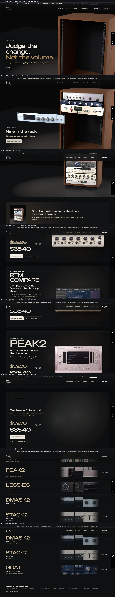
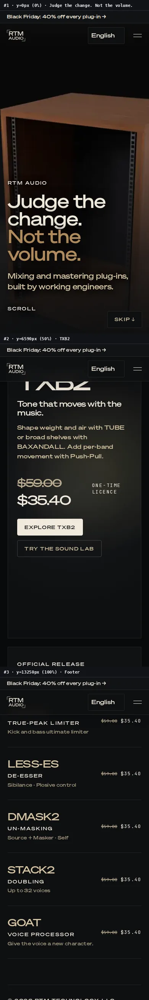

# UI Design System & Master Generation Blueprint: www-rtmaudio-com

> **RTM Audio · Audio plug-ins for mixing and mastering** (https://www.rtmaudio.com) — Mixing and mastering plug-ins, built by working engineers. Judge the change. Not the volume.





---

## 1. Executive Visual Persona & Design Archetype

- **Brand Essence & Persona**: **RTM Audio · Audio plug-ins for mixing and mastering** (`https://www.rtmaudio.com`). Mixing and mastering plug-ins, built by working engineers. Judge the change. Not the volume.
- **Capture Provenance**: Live browser capture (`tier1_fast`, HTTP `200`, captured `2026-11-24`).
- **Visual Archetype**: **Dark-Substrate WebGL / Canvas Interactive Experience (`#0e0f10` / `#d6c5a3`)**.
- **Anti-AI-Slop Differentiators**:
  - **Live-Computed Chromatic Polarity**: Anchors the viewport in `#0e0f10` (live computed `html` `background-color` (`computed_styles.json`)) paired with `#f0e9dc` primary typography and `#d6c5a3` accents.
  - **Grounded Typographic Hierarchy**: Uses `Söhne Breit` across display (`Judge the change. Not the volume.`) and body copy, paired with `JetBrains Mono` for monospace/code.
  - **Calibrated Spatial Grid & Motion**: Combines `1296px` container bounds (`gap: 32px`, padding `.45rem`) with `cubic-bezier(.16,1,.3,1)` easing and Three.js / WebGL Canvas Pipeline.

---

## 2. Spatial Architecture & Modular Grid Mathematics

### Viewport Allocation & Container Geometry
- **Captured Journey Filmstrips**: Desktop `1280×6624px` (`assets/desktop-journey.webp`, `8` keyframes up to `y=14058px` / doc `14958px`), Mobile `390×2616px` (`assets/mobile-journey.webp`, `3` keyframes).
- **Master Container Bounds**: `1296px` (measured widest bounded `<section>` landmark width on `1440px` desktop).
- **Canvas Lateral Padding & Spacing**: `.45rem` lateral canvas padding with `32px` grid gap.
- **Border Radius Scale**: `4px`, `2px`, `var(--r)`, `999px`.

### Responsive Breakpoint Architecture
- **Desktop Layout**: Multi-column CSS Grid / Flexbox layout at `1440px` (`max-width: 1296px`, `gap: 32px`).
- **Mobile Layout**: Single-column vertical stack at `390px` viewport width with `.45rem` horizontal padding.
- **Extracted CSS Media Queries**: `@media (max-width:560px)`, `@media (prefers-reduced-motion:reduce)`, `@media (max-width:820px)`, `@media (max-width:420px)`.

---

## 3. Color System, Materiality & Atmospheric Lighting

### Semantic Palette & Source Grounding
| Semantic Role | Ground-Truth Value | Extracted Live / CSS Source |
|---|---|---|
| **Primary Canvas Substrate** | `#0e0f10` | live computed `html` `background-color` (`computed_styles.json`) |
| **Primary Typography Ink** | `#f0e9dc` | live computed `h1` `color` (`computed_styles.json`) |
| **Elevated Surface / Card Substrate** | `#121315` | live computed `a` `background-color` (`computed_styles.json`) |
| **Interactive Accent / Highlight** | `#d6c5a3` | live computed `button` `color` (`computed_styles.json`) |
| **Secondary / Muted Copy** | `#b08b5c` | `var(--ink-dim)` in `:root` |
| **Structural Hairline Border** | `#252524` | `var(--line)` in `:root` (`rgba(240,233,220,.10)`) |
| **Variable Token (`--green`)** | `#57c279` | `var(--green)` in `:root` |
| **Variable Token (`--well`)** | `#07080a` | `var(--well)` in `:root` |

### Sanitized Root CSS Variables (`ui-ux.md` Ground Truth)
| Variable Name | Extracted Value | Semantic Role |
|---|---|---|
| `--display-weight` | `500` | Design System Custom Token |
| `--void` | `#0e0f10` | Color / Atmospheric Token |
| `--ink` | `#f0e9dc` | Typography Ink Token |
| `--ink-2` | `#d6c5a3` | Typography Ink Token |
| `--ink-dim` | `#b08b5c` | Typography Ink Token |
| `--green` | `#57c279` | Color / Atmospheric Token |
| `--line` | `rgba(240,233,220,.10)` | Color / Atmospheric Token |
| `--line-2` | `rgba(240,233,220,.22)` | Color / Atmospheric Token |
| `--wash` | `rgba(240,233,220,.05)` | Color / Atmospheric Token |
| `--well` | `#07080a` | Color / Atmospheric Token |
| `--raise` | `#121315` | Color / Atmospheric Token |
| `--glass` | `rgba(14,15,16,.72)` | Color / Atmospheric Token |
| `--acc` | `#b08b5c` | Color / Atmospheric Token |
| `--edge` | `inset 0 1px 0 rgba(240,233,220,.07)` | Color / Atmospheric Token |
| `--e1` | `var(--edge),0 1px 0 rgba(0,0,0,.5),0 34px 68px -34px rgba(0,0,0,.7)` | Color / Atmospheric Token |
| `--vignette` | `inset 0 0 34px 6px rgba(0,0,0,.55),inset 0 0 96px 20px rgba(8,6,4,.34)` | Color / Atmospheric Token |

---

## 4. Typographic Scale & Editorial Hierarchy

### Font Family Stacks
- **Display Typography**: `Söhne Breit`.
- **Primary Body Stack**: `Söhne Breit`.
- **Technical / Metadata Stack**: `JetBrains Mono`.

### Typographic Scale & Rules (Live Computed & Stylesheet Grounded)
- **Hero Display (`H1`)**: live computed `h1` (`font-size: 76.2899px`, `line-height: 71.7125px`, `font-weight: 500`, `letter-spacing: -1.90725px`); CSS variables `--display-weight: 500`, `--t-display: clamp(3.0518rem,2.3212rem + 2.7188vw,4.7684rem)`, `--lh-display: .94`; rule `h1` (`letter-spacing: -.02em`).
- **Section Heading (`H2`)**: live computed `h2` (`font-size: 48.8288px`, `line-height: 48.8288px`, `font-weight: 500`, `letter-spacing: -0.976576px`); rule `h2` (`font-size: clamp(2.8rem,8vw,8rem)`, `line-height: .84`, `letter-spacing: -.045em`, `font-weight: 500`).
- **Body Copy**: live computed `body` (`font-size: 16px`, `line-height: normal`, `font-weight: 400`, `letter-spacing: 0.288px`); CSS variables `--t-body: 1rem`, `--lh-body: 24px`, `--tr-body: 0`; rule `body` (`letter-spacing: .018em`).
- **Metadata & Navigation Labels**: live computed `nav/a` (`font-size: 12.8px`, `line-height: normal`, `font-weight: 400`, `letter-spacing: 1.792px`); CSS variables `--mono: "JetBrains Mono",ui-monospace,SFMono-Regular,Menlo,monospace`, `--t-label: .8rem`, `--m-label: .8rem`; rule `small` (`font-size: .65rem`, `letter-spacing: .13em`).

---

## 5. Choreographed Motion & Interaction Physics

### Primary Easing Curves
- **Extracted Timing Functions**: `cubic-bezier(.16,1,.3,1)`.

### Per-Element Transition & Choreography Rules
- **Selector `media(prefers-reduced-motion:reduce)`**: `transition: none!important` extracted from `www-rtmaudio-com` stylesheet.
- **Selector `.material-light::before`**: `transition: opacity .5s var(--ease)` extracted from `www-rtmaudio-com` stylesheet.
- **Selector `.campaign-object`**: `transition: transform .22s var(--ease)` extracted from `www-rtmaudio-com` stylesheet.
- **Extracted Easing Curve (`cubic-bezier(.16,1,.3,1)`)**: Governs interactive state transitions across `<header.campaigns-head>` and `<section.campaigns>`.
- **Runtime Interaction Engine**: Integrates Three.js / WebGL Canvas Pipeline with `prefers-reduced-motion: reduce` fallback guards.
### Measured Runtime Scroll & Interaction Telemetry (`behavioral_journey_v2`)
- **Scroll Driver Mode**: `native` (max document height `14958px`, deepest scrollY reached `14058px` across `8` desktop keyframes).
- **Detected Scroll / Motion Libraries**: `WebGL/Canvas`.
- **Interactive Control Probe (`tab` · `TOOLS`)**: Triggered visual diff `6.015` (attr `false -> true`, captured in `assets/state-interactive.webp`).
- **Route Transition Architecture**: First internal navigation (`/store/`) measured as `MPA` in `1433ms`.

---

## 6. Component Wireframe & Structural DOM Map

### Visual Layout Schematic — Desktop (`1440px`, Grounded in `dom.html` & Landmark Bounding Boxes)
```
┌────────────────────────────────────────────────────────────────────────┐
│ DESKTOP VIEWPORT (1440px) — RTM Audio · Audio plug-ins for mixing and  │
│ ====================================================================== │
│ [ <header.campaigns-head (1296x194px) | Plugins Plugins · Store Stor ] │
│ ---------------------------------------------------------------------- │
│ | HERO STAGE: <section.take> (w=1440px)                              | │
│ | H1: Judge the change. Not the volume.                              | │
│ | Substrate: #0e0f10 | Ink: #f0e9dc | Accent: #d6c5a3                | │
│ ---------------------------------------------------------------------- │
│ | SHOWCASE GRID (<section.campaigns>) max-w: 1296px                  | │
│ | +------------------------------+  +------------------------------+ | │
│ | | Nine in the rack.            |  | Your whole rack, in one app. | | │
│ | +------------------------------+  +------------------------------+ | │
│ ---------------------------------------------------------------------- │
│ | DETAIL MODULE (<article.campaign-panel>) — One-time licences. No   | │
│ ---------------------------------------------------------------------- │
│ [ FOOTER (<footer.cn-ground>  ) | https://www.rtmaudio.com             │
└────────────────────────────────────────────────────────────────────────┘
```

### Visual Layout Schematic — Mobile Reflow (`390px`)
```
┌────────────────────────────────────────────────────────────────────────┐
│ MOBILE VIEWPORT REFLOW (390px) — Single-Column Stack (gap: 32px)       │
│ ====================================================================== │
│ [ HEADER BAR (<header.campaigns-head> ) | Compact Menu (390px)         │
│ ---------------------------------------------------------------------- │
│ | HERO STAGE (<section.take>) — 390px Vertical Lead                  | │
│ | H1: Judge the change. Not the volume.                              | │
│ ---------------------------------------------------------------------- │
│ | SHOWCASE STACK (<section.campaigns>) — 1-Col Stack                 | │
│ | [ Item 1: Nine in the rack.                                      ] | │
│ | [ Item 2: Your whole rack, in one app.                           ] | │
│ ---------------------------------------------------------------------- │
│ | DETAIL STACK (<article.campaign-panel>) — 1-Col (One-time licences.) │
│ ---------------------------------------------------------------------- │
│ [ FOOTER (<footer.cn-ground>  ) | Stacked 390px Colophon               │
└────────────────────────────────────────────────────────────────────────┘
```

### Granular DOM Region Breakdown
1. **Brand Header & Navigation Bar (<header.campaigns-head> — `www-rtmaudio-com`)**:
   - Landmark `<header class="campaigns-head">` (`1296x194px`) hosting `RTM Audio · Audio plug-ins for mixin` navigation (`Plugins Plugins · Store Store · About About · Account Account`), DOM attributes (`data-consent="granted"`, `data-i18n-key="RTM Audio · Audio plu..."`, `data-i18n-content="Mixing and mastering..."`, `data-i18n-content="Mixing and mastering..."`), and stylesheet rule `root { --display-weight:500; }`.
2. **Hero Stage & Focal Lead (<section.take> — `Judge the change. Not the volume.`)**:
   - Landmark `<section class="take">` presenting display lead `Judge the change. Not the volume.` and copy excerpt *"Mixing and mastering plug-ins, built by working engineers."* over `#0e0f10` canvas and `#f0e9dc` ink.
3. **Primary Showcase & Content Grid (<section.campaigns> — `Nine in the rack.`)**:
   - Landmark `<section class="campaigns">` rendering section `Nine in the rack.` with copy *"EQ, vocals, dynamics and loudness."*, asset references (`clarity.js`, `soehne-breit-kraftig.woff2`, `fonts.css`, `site.css`), and grid rule `body { letter-spacing:.018em }`.
4. **Interactive Detail & Feature Matrix (<article.campaign-panel> — `Your whole rack, in one app.`)**:
   - Landmark `<article class="campaign-panel material-light">` framing `Your whole rack, in one app.` and `One-time licences. No subscription.` (*"Download, install and activate every plug-in you own. Free for Ma"*) with `#121315` surface cards, `#d6c5a3` accents, and `.hero h1 { letter-spacing:-.02em }`.
5. **Colophon & Global Directory Footer (<footer.cn-ground> — `https://www.rtmaudio.com`)**:
   - Landmark `<footer class="cn-ground">` anchoring `RTM Audio · Audio plug-ins for m` footer links (`Plugins Plugins · Store Store · About About · Account Account`), copy *"Try any plug-in in the store first."*, and `#252524` structural dividers.
### Full Vertical Scroll Sequence (Desktop `1440×900` Keyframes)
- **Step 01** (`y=0px`, `0%`): Active landmark `Judge the change. Not the volume.` · sticky/fixed elements: `2`
- **Step 02** (`y=850px`, `6%`): Active landmark `Nine in the rack.` · sticky/fixed elements: `2`
- **Step 03** (`y=3400px`, `24%`): Active landmark `#take` · sticky/fixed elements: `2`
- **Step 04** (`y=5950px`, `42%`): Active landmark `RTM Audio 2.0 collection` · sticky/fixed elements: `1`
- **Step 05** (`y=8500px`, `60%`): Active landmark `RTM Audio 2.0 collection` · sticky/fixed elements: `1`
- **Step 06** (`y=11050px`, `79%`): Active landmark `RTM Audio 2.0 collection` · sticky/fixed elements: `1`
- **Step 07** (`y=13600px`, `97%`): Active landmark `#rack` · sticky/fixed elements: `1`
- **Step 08** (`y=14058px`, `100%`): Active landmark `Footer` · sticky/fixed elements: `1`

### Multi-Page Internal Route Map
- **Listing Route (`/store/`)**: `https://www.rtmaudio.com/store/` — H1: `Buy it once.`, scrollHeight `4878px`, transition `MPA` (`1433ms`)
- **About Route (`/about/`)**: `https://www.rtmaudio.com/about/` — H1: `The engineers behind`, scrollHeight `2349px`, transition `direct` (`526ms`)
- **Other Route (`/home/`)**: `https://www.rtmaudio.com/home/` — H1: `All your plug-ins. One rack.`, scrollHeight `5301px`, transition `direct` (`638ms`)

---

## 7. Master Zero-Shot AI Generation Prompt

```markdown
# Master Zero-Shot Frontend Generation Prompt: www-rtmaudio-com (RTM Audio · Audio plug-ins for mixing and mastering)

You are a principal frontend architect and design systems engineer. Build a complete, production-ready web application replicating the exact design system, DOM landmarks, typographic hierarchy, color tokens, and motion physics of `www-rtmaudio-com` (**RTM Audio · Audio plug-ins for mixing and mastering** — `https://www.rtmaudio.com`).

### 1. Visual Archetype & Anti-AI-Slop Mandates
- **Archetype**: Dark-Substrate WebGL / Canvas Interactive Experience (`#0e0f10` / `#d6c5a3`).
- **Identity & Domain Context**: Mixing and mastering plug-ins, built by working engineers. Judge the change. Not the volume.
- **Primary Substrate**: `#0e0f10` (live computed `html` `background-color` (`computed_styles.json`)), **Primary Ink**: `#f0e9dc`, **Accent / Highlight**: `#d6c5a3`.
- **Site-Specific Differentiators**:
  - **Live-Computed Chromatic Polarity**: Anchors the viewport in `#0e0f10` (live computed `html` `background-color` (`computed_styles.json`)) paired with `#f0e9dc` primary typography and `#d6c5a3` accents.
  - **Grounded Typographic Hierarchy**: Uses `Söhne Breit` across display (`Judge the change. Not the volume.`) and body copy, paired with `JetBrains Mono` for monospace/code.
  - **Calibrated Spatial Grid & Motion**: Combines `1296px` container bounds (`gap: 32px`, padding `.45rem`) with `cubic-bezier(.16,1,.3,1)` easing and Three.js / WebGL Canvas Pipeline.

### 2. Ground-Truth CSS Variables (`:root` Token Contract)
Declare and consume these exact custom properties extracted from `www-rtmaudio-com` in your global stylesheet:

:root {
  /* RTM Audio · Audio plug-ins for mixing and mastering (www-rtmaudio-com) — Live-Grounded CSS Variables */
  --display-weight: 500; /* Design System Custom Token (www-rtmaudio-com) */
  --void: #0e0f10; /* Color / Atmospheric Token (www-rtmaudio-com) */
  --ink: #f0e9dc; /* Typography Ink Token (www-rtmaudio-com) */
  --ink-2: #d6c5a3; /* Typography Ink Token (www-rtmaudio-com) */
  --ink-dim: #b08b5c; /* Typography Ink Token (www-rtmaudio-com) */
  --green: #57c279; /* Color / Atmospheric Token (www-rtmaudio-com) */
  --line: rgba(240,233,220,.10); /* Color / Atmospheric Token (www-rtmaudio-com) */
  --line-2: rgba(240,233,220,.22); /* Color / Atmospheric Token (www-rtmaudio-com) */
  --wash: rgba(240,233,220,.05); /* Color / Atmospheric Token (www-rtmaudio-com) */
  --well: #07080a; /* Color / Atmospheric Token (www-rtmaudio-com) */
  --raise: #121315; /* Color / Atmospheric Token (www-rtmaudio-com) */
  --glass: rgba(14,15,16,.72); /* Color / Atmospheric Token (www-rtmaudio-com) */
  --acc: #b08b5c; /* Color / Atmospheric Token (www-rtmaudio-com) */
  --edge: inset 0 1px 0 rgba(240,233,220,.07); /* Color / Atmospheric Token (www-rtmaudio-com) */
  --e1: var(--edge),0 1px 0 rgba(0,0,0,.5),0 34px 68px -34px rgba(0,0,0,.7); /* Color / Atmospheric Token (www-rtmaudio-com) */
  --vignette: inset 0 0 34px 6px rgba(0,0,0,.55),inset 0 0 96px 20px rgba(8,6,4,.34); /* Color / Atmospheric Token (www-rtmaudio-com) */
}

### 3. Semantic Color & Materiality Contract
Map every surface, ink, and border strictly to these source-grounded tokens:
- **Primary Canvas Substrate**: `#0e0f10` — grounded in live computed `html` `background-color` (`computed_styles.json`)
- **Primary Typography Ink**: `#f0e9dc` — grounded in live computed `h1` `color` (`computed_styles.json`)
- **Elevated Surface / Card Substrate**: `#121315` — grounded in live computed `a` `background-color` (`computed_styles.json`)
- **Interactive Accent / Highlight**: `#d6c5a3` — grounded in live computed `button` `color` (`computed_styles.json`)
- **Secondary / Muted Copy**: `#b08b5c` — grounded in `var(--ink-dim)` in `:root`
- **Structural Hairline Border**: `#252524` — grounded in `var(--line)` in `:root` (`rgba(240,233,220,.10)`)
- **Variable Token (`--green`)**: `#57c279` — grounded in `var(--green)` in `:root`
- **Variable Token (`--well`)**: `#07080a` — grounded in `var(--well)` in `:root`

### 4. Spatial Grid, Container Bounds & Responsive Breakpoints
- **Desktop Viewport Reference**: `1280×6624px` (multi-frame vertical journey filmstrip (6624px), `1440px` standard desktop width).
- **Mobile Viewport Reference**: `390×2616px` (multi-frame vertical journey filmstrip (2616px), `390px` standard mobile width).
- **Container Max-Width**: `1296px` (measured widest bounded `<section>` landmark width on `1440px` desktop)
- **Padding & Gutters**: `.45rem` lateral canvas padding with `32px` grid gap
- **Desktop Grid**: Multi-column CSS Grid / Flexbox layout at `1440px` (`max-width: 1296px`, `gap: 32px`)
- **Mobile Adaptation**: Single-column vertical stack at `390px` viewport width with `.45rem` horizontal padding
- **Media Queries**: `@media (max-width:560px)`, `@media (prefers-reduced-motion:reduce)`, `@media (max-width:820px)`, `@media (max-width:420px)`
- **Corner Radii**: `4px`, `2px`, `var(--r)`, `999px`

### 5. Typography & Editorial Scale Contract
- **Display Font Stack**: `Söhne Breit`
- **Body Font Stack**: `Söhne Breit`
- **Monospace / Technical Font Stack**: `JetBrains Mono`
- **H1 Display Rule**: live computed `h1` (`font-size: 76.2899px`, `line-height: 71.7125px`, `font-weight: 500`, `letter-spacing: -1.90725px`); CSS variables `--display-weight: 500`, `--t-display: clamp(3.0518rem,2.3212rem + 2.7188vw,4.7684rem)`, `--lh-display: .94`; rule `h1` (`letter-spacing: -.02em`)
- **H2 Section Rule**: live computed `h2` (`font-size: 48.8288px`, `line-height: 48.8288px`, `font-weight: 500`, `letter-spacing: -0.976576px`); rule `h2` (`font-size: clamp(2.8rem,8vw,8rem)`, `line-height: .84`, `letter-spacing: -.045em`, `font-weight: 500`)
- **Body Copy Rule**: live computed `body` (`font-size: 16px`, `line-height: normal`, `font-weight: 400`, `letter-spacing: 0.288px`); CSS variables `--t-body: 1rem`, `--lh-body: 24px`, `--tr-body: 0`; rule `body` (`letter-spacing: .018em`)
- **Metadata & Index Rule**: live computed `nav/a` (`font-size: 12.8px`, `line-height: normal`, `font-weight: 400`, `letter-spacing: 1.792px`); CSS variables `--mono: "JetBrains Mono",ui-monospace,SFMono-Regular,Menlo,monospace`, `--t-label: .8rem`, `--m-label: .8rem`; rule `small` (`font-size: .65rem`, `letter-spacing: .13em`)

### 6. Component Hierarchy, Verbatim Copy & Real DOM Landmarks
Scaffold `www-rtmaudio-com` (`RTM Audio · Audio plug-ins for mixing and mastering`) with these exact structural regions, extracted copy, and CSS rules from `dom.html`:
1. **Brand Header & Navigation Bar (<header.campaigns-head> — `www-rtmaudio-com`)**:
   - DOM & Selectors: Landmark `<header class="campaigns-head">` (`1296x194px`) hosting `RTM Audio · Audio plug-ins for mixin` navigation (`Plugins Plugins · Store Store · About About · Account Account`), DOM attributes (`data-consent="granted"`, `data-i18n-key="RTM Audio · Audio plu..."`, `data-i18n-content="Mixing and mastering..."`, `data-i18n-content="Mixing and mastering..."`), and stylesheet rule `root { --display-weight:500; }`.
   - Responsive Contract: Header `Brand Header & Navigation Bar (<header.campaigns-head> — `www-rtmaudio-com`)` (`www-rtmaudio-com`) adapts across `@media (max-width:560px)`, `@media (prefers-reduced-motion:reduce)`, `@media (max-width:820px)`, `@media (max-width:420px)` with `cubic-bezier(.16,1,.3,1)` transitions and links `Plugins Plugins · Store Store · About About · Account Account`.
2. **Hero Stage & Focal Lead (<section.take> — `Judge the change. Not the volume.`)**:
   - DOM & Selectors: Landmark `<section class="take">` presenting display lead `Judge the change. Not the volume.` and copy excerpt *"Mixing and mastering plug-ins, built by working engineers."* over `#0e0f10` canvas and `#f0e9dc` ink.
   - Responsive Contract: Hero stage (`1280×6624px` desktop / `390×2616px` mobile) sets `#0e0f10` background with `#f0e9dc` headline `Judge the change. Not the volume.`.
3. **Primary Showcase & Content Grid (<section.campaigns> — `Nine in the rack.`)**:
   - DOM & Selectors: Landmark `<section class="campaigns">` rendering section `Nine in the rack.` with copy *"EQ, vocals, dynamics and loudness."*, asset references (`clarity.js`, `soehne-breit-kraftig.woff2`, `fonts.css`, `site.css`), and grid rule `body { letter-spacing:.018em }`.
   - Responsive Contract: Showcase grid `Primary Showcase & Content Grid (<section.campaigns> — `Nine in the rack.`)` applies Multi-column CSS Grid / Flexbox layout at `1440px` (`max-width: 1296px`, `gap: 32px`) on desktop and Single-column vertical stack at `390px` viewport width with `.45rem` horizontal padding on mobile.
4. **Interactive Detail & Feature Matrix (<article.campaign-panel> — `Your whole rack, in one app.`)**:
   - DOM & Selectors: Landmark `<article class="campaign-panel material-light">` framing `Your whole rack, in one app.` and `One-time licences. No subscription.` (*"Download, install and activate every plug-in you own. Free for Ma"*) with `#121315` surface cards, `#d6c5a3` accents, and `.hero h1 { letter-spacing:-.02em }`.
   - Responsive Contract: Detail module `Interactive Detail & Feature Matrix (<article.campaign-panel> — `Your whole rack, in one app.`)` uses `4px`, `2px`, `var(--r)`, `999px` radii, `#d6c5a3` highlights, and assets (clarity.js, soehne-breit-kraftig.woff2, fonts.css).
5. **Colophon & Global Directory Footer (<footer.cn-ground> — `https://www.rtmaudio.com`)**:
   - DOM & Selectors: Landmark `<footer class="cn-ground">` anchoring `RTM Audio · Audio plug-ins for m` footer links (`Plugins Plugins · Store Store · About About · Account Account`), copy *"Try any plug-in in the store first."*, and `#252524` structural dividers.
   - Responsive Contract: Footer `Colophon & Global Directory Footer (<footer.cn-ground> — `https://www.rtmaudio.com`)` aligns to `1296px` (measured widest bounded `<section>` landmark width on `1440px` desktop) with `.45rem` lateral canvas padding with `32px` grid gap and attributes (data-consent="granted", data-i18n-key="RTM Audio · Audio plu...", data-i18n-content="Mixing and mastering...").

#### Verbatim DOM Copy Excerpts (`dom.html`)
- Copy Excerpt 1: *"Mixing and mastering plug-ins, built by working engineers."*
- Copy Excerpt 2: *"EQ, vocals, dynamics and loudness."*
- Copy Excerpt 3: *"Download, install and activate every plug-in you own. Free for Mac and Windows."*
- Copy Excerpt 4: *"Try any plug-in in the store first."*

### 7. Motion, Extracted Stylesheet Rules & Interaction Choreography
- **Primary Easing Functions**: `cubic-bezier(.16,1,.3,1)`
- **Extracted Stylesheet Rules (`www-rtmaudio-com`)**:
- `root { --display-weight:500; }`
- `body { letter-spacing:.018em }`
- `.hero h1 { letter-spacing:-.02em }`
- `.rtm-language { display:inline-flex;align-items:center;margin-inline-start:clamp(8px,1.2... }`
- `.rtm-language select:focus-visible { outline:2px solid currentColor;outline-offset:3px }`
- **Per-Selector Transition Rules**:
- **Selector `media(prefers-reduced-motion:reduce)`**: `transition: none!important` extracted from `www-rtmaudio-com` stylesheet.
- **Selector `.material-light::before`**: `transition: opacity .5s var(--ease)` extracted from `www-rtmaudio-com` stylesheet.
- **Selector `.campaign-object`**: `transition: transform .22s var(--ease)` extracted from `www-rtmaudio-com` stylesheet.
- **Extracted Easing Curve (`cubic-bezier(.16,1,.3,1)`)**: Governs interactive state transitions across `<header.campaigns-head>` and `<section.campaigns>`.
- **Runtime Interaction Engine**: Integrates Three.js / WebGL Canvas Pipeline with `prefers-reduced-motion: reduce` fallback guards.
### 7b. Full-Page Scroll Choreography, Interactive States & Multi-Page Routes
- **Scroll Mechanics**: Implement `native` vertical progression up to `14958px` across 8 distinct viewport chapters using WebGL/Canvas.
- **Vertical Chapter Sequence**: Judge the change. Not the v... (0%) -> Nine in the rack. (6%) -> #take (24%) -> RTM Audio 2.0 collection (42%) -> RTM Audio 2.0 collection (60%) -> RTM Audio 2.0 collection (79%) -> #rack (97%) -> Footer (100%).
- **Multi-Page Routes**: Scaffold internal routes `/store/` (listing, MPA), `/about/` (about, direct), `/home/` (other, direct) sharing the global header/footer shell and design tokens.

### 8. Technical Deliverables
- Implement in Next.js (App Router) with TypeScript and Tailwind CSS consuming the `:root` custom properties defined above for `www-rtmaudio-com`.
- Reproduce both the `1440px` desktop architecture and `390px` mobile breakpoint transitions, preserving semantic HTML5 landmarks (`<header>`, `<nav>`, `<main>`, `<section>`, `<footer>`) and `prefers-reduced-motion` accessibility guards.
```
---

## 8. Full-Page Scroll Journey, Interactive States & Subpage Inventory

### Desktop Scroll Keyframes (`1440×900` WebP)
| Step | Scroll Y | Progress | Active Landmark / Section | Sticky/Fixed | Visual Asset |
| :---: | :---: | :---: | :--- | :---: | :--- |
| `#01` | `0px` | `0%` | Judge the change. Not the volume. | `2` | [desktop-step-01.webp](assets/desktop-step-01.webp) |
| `#02` | `850px` | `6%` | Nine in the rack. | `2` | [desktop-step-02.webp](assets/desktop-step-02.webp) |
| `#03` | `3400px` | `24%` | #take | `2` | [desktop-step-03.webp](assets/desktop-step-03.webp) |
| `#04` | `5950px` | `42%` | RTM Audio 2.0 collection | `1` | [desktop-step-04.webp](assets/desktop-step-04.webp) |
| `#05` | `8500px` | `60%` | RTM Audio 2.0 collection | `1` | [desktop-step-05.webp](assets/desktop-step-05.webp) |
| `#06` | `11050px` | `79%` | RTM Audio 2.0 collection | `1` | [desktop-step-06.webp](assets/desktop-step-06.webp) |
| `#07` | `13600px` | `97%` | #rack | `1` | [desktop-step-07.webp](assets/desktop-step-07.webp) |
| `#08` | `14058px` | `100%` | Footer | `1` | [desktop-step-08.webp](assets/desktop-step-08.webp) |

### Mobile Condensed Keyframes (`390×844` WebP)
| Step | Scroll Y | Progress | Active Landmark | Visual Asset |
| :---: | :---: | :---: | :--- | :--- |
| `#01` | `0px` | `0%` | Judge the change. Not the volume. | [mobile-step-01.webp](assets/mobile-step-01.webp) |
| `#02` | `6590px` | `50%` | TXB2 | [mobile-step-02.webp](assets/mobile-step-02.webp) |
| `#03` | `13250px` | `100%` | Footer | [mobile-step-03.webp](assets/mobile-step-03.webp) |

### Interactive UI State Captures (`1440×900` WebP)
| State Type | Trigger / Observation | Visual Asset |
| :--- | :--- | :--- |
| `interactive_control` | Control `tab` (`TOOLS`, diff `6.015`) | [state-interactive.webp](assets/state-interactive.webp) |

### Internal Subpage Filmstrips (`1080px` Wide WebP)
| # | Template | Route URL | H1 / Title | Scroll Height | Transition | Filmstrip Asset |
| :-: | :---: | :--- | :--- | :---: | :---: | :--- |
| `1` | `listing` | `https://www.rtmaudio.com/store/` | Buy it once. | `4878px` | `MPA` (`1433ms`) | [subpage-01-store.webp](assets/subpage-01-store.webp) |
| `2` | `about` | `https://www.rtmaudio.com/about/` | The engineers behind | `2349px` | `direct` (`526ms`) | [subpage-02-about.webp](assets/subpage-02-about.webp) |
| `3` | `other` | `https://www.rtmaudio.com/home/` | All your plug-ins. One rack. | `5301px` | `direct` (`638ms`) | [subpage-03-home.webp](assets/subpage-03-home.webp) |

