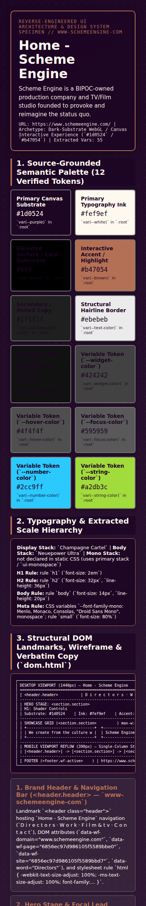

# UI Design System & Master Generation Blueprint: www-schemeengine-com

> **Home - Scheme Engine** (https://www.schemeengine.com/) — Scheme Engine is a BIPOC-owned production company and TV/Film studio founded to provoke and reimagine the status quo.


---

## 1. Executive Visual Persona & Design Archetype

- **Brand Essence & Persona**: **Home - Scheme Engine** (`https://www.schemeengine.com/`). Scheme Engine is a BIPOC-owned production company and TV/Film studio founded to provoke and reimagine the status quo.
- **Visual Archetype**: **Dark-Substrate WebGL / Canvas Interactive Experience (`#1d0524` / `#b47054`)**.
- **Anti-AI-Slop Differentiators**:
  - **Source-Grounded Chromatic Polarity**: Anchors the viewport in `#1d0524` (`var(--purple)` in `:root`) paired with `#fef9ef` primary typography and `#b47054` accents.
  - **Extracted Typographic Hierarchy**: Pairs `Champagne Cartel` for display copy (`Shader Controls`) with `Neuepower Ultra` and not declared in static CSS (uses primary stack / `ui-monospace`).
  - **Calibrated Spatial Grid & Motion**: Combines `940px` container bounds (`gap: 16px`, padding `9px`) with `cubic-bezier(0.2,0.6,0.35,1)` easing and Lenis Smooth Scroll (`data-lenis`), Three.js / WebGL Canvas Pipeline.

---

## 2. Spatial Architecture & Modular Grid Mathematics



### Viewport Allocation & Container Geometry
- **Captured Viewport Dimensions**: Desktop `1440×17325px` (`assets/desktop.png`, full-page scroll capture), Mobile `390×2400px` (`assets/mobile.png`, capped at 2400px multi-section capture).
- **Master Container Bounds**: `940px` extracted from `www-schemeengine-com` stylesheet.
- **Canvas Lateral Padding & Spacing**: `9px` lateral canvas padding with `16px` grid gap.
- **Border Radius Scale**: `3px`, `100%`, `50%`, `1.25rem`.

### Responsive Breakpoint Architecture
- **Desktop Layout**: Multi-column CSS Grid / Flexbox layout at `1440px` (`max-width: 940px`, `gap: 16px`).
- **Mobile Layout**: Single-column vertical stack at `390px` viewport width with `9px` horizontal padding.
- **Extracted CSS Media Queries**: `@media screen and (max-width: 991px)`, `@media screen and (max-width: 767px)`, `@media screen and (max-width: 479px)`, `@media (min-width: 768px)`.

---

## 3. Color System, Materiality & Atmospheric Lighting

### Semantic Palette & Source Grounding
| Semantic Role | Ground-Truth Value | Extracted CSS Source / Selector |
|---|---|---|
| **Primary Canvas Substrate** | `#1d0524` | `var(--purple)` in `:root` |
| **Primary Typography Ink** | `#fef9ef` | `var(--white)` in `:root` |
| **Elevated Surface / Card Substrate** | `#000` | `var(--black)` in `:root` |
| **Interactive Accent / Highlight** | `#b47054` | `var(--brown)` in `:root` |
| **Secondary / Muted Copy** | `#1f1f1f` | `var(--background-color)` in `:root` |
| **Structural Hairline Border** | `#ebebeb` | `var(--text-color)` in `:root` |
| **Variable Token (`--title-background-color`)** | `#111111` | `var(--title-background-color)` in `:root` |
| **Variable Token (`--widget-color`)** | `#424242` | `var(--widget-color)` in `:root` |
| **Variable Token (`--hover-color`)** | `#4f4f4f` | `var(--hover-color)` in `:root` |
| **Variable Token (`--focus-color`)** | `#595959` | `var(--focus-color)` in `:root` |
| **Variable Token (`--number-color`)** | `#2cc9ff` | `var(--number-color)` in `:root` |
| **Variable Token (`--string-color`)** | `#a2db3c` | `var(--string-color)` in `:root` |

### Sanitized Root CSS Variables (`ui-ux.md` Ground Truth)
| Variable Name | Extracted Value | Semantic Role |
|---|---|---|
| `--purple` | `#1d0524` | Color / Atmospheric Token |
| `--white` | `#fef9ef` | Canvas / Surface Token |
| `--black` | `#000` | Canvas / Surface Token |
| `--brown` | `#b47054` | Color / Atmospheric Token |
| `--background-color` | `#1f1f1f` | Canvas / Surface Token |
| `--text-color` | `#ebebeb` | Typography Ink Token |
| `--title-background-color` | `#111111` | Canvas / Surface Token |
| `--title-text-color` | `#ebebeb` | Typography Ink Token |
| `--widget-color` | `#424242` | Brand / Palette Token |
| `--hover-color` | `#4f4f4f` | Brand / Palette Token |
| `--focus-color` | `#595959` | Brand / Palette Token |
| `--number-color` | `#2cc9ff` | Brand / Palette Token |
| `--string-color` | `#a2db3c` | Brand / Palette Token |
| `--font-size` | `11px` | Typography / Scale Token |
| `--input-font-size` | `11px` | Typography / Scale Token |
| `--font-family` | `-apple-system, BlinkMacSystemFont, "Segoe UI", Roboto, Arial, sans-serif` | Typography / Scale Token |

---

## 4. Typographic Scale & Editorial Hierarchy

### Font Family Stacks
- **Display Typography**: `Champagne Cartel`.
- **Primary Body Stack**: `Neuepower Ultra`.
- **Technical / Metadata Stack**: not declared in static CSS (uses primary stack / `ui-monospace`).

### Typographic Scale & Rules (Extracted from Stylesheet & Variables)
- **Hero Display (`H1`)**: rule `h1` (`font-size: 2em`).
- **Section Heading (`H2`)**: rule `h2` (`font-size: 32px`, `line-height: 36px`).
- **Body Copy**: rule `body` (`font-size: 14px`, `line-height: 20px`).
- **Metadata & Navigation Labels**: CSS variables `--font-family-mono: Menlo, Monaco, Consolas, "Droid Sans Mono", monospace`; rule `small` (`font-size: 80%`).

---

## 5. Choreographed Motion & Interaction Physics

### Primary Easing Curves
- **Extracted Timing Functions**: `cubic-bezier(0.2,0.6,0.35,1)`, `cubic-bezier(0.65,0,0.35,1)`, `cubic-bezier(0.25,0.46,0.45,0.94)`.

### Per-Element Transition & Choreography Rules
- **Selector `.w-webflow-badge > img`**: `transition: unset` extracted from `www-schemeengine-com` stylesheet.
- **Selector `.w-slider-dot`**: `transition: background-color .1s, color .1s` extracted from `www-schemeengine-com` stylesheet.
- **Selector `.w-lightbox-control`**: `transition: all .3s` extracted from `www-schemeengine-com` stylesheet.
- **Extracted Easing Curve (`cubic-bezier(0.2,0.6,0.35,1)`)**: Governs interactive state transitions across `<header.header>` and `<section.section>`.
- **Runtime Interaction Engine**: Integrates Lenis Smooth Scroll (`data-lenis`), Three.js / WebGL Canvas Pipeline with `prefers-reduced-motion: reduce` fallback guards.

---

## 6. Component Wireframe & Structural DOM Map

### Visual Layout Schematic (Grounded in `dom.html` — `1440px` Desktop & `390px` Mobile Reflow)
```
┌────────────────────────────────────────────────────────────────────────┐
│ DESKTOP VIEWPORT (1440px) — Home - Scheme Engine                       │
│ ====================================================================== │
│ [ <header.header>          | D i r e c t o r s · W o r k · F i l m  ]  │
│ ---------------------------------------------------------------------- │
│ | HERO STAGE: <section.section>                                    |   │
│ | H1: Shader Controls                                              |   │
│ | Substrate: #1d0524    | Ink: #fef9ef    | Accent: #b47054        |   │
│ ---------------------------------------------------------------------- │
│ | SHOWCASE GRID (<section.section>         ) max-w: 940px          |   │
│ | +------------------------------+  +------------------------------+ | │
│ | | We create from the culture w |  | Scheme Engine is a culture-f | | │
│ | +------------------------------+  +------------------------------+ | │
│ ---------------------------------------------------------------------- │
│ | MOBILE VIEWPORT REFLOW (390px) — Single-Column Stack (gap: 16px  ) | │
│ | [<header.header>] -> [<section.section>] -> [<section.section>] |    │
│ ---------------------------------------------------------------------- │
│ [ FOOTER (<footer.wf-active>    ) | https://www.schemeengine.com/      │
└────────────────────────────────────────────────────────────────────────┘
```

### Granular DOM Region Breakdown
1. **Brand Header & Navigation Bar (<header.header> — `www-schemeengine-com`)**:
   - Landmark `<header class="header">` hosting `Home - Scheme Engine` navigation (`D i r e c t o r s · W o r k · F i l m & t v · C o n t a c t`), DOM attributes (`data-wf-domain="www.schemeengine.com"`, `data-wf-page="6856ec97d986105f5589bbe0"`, `data-wf-site="6856ec97d986105f5589bbd7"`, `data-word="Directors"`), and stylesheet rule `html { -webkit-text-size-adjust: 100%; -ms-text-size-adjust: 100%; font-family:... }`.
2. **Hero Stage & Focal Lead (<section.section> — `Shader Controls`)**:
   - Landmark `<section class="section">` presenting display lead `Shader Controls` and copy excerpt *"Skip to main content"* over `#1d0524` canvas and `#fef9ef` ink.
3. **Primary Showcase & Content Grid (<section.section> — `We create from the culture we live`)**:
   - Landmark `<section class="section">` rendering section `We create from the culture we live.` with copy *"Scheme Engine is a culture-first production company championing t"*, asset references (`cdn.prod.website-files.com`, `schemeengine.webflow.shared.3fbb9...`, `soy0bmb.js`, `68b845cb16daf25e488bd7a5_scheme-e...`), and grid rule `body { margin: 0; }`.
4. **Interactive Detail & Feature Matrix (<section.section> — `Scheme Engine is a culture-first p`)**:
   - Landmark `<section class="section">` framing `Scheme Engine is a culture-first production comp` and `Our award-winning directors and creatives work a` (*"Our award-winning directors and creatives work across formats, al"*) with `#000` surface cards, `#b47054` accents, and `summary { display: block; }`.
5. **Colophon & Global Directory Footer (<footer.wf-active> — `https://www.schemeengine.com/`)**:
   - Landmark `<footer class="wf-active">` anchoring `Home - Scheme Engine` footer links (`D i r e c t o r s · W o r k · F i l m & t v · C o n t a c t`), copy *"Impactful, resonant storytelling is rooted in lived experien"*, and `#ebebeb` structural dividers.

---

## 7. Master Zero-Shot AI Generation Prompt

```markdown
# Master Zero-Shot Frontend Generation Prompt: www-schemeengine-com (Home - Scheme Engine)

You are a principal frontend architect and design systems engineer. Build a complete, production-ready web application replicating the exact design system, DOM landmarks, typographic hierarchy, color tokens, and motion physics of `www-schemeengine-com` (**Home - Scheme Engine** — `https://www.schemeengine.com/`).

### 1. Visual Archetype & Anti-AI-Slop Mandates
- **Archetype**: Dark-Substrate WebGL / Canvas Interactive Experience (`#1d0524` / `#b47054`).
- **Identity & Domain Context**: Scheme Engine is a BIPOC-owned production company and TV/Film studio founded to provoke and reimagine the status quo.
- **Primary Substrate**: `#1d0524` (`var(--purple)` in `:root`), **Primary Ink**: `#fef9ef`, **Accent / Highlight**: `#b47054`.
- **Site-Specific Differentiators**:
  - **Source-Grounded Chromatic Polarity**: Anchors the viewport in `#1d0524` (`var(--purple)` in `:root`) paired with `#fef9ef` primary typography and `#b47054` accents.
  - **Extracted Typographic Hierarchy**: Pairs `Champagne Cartel` for display copy (`Shader Controls`) with `Neuepower Ultra` and not declared in static CSS (uses primary stack / `ui-monospace`).
  - **Calibrated Spatial Grid & Motion**: Combines `940px` container bounds (`gap: 16px`, padding `9px`) with `cubic-bezier(0.2,0.6,0.35,1)` easing and Lenis Smooth Scroll (`data-lenis`), Three.js / WebGL Canvas Pipeline.

### 2. Ground-Truth CSS Variables (`:root` Token Contract)
Declare and consume these exact custom properties extracted from `www-schemeengine-com` in your global stylesheet:

:root {
  /* Home - Scheme Engine (www-schemeengine-com) — Ground-Truth Extracted CSS Variables */
  --purple: #1d0524; /* Color / Atmospheric Token (www-schemeengine-com) */
  --white: #fef9ef; /* Canvas / Surface Token (www-schemeengine-com) */
  --black: #000; /* Canvas / Surface Token (www-schemeengine-com) */
  --brown: #b47054; /* Color / Atmospheric Token (www-schemeengine-com) */
  --background-color: #1f1f1f; /* Canvas / Surface Token (www-schemeengine-com) */
  --text-color: #ebebeb; /* Typography Ink Token (www-schemeengine-com) */
  --title-background-color: #111111; /* Canvas / Surface Token (www-schemeengine-com) */
  --title-text-color: #ebebeb; /* Typography Ink Token (www-schemeengine-com) */
  --widget-color: #424242; /* Brand / Palette Token (www-schemeengine-com) */
  --hover-color: #4f4f4f; /* Brand / Palette Token (www-schemeengine-com) */
  --focus-color: #595959; /* Brand / Palette Token (www-schemeengine-com) */
  --number-color: #2cc9ff; /* Brand / Palette Token (www-schemeengine-com) */
  --string-color: #a2db3c; /* Brand / Palette Token (www-schemeengine-com) */
  --font-size: 11px; /* Typography / Scale Token (www-schemeengine-com) */
  --input-font-size: 11px; /* Typography / Scale Token (www-schemeengine-com) */
  --font-family: -apple-system, BlinkMacSystemFont, "Segoe UI", Roboto, Arial, sans-serif; /* Typography / Scale Token (www-schemeengine-com) */
}

### 3. Semantic Color & Materiality Contract
Map every surface, ink, and border strictly to these source-grounded tokens:
- **Primary Canvas Substrate**: `#1d0524` — grounded in `var(--purple)` in `:root`
- **Primary Typography Ink**: `#fef9ef` — grounded in `var(--white)` in `:root`
- **Elevated Surface / Card Substrate**: `#000` — grounded in `var(--black)` in `:root`
- **Interactive Accent / Highlight**: `#b47054` — grounded in `var(--brown)` in `:root`
- **Secondary / Muted Copy**: `#1f1f1f` — grounded in `var(--background-color)` in `:root`
- **Structural Hairline Border**: `#ebebeb` — grounded in `var(--text-color)` in `:root`
- **Variable Token (`--title-background-color`)**: `#111111` — grounded in `var(--title-background-color)` in `:root`
- **Variable Token (`--widget-color`)**: `#424242` — grounded in `var(--widget-color)` in `:root`
- **Variable Token (`--hover-color`)**: `#4f4f4f` — grounded in `var(--hover-color)` in `:root`
- **Variable Token (`--focus-color`)**: `#595959` — grounded in `var(--focus-color)` in `:root`
- **Variable Token (`--number-color`)**: `#2cc9ff` — grounded in `var(--number-color)` in `:root`
- **Variable Token (`--string-color`)**: `#a2db3c` — grounded in `var(--string-color)` in `:root`

### 4. Spatial Grid, Container Bounds & Responsive Breakpoints
- **Desktop Viewport Reference**: `1440×17325px` (full-page scroll capture, `1440px` standard desktop width).
- **Mobile Viewport Reference**: `390×2400px` (capped at 2400px multi-section capture, `390px` standard mobile width).
- **Container Max-Width**: `940px` extracted from `www-schemeengine-com` stylesheet
- **Padding & Gutters**: `9px` lateral canvas padding with `16px` grid gap
- **Desktop Grid**: Multi-column CSS Grid / Flexbox layout at `1440px` (`max-width: 940px`, `gap: 16px`)
- **Mobile Adaptation**: Single-column vertical stack at `390px` viewport width with `9px` horizontal padding
- **Media Queries**: `@media screen and (max-width: 991px)`, `@media screen and (max-width: 767px)`, `@media screen and (max-width: 479px)`, `@media (min-width: 768px)`
- **Corner Radii**: `3px`, `100%`, `50%`, `1.25rem`

### 5. Typography & Editorial Scale Contract
- **Display Font Stack**: `Champagne Cartel`
- **Body Font Stack**: `Neuepower Ultra`
- **Monospace / Technical Font Stack**: not declared in static CSS (uses primary stack / `ui-monospace`)
- **H1 Display Rule**: rule `h1` (`font-size: 2em`)
- **H2 Section Rule**: rule `h2` (`font-size: 32px`, `line-height: 36px`)
- **Body Copy Rule**: rule `body` (`font-size: 14px`, `line-height: 20px`)
- **Metadata & Index Rule**: CSS variables `--font-family-mono: Menlo, Monaco, Consolas, "Droid Sans Mono", monospace`; rule `small` (`font-size: 80%`)

### 6. Component Hierarchy, Verbatim Copy & Real DOM Landmarks
Scaffold `www-schemeengine-com` (`Home - Scheme Engine`) with these exact structural regions, extracted copy, and CSS rules from `dom.html`:
1. **Brand Header & Navigation Bar (<header.header> — `www-schemeengine-com`)**:
   - DOM & Selectors: Landmark `<header class="header">` hosting `Home - Scheme Engine` navigation (`D i r e c t o r s · W o r k · F i l m & t v · C o n t a c t`), DOM attributes (`data-wf-domain="www.schemeengine.com"`, `data-wf-page="6856ec97d986105f5589bbe0"`, `data-wf-site="6856ec97d986105f5589bbd7"`, `data-word="Directors"`), and stylesheet rule `html { -webkit-text-size-adjust: 100%; -ms-text-size-adjust: 100%; font-family:... }`.
   - Responsive Contract: Header `Brand Header & Navigation Bar (<header.header> — `www-schemeengine-com`)` (`www-schemeengine-com`) adapts across `@media screen and (max-width: 991px)`, `@media screen and (max-width: 767px)`, `@media screen and (max-width: 479px)`, `@media (min-width: 768px)` with `cubic-bezier(0.2,0.6,0.35,1)`, `cubic-bezier(0.65,0,0.35,1)`, `cubic-bezier(0.25,0.46,0.45,0.94)` transitions and links `D i r e c t o r s · W o r k · F i l m & t v · C o n t a c t`.
2. **Hero Stage & Focal Lead (<section.section> — `Shader Controls`)**:
   - DOM & Selectors: Landmark `<section class="section">` presenting display lead `Shader Controls` and copy excerpt *"Skip to main content"* over `#1d0524` canvas and `#fef9ef` ink.
   - Responsive Contract: Hero stage (`1440×17325px` desktop / `390×2400px` mobile) sets `#1d0524` background with `#fef9ef` headline `Shader Controls`.
3. **Primary Showcase & Content Grid (<section.section> — `We create from the culture we live`)**:
   - DOM & Selectors: Landmark `<section class="section">` rendering section `We create from the culture we live.` with copy *"Scheme Engine is a culture-first production company championing t"*, asset references (`cdn.prod.website-files.com`, `schemeengine.webflow.shared.3fbb9...`, `soy0bmb.js`, `68b845cb16daf25e488bd7a5_scheme-e...`), and grid rule `body { margin: 0; }`.
   - Responsive Contract: Showcase grid `Primary Showcase & Content Grid (<section.section> — `We create from the culture we live`)` applies Multi-column CSS Grid / Flexbox layout at `1440px` (`max-width: 940px`, `gap: 16px`) on desktop and Single-column vertical stack at `390px` viewport width with `9px` horizontal padding on mobile.
4. **Interactive Detail & Feature Matrix (<section.section> — `Scheme Engine is a culture-first p`)**:
   - DOM & Selectors: Landmark `<section class="section">` framing `Scheme Engine is a culture-first production comp` and `Our award-winning directors and creatives work a` (*"Our award-winning directors and creatives work across formats, al"*) with `#000` surface cards, `#b47054` accents, and `summary { display: block; }`.
   - Responsive Contract: Detail module `Interactive Detail & Feature Matrix (<section.section> — `Scheme Engine is a culture-first p`)` uses `3px`, `100%`, `50%`, `1.25rem` radii, `#b47054` highlights, and assets (cdn.prod.website-files.com, schemeengine.webflow.shared.3fbb9..., soy0bmb.js).
5. **Colophon & Global Directory Footer (<footer.wf-active> — `https://www.schemeengine.com/`)**:
   - DOM & Selectors: Landmark `<footer class="wf-active">` anchoring `Home - Scheme Engine` footer links (`D i r e c t o r s · W o r k · F i l m & t v · C o n t a c t`), copy *"Impactful, resonant storytelling is rooted in lived experien"*, and `#ebebeb` structural dividers.
   - Responsive Contract: Footer `Colophon & Global Directory Footer (<footer.wf-active> — `https://www.schemeengine.com/`)` aligns to `940px` extracted from `www-schemeengine-com` stylesheet with `9px` lateral canvas padding with `16px` grid gap and attributes (data-wf-domain="www.schemeengine.com", data-wf-page="6856ec97d986105f5589bbe0", data-wf-site="6856ec97d986105f5589bbd7").

#### Verbatim DOM Copy Excerpts (`dom.html`)
- Copy Excerpt 1: *"Skip to main content"*
- Copy Excerpt 2: *"Scheme Engine is a culture-first production company championing the most exciting,..."*
- Copy Excerpt 3: *"Our award-winning directors and creatives work across formats, always attuned to t..."*
- Copy Excerpt 4: *"Impactful, resonant storytelling is rooted in lived experience. We deliver it with..."*

### 7. Motion, Extracted Stylesheet Rules & Interaction Choreography
- **Primary Easing Functions**: `cubic-bezier(0.2,0.6,0.35,1)`, `cubic-bezier(0.65,0,0.35,1)`, `cubic-bezier(0.25,0.46,0.45,0.94)`
- **Extracted Stylesheet Rules (`www-schemeengine-com`)**:
- `html { -webkit-text-size-adjust: 100%; -ms-text-size-adjust: 100%; font-family:... }`
- `body { margin: 0; }`
- `summary { display: block; }`
- `video { vertical-align: baseline; display: inline-block; }`
- `template { display: none; }`
- **Per-Selector Transition Rules**:
- **Selector `.w-webflow-badge > img`**: `transition: unset` extracted from `www-schemeengine-com` stylesheet.
- **Selector `.w-slider-dot`**: `transition: background-color .1s, color .1s` extracted from `www-schemeengine-com` stylesheet.
- **Selector `.w-lightbox-control`**: `transition: all .3s` extracted from `www-schemeengine-com` stylesheet.
- **Extracted Easing Curve (`cubic-bezier(0.2,0.6,0.35,1)`)**: Governs interactive state transitions across `<header.header>` and `<section.section>`.
- **Runtime Interaction Engine**: Integrates Lenis Smooth Scroll (`data-lenis`), Three.js / WebGL Canvas Pipeline with `prefers-reduced-motion: reduce` fallback guards.

### 8. Technical Deliverables
- Implement in Next.js (App Router) with TypeScript and Tailwind CSS consuming the `:root` custom properties defined above for `www-schemeengine-com`.
- Reproduce both the `1440px` desktop architecture and `390px` mobile breakpoint transitions, preserving semantic HTML5 landmarks (`<header>`, `<nav>`, `<main>`, `<section>`, `<footer>`) and `prefers-reduced-motion` accessibility guards.
```
