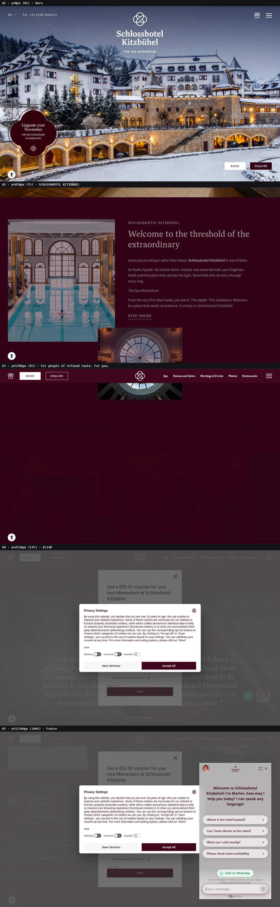
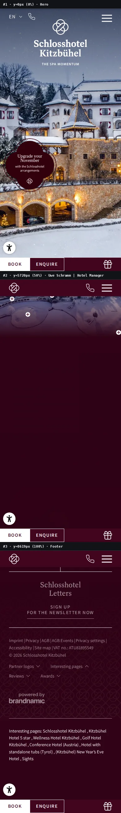

# UI Design System & Master Generation Blueprint: www-schlosshotel-kitzbuehel-com_en

> **Schlosshotel Kitzbühel – a premium experience** (https://www.schlosshotel-kitzbuehel.com/en) — A beacon of elegance, exclusivity, and warmth – Schlosshotel Kitzbühel is a truly unparalleled retreat.





---

## 1. Executive Visual Persona & Design Archetype

- **Brand Essence & Persona**: **Schlosshotel Kitzbühel – a premium experience** (`https://www.schlosshotel-kitzbuehel.com/en`). A beacon of elegance, exclusivity, and warmth – Schlosshotel Kitzbühel is a truly unparalleled retreat.
- **Capture Provenance**: Live browser capture (`tier1_fast`, HTTP `200`, captured `2026-11-24`).
- **Visual Archetype**: **High-Contrast Obsidian / Atmospheric Design System (`#300316` canvas, `#ffffff` ink, `#42041e` accent)**.
- **Anti-AI-Slop Differentiators**:
  - **Live-Computed Chromatic Polarity**: Anchors the viewport in `#300316` (live computed `body` `background-color` (`computed_styles.json`)) paired with `#ffffff` primary typography and `#42041e` accents.
  - **Grounded Typographic Hierarchy**: Uses `Assistant` across display (`SCHLOSSHOTEL KITZBÜHEL`) and body copy, paired with `SFMono-Regular` for monospace/code.
  - **Calibrated Spatial Grid & Motion**: Combines `1360px` container bounds (`gap: .3rem`, padding `36px`) with `cubic-bezier(.23,1,.32,1)` easing and Swiper Touch Carousel Engine.

---

## 2. Spatial Architecture & Modular Grid Mathematics

### Viewport Allocation & Container Geometry
- **Captured Journey Filmstrips**: Desktop `1280×4140px` (`assets/desktop-journey.webp`, `5` keyframes up to `y=12706px` / doc `19696px`), Mobile `390×2616px` (`assets/mobile-journey.webp`, `3` keyframes).
- **Master Container Bounds**: `1360px` (measured widest bounded `<section>` landmark width on `1440px` desktop).
- **Canvas Lateral Padding & Spacing**: `36px` lateral canvas padding with `.3rem` grid gap.
- **Border Radius Scale**: `2px`, `50%`, `5px`, `100%`.

### Responsive Breakpoint Architecture
- **Desktop Layout**: Multi-column CSS Grid / Flexbox layout at `1440px` (`max-width: 1360px`, `gap: .3rem`).
- **Mobile Layout**: Single-column vertical stack at `390px` viewport width with `36px` horizontal padding.
- **Extracted CSS Media Queries**: `@media (max-width: 1366px)`, `@media (max-width: 1024px)`, `@media (max-width: 767px)`, `@media (max-width: 480px)`.

---

## 3. Color System, Materiality & Atmospheric Lighting

### Semantic Palette & Source Grounding
| Semantic Role | Ground-Truth Value | Extracted Live / CSS Source |
|---|---|---|
| **Primary Canvas Substrate** | `#300316` | live computed `body` `background-color` (`computed_styles.json`) |
| **Primary Typography Ink** | `#ffffff` | live computed `h1` `color` (`computed_styles.json`) |
| **Elevated Surface / Card Substrate** | `#000000` | live computed `button` `background-color` (`computed_styles.json`) |
| **Interactive Accent / Highlight** | `#42041e` | `.branDNAmic .DNA-button--cta-bo... { color: #42041e }` |
| **Secondary / Muted Copy** | `#999999` | live computed `button` `color` (`computed_styles.json`) |
| **Structural Hairline Border** | `#2865ad` | `var(--BN-dynform--clr-button-border)` in `:root` |
| **Variable Token (`--BN-dynform--clr-scrollbar-thumb`)** | `#c4c4c4` | `var(--BN-dynform--clr-scrollbar-thumb)` in `:root` |
| **Variable Token (`--BN-dynform--clr-selection-text`)** | `#0b0b0b` | `var(--BN-dynform--clr-selection-text)` in `:root` |

### Sanitized Root CSS Variables (`ui-ux.md` Ground Truth)
| Variable Name | Extracted Value | Semantic Role |
|---|---|---|
| `--dna-tldr-bg` | `#300316` | Canvas / Surface Token |
| `--dna-tldr-text` | `#FFFFFF` | Typography Ink Token |
| `--dna-tldr-fs-desktop` | `2.1em` | Dimension / Scale Token |
| `--dna-tldr-fs-mobile` | `1.6em` | Dimension / Scale Token |
| `--BN-dynform--ff` | `inherit` | Design System Custom Token |
| `--BN-dynform--fw-bold` | `700` | Design System Custom Token |
| `--BN-dynform--fw-light` | `300` | Canvas / Surface Token |
| `--BN-dynform--fw-regular` | `400` | Design System Custom Token |
| `--BN-dynform--clr-scrollbar-thumb` | `#C4C4C4` | Color / Atmospheric Token |
| `--BN-dynform--clr-scrollbar-track` | `transparent` | Design System Custom Token |
| `--BN-dynform--clr-selection-bg` | `#C4C4C4` | Canvas / Surface Token |
| `--BN-dynform--clr-selection-text` | `#0B0B0B` | Typography Ink Token |
| `--BN-dynform--clr-form-bg` | `#ffffff` | Canvas / Surface Token |
| `--BN-dynform--clr-button-bg` | `#2865AD` | Canvas / Surface Token |
| `--BN-dynform--clr-button-border` | `#2865AD` | Elevation / Border Token |
| `--BN-dynform--clr-button-text` | `#ffffff` | Typography Ink Token |

---

## 4. Typographic Scale & Editorial Hierarchy

### Font Family Stacks
- **Display Typography**: `Assistant`.
- **Primary Body Stack**: `Assistant`.
- **Technical / Metadata Stack**: `SFMono-Regular`.

### Typographic Scale & Rules (Live Computed & Stylesheet Grounded)
- **Hero Display (`H1`)**: live computed `h1` (`font-size: 9.008px`, `line-height: 10.8096px`, `font-weight: 600`, `letter-spacing: 2.2px`); rule `h1` (`line-height: 1.2`, `font-weight: 500`).
- **Section Heading (`H2`)**: live computed `h2` (`font-size: 18.9168px`, `line-height: 29.5102px`, `font-weight: 700`); rule `h2` (`font-size: 1em`, `line-height: 1.2`, `font-weight: 500`).
- **Body Copy**: live computed `body` (`font-size: 9.008px`, `line-height: 14.0525px`, `font-weight: 400`); rule `p` (`font-size: 12px`).
- **Metadata & Navigation Labels**: live computed `nav/a` (`font-size: 9.008px`, `line-height: 14.0525px`, `font-weight: 400`).

---

## 5. Choreographed Motion & Interaction Physics

### Primary Easing Curves
- **Extracted Timing Functions**: `cubic-bezier(.23,1,.32,1)`, `cubic-bezier(0,0,0.25,1)`, `cubic-bezier(0.215,0.61,0.355,1)`.

### Per-Element Transition & Choreography Rules
- **Selector `Teaser .MOD-RoomsTeaser__item__me...`**: `transition: background-color .5s ease-out` extracted from `www-schlosshotel-kitzbuehel-com_en` stylesheet.
- **Selector `MOD-RoomsTeaser .MOD-RoomsTeaser_...`**: `transition: margin-top .25s,max-height .25s,opacity .25s` extracted from `www-schlosshotel-kitzbuehel-com_en` stylesheet.
- **Selector `RoomsTeaser .MOD-RoomsTeaser__ite...`**: `transition: opacity .5s .25s ease-out` extracted from `www-schlosshotel-kitzbuehel-com_en` stylesheet.
- **Extracted Easing Curve (`cubic-bezier(.23,1,.32,1)`)**: Governs interactive state transitions across `<header.SECT-Header>` and `<section.MOD-OffersTeaser>`.
- **Runtime Interaction Engine**: Integrates Swiper Touch Carousel Engine with `prefers-reduced-motion: reduce` fallback guards.
### Measured Runtime Scroll & Interaction Telemetry (`behavioral_journey_v2`)
- **Scroll Driver Mode**: `native` (max document height `19696px`, deepest scrollY reached `12706px` across `5` desktop keyframes).
- **Detected Scroll / Motion Libraries**: Native browser scroll / standard CSS transitions.
- **Hover Physics (`primary_cta` · `BOOK`)**: Computed transition `0.25s, 0.25s` / `ease, ease` (no static color/transform shift captured at rest).
- **Route Transition Architecture**: First internal navigation (`/en/vouchers`) measured as `direct` in `655ms`.

---

## 6. Component Wireframe & Structural DOM Map

### Visual Layout Schematic — Desktop (`1440px`, Grounded in `dom.html` & Landmark Bounding Boxes)
```
┌────────────────────────────────────────────────────────────────────────┐
│ DESKTOP VIEWPORT (1440px) — Schlosshotel Kitzbühel – a premium experie │
│ ====================================================================== │
│ [ <header.SECT-Header> (1440x0px)     | Book · Enquire · Spa · Rooms ] │
│ ---------------------------------------------------------------------- │
│ | HERO STAGE: <section.MOD-RoomsTeaser> (w=1440px)                   | │
│ | H1: SCHLOSSHOTEL KITZBÜHEL                                         | │
│ | Substrate: #300316 | Ink: #ffffff | Accent: #42041e                | │
│ ---------------------------------------------------------------------- │
│ | SHOWCASE GRID (<section.MOD-OffersTeaser>) max-w: 1360px           | │
│ | +------------------------------+  +------------------------------+ | │
│ | | Schlosshotel Kitzbühel       |  | Welcome to the threshold of  | | │
│ | +------------------------------+  +------------------------------+ | │
│ ---------------------------------------------------------------------- │
│ | DETAIL MODULE (<section.MOD-Text>) — For people of refined         | │
│ ---------------------------------------------------------------------- │
│ [ FOOTER (<footer.SECT-Footer>) | https://www.schlosshotel-kitzbuehel  │
└────────────────────────────────────────────────────────────────────────┘
```

### Visual Layout Schematic — Mobile Reflow (`390px`)
```
┌────────────────────────────────────────────────────────────────────────┐
│ MOBILE VIEWPORT REFLOW (390px) — Single-Column Stack (gap: .3rem)      │
│ ====================================================================== │
│ [ HEADER BAR (<header.SECT-Header>    ) | Compact Menu (390px)         │
│ ---------------------------------------------------------------------- │
│ | HERO STAGE (<section.MOD-RoomsTeaser) — 390px Vertical Lead        | │
│ | H1: SCHLOSSHOTEL KITZBÜHEL                                         | │
│ ---------------------------------------------------------------------- │
│ | SHOWCASE STACK (<section.MOD-OffersTea) — 1-Col Stack              | │
│ | [ Item 1: Schlosshotel Kitzbühel                                 ] | │
│ | [ Item 2: Welcome to the threshold of the extraordinary          ] | │
│ ---------------------------------------------------------------------- │
│ | DETAIL STACK (<section.MOD-Text>) — 1-Col (For people of refi)     | │
│ ---------------------------------------------------------------------- │
│ [ FOOTER (<footer.SECT-Footer>) | Stacked 390px Colophon               │
└────────────────────────────────────────────────────────────────────────┘
```

### Granular DOM Region Breakdown
1. **Brand Header & Navigation Bar (<header.SECT-Header> — `www-schlosshotel-kitzbuehel-com_en`)**:
   - Landmark `<header class="SECT-Header DNA-section">` (`1440x0px`) hosting `Schlosshotel Kitzbühel – a premium e` navigation (`Book · Enquire · Spa · Rooms and Suites · Meetings & Events`), DOM attributes (`data-asset-id="Scss/presets"`, `data-asset-id="Scss/vendors"`, `data-asset-id="Globals/Main"`, `data-asset-id="Sections/Header"`), and stylesheet rule `from { transform:translateX(0) }`.
2. **Hero Stage & Focal Lead (<section.MOD-RoomsTeaser> — `SCHLOSSHOTEL KITZBÜHEL`)**:
   - Landmark `<section class="MOD-RoomsTeaser DNA-module">` presenting display lead `SCHLOSSHOTEL KITZBÜHEL` and copy excerpt *"Some places whisper rather than shout. Schlosshotel Kitzbühel is "* over `#300316` canvas and `#ffffff` ink.
3. **Primary Showcase & Content Grid (<section.MOD-OffersTeaser> — `Schlosshotel Kitzbühel`)**:
   - Landmark `<section class="MOD-OffersTeaser DNA-module">` rendering section `Schlosshotel Kitzbühel` with copy *"Schlosshotel Kitzbühel"*, asset references (`favicon-96x96.png`, `favicon.svg`, `favicon.ico`, `apple-touch-icon.png`), and grid rule `page { margin:.5cm }`.
4. **Interactive Detail & Feature Matrix (<section.MOD-Text> — `Welcome to the threshold of the ex`)**:
   - Landmark `<section class="MOD-Text DNA-module">` framing `Welcome to the threshold of the extraordinary` and `For people of refined taste. For you.` (*"Welcome to the threshold of the extraordinary"*) with `#000000` surface cards, `#42041e` accents, and `body { font-family:Arial,sans-serif;font-size:12px }`.
5. **Colophon & Global Directory Footer (<footer.SECT-Footer> — `https://www.schlosshotel-kitzbuehel.com/en`)**:
   - Landmark `<footer class="SECT-Footer DNA-section">` anchoring `Schlosshotel Kitzbühel – a premi` footer links (`Book · Enquire · Spa · Rooms and Suites · Meetings & Events`), copy *"No flashy façade. No hollow shine. Instead: real stone benea"*, and `#2865ad` structural dividers.
### Full Vertical Scroll Sequence (Desktop `1440×900` Keyframes)
- **Step 01** (`y=0px`, `0%`): Active landmark `Hero` · sticky/fixed elements: `1`
- **Step 02** (`y=850px`, `5%`): Active landmark `SCHLOSSHOTEL KITZBÜHEL` · sticky/fixed elements: `1`
- **Step 03** (`y=1700px`, `9%`): Active landmark `For people of refined taste. For you.` · sticky/fixed elements: `3`
- **Step 04** (`y=2550px`, `14%`): Active landmark `c140` · sticky/fixed elements: `4`
- **Step 05** (`y=12706px`, `100%`): Active landmark `Footer` · sticky/fixed elements: `3`

### Multi-Page Internal Route Map
- **Detail Route (`/en/vouchers`)**: `https://www.schlosshotel-kitzbuehel.com/en/vouchers` — H1: `A MAGICAL INVITATION`, scrollHeight `3444px`, transition `direct` (`655ms`)
- **Detail Route (`/en/enquiry`)**: `https://www.schlosshotel-kitzbuehel.com/en/enquiry` — H1: `YOU SAY WHEN. WE SAY: WITH PLEASURE.`, scrollHeight `3078px`, transition `direct` (`1492ms`)
- **Detail Route (`/en/wellness-hotel-kitzbuhel`)**: `https://www.schlosshotel-kitzbuehel.com/en/wellness-hotel-kitzbuhel` — H1: `PREMIUM WELLNESS HOTEL IN KITZBÜHEL`, scrollHeight `13397px`, transition `direct` (`4522ms`)

---

## 7. Master Zero-Shot AI Generation Prompt

```markdown
# Master Zero-Shot Frontend Generation Prompt: www-schlosshotel-kitzbuehel-com_en (Schlosshotel Kitzbühel – a premium experience)

You are a principal frontend architect and design systems engineer. Build a complete, production-ready web application replicating the exact design system, DOM landmarks, typographic hierarchy, color tokens, and motion physics of `www-schlosshotel-kitzbuehel-com_en` (**Schlosshotel Kitzbühel – a premium experience** — `https://www.schlosshotel-kitzbuehel.com/en`).

### 1. Visual Archetype & Anti-AI-Slop Mandates
- **Archetype**: High-Contrast Obsidian / Atmospheric Design System (`#300316` canvas, `#ffffff` ink, `#42041e` accent).
- **Identity & Domain Context**: A beacon of elegance, exclusivity, and warmth – Schlosshotel Kitzbühel is a truly unparalleled retreat.
- **Primary Substrate**: `#300316` (live computed `body` `background-color` (`computed_styles.json`)), **Primary Ink**: `#ffffff`, **Accent / Highlight**: `#42041e`.
- **Site-Specific Differentiators**:
  - **Live-Computed Chromatic Polarity**: Anchors the viewport in `#300316` (live computed `body` `background-color` (`computed_styles.json`)) paired with `#ffffff` primary typography and `#42041e` accents.
  - **Grounded Typographic Hierarchy**: Uses `Assistant` across display (`SCHLOSSHOTEL KITZBÜHEL`) and body copy, paired with `SFMono-Regular` for monospace/code.
  - **Calibrated Spatial Grid & Motion**: Combines `1360px` container bounds (`gap: .3rem`, padding `36px`) with `cubic-bezier(.23,1,.32,1)` easing and Swiper Touch Carousel Engine.

### 2. Ground-Truth CSS Variables (`:root` Token Contract)
Declare and consume these exact custom properties extracted from `www-schlosshotel-kitzbuehel-com_en` in your global stylesheet:

:root {
  /* Schlosshotel Kitzbühel – a premium experience (www-schlosshotel-kitzbuehel-com_en) — Live-Grounded CSS Variables */
  --dna-tldr-bg: #300316; /* Canvas / Surface Token (www-schlosshotel-kitzbuehel-com_en) */
  --dna-tldr-text: #FFFFFF; /* Typography Ink Token (www-schlosshotel-kitzbuehel-com_en) */
  --dna-tldr-fs-desktop: 2.1em; /* Dimension / Scale Token (www-schlosshotel-kitzbuehel-com_en) */
  --dna-tldr-fs-mobile: 1.6em; /* Dimension / Scale Token (www-schlosshotel-kitzbuehel-com_en) */
  --BN-dynform--ff: inherit; /* Design System Custom Token (www-schlosshotel-kitzbuehel-com_en) */
  --BN-dynform--fw-bold: 700; /* Design System Custom Token (www-schlosshotel-kitzbuehel-com_en) */
  --BN-dynform--fw-light: 300; /* Canvas / Surface Token (www-schlosshotel-kitzbuehel-com_en) */
  --BN-dynform--fw-regular: 400; /* Design System Custom Token (www-schlosshotel-kitzbuehel-com_en) */
  --BN-dynform--clr-scrollbar-thumb: #C4C4C4; /* Color / Atmospheric Token (www-schlosshotel-kitzbuehel-com_en) */
  --BN-dynform--clr-scrollbar-track: transparent; /* Design System Custom Token (www-schlosshotel-kitzbuehel-com_en) */
  --BN-dynform--clr-selection-bg: #C4C4C4; /* Canvas / Surface Token (www-schlosshotel-kitzbuehel-com_en) */
  --BN-dynform--clr-selection-text: #0B0B0B; /* Typography Ink Token (www-schlosshotel-kitzbuehel-com_en) */
  --BN-dynform--clr-form-bg: #ffffff; /* Canvas / Surface Token (www-schlosshotel-kitzbuehel-com_en) */
  --BN-dynform--clr-button-bg: #2865AD; /* Canvas / Surface Token (www-schlosshotel-kitzbuehel-com_en) */
  --BN-dynform--clr-button-border: #2865AD; /* Elevation / Border Token (www-schlosshotel-kitzbuehel-com_en) */
  --BN-dynform--clr-button-text: #ffffff; /* Typography Ink Token (www-schlosshotel-kitzbuehel-com_en) */
}

### 3. Semantic Color & Materiality Contract
Map every surface, ink, and border strictly to these source-grounded tokens:
- **Primary Canvas Substrate**: `#300316` — grounded in live computed `body` `background-color` (`computed_styles.json`)
- **Primary Typography Ink**: `#ffffff` — grounded in live computed `h1` `color` (`computed_styles.json`)
- **Elevated Surface / Card Substrate**: `#000000` — grounded in live computed `button` `background-color` (`computed_styles.json`)
- **Interactive Accent / Highlight**: `#42041e` — grounded in `.branDNAmic .DNA-button--cta-bo... { color: #42041e }`
- **Secondary / Muted Copy**: `#999999` — grounded in live computed `button` `color` (`computed_styles.json`)
- **Structural Hairline Border**: `#2865ad` — grounded in `var(--BN-dynform--clr-button-border)` in `:root`
- **Variable Token (`--BN-dynform--clr-scrollbar-thumb`)**: `#c4c4c4` — grounded in `var(--BN-dynform--clr-scrollbar-thumb)` in `:root`
- **Variable Token (`--BN-dynform--clr-selection-text`)**: `#0b0b0b` — grounded in `var(--BN-dynform--clr-selection-text)` in `:root`

### 4. Spatial Grid, Container Bounds & Responsive Breakpoints
- **Desktop Viewport Reference**: `1280×4140px` (multi-frame vertical journey filmstrip (4140px), `1440px` standard desktop width).
- **Mobile Viewport Reference**: `390×2616px` (multi-frame vertical journey filmstrip (2616px), `390px` standard mobile width).
- **Container Max-Width**: `1360px` (measured widest bounded `<section>` landmark width on `1440px` desktop)
- **Padding & Gutters**: `36px` lateral canvas padding with `.3rem` grid gap
- **Desktop Grid**: Multi-column CSS Grid / Flexbox layout at `1440px` (`max-width: 1360px`, `gap: .3rem`)
- **Mobile Adaptation**: Single-column vertical stack at `390px` viewport width with `36px` horizontal padding
- **Media Queries**: `@media (max-width: 1366px)`, `@media (max-width: 1024px)`, `@media (max-width: 767px)`, `@media (max-width: 480px)`
- **Corner Radii**: `2px`, `50%`, `5px`, `100%`

### 5. Typography & Editorial Scale Contract
- **Display Font Stack**: `Assistant`
- **Body Font Stack**: `Assistant`
- **Monospace / Technical Font Stack**: `SFMono-Regular`
- **H1 Display Rule**: live computed `h1` (`font-size: 9.008px`, `line-height: 10.8096px`, `font-weight: 600`, `letter-spacing: 2.2px`); rule `h1` (`line-height: 1.2`, `font-weight: 500`)
- **H2 Section Rule**: live computed `h2` (`font-size: 18.9168px`, `line-height: 29.5102px`, `font-weight: 700`); rule `h2` (`font-size: 1em`, `line-height: 1.2`, `font-weight: 500`)
- **Body Copy Rule**: live computed `body` (`font-size: 9.008px`, `line-height: 14.0525px`, `font-weight: 400`); rule `p` (`font-size: 12px`)
- **Metadata & Index Rule**: live computed `nav/a` (`font-size: 9.008px`, `line-height: 14.0525px`, `font-weight: 400`)

### 6. Component Hierarchy, Verbatim Copy & Real DOM Landmarks
Scaffold `www-schlosshotel-kitzbuehel-com_en` (`Schlosshotel Kitzbühel – a premium experience`) with these exact structural regions, extracted copy, and CSS rules from `dom.html`:
1. **Brand Header & Navigation Bar (<header.SECT-Header> — `www-schlosshotel-kitzbuehel-com_en`)**:
   - DOM & Selectors: Landmark `<header class="SECT-Header DNA-section">` (`1440x0px`) hosting `Schlosshotel Kitzbühel – a premium e` navigation (`Book · Enquire · Spa · Rooms and Suites · Meetings & Events`), DOM attributes (`data-asset-id="Scss/presets"`, `data-asset-id="Scss/vendors"`, `data-asset-id="Globals/Main"`, `data-asset-id="Sections/Header"`), and stylesheet rule `from { transform:translateX(0) }`.
   - Responsive Contract: Header `Brand Header & Navigation Bar (<header.SECT-Header> — `www-schlosshotel-kitzbuehel-com_en`)` (`www-schlosshotel-kitzbuehel-com_en`) adapts across `@media (max-width: 1366px)`, `@media (max-width: 1024px)`, `@media (max-width: 767px)`, `@media (max-width: 480px)` with `cubic-bezier(.23,1,.32,1)`, `cubic-bezier(0,0,0.25,1)`, `cubic-bezier(0.215,0.61,0.355,1)` transitions and links `Book · Enquire · Spa · Rooms and Suites · Meetings & Events`.
2. **Hero Stage & Focal Lead (<section.MOD-RoomsTeaser> — `SCHLOSSHOTEL KITZBÜHEL`)**:
   - DOM & Selectors: Landmark `<section class="MOD-RoomsTeaser DNA-module">` presenting display lead `SCHLOSSHOTEL KITZBÜHEL` and copy excerpt *"Some places whisper rather than shout. Schlosshotel Kitzbühel is "* over `#300316` canvas and `#ffffff` ink.
   - Responsive Contract: Hero stage (`1280×4140px` desktop / `390×2616px` mobile) sets `#300316` background with `#ffffff` headline `SCHLOSSHOTEL KITZBÜHEL`.
3. **Primary Showcase & Content Grid (<section.MOD-OffersTeaser> — `Schlosshotel Kitzbühel`)**:
   - DOM & Selectors: Landmark `<section class="MOD-OffersTeaser DNA-module">` rendering section `Schlosshotel Kitzbühel` with copy *"Schlosshotel Kitzbühel"*, asset references (`favicon-96x96.png`, `favicon.svg`, `favicon.ico`, `apple-touch-icon.png`), and grid rule `page { margin:.5cm }`.
   - Responsive Contract: Showcase grid `Primary Showcase & Content Grid (<section.MOD-OffersTeaser> — `Schlosshotel Kitzbühel`)` applies Multi-column CSS Grid / Flexbox layout at `1440px` (`max-width: 1360px`, `gap: .3rem`) on desktop and Single-column vertical stack at `390px` viewport width with `36px` horizontal padding on mobile.
4. **Interactive Detail & Feature Matrix (<section.MOD-Text> — `Welcome to the threshold of the ex`)**:
   - DOM & Selectors: Landmark `<section class="MOD-Text DNA-module">` framing `Welcome to the threshold of the extraordinary` and `For people of refined taste. For you.` (*"Welcome to the threshold of the extraordinary"*) with `#000000` surface cards, `#42041e` accents, and `body { font-family:Arial,sans-serif;font-size:12px }`.
   - Responsive Contract: Detail module `Interactive Detail & Feature Matrix (<section.MOD-Text> — `Welcome to the threshold of the ex`)` uses `2px`, `50%`, `5px`, `100%` radii, `#42041e` highlights, and assets (favicon-96x96.png, favicon.svg, favicon.ico).
5. **Colophon & Global Directory Footer (<footer.SECT-Footer> — `https://www.schlosshotel-kitzbuehel.com/en`)**:
   - DOM & Selectors: Landmark `<footer class="SECT-Footer DNA-section">` anchoring `Schlosshotel Kitzbühel – a premi` footer links (`Book · Enquire · Spa · Rooms and Suites · Meetings & Events`), copy *"No flashy façade. No hollow shine. Instead: real stone benea"*, and `#2865ad` structural dividers.
   - Responsive Contract: Footer `Colophon & Global Directory Footer (<footer.SECT-Footer> — `https://www.schlosshotel-kitzbuehel.com/en`)` aligns to `1360px` (measured widest bounded `<section>` landmark width on `1440px` desktop) with `36px` lateral canvas padding with `.3rem` grid gap and attributes (data-asset-id="Scss/presets", data-asset-id="Scss/vendors", data-asset-id="Globals/Main").

#### Verbatim DOM Copy Excerpts (`dom.html`)
- Copy Excerpt 1: *"Some places whisper rather than shout. Schlosshotel Kitzbühel is one of them."*
- Copy Excerpt 2: *"Schlosshotel Kitzbühel"*
- Copy Excerpt 3: *"Welcome to the threshold of the extraordinary"*
- Copy Excerpt 4: *"No flashy façade. No hollow shine. Instead: real stone beneath your fingertips. Ha..."*

### 7. Motion, Extracted Stylesheet Rules & Interaction Choreography
- **Primary Easing Functions**: `cubic-bezier(.23,1,.32,1)`, `cubic-bezier(0,0,0.25,1)`, `cubic-bezier(0.215,0.61,0.355,1)`
- **Extracted Stylesheet Rules (`www-schlosshotel-kitzbuehel-com_en`)**:
- `from { transform:translateX(0) }`
- `page { margin:.5cm }`
- `body { font-family:Arial,sans-serif;font-size:12px }`
- `a:visited { text-decoration:none }`
- `after { display:none }`
- **Per-Selector Transition Rules**:
- **Selector `Teaser .MOD-RoomsTeaser__item__me...`**: `transition: background-color .5s ease-out` extracted from `www-schlosshotel-kitzbuehel-com_en` stylesheet.
- **Selector `MOD-RoomsTeaser .MOD-RoomsTeaser_...`**: `transition: margin-top .25s,max-height .25s,opacity .25s` extracted from `www-schlosshotel-kitzbuehel-com_en` stylesheet.
- **Selector `RoomsTeaser .MOD-RoomsTeaser__ite...`**: `transition: opacity .5s .25s ease-out` extracted from `www-schlosshotel-kitzbuehel-com_en` stylesheet.
- **Extracted Easing Curve (`cubic-bezier(.23,1,.32,1)`)**: Governs interactive state transitions across `<header.SECT-Header>` and `<section.MOD-OffersTeaser>`.
- **Runtime Interaction Engine**: Integrates Swiper Touch Carousel Engine with `prefers-reduced-motion: reduce` fallback guards.
### 7b. Full-Page Scroll Choreography, Interactive States & Multi-Page Routes
- **Scroll Mechanics**: Implement `native` vertical progression up to `19696px` across 5 distinct viewport chapters.
- **Vertical Chapter Sequence**: Hero (0%) -> SCHLOSSHOTEL KITZBÜHEL (5%) -> For people of refined taste... (9%) -> c140 (14%) -> Footer (100%).
- **Multi-Page Routes**: Scaffold internal routes `/en/vouchers` (detail, direct), `/en/enquiry` (detail, direct), `/en/wellness-hotel-kitzbuhel` (detail, direct) sharing the global header/footer shell and design tokens.

### 8. Technical Deliverables
- Implement in Next.js (App Router) with TypeScript and Tailwind CSS consuming the `:root` custom properties defined above for `www-schlosshotel-kitzbuehel-com_en`.
- Reproduce both the `1440px` desktop architecture and `390px` mobile breakpoint transitions, preserving semantic HTML5 landmarks (`<header>`, `<nav>`, `<main>`, `<section>`, `<footer>`) and `prefers-reduced-motion` accessibility guards.
```
---

## 8. Full-Page Scroll Journey, Interactive States & Subpage Inventory

### Desktop Scroll Keyframes (`1440×900` WebP)
| Step | Scroll Y | Progress | Active Landmark / Section | Sticky/Fixed | Visual Asset |
| :---: | :---: | :---: | :--- | :---: | :--- |
| `#01` | `0px` | `0%` | Hero | `1` | [desktop-step-01.webp](assets/desktop-step-01.webp) |
| `#02` | `850px` | `5%` | SCHLOSSHOTEL KITZBÜHEL | `1` | [desktop-step-02.webp](assets/desktop-step-02.webp) |
| `#03` | `1700px` | `9%` | For people of refined taste. For you. | `3` | [desktop-step-03.webp](assets/desktop-step-03.webp) |
| `#04` | `2550px` | `14%` | c140 | `4` | [desktop-step-04.webp](assets/desktop-step-04.webp) |
| `#05` | `12706px` | `100%` | Footer | `3` | [desktop-step-05.webp](assets/desktop-step-05.webp) |

### Mobile Condensed Keyframes (`390×844` WebP)
| Step | Scroll Y | Progress | Active Landmark | Visual Asset |
| :---: | :---: | :---: | :--- | :--- |
| `#01` | `0px` | `0%` | Hero | [mobile-step-01.webp](assets/mobile-step-01.webp) |
| `#02` | `5720px` | `50%` | Uwe Schramm · Hotel Manager | [mobile-step-02.webp](assets/mobile-step-02.webp) |
| `#03` | `8619px` | `100%` | Footer | [mobile-step-03.webp](assets/mobile-step-03.webp) |

### Internal Subpage Filmstrips (`1080px` Wide WebP)
| # | Template | Route URL | H1 / Title | Scroll Height | Transition | Filmstrip Asset |
| :-: | :---: | :--- | :--- | :---: | :---: | :--- |
| `1` | `detail` | `https://www.schlosshotel-kitzbuehel.com/en/vouchers` | A MAGICAL INVITATION | `3444px` | `direct` (`655ms`) | [subpage-01-en-vouchers.webp](assets/subpage-01-en-vouchers.webp) |
| `2` | `detail` | `https://www.schlosshotel-kitzbuehel.com/en/enquiry` | YOU SAY WHEN. WE SAY: WITH PLEASURE. | `3078px` | `direct` (`1492ms`) | [subpage-02-en-enquiry.webp](assets/subpage-02-en-enquiry.webp) |
| `3` | `detail` | `https://www.schlosshotel-kitzbuehel.com/en/wellness-hotel-kitzbuhel` | PREMIUM WELLNESS HOTEL IN KITZBÜHEL | `13397px` | `direct` (`4522ms`) | [subpage-03-en-wellness-hotel-kitzbuhel.webp](assets/subpage-03-en-wellness-hotel-kitzbuhel.webp) |

