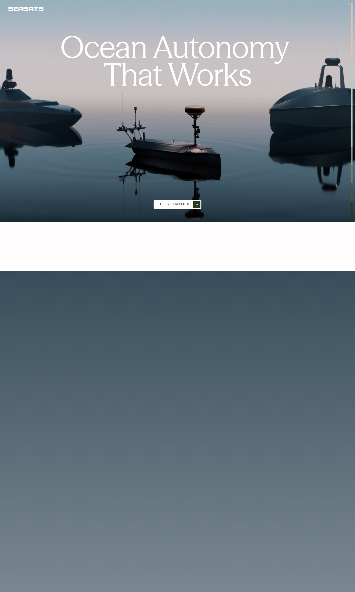
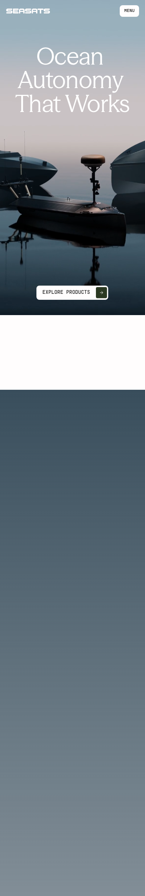

# UI Design System & Master Generation Blueprint: www-seasats-com

> **Seasats · Ocean Autonomy That Works** (https://www.seasats.com/) — Missions completed for defense, science, and commercial customers around the world.



---

## 1. Executive Visual Persona & Design Archetype

- **Brand Essence & Persona**: **Seasats · Ocean Autonomy That Works** (`https://www.seasats.com/`). Missions completed for defense, science, and commercial customers around the world.
- **Capture Provenance**: Live browser capture (`tier1_fast`, HTTP `200`, captured `2026-11-23`).
- **Visual Archetype**: **Light-Gallery WebGL / Canvas Interactive Experience (`#fffdfd` / `#4e9a85`)**.
- **Anti-AI-Slop Differentiators**:
  - **Live-Computed Chromatic Polarity**: Anchors the viewport in `#fffdfd` (live computed `html` `background-color` (`computed_styles.json`)) paired with `#232323` primary typography and `#4e9a85` accents.
  - **Grounded Typographic Hierarchy**: Pairs `seasonMix` for display copy (`Ocean Autonomy That Works`) with `seasonSans` and `supplyMono`.
  - **Calibrated Spatial Grid & Motion**: Combines `1440px` container bounds (`gap: .8rem`, padding `1rem`) with `cubic-bezier(.215,.61,.355,1)` easing and Lenis Smooth Scroll (`data-lenis`), GSAP Timeline & ScrollTrigger.

---

## 2. Spatial Architecture & Modular Grid Mathematics



### Viewport Allocation & Container Geometry
- **Captured Viewport Dimensions**: Desktop `1440×2400px` (`assets/desktop.png`, clamped at 2400px live multi-section capture), Mobile `390×2400px` (`assets/mobile.png`, clamped at 2400px live multi-section capture).
- **Master Container Bounds**: `1440px` (full-bleed `100%` desktop stage measured on `1440px` viewport).
- **Canvas Lateral Padding & Spacing**: `1rem` lateral canvas padding with `.8rem` grid gap.
- **Border Radius Scale**: `8px`, `2px`, `50%`, `999px`.

### Responsive Breakpoint Architecture
- **Desktop Layout**: Multi-column CSS Grid / Flexbox layout at `1440px` (`max-width: 1440px`, `gap: .8rem`).
- **Mobile Layout**: Single-column vertical stack at `390px` viewport width with `1rem` horizontal padding.
- **Extracted CSS Media Queries**: `@media screen and (max-width:1023px)`, `@media screen and (max-width:519px)`, `@media screen and (min-width:1024px)`, `@media screen and (max-width:1023px)and (max-width:519px)`.

---

## 3. Color System, Materiality & Atmospheric Lighting

### Semantic Palette & Source Grounding
| Semantic Role | Ground-Truth Value | Extracted Live / CSS Source |
|---|---|---|
| **Primary Canvas Substrate** | `#fffdfd` | live computed `html` `background-color` (`computed_styles.json`) |
| **Primary Typography Ink** | `#232323` | live computed `main` `color` (`computed_styles.json`) |
| **Elevated Surface / Card Substrate** | `#e3ede4` | `var(--modal-contentBackgroundColor)` in `:root` |
| **Interactive Accent / Highlight** | `#4e9a85` | `var(--gradient)` in `:root` |
| **Secondary / Muted Copy** | `#ffffff` | live computed `h1` `color` (`computed_styles.json`) |
| **Structural Hairline Border** | `#dcdada` | `.ContentStats_item__LxyN9 { border-top: #dcdada }` |
| **Variable Token (`--gradient`)** | `#183f34` | `var(--gradient)` in `:root` |
| **Variable Token (`--gradient`)** | `#2b3922` | `var(--gradient)` in `:root` |

### Sanitized Root CSS Variables (`ui-ux.md` Ground Truth)
| Variable Name | Extracted Value | Semantic Role |
|---|---|---|
| `--wrapperWidth` | `144rem` | Layout / Spatial Grid Token |
| `--headerHeight` | `7.2rem` | Layout / Spatial Grid Token |
| `--columns` | `24` | Layout / Spatial Grid Token |
| `--gutter` | `1.2rem` | Layout / Spatial Grid Token |
| `--margin` | `3.2rem` | Layout / Spatial Grid Token |
| `--radius` | `0.8rem` | Elevation / Border Token |
| `--colorText` | `#232323` | Typography Ink Token |
| `--colorAccent` | `#e3ede4` | Brand / Palette Token |
| `--gradient` | `linear-gradient(180deg,#4e9a85,#183f34 52.82%,#2b3922 75.83%)` | Color / Atmospheric Token |
| `--body-adjustOffset` | `calc(59.8rem / -2)` | Dimension / Scale Token |
| `--body-adjustScale` | `0.66` | Design System Custom Token |
| `--body-adjustScalePrecise` | `0.585` | Design System Custom Token |
| `--fontSeasonMix` | `"seasonMix","seasonMix Fallback",serif` | Typography / Scale Token |
| `--fontSeasonSans` | `"seasonSans","seasonSans Fallback",sans-serif` | Typography / Scale Token |
| `--fontSupplyMono` | `"supplyMono","supplyMono Fallback",monospace` | Typography / Scale Token |
| `--uiOffset` | `48px` | Dimension / Scale Token |

---

## 4. Typographic Scale & Editorial Hierarchy

### Font Family Stacks
- **Display Typography**: `seasonMix`.
- **Primary Body Stack**: `seasonSans`.
- **Technical / Metadata Stack**: `supplyMono`.

### Typographic Scale & Rules (Live Computed & Stylesheet Grounded)
- **Hero Display (`H1`)**: live computed `h1` (`font-size: 124px`, `line-height: 111.6px`, `font-weight: 400`, `letter-spacing: -1.24px`); rule `h1` (`font-size: 4.8rem`, `line-height: 1`, `letter-spacing: -.01em`, `font-weight: 400`).
- **Section Heading (`H2`)**: live computed `h2` (`font-size: 80px`, `line-height: 80px`, `font-weight: 400`, `letter-spacing: -0.8px`); rule `h2` (`font-size: 2.4rem`, `line-height: 1.2`, `letter-spacing: 0`, `font-weight: 400`).
- **Body Copy**: live computed `body` (`font-size: 16px`, `line-height: 22.4px`, `font-weight: 400`); CSS variables `--body-adjustOffset: calc(59.8rem / -2)`, `--body-adjustScale: 0.66`, `--body-adjustScalePrecise: 0.585`.
- **Metadata & Navigation Labels**: live computed `nav/a` (`font-size: 24px`, `line-height: 28.8px`, `font-weight: 500`); CSS variables `--fontSupplyMono: "supplyMono","supplyMono Fallback",monospace`.

---

## 5. Choreographed Motion & Interaction Physics

### Primary Easing Curves
- **Extracted Timing Functions**: `cubic-bezier(.215,.61,.355,1)`, `cubic-bezier(.23,.88,.26,.92)`, `cubic-bezier(.55,.055,.675,.19)`.

### Per-Element Transition & Choreography Rules
- **Selector `.swiper-wrapper`**: `transition: var(--swiper-wrapper-transition-timing-function,initial)` extracted from `www-seasats-com` stylesheet.
- **Selector `media screen and (min-width:1024px)`**: `transition: transform .8s ease` extracted from `www-seasats-com` stylesheet.
- **Selector `.nav)) .overlay-adjust--center`**: `transition: transform .8s ease` extracted from `www-seasats-com` stylesheet.
- **Extracted Easing Curve (`cubic-bezier(.215,.61,.355,1)`)**: Governs interactive state transitions across `<header.Header_container__U6gzw>` and `<main.browser-ui-overlay--top>`.
- **Runtime Interaction Engine**: Integrates Lenis Smooth Scroll (`data-lenis`), GSAP Timeline & ScrollTrigger, Three.js / WebGL Canvas Pipeline, Swiper Touch Carousel Engine, Barba.js Page Transition Router with `prefers-reduced-motion: reduce` fallback guards.

---

## 6. Component Wireframe & Structural DOM Map

### Visual Layout Schematic — Desktop (`1440px`, Grounded in `dom.html` & Landmark Bounding Boxes)
```
┌────────────────────────────────────────────────────────────────────────┐
│ DESKTOP VIEWPORT (1440px) — Seasats · Ocean Autonomy That Works        │
│ ====================================================================== │
│ [ <header.Header_contain (1376x72px)  | Home · 01 Capabilities · 02  ] │
│ ---------------------------------------------------------------------- │
│ | HERO STAGE: <main.browser-ui-overlay> (w=1440px)                   | │
│ | H1: Ocean Autonomy That Works                                      | │
│ | Substrate: #fffdfd | Ink: #232323 | Accent: #4e9a85                | │
│ ---------------------------------------------------------------------- │
│ | SHOWCASE GRID (<main.browser-ui-overlay--) max-w: 1440px           | │
│ | +------------------------------+  +------------------------------+ | │
│ | | Deploy in minutes.           |  | Detect from miles.           | | │
│ | +------------------------------+  +------------------------------+ | │
│ ---------------------------------------------------------------------- │
│ | DETAIL MODULE (<main.ThemeBackground_back) — React at once.        | │
│ ---------------------------------------------------------------------- │
│ [ FOOTER (<footer.footer>     ) | https://www.seasats.com/             │
└────────────────────────────────────────────────────────────────────────┘
```

### Visual Layout Schematic — Mobile Reflow (`390px`)
```
┌────────────────────────────────────────────────────────────────────────┐
│ MOBILE VIEWPORT REFLOW (390px) — Single-Column Stack (gap: .8rem)      │
│ ====================================================================== │
│ [ HEADER BAR (<header.Header_container) | Compact Menu (390px)         │
│ ---------------------------------------------------------------------- │
│ | HERO STAGE (<main.browser-ui-overlay) — 390px Vertical Lead        | │
│ | H1: Ocean Autonomy That Works                                      | │
│ ---------------------------------------------------------------------- │
│ | SHOWCASE STACK (<main.browser-ui-overl) — 1-Col Stack              | │
│ | [ Item 1: Deploy in minutes.                                     ] | │
│ | [ Item 2: Detect from miles.                                     ] | │
│ ---------------------------------------------------------------------- │
│ | DETAIL STACK (<main.ThemeBackground_ba) — 1-Col (React at once.)   | │
│ ---------------------------------------------------------------------- │
│ [ FOOTER (<footer.footer>     ) | Stacked 390px Colophon               │
└────────────────────────────────────────────────────────────────────────┘
```

### Granular DOM Region Breakdown
1. **Brand Header & Navigation Bar (<header.Header_container__U6gzw> — `www-seasats-com`)**:
   - Landmark `<header class="Header_container__U6gzw">` (`1376x72px`) hosting `Seasats · Ocean Autonomy That Works` navigation (`Home · 01 Capabilities · 02 Past Missions · Products · 01 Comparison`), DOM attributes (`data-precedence="next"`, `data-precedence="next"`, `data-precedence="next"`, `data-precedence="next"`), and stylesheet rule `video { margin:0;padding:0;font:inherit;font-size:100%;vertical-align:baseline;b... }`.
2. **Hero Stage & Focal Lead (<main.browser-ui-overlay> — `Ocean Autonomy That Works`)**:
   - Landmark `<main class="browser-ui-overlay">` presenting display lead `Ocean Autonomy That Works` and copy excerpt *"Ocean Autonomy That Works"* over `#fffdfd` canvas and `#232323` ink.
3. **Primary Showcase & Content Grid (<main.browser-ui-overlay--top> — `Deploy in minutes.`)**:
   - Landmark `<main class="browser-ui-overlay--top">` rendering section `Deploy in minutes.` with copy *"E x p l o r e p r o d u c t s E x p l o r e p r o d u c t s"*, asset references (`d11d81b0342c0709.css`, `a14bc365605f91b3.css`, `110e11ba57841c1c.css`, `5ef63a433e26978c.css`), and grid rule `section { display:block }`.
4. **Interactive Detail & Feature Matrix (<main.ThemeBackground_background__xCT8k> — `Detect from miles.`)**:
   - Landmark `<main class="ThemeBackground_background__xCT8k">` framing `Detect from miles.` and `React at once.` (*"E x p l o r e p r o d u c t s"*) with `#e3ede4` surface cards, `#4e9a85` accents, and `body { line-height:1 }`.
5. **Colophon & Global Directory Footer (<footer.footer> — `https://www.seasats.com/`)**:
   - Landmark `<footer class="footer Footer_container__kRlyj">` anchoring `Seasats · Ocean Autonomy That Wo` footer links (`Home · 01 Capabilities · 02 Past Missions · Products · 01 Comparison`), copy *"The coordinates of the ghost fleet."*, and `#dcdada` structural dividers.

---

## 7. Master Zero-Shot AI Generation Prompt

```markdown
# Master Zero-Shot Frontend Generation Prompt: www-seasats-com (Seasats · Ocean Autonomy That Works)

You are a principal frontend architect and design systems engineer. Build a complete, production-ready web application replicating the exact design system, DOM landmarks, typographic hierarchy, color tokens, and motion physics of `www-seasats-com` (**Seasats · Ocean Autonomy That Works** — `https://www.seasats.com/`).

### 1. Visual Archetype & Anti-AI-Slop Mandates
- **Archetype**: Light-Gallery WebGL / Canvas Interactive Experience (`#fffdfd` / `#4e9a85`).
- **Identity & Domain Context**: Missions completed for defense, science, and commercial customers around the world.
- **Primary Substrate**: `#fffdfd` (live computed `html` `background-color` (`computed_styles.json`)), **Primary Ink**: `#232323`, **Accent / Highlight**: `#4e9a85`.
- **Site-Specific Differentiators**:
  - **Live-Computed Chromatic Polarity**: Anchors the viewport in `#fffdfd` (live computed `html` `background-color` (`computed_styles.json`)) paired with `#232323` primary typography and `#4e9a85` accents.
  - **Grounded Typographic Hierarchy**: Pairs `seasonMix` for display copy (`Ocean Autonomy That Works`) with `seasonSans` and `supplyMono`.
  - **Calibrated Spatial Grid & Motion**: Combines `1440px` container bounds (`gap: .8rem`, padding `1rem`) with `cubic-bezier(.215,.61,.355,1)` easing and Lenis Smooth Scroll (`data-lenis`), GSAP Timeline & ScrollTrigger.

### 2. Ground-Truth CSS Variables (`:root` Token Contract)
Declare and consume these exact custom properties extracted from `www-seasats-com` in your global stylesheet:

:root {
  /* Seasats · Ocean Autonomy That Works (www-seasats-com) — Live-Grounded CSS Variables */
  --wrapperWidth: 144rem; /* Layout / Spatial Grid Token (www-seasats-com) */
  --headerHeight: 7.2rem; /* Layout / Spatial Grid Token (www-seasats-com) */
  --columns: 24; /* Layout / Spatial Grid Token (www-seasats-com) */
  --gutter: 1.2rem; /* Layout / Spatial Grid Token (www-seasats-com) */
  --margin: 3.2rem; /* Layout / Spatial Grid Token (www-seasats-com) */
  --radius: 0.8rem; /* Elevation / Border Token (www-seasats-com) */
  --colorText: #232323; /* Typography Ink Token (www-seasats-com) */
  --colorAccent: #e3ede4; /* Brand / Palette Token (www-seasats-com) */
  --gradient: linear-gradient(180deg,#4e9a85,#183f34 52.82%,#2b3922 75.83%); /* Color / Atmospheric Token (www-seasats-com) */
  --body-adjustOffset: calc(59.8rem / -2); /* Dimension / Scale Token (www-seasats-com) */
  --body-adjustScale: 0.66; /* Design System Custom Token (www-seasats-com) */
  --body-adjustScalePrecise: 0.585; /* Design System Custom Token (www-seasats-com) */
  --fontSeasonMix: "seasonMix","seasonMix Fallback",serif; /* Typography / Scale Token (www-seasats-com) */
  --fontSeasonSans: "seasonSans","seasonSans Fallback",sans-serif; /* Typography / Scale Token (www-seasats-com) */
  --fontSupplyMono: "supplyMono","supplyMono Fallback",monospace; /* Typography / Scale Token (www-seasats-com) */
  --uiOffset: 48px; /* Dimension / Scale Token (www-seasats-com) */
}

### 3. Semantic Color & Materiality Contract
Map every surface, ink, and border strictly to these source-grounded tokens:
- **Primary Canvas Substrate**: `#fffdfd` — grounded in live computed `html` `background-color` (`computed_styles.json`)
- **Primary Typography Ink**: `#232323` — grounded in live computed `main` `color` (`computed_styles.json`)
- **Elevated Surface / Card Substrate**: `#e3ede4` — grounded in `var(--modal-contentBackgroundColor)` in `:root`
- **Interactive Accent / Highlight**: `#4e9a85` — grounded in `var(--gradient)` in `:root`
- **Secondary / Muted Copy**: `#ffffff` — grounded in live computed `h1` `color` (`computed_styles.json`)
- **Structural Hairline Border**: `#dcdada` — grounded in `.ContentStats_item__LxyN9 { border-top: #dcdada }`
- **Variable Token (`--gradient`)**: `#183f34` — grounded in `var(--gradient)` in `:root`
- **Variable Token (`--gradient`)**: `#2b3922` — grounded in `var(--gradient)` in `:root`

### 4. Spatial Grid, Container Bounds & Responsive Breakpoints
- **Desktop Viewport Reference**: `1440×2400px` (clamped at 2400px live multi-section capture, `1440px` standard desktop width).
- **Mobile Viewport Reference**: `390×2400px` (clamped at 2400px live multi-section capture, `390px` standard mobile width).
- **Container Max-Width**: `1440px` (full-bleed `100%` desktop stage measured on `1440px` viewport)
- **Padding & Gutters**: `1rem` lateral canvas padding with `.8rem` grid gap
- **Desktop Grid**: Multi-column CSS Grid / Flexbox layout at `1440px` (`max-width: 1440px`, `gap: .8rem`)
- **Mobile Adaptation**: Single-column vertical stack at `390px` viewport width with `1rem` horizontal padding
- **Media Queries**: `@media screen and (max-width:1023px)`, `@media screen and (max-width:519px)`, `@media screen and (min-width:1024px)`, `@media screen and (max-width:1023px)and (max-width:519px)`
- **Corner Radii**: `8px`, `2px`, `50%`, `999px`

### 5. Typography & Editorial Scale Contract
- **Display Font Stack**: `seasonMix`
- **Body Font Stack**: `seasonSans`
- **Monospace / Technical Font Stack**: `supplyMono`
- **H1 Display Rule**: live computed `h1` (`font-size: 124px`, `line-height: 111.6px`, `font-weight: 400`, `letter-spacing: -1.24px`); rule `h1` (`font-size: 4.8rem`, `line-height: 1`, `letter-spacing: -.01em`, `font-weight: 400`)
- **H2 Section Rule**: live computed `h2` (`font-size: 80px`, `line-height: 80px`, `font-weight: 400`, `letter-spacing: -0.8px`); rule `h2` (`font-size: 2.4rem`, `line-height: 1.2`, `letter-spacing: 0`, `font-weight: 400`)
- **Body Copy Rule**: live computed `body` (`font-size: 16px`, `line-height: 22.4px`, `font-weight: 400`); CSS variables `--body-adjustOffset: calc(59.8rem / -2)`, `--body-adjustScale: 0.66`, `--body-adjustScalePrecise: 0.585`
- **Metadata & Index Rule**: live computed `nav/a` (`font-size: 24px`, `line-height: 28.8px`, `font-weight: 500`); CSS variables `--fontSupplyMono: "supplyMono","supplyMono Fallback",monospace`

### 6. Component Hierarchy, Verbatim Copy & Real DOM Landmarks
Scaffold `www-seasats-com` (`Seasats · Ocean Autonomy That Works`) with these exact structural regions, extracted copy, and CSS rules from `dom.html`:
1. **Brand Header & Navigation Bar (<header.Header_container__U6gzw> — `www-seasats-com`)**:
   - DOM & Selectors: Landmark `<header class="Header_container__U6gzw">` (`1376x72px`) hosting `Seasats · Ocean Autonomy That Works` navigation (`Home · 01 Capabilities · 02 Past Missions · Products · 01 Comparison`), DOM attributes (`data-precedence="next"`, `data-precedence="next"`, `data-precedence="next"`, `data-precedence="next"`), and stylesheet rule `video { margin:0;padding:0;font:inherit;font-size:100%;vertical-align:baseline;b... }`.
   - Responsive Contract: Header `Brand Header & Navigation Bar (<header.Header_container__U6gzw> — `www-seasats-com`)` (`www-seasats-com`) adapts across `@media screen and (max-width:1023px)`, `@media screen and (max-width:519px)`, `@media screen and (min-width:1024px)`, `@media screen and (max-width:1023px)and (max-width:519px)` with `cubic-bezier(.215,.61,.355,1)`, `cubic-bezier(.23,.88,.26,.92)`, `cubic-bezier(.55,.055,.675,.19)` transitions and links `Home · 01 Capabilities · 02 Past Missions · Products · 01 Comparison`.
2. **Hero Stage & Focal Lead (<main.browser-ui-overlay> — `Ocean Autonomy That Works`)**:
   - DOM & Selectors: Landmark `<main class="browser-ui-overlay">` presenting display lead `Ocean Autonomy That Works` and copy excerpt *"Ocean Autonomy That Works"* over `#fffdfd` canvas and `#232323` ink.
   - Responsive Contract: Hero stage (`1440×2400px` desktop / `390×2400px` mobile) sets `#fffdfd` background with `#232323` headline `Ocean Autonomy That Works`.
3. **Primary Showcase & Content Grid (<main.browser-ui-overlay--top> — `Deploy in minutes.`)**:
   - DOM & Selectors: Landmark `<main class="browser-ui-overlay--top">` rendering section `Deploy in minutes.` with copy *"E x p l o r e p r o d u c t s E x p l o r e p r o d u c t s"*, asset references (`d11d81b0342c0709.css`, `a14bc365605f91b3.css`, `110e11ba57841c1c.css`, `5ef63a433e26978c.css`), and grid rule `section { display:block }`.
   - Responsive Contract: Showcase grid `Primary Showcase & Content Grid (<main.browser-ui-overlay--top> — `Deploy in minutes.`)` applies Multi-column CSS Grid / Flexbox layout at `1440px` (`max-width: 1440px`, `gap: .8rem`) on desktop and Single-column vertical stack at `390px` viewport width with `1rem` horizontal padding on mobile.
4. **Interactive Detail & Feature Matrix (<main.ThemeBackground_background__xCT8k> — `Detect from miles.`)**:
   - DOM & Selectors: Landmark `<main class="ThemeBackground_background__xCT8k">` framing `Detect from miles.` and `React at once.` (*"E x p l o r e p r o d u c t s"*) with `#e3ede4` surface cards, `#4e9a85` accents, and `body { line-height:1 }`.
   - Responsive Contract: Detail module `Interactive Detail & Feature Matrix (<main.ThemeBackground_background__xCT8k> — `Detect from miles.`)` uses `8px`, `2px`, `50%`, `999px` radii, `#4e9a85` highlights, and assets (d11d81b0342c0709.css, a14bc365605f91b3.css, 110e11ba57841c1c.css).
5. **Colophon & Global Directory Footer (<footer.footer> — `https://www.seasats.com/`)**:
   - DOM & Selectors: Landmark `<footer class="footer Footer_container__kRlyj">` anchoring `Seasats · Ocean Autonomy That Wo` footer links (`Home · 01 Capabilities · 02 Past Missions · Products · 01 Comparison`), copy *"The coordinates of the ghost fleet."*, and `#dcdada` structural dividers.
   - Responsive Contract: Footer `Colophon & Global Directory Footer (<footer.footer> — `https://www.seasats.com/`)` aligns to `1440px` (full-bleed `100%` desktop stage measured on `1440px` viewport) with `1rem` lateral canvas padding with `.8rem` grid gap and attributes (data-precedence="next", data-precedence="next", data-precedence="next").

#### Verbatim DOM Copy Excerpts (`dom.html`)
- Copy Excerpt 1: *"Ocean Autonomy That Works"*
- Copy Excerpt 2: *"E x p l o r e p r o d u c t s E x p l o r e p r o d u c t s"*
- Copy Excerpt 3: *"E x p l o r e p r o d u c t s"*
- Copy Excerpt 4: *"The coordinates of the ghost fleet."*

### 7. Motion, Extracted Stylesheet Rules & Interaction Choreography
- **Primary Easing Functions**: `cubic-bezier(.215,.61,.355,1)`, `cubic-bezier(.23,.88,.26,.92)`, `cubic-bezier(.55,.055,.675,.19)`
- **Extracted Stylesheet Rules (`www-seasats-com`)**:
- `video { margin:0;padding:0;font:inherit;font-size:100%;vertical-align:baseline;b... }`
- `section { display:block }`
- `body { line-height:1 }`
- `q:before { content:"";content:none }`
- `table { border-spacing:0;border-collapse:collapse }`
- **Per-Selector Transition Rules**:
- **Selector `.swiper-wrapper`**: `transition: var(--swiper-wrapper-transition-timing-function,initial)` extracted from `www-seasats-com` stylesheet.
- **Selector `media screen and (min-width:1024px)`**: `transition: transform .8s ease` extracted from `www-seasats-com` stylesheet.
- **Selector `.nav)) .overlay-adjust--center`**: `transition: transform .8s ease` extracted from `www-seasats-com` stylesheet.
- **Extracted Easing Curve (`cubic-bezier(.215,.61,.355,1)`)**: Governs interactive state transitions across `<header.Header_container__U6gzw>` and `<main.browser-ui-overlay--top>`.
- **Runtime Interaction Engine**: Integrates Lenis Smooth Scroll (`data-lenis`), GSAP Timeline & ScrollTrigger, Three.js / WebGL Canvas Pipeline, Swiper Touch Carousel Engine, Barba.js Page Transition Router with `prefers-reduced-motion: reduce` fallback guards.

### 8. Technical Deliverables
- Implement in Next.js (App Router) with TypeScript and Tailwind CSS consuming the `:root` custom properties defined above for `www-seasats-com`.
- Reproduce both the `1440px` desktop architecture and `390px` mobile breakpoint transitions, preserving semantic HTML5 landmarks (`<header>`, `<nav>`, `<main>`, `<section>`, `<footer>`) and `prefers-reduced-motion` accessibility guards.
```
