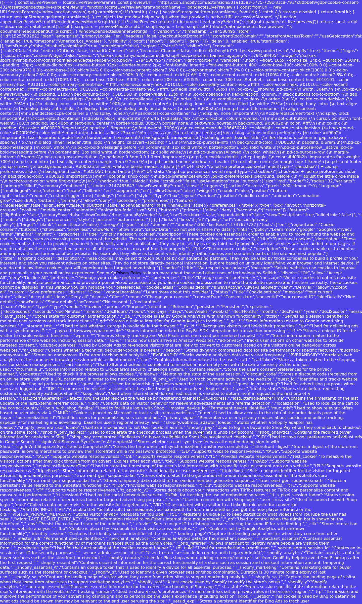

# UI Design System & Master Generation Blueprint: www-selkirk-com_pages-omni-pickleball-paddle

> **Selkirk OMNI™ Pickleball Paddle · Selkirk Sport - We Are Pickleball** (https://www.selkirk.com/pages/omni-pickleball-paddle) — The Selkirk OMNI™ pickleball paddle redefines all-court performance for the modern fast-paced pickleball game. Featuring ReactCore™ techn...



---

## 1. Executive Visual Persona & Design Archetype

- **Brand Essence & Persona**: **Selkirk OMNI™ Pickleball Paddle · Selkirk Sport - We Are Pickleball** (`https://www.selkirk.com/pages/omni-pickleball-paddle`). The Selkirk OMNI™ pickleball paddle redefines all-court performance for the modern fast-paced pickleball game. Featuring ReactCore™ techn...
- **Visual Archetype**: **High-Contrast Obsidian / Atmospheric Design System (`#5046e4` canvas, `#ffffff` ink, `#333333` accent)**.
- **Anti-AI-Slop Differentiators**:
  - **Source-Grounded Chromatic Polarity**: Anchors the viewport in `#5046e4` (`var(--shop-ai-bubble-color)` in `:root`) paired with `#ffffff` primary typography and `#333333` accents.
  - **Extracted Typographic Hierarchy**: Pairs `tenby-six` for display copy (`Earn money back while shopping onlin`) with `kallisto` and `Kode Mono`.
  - **Calibrated Spatial Grid & Motion**: Combines `225px` container bounds (`gap: 24px`, padding `36px`) with `cubic-bezier(.075,.82,.165,1)` easing and GSAP Timeline & ScrollTrigger, Three.js / WebGL Canvas Pipeline.

---

## 2. Spatial Architecture & Modular Grid Mathematics


### Viewport Allocation & Container Geometry
- **Captured Viewport Dimensions**: Desktop `1440×2400px` (`assets/desktop.png`, capped at 2400px multi-section capture), Mobile `390×2400px` (`assets/mobile.png`, capped at 2400px multi-section capture).
- **Master Container Bounds**: `225px` extracted from `www-selkirk-com_pages-omni-pickleball-paddle` stylesheet.
- **Canvas Lateral Padding & Spacing**: `36px` lateral canvas padding with `24px` grid gap.
- **Border Radius Scale**: `30px`, `100px`, `5px`, `50%`.

### Responsive Breakpoint Architecture
- **Desktop Layout**: Multi-column CSS Grid / Flexbox layout at `1440px` (`max-width: 225px`, `gap: 24px`).
- **Mobile Layout**: Single-column vertical stack at `390px` viewport width with `36px` horizontal padding.
- **Extracted CSS Media Queries**: `@media (prefers-reduced-motion:reduce)`, `@media only screen and (min-width:768px)`, `@media only screen and (min-width:1200px)`, `@media only screen and (min-width:1441px)`.

---

## 3. Color System, Materiality & Atmospheric Lighting

### Semantic Palette & Source Grounding
| Semantic Role | Ground-Truth Value | Extracted CSS Source / Selector |
|---|---|---|
| **Primary Canvas Substrate** | `#5046e4` | `var(--shop-ai-bubble-color)` in `:root` |
| **Primary Typography Ink** | `#ffffff` | `var(--shop-ai-chat-background)` in `:root` |
| **Elevated Surface / Card Substrate** | `#f1f1f1` | `var(--shop-ai-reply-background)` in `:root` |
| **Interactive Accent / Highlight** | `#333333` | `var(--shop-ai-reply-text)` in `:root` |
| **Secondary / Muted Copy** | `#eaeaea` | `var(--shop-ai-border-color)` in `:root` |
| **Structural Hairline Border** | `#030712` | `var(--loop-primary-color)` in `:root` |
| **Variable Token (`--shop-ai-inline-shadow-raised`)** | `#0000` | `var(--shop-ai-inline-shadow-raised)` in `:root` |

### Sanitized Root CSS Variables (`ui-ux.md` Ground Truth)
| Variable Name | Extracted Value | Semantic Role |
|---|---|---|
| `--shop-ai-inline-shadow-color` | `16 24 40` | Brand / Palette Token |
| `--shop-ai-inline-shadow-resting` | `0 1px 2px rgb(var(--shop-ai-inline-shadow-color) / 0.06)` | Elevation / Border Token |
| `--shop-ai-inline-header-radius` | `12px` | Layout / Spatial Grid Token |
| `--shop-ai-inline-control-radius` | `999px` | Elevation / Border Token |
| `--shop-ai-inline-button-radius` | `50%` | Elevation / Border Token |
| `--shop-ai-inline-transition` | `160ms ease` | Motion / Easing Token |
| `--shop-ai-inline-shadow-raised` | `0 0 #0000` | Elevation / Border Token |
| `--shop-ai-inline-shadow-hover` | `0 0 #0000` | Elevation / Border Token |
| `--shop-ai-inline-header-shadow` | `0 0 #0000` | Layout / Spatial Grid Token |
| `--shop-ai-inline-send-shadow` | `0 0 #0000` | Elevation / Border Token |
| `--shop-ai-inline-send-shadow-hover` | `0 0 #0000` | Elevation / Border Token |
| `--viewport-height` | `100vh` | Layout / Spatial Grid Token |
| `--shop-ai-bubble-color` | `#5046e4` | Brand / Palette Token |
| `--shop-ai-window-color` | `#5046e4` | Brand / Palette Token |
| `--shop-ai-chat-background` | `#ffffff` | Canvas / Surface Token |
| `--shop-ai-reply-background` | `#f1f1f1` | Canvas / Surface Token |

---

## 4. Typographic Scale & Editorial Hierarchy

### Font Family Stacks
- **Display Typography**: `tenby-six`.
- **Primary Body Stack**: `kallisto`.
- **Technical / Metadata Stack**: `Kode Mono`.

### Typographic Scale & Rules (Extracted from Stylesheet & Variables)
- **Hero Display (`H1`)**: rule `h1` (`font-size: 4rem`).
- **Section Heading (`H2`)**: rule `h2` (`font-size: var(--font_size)`, `font-weight: 400`).
- **Body Copy**: CSS variables `--body_bg: #ffffff`, `--body_color: #3c3c3c`, `--oke-bodyText-fontWeight: 400`; rule `p` (`font-size: clamp(12px,1.125rem,16px)`, `line-height: 133%`).
- **Metadata & Navigation Labels**: CSS variables `--custom_label_text: #ffffff`, `--custom_label_bg: #323232`, `--bundle_label_text: #ffffff`; rule `.label` (`font-size: 9px`, `line-height: 24px`).

---

## 5. Choreographed Motion & Interaction Physics

### Primary Easing Curves
- **Extracted Timing Functions**: `cubic-bezier(.075,.82,.165,1)`, `cubic-bezier(.165,.84,.44,1)`.

### Per-Element Transition & Choreography Rules
- **Selector `media(prefers-reduced-motion:reduce)`**: `transition: 1ms!important` extracted from `www-selkirk-com_pages-omni-pickleball-paddle` stylesheet.
- **Selector `.announcement-text div`**: `transition: opacity .5s,transform .5s` extracted from `www-selkirk-com_pages-omni-pickleball-paddle` stylesheet.
- **Selector `.announcement-text div.initial`**: `transition: none` extracted from `www-selkirk-com_pages-omni-pickleball-paddle` stylesheet.
- **Extracted Easing Curve (`cubic-bezier(.075,.82,.165,1)`)**: Governs interactive state transitions across `<header.no-js>` and `<section.header-nav>`.
- **Runtime Interaction Engine**: Integrates GSAP Timeline & ScrollTrigger, Three.js / WebGL Canvas Pipeline, Swiper Touch Carousel Engine, Barba.js Page Transition Router with `prefers-reduced-motion: reduce` fallback guards.

---

## 6. Component Wireframe & Structural DOM Map

### Visual Layout Schematic (Grounded in `dom.html` — `1440px` Desktop & `390px` Mobile Reflow)
```
┌────────────────────────────────────────────────────────────────────────┐
│ DESKTOP VIEWPORT (1440px) — Selkirk OMNI™ Pickleball Paddle · Selkirk  │
│ ====================================================================== │
│ [ <header.no-js>           | Customer Support · Shop Boomstik ST ·  ]  │
│ ---------------------------------------------------------------------- │
│ | HERO STAGE: <section.template-page>                              |   │
│ | H1: Earn money back while shopping online at selkirk....         |   │
│ | Substrate: #5046e4    | Ink: #ffffff    | Accent: #333333        |   │
│ ---------------------------------------------------------------------- │
│ | SHOWCASE GRID (<section.header-nav>      ) max-w: 225px          |   │
│ | +------------------------------+  +------------------------------+ | │
│ | | Popular Products             |  | Selkirk Boomstik® ST with Sh | | │
│ | +------------------------------+  +------------------------------+ | │
│ ---------------------------------------------------------------------- │
│ | MOBILE VIEWPORT REFLOW (390px) — Single-Column Stack (gap: 24px  ) | │
│ | [<header.no-js>] -> [<section.template-] -> [<section.header-na] |   │
│ ---------------------------------------------------------------------- │
│ [ FOOTER (<footer.site-footer>  ) | https://www.selkirk.com/pages/omni │
└────────────────────────────────────────────────────────────────────────┘
```

### Granular DOM Region Breakdown
1. **Brand Header & Navigation Bar (<header.no-js> — `www-selkirk-com_pages-omni-pickleball-paddle`)**:
   - Landmark `<header class="no-js">` hosting `Selkirk OMNI™ Pickleball Paddle · Se` navigation (`Customer Support · Shop Boomstik ST · Shop the deals · Wholesale Login · Paddles`), DOM attributes (`data-gif-toggle-ready="true"`, `data-src="https://static.ads-tw..."`, `data-cookiecategory="4"`, `data-source-attribution="shopify.exit_intersti..."`), and stylesheet rule `.tk-tenby-five { font-family: "tenby-five",sans-serif; }`.
2. **Hero Stage & Focal Lead (<section.template-page> — `Earn money back while shopping onl`)**:
   - Landmark `<section class="template-page">` presenting display lead `Earn money back while shopping online at selkirk....` and copy excerpt *"Bonus Bucks can be earned on purchases $100+ from 12:00AM EST Dec"* over `#5046e4` canvas and `#ffffff` ink.
3. **Primary Showcase & Content Grid (<section.header-nav> — `Popular Products`)**:
   - Landmark `<section class="header-nav">` rendering section `Popular Products` with copy *"Spend $100: Get $25 in Bonus Bucks"*, asset references (`uwt.js`, `patrol-styles.css`, `pandectes-rules.js`, `favicon.ico`), and grid rule `.tk-tenby-six { font-family: "tenby-six",sans-serif; }`.
4. **Interactive Detail & Feature Matrix (<section.nav-dropdown> — `Selkirk Boomstik® ST with Sharktoo`)**:
   - Landmark `<section class="nav-dropdown">` framing `Selkirk Boomstik® ST with Sharktooth™ Groove Tech...` and `Selkirk OMNI Pickleball Paddle` (*"Spend $150: Get $50 in Bonus Bucks"*) with `#f1f1f1` surface cards, `#333333` accents, and `.tk-kallisto { font-family: "kallisto",sans-serif; }`.
5. **Colophon & Global Directory Footer (<footer.site-footer> — `https://www.selkirk.com/pages/omni-pickleball-paddle`)**:
   - Landmark `<footer class="site-footer footer-default">` anchoring `Selkirk OMNI™ Pickleball Paddle ` footer links (`Customer Support · Shop Boomstik ST · Shop the deals · Wholesale Login · Paddles`), copy *"Spend $200: Get $75 in Bonus Bucks"*, and `#030712` structural dividers.

---

## 7. Master Zero-Shot AI Generation Prompt

```markdown
# Master Zero-Shot Frontend Generation Prompt: www-selkirk-com_pages-omni-pickleball-paddle (Selkirk OMNI™ Pickleball Paddle · Selkirk Sport - We Are Pickleball)

You are a principal frontend architect and design systems engineer. Build a complete, production-ready web application replicating the exact design system, DOM landmarks, typographic hierarchy, color tokens, and motion physics of `www-selkirk-com_pages-omni-pickleball-paddle` (**Selkirk OMNI™ Pickleball Paddle · Selkirk Sport - We Are Pickleball** — `https://www.selkirk.com/pages/omni-pickleball-paddle`).

### 1. Visual Archetype & Anti-AI-Slop Mandates
- **Archetype**: High-Contrast Obsidian / Atmospheric Design System (`#5046e4` canvas, `#ffffff` ink, `#333333` accent).
- **Identity & Domain Context**: The Selkirk OMNI™ pickleball paddle redefines all-court performance for the modern fast-paced pickleball game. Featuring ReactCore™ techn...
- **Primary Substrate**: `#5046e4` (`var(--shop-ai-bubble-color)` in `:root`), **Primary Ink**: `#ffffff`, **Accent / Highlight**: `#333333`.
- **Site-Specific Differentiators**:
  - **Source-Grounded Chromatic Polarity**: Anchors the viewport in `#5046e4` (`var(--shop-ai-bubble-color)` in `:root`) paired with `#ffffff` primary typography and `#333333` accents.
  - **Extracted Typographic Hierarchy**: Pairs `tenby-six` for display copy (`Earn money back while shopping onlin`) with `kallisto` and `Kode Mono`.
  - **Calibrated Spatial Grid & Motion**: Combines `225px` container bounds (`gap: 24px`, padding `36px`) with `cubic-bezier(.075,.82,.165,1)` easing and GSAP Timeline & ScrollTrigger, Three.js / WebGL Canvas Pipeline.

### 2. Ground-Truth CSS Variables (`:root` Token Contract)
Declare and consume these exact custom properties extracted from `www-selkirk-com_pages-omni-pickleball-paddle` in your global stylesheet:

:root {
  /* Selkirk OMNI™ Pickleball Paddle · Selkirk Sport - We Are Pickleball (www-selkirk-com_pages-omni-pickleball-paddle) — Ground-Truth Extracted CSS Variables */
  --shop-ai-inline-shadow-color: 16 24 40; /* Brand / Palette Token (www-selkirk-com_pages-omni-pickleball-paddle) */
  --shop-ai-inline-shadow-resting: 0 1px 2px rgb(var(--shop-ai-inline-shadow-color) / 0.06); /* Elevation / Border Token (www-selkirk-com_pages-omni-pickleball-paddle) */
  --shop-ai-inline-header-radius: 12px; /* Layout / Spatial Grid Token (www-selkirk-com_pages-omni-pickleball-paddle) */
  --shop-ai-inline-control-radius: 999px; /* Elevation / Border Token (www-selkirk-com_pages-omni-pickleball-paddle) */
  --shop-ai-inline-button-radius: 50%; /* Elevation / Border Token (www-selkirk-com_pages-omni-pickleball-paddle) */
  --shop-ai-inline-transition: 160ms ease; /* Motion / Easing Token (www-selkirk-com_pages-omni-pickleball-paddle) */
  --shop-ai-inline-shadow-raised: 0 0 #0000; /* Elevation / Border Token (www-selkirk-com_pages-omni-pickleball-paddle) */
  --shop-ai-inline-shadow-hover: 0 0 #0000; /* Elevation / Border Token (www-selkirk-com_pages-omni-pickleball-paddle) */
  --shop-ai-inline-header-shadow: 0 0 #0000; /* Layout / Spatial Grid Token (www-selkirk-com_pages-omni-pickleball-paddle) */
  --shop-ai-inline-send-shadow: 0 0 #0000; /* Elevation / Border Token (www-selkirk-com_pages-omni-pickleball-paddle) */
  --shop-ai-inline-send-shadow-hover: 0 0 #0000; /* Elevation / Border Token (www-selkirk-com_pages-omni-pickleball-paddle) */
  --viewport-height: 100vh; /* Layout / Spatial Grid Token (www-selkirk-com_pages-omni-pickleball-paddle) */
  --shop-ai-bubble-color: #5046e4; /* Brand / Palette Token (www-selkirk-com_pages-omni-pickleball-paddle) */
  --shop-ai-window-color: #5046e4; /* Brand / Palette Token (www-selkirk-com_pages-omni-pickleball-paddle) */
  --shop-ai-chat-background: #ffffff; /* Canvas / Surface Token (www-selkirk-com_pages-omni-pickleball-paddle) */
  --shop-ai-reply-background: #f1f1f1; /* Canvas / Surface Token (www-selkirk-com_pages-omni-pickleball-paddle) */
}

### 3. Semantic Color & Materiality Contract
Map every surface, ink, and border strictly to these source-grounded tokens:
- **Primary Canvas Substrate**: `#5046e4` — grounded in `var(--shop-ai-bubble-color)` in `:root`
- **Primary Typography Ink**: `#ffffff` — grounded in `var(--shop-ai-chat-background)` in `:root`
- **Elevated Surface / Card Substrate**: `#f1f1f1` — grounded in `var(--shop-ai-reply-background)` in `:root`
- **Interactive Accent / Highlight**: `#333333` — grounded in `var(--shop-ai-reply-text)` in `:root`
- **Secondary / Muted Copy**: `#eaeaea` — grounded in `var(--shop-ai-border-color)` in `:root`
- **Structural Hairline Border**: `#030712` — grounded in `var(--loop-primary-color)` in `:root`
- **Variable Token (`--shop-ai-inline-shadow-raised`)**: `#0000` — grounded in `var(--shop-ai-inline-shadow-raised)` in `:root`

### 4. Spatial Grid, Container Bounds & Responsive Breakpoints
- **Desktop Viewport Reference**: `1440×2400px` (capped at 2400px multi-section capture, `1440px` standard desktop width).
- **Mobile Viewport Reference**: `390×2400px` (capped at 2400px multi-section capture, `390px` standard mobile width).
- **Container Max-Width**: `225px` extracted from `www-selkirk-com_pages-omni-pickleball-paddle` stylesheet
- **Padding & Gutters**: `36px` lateral canvas padding with `24px` grid gap
- **Desktop Grid**: Multi-column CSS Grid / Flexbox layout at `1440px` (`max-width: 225px`, `gap: 24px`)
- **Mobile Adaptation**: Single-column vertical stack at `390px` viewport width with `36px` horizontal padding
- **Media Queries**: `@media (prefers-reduced-motion:reduce)`, `@media only screen and (min-width:768px)`, `@media only screen and (min-width:1200px)`, `@media only screen and (min-width:1441px)`
- **Corner Radii**: `30px`, `100px`, `5px`, `50%`

### 5. Typography & Editorial Scale Contract
- **Display Font Stack**: `tenby-six`
- **Body Font Stack**: `kallisto`
- **Monospace / Technical Font Stack**: `Kode Mono`
- **H1 Display Rule**: rule `h1` (`font-size: 4rem`)
- **H2 Section Rule**: rule `h2` (`font-size: var(--font_size)`, `font-weight: 400`)
- **Body Copy Rule**: CSS variables `--body_bg: #ffffff`, `--body_color: #5046e4`, `--oke-bodyText-fontWeight: 400`; rule `p` (`font-size: clamp(12px,1.125rem,16px)`, `line-height: 133%`)
- **Metadata & Index Rule**: CSS variables `--custom_label_text: #ffffff`, `--custom_label_bg: #5046e4`, `--bundle_label_text: #ffffff`; rule `.label` (`font-size: 9px`, `line-height: 24px`)

### 6. Component Hierarchy, Verbatim Copy & Real DOM Landmarks
Scaffold `www-selkirk-com_pages-omni-pickleball-paddle` (`Selkirk OMNI™ Pickleball Paddle · Selkirk Sport - We Are Pickleball`) with these exact structural regions, extracted copy, and CSS rules from `dom.html`:
1. **Brand Header & Navigation Bar (<header.no-js> — `www-selkirk-com_pages-omni-pickleball-paddle`)**:
   - DOM & Selectors: Landmark `<header class="no-js">` hosting `Selkirk OMNI™ Pickleball Paddle · Se` navigation (`Customer Support · Shop Boomstik ST · Shop the deals · Wholesale Login · Paddles`), DOM attributes (`data-gif-toggle-ready="true"`, `data-src="https://static.ads-tw..."`, `data-cookiecategory="4"`, `data-source-attribution="shopify.exit_intersti..."`), and stylesheet rule `.tk-tenby-five { font-family: "tenby-five",sans-serif; }`.
   - Responsive Contract: Header `Brand Header & Navigation Bar (<header.no-js> — `www-selkirk-com_pages-omni-pickleball-paddle`)` (`www-selkirk-com_pages-omni-pickleball-paddle`) adapts across `@media (prefers-reduced-motion:reduce)`, `@media only screen and (min-width:768px)`, `@media only screen and (min-width:1200px)`, `@media only screen and (min-width:1441px)` with `cubic-bezier(.075,.82,.165,1)`, `cubic-bezier(.165,.84,.44,1)` transitions and links `Customer Support · Shop Boomstik ST · Shop the deals · Wholesale Login · Paddles`.
2. **Hero Stage & Focal Lead (<section.template-page> — `Earn money back while shopping onl`)**:
   - DOM & Selectors: Landmark `<section class="template-page">` presenting display lead `Earn money back while shopping online at selkirk....` and copy excerpt *"Bonus Bucks can be earned on purchases $100+ from 12:00AM EST Dec"* over `#5046e4` canvas and `#ffffff` ink.
   - Responsive Contract: Hero stage (`1440×2400px` desktop / `390×2400px` mobile) sets `#5046e4` background with `#ffffff` headline `Earn money back while shopping online at selkirk....`.
3. **Primary Showcase & Content Grid (<section.header-nav> — `Popular Products`)**:
   - DOM & Selectors: Landmark `<section class="header-nav">` rendering section `Popular Products` with copy *"Spend $100: Get $25 in Bonus Bucks"*, asset references (`uwt.js`, `patrol-styles.css`, `pandectes-rules.js`, `favicon.ico`), and grid rule `.tk-tenby-six { font-family: "tenby-six",sans-serif; }`.
   - Responsive Contract: Showcase grid `Primary Showcase & Content Grid (<section.header-nav> — `Popular Products`)` applies Multi-column CSS Grid / Flexbox layout at `1440px` (`max-width: 225px`, `gap: 24px`) on desktop and Single-column vertical stack at `390px` viewport width with `36px` horizontal padding on mobile.
4. **Interactive Detail & Feature Matrix (<section.nav-dropdown> — `Selkirk Boomstik® ST with Sharktoo`)**:
   - DOM & Selectors: Landmark `<section class="nav-dropdown">` framing `Selkirk Boomstik® ST with Sharktooth™ Groove Tech...` and `Selkirk OMNI Pickleball Paddle` (*"Spend $150: Get $50 in Bonus Bucks"*) with `#f1f1f1` surface cards, `#333333` accents, and `.tk-kallisto { font-family: "kallisto",sans-serif; }`.
   - Responsive Contract: Detail module `Interactive Detail & Feature Matrix (<section.nav-dropdown> — `Selkirk Boomstik® ST with Sharktoo`)` uses `30px`, `100px`, `5px`, `50%` radii, `#333333` highlights, and assets (uwt.js, patrol-styles.css, pandectes-rules.js).
5. **Colophon & Global Directory Footer (<footer.site-footer> — `https://www.selkirk.com/pages/omni-pickleball-paddle`)**:
   - DOM & Selectors: Landmark `<footer class="site-footer footer-default">` anchoring `Selkirk OMNI™ Pickleball Paddle ` footer links (`Customer Support · Shop Boomstik ST · Shop the deals · Wholesale Login · Paddles`), copy *"Spend $200: Get $75 in Bonus Bucks"*, and `#030712` structural dividers.
   - Responsive Contract: Footer `Colophon & Global Directory Footer (<footer.site-footer> — `https://www.selkirk.com/pages/omni-pickleball-paddle`)` aligns to `225px` extracted from `www-selkirk-com_pages-omni-pickleball-paddle` stylesheet with `36px` lateral canvas padding with `24px` grid gap and attributes (data-gif-toggle-ready="true", data-src="https://static.ads-tw...", data-cookiecategory="4").

#### Verbatim DOM Copy Excerpts (`dom.html`)
- Copy Excerpt 1: *"Bonus Bucks can be earned on purchases $100+ from 12:00AM EST December 9 - 11:59PM..."*
- Copy Excerpt 2: *"Spend $100: Get $25 in Bonus Bucks"*
- Copy Excerpt 3: *"Spend $150: Get $50 in Bonus Bucks"*
- Copy Excerpt 4: *"Spend $200: Get $75 in Bonus Bucks"*

### 7. Motion, Extracted Stylesheet Rules & Interaction Choreography
- **Primary Easing Functions**: `cubic-bezier(.075,.82,.165,1)`, `cubic-bezier(.165,.84,.44,1)`
- **Extracted Stylesheet Rules (`www-selkirk-com_pages-omni-pickleball-paddle`)**:
- `.tk-tenby-five { font-family: "tenby-five",sans-serif; }`
- `.tk-tenby-six { font-family: "tenby-six",sans-serif; }`
- `.tk-kallisto { font-family: "kallisto",sans-serif; }`
- `.tk-owners-xxnarrow-light { font-family: "owners-xxnarrow",sans-serif; }`
- `.tk-owners-xnarrow-black { font-family: "owners-xnarrow",sans-serif; }`
- **Per-Selector Transition Rules**:
- **Selector `media(prefers-reduced-motion:reduce)`**: `transition: 1ms!important` extracted from `www-selkirk-com_pages-omni-pickleball-paddle` stylesheet.
- **Selector `.announcement-text div`**: `transition: opacity .5s,transform .5s` extracted from `www-selkirk-com_pages-omni-pickleball-paddle` stylesheet.
- **Selector `.announcement-text div.initial`**: `transition: none` extracted from `www-selkirk-com_pages-omni-pickleball-paddle` stylesheet.
- **Extracted Easing Curve (`cubic-bezier(.075,.82,.165,1)`)**: Governs interactive state transitions across `<header.no-js>` and `<section.header-nav>`.
- **Runtime Interaction Engine**: Integrates GSAP Timeline & ScrollTrigger, Three.js / WebGL Canvas Pipeline, Swiper Touch Carousel Engine, Barba.js Page Transition Router with `prefers-reduced-motion: reduce` fallback guards.

### 8. Technical Deliverables
- Implement in Next.js (App Router) with TypeScript and Tailwind CSS consuming the `:root` custom properties defined above for `www-selkirk-com_pages-omni-pickleball-paddle`.
- Reproduce both the `1440px` desktop architecture and `390px` mobile breakpoint transitions, preserving semantic HTML5 landmarks (`<header>`, `<nav>`, `<main>`, `<section>`, `<footer>`) and `prefers-reduced-motion` accessibility guards.
```
