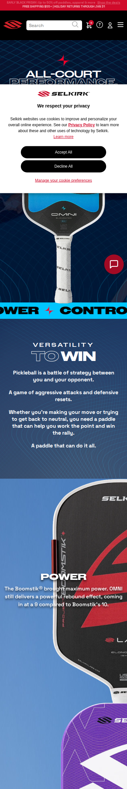

# UI Design System & Master Generation Blueprint: www-selkirk-com_pages-omni-pickleball-paddle

> **Selkirk OMNI™ Pickleball Paddle · Selkirk Sport - We Are Pickleball** (https://www.selkirk.com/pages/omni-pickleball-paddle) — The Selkirk OMNI™ pickleball paddle redefines all-court performance for the modern fast-paced pickleball game. Featuring ReactCore™ techn...


---

## 1. Executive Visual Persona & Design Archetype

- **Brand Essence & Persona**: **Selkirk OMNI™ Pickleball Paddle · Selkirk Sport - We Are Pickleball** (`https://www.selkirk.com/pages/omni-pickleball-paddle`). The Selkirk OMNI™ pickleball paddle redefines all-court performance for the modern fast-paced pickleball game. Featuring ReactCore™ techn...
- **Capture Provenance**: Live browser capture (`tier1_fast`, HTTP `200`, captured `2026-11-23`).
- **Visual Archetype**: **Light-Substrate Editorial & Modular Grid System (`#ffffff` canvas, `#000000` ink, `#00c6fd` accent)**.
- **Anti-AI-Slop Differentiators**:
  - **Live-Computed Chromatic Polarity**: Anchors the viewport in `#ffffff` (live computed `browser-default` `background-color` (`computed_styles.json`)) paired with `#000000` primary typography and `#00c6fd` accents.
  - **Grounded Typographic Hierarchy**: Pairs `akira expanded` for display copy (`ALL-COURT PERFORMANCE, REDEFINED`) with `owners-xwide` and `Kode Mono`.
  - **Calibrated Spatial Grid & Motion**: Combines `1296px` container bounds (`gap: 30px`, padding `5px`) with `cubic-bezier(.165,.84,.44,1)` easing and GSAP Timeline & ScrollTrigger, Three.js / WebGL Canvas Pipeline.

---

## 2. Spatial Architecture & Modular Grid Mathematics



### Viewport Allocation & Container Geometry
- **Captured Viewport Dimensions**: Desktop `1440×900px` (`assets/desktop.png`, single-viewport 100vh live capture (900px)), Mobile `390×2400px` (`assets/mobile.png`, clamped at 2400px live multi-section capture).
- **Master Container Bounds**: `1296px` (measured widest bounded `<section>` landmark width on `1440px` desktop).
- **Canvas Lateral Padding & Spacing**: `5px` lateral canvas padding with `30px` grid gap.
- **Border Radius Scale**: `30px`, `10px`, `50%`, `5px`.

### Responsive Breakpoint Architecture
- **Desktop Layout**: Multi-column CSS Grid / Flexbox layout at `1440px` (`max-width: 1296px`, `gap: 30px`).
- **Mobile Layout**: Single-column vertical stack at `390px` viewport width with `5px` horizontal padding.
- **Extracted CSS Media Queries**: `@media screen and (-ms-high-contrast:active),(-ms-high-contrast:...`, `@media only screen and (max-width:797px)`, `@media only screen and (min-width:798px)`, `@media only screen and (max-width:780px)`.

---

## 3. Color System, Materiality & Atmospheric Lighting

### Semantic Palette & Source Grounding
| Semantic Role | Ground-Truth Value | Extracted Live / CSS Source |
|---|---|---|
| **Primary Canvas Substrate** | `#ffffff` | live computed `browser-default` `background-color` (`computed_styles.json`) |
| **Primary Typography Ink** | `#000000` | live computed `main` `color` (`computed_styles.json`) |
| **Elevated Surface / Card Substrate** | `#f9fafb` | `var(--loop-badge-background)` in `:root` |
| **Interactive Accent / Highlight** | `#00c6fd` | `.moi-explore-btn:hover { background: #00c6fd }` |
| **Secondary / Muted Copy** | `#333333` | `var(--shop-ai-reply-text)` in `:root` |
| **Structural Hairline Border** | `#f6f6f6` | `var(--new_label_border)` in `:root` |
| **Variable Token (`--loop-primary-color`)** | `#030712` | `var(--loop-primary-color)` in `:root` |
| **Variable Token (`--loop-badge-text`)** | `#374151` | `var(--loop-badge-text)` in `:root` |
| **Variable Token (`--loop-button-background`)** | `#d1d5db` | `var(--loop-button-background)` in `:root` |
| **Variable Token (`--loop-button-text`)** | `#1f2937` | `var(--loop-button-text)` in `:root` |

### Sanitized Root CSS Variables (`ui-ux.md` Ground Truth)
| Variable Name | Extracted Value | Semantic Role |
|---|---|---|
| `--loop-primary-color` | `#030712` | Brand / Palette Token |
| `--loop-text-color` | `white` | Typography Ink Token |
| `--loop-badge-background` | `#F9FAFB` | Canvas / Surface Token |
| `--loop-badge-text` | `#374151` | Typography Ink Token |
| `--loop-button-background` | `#D1D5DB` | Canvas / Surface Token |
| `--loop-button-text` | `#1F2937` | Typography Ink Token |
| `--loop-onstore-button-padding` | `14px 16px` | Layout / Spatial Grid Token |
| `--loop-onstore-checkout-background` | `#030712` | Canvas / Surface Token |
| `--loop-onstore-checkout-text-color` | `white` | Typography Ink Token |
| `--loop-onstore-button-radius` | `0` | Elevation / Border Token |
| `--loop-onstore-button-gap` | `0.25rem` | Layout / Spatial Grid Token |
| `--loop-onstore-add-more-background` | `white` | Canvas / Surface Token |
| `--loop-onstore-add-more-text-color` | `black` | Typography Ink Token |
| `--loop-onstore-add-more-border` | `black` | Elevation / Border Token |
| `--loop-onstore-casing` | `uppercase` | Design System Custom Token |
| `--font_size` | `14px` | Typography / Scale Token |

---

## 4. Typographic Scale & Editorial Hierarchy

### Font Family Stacks
- **Display Typography**: `akira expanded`.
- **Primary Body Stack**: `owners-xwide`.
- **Technical / Metadata Stack**: `Kode Mono`.

### Typographic Scale & Rules (Live Computed & Stylesheet Grounded)
- **Hero Display (`H1`)**: live computed `h1` (`font-size: 40px`, `line-height: normal`, `font-weight: 700`); rule `.title` (`font-size: 2.5rem`).
- **Section Heading (`H2`)**: live computed `h2` (`font-size: 36px`, `line-height: 36px`, `font-weight: 700`, `letter-spacing: -0.5px`); rule `h2` (`line-height: 1.4em`).
- **Body Copy**: live computed `body` (`font-size: 16px`, `line-height: 19.2px`, `font-weight: 400`); CSS variables `--oke-bodyText-fontWeight: 400`, `--oke-bodyText-fontSize: var(--oke-text-regular,14px)`, `--oke-bodyText-fontFamily: inherit`; rule `p` (`line-height: var(--font_size_plus12)`).
- **Metadata & Navigation Labels**: live computed `nav/a` (`font-size: 12px`, `line-height: normal`, `font-weight: 400`); CSS variables `--oke-text-small: 12px`, `--onstore-label-size: 10px`; rule `.label` (`font-size: 9px`, `line-height: 24px`).

---

## 5. Choreographed Motion & Interaction Physics

### Primary Easing Curves
- **Extracted Timing Functions**: `cubic-bezier(.165,.84,.44,1)`, `cubic-bezier(.075,.82,.165,1)`.

### Per-Element Transition & Choreography Rules
- **Selector `.lazyloaded`**: `transition: opacity .3s` extracted from `www-selkirk-com_pages-omni-pickleball-paddle` stylesheet.
- **Selector `input[type=radio]+label:after`**: `transition: all .1s` extracted from `www-selkirk-com_pages-omni-pickleball-paddle` stylesheet.
- **Selector `input[type=radio]+label:after`**: `transition: all .1s ease` extracted from `www-selkirk-com_pages-omni-pickleball-paddle` stylesheet.
- **Extracted Easing Curve (`cubic-bezier(.165,.84,.44,1)`)**: Governs interactive state transitions across `<header.no-js>` and `<section.shopify-section>`.
- **Runtime Interaction Engine**: Integrates GSAP Timeline & ScrollTrigger, Three.js / WebGL Canvas Pipeline, Swiper Touch Carousel Engine, Barba.js Page Transition Router with `prefers-reduced-motion: reduce` fallback guards.

---

## 6. Component Wireframe & Structural DOM Map

### Visual Layout Schematic — Desktop (`1440px`, Grounded in `dom.html` & Landmark Bounding Boxes)
```
┌────────────────────────────────────────────────────────────────────────┐
│ DESKTOP VIEWPORT (1440px) — Selkirk OMNI™ Pickleball Paddle · Selkirk  │
│ ====================================================================== │
│ [ <header.no-js> (1440px)             | Paddles · Clothing · Shoes · ] │
│ ---------------------------------------------------------------------- │
│ | HERO STAGE: <section.template-page> (w=1440px)                     | │
│ | H1: ALL-COURT PERFORMANCE, REDEFINED                               | │
│ | Substrate: #ffffff | Ink: #000000 | Accent: #00c6fd                | │
│ ---------------------------------------------------------------------- │
│ | SHOWCASE GRID (<section.shopify-section>) max-w: 1296px            | │
│ | +------------------------------+  +------------------------------+ | │
│ | | referred you!                |  | We're sorry, self-referrals  | | │
│ | +------------------------------+  +------------------------------+ | │
│ ---------------------------------------------------------------------- │
│ | DETAIL MODULE (<section.omni-hero>) — We're sorry, but the         | │
│ ---------------------------------------------------------------------- │
│ [ FOOTER (<footer.site-footer>) | https://www.selkirk.com/pages/omni-  │
└────────────────────────────────────────────────────────────────────────┘
```

### Visual Layout Schematic — Mobile Reflow (`390px`)
```
┌────────────────────────────────────────────────────────────────────────┐
│ MOBILE VIEWPORT REFLOW (390px) — Single-Column Stack (gap: 30px)       │
│ ====================================================================== │
│ [ HEADER BAR (<header.no-js>          ) | Compact Menu (390px)         │
│ ---------------------------------------------------------------------- │
│ | HERO STAGE (<section.template-page>) — 390px Vertical Lead         | │
│ | H1: ALL-COURT PERFORMANCE, REDEFINED                               | │
│ ---------------------------------------------------------------------- │
│ | SHOWCASE STACK (<section.shopify-secti) — 1-Col Stack              | │
│ | [ Item 1: referred you!                                          ] | │
│ | [ Item 2: We're sorry, self-referrals are not allowed.           ] | │
│ ---------------------------------------------------------------------- │
│ | DETAIL STACK (<section.omni-hero>) — 1-Col (We're sorry, but t)    | │
│ ---------------------------------------------------------------------- │
│ [ FOOTER (<footer.site-footer>) | Stacked 390px Colophon               │
└────────────────────────────────────────────────────────────────────────┘
```

### Granular DOM Region Breakdown
1. **Brand Header & Navigation Bar (<header.no-js> — `www-selkirk-com_pages-omni-pickleball-paddle`)**:
   - Landmark `<header class="no-js">` (`1440px`) hosting `Selkirk OMNI™ Pickleball Paddle · Se` navigation (`Paddles · Clothing · Shoes · Gear · Blog`), DOM attributes (`data-gif-toggle-ready="true"`, `data-src="https://static.ads-tw..."`, `data-cookiecategory="4"`, `data-source-attribution="shopify.exit_intersti..."`), and stylesheet rule `.patrol-unstyled-list { list-style:inherit;padding:0;margin:0 }`.
2. **Hero Stage & Focal Lead (<section.template-page> — `ALL-COURT PERFORMANCE, REDEFINED`)**:
   - Landmark `<section class="template-page">` presenting display lead `ALL-COURT PERFORMANCE, REDEFINED` and copy excerpt *"BOOMSTIK ST IS HERE: More power. Now more spin."* over `#ffffff` canvas and `#000000` ink.
3. **Primary Showcase & Content Grid (<section.shopify-section> — `referred you!`)**:
   - Landmark `<section class="shopify-section section-omni-landing">` rendering section `referred you!` with copy *"Shop and spend $50+ to get your free gift. Free gift will be adde"*, asset references (`uwt.js`, `patrol-styles.css`, `pandectes-rules.js`, `favicon.ico`), and grid rule `span.patrol-blank-target { display:none }`.
4. **Interactive Detail & Feature Matrix (<section.omni-hero> — `We're sorry, self-referrals are no`)**:
   - Landmark `<section class="omni-hero">` framing `We're sorry, self-referrals are not allowed.` and `We're sorry, but the referral link you used is no...` (*"A dark-toned, overhead action shot of a male pickleball player lu"*) with `#f9fafb` surface cards, `#00c6fd` accents, and `strong.patrol-semantic-bold { font-weight:inherit }`.
5. **Colophon & Global Directory Footer (<footer.site-footer> — `https://www.selkirk.com/pages/omni-pickleball-paddle`)**:
   - Landmark `<footer class="site-footer footer-default">` anchoring `Selkirk OMNI™ Pickleball Paddle ` footer links (`Paddles · Clothing · Shoes · Gear · Blog`), copy *"OMNI [definition: “of all things”]"*, and `#f6f6f6` structural dividers.

---

## 7. Master Zero-Shot AI Generation Prompt

```markdown
# Master Zero-Shot Frontend Generation Prompt: www-selkirk-com_pages-omni-pickleball-paddle (Selkirk OMNI™ Pickleball Paddle · Selkirk Sport - We Are Pickleball)

You are a principal frontend architect and design systems engineer. Build a complete, production-ready web application replicating the exact design system, DOM landmarks, typographic hierarchy, color tokens, and motion physics of `www-selkirk-com_pages-omni-pickleball-paddle` (**Selkirk OMNI™ Pickleball Paddle · Selkirk Sport - We Are Pickleball** — `https://www.selkirk.com/pages/omni-pickleball-paddle`).

### 1. Visual Archetype & Anti-AI-Slop Mandates
- **Archetype**: Light-Substrate Editorial & Modular Grid System (`#ffffff` canvas, `#000000` ink, `#00c6fd` accent).
- **Identity & Domain Context**: The Selkirk OMNI™ pickleball paddle redefines all-court performance for the modern fast-paced pickleball game. Featuring ReactCore™ techn...
- **Primary Substrate**: `#ffffff` (live computed `browser-default` `background-color` (`computed_styles.json`)), **Primary Ink**: `#000000`, **Accent / Highlight**: `#00c6fd`.
- **Site-Specific Differentiators**:
  - **Live-Computed Chromatic Polarity**: Anchors the viewport in `#ffffff` (live computed `browser-default` `background-color` (`computed_styles.json`)) paired with `#000000` primary typography and `#00c6fd` accents.
  - **Grounded Typographic Hierarchy**: Pairs `akira expanded` for display copy (`ALL-COURT PERFORMANCE, REDEFINED`) with `owners-xwide` and `Kode Mono`.
  - **Calibrated Spatial Grid & Motion**: Combines `1296px` container bounds (`gap: 30px`, padding `5px`) with `cubic-bezier(.165,.84,.44,1)` easing and GSAP Timeline & ScrollTrigger, Three.js / WebGL Canvas Pipeline.

### 2. Ground-Truth CSS Variables (`:root` Token Contract)
Declare and consume these exact custom properties extracted from `www-selkirk-com_pages-omni-pickleball-paddle` in your global stylesheet:

:root {
  /* Selkirk OMNI™ Pickleball Paddle · Selkirk Sport - We Are Pickleball (www-selkirk-com_pages-omni-pickleball-paddle) — Live-Grounded CSS Variables */
  --loop-primary-color: #030712; /* Brand / Palette Token (www-selkirk-com_pages-omni-pickleball-paddle) */
  --loop-text-color: white; /* Typography Ink Token (www-selkirk-com_pages-omni-pickleball-paddle) */
  --loop-badge-background: #F9FAFB; /* Canvas / Surface Token (www-selkirk-com_pages-omni-pickleball-paddle) */
  --loop-badge-text: #374151; /* Typography Ink Token (www-selkirk-com_pages-omni-pickleball-paddle) */
  --loop-button-background: #D1D5DB; /* Canvas / Surface Token (www-selkirk-com_pages-omni-pickleball-paddle) */
  --loop-button-text: #1F2937; /* Typography Ink Token (www-selkirk-com_pages-omni-pickleball-paddle) */
  --loop-onstore-button-padding: 14px 16px; /* Layout / Spatial Grid Token (www-selkirk-com_pages-omni-pickleball-paddle) */
  --loop-onstore-checkout-background: #030712; /* Canvas / Surface Token (www-selkirk-com_pages-omni-pickleball-paddle) */
  --loop-onstore-checkout-text-color: white; /* Typography Ink Token (www-selkirk-com_pages-omni-pickleball-paddle) */
  --loop-onstore-button-radius: 0; /* Elevation / Border Token (www-selkirk-com_pages-omni-pickleball-paddle) */
  --loop-onstore-button-gap: 0.25rem; /* Layout / Spatial Grid Token (www-selkirk-com_pages-omni-pickleball-paddle) */
  --loop-onstore-add-more-background: white; /* Canvas / Surface Token (www-selkirk-com_pages-omni-pickleball-paddle) */
  --loop-onstore-add-more-text-color: black; /* Typography Ink Token (www-selkirk-com_pages-omni-pickleball-paddle) */
  --loop-onstore-add-more-border: black; /* Elevation / Border Token (www-selkirk-com_pages-omni-pickleball-paddle) */
  --loop-onstore-casing: uppercase; /* Design System Custom Token (www-selkirk-com_pages-omni-pickleball-paddle) */
  --font_size: 14px; /* Typography / Scale Token (www-selkirk-com_pages-omni-pickleball-paddle) */
}

### 3. Semantic Color & Materiality Contract
Map every surface, ink, and border strictly to these source-grounded tokens:
- **Primary Canvas Substrate**: `#ffffff` — grounded in live computed `browser-default` `background-color` (`computed_styles.json`)
- **Primary Typography Ink**: `#000000` — grounded in live computed `main` `color` (`computed_styles.json`)
- **Elevated Surface / Card Substrate**: `#f9fafb` — grounded in `var(--loop-badge-background)` in `:root`
- **Interactive Accent / Highlight**: `#00c6fd` — grounded in `.moi-explore-btn:hover { background: #00c6fd }`
- **Secondary / Muted Copy**: `#333333` — grounded in `var(--shop-ai-reply-text)` in `:root`
- **Structural Hairline Border**: `#f6f6f6` — grounded in `var(--new_label_border)` in `:root`
- **Variable Token (`--loop-primary-color`)**: `#030712` — grounded in `var(--loop-primary-color)` in `:root`
- **Variable Token (`--loop-badge-text`)**: `#374151` — grounded in `var(--loop-badge-text)` in `:root`
- **Variable Token (`--loop-button-background`)**: `#d1d5db` — grounded in `var(--loop-button-background)` in `:root`
- **Variable Token (`--loop-button-text`)**: `#1f2937` — grounded in `var(--loop-button-text)` in `:root`

### 4. Spatial Grid, Container Bounds & Responsive Breakpoints
- **Desktop Viewport Reference**: `1440×900px` (single-viewport 100vh live capture (900px), `1440px` standard desktop width).
- **Mobile Viewport Reference**: `390×2400px` (clamped at 2400px live multi-section capture, `390px` standard mobile width).
- **Container Max-Width**: `1296px` (measured widest bounded `<section>` landmark width on `1440px` desktop)
- **Padding & Gutters**: `5px` lateral canvas padding with `30px` grid gap
- **Desktop Grid**: Multi-column CSS Grid / Flexbox layout at `1440px` (`max-width: 1296px`, `gap: 30px`)
- **Mobile Adaptation**: Single-column vertical stack at `390px` viewport width with `5px` horizontal padding
- **Media Queries**: `@media screen and (-ms-high-contrast:active),(-ms-high-contrast:...`, `@media only screen and (max-width:797px)`, `@media only screen and (min-width:798px)`, `@media only screen and (max-width:780px)`
- **Corner Radii**: `30px`, `10px`, `50%`, `5px`

### 5. Typography & Editorial Scale Contract
- **Display Font Stack**: `akira expanded`
- **Body Font Stack**: `owners-xwide`
- **Monospace / Technical Font Stack**: `Kode Mono`
- **H1 Display Rule**: live computed `h1` (`font-size: 40px`, `line-height: normal`, `font-weight: 700`); rule `.title` (`font-size: 2.5rem`)
- **H2 Section Rule**: live computed `h2` (`font-size: 36px`, `line-height: 36px`, `font-weight: 700`, `letter-spacing: -0.5px`); rule `h2` (`line-height: 1.4em`)
- **Body Copy Rule**: live computed `body` (`font-size: 16px`, `line-height: 19.2px`, `font-weight: 400`); CSS variables `--oke-bodyText-fontWeight: 400`, `--oke-bodyText-fontSize: var(--oke-text-regular,14px)`, `--oke-bodyText-fontFamily: inherit`; rule `p` (`line-height: var(--font_size_plus12)`)
- **Metadata & Index Rule**: live computed `nav/a` (`font-size: 12px`, `line-height: normal`, `font-weight: 400`); CSS variables `--oke-text-small: 12px`, `--onstore-label-size: 10px`; rule `.label` (`font-size: 9px`, `line-height: 24px`)

### 6. Component Hierarchy, Verbatim Copy & Real DOM Landmarks
Scaffold `www-selkirk-com_pages-omni-pickleball-paddle` (`Selkirk OMNI™ Pickleball Paddle · Selkirk Sport - We Are Pickleball`) with these exact structural regions, extracted copy, and CSS rules from `dom.html`:
1. **Brand Header & Navigation Bar (<header.no-js> — `www-selkirk-com_pages-omni-pickleball-paddle`)**:
   - DOM & Selectors: Landmark `<header class="no-js">` (`1440px`) hosting `Selkirk OMNI™ Pickleball Paddle · Se` navigation (`Paddles · Clothing · Shoes · Gear · Blog`), DOM attributes (`data-gif-toggle-ready="true"`, `data-src="https://static.ads-tw..."`, `data-cookiecategory="4"`, `data-source-attribution="shopify.exit_intersti..."`), and stylesheet rule `.patrol-unstyled-list { list-style:inherit;padding:0;margin:0 }`.
   - Responsive Contract: Header `Brand Header & Navigation Bar (<header.no-js> — `www-selkirk-com_pages-omni-pickleball-paddle`)` (`www-selkirk-com_pages-omni-pickleball-paddle`) adapts across `@media screen and (-ms-high-contrast:active),(-ms-high-contrast:...`, `@media only screen and (max-width:797px)`, `@media only screen and (min-width:798px)`, `@media only screen and (max-width:780px)` with `cubic-bezier(.165,.84,.44,1)`, `cubic-bezier(.075,.82,.165,1)` transitions and links `Paddles · Clothing · Shoes · Gear · Blog`.
2. **Hero Stage & Focal Lead (<section.template-page> — `ALL-COURT PERFORMANCE, REDEFINED`)**:
   - DOM & Selectors: Landmark `<section class="template-page">` presenting display lead `ALL-COURT PERFORMANCE, REDEFINED` and copy excerpt *"BOOMSTIK ST IS HERE: More power. Now more spin."* over `#ffffff` canvas and `#000000` ink.
   - Responsive Contract: Hero stage (`1440×900px` desktop / `390×2400px` mobile) sets `#ffffff` background with `#000000` headline `ALL-COURT PERFORMANCE, REDEFINED`.
3. **Primary Showcase & Content Grid (<section.shopify-section> — `referred you!`)**:
   - DOM & Selectors: Landmark `<section class="shopify-section section-omni-landing">` rendering section `referred you!` with copy *"Shop and spend $50+ to get your free gift. Free gift will be adde"*, asset references (`uwt.js`, `patrol-styles.css`, `pandectes-rules.js`, `favicon.ico`), and grid rule `span.patrol-blank-target { display:none }`.
   - Responsive Contract: Showcase grid `Primary Showcase & Content Grid (<section.shopify-section> — `referred you!`)` applies Multi-column CSS Grid / Flexbox layout at `1440px` (`max-width: 1296px`, `gap: 30px`) on desktop and Single-column vertical stack at `390px` viewport width with `5px` horizontal padding on mobile.
4. **Interactive Detail & Feature Matrix (<section.omni-hero> — `We're sorry, self-referrals are no`)**:
   - DOM & Selectors: Landmark `<section class="omni-hero">` framing `We're sorry, self-referrals are not allowed.` and `We're sorry, but the referral link you used is no...` (*"A dark-toned, overhead action shot of a male pickleball player lu"*) with `#f9fafb` surface cards, `#00c6fd` accents, and `strong.patrol-semantic-bold { font-weight:inherit }`.
   - Responsive Contract: Detail module `Interactive Detail & Feature Matrix (<section.omni-hero> — `We're sorry, self-referrals are no`)` uses `30px`, `10px`, `50%`, `5px` radii, `#00c6fd` highlights, and assets (uwt.js, patrol-styles.css, pandectes-rules.js).
5. **Colophon & Global Directory Footer (<footer.site-footer> — `https://www.selkirk.com/pages/omni-pickleball-paddle`)**:
   - DOM & Selectors: Landmark `<footer class="site-footer footer-default">` anchoring `Selkirk OMNI™ Pickleball Paddle ` footer links (`Paddles · Clothing · Shoes · Gear · Blog`), copy *"OMNI [definition: “of all things”]"*, and `#f6f6f6` structural dividers.
   - Responsive Contract: Footer `Colophon & Global Directory Footer (<footer.site-footer> — `https://www.selkirk.com/pages/omni-pickleball-paddle`)` aligns to `1296px` (measured widest bounded `<section>` landmark width on `1440px` desktop) with `5px` lateral canvas padding with `30px` grid gap and attributes (data-gif-toggle-ready="true", data-src="https://static.ads-tw...", data-cookiecategory="4").

#### Verbatim DOM Copy Excerpts (`dom.html`)
- Copy Excerpt 1: *"BOOMSTIK ST IS HERE: More power. Now more spin."*
- Copy Excerpt 2: *"Shop and spend $50+ to get your free gift. Free gift will be added at checkout. Va..."*
- Copy Excerpt 3: *"A dark-toned, overhead action shot of a male pickleball player lunging across a bl..."*
- Copy Excerpt 4: *"OMNI [definition: “of all things”]"*

### 7. Motion, Extracted Stylesheet Rules & Interaction Choreography
- **Primary Easing Functions**: `cubic-bezier(.165,.84,.44,1)`, `cubic-bezier(.075,.82,.165,1)`
- **Extracted Stylesheet Rules (`www-selkirk-com_pages-omni-pickleball-paddle`)**:
- `.patrol-unstyled-list { list-style:inherit;padding:0;margin:0 }`
- `span.patrol-blank-target { display:none }`
- `strong.patrol-semantic-bold { font-weight:inherit }`
- `.patrol-skip-link { position:absolute!important;left:-1000px!important;width:1px!important;h... }`
- `.lazyloaded { opacity:1;transition:opacity .3s }`
- **Per-Selector Transition Rules**:
- **Selector `.lazyloaded`**: `transition: opacity .3s` extracted from `www-selkirk-com_pages-omni-pickleball-paddle` stylesheet.
- **Selector `input[type=radio]+label:after`**: `transition: all .1s` extracted from `www-selkirk-com_pages-omni-pickleball-paddle` stylesheet.
- **Selector `input[type=radio]+label:after`**: `transition: all .1s ease` extracted from `www-selkirk-com_pages-omni-pickleball-paddle` stylesheet.
- **Extracted Easing Curve (`cubic-bezier(.165,.84,.44,1)`)**: Governs interactive state transitions across `<header.no-js>` and `<section.shopify-section>`.
- **Runtime Interaction Engine**: Integrates GSAP Timeline & ScrollTrigger, Three.js / WebGL Canvas Pipeline, Swiper Touch Carousel Engine, Barba.js Page Transition Router with `prefers-reduced-motion: reduce` fallback guards.

### 8. Technical Deliverables
- Implement in Next.js (App Router) with TypeScript and Tailwind CSS consuming the `:root` custom properties defined above for `www-selkirk-com_pages-omni-pickleball-paddle`.
- Reproduce both the `1440px` desktop architecture and `390px` mobile breakpoint transitions, preserving semantic HTML5 landmarks (`<header>`, `<nav>`, `<main>`, `<section>`, `<footer>`) and `prefers-reduced-motion` accessibility guards.
```
