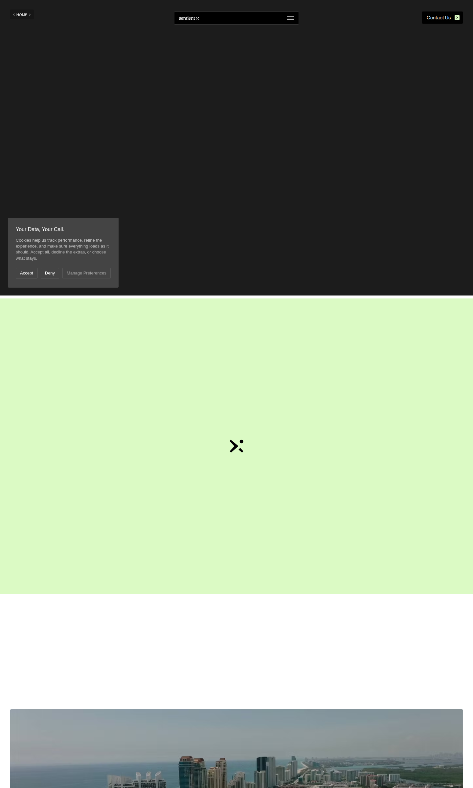

# UI Design System & Master Generation Blueprint: www-sentientx-com

> **SentientX · Enterprise AI & Digital Likeness Protection** (https://www.sentientx.com) — SentientX is an AI operating partner for consumer products and retail. Production-grade AI across supply chain, finance, and operations....



---

## 1. Executive Visual Persona & Design Archetype

- **Brand Essence & Persona**: **SentientX · Enterprise AI & Digital Likeness Protection** (`https://www.sentientx.com`). SentientX is an AI operating partner for consumer products and retail. Production-grade AI across supply chain, finance, and operations....
- **Capture Provenance**: Live browser capture (`tier1_fast`, HTTP `200`, captured `2026-11-23`).
- **Visual Archetype**: **Light-Gallery WebGL / Canvas Interactive Experience (`#ffffff` / `#141414`)**.
- **Anti-AI-Slop Differentiators**:
  - **Live-Computed Chromatic Polarity**: Anchors the viewport in `#ffffff` (live computed `browser-default` `background-color` (`computed_styles.json`)) paired with `#000000` primary typography and `#141414` accents.
  - **Grounded Typographic Hierarchy**: Pairs `wfont_0c99ee_2751996ff9224fc486a0c6fe16...` for display copy (`The Autonomous Enterprise`) with `wf_2751996ff9224fc486a0c6fe1` and not declared in live computed styles (uses primary stack / `ui-monospace`).
  - **Calibrated Spatial Grid & Motion**: Combines `1440px` container bounds (`gap: 10px`, padding `8px`) with `cubic-bezier(.83,0,.17,1)` easing and Lenis Smooth Scroll (`data-lenis`), Three.js / WebGL Canvas Pipeline.

---

## 2. Spatial Architecture & Modular Grid Mathematics


### Viewport Allocation & Container Geometry
- **Captured Viewport Dimensions**: Desktop `1440×2400px` (`assets/desktop.png`, clamped at 2400px live multi-section capture), Mobile `390×2400px` (`assets/mobile.png`, clamped at 2400px live multi-section capture).
- **Master Container Bounds**: `1440px` (full-bleed `100%` desktop stage measured on `1440px` viewport).
- **Canvas Lateral Padding & Spacing**: `8px` lateral canvas padding with `10px` grid gap.
- **Border Radius Scale**: `2px`, `3px`, `999px`, `var(--corvid-border-radius)`.

### Responsive Breakpoint Architecture
- **Desktop Layout**: Multi-column CSS Grid / Flexbox layout at `1440px` (`max-width: 1440px`, `gap: 10px`).
- **Mobile Layout**: Single-column vertical stack at `390px` viewport width with `8px` horizontal padding.
- **Extracted CSS Media Queries**: `@media (prefers-reduced-motion:reduce)`, `@media (max-width:768px)`, `@media (prefers-reduced-motion:no-preference)`, `@media screen and (min-width: 1px) and (max-width: 1000px)`.

---

## 3. Color System, Materiality & Atmospheric Lighting

### Semantic Palette & Source Grounding
| Semantic Role | Ground-Truth Value | Extracted Live / CSS Source |
|---|---|---|
| **Primary Canvas Substrate** | `#ffffff` | live computed `browser-default` `background-color` (`computed_styles.json`) |
| **Primary Typography Ink** | `#000000` | live computed `main` `color` (`computed_styles.json`) |
| **Elevated Surface / Card Substrate** | `#dbfac4` | `.sx-toggle-track:before { background: #dbfac4 }` |
| **Interactive Accent / Highlight** | `#141414` | live computed `a` `color` (`computed_styles.json`) |
| **Secondary / Muted Copy** | `#141414` | live computed `a` `color` (`computed_styles.json`) |
| **Structural Hairline Border** | `#757575` | `var(--stroke)` in `:root` |

### Sanitized Root CSS Variables (`ui-ux.md` Ground Truth)
| Variable Name | Extracted Value | Semantic Role |
|---|---|---|
| `--one-unit` | `1vw` | Dimension / Scale Token |
| `--section-max-width` | `9999px` | Layout / Spatial Grid Token |
| `--spx-stopper-max` | `9999px` | Dimension / Scale Token |
| `--spx-stopper-min` | `0px` | Dimension / Scale Token |
| `--browser-zoom` | `1` | Design System Custom Token |
| `--wst-button-color-fill-primary` | `rgb(var(--color_48))` | Brand / Palette Token |
| `--wst-button-color-border-primary` | `rgb(var(--color_49))` | Brand / Palette Token |
| `--wst-button-color-text-primary` | `rgb(var(--color_50))` | Typography Ink Token |
| `--wst-button-color-fill-primary-hover` | `rgb(var(--color_51))` | Brand / Palette Token |
| `--wst-button-color-border-primary-hover` | `rgb(var(--color_52))` | Brand / Palette Token |
| `--wst-button-color-text-primary-hover` | `rgb(var(--color_53))` | Typography Ink Token |
| `--wst-button-color-fill-primary-disabled` | `rgb(var(--color_54))` | Brand / Palette Token |
| `--wst-button-color-border-primary-disabled` | `rgb(var(--color_55))` | Brand / Palette Token |
| `--wst-button-color-text-primary-disabled` | `rgb(var(--color_56))` | Typography Ink Token |
| `--wst-button-color-fill-secondary` | `rgb(var(--color_57))` | Brand / Palette Token |
| `--wst-button-color-border-secondary` | `rgb(var(--color_58))` | Brand / Palette Token |

---

## 4. Typographic Scale & Editorial Hierarchy

### Font Family Stacks
- **Display Typography**: `wfont_0c99ee_2751996ff9224fc486a0c6fe16...`.
- **Primary Body Stack**: `wf_2751996ff9224fc486a0c6fe1`.
- **Technical / Metadata Stack**: not declared in live computed styles (uses primary stack / `ui-monospace`).

### Typographic Scale & Rules (Live Computed & Stylesheet Grounded)
- **Hero Display (`H1`)**: live computed `h1` (`font-size: 60px`, `line-height: 66px`, `font-weight: 400`, `letter-spacing: -1.8px`); CSS variables `--display: inline-block`, `--comp-display: unset`, `--container-display: grid`.
- **Section Heading (`H2`)**: live computed `h2` (`font-size: 45px`, `line-height: 49.5px`, `font-weight: 400`, `letter-spacing: -1.35px`); CSS variables `--wst-font-style-h2: var(--font_2)`, `--item-depth2-direction: inherit`, `--item-depth2-align: inherit`; rule `h2` (`font-size: 16px`, `line-height: 1.05`, `font-weight: 400`).
- **Body Copy**: live computed `body` (`font-size: 10px`, `line-height: normal`, `font-weight: 400`); CSS variables `--wst-font-style-body-large: var(--font_7)`, `--wst-font-style-body-medium: var(--font_8)`, `--wst-font-style-body-small: var(--font_9)`; rule `p` (`font-size: 13px`, `line-height: 1.4`, `font-weight: 400`).
- **Metadata & Navigation Labels**: live computed `nav/a` (`font-size: 10px`, `line-height: normal`, `font-weight: 400`); CSS variables `--wst-font-style-body-small: var(--font_9)`, `--wst-font-style-body-x-small: var(--font_10)`, `--label-align: center`.

---

## 5. Choreographed Motion & Interaction Physics

### Primary Easing Curves
- **Extracted Timing Functions**: `cubic-bezier(.83,0,.17,1)`, `cubic-bezier(.22,1,.36,1)`, `cubic-bezier(.64,0,.78,0)`.

### Per-Element Transition & Choreography Rules
- **Selector `id^=oldHoverBox-]`**: `transition: opacity .5s,visibility .5s` extracted from `www-sentientx-com` stylesheet.
- **Selector `.sx-cookie-btn`**: `transition: background .2s ease,opacity .2s ease` extracted from `www-sentientx-com` stylesheet.
- **Selector `.sx-toggle-track`**: `transition: .3s` extracted from `www-sentientx-com` stylesheet.
- **Extracted Easing Curve (`cubic-bezier(.83,0,.17,1)`)**: Governs interactive state transitions across `<header.comp-mqurid64>` and `<section.comp-mrnlzewt-container>`.
- **Runtime Interaction Engine**: Integrates Lenis Smooth Scroll (`data-lenis`), Three.js / WebGL Canvas Pipeline, Swiper Touch Carousel Engine, Lottie Vector Animation Player with `prefers-reduced-motion: reduce` fallback guards.

---

## 6. Component Wireframe & Structural DOM Map

### Visual Layout Schematic — Desktop (`1440px`, Grounded in `dom.html` & Landmark Bounding Boxes)
```
┌────────────────────────────────────────────────────────────────────────┐
│ DESKTOP VIEWPORT (1440px) — SentientX · Enterprise AI & Digital Likene │
│ ====================================================================== │
│ [ <header.comp-mqurid64> (1440x140px) | Home                         ] │
│ ---------------------------------------------------------------------- │
│ | HERO STAGE: <section.ke5pl1> (w=1440px)                            | │
│ | H1: The Autonomous Enterprise                                      | │
│ | Substrate: #ffffff | Ink: #000000 | Accent: #141414                | │
│ ---------------------------------------------------------------------- │
│ | SHOWCASE GRID (<section.comp-mrnlzewt-con) max-w: 1440px           | │
│ | +------------------------------+  +------------------------------+ | │
│ | | One intelligence, three laye |  | A new institutional layer fo | | │
│ | +------------------------------+  +------------------------------+ | │
│ ---------------------------------------------------------------------- │
│ | DETAIL MODULE (<section.comp-mqqmgqfu-con) — Monitor, protect, con | │
│ ---------------------------------------------------------------------- │
│ [ FOOTER (<footer.comp-kbgakxm) | https://www.sentientx.com            │
└────────────────────────────────────────────────────────────────────────┘
```

### Visual Layout Schematic — Mobile Reflow (`390px`)
```
┌────────────────────────────────────────────────────────────────────────┐
│ MOBILE VIEWPORT REFLOW (390px) — Single-Column Stack (gap: 10px)       │
│ ====================================================================== │
│ [ HEADER BAR (<header.comp-mqurid64>  ) | Compact Menu (390px)         │
│ ---------------------------------------------------------------------- │
│ | HERO STAGE (<section.ke5pl1>) — 390px Vertical Lead                | │
│ | H1: The Autonomous Enterprise                                      | │
│ ---------------------------------------------------------------------- │
│ | SHOWCASE STACK (<section.comp-mrnlzewt) — 1-Col Stack              | │
│ | [ Item 1: One intelligence, three layers                         ] | │
│ | [ Item 2: A new institutional layer for human identity.          ] | │
│ ---------------------------------------------------------------------- │
│ | DETAIL STACK (<section.comp-mqqmgqfu-c) — 1-Col (Monitor, protect, ) │
│ ---------------------------------------------------------------------- │
│ [ FOOTER (<footer.comp-kbgakxm) | Stacked 390px Colophon               │
└────────────────────────────────────────────────────────────────────────┘
```

### Granular DOM Region Breakdown
1. **Brand Header & Navigation Bar (<header.comp-mqurid64> — `www-sentientx-com`)**:
   - Landmark `<header class="comp-mqurid64 S829f_">` (`1440x140px`) hosting `SentientX · Enterprise AI & Digital ` navigation (`Home`), DOM attributes (`data-url="https://static.parast..."`, `data-url="https://static.parast..."`, `data-url="https://static.parast..."`, `data-url="https://static.parast..."`), and stylesheet rule `root:active-view-transition { view-transition-name:none }`.
2. **Hero Stage & Focal Lead (<section.ke5pl1> — `The Autonomous Enterprise`)**:
   - Landmark `<section class="ke5pl1 comp-mr0mk2kw-container">` presenting display lead `The Autonomous Enterprise` and copy excerpt *"Orchestrates execution - not a bolt-on."* over `#ffffff` canvas and `#000000` ink.
3. **Primary Showcase & Content Grid (<section.comp-mrnlzewt-container> — `One intelligence, three layers`)**:
   - Landmark `<section class="ke5pl1 comp-mrnlzewt-container">` rendering section `One intelligence, three layers` with copy *"Reinvents and runs the corporation."*, asset references (`0b6ff1_2de67bd90d924a449a9260fe7d...`, `cc.js`, `minified.js`, `focus-within-polyfill.js`), and grid rule `root::view-transition { pointer-events:none }`.
4. **Interactive Detail & Feature Matrix (<section.comp-mqqmgqfu-container> — `A new institutional layer for huma`)**:
   - Landmark `<section class="ke5pl1 comp-mqqmgqfu-container">` framing `A new institutional layer for human identity.` and `Monitor, protect, control and enforce.` (*"Protects human identity while extending humanity into the univers"*) with `#dbfac4` surface cards, `#141414` accents, and `SITE_HEADER { view-transition-name:header-group }`.
5. **Colophon & Global Directory Footer (<footer.comp-kbgakxmn> — `https://www.sentientx.com`)**:
   - Landmark `<footer class="comp-kbgakxmn S829f_">` anchoring `SentientX · Enterprise AI & Digi` footer links (`Home`), copy *"A new institutional layer for human identity."*, and `#757575` structural dividers.

---

## 7. Master Zero-Shot AI Generation Prompt

```markdown
# Master Zero-Shot Frontend Generation Prompt: www-sentientx-com (SentientX · Enterprise AI & Digital Likeness Protection)

You are a principal frontend architect and design systems engineer. Build a complete, production-ready web application replicating the exact design system, DOM landmarks, typographic hierarchy, color tokens, and motion physics of `www-sentientx-com` (**SentientX · Enterprise AI & Digital Likeness Protection** — `https://www.sentientx.com`).

### 1. Visual Archetype & Anti-AI-Slop Mandates
- **Archetype**: Light-Gallery WebGL / Canvas Interactive Experience (`#ffffff` / `#141414`).
- **Identity & Domain Context**: SentientX is an AI operating partner for consumer products and retail. Production-grade AI across supply chain, finance, and operations....
- **Primary Substrate**: `#ffffff` (live computed `browser-default` `background-color` (`computed_styles.json`)), **Primary Ink**: `#000000`, **Accent / Highlight**: `#141414`.
- **Site-Specific Differentiators**:
  - **Live-Computed Chromatic Polarity**: Anchors the viewport in `#ffffff` (live computed `browser-default` `background-color` (`computed_styles.json`)) paired with `#000000` primary typography and `#141414` accents.
  - **Grounded Typographic Hierarchy**: Pairs `wfont_0c99ee_2751996ff9224fc486a0c6fe16...` for display copy (`The Autonomous Enterprise`) with `wf_2751996ff9224fc486a0c6fe1` and not declared in live computed styles (uses primary stack / `ui-monospace`).
  - **Calibrated Spatial Grid & Motion**: Combines `1440px` container bounds (`gap: 10px`, padding `8px`) with `cubic-bezier(.83,0,.17,1)` easing and Lenis Smooth Scroll (`data-lenis`), Three.js / WebGL Canvas Pipeline.

### 2. Ground-Truth CSS Variables (`:root` Token Contract)
Declare and consume these exact custom properties extracted from `www-sentientx-com` in your global stylesheet:

:root {
  /* SentientX · Enterprise AI & Digital Likeness Protection (www-sentientx-com) — Live-Grounded CSS Variables */
  --one-unit: 1vw; /* Dimension / Scale Token (www-sentientx-com) */
  --section-max-width: 9999px; /* Layout / Spatial Grid Token (www-sentientx-com) */
  --spx-stopper-max: 9999px; /* Dimension / Scale Token (www-sentientx-com) */
  --spx-stopper-min: 0px; /* Dimension / Scale Token (www-sentientx-com) */
  --browser-zoom: 1; /* Design System Custom Token (www-sentientx-com) */
  --wst-button-color-fill-primary: rgb(var(--color_48)); /* Brand / Palette Token (www-sentientx-com) */
  --wst-button-color-border-primary: rgb(var(--color_49)); /* Brand / Palette Token (www-sentientx-com) */
  --wst-button-color-text-primary: rgb(var(--color_50)); /* Typography Ink Token (www-sentientx-com) */
  --wst-button-color-fill-primary-hover: rgb(var(--color_51)); /* Brand / Palette Token (www-sentientx-com) */
  --wst-button-color-border-primary-hover: rgb(var(--color_52)); /* Brand / Palette Token (www-sentientx-com) */
  --wst-button-color-text-primary-hover: rgb(var(--color_53)); /* Typography Ink Token (www-sentientx-com) */
  --wst-button-color-fill-primary-disabled: rgb(var(--color_54)); /* Brand / Palette Token (www-sentientx-com) */
  --wst-button-color-border-primary-disabled: rgb(var(--color_55)); /* Brand / Palette Token (www-sentientx-com) */
  --wst-button-color-text-primary-disabled: rgb(var(--color_56)); /* Typography Ink Token (www-sentientx-com) */
  --wst-button-color-fill-secondary: rgb(var(--color_57)); /* Brand / Palette Token (www-sentientx-com) */
  --wst-button-color-border-secondary: rgb(var(--color_58)); /* Brand / Palette Token (www-sentientx-com) */
}

### 3. Semantic Color & Materiality Contract
Map every surface, ink, and border strictly to these source-grounded tokens:
- **Primary Canvas Substrate**: `#ffffff` — grounded in live computed `browser-default` `background-color` (`computed_styles.json`)
- **Primary Typography Ink**: `#000000` — grounded in live computed `main` `color` (`computed_styles.json`)
- **Elevated Surface / Card Substrate**: `#dbfac4` — grounded in `.sx-toggle-track:before { background: #dbfac4 }`
- **Interactive Accent / Highlight**: `#141414` — grounded in live computed `a` `color` (`computed_styles.json`)
- **Secondary / Muted Copy**: `#141414` — grounded in live computed `a` `color` (`computed_styles.json`)
- **Structural Hairline Border**: `#757575` — grounded in `var(--stroke)` in `:root`

### 4. Spatial Grid, Container Bounds & Responsive Breakpoints
- **Desktop Viewport Reference**: `1440×2400px` (clamped at 2400px live multi-section capture, `1440px` standard desktop width).
- **Mobile Viewport Reference**: `390×2400px` (clamped at 2400px live multi-section capture, `390px` standard mobile width).
- **Container Max-Width**: `1440px` (full-bleed `100%` desktop stage measured on `1440px` viewport)
- **Padding & Gutters**: `8px` lateral canvas padding with `10px` grid gap
- **Desktop Grid**: Multi-column CSS Grid / Flexbox layout at `1440px` (`max-width: 1440px`, `gap: 10px`)
- **Mobile Adaptation**: Single-column vertical stack at `390px` viewport width with `8px` horizontal padding
- **Media Queries**: `@media (prefers-reduced-motion:reduce)`, `@media (max-width:768px)`, `@media (prefers-reduced-motion:no-preference)`, `@media screen and (min-width: 1px) and (max-width: 1000px)`
- **Corner Radii**: `2px`, `3px`, `999px`, `var(--corvid-border-radius)`

### 5. Typography & Editorial Scale Contract
- **Display Font Stack**: `wfont_0c99ee_2751996ff9224fc486a0c6fe16...`
- **Body Font Stack**: `wf_2751996ff9224fc486a0c6fe1`
- **Monospace / Technical Font Stack**: not declared in live computed styles (uses primary stack / `ui-monospace`)
- **H1 Display Rule**: live computed `h1` (`font-size: 60px`, `line-height: 66px`, `font-weight: 400`, `letter-spacing: -1.8px`); CSS variables `--display: inline-block`, `--comp-display: unset`, `--container-display: grid`
- **H2 Section Rule**: live computed `h2` (`font-size: 45px`, `line-height: 49.5px`, `font-weight: 400`, `letter-spacing: -1.35px`); CSS variables `--wst-font-style-h2: var(--font_2)`, `--item-depth2-direction: inherit`, `--item-depth2-align: inherit`; rule `h2` (`font-size: 16px`, `line-height: 1.05`, `font-weight: 400`)
- **Body Copy Rule**: live computed `body` (`font-size: 10px`, `line-height: normal`, `font-weight: 400`); CSS variables `--wst-font-style-body-large: var(--font_7)`, `--wst-font-style-body-medium: var(--font_8)`, `--wst-font-style-body-small: var(--font_9)`; rule `p` (`font-size: 13px`, `line-height: 1.4`, `font-weight: 400`)
- **Metadata & Index Rule**: live computed `nav/a` (`font-size: 10px`, `line-height: normal`, `font-weight: 400`); CSS variables `--wst-font-style-body-small: var(--font_9)`, `--wst-font-style-body-x-small: var(--font_10)`, `--label-align: center`

### 6. Component Hierarchy, Verbatim Copy & Real DOM Landmarks
Scaffold `www-sentientx-com` (`SentientX · Enterprise AI & Digital Likeness Protection`) with these exact structural regions, extracted copy, and CSS rules from `dom.html`:
1. **Brand Header & Navigation Bar (<header.comp-mqurid64> — `www-sentientx-com`)**:
   - DOM & Selectors: Landmark `<header class="comp-mqurid64 S829f_">` (`1440x140px`) hosting `SentientX · Enterprise AI & Digital ` navigation (`Home`), DOM attributes (`data-url="https://static.parast..."`, `data-url="https://static.parast..."`, `data-url="https://static.parast..."`, `data-url="https://static.parast..."`), and stylesheet rule `root:active-view-transition { view-transition-name:none }`.
   - Responsive Contract: Header `Brand Header & Navigation Bar (<header.comp-mqurid64> — `www-sentientx-com`)` (`www-sentientx-com`) adapts across `@media (prefers-reduced-motion:reduce)`, `@media (max-width:768px)`, `@media (prefers-reduced-motion:no-preference)`, `@media screen and (min-width: 1px) and (max-width: 1000px)` with `cubic-bezier(.83,0,.17,1)`, `cubic-bezier(.22,1,.36,1)`, `cubic-bezier(.64,0,.78,0)` transitions and links `Home`.
2. **Hero Stage & Focal Lead (<section.ke5pl1> — `The Autonomous Enterprise`)**:
   - DOM & Selectors: Landmark `<section class="ke5pl1 comp-mr0mk2kw-container">` presenting display lead `The Autonomous Enterprise` and copy excerpt *"Orchestrates execution - not a bolt-on."* over `#ffffff` canvas and `#000000` ink.
   - Responsive Contract: Hero stage (`1440×2400px` desktop / `390×2400px` mobile) sets `#ffffff` background with `#000000` headline `The Autonomous Enterprise`.
3. **Primary Showcase & Content Grid (<section.comp-mrnlzewt-container> — `One intelligence, three layers`)**:
   - DOM & Selectors: Landmark `<section class="ke5pl1 comp-mrnlzewt-container">` rendering section `One intelligence, three layers` with copy *"Reinvents and runs the corporation."*, asset references (`0b6ff1_2de67bd90d924a449a9260fe7d...`, `cc.js`, `minified.js`, `focus-within-polyfill.js`), and grid rule `root::view-transition { pointer-events:none }`.
   - Responsive Contract: Showcase grid `Primary Showcase & Content Grid (<section.comp-mrnlzewt-container> — `One intelligence, three layers`)` applies Multi-column CSS Grid / Flexbox layout at `1440px` (`max-width: 1440px`, `gap: 10px`) on desktop and Single-column vertical stack at `390px` viewport width with `8px` horizontal padding on mobile.
4. **Interactive Detail & Feature Matrix (<section.comp-mqqmgqfu-container> — `A new institutional layer for huma`)**:
   - DOM & Selectors: Landmark `<section class="ke5pl1 comp-mqqmgqfu-container">` framing `A new institutional layer for human identity.` and `Monitor, protect, control and enforce.` (*"Protects human identity while extending humanity into the univers"*) with `#dbfac4` surface cards, `#141414` accents, and `SITE_HEADER { view-transition-name:header-group }`.
   - Responsive Contract: Detail module `Interactive Detail & Feature Matrix (<section.comp-mqqmgqfu-container> — `A new institutional layer for huma`)` uses `2px`, `3px`, `999px`, `var(--corvid-border-radius)` radii, `#141414` highlights, and assets (0b6ff1_2de67bd90d924a449a9260fe7d..., cc.js, minified.js).
5. **Colophon & Global Directory Footer (<footer.comp-kbgakxmn> — `https://www.sentientx.com`)**:
   - DOM & Selectors: Landmark `<footer class="comp-kbgakxmn S829f_">` anchoring `SentientX · Enterprise AI & Digi` footer links (`Home`), copy *"A new institutional layer for human identity."*, and `#757575` structural dividers.
   - Responsive Contract: Footer `Colophon & Global Directory Footer (<footer.comp-kbgakxmn> — `https://www.sentientx.com`)` aligns to `1440px` (full-bleed `100%` desktop stage measured on `1440px` viewport) with `8px` lateral canvas padding with `10px` grid gap and attributes (data-url="https://static.parast...", data-url="https://static.parast...", data-url="https://static.parast...").

#### Verbatim DOM Copy Excerpts (`dom.html`)
- Copy Excerpt 1: *"Orchestrates execution - not a bolt-on."*
- Copy Excerpt 2: *"Reinvents and runs the corporation."*
- Copy Excerpt 3: *"Protects human identity while extending humanity into the universe."*
- Copy Excerpt 4: *"A new institutional layer for human identity."*

### 7. Motion, Extracted Stylesheet Rules & Interaction Choreography
- **Primary Easing Functions**: `cubic-bezier(.83,0,.17,1)`, `cubic-bezier(.22,1,.36,1)`, `cubic-bezier(.64,0,.78,0)`
- **Extracted Stylesheet Rules (`www-sentientx-com`)**:
- `root:active-view-transition { view-transition-name:none }`
- `root::view-transition { pointer-events:none }`
- `SITE_HEADER { view-transition-name:header-group }`
- `WIX_ADS { view-transition-name:wix-ads-group }`
- `SITE_FOOTER { view-transition-name:footer-group }`
- **Per-Selector Transition Rules**:
- **Selector `id^=oldHoverBox-]`**: `transition: opacity .5s,visibility .5s` extracted from `www-sentientx-com` stylesheet.
- **Selector `.sx-cookie-btn`**: `transition: background .2s ease,opacity .2s ease` extracted from `www-sentientx-com` stylesheet.
- **Selector `.sx-toggle-track`**: `transition: .3s` extracted from `www-sentientx-com` stylesheet.
- **Extracted Easing Curve (`cubic-bezier(.83,0,.17,1)`)**: Governs interactive state transitions across `<header.comp-mqurid64>` and `<section.comp-mrnlzewt-container>`.
- **Runtime Interaction Engine**: Integrates Lenis Smooth Scroll (`data-lenis`), Three.js / WebGL Canvas Pipeline, Swiper Touch Carousel Engine, Lottie Vector Animation Player with `prefers-reduced-motion: reduce` fallback guards.

### 8. Technical Deliverables
- Implement in Next.js (App Router) with TypeScript and Tailwind CSS consuming the `:root` custom properties defined above for `www-sentientx-com`.
- Reproduce both the `1440px` desktop architecture and `390px` mobile breakpoint transitions, preserving semantic HTML5 landmarks (`<header>`, `<nav>`, `<main>`, `<section>`, `<footer>`) and `prefers-reduced-motion` accessibility guards.
```
