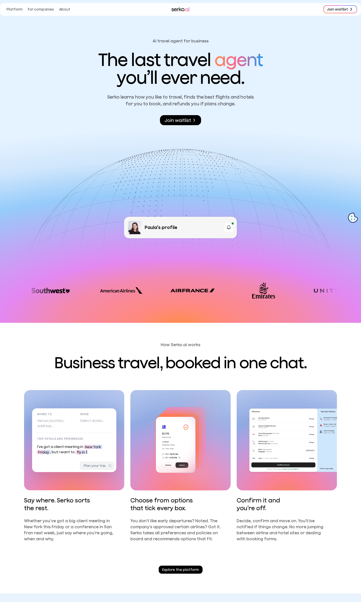

# UI Design System & Master Generation Blueprint: www-serko-ai

> **Serko.ai · AI Travel Agent for Business Trips** (https://www.serko.ai) — Serko.ai is an AI travel agent for work. Book personalized flights and hotels, follow company policy, manage disruptions and cancel with...



---

## 1. Executive Visual Persona & Design Archetype

- **Brand Essence & Persona**: **Serko.ai · AI Travel Agent for Business Trips** (`https://www.serko.ai`). Serko.ai is an AI travel agent for work. Book personalized flights and hotels, follow company policy, manage disruptions and cancel with...
- **Capture Provenance**: Live browser capture (`tier1_fast`, HTTP `200`, captured `2026-11-23`).
- **Visual Archetype**: **Light-Gallery WebGL / Canvas Interactive Experience (`#e8f3fe` / `#0082f3`)**.
- **Anti-AI-Slop Differentiators**:
  - **Live-Computed Chromatic Polarity**: Anchors the viewport in `#e8f3fe` (live computed `body` `background-color` (`computed_styles.json`)) paired with `#000000` primary typography and `#0082f3` accents.
  - **Grounded Typographic Hierarchy**: Pairs `Jokker` for display copy (`AI travel agent for business`) with `Jokker` and not declared in live computed styles (uses primary stack / `ui-monospace`).
  - **Calibrated Spatial Grid & Motion**: Combines `1440px` container bounds (`gap: 16px`, padding `9px`) with `cubic-bezier(0.525,0,0,1)` easing and Lenis Smooth Scroll (`data-lenis`), GSAP Timeline & ScrollTrigger.

---

## 2. Spatial Architecture & Modular Grid Mathematics


### Viewport Allocation & Container Geometry
- **Captured Viewport Dimensions**: Desktop `1440×2400px` (`assets/desktop.png`, clamped at 2400px live multi-section capture), Mobile `390×2400px` (`assets/mobile.png`, clamped at 2400px live multi-section capture).
- **Master Container Bounds**: `1440px` (full-bleed `100%` desktop stage measured on `1440px` viewport).
- **Canvas Lateral Padding & Spacing**: `9px` lateral canvas padding with `16px` grid gap.
- **Border Radius Scale**: `3px`, `100%`, `50%`, `var(--radius--medium)`.

### Responsive Breakpoint Architecture
- **Desktop Layout**: Multi-column CSS Grid / Flexbox layout at `1440px` (`max-width: 1440px`, `gap: 16px`).
- **Mobile Layout**: Single-column vertical stack at `390px` viewport width with `9px` horizontal padding.
- **Extracted CSS Media Queries**: `@media screen and (max-width:991px)`, `@media screen and (max-width:767px)`, `@media screen and (max-width:479px)`, `@media (min-width:768px)`.

---

## 3. Color System, Materiality & Atmospheric Lighting

### Semantic Palette & Source Grounding
| Semantic Role | Ground-Truth Value | Extracted Live / CSS Source |
|---|---|---|
| **Primary Canvas Substrate** | `#e8f3fe` | live computed `body` `background-color` (`computed_styles.json`) |
| **Primary Typography Ink** | `#000000` | live computed `h1` `color` (`computed_styles.json`) |
| **Elevated Surface / Card Substrate** | `#ebebeb` | `var(--osano-info-dialog-selected-background-color)` in `:root` |
| **Interactive Accent / Highlight** | `#0082f3` | `.w-dropdown-link.w--current { color: #0082f3 }` |
| **Secondary / Muted Copy** | `#058a5e` | `var(--osano-gpc-foreground-color)` in `:root` |
| **Structural Hairline Border** | `#d8d8d8` | `var(--osano-info-dialog-border-color)` in `:root` |
| **Variable Token (`--osano-info-dialog-border-subtle-color`)** | `#e9e9e9` | `var(--osano-info-dialog-border-subtle-color)` in `:root` |
| **Variable Token (`--osano-info-dialog-inset-color`)** | `#f4f4f4` | `var(--osano-info-dialog-inset-color)` in `:root` |
| **Variable Token (`--osano-info-dialog-gpc-tint-color`)** | `#e7f9f0` | `var(--osano-info-dialog-gpc-tint-color)` in `:root` |
| **Variable Token (`--osano-button-foreground-color`)** | `#ffffff` | `var(--osano-button-foreground-color)` in `:root` |

### Sanitized Root CSS Variables (`ui-ux.md` Ground Truth)
| Variable Name | Extracted Value | Semantic Role |
|---|---|---|
| `--osano-clear-dialog-background` | `rgba(0,0,0,0)` | Canvas / Surface Token |
| `--osano-info-dialog-border-color` | `#d8d8d8` | Brand / Palette Token |
| `--osano-info-dialog-border-subtle-color` | `#e9e9e9` | Brand / Palette Token |
| `--osano-info-dialog-inset-color` | `#f4f4f4` | Brand / Palette Token |
| `--osano-info-dialog-selected-background-color` | `#ebebeb` | Canvas / Surface Token |
| `--osano-info-dialog-gpc-tint-color` | `#e7f9f0` | Canvas / Surface Token |
| `--osano-theme` | `modern` | Brand / Palette Token |
| `--osano-button-border-color` | `var(--osano-button-foreground-color)` | Brand / Palette Token |
| `--osano-dialog-type` | `box` | Typography / Scale Token |
| `--osano-display-position` | `"bottom-left"` | Design System Custom Token |
| `--osano-info-dialog-position` | `right` | Design System Custom Token |
| `--osano-widget-position` | `right` | Design System Custom Token |
| `--osano-opt-out-widget-position` | `right` | Design System Custom Token |
| `--osano-button-background-color` | `#000000` | Canvas / Surface Token |
| `--osano-button-foreground-color` | `#FFFFFF` | Typography Ink Token |
| `--osano-dialog-background-color` | `#ffffff` | Canvas / Surface Token |

---

## 4. Typographic Scale & Editorial Hierarchy

### Font Family Stacks
- **Display Typography**: `Jokker`.
- **Primary Body Stack**: `Jokker`.
- **Technical / Metadata Stack**: not declared in live computed styles (uses primary stack / `ui-monospace`).

### Typographic Scale & Rules (Live Computed & Stylesheet Grounded)
- **Hero Display (`H1`)**: live computed `h1` (`font-size: 16px`, `line-height: 16px`, `font-weight: 500`); CSS variables `--osano-display-position: "bottom-left"`, `--library_typography---font-size--h1: 5.25rem`, `--library_typography---font-size--display: 6rem`.
- **Section Heading (`H2`)**: live computed `h3 (primary section heading)` (`font-size: 62.3271px`, `line-height: 62.3271px`, `font-weight: 500`, `letter-spacing: -1.86981px`); CSS variables `--library_typography---font-size--h2: 4rem`.
- **Body Copy**: live computed `body` (`font-size: 16px`, `line-height: 24px`, `font-weight: 500`).
- **Metadata & Navigation Labels**: live computed `nav/a` (`font-size: 16px`, `line-height: 24px`, `font-weight: 500`); CSS variables `--library_heading-style---letter-spacing: var(--library_typography---letter-spacing--0em)`, `--library_text-style---letter-spacing: var(--library_typography---letter-spacing--0em)`, `--library_spacing---section-space--small: 5rem`.

---

## 5. Choreographed Motion & Interaction Physics

### Primary Easing Curves
- **Extracted Timing Functions**: `cubic-bezier(0.525,0,0,1)`, `cubic-bezier(.22,1.15,.36,1)`.

### Per-Element Transition & Choreography Rules
- **Selector `.w-webflow-badge>img`**: `transition: unset` extracted from `www-serko-ai` stylesheet.
- **Selector `.w-slider-dot`**: `transition: background-color .1s,color .1s` extracted from `www-serko-ai` stylesheet.
- **Selector `.w-lightbox-control`**: `transition: all .3s` extracted from `www-serko-ai` stylesheet.
- **Extracted Easing Curve (`cubic-bezier(0.525,0,0,1)`)**: Governs interactive state transitions across `<header.nav1_header>` and `<section.col3_wrap>`.
- **Runtime Interaction Engine**: Integrates Lenis Smooth Scroll (`data-lenis`), GSAP Timeline & ScrollTrigger, Three.js / WebGL Canvas Pipeline, Swiper Touch Carousel Engine with `prefers-reduced-motion: reduce` fallback guards.

---

## 6. Component Wireframe & Structural DOM Map

### Visual Layout Schematic — Desktop (`1440px`, Grounded in `dom.html` & Landmark Bounding Boxes)
```
┌────────────────────────────────────────────────────────────────────────┐
│ DESKTOP VIEWPORT (1440px) — Serko.ai · AI Travel Agent for Business Tr │
│ ====================================================================== │
│ [ <header.nav1_header> (1440x75px)    | Home · Platform · For compan ] │
│ ---------------------------------------------------------------------- │
│ | HERO STAGE: <section.hero1_wrap> (w=1440px)                        | │
│ | H1: AI travel agent for business                                   | │
│ | Substrate: #e8f3fe | Ink: #000000 | Accent: #0082f3                | │
│ ---------------------------------------------------------------------- │
│ | SHOWCASE GRID (<section.col3_wrap>) max-w: 1440px                  | │
│ | +------------------------------+  +------------------------------+ | │
│ | | The last travel agent you’ll |  | How Serko.ai works           | | │
│ | +------------------------------+  +------------------------------+ | │
│ ---------------------------------------------------------------------- │
│ | DETAIL MODULE (<section.feature1_wrap>) — Business travel, book    | │
│ ---------------------------------------------------------------------- │
│ [ FOOTER (<footer.osano-cm-win) | https://www.serko.ai                 │
└────────────────────────────────────────────────────────────────────────┘
```

### Visual Layout Schematic — Mobile Reflow (`390px`)
```
┌────────────────────────────────────────────────────────────────────────┐
│ MOBILE VIEWPORT REFLOW (390px) — Single-Column Stack (gap: 16px)       │
│ ====================================================================== │
│ [ HEADER BAR (<header.nav1_header>    ) | Compact Menu (390px)         │
│ ---------------------------------------------------------------------- │
│ | HERO STAGE (<section.hero1_wrap>) — 390px Vertical Lead            | │
│ | H1: AI travel agent for business                                   | │
│ ---------------------------------------------------------------------- │
│ | SHOWCASE STACK (<section.col3_wrap>) — 1-Col Stack                 | │
│ | [ Item 1: The last travel agent you’ll ever need.                ] | │
│ | [ Item 2: How Serko.ai works                                     ] | │
│ ---------------------------------------------------------------------- │
│ | DETAIL STACK (<section.feature1_wrap>) — 1-Col (Business travel, b)  │
│ ---------------------------------------------------------------------- │
│ [ FOOTER (<footer.osano-cm-win) | Stacked 390px Colophon               │
└────────────────────────────────────────────────────────────────────────┘
```

### Granular DOM Region Breakdown
1. **Brand Header & Navigation Bar (<header.nav1_header> — `www-serko-ai`)**:
   - Landmark `<header class="nav1_header">` (`1440x75px`) hosting `Serko.ai · AI Travel Agent for Busin` navigation (`Home · Platform · For companies · About · Sign up free`), DOM attributes (`data-wf-domain="www.serko.ai"`, `data-wf-page="6aa12b65e6dd0b96a2a83430"`, `data-wf-site="6aa12b65e6dd0b96a2a8345b"`, `data-wf-intellimize-customer-id="117114932"`), and stylesheet rule `html { -webkit-text-size-adjust:100%;-ms-text-size-adjust:100%;font-family:sans... }`.
2. **Hero Stage & Focal Lead (<section.hero1_wrap> — `AI travel agent for business`)**:
   - Landmark `<section class="hero1_wrap u-gradient-bg-1">` presenting display lead `AI travel agent for business` and copy excerpt *"Serko learns how you like to travel, finds the best flights and h"* over `#e8f3fe` canvas and `#000000` ink.
3. **Primary Showcase & Content Grid (<section.col3_wrap> — `The last travel agent you’ll ever `)**:
   - Landmark `<section class="col3_wrap">` rendering section `The last travel agent you’ll ever need.` with copy *"Venue, location, address..."*, asset references (`cdn.prod.website-files.com`, `serko-ai.webflow.shared.96cab25cb...`, `serko-ai.webflow.6aa12b65e6dd0b96...`, `0.8.77`), and grid rule `summary { display:block }`.
4. **Interactive Detail & Feature Matrix (<section.feature1_wrap> — `How Serko.ai works`)**:
   - Landmark `<section class="feature1_wrap u-background-3">` framing `How Serko.ai works` and `Business travel, booked in one chat.` (*"Trip details and preferences"*) with `#ebebeb` surface cards, `#0082f3` accents, and `video { vertical-align:baseline;display:inline-block }`.
5. **Colophon & Global Directory Footer (<footer.osano-cm-window> — `https://www.serko.ai`)**:
   - Landmark `<footer class="osano-cm-window">` anchoring `Serko.ai · AI Travel Agent for B` footer links (`Home · Platform · For companies · About · Sign up free`), copy *"I've got a client meeting in New York Friday , but I wan"*, and `#d8d8d8` structural dividers.

---

## 7. Master Zero-Shot AI Generation Prompt

```markdown
# Master Zero-Shot Frontend Generation Prompt: www-serko-ai (Serko.ai · AI Travel Agent for Business Trips)

You are a principal frontend architect and design systems engineer. Build a complete, production-ready web application replicating the exact design system, DOM landmarks, typographic hierarchy, color tokens, and motion physics of `www-serko-ai` (**Serko.ai · AI Travel Agent for Business Trips** — `https://www.serko.ai`).

### 1. Visual Archetype & Anti-AI-Slop Mandates
- **Archetype**: Light-Gallery WebGL / Canvas Interactive Experience (`#e8f3fe` / `#0082f3`).
- **Identity & Domain Context**: Serko.ai is an AI travel agent for work. Book personalized flights and hotels, follow company policy, manage disruptions and cancel with...
- **Primary Substrate**: `#e8f3fe` (live computed `body` `background-color` (`computed_styles.json`)), **Primary Ink**: `#000000`, **Accent / Highlight**: `#0082f3`.
- **Site-Specific Differentiators**:
  - **Live-Computed Chromatic Polarity**: Anchors the viewport in `#e8f3fe` (live computed `body` `background-color` (`computed_styles.json`)) paired with `#000000` primary typography and `#0082f3` accents.
  - **Grounded Typographic Hierarchy**: Pairs `Jokker` for display copy (`AI travel agent for business`) with `Jokker` and not declared in live computed styles (uses primary stack / `ui-monospace`).
  - **Calibrated Spatial Grid & Motion**: Combines `1440px` container bounds (`gap: 16px`, padding `9px`) with `cubic-bezier(0.525,0,0,1)` easing and Lenis Smooth Scroll (`data-lenis`), GSAP Timeline & ScrollTrigger.

### 2. Ground-Truth CSS Variables (`:root` Token Contract)
Declare and consume these exact custom properties extracted from `www-serko-ai` in your global stylesheet:

:root {
  /* Serko.ai · AI Travel Agent for Business Trips (www-serko-ai) — Live-Grounded CSS Variables */
  --osano-clear-dialog-background: rgba(0,0,0,0); /* Canvas / Surface Token (www-serko-ai) */
  --osano-info-dialog-border-color: #d8d8d8; /* Brand / Palette Token (www-serko-ai) */
  --osano-info-dialog-border-subtle-color: #e9e9e9; /* Brand / Palette Token (www-serko-ai) */
  --osano-info-dialog-inset-color: #f4f4f4; /* Brand / Palette Token (www-serko-ai) */
  --osano-info-dialog-selected-background-color: #ebebeb; /* Canvas / Surface Token (www-serko-ai) */
  --osano-info-dialog-gpc-tint-color: #e7f9f0; /* Canvas / Surface Token (www-serko-ai) */
  --osano-theme: modern; /* Brand / Palette Token (www-serko-ai) */
  --osano-button-border-color: var(--osano-button-foreground-color); /* Brand / Palette Token (www-serko-ai) */
  --osano-dialog-type: box; /* Typography / Scale Token (www-serko-ai) */
  --osano-display-position: "bottom-left"; /* Design System Custom Token (www-serko-ai) */
  --osano-info-dialog-position: right; /* Design System Custom Token (www-serko-ai) */
  --osano-widget-position: right; /* Design System Custom Token (www-serko-ai) */
  --osano-opt-out-widget-position: right; /* Design System Custom Token (www-serko-ai) */
  --osano-button-background-color: #000000; /* Canvas / Surface Token (www-serko-ai) */
  --osano-button-foreground-color: #FFFFFF; /* Typography Ink Token (www-serko-ai) */
  --osano-dialog-background-color: #ffffff; /* Canvas / Surface Token (www-serko-ai) */
}

### 3. Semantic Color & Materiality Contract
Map every surface, ink, and border strictly to these source-grounded tokens:
- **Primary Canvas Substrate**: `#e8f3fe` — grounded in live computed `body` `background-color` (`computed_styles.json`)
- **Primary Typography Ink**: `#000000` — grounded in live computed `h1` `color` (`computed_styles.json`)
- **Elevated Surface / Card Substrate**: `#ebebeb` — grounded in `var(--osano-info-dialog-selected-background-color)` in `:root`
- **Interactive Accent / Highlight**: `#0082f3` — grounded in `.w-dropdown-link.w--current { color: #0082f3 }`
- **Secondary / Muted Copy**: `#058a5e` — grounded in `var(--osano-gpc-foreground-color)` in `:root`
- **Structural Hairline Border**: `#d8d8d8` — grounded in `var(--osano-info-dialog-border-color)` in `:root`
- **Variable Token (`--osano-info-dialog-border-subtle-color`)**: `#e9e9e9` — grounded in `var(--osano-info-dialog-border-subtle-color)` in `:root`
- **Variable Token (`--osano-info-dialog-inset-color`)**: `#f4f4f4` — grounded in `var(--osano-info-dialog-inset-color)` in `:root`
- **Variable Token (`--osano-info-dialog-gpc-tint-color`)**: `#e7f9f0` — grounded in `var(--osano-info-dialog-gpc-tint-color)` in `:root`
- **Variable Token (`--osano-button-foreground-color`)**: `#ffffff` — grounded in `var(--osano-button-foreground-color)` in `:root`

### 4. Spatial Grid, Container Bounds & Responsive Breakpoints
- **Desktop Viewport Reference**: `1440×2400px` (clamped at 2400px live multi-section capture, `1440px` standard desktop width).
- **Mobile Viewport Reference**: `390×2400px` (clamped at 2400px live multi-section capture, `390px` standard mobile width).
- **Container Max-Width**: `1440px` (full-bleed `100%` desktop stage measured on `1440px` viewport)
- **Padding & Gutters**: `9px` lateral canvas padding with `16px` grid gap
- **Desktop Grid**: Multi-column CSS Grid / Flexbox layout at `1440px` (`max-width: 1440px`, `gap: 16px`)
- **Mobile Adaptation**: Single-column vertical stack at `390px` viewport width with `9px` horizontal padding
- **Media Queries**: `@media screen and (max-width:991px)`, `@media screen and (max-width:767px)`, `@media screen and (max-width:479px)`, `@media (min-width:768px)`
- **Corner Radii**: `3px`, `100%`, `50%`, `var(--radius--medium)`

### 5. Typography & Editorial Scale Contract
- **Display Font Stack**: `Jokker`
- **Body Font Stack**: `Jokker`
- **Monospace / Technical Font Stack**: not declared in live computed styles (uses primary stack / `ui-monospace`)
- **H1 Display Rule**: live computed `h1` (`font-size: 16px`, `line-height: 16px`, `font-weight: 500`); CSS variables `--osano-display-position: "bottom-left"`, `--library_typography---font-size--h1: 5.25rem`, `--library_typography---font-size--display: 6rem`
- **H2 Section Rule**: live computed `h3 (primary section heading)` (`font-size: 62.3271px`, `line-height: 62.3271px`, `font-weight: 500`, `letter-spacing: -1.86981px`); CSS variables `--library_typography---font-size--h2: 4rem`
- **Body Copy Rule**: live computed `body` (`font-size: 16px`, `line-height: 24px`, `font-weight: 500`)
- **Metadata & Index Rule**: live computed `nav/a` (`font-size: 16px`, `line-height: 24px`, `font-weight: 500`); CSS variables `--library_heading-style---letter-spacing: var(--library_typography---letter-spacing--0em)`, `--library_text-style---letter-spacing: var(--library_typography---letter-spacing--0em)`, `--library_spacing---section-space--small: 5rem`

### 6. Component Hierarchy, Verbatim Copy & Real DOM Landmarks
Scaffold `www-serko-ai` (`Serko.ai · AI Travel Agent for Business Trips`) with these exact structural regions, extracted copy, and CSS rules from `dom.html`:
1. **Brand Header & Navigation Bar (<header.nav1_header> — `www-serko-ai`)**:
   - DOM & Selectors: Landmark `<header class="nav1_header">` (`1440x75px`) hosting `Serko.ai · AI Travel Agent for Busin` navigation (`Home · Platform · For companies · About · Sign up free`), DOM attributes (`data-wf-domain="www.serko.ai"`, `data-wf-page="6aa12b65e6dd0b96a2a83430"`, `data-wf-site="6aa12b65e6dd0b96a2a8345b"`, `data-wf-intellimize-customer-id="117114932"`), and stylesheet rule `html { -webkit-text-size-adjust:100%;-ms-text-size-adjust:100%;font-family:sans... }`.
   - Responsive Contract: Header `Brand Header & Navigation Bar (<header.nav1_header> — `www-serko-ai`)` (`www-serko-ai`) adapts across `@media screen and (max-width:991px)`, `@media screen and (max-width:767px)`, `@media screen and (max-width:479px)`, `@media (min-width:768px)` with `cubic-bezier(0.525,0,0,1)`, `cubic-bezier(.22,1.15,.36,1)` transitions and links `Home · Platform · For companies · About · Sign up free`.
2. **Hero Stage & Focal Lead (<section.hero1_wrap> — `AI travel agent for business`)**:
   - DOM & Selectors: Landmark `<section class="hero1_wrap u-gradient-bg-1">` presenting display lead `AI travel agent for business` and copy excerpt *"Serko learns how you like to travel, finds the best flights and h"* over `#e8f3fe` canvas and `#000000` ink.
   - Responsive Contract: Hero stage (`1440×2400px` desktop / `390×2400px` mobile) sets `#e8f3fe` background with `#000000` headline `AI travel agent for business`.
3. **Primary Showcase & Content Grid (<section.col3_wrap> — `The last travel agent you’ll ever `)**:
   - DOM & Selectors: Landmark `<section class="col3_wrap">` rendering section `The last travel agent you’ll ever need.` with copy *"Venue, location, address..."*, asset references (`cdn.prod.website-files.com`, `serko-ai.webflow.shared.96cab25cb...`, `serko-ai.webflow.6aa12b65e6dd0b96...`, `0.8.77`), and grid rule `summary { display:block }`.
   - Responsive Contract: Showcase grid `Primary Showcase & Content Grid (<section.col3_wrap> — `The last travel agent you’ll ever `)` applies Multi-column CSS Grid / Flexbox layout at `1440px` (`max-width: 1440px`, `gap: 16px`) on desktop and Single-column vertical stack at `390px` viewport width with `9px` horizontal padding on mobile.
4. **Interactive Detail & Feature Matrix (<section.feature1_wrap> — `How Serko.ai works`)**:
   - DOM & Selectors: Landmark `<section class="feature1_wrap u-background-3">` framing `How Serko.ai works` and `Business travel, booked in one chat.` (*"Trip details and preferences"*) with `#ebebeb` surface cards, `#0082f3` accents, and `video { vertical-align:baseline;display:inline-block }`.
   - Responsive Contract: Detail module `Interactive Detail & Feature Matrix (<section.feature1_wrap> — `How Serko.ai works`)` uses `3px`, `100%`, `50%`, `var(--radius--medium)` radii, `#0082f3` highlights, and assets (cdn.prod.website-files.com, serko-ai.webflow.shared.96cab25cb..., serko-ai.webflow.6aa12b65e6dd0b96...).
5. **Colophon & Global Directory Footer (<footer.osano-cm-window> — `https://www.serko.ai`)**:
   - DOM & Selectors: Landmark `<footer class="osano-cm-window">` anchoring `Serko.ai · AI Travel Agent for B` footer links (`Home · Platform · For companies · About · Sign up free`), copy *"I've got a client meeting in New York Friday , but I wan"*, and `#d8d8d8` structural dividers.
   - Responsive Contract: Footer `Colophon & Global Directory Footer (<footer.osano-cm-window> — `https://www.serko.ai`)` aligns to `1440px` (full-bleed `100%` desktop stage measured on `1440px` viewport) with `9px` lateral canvas padding with `16px` grid gap and attributes (data-wf-domain="www.serko.ai", data-wf-page="6aa12b65e6dd0b96a2a83430", data-wf-site="6aa12b65e6dd0b96a2a8345b").

#### Verbatim DOM Copy Excerpts (`dom.html`)
- Copy Excerpt 1: *"Serko learns how you like to travel, finds the best flights and hotels for you to..."*
- Copy Excerpt 2: *"Venue, location, address..."*
- Copy Excerpt 3: *"Trip details and preferences"*
- Copy Excerpt 4: *"I've got a client meeting in New York Friday , but I wan"*

### 7. Motion, Extracted Stylesheet Rules & Interaction Choreography
- **Primary Easing Functions**: `cubic-bezier(0.525,0,0,1)`, `cubic-bezier(.22,1.15,.36,1)`
- **Extracted Stylesheet Rules (`www-serko-ai`)**:
- `html { -webkit-text-size-adjust:100%;-ms-text-size-adjust:100%;font-family:sans... }`
- `summary { display:block }`
- `video { vertical-align:baseline;display:inline-block }`
- `template { display:none }`
- `strong { font-weight:700 }`
- **Per-Selector Transition Rules**:
- **Selector `.w-webflow-badge>img`**: `transition: unset` extracted from `www-serko-ai` stylesheet.
- **Selector `.w-slider-dot`**: `transition: background-color .1s,color .1s` extracted from `www-serko-ai` stylesheet.
- **Selector `.w-lightbox-control`**: `transition: all .3s` extracted from `www-serko-ai` stylesheet.
- **Extracted Easing Curve (`cubic-bezier(0.525,0,0,1)`)**: Governs interactive state transitions across `<header.nav1_header>` and `<section.col3_wrap>`.
- **Runtime Interaction Engine**: Integrates Lenis Smooth Scroll (`data-lenis`), GSAP Timeline & ScrollTrigger, Three.js / WebGL Canvas Pipeline, Swiper Touch Carousel Engine with `prefers-reduced-motion: reduce` fallback guards.

### 8. Technical Deliverables
- Implement in Next.js (App Router) with TypeScript and Tailwind CSS consuming the `:root` custom properties defined above for `www-serko-ai`.
- Reproduce both the `1440px` desktop architecture and `390px` mobile breakpoint transitions, preserving semantic HTML5 landmarks (`<header>`, `<nav>`, `<main>`, `<section>`, `<footer>`) and `prefers-reduced-motion` accessibility guards.
```
