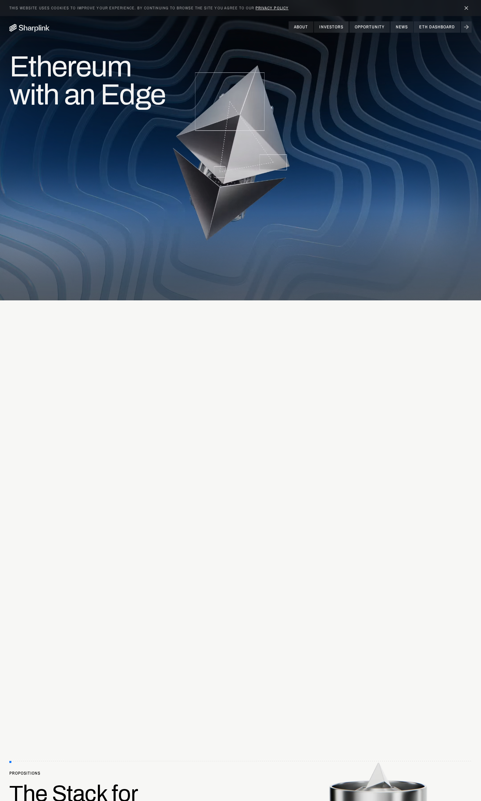
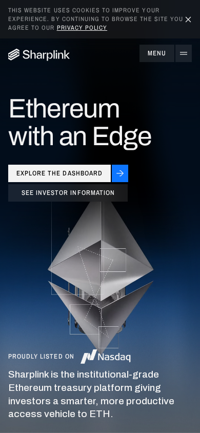

# UI Design System & Master Generation Blueprint: www-sharplink-com

> **Sharplink : Home** (https://www.sharplink.com/) — Sharplink is the institutional-grade Ethereum treasury platform giving investors a smarter, more productive access vehicle to ETH



---

## 1. Executive Visual Persona & Design Archetype

- **Brand Essence & Persona**: **Sharplink : Home** (`https://www.sharplink.com/`). Sharplink is the institutional-grade Ethereum treasury platform giving investors a smarter, more productive access vehicle to ETH
- **Capture Provenance**: Live browser capture (`tier1_fast`, HTTP `200`, captured `2026-11-23`).
- **Visual Archetype**: **Light-Gallery WebGL / Canvas Interactive Experience (`#f7f7f5` / `#0e76ff`)**.
- **Anti-AI-Slop Differentiators**:
  - **Live-Computed Chromatic Polarity**: Anchors the viewport in `#f7f7f5` (live computed `body` `background-color` (`computed_styles.json`)) paired with `#000000` primary typography and `#0e76ff` accents.
  - **Grounded Typographic Hierarchy**: Pairs `Archivo` for display copy (`Ethereum with an Edge`) with `Archivo` and not declared in live computed styles (uses primary stack / `ui-monospace`).
  - **Calibrated Spatial Grid & Motion**: Combines `100vw` container bounds (`gap: 8px 28px`, padding `var(--layout-margin)`) with `cubic-bezier(.47,0,.745,.715)` easing and Lenis Smooth Scroll (`data-lenis`), Three.js / WebGL Canvas Pipeline.

---

## 2. Spatial Architecture & Modular Grid Mathematics



### Viewport Allocation & Container Geometry
- **Captured Viewport Dimensions**: Desktop `1440×2400px` (`assets/desktop.png`, clamped at 2400px live multi-section capture), Mobile `390×844px` (`assets/mobile.png`, single-viewport 100vh live capture (844px)).
- **Master Container Bounds**: `100vw` (non-`@media` desktop container stylesheet rule).
- **Canvas Lateral Padding & Spacing**: `var(--layout-margin)` lateral canvas padding with `8px 28px` grid gap.
- **Border Radius Scale**: `4px`, `20px`, `0px`.

### Responsive Breakpoint Architecture
- **Desktop Layout**: Multi-column CSS Grid / Flexbox layout at `1440px` (`max-width: 100vw`, `gap: 8px 28px`).
- **Mobile Layout**: Single-column vertical stack at `390px` viewport width with `var(--layout-margin)` horizontal padding.
- **Extracted CSS Media Queries**: `@media (min-width:800px)`, `@media (min-width:1920px)`, `@media (max-width:799px)`, `@media (min-width:800px)and (max-width:1199px)`.

---

## 3. Color System, Materiality & Atmospheric Lighting

### Semantic Palette & Source Grounding
| Semantic Role | Ground-Truth Value | Extracted Live / CSS Source |
|---|---|---|
| **Primary Canvas Substrate** | `#f7f7f5` | live computed `body` `background-color` (`computed_styles.json`) |
| **Primary Typography Ink** | `#000000` | live computed `main` `color` (`computed_styles.json`) |
| **Elevated Surface / Card Substrate** | `#ffffff` | `:after { background-color: white }` (`#ffffff`) |
| **Interactive Accent / Highlight** | `#0e76ff` | `var(--brand-blue-primary)` in `:root` |
| **Secondary / Muted Copy** | `#a9a9a9` | `var(--grey-secondary)` in `:root` |
| **Structural Hairline Border** | `#dededc` | `var(--stroke-black-10)` in `:root` (`rgba(0,0,0,.1)`) |

### Sanitized Root CSS Variables (`ui-ux.md` Ground Truth)
| Variable Name | Extracted Value | Semantic Role |
|---|---|---|
| `--layout-columns-count` | `4` | Layout / Spatial Grid Token |
| `--layout-columns-gap` | `16px` | Layout / Spatial Grid Token |
| `--layout-rows-gap` | `8px` | Layout / Spatial Grid Token |
| `--layout-margin` | `16px` | Layout / Spatial Grid Token |
| `--layout-width` | `calc(100vw - var(--layout-margin)*2)` | Layout / Spatial Grid Token |
| `--black` | `#000` | Canvas / Surface Token |
| `--black-0` | `transparent` | Canvas / Surface Token |
| `--black-5` | `rgb(0 0 0/5%)` | Canvas / Surface Token |
| `--black-10` | `rgba(0,0,0,.1)` | Canvas / Surface Token |
| `--black-15` | `rgba(0,0,0,.15)` | Canvas / Surface Token |
| `--black-20` | `rgba(0,0,0,.2)` | Canvas / Surface Token |
| `--black-25` | `rgba(0,0,0,.25)` | Canvas / Surface Token |
| `--black-30` | `rgba(0,0,0,.3)` | Canvas / Surface Token |
| `--black-35` | `rgba(0,0,0,.35)` | Canvas / Surface Token |
| `--black-40` | `rgba(0,0,0,.4)` | Canvas / Surface Token |
| `--black-45` | `rgba(0,0,0,.45)` | Canvas / Surface Token |

---

## 4. Typographic Scale & Editorial Hierarchy

### Font Family Stacks
- **Display Typography**: `Archivo`.
- **Primary Body Stack**: `Archivo`.
- **Technical / Metadata Stack**: not declared in live computed styles (uses primary stack / `ui-monospace`).

### Typographic Scale & Rules (Live Computed & Stylesheet Grounded)
- **Hero Display (`H1`)**: live computed `h1` (`font-size: 88px`, `line-height: 84.48px`, `font-weight: 400`, `letter-spacing: -2.64px`); rule `,h1` (`font-size: 88px`, `line-height: .96`, `letter-spacing: -2.64px`).
- **Section Heading (`H2`)**: live computed `h2` (`font-size: 68px`, `line-height: 72.08px`, `font-weight: 400`, `letter-spacing: -1.36px`); rule `,h2` (`font-weight: 400`).
- **Body Copy**: live computed `body` (`font-size: 16px`, `line-height: normal`, `font-weight: 400`); rule `p` (`font-size: 16px`, `line-height: 1.35`, `letter-spacing: 0`, `font-weight: 500`).
- **Metadata & Navigation Labels**: live computed `nav/a` (`font-size: 16px`, `line-height: normal`, `font-weight: 400`).

---

## 5. Choreographed Motion & Interaction Physics

### Primary Easing Curves
- **Extracted Timing Functions**: `cubic-bezier(.47,0,.745,.715)`, `cubic-bezier(.39,.575,.565,1)`, `cubic-bezier(.445,.05,.55,.95)`.

### Per-Element Transition & Choreography Rules
- **Selector `.ui-button>.content[data-v-a133cfe3]`**: `transition: transform .5s var(--ease-in-out-circ) 0s` extracted from `www-sharplink-com` stylesheet.
- **Selector `.ui-button>.content[data-v-a133cf...`**: `transition: transform .5s var(--ease-in-out-circ) .07s` extracted from `www-sharplink-com` stylesheet.
- **Selector `.ui-button>.icon[data-v-a133cfe3]`**: `transition: transform .5s var(--ease-out-circ) .3s,left .5s var(--ease-in-...` extracted from `www-sharplink-com` stylesheet.
- **Extracted Easing Curve (`cubic-bezier(.47,0,.745,.715)`)**: Governs interactive state transitions across `<header.site-header>` and `<section.home-productivity>`.
- **Runtime Interaction Engine**: Integrates Lenis Smooth Scroll (`data-lenis`), Three.js / WebGL Canvas Pipeline, Lottie Vector Animation Player with `prefers-reduced-motion: reduce` fallback guards.

---

## 6. Component Wireframe & Structural DOM Map

### Visual Layout Schematic — Desktop (`1440px`, Grounded in `dom.html` & Landmark Bounding Boxes)
```
┌────────────────────────────────────────────────────────────────────────┐
│ DESKTOP VIEWPORT (1440px) — Sharplink : Home                           │
│ ====================================================================== │
│ [ <header.site-header> (1440x98px)    | Home · About · Investors · O ] │
│ ---------------------------------------------------------------------- │
│ | HERO STAGE: <section.home-hero> (w=1440px)                         | │
│ | H1: Ethereum with an Edge                                          | │
│ | Substrate: #f7f7f5 | Ink: #000000 | Accent: #0e76ff                | │
│ ---------------------------------------------------------------------- │
│ | SHOWCASE GRID (<section.home-productivity) max-w: 100vw            | │
│ | +------------------------------+  +------------------------------+ | │
│ | | Please enable JavaScript     |  | This website requires JavaSc | | │
│ | +------------------------------+  +------------------------------+ | │
│ ---------------------------------------------------------------------- │
│ | DETAIL MODULE (<section.wrapped-hero>) — Investors Investors       | │
│ ---------------------------------------------------------------------- │
│ [ FOOTER (<footer.site-footer>) | https://www.sharplink.com/           │
└────────────────────────────────────────────────────────────────────────┘
```

### Visual Layout Schematic — Mobile Reflow (`390px`)
```
┌────────────────────────────────────────────────────────────────────────┐
│ MOBILE VIEWPORT REFLOW (390px) — Single-Column Stack (gap: 8px 28px)   │
│ ====================================================================== │
│ [ HEADER BAR (<header.site-header>    ) | Compact Menu (390px)         │
│ ---------------------------------------------------------------------- │
│ | HERO STAGE (<section.home-hero>) — 390px Vertical Lead             | │
│ | H1: Ethereum with an Edge                                          | │
│ ---------------------------------------------------------------------- │
│ | SHOWCASE STACK (<section.home-producti) — 1-Col Stack              | │
│ | [ Item 1: Please enable JavaScript                               ] | │
│ | [ Item 2: This website requires JavaScript in order to work...   ] | │
│ ---------------------------------------------------------------------- │
│ | DETAIL STACK (<section.wrapped-hero>) — 1-Col (Investors Investor) | │
│ ---------------------------------------------------------------------- │
│ [ FOOTER (<footer.site-footer>) | Stacked 390px Colophon               │
└────────────────────────────────────────────────────────────────────────┘
```

### Granular DOM Region Breakdown
1. **Brand Header & Navigation Bar (<header.site-header> — `www-sharplink-com`)**:
   - Landmark `<header class="site-header theme-dark">` (`1440x98px`) hosting `Sharplink : Home` navigation (`Home · About · Investors · Opportunity · News`), DOM attributes (`data-v-00374420`, `data-v-e2147945`, `data-v-9d8fa70e`, `data-v-15fa0cd1`), and stylesheet rule `.body-large { font-size:19px;font-style:normal;line-height:1.35 }`.
2. **Hero Stage & Focal Lead (<section.home-hero> — `Ethereum with an Edge`)**:
   - Landmark `<section class="home-hero mobile-only">` presenting display lead `Ethereum with an Edge` and copy excerpt *"Ethereum for Everyone,Engineered to Compound."* over `#f7f7f5` canvas and `#000000` ink.
3. **Primary Showcase & Content Grid (<section.home-productivity> — `Please enable JavaScript`)**:
   - Landmark `<section class="home-productivity">` rendering section `Please enable JavaScript` with copy *"SharpLink is proudly listed on NASDAQ under the trading symbol SB"*, asset references (`entry.097ojG-J.css`, `Content.DYtseY0i.css`, `colors.DCDPWAmH.css`, `Wrapper.CA5eSekD.css`), and grid rule `.body-blog { font-size:16px;font-style:medium;line-height:1.56 }`.
4. **Interactive Detail & Feature Matrix (<section.wrapped-hero> — `This website requires JavaScript i`)**:
   - Landmark `<section class="home-hero wrapped-hero">` framing `This website requires JavaScript in order to work...` and `Investors Investors` (*"Investors Investors"*) with `#ffffff` surface cards, `#0e76ff` accents, and `.mono { font-size:13px;font-weight:500 }`.
5. **Colophon & Global Directory Footer (<footer.site-footer> — `https://www.sharplink.com/`)**:
   - Landmark `<footer class="site-footer">` anchoring `Sharplink : Home` footer links (`Home · About · Investors · Opportunity · News`), copy *"Opportunity Opportunity"*, and `#dededc` structural dividers.

---

## 7. Master Zero-Shot AI Generation Prompt

```markdown
# Master Zero-Shot Frontend Generation Prompt: www-sharplink-com (Sharplink : Home)

You are a principal frontend architect and design systems engineer. Build a complete, production-ready web application replicating the exact design system, DOM landmarks, typographic hierarchy, color tokens, and motion physics of `www-sharplink-com` (**Sharplink : Home** — `https://www.sharplink.com/`).

### 1. Visual Archetype & Anti-AI-Slop Mandates
- **Archetype**: Light-Gallery WebGL / Canvas Interactive Experience (`#f7f7f5` / `#0e76ff`).
- **Identity & Domain Context**: Sharplink is the institutional-grade Ethereum treasury platform giving investors a smarter, more productive access vehicle to ETH
- **Primary Substrate**: `#f7f7f5` (live computed `body` `background-color` (`computed_styles.json`)), **Primary Ink**: `#000000`, **Accent / Highlight**: `#0e76ff`.
- **Site-Specific Differentiators**:
  - **Live-Computed Chromatic Polarity**: Anchors the viewport in `#f7f7f5` (live computed `body` `background-color` (`computed_styles.json`)) paired with `#000000` primary typography and `#0e76ff` accents.
  - **Grounded Typographic Hierarchy**: Pairs `Archivo` for display copy (`Ethereum with an Edge`) with `Archivo` and not declared in live computed styles (uses primary stack / `ui-monospace`).
  - **Calibrated Spatial Grid & Motion**: Combines `100vw` container bounds (`gap: 8px 28px`, padding `var(--layout-margin)`) with `cubic-bezier(.47,0,.745,.715)` easing and Lenis Smooth Scroll (`data-lenis`), Three.js / WebGL Canvas Pipeline.

### 2. Ground-Truth CSS Variables (`:root` Token Contract)
Declare and consume these exact custom properties extracted from `www-sharplink-com` in your global stylesheet:

:root {
  /* Sharplink : Home (www-sharplink-com) — Live-Grounded CSS Variables */
  --layout-columns-count: 4; /* Layout / Spatial Grid Token (www-sharplink-com) */
  --layout-columns-gap: 16px; /* Layout / Spatial Grid Token (www-sharplink-com) */
  --layout-rows-gap: 8px; /* Layout / Spatial Grid Token (www-sharplink-com) */
  --layout-margin: 16px; /* Layout / Spatial Grid Token (www-sharplink-com) */
  --layout-width: calc(100vw - var(--layout-margin)*2); /* Layout / Spatial Grid Token (www-sharplink-com) */
  --black: #000; /* Canvas / Surface Token (www-sharplink-com) */
  --black-0: transparent; /* Canvas / Surface Token (www-sharplink-com) */
  --black-5: rgb(0 0 0/5%); /* Canvas / Surface Token (www-sharplink-com) */
  --black-10: rgba(0,0,0,.1); /* Canvas / Surface Token (www-sharplink-com) */
  --black-15: rgba(0,0,0,.15); /* Canvas / Surface Token (www-sharplink-com) */
  --black-20: rgba(0,0,0,.2); /* Canvas / Surface Token (www-sharplink-com) */
  --black-25: rgba(0,0,0,.25); /* Canvas / Surface Token (www-sharplink-com) */
  --black-30: rgba(0,0,0,.3); /* Canvas / Surface Token (www-sharplink-com) */
  --black-35: rgba(0,0,0,.35); /* Canvas / Surface Token (www-sharplink-com) */
  --black-40: rgba(0,0,0,.4); /* Canvas / Surface Token (www-sharplink-com) */
  --black-45: rgba(0,0,0,.45); /* Canvas / Surface Token (www-sharplink-com) */
}

### 3. Semantic Color & Materiality Contract
Map every surface, ink, and border strictly to these source-grounded tokens:
- **Primary Canvas Substrate**: `#f7f7f5` — grounded in live computed `body` `background-color` (`computed_styles.json`)
- **Primary Typography Ink**: `#000000` — grounded in live computed `main` `color` (`computed_styles.json`)
- **Elevated Surface / Card Substrate**: `#ffffff` — grounded in `:after { background-color: white }` (`#ffffff`)
- **Interactive Accent / Highlight**: `#0e76ff` — grounded in `var(--brand-blue-primary)` in `:root`
- **Secondary / Muted Copy**: `#a9a9a9` — grounded in `var(--grey-secondary)` in `:root`
- **Structural Hairline Border**: `#dededc` — grounded in `var(--stroke-black-10)` in `:root` (`rgba(0,0,0,.1)`)

### 4. Spatial Grid, Container Bounds & Responsive Breakpoints
- **Desktop Viewport Reference**: `1440×2400px` (clamped at 2400px live multi-section capture, `1440px` standard desktop width).
- **Mobile Viewport Reference**: `390×844px` (single-viewport 100vh live capture (844px), `390px` standard mobile width).
- **Container Max-Width**: `100vw` (non-`@media` desktop container stylesheet rule)
- **Padding & Gutters**: `var(--layout-margin)` lateral canvas padding with `8px 28px` grid gap
- **Desktop Grid**: Multi-column CSS Grid / Flexbox layout at `1440px` (`max-width: 100vw`, `gap: 8px 28px`)
- **Mobile Adaptation**: Single-column vertical stack at `390px` viewport width with `var(--layout-margin)` horizontal padding
- **Media Queries**: `@media (min-width:800px)`, `@media (min-width:1920px)`, `@media (max-width:799px)`, `@media (min-width:800px)and (max-width:1199px)`
- **Corner Radii**: `4px`, `20px`, `0px`

### 5. Typography & Editorial Scale Contract
- **Display Font Stack**: `Archivo`
- **Body Font Stack**: `Archivo`
- **Monospace / Technical Font Stack**: not declared in live computed styles (uses primary stack / `ui-monospace`)
- **H1 Display Rule**: live computed `h1` (`font-size: 88px`, `line-height: 84.48px`, `font-weight: 400`, `letter-spacing: -2.64px`); rule `,h1` (`font-size: 88px`, `line-height: .96`, `letter-spacing: -2.64px`)
- **H2 Section Rule**: live computed `h2` (`font-size: 68px`, `line-height: 72.08px`, `font-weight: 400`, `letter-spacing: -1.36px`); rule `,h2` (`font-weight: 400`)
- **Body Copy Rule**: live computed `body` (`font-size: 16px`, `line-height: normal`, `font-weight: 400`); rule `p` (`font-size: 16px`, `line-height: 1.35`, `letter-spacing: 0`, `font-weight: 500`)
- **Metadata & Index Rule**: live computed `nav/a` (`font-size: 16px`, `line-height: normal`, `font-weight: 400`)

### 6. Component Hierarchy, Verbatim Copy & Real DOM Landmarks
Scaffold `www-sharplink-com` (`Sharplink : Home`) with these exact structural regions, extracted copy, and CSS rules from `dom.html`:
1. **Brand Header & Navigation Bar (<header.site-header> — `www-sharplink-com`)**:
   - DOM & Selectors: Landmark `<header class="site-header theme-dark">` (`1440x98px`) hosting `Sharplink : Home` navigation (`Home · About · Investors · Opportunity · News`), DOM attributes (`data-v-00374420`, `data-v-e2147945`, `data-v-9d8fa70e`, `data-v-15fa0cd1`), and stylesheet rule `.body-large { font-size:19px;font-style:normal;line-height:1.35 }`.
   - Responsive Contract: Header `Brand Header & Navigation Bar (<header.site-header> — `www-sharplink-com`)` (`www-sharplink-com`) adapts across `@media (min-width:800px)`, `@media (min-width:1920px)`, `@media (max-width:799px)`, `@media (min-width:800px)and (max-width:1199px)` with `cubic-bezier(.47,0,.745,.715)`, `cubic-bezier(.39,.575,.565,1)`, `cubic-bezier(.445,.05,.55,.95)` transitions and links `Home · About · Investors · Opportunity · News`.
2. **Hero Stage & Focal Lead (<section.home-hero> — `Ethereum with an Edge`)**:
   - DOM & Selectors: Landmark `<section class="home-hero mobile-only">` presenting display lead `Ethereum with an Edge` and copy excerpt *"Ethereum for Everyone,Engineered to Compound."* over `#f7f7f5` canvas and `#000000` ink.
   - Responsive Contract: Hero stage (`1440×2400px` desktop / `390×844px` mobile) sets `#f7f7f5` background with `#000000` headline `Ethereum with an Edge`.
3. **Primary Showcase & Content Grid (<section.home-productivity> — `Please enable JavaScript`)**:
   - DOM & Selectors: Landmark `<section class="home-productivity">` rendering section `Please enable JavaScript` with copy *"SharpLink is proudly listed on NASDAQ under the trading symbol SB"*, asset references (`entry.097ojG-J.css`, `Content.DYtseY0i.css`, `colors.DCDPWAmH.css`, `Wrapper.CA5eSekD.css`), and grid rule `.body-blog { font-size:16px;font-style:medium;line-height:1.56 }`.
   - Responsive Contract: Showcase grid `Primary Showcase & Content Grid (<section.home-productivity> — `Please enable JavaScript`)` applies Multi-column CSS Grid / Flexbox layout at `1440px` (`max-width: 100vw`, `gap: 8px 28px`) on desktop and Single-column vertical stack at `390px` viewport width with `var(--layout-margin)` horizontal padding on mobile.
4. **Interactive Detail & Feature Matrix (<section.wrapped-hero> — `This website requires JavaScript i`)**:
   - DOM & Selectors: Landmark `<section class="home-hero wrapped-hero">` framing `This website requires JavaScript in order to work...` and `Investors Investors` (*"Investors Investors"*) with `#ffffff` surface cards, `#0e76ff` accents, and `.mono { font-size:13px;font-weight:500 }`.
   - Responsive Contract: Detail module `Interactive Detail & Feature Matrix (<section.wrapped-hero> — `This website requires JavaScript i`)` uses `4px`, `20px`, `0px` radii, `#0e76ff` highlights, and assets (entry.097ojG-J.css, Content.DYtseY0i.css, colors.DCDPWAmH.css).
5. **Colophon & Global Directory Footer (<footer.site-footer> — `https://www.sharplink.com/`)**:
   - DOM & Selectors: Landmark `<footer class="site-footer">` anchoring `Sharplink : Home` footer links (`Home · About · Investors · Opportunity · News`), copy *"Opportunity Opportunity"*, and `#dededc` structural dividers.
   - Responsive Contract: Footer `Colophon & Global Directory Footer (<footer.site-footer> — `https://www.sharplink.com/`)` aligns to `100vw` (non-`@media` desktop container stylesheet rule) with `var(--layout-margin)` lateral canvas padding with `8px 28px` grid gap and attributes (data-v-00374420, data-v-e2147945, data-v-9d8fa70e).

#### Verbatim DOM Copy Excerpts (`dom.html`)
- Copy Excerpt 1: *"Ethereum for Everyone,Engineered to Compound."*
- Copy Excerpt 2: *"SharpLink is proudly listed on NASDAQ under the trading symbol SBET"*
- Copy Excerpt 3: *"Investors Investors"*
- Copy Excerpt 4: *"Opportunity Opportunity"*

### 7. Motion, Extracted Stylesheet Rules & Interaction Choreography
- **Primary Easing Functions**: `cubic-bezier(.47,0,.745,.715)`, `cubic-bezier(.39,.575,.565,1)`, `cubic-bezier(.445,.05,.55,.95)`
- **Extracted Stylesheet Rules (`www-sharplink-com`)**:
- `.body-large { font-size:19px;font-style:normal;line-height:1.35 }`
- `.body-blog { font-size:16px;font-style:medium;line-height:1.56 }`
- `.mono { font-size:13px;font-weight:500 }`
- `.mono-small { font-size:12px;font-weight:400 }`
- `root { --layout-columns-count:12;--layout-columns-gap:28px;--layout-rows-gap:8p... }`
- **Per-Selector Transition Rules**:
- **Selector `.ui-button>.content[data-v-a133cfe3]`**: `transition: transform .5s var(--ease-in-out-circ) 0s` extracted from `www-sharplink-com` stylesheet.
- **Selector `.ui-button>.content[data-v-a133cf...`**: `transition: transform .5s var(--ease-in-out-circ) .07s` extracted from `www-sharplink-com` stylesheet.
- **Selector `.ui-button>.icon[data-v-a133cfe3]`**: `transition: transform .5s var(--ease-out-circ) .3s,left .5s var(--ease-in-...` extracted from `www-sharplink-com` stylesheet.
- **Extracted Easing Curve (`cubic-bezier(.47,0,.745,.715)`)**: Governs interactive state transitions across `<header.site-header>` and `<section.home-productivity>`.
- **Runtime Interaction Engine**: Integrates Lenis Smooth Scroll (`data-lenis`), Three.js / WebGL Canvas Pipeline, Lottie Vector Animation Player with `prefers-reduced-motion: reduce` fallback guards.

### 8. Technical Deliverables
- Implement in Next.js (App Router) with TypeScript and Tailwind CSS consuming the `:root` custom properties defined above for `www-sharplink-com`.
- Reproduce both the `1440px` desktop architecture and `390px` mobile breakpoint transitions, preserving semantic HTML5 landmarks (`<header>`, `<nav>`, `<main>`, `<section>`, `<footer>`) and `prefers-reduced-motion` accessibility guards.
```
