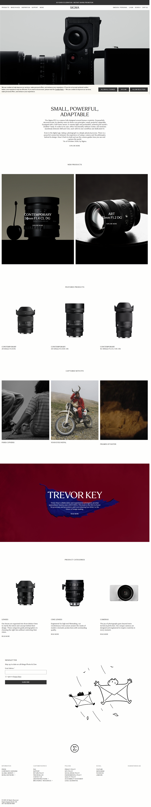

# UI Design System & Master Generation Blueprint: www-sigma-imaging-se

> **SIGMA Imaging Nordics & Baltics · Optical Lenses, Cameras & Cine-Lenses** — An industrial optical engineering and e-commerce platform built on pure optical white (`--ps-white: #fefefd`), matte lens-barrel charcoal (`--ps-text: #333333`), subtle light tint (`--ps-tint: #f7f7f7`), and precision blue/amber indicators (`#4eb5e6`, `#ff9a19`).



---

## 1. Executive Visual Persona & Design Archetype

- **Brand Essence & Persona**: **SIGMA Imaging Nordics & Baltics · Optical Lenses, Cameras & Cine-Lenses**. An industrial optical engineering and e-commerce platform built on pure optical white (`--ps-white: #fefefd`), matte lens-barrel charcoal (`--ps-text: #333333`), subtle light tint (`--ps-tint: #f7f7f7`), and precision blue/amber indicators (`#4eb5e6`, `#ff9a19`).
- **Visual Archetype**: **Swiss-Japanese Precision Optical Hardware & Storefront System (`Sigma Sans` + `Sigma Serif`)**.
- **Anti-AI-Slop Differentiators**:
  1. **Bespoke Optical Typography Pairing**: Pairs geometric technical sans (`--ps-font-ui: "Sigma Sans", sans-serif`) for lens designations with editorial serif (`--ps-font-body: "Sigma Serif", serif`) for optical craftsmanship stories.
  2. **Snap-Grid Product Carousel Physics**: Driven by CSS scroll-snap equations (`--snap-size: calc((100% - var(--snap-gap)*(var(--snap-cols) - 1))/var(--snap-cols))`) and `.kuCarousel .kuSlide` easing `cubic-bezier(0.47,0.13,0.15,0.89)`.
  3. **High-Contrast Monoline Navigation (`#ammenu-header-container`)**: Precision mega-menu with `--ammenu-main-menu-background: #fefefd`, `--ammenu-main-menu-text: #333333`, and `--ammenu-border: #757575`.
  4. **Photographer Ambassador Integration**: Pairs technical hardware grids (`H2: NEW PRODUCTS`, `H2: FEATURED PRODUCTS`) with artist monographs (`H1: Trevor Key`) and bold hero statements (`H1: SMALL, POWERFUL, ADAPTABLE`).

---

## 2. Spatial Architecture & Modular Grid Mathematics


### Viewport Allocation & Container Geometry
- **Captured Full-Page Dimensions**: Desktop `1440×7696px` (`assets/desktop.png`), Mobile `390×10390px` (`assets/mobile.png`).
- **Master Container Bounds**: 1440px container with `@media (min-width: 1201px)` and `@media (min-width: 1024px)` multi-column optical grids.
- **Canvas Lateral Padding & Spacing**: Desktop `clamp(16px, 3vw, 48px)` (`p-4` utility base), mobile `16px`.
- **Border Radius Scale**: `--adp-border-radius: 4px` for UI controls; sharp `0px` framing for optical product plates.

### Responsive Breakpoint Architecture
- **Desktop Layout**: 4-column product specification matrix on desktop, dynamic `--snap-cols` carousel track.
- **Mobile Layout**: Single-column snap track (`--snap-cols: 1`, `--snap-gap: 1rem`) below `@media (max-width: 1023px)`.
- **Extracted CSS Media Queries**: `@media (min-width: 768px)`, `@media (max-width: 1023px)`, `@media (min-width: 1024px)`, `@media (max-width: 1200px)`, `@media (min-width: 1201px)`.

---

## 3. Color System, Materiality & Atmospheric Lighting

### Semantic Palette & Source Grounding
| Semantic Role | Ground-Truth Value | Extracted CSS Source / Selector |
|---|---|---|
| Primary Optical White Canvas | `#fefefd` | `--ps-white` / `--ammenu-main-menu-background` |
| Secondary Light Tint Surface | `#f7f7f7` | `--ps-tint` (`:root`) |
| Pure White Card Surface | `#FFFFFF` | `--amcart-background` / `--amscroll-background-color` |
| Primary Lens-Barrel Charcoal Ink | `#333333` | `--ps-text` / `--ammenu-main-menu-text` |
| Deep Black Product Title Ink | `#000000` | `--amcart-product-name` |
| Secondary Muted Ink | `rgba(51, 51, 51, 0.5)` | `--ps-text-muted` (`:root`) |
| Structural Border Gray | `#cccfd6` | `--amscroll-border-color` |
| Navigation Rule Gray | `#757575` | `--ammenu-border` / `--ammenu-toggle-icon-color` |
| Optical Cyan Accent | `#4eb5e6` | `--adp-accent-color` |
| Interactive Blue Toggle | `#2563eb` | `--ambar-toggle-active-color` |
| Aperture Amber Highlight | `#ff9a19` | `--adp-day-name-color` |

### Sanitized Root CSS Variables (`ui-ux.md` Ground Truth)
| Variable Name | Extracted Value | Semantic Role |
|---|---|---|
| `--ps-white` | `#fefefd` | Primary optical white substrate |
| `--ps-tint` | `#f7f7f7` | Secondary product card tint surface |
| `--ps-text` | `#333` | Primary charcoal typography ink |
| `--ps-text-muted` | `rgba(51, 51, 51, 0.5)` | Muted technical specification ink |
| `--ps-font-ui` | `"Sigma Sans", sans-serif` | Primary technical UI & lens designation font |
| `--ps-font-body` | `"Sigma Serif", serif` | Editorial monograph & body serif font |
| `--snap-cols` | `1` | Responsive scroll-snap column divisor |
| `--snap-gap` | `1rem` | Scroll-snap grid gutter spacing |
| `--snap-size` | `calc((100% - var(--snap-gap)*(var(--snap-cols) - 1))/var(--snap-cols))` | Dynamic card width calculation |
| `--ammenu-main-menu-background` | `#fefefd` | Header mega-menu background |
| `--ammenu-main-menu-text` | `#333333` | Header navigation link ink |
| `--ammenu-submenu-text-hover` | `#4d4d4d` | Submenu hover ink state |
| `--ammenu-border` | `#757575` | Navigation structural divider color |
| `--amcart-background` | `#FFFFFF` | Cart drawer background surface |
| `--amcart-product-name` | `#000000` | Cart product title ink |
| `--amscroll--transition-duration` | `.2s` | Fast UI transition duration |
| `--amscroll--hover-filter` | `brightness(.8)` | Optical image hover darkening filter |
| `--amscroll-border-color` | `#cccfd6` | Card & pagination border token |
| `--ambar-toggle-active-color` | `#2563eb` | Active interactive toggle accent |

---

## 4. Typographic Scale & Editorial Hierarchy

### Font Family Stacks
- **Display Typography**: `"Sigma Sans", "Century Gothic", CenturyGothic, AppleGothic, sans-serif` (`--ps-font-ui`).
- **Primary Body Stack**: `"Sigma Serif", serif` (`--ps-font-body`) paired with `"Sigma Sans", sans-serif`.
- **Technical / Metadata Stack**: `ui-monospace, "SF Mono", monospace` (Focal length `mm`, aperture `F1.4 DG DN`, mount codes).

### Typographic Scale & Rules
- **Hero Display (`H1`)**: `clamp(2.5rem, 5vw, 4.5rem)`, `font-family: var(--ps-font-ui)`, `font-weight: 700`, `letter-spacing: -0.02em`, uppercase ("SMALL, POWERFUL, ADAPTABLE" / "Trevor Key").
- **Section Heading (`H2`)**: `clamp(1.5rem, 2.8vw, 2.25rem)`, `font-family: var(--ps-font-ui)`, `font-weight: 600`, `letter-spacing: 0.04em` ("NEW PRODUCTS", "FEATURED PRODUCTS").
- **Body Copy**: `1rem (16px)`, `font-family: var(--ps-font-body)`, `line-height: 1.65`, `color: var(--ps-text)`.
- **Metadata & Navigation Labels**: `0.75rem (12px)`, `font-family: var(--ps-font-ui)`, `color: var(--ps-text-muted)`, `letter-spacing: 0.08em`, uppercase mount badges (`L-MOUNT`, `SONY E`, `CINE`).

---

## 5. Choreographed Motion & Interaction Physics

### Primary Easing Curves
- **Extracted Timing Functions**: `cubic-bezier(0.47,0.13,0.15,0.89)` (carousel slide) and `cubic-bezier(.49,.78,.46,1.34)` (spring overshoot).

### Per-Element Transition & Choreography Rules
- `.kuCarousel .kuSlide` -> `transition: left .4s cubic-bezier(0.47,0.13,0.15,0.89)` (optical product carousel track)
- `.kuCarousel .kuCarousel-content` -> `transition: width .4s` (responsive container adaptation)
- `.kuFilterHead` -> `transition: all .3s ease` (lens mount & focal-length filter accordion)
- `.kuFilterIcon:before` -> `transition: background 200ms` (filter checkbox state)
- `Image Hover` -> `filter: var(--amscroll--hover-filter)` (`brightness(.8)`) over `--amscroll--transition-duration: .2s`

---

## 6. Component Wireframe & Structural DOM Map

### Visual Layout Schematic (Grounded in `dom.html`)
```
┌────────────────────────────────────────────────────────────────────────┐
│ <header id="ammenu-header-container" class="ammenu-header-container">  │
│   [SIGMA]   [Lenses] [Cameras] [Cine] [Ambassadors]   [Search] [Cart]  │
├────────────────────────────────────────────────────────────────────────┤
│ <main id="maincontent" class="page-main"> (Canvas: --ps-white #fefefd) │
│   Hero Split Stage: H1: SMALL, POWERFUL, ADAPTABLE | H1: Trevor Key    │
├────────────────────────────────────────────────────────────────────────┤
│ <section class="new-products"> H2: NEW PRODUCTS (Surface: --ps-tint #f │
│   [ Art 50mm F1.2 DG DN ]  [ Contempor. 28-70mm ]  [ Sports 500mm F5.6 │
├────────────────────────────────────────────────────────────────────────┤
│ <section class="featured-products"> H2: FEATURED PRODUCTS (.kuCarousel │
│   Track: --snap-size calc((100% - var(--snap-gap)*(var(--snap-cols)-1) │
├────────────────────────────────────────────────────────────────────────┤
│ <footer> [Nordic Service] [Warranty] [Authorized Dealers] © SIGMA Nord │
└────────────────────────────────────────────────────────────────────────┘
```

### Granular DOM Region Breakdown
1. **Mega-Menu Header (`<header id="ammenu-header-container" class="ammenu-header-container page-header">`)**:
   - Sticky optical navigation bar styled with `--ammenu-main-menu-background: #fefefd`, `--ammenu-main-menu-text: #333333`, `--ammenu-border: #757575`, and `#am-account-menu`.
2. **Dual Hero Campaign Stage (`<main id="maincontent" class="page-main">`)**:
   - Features high-impact hardware hero (`H1: SMALL, POWERFUL, ADAPTABLE` in `--ps-font-ui`) alongside artist monograph feature (`H1: Trevor Key` in `--ps-font-body`).
3. **New Products Hardware Matrix (`H2: NEW PRODUCTS`)**:
   - 4-column desktop grid of optical lenses and cameras on `--ps-tint: #f7f7f7` cards with mount badges (`L-MOUNT`, `SONY E`), focal length specs, and `--amscroll-border-color: #cccfd6` borders.
4. **Featured Products Snap Carousel (`H2: FEATURED PRODUCTS` and `.kuCarousel`)**:
   - Horizontal snap track driven by `--snap-size` and `cubic-bezier(0.47,0.13,0.15,0.89)` slide physics with `.kuFilterHead` faceted lens filtering.
5. **Cart & Service Footer (`--amcart-background: #FFFFFF`)**:
   - Slide-over cart drawer (`--amcart-product-name: #000000`) and Nordic dealer/service colophon.

---

## 7. Master Zero-Shot AI Generation Prompt

```markdown
# Master Zero-Shot Frontend Generation Prompt: www-sigma-imaging-se (SIGMA Imaging Nordics & Baltics · Optical Lenses, Cameras & Cine-Lenses)

You are a principal frontend architect and design systems engineer. Build a complete, production-ready web application replicating the exact design system, DOM landmarks, typographic hierarchy, color tokens, and motion physics of `www-sigma-imaging-se` (SIGMA Imaging Nordics & Baltics · Optical Lenses, Cameras & Cine-Lenses).

### 1. Visual Archetype & Anti-AI-Slop Mandates
- **Archetype**: Swiss-Japanese Precision Optical Hardware & Storefront System (`Sigma Sans` + `Sigma Serif`).
- **Primary Substrate**: `#fefefd` (`--ps-white` / `--ammenu-main-menu-background`), **Primary Ink**: `#333333`, **Accent / Highlight**: `#ff9a19`.
- **Site-Specific Differentiators**:
  1. **Bespoke Optical Typography Pairing**: Pairs geometric technical sans (`--ps-font-ui: "Sigma Sans", sans-serif`) for lens designations with editorial serif (`--ps-font-body: "Sigma Serif", serif`) for optical craftsmanship stories.
  2. **Snap-Grid Product Carousel Physics**: Driven by CSS scroll-snap equations (`--snap-size: calc((100% - var(--snap-gap)*(var(--snap-cols) - 1))/var(--snap-cols))`) and `.kuCarousel .kuSlide` easing `cubic-bezier(0.47,0.13,0.15,0.89)`.
  3. **High-Contrast Monoline Navigation (`#ammenu-header-container`)**: Precision mega-menu with `--ammenu-main-menu-background: #fefefd`, `--ammenu-main-menu-text: #333333`, and `--ammenu-border: #757575`.
  4. **Photographer Ambassador Integration**: Pairs technical hardware grids (`H2: NEW PRODUCTS`, `H2: FEATURED PRODUCTS`) with artist monographs (`H1: Trevor Key`) and bold hero statements (`H1: SMALL, POWERFUL, ADAPTABLE`).

### 2. Ground-Truth CSS Variables (`:root` Token Contract)
Declare and consume these exact custom properties extracted from `www-sigma-imaging-se` in your global stylesheet:

:root {
  /* SIGMA Imaging Nordics & Baltics · Optical Lenses, Cameras & Cine-Lenses — Ground-Truth Extracted CSS Variables */
  --ps-white: #fefefd; /* Primary optical white substrate */
  --ps-tint: #f7f7f7; /* Secondary product card tint surface */
  --ps-text: #333; /* Primary charcoal typography ink */
  --ps-text-muted: rgba(51, 51, 51, 0.5); /* Muted technical specification ink */
  --ps-font-ui: "Sigma Sans", sans-serif; /* Primary technical UI & lens designation font */
  --ps-font-body: "Sigma Serif", serif; /* Editorial monograph & body serif font */
  --snap-cols: 1; /* Responsive scroll-snap column divisor */
  --snap-gap: 1rem; /* Scroll-snap grid gutter spacing */
  --snap-size: calc((100% - var(--snap-gap)*(var(--snap-cols) - 1))/var(--snap-cols)); /* Dynamic card width calculation */
  --ammenu-main-menu-background: #fefefd; /* Header mega-menu background */
  --ammenu-main-menu-text: #333333; /* Header navigation link ink */
  --ammenu-submenu-text-hover: #4d4d4d; /* Submenu hover ink state */
  --ammenu-border: #757575; /* Navigation structural divider color */
  --amcart-background: #FFFFFF; /* Cart drawer background surface */
  --amcart-product-name: #000000; /* Cart product title ink */
  --amscroll--transition-duration: .2s; /* Fast UI transition duration */
  --amscroll--hover-filter: brightness(.8); /* Optical image hover darkening filter */
  --amscroll-border-color: #cccfd6; /* Card & pagination border token */
  --ambar-toggle-active-color: #2563eb; /* Active interactive toggle accent */
}

### 3. Semantic Color & Materiality Contract
Map every surface, ink, and border strictly to these source-grounded tokens:
- **Primary Optical White Canvas**: `#fefefd` — grounded in `--ps-white` / `--ammenu-main-menu-background`
- **Secondary Light Tint Surface**: `#f7f7f7` — grounded in `--ps-tint` (`:root`)
- **Pure White Card Surface**: `#FFFFFF` — grounded in `--amcart-background` / `--amscroll-background-color`
- **Primary Lens-Barrel Charcoal Ink**: `#333333` — grounded in `--ps-text` / `--ammenu-main-menu-text`
- **Deep Black Product Title Ink**: `#000000` — grounded in `--amcart-product-name`
- **Secondary Muted Ink**: `rgba(51, 51, 51, 0.5)` — grounded in `--ps-text-muted` (`:root`)
- **Structural Border Gray**: `#cccfd6` — grounded in `--amscroll-border-color`
- **Navigation Rule Gray**: `#757575` — grounded in `--ammenu-border` / `--ammenu-toggle-icon-color`
- **Optical Cyan Accent**: `#4eb5e6` — grounded in `--adp-accent-color`
- **Interactive Blue Toggle**: `#2563eb` — grounded in `--ambar-toggle-active-color`
- **Aperture Amber Highlight**: `#ff9a19` — grounded in `--adp-day-name-color`

### 4. Spatial Grid, Container Bounds & Responsive Breakpoints
- **Desktop Viewport Reference**: `1440×7696px` full-page capture (`1440px` standard desktop width).
- **Mobile Viewport Reference**: `390×10390px` full-page capture (`390px` standard mobile width).
- **Container Max-Width**: 1440px container with `@media (min-width: 1201px)` and `@media (min-width: 1024px)` multi-column optical grids
- **Padding & Gutters**: Desktop `clamp(16px, 3vw, 48px)` (`p-4` utility base), mobile `16px`
- **Desktop Grid**: 4-column product specification matrix on desktop, dynamic `--snap-cols` carousel track
- **Mobile Adaptation**: Single-column snap track (`--snap-cols: 1`, `--snap-gap: 1rem`) below `@media (max-width: 1023px)`
- **Media Queries**: `@media (min-width: 768px)`, `@media (max-width: 1023px)`, `@media (min-width: 1024px)`, `@media (max-width: 1200px)`, `@media (min-width: 1201px)`
- **Corner Radii**: `--adp-border-radius: 4px` for UI controls; sharp `0px` framing for optical product plates

### 5. Typography & Editorial Scale Contract
- **Display Font Stack**: `"Sigma Sans", "Century Gothic", CenturyGothic, AppleGothic, sans-serif` (`--ps-font-ui`)
- **Body Font Stack**: `"Sigma Serif", serif` (`--ps-font-body`) paired with `"Sigma Sans", sans-serif`
- **Monospace / Technical Font Stack**: `ui-monospace, "SF Mono", monospace` (Focal length `mm`, aperture `F1.4 DG DN`, mount codes)
- **H1 Display Rule**: `clamp(2.5rem, 5vw, 4.5rem)`, `font-family: var(--ps-font-ui)`, `font-weight: 700`, `letter-spacing: -0.02em`, uppercase ("SMALL, POWERFUL, ADAPTABLE" / "Trevor Key")
- **H2 Section Rule**: `clamp(1.5rem, 2.8vw, 2.25rem)`, `font-family: var(--ps-font-ui)`, `font-weight: 600`, `letter-spacing: 0.04em` ("NEW PRODUCTS", "FEATURED PRODUCTS")
- **Body Copy Rule**: `1rem (16px)`, `font-family: var(--ps-font-body)`, `line-height: 1.65`, `color: var(--ps-text)`
- **Metadata & Index Rule**: `0.75rem (12px)`, `font-family: var(--ps-font-ui)`, `color: var(--ps-text-muted)`, `letter-spacing: 0.08em`, uppercase mount badges (`L-MOUNT`, `SONY E`, `CINE`)

### 6. Component Hierarchy & Real DOM Landmarks
Scaffold the interface with these exact structural regions and class selectors from `www-sigma-imaging-se`:
1. **Mega-Menu Header (`<header id="ammenu-header-container" class="ammenu-header-container page-header">`)**:
   - Architecture & Selectors: Sticky optical navigation bar styled with `--ammenu-main-menu-background: #fefefd`, `--ammenu-main-menu-text: #333333`, `--ammenu-border: #757575`, and `#am-account-menu`.
   - Layout & State Contract: Sticky/fixed top header navigation adapting across `@media (min-width: 768px)`, `@media (max-width: 1023px)`, `@media (min-width: 1024px)`, `@media (max-width: 1200px)`, `@media (min-width: 1201px)` with `cubic-bezier(0.47,0.13,0.15,0.89)` (carousel slide) and `cubic-bezier(.49,.78,.46,1.34)` (spring overshoot) menu transitions.
2. **Dual Hero Campaign Stage (`<main id="maincontent" class="page-main">`)**:
   - Architecture & Selectors: Features high-impact hardware hero (`H1: SMALL, POWERFUL, ADAPTABLE` in `--ps-font-ui`) alongside artist monograph feature (`H1: Trevor Key` in `--ps-font-body`).
   - Layout & State Contract: Full-viewport hero stage (`1440px` desktop / `390px` mobile) pairing `#fefefd` substrate with `#333333` display typography (`H1`).
3. **New Products Hardware Matrix (`H2: NEW PRODUCTS`)**:
   - Architecture & Selectors: 4-column desktop grid of optical lenses and cameras on `--ps-tint: #f7f7f7` cards with mount badges (`L-MOUNT`, `SONY E`), focal length specs, and `--amscroll-border-color: #cccfd6` borders.
   - Layout & State Contract: Primary showcase grid executing 4-column product specification matrix on desktop, dynamic `--snap-cols` carousel track on desktop and Single-column snap track (`--snap-cols: 1`, `--snap-gap: 1rem`) below `@media (max-width: 1023px)` on mobile.
4. **Featured Products Snap Carousel (`H2: FEATURED PRODUCTS` and `.kuCarousel`)**:
   - Architecture & Selectors: Horizontal snap track driven by `--snap-size` and `cubic-bezier(0.47,0.13,0.15,0.89)` slide physics with `.kuFilterHead` faceted lens filtering.
   - Layout & State Contract: Interactive specification & narrative module framed by `--adp-border-radius: 4px` for UI controls; sharp `0px` framing for optical product plates and `#ff9a19` highlights.
5. **Cart & Service Footer (`--amcart-background: #FFFFFF`)**:
   - Architecture & Selectors: Slide-over cart drawer (`--amcart-product-name: #000000`) and Nordic dealer/service colophon.
   - Layout & State Contract: Footer directory and utility bar anchored to 1440px container with `@media (min-width: 1201px)` and `@media (min-width: 1024px)` multi-column optical grids with Desktop `clamp(16px, 3vw, 48px)` (`p-4` utility base), mobile `16px` lateral gutters.

### 7. Motion & Interaction Choreography
- **Primary Easing Functions**: `cubic-bezier(0.47,0.13,0.15,0.89)` (carousel slide) and `cubic-bezier(.49,.78,.46,1.34)` (spring overshoot)
- **Per-Selector Transition Rules**:
- `.kuCarousel .kuSlide` -> `transition: left .4s cubic-bezier(0.47,0.13,0.15,0.89)` (optical product carousel track)
- `.kuCarousel .kuCarousel-content` -> `transition: width .4s` (responsive container adaptation)
- `.kuFilterHead` -> `transition: all .3s ease` (lens mount & focal-length filter accordion)
- `.kuFilterIcon:before` -> `transition: background 200ms` (filter checkbox state)
- `Image Hover` -> `filter: var(--amscroll--hover-filter)` (`brightness(.8)`) over `--amscroll--transition-duration: .2s`

### 8. Technical Deliverables
- Implement in Next.js (App Router) with TypeScript and Tailwind CSS consuming the `:root` custom properties defined above.
- Reproduce both the `1440px` desktop architecture and `390px` mobile breakpoint transitions, preserving semantic HTML5 landmarks (`<header>`, `<nav>`, `<main>`, `<section>`, `<footer>`) and `prefers-reduced-motion` accessibility guards.
```
