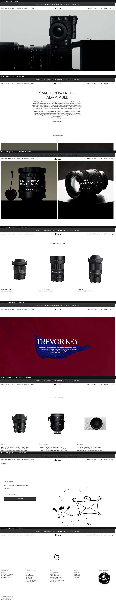
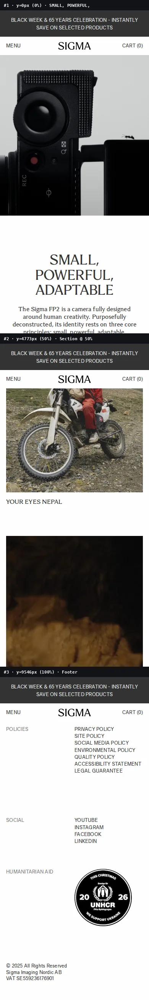

# UI Design System & Master Generation Blueprint: www-sigma-imaging-se

> **SIGMA Imaging Nordics & Baltics · Lenses, Cameras & Cine-lenses - Sigma** (https://www.sigma-imaging.se/) — Official SIGMA subsidiary for the Nordics and Baltics. Lenses and cameras Made in Aizu, Japan, with 5-year warranty, local support and fi...





---

## 1. Executive Visual Persona & Design Archetype

- **Brand Essence & Persona**: **SIGMA Imaging Nordics & Baltics · Lenses, Cameras & Cine-lenses - Sigma** (`https://www.sigma-imaging.se/`). Official SIGMA subsidiary for the Nordics and Baltics. Lenses and cameras Made in Aizu, Japan, with 5-year warranty, local support and fi...
- **Capture Provenance**: Live browser capture (`tier1_fast`, HTTP `200`, captured `2026-11-24`).
- **Visual Archetype**: **Light-Substrate Editorial & Modular Grid System (`#fefefd` canvas, `#333333` ink, `#0077cb` accent)**.
- **Anti-AI-Slop Differentiators**:
  - **Live-Computed Chromatic Polarity**: Anchors the viewport in `#fefefd` (live computed `body` `background-color` (`computed_styles.json`)) paired with `#333333` primary typography and `#0077cb` accents.
  - **Grounded Typographic Hierarchy**: Pairs `Sigma Serif Headline` for display copy (`TREVOR KEY`) with `Sigma Serif` and `SFMono-Regular`.
  - **Calibrated Spatial Grid & Motion**: Combines `1456px` container bounds (`gap: 12px`, padding `var(--adp-padding)`) with `cubic-bezier(.4,0,.2,1)` easing and Three.js / WebGL Canvas Pipeline, Swiper Touch Carousel Engine.

---

## 2. Spatial Architecture & Modular Grid Mathematics

### Viewport Allocation & Container Geometry
- **Captured Journey Filmstrips**: Desktop `1280×6624px` (`assets/desktop-journey.webp`, `8` keyframes up to `y=6796px` / doc `7696px`), Mobile `390×2616px` (`assets/mobile-journey.webp`, `3` keyframes).
- **Master Container Bounds**: `1456px` (non-`@media` desktop container stylesheet rule).
- **Canvas Lateral Padding & Spacing**: `var(--adp-padding)` lateral canvas padding with `12px` grid gap.
- **Border Radius Scale**: `4px`, `var(--adp-cell-border-radius)`, `var(--adp-border-radius)`, `var(--adp-btn-border-radius)`.

### Responsive Breakpoint Architecture
- **Desktop Layout**: Multi-column CSS Grid / Flexbox layout at `1440px` (`max-width: 1456px`, `gap: 12px`).
- **Mobile Layout**: Single-column vertical stack at `390px` viewport width with `var(--adp-padding)` horizontal padding.
- **Extracted CSS Media Queries**: `@media (max-width: 1200px)`, `@media (min-width: 1024px)`, `@media (min-width: 1201px)`, `@media (min-width:768px)`.

---

## 3. Color System, Materiality & Atmospheric Lighting

### Semantic Palette & Source Grounding
| Semantic Role | Ground-Truth Value | Extracted Live / CSS Source |
|---|---|---|
| **Primary Canvas Substrate** | `#fefefd` | live computed `body` `background-color` (`computed_styles.json`) |
| **Primary Typography Ink** | `#333333` | live computed `h1` `color` (`computed_styles.json`) |
| **Elevated Surface / Card Substrate** | `#ffffff` | `var(--amscroll-background-color)` in `:root` |
| **Interactive Accent / Highlight** | `#0077cb` | `.mollie-buttons .button:hover { background-color: #0077cb }` |
| **Secondary / Muted Copy** | `#9c9c9c` | `var(--adp-color-secondary)` in `:root` |
| **Structural Hairline Border** | `#cccfd6` | `var(--amscroll-border-color)` in `:root` |
| **Variable Token (`--amscroll--text--color`)** | `#252525` | `var(--amscroll--text--color)` in `:root` |
| **Variable Token (`--amcart-product-name`)** | `#000000` | `var(--amcart-product-name)` in `:root` |

### Sanitized Root CSS Variables (`ui-ux.md` Ground Truth)
| Variable Name | Extracted Value | Semantic Role |
|---|---|---|
| `--amscroll-module--path` | `"../Amasty_Scroll"` | Design System Custom Token |
| `--amscroll--transition-duration` | `.2s` | Motion / Easing Token |
| `--amscroll--hover-filter` | `brightness(.8)` | Design System Custom Token |
| `--amscroll-loader--size` | `25px` | Layout / Spatial Grid Token |
| `--amscroll--text--color` | `#252525` | Typography Ink Token |
| `--amscroll-border-color` | `#cccfd6` | Brand / Palette Token |
| `--amscroll-background-color` | `#fff` | Canvas / Surface Token |
| `--amscroll--indent` | `10px` | Dimension / Scale Token |
| `--amscroll--indent--m` | `@amscroll--indent + @amscroll--indent/2` | Design System Custom Token |
| `--amscroll--indent--l` | `@amscroll--indent * 2` | Design System Custom Token |
| `--amscroll--indent--xl` | `@amscroll--indent--l + @amscroll--indent/2` | Design System Custom Token |
| `--amcart-background` | `#FFFFFF` | Canvas / Surface Token |
| `--amcart-product-name` | `#000000` | Color / Atmospheric Token |
| `--amcart-dialog-text` | `#000000` | Typography Ink Token |
| `--amcart-btn-text` | `#000000` | Typography Ink Token |
| `--amcart-continue-btn` | `#000000` | Color / Atmospheric Token |

---

## 4. Typographic Scale & Editorial Hierarchy

### Font Family Stacks
- **Display Typography**: `Sigma Serif Headline`.
- **Primary Body Stack**: `Sigma Serif`.
- **Technical / Metadata Stack**: `SFMono-Regular`.

### Typographic Scale & Rules (Live Computed & Stylesheet Grounded)
- **Hero Display (`H1`)**: live computed `h1` (`font-size: 88px`, `line-height: 83.6px`, `font-weight: 400`, `letter-spacing: -1.32px`); rule `h1` (`font-size: 2.25rem`, `line-height: 2.5rem`, `font-weight: 300`).
- **Section Heading (`H2`)**: live computed `h2` (`font-size: 16px`, `line-height: 20px`, `font-weight: 400`, `letter-spacing: 0.08px`); rule `h2` (`font-size: 2.25rem`, `line-height: 2.5rem`, `font-weight: 300`).
- **Body Copy**: live computed `body` (`font-size: 16px`, `line-height: 20px`, `font-weight: 400`, `letter-spacing: 0.08px`); CSS variables `--ps-font-body: "Sigma Serif", serif`; rule `p` (`font-size: .8125rem`, `line-height: 125%`, `letter-spacing: .02em`, `font-weight: 400`).
- **Metadata & Navigation Labels**: live computed `nav/a` (`font-size: 16px`, `line-height: 20px`, `font-weight: 400`, `letter-spacing: 0.08px`); CSS variables `--amlabel-margin-between: 7px`, `--gap-amlabel-margin: var(--amlabel-margin-between)`.

---

## 5. Choreographed Motion & Interaction Physics

### Primary Easing Curves
- **Extracted Timing Functions**: `cubic-bezier(.4,0,.2,1)`, `cubic-bezier(0,0,.2,1)`, `cubic-bezier(.4,0,1,1)`.

### Per-Element Transition & Choreography Rules
- **Selector `.air-datepicker-body`**: `transition: all var(--adp-transition-duration) var(--adp-transition-ease)` extracted from `www-sigma-imaging-se` stylesheet.
- **Selector `row input[type=range]::-webkit-sl...`**: `transition: background var(--adp-transition-duration)` extracted from `www-sigma-imaging-se` stylesheet.
- **Selector `me--row input[type=range]::-moz-r...`**: `transition: background var(--adp-transition-duration)` extracted from `www-sigma-imaging-se` stylesheet.
- **Extracted Easing Curve (`cubic-bezier(.4,0,.2,1)`)**: Governs interactive state transitions across `<header.ammenu-header-container>` and `<section.cms-index-index>`.
- **Runtime Interaction Engine**: Integrates Three.js / WebGL Canvas Pipeline, Swiper Touch Carousel Engine with `prefers-reduced-motion: reduce` fallback guards.
### Measured Runtime Scroll & Interaction Telemetry (`behavioral_journey_v2`)
- **Scroll Driver Mode**: `native` (max document height `7696px`, deepest scrollY reached `6796px` across `8` desktop keyframes).
- **Detected Scroll / Motion Libraries**: Native browser scroll / standard CSS transitions.
- **Nav / Drawer Probe (`SWEDEN / PERSONAL`)**: Triggered visual change (pixel diff `46.857`, captured in `assets/state-nav.webp`); revealed links: BUSINESS, DENMARK EN, ESTONIA EN, FINLAND EN, LATVIA EN, LITHUANIA EN.
- **Route Transition Architecture**: First internal navigation (`/stores/store/redirect/___store/sweb2b/uenc/aHR0cHM6Ly9iMmIuc2lnbWEtaW1hZ2luZy5zZS8_X19fc3RvcmU9c3dlYjJi/___from_store/default/`) measured as `direct` in `9997ms`.

---

## 6. Component Wireframe & Structural DOM Map

### Visual Layout Schematic — Desktop (`1440px`, Grounded in `dom.html` & Landmark Bounding Boxes)
```
┌────────────────────────────────────────────────────────────────────────┐
│ DESKTOP VIEWPORT (1440px) — SIGMA Imaging Nordics & Baltics · Lenses,  │
│ ====================================================================== │
│ [ <header.ammenu-header- (1425x0px)   | Products · Made in Aizu · In ] │
│ ---------------------------------------------------------------------- │
│ | HERO STAGE: <section.message> (w=1425px)                           | │
│ | H1: TREVOR KEY                                                     | │
│ | Substrate: #fefefd | Ink: #333333 | Accent: #0077cb                | │
│ ---------------------------------------------------------------------- │
│ | SHOWCASE GRID (<section.cms-index-index>) max-w: 1456px            | │
│ | +------------------------------+  +------------------------------+ | │
│ | | SMALL, POWERFUL,             |  | ADAPTABLE                    | | │
│ | +------------------------------+  +------------------------------+ | │
│ ---------------------------------------------------------------------- │
│ | DETAIL MODULE (<section.page-layout-1colu) — NEW PRODUCTS          | │
│ ---------------------------------------------------------------------- │
│ [ FOOTER (<footer.page-footer>) | https://www.sigma-imaging.se/        │
└────────────────────────────────────────────────────────────────────────┘
```

### Visual Layout Schematic — Mobile Reflow (`390px`)
```
┌────────────────────────────────────────────────────────────────────────┐
│ MOBILE VIEWPORT REFLOW (390px) — Single-Column Stack (gap: 12px)       │
│ ====================================================================== │
│ [ HEADER BAR (<header.ammenu-header-co) | Compact Menu (390px)         │
│ ---------------------------------------------------------------------- │
│ | HERO STAGE (<section.message>) — 390px Vertical Lead               | │
│ | H1: TREVOR KEY                                                     | │
│ ---------------------------------------------------------------------- │
│ | SHOWCASE STACK (<section.cms-index-ind) — 1-Col Stack              | │
│ | [ Item 1: SMALL, POWERFUL,                                       ] | │
│ | [ Item 2: ADAPTABLE                                              ] | │
│ ---------------------------------------------------------------------- │
│ | DETAIL STACK (<section.page-layout-1co) — 1-Col (NEW PRODUCTS)     | │
│ ---------------------------------------------------------------------- │
│ [ FOOTER (<footer.page-footer>) | Stacked 390px Colophon               │
└────────────────────────────────────────────────────────────────────────┘
```

### Granular DOM Region Breakdown
1. **Brand Header & Navigation Bar (<header.ammenu-header-container> — `www-sigma-imaging-se`)**:
   - Landmark `<header class="ammenu-header-container page-header">` (`1425x0px`) hosting `SIGMA Imaging Nordics & Baltics · Le` navigation (`Products · Made in Aizu · Inspiration · Support · News`), DOM attributes (`data-src="//www.googletagmanage..."`, `data-cfasync="false"`, `data-dialog-ref-name="am-cookie-bar"`, `data-dispatch-action="cookiebar-action-allow"`), and stylesheet rule `air-datepicker-cell.-day-.-other-... { color:var(--adp-color-other-month) }`.
2. **Hero Stage & Focal Lead (<section.message> — `TREVOR KEY`)**:
   - Landmark `<section class="message global">` presenting display lead `TREVOR KEY` and copy excerpt *"BLACK WEEK & 65 YEARS CELEBRATION - INSTANTLY SAVE ON SELECTED PR"* over `#fefefd` canvas and `#333333` ink.
3. **Primary Showcase & Content Grid (<section.cms-index-index> — `SMALL, POWERFUL,`)**:
   - Landmark `<section class="cms-index-index">` rendering section `SMALL, POWERFUL,` with copy *"The Sigma FP2 is a camera fully designed around human creativity."*, asset references (`recaptcha__en.js`, `gtm.js`, `styles.css`, `eu-guarantee.css`), and grid rule `tepicker-cell.-day-.-other-month-... { color:var(--adp-color-other-month-hover) }`.
4. **Interactive Detail & Feature Matrix (<section.page-layout-1column> — `ADAPTABLE`)**:
   - Landmark `<section class="page-layout-1column">` framing `ADAPTABLE` and `NEW PRODUCTS` (*"Even in the digital age, taking a photograph is a deeply physical"*) with `#ffffff` surface cards, `#0077cb` accents, and `.air-datepicker-cell.-focus- { background:var(--adp-cell-background-color-hover) }`.
5. **Colophon & Global Directory Footer (<footer.page-footer> — `https://www.sigma-imaging.se/`)**:
   - Landmark `<footer class="page-footer">` anchoring `SIGMA Imaging Nordics & Baltics ` footer links (`Products · Made in Aizu · Inspiration · Support · News`), copy *"CONTEMPORARY 50 mm F1.4 CL DG"*, and `#cccfd6` structural dividers.
### Full Vertical Scroll Sequence (Desktop `1440×900` Keyframes)
- **Step 01** (`y=0px`, `0%`): Active landmark `Hero` · sticky/fixed elements: `2`
- **Step 02** (`y=850px`, `13%`): Active landmark `ADAPTABLE` · sticky/fixed elements: `2`
- **Step 03** (`y=1700px`, `25%`): Active landmark `FEATURED PRODUCTS` · sticky/fixed elements: `2`
- **Step 04** (`y=2550px`, `38%`): Active landmark `FEATURED PRODUCTS` · sticky/fixed elements: `2`
- **Step 05** (`y=4250px`, `63%`): Active landmark `TREVOR KEY` · sticky/fixed elements: `2`
- **Step 06** (`y=5100px`, `75%`): Active landmark `PRODUCT CATEGORIES` · sticky/fixed elements: `2`
- **Step 07** (`y=5950px`, `88%`): Active landmark `Section @ 88%` · sticky/fixed elements: `2`
- **Step 08** (`y=6796px`, `100%`): Active landmark `Footer` · sticky/fixed elements: `1`

### Multi-Page Internal Route Map
- **Detail Route (`/stores/store/redirect/___store/sweb2b/uenc/aHR0cHM6Ly9iMmIuc2lnbWEtaW1hZ2luZy5zZS8_X19fc3RvcmU9c3dlYjJi/___from_store/default/`)**: `https://www.sigma-imaging.se/stores/store/redirect/___store/sweb2b/uenc/aHR0cHM6Ly9iMmIuc2lnbWEtaW1hZ2luZy5zZS8_X19fc3RvcmU9c3dlYjJi/___from_store/default/` — H1: `SMALL, POWERFUL,`, scrollHeight `7696px`, transition `direct` (`9997ms`)
- **Detail Route (`/stores/store/redirect/___store/dk_storeview/uenc/aHR0cHM6Ly93d3cuc2lnbWEtaW1hZ2luZy5kay8_X19fc3RvcmU9ZGtfc3RvcmV2aWV3/___from_store/default/`)**: `https://www.sigma-imaging.se/stores/store/redirect/___store/dk_storeview/uenc/aHR0cHM6Ly93d3cuc2lnbWEtaW1hZ2luZy5kay8_X19fc3RvcmU9ZGtfc3RvcmV2aWV3/___from_store/default/` — H1: `SMALL, POWERFUL,`, scrollHeight `6892px`, transition `direct` (`4408ms`)
- **Detail Route (`/stores/store/redirect/___store/ee_storeview/uenc/aHR0cHM6Ly93d3cuc2lnbWEtaW1hZ2luZy5lZS8_X19fc3RvcmU9ZWVfc3RvcmV2aWV3/___from_store/default/`)**: `https://www.sigma-imaging.se/stores/store/redirect/___store/ee_storeview/uenc/aHR0cHM6Ly93d3cuc2lnbWEtaW1hZ2luZy5lZS8_X19fc3RvcmU9ZWVfc3RvcmV2aWV3/___from_store/default/` — H1: `SMALL, POWERFUL,`, scrollHeight `7696px`, transition `direct` (`4533ms`)

---

## 7. Master Zero-Shot AI Generation Prompt

```markdown
# Master Zero-Shot Frontend Generation Prompt: www-sigma-imaging-se (SIGMA Imaging Nordics & Baltics · Lenses, Cameras & Cine-lenses - Sigma)

You are a principal frontend architect and design systems engineer. Build a complete, production-ready web application replicating the exact design system, DOM landmarks, typographic hierarchy, color tokens, and motion physics of `www-sigma-imaging-se` (**SIGMA Imaging Nordics & Baltics · Lenses, Cameras & Cine-lenses - Sigma** — `https://www.sigma-imaging.se/`).

### 1. Visual Archetype & Anti-AI-Slop Mandates
- **Archetype**: Light-Substrate Editorial & Modular Grid System (`#fefefd` canvas, `#333333` ink, `#0077cb` accent).
- **Identity & Domain Context**: Official SIGMA subsidiary for the Nordics and Baltics. Lenses and cameras Made in Aizu, Japan, with 5-year warranty, local support and fi...
- **Primary Substrate**: `#fefefd` (live computed `body` `background-color` (`computed_styles.json`)), **Primary Ink**: `#333333`, **Accent / Highlight**: `#0077cb`.
- **Site-Specific Differentiators**:
  - **Live-Computed Chromatic Polarity**: Anchors the viewport in `#fefefd` (live computed `body` `background-color` (`computed_styles.json`)) paired with `#333333` primary typography and `#0077cb` accents.
  - **Grounded Typographic Hierarchy**: Pairs `Sigma Serif Headline` for display copy (`TREVOR KEY`) with `Sigma Serif` and `SFMono-Regular`.
  - **Calibrated Spatial Grid & Motion**: Combines `1456px` container bounds (`gap: 12px`, padding `var(--adp-padding)`) with `cubic-bezier(.4,0,.2,1)` easing and Three.js / WebGL Canvas Pipeline, Swiper Touch Carousel Engine.

### 2. Ground-Truth CSS Variables (`:root` Token Contract)
Declare and consume these exact custom properties extracted from `www-sigma-imaging-se` in your global stylesheet:

:root {
  /* SIGMA Imaging Nordics & Baltics · Lenses, Cameras & Cine-lenses - Sigma (www-sigma-imaging-se) — Live-Grounded CSS Variables */
  --amscroll-module--path: "../Amasty_Scroll"; /* Design System Custom Token (www-sigma-imaging-se) */
  --amscroll--transition-duration: .2s; /* Motion / Easing Token (www-sigma-imaging-se) */
  --amscroll--hover-filter: brightness(.8); /* Design System Custom Token (www-sigma-imaging-se) */
  --amscroll-loader--size: 25px; /* Layout / Spatial Grid Token (www-sigma-imaging-se) */
  --amscroll--text--color: #252525; /* Typography Ink Token (www-sigma-imaging-se) */
  --amscroll-border-color: #cccfd6; /* Brand / Palette Token (www-sigma-imaging-se) */
  --amscroll-background-color: #fff; /* Canvas / Surface Token (www-sigma-imaging-se) */
  --amscroll--indent: 10px; /* Dimension / Scale Token (www-sigma-imaging-se) */
  --amscroll--indent--m: @amscroll--indent + @amscroll--indent/2; /* Design System Custom Token (www-sigma-imaging-se) */
  --amscroll--indent--l: @amscroll--indent * 2; /* Design System Custom Token (www-sigma-imaging-se) */
  --amscroll--indent--xl: @amscroll--indent--l + @amscroll--indent/2; /* Design System Custom Token (www-sigma-imaging-se) */
  --amcart-background: #FFFFFF; /* Canvas / Surface Token (www-sigma-imaging-se) */
  --amcart-product-name: #000000; /* Color / Atmospheric Token (www-sigma-imaging-se) */
  --amcart-dialog-text: #000000; /* Typography Ink Token (www-sigma-imaging-se) */
  --amcart-btn-text: #000000; /* Typography Ink Token (www-sigma-imaging-se) */
  --amcart-continue-btn: #000000; /* Color / Atmospheric Token (www-sigma-imaging-se) */
}

### 3. Semantic Color & Materiality Contract
Map every surface, ink, and border strictly to these source-grounded tokens:
- **Primary Canvas Substrate**: `#fefefd` — grounded in live computed `body` `background-color` (`computed_styles.json`)
- **Primary Typography Ink**: `#333333` — grounded in live computed `h1` `color` (`computed_styles.json`)
- **Elevated Surface / Card Substrate**: `#ffffff` — grounded in `var(--amscroll-background-color)` in `:root`
- **Interactive Accent / Highlight**: `#0077cb` — grounded in `.mollie-buttons .button:hover { background-color: #0077cb }`
- **Secondary / Muted Copy**: `#9c9c9c` — grounded in `var(--adp-color-secondary)` in `:root`
- **Structural Hairline Border**: `#cccfd6` — grounded in `var(--amscroll-border-color)` in `:root`
- **Variable Token (`--amscroll--text--color`)**: `#252525` — grounded in `var(--amscroll--text--color)` in `:root`
- **Variable Token (`--amcart-product-name`)**: `#000000` — grounded in `var(--amcart-product-name)` in `:root`

### 4. Spatial Grid, Container Bounds & Responsive Breakpoints
- **Desktop Viewport Reference**: `1280×6624px` (multi-frame vertical journey filmstrip (6624px), `1440px` standard desktop width).
- **Mobile Viewport Reference**: `390×2616px` (multi-frame vertical journey filmstrip (2616px), `390px` standard mobile width).
- **Container Max-Width**: `1456px` (non-`@media` desktop container stylesheet rule)
- **Padding & Gutters**: `var(--adp-padding)` lateral canvas padding with `12px` grid gap
- **Desktop Grid**: Multi-column CSS Grid / Flexbox layout at `1440px` (`max-width: 1456px`, `gap: 12px`)
- **Mobile Adaptation**: Single-column vertical stack at `390px` viewport width with `var(--adp-padding)` horizontal padding
- **Media Queries**: `@media (max-width: 1200px)`, `@media (min-width: 1024px)`, `@media (min-width: 1201px)`, `@media (min-width:768px)`
- **Corner Radii**: `4px`, `var(--adp-cell-border-radius)`, `var(--adp-border-radius)`, `var(--adp-btn-border-radius)`

### 5. Typography & Editorial Scale Contract
- **Display Font Stack**: `Sigma Serif Headline`
- **Body Font Stack**: `Sigma Serif`
- **Monospace / Technical Font Stack**: `SFMono-Regular`
- **H1 Display Rule**: live computed `h1` (`font-size: 88px`, `line-height: 83.6px`, `font-weight: 400`, `letter-spacing: -1.32px`); rule `h1` (`font-size: 2.25rem`, `line-height: 2.5rem`, `font-weight: 300`)
- **H2 Section Rule**: live computed `h2` (`font-size: 16px`, `line-height: 20px`, `font-weight: 400`, `letter-spacing: 0.08px`); rule `h2` (`font-size: 2.25rem`, `line-height: 2.5rem`, `font-weight: 300`)
- **Body Copy Rule**: live computed `body` (`font-size: 16px`, `line-height: 20px`, `font-weight: 400`, `letter-spacing: 0.08px`); CSS variables `--ps-font-body: "Sigma Serif", serif`; rule `p` (`font-size: .8125rem`, `line-height: 125%`, `letter-spacing: .02em`, `font-weight: 400`)
- **Metadata & Index Rule**: live computed `nav/a` (`font-size: 16px`, `line-height: 20px`, `font-weight: 400`, `letter-spacing: 0.08px`); CSS variables `--amlabel-margin-between: 7px`, `--gap-amlabel-margin: var(--amlabel-margin-between)`

### 6. Component Hierarchy, Verbatim Copy & Real DOM Landmarks
Scaffold `www-sigma-imaging-se` (`SIGMA Imaging Nordics & Baltics · Lenses, Cameras & Cine-lenses - Sigma`) with these exact structural regions, extracted copy, and CSS rules from `dom.html`:
1. **Brand Header & Navigation Bar (<header.ammenu-header-container> — `www-sigma-imaging-se`)**:
   - DOM & Selectors: Landmark `<header class="ammenu-header-container page-header">` (`1425x0px`) hosting `SIGMA Imaging Nordics & Baltics · Le` navigation (`Products · Made in Aizu · Inspiration · Support · News`), DOM attributes (`data-src="//www.googletagmanage..."`, `data-cfasync="false"`, `data-dialog-ref-name="am-cookie-bar"`, `data-dispatch-action="cookiebar-action-allow"`), and stylesheet rule `air-datepicker-cell.-day-.-other-... { color:var(--adp-color-other-month) }`.
   - Responsive Contract: Header `Brand Header & Navigation Bar (<header.ammenu-header-container> — `www-sigma-imaging-se`)` (`www-sigma-imaging-se`) adapts across `@media (max-width: 1200px)`, `@media (min-width: 1024px)`, `@media (min-width: 1201px)`, `@media (min-width:768px)` with `cubic-bezier(.4,0,.2,1)`, `cubic-bezier(0,0,.2,1)`, `cubic-bezier(.4,0,1,1)` transitions and links `Products · Made in Aizu · Inspiration · Support · News`.
2. **Hero Stage & Focal Lead (<section.message> — `TREVOR KEY`)**:
   - DOM & Selectors: Landmark `<section class="message global">` presenting display lead `TREVOR KEY` and copy excerpt *"BLACK WEEK & 65 YEARS CELEBRATION - INSTANTLY SAVE ON SELECTED PR"* over `#fefefd` canvas and `#333333` ink.
   - Responsive Contract: Hero stage (`1280×6624px` desktop / `390×2616px` mobile) sets `#fefefd` background with `#333333` headline `TREVOR KEY`.
3. **Primary Showcase & Content Grid (<section.cms-index-index> — `SMALL, POWERFUL,`)**:
   - DOM & Selectors: Landmark `<section class="cms-index-index">` rendering section `SMALL, POWERFUL,` with copy *"The Sigma FP2 is a camera fully designed around human creativity."*, asset references (`recaptcha__en.js`, `gtm.js`, `styles.css`, `eu-guarantee.css`), and grid rule `tepicker-cell.-day-.-other-month-... { color:var(--adp-color-other-month-hover) }`.
   - Responsive Contract: Showcase grid `Primary Showcase & Content Grid (<section.cms-index-index> — `SMALL, POWERFUL,`)` applies Multi-column CSS Grid / Flexbox layout at `1440px` (`max-width: 1456px`, `gap: 12px`) on desktop and Single-column vertical stack at `390px` viewport width with `var(--adp-padding)` horizontal padding on mobile.
4. **Interactive Detail & Feature Matrix (<section.page-layout-1column> — `ADAPTABLE`)**:
   - DOM & Selectors: Landmark `<section class="page-layout-1column">` framing `ADAPTABLE` and `NEW PRODUCTS` (*"Even in the digital age, taking a photograph is a deeply physical"*) with `#ffffff` surface cards, `#0077cb` accents, and `.air-datepicker-cell.-focus- { background:var(--adp-cell-background-color-hover) }`.
   - Responsive Contract: Detail module `Interactive Detail & Feature Matrix (<section.page-layout-1column> — `ADAPTABLE`)` uses `4px`, `var(--adp-cell-border-radius)`, `var(--adp-border-radius)`, `var(--adp-btn-border-radius)` radii, `#0077cb` highlights, and assets (recaptcha__en.js, gtm.js, styles.css).
5. **Colophon & Global Directory Footer (<footer.page-footer> — `https://www.sigma-imaging.se/`)**:
   - DOM & Selectors: Landmark `<footer class="page-footer">` anchoring `SIGMA Imaging Nordics & Baltics ` footer links (`Products · Made in Aizu · Inspiration · Support · News`), copy *"CONTEMPORARY 50 mm F1.4 CL DG"*, and `#cccfd6` structural dividers.
   - Responsive Contract: Footer `Colophon & Global Directory Footer (<footer.page-footer> — `https://www.sigma-imaging.se/`)` aligns to `1456px` (non-`@media` desktop container stylesheet rule) with `var(--adp-padding)` lateral canvas padding with `12px` grid gap and attributes (data-src="//www.googletagmanage...", data-cfasync="false", data-dialog-ref-name="am-cookie-bar").

#### Verbatim DOM Copy Excerpts (`dom.html`)
- Copy Excerpt 1: *"BLACK WEEK & 65 YEARS CELEBRATION - INSTANTLY SAVE ON SELECTED PRODUCTS"*
- Copy Excerpt 2: *"The Sigma FP2 is a camera fully designed around human creativity. Purposefully dec..."*
- Copy Excerpt 3: *"Even in the digital age, taking a photograph is a deeply physical process. There i..."*
- Copy Excerpt 4: *"CONTEMPORARY 50 mm F1.4 CL DG"*

### 7. Motion, Extracted Stylesheet Rules & Interaction Choreography
- **Primary Easing Functions**: `cubic-bezier(.4,0,.2,1)`, `cubic-bezier(0,0,.2,1)`, `cubic-bezier(.4,0,1,1)`
- **Extracted Stylesheet Rules (`www-sigma-imaging-se`)**:
- `air-datepicker-cell.-day-.-other-... { color:var(--adp-color-other-month) }`
- `tepicker-cell.-day-.-other-month-... { color:var(--adp-color-other-month-hover) }`
- `.air-datepicker-cell.-focus- { background:var(--adp-cell-background-color-hover) }`
- `.air-datepicker-cell.-current- { color:var(--adp-color-current-date) }`
- `.air-datepicker-cell.-current-.-f... { color:var(--adp-color) }`
- **Per-Selector Transition Rules**:
- **Selector `.air-datepicker-body`**: `transition: all var(--adp-transition-duration) var(--adp-transition-ease)` extracted from `www-sigma-imaging-se` stylesheet.
- **Selector `row input[type=range]::-webkit-sl...`**: `transition: background var(--adp-transition-duration)` extracted from `www-sigma-imaging-se` stylesheet.
- **Selector `me--row input[type=range]::-moz-r...`**: `transition: background var(--adp-transition-duration)` extracted from `www-sigma-imaging-se` stylesheet.
- **Extracted Easing Curve (`cubic-bezier(.4,0,.2,1)`)**: Governs interactive state transitions across `<header.ammenu-header-container>` and `<section.cms-index-index>`.
- **Runtime Interaction Engine**: Integrates Three.js / WebGL Canvas Pipeline, Swiper Touch Carousel Engine with `prefers-reduced-motion: reduce` fallback guards.
### 7b. Full-Page Scroll Choreography, Interactive States & Multi-Page Routes
- **Scroll Mechanics**: Implement `native` vertical progression up to `7696px` across 8 distinct viewport chapters.
- **Vertical Chapter Sequence**: Hero (0%) -> ADAPTABLE (13%) -> FEATURED PRODUCTS (25%) -> FEATURED PRODUCTS (38%) -> TREVOR KEY (63%) -> PRODUCT CATEGORIES (75%) -> Section @ 88% (88%) -> Footer (100%).
- **Navigation Drawer / Menu State**: Replicate interactive menu toggle (`SWEDEN / PERSONAL`) with Escape-to-close keyboard handling.
- **Multi-Page Routes**: Scaffold internal routes `/stores/store/redirect/___store/sweb2b/uenc/aHR0cHM6Ly9iMmIuc2lnbWEtaW1hZ2luZy5zZS8_X19fc3RvcmU9c3dlYjJi/___from_store/default/` (detail, direct), `/stores/store/redirect/___store/dk_storeview/uenc/aHR0cHM6Ly93d3cuc2lnbWEtaW1hZ2luZy5kay8_X19fc3RvcmU9ZGtfc3RvcmV2aWV3/___from_store/default/` (detail, direct), `/stores/store/redirect/___store/ee_storeview/uenc/aHR0cHM6Ly93d3cuc2lnbWEtaW1hZ2luZy5lZS8_X19fc3RvcmU9ZWVfc3RvcmV2aWV3/___from_store/default/` (detail, direct) sharing the global header/footer shell and design tokens.

### 8. Technical Deliverables
- Implement in Next.js (App Router) with TypeScript and Tailwind CSS consuming the `:root` custom properties defined above for `www-sigma-imaging-se`.
- Reproduce both the `1440px` desktop architecture and `390px` mobile breakpoint transitions, preserving semantic HTML5 landmarks (`<header>`, `<nav>`, `<main>`, `<section>`, `<footer>`) and `prefers-reduced-motion` accessibility guards.
```
---

## 8. Full-Page Scroll Journey, Interactive States & Subpage Inventory

### Desktop Scroll Keyframes (`1440×900` WebP)
| Step | Scroll Y | Progress | Active Landmark / Section | Sticky/Fixed | Visual Asset |
| :---: | :---: | :---: | :--- | :---: | :--- |
| `#01` | `0px` | `0%` | Hero | `2` | [desktop-step-01.webp](assets/desktop-step-01.webp) |
| `#02` | `850px` | `13%` | ADAPTABLE | `2` | [desktop-step-02.webp](assets/desktop-step-02.webp) |
| `#03` | `1700px` | `25%` | FEATURED PRODUCTS | `2` | [desktop-step-03.webp](assets/desktop-step-03.webp) |
| `#04` | `2550px` | `38%` | FEATURED PRODUCTS | `2` | [desktop-step-04.webp](assets/desktop-step-04.webp) |
| `#05` | `4250px` | `63%` | TREVOR KEY | `2` | [desktop-step-05.webp](assets/desktop-step-05.webp) |
| `#06` | `5100px` | `75%` | PRODUCT CATEGORIES | `2` | [desktop-step-06.webp](assets/desktop-step-06.webp) |
| `#07` | `5950px` | `88%` | Section @ 88% | `2` | [desktop-step-07.webp](assets/desktop-step-07.webp) |
| `#08` | `6796px` | `100%` | Footer | `1` | [desktop-step-08.webp](assets/desktop-step-08.webp) |

### Mobile Condensed Keyframes (`390×844` WebP)
| Step | Scroll Y | Progress | Active Landmark | Visual Asset |
| :---: | :---: | :---: | :--- | :--- |
| `#01` | `0px` | `0%` | SMALL, POWERFUL, | [mobile-step-01.webp](assets/mobile-step-01.webp) |
| `#02` | `4773px` | `50%` | Section @ 50% | [mobile-step-02.webp](assets/mobile-step-02.webp) |
| `#03` | `9546px` | `100%` | Footer | [mobile-step-03.webp](assets/mobile-step-03.webp) |

### Interactive UI State Captures (`1440×900` WebP)
| State Type | Trigger / Observation | Visual Asset |
| :--- | :--- | :--- |
| `nav_menu` | Nav/Menu opened (`SWEDEN / PERSONAL`, diff `46.857`) | [state-nav.webp](assets/state-nav.webp) |

### Internal Subpage Filmstrips (`1080px` Wide WebP)
| # | Template | Route URL | H1 / Title | Scroll Height | Transition | Filmstrip Asset |
| :-: | :---: | :--- | :--- | :---: | :---: | :--- |
| `1` | `detail` | `https://www.sigma-imaging.se/stores/store/redirect/___store/sweb2b/uenc/aHR0cHM6Ly9iMmIuc2lnbWEtaW1hZ2luZy5zZS8_X19fc3RvcmU9c3dlYjJi/___from_store/default/` | SMALL, POWERFUL, | `7696px` | `direct` (`9997ms`) | [subpage-01-stores-store-redirect-store-sweb2b-u.webp](assets/subpage-01-stores-store-redirect-store-sweb2b-u.webp) |
| `2` | `detail` | `https://www.sigma-imaging.se/stores/store/redirect/___store/dk_storeview/uenc/aHR0cHM6Ly93d3cuc2lnbWEtaW1hZ2luZy5kay8_X19fc3RvcmU9ZGtfc3RvcmV2aWV3/___from_store/default/` | SMALL, POWERFUL, | `6892px` | `direct` (`4408ms`) | [subpage-02-stores-store-redirect-store-dk-store.webp](assets/subpage-02-stores-store-redirect-store-dk-store.webp) |
| `3` | `detail` | `https://www.sigma-imaging.se/stores/store/redirect/___store/ee_storeview/uenc/aHR0cHM6Ly93d3cuc2lnbWEtaW1hZ2luZy5lZS8_X19fc3RvcmU9ZWVfc3RvcmV2aWV3/___from_store/default/` | SMALL, POWERFUL, | `7696px` | `direct` (`4533ms`) | [subpage-03-stores-store-redirect-store-ee-store.webp](assets/subpage-03-stores-store-redirect-store-ee-store.webp) |

