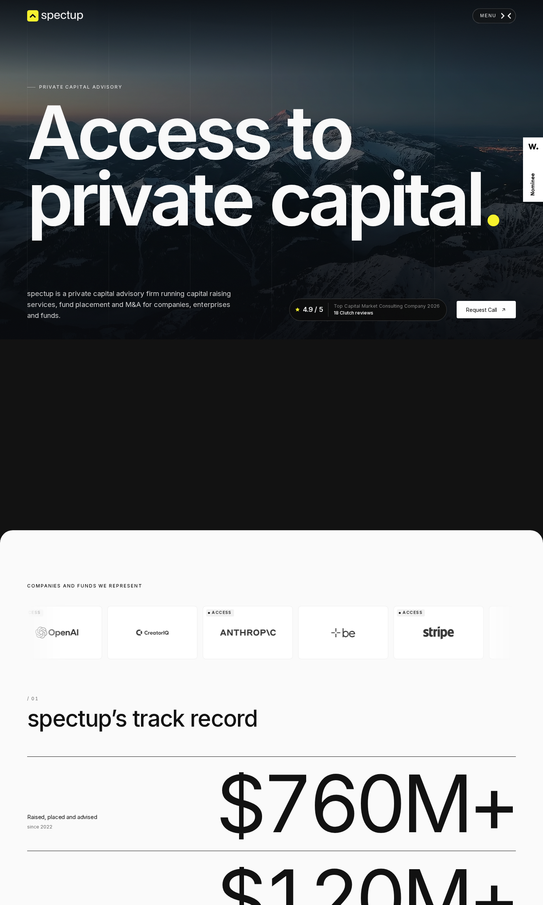
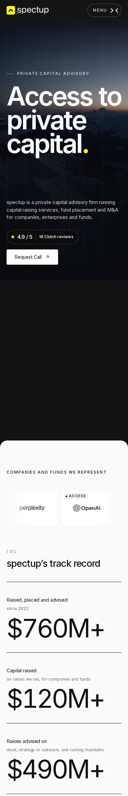

# UI Design System & Master Generation Blueprint: www-spectup-com

> **Private Capital Advisory: Capital Raising and M&A · spectup** (https://www.spectup.com/) — Private capital advisory with $760M+ advised, raised or placed since 2022: capital raising for companies and funds, fund placement and M&...



---

## 1. Executive Visual Persona & Design Archetype

- **Brand Essence & Persona**: **Private Capital Advisory: Capital Raising and M&A · spectup** (`https://www.spectup.com/`). Private capital advisory with $760M+ advised, raised or placed since 2022: capital raising for companies and funds, fund placement and M&...
- **Capture Provenance**: Live browser capture (`tier1_fast`, HTTP `200`, captured `2026-11-23`).
- **Visual Archetype**: **Dark-Substrate WebGL / Canvas Interactive Experience (`#121212` / `#ffff00`)**.
- **Anti-AI-Slop Differentiators**:
  - **Live-Computed Chromatic Polarity**: Anchors the viewport in `#121212` (live computed `body` `background-color` (`computed_styles.json`)) paired with `#fafafa` primary typography and `#ffff00` accents.
  - **Grounded Typographic Hierarchy**: Pairs `Inter` for display copy (`PRIVATE CAPITAL ADVISORY : Access to`) with `Inter` and `SFMono-Regular`.
  - **Calibrated Spatial Grid & Motion**: Combines `1296px` container bounds (`gap: var(--s2)`, padding `var(--s-sec)`) with `cubic-bezier(.4,0,1,1)` easing and Three.js / WebGL Canvas Pipeline.

---

## 2. Spatial Architecture & Modular Grid Mathematics



### Viewport Allocation & Container Geometry
- **Captured Viewport Dimensions**: Desktop `1440×2400px` (`assets/desktop.png`, clamped at 2400px live multi-section capture), Mobile `390×2400px` (`assets/mobile.png`, clamped at 2400px live multi-section capture).
- **Master Container Bounds**: `1296px` (measured widest bounded `<section>` landmark width on `1440px` desktop).
- **Canvas Lateral Padding & Spacing**: `var(--s-sec)` lateral canvas padding with `var(--s2)` grid gap.
- **Border Radius Scale**: `999px`, `2px`, `var(--r)`, `var(--r-xs)`.

### Responsive Breakpoint Architecture
- **Desktop Layout**: Multi-column CSS Grid / Flexbox layout at `1440px` (`max-width: 1296px`, `gap: var(--s2)`).
- **Mobile Layout**: Single-column vertical stack at `390px` viewport width with `var(--s-sec)` horizontal padding.
- **Extracted CSS Media Queries**: `@media (prefers-reduced-motion:reduce)`, `@media (min-width:1600px)`, `@media (hover:none),(pointer:coarse),(max-width:820px)`, `@media (max-width:1024px)`.

---

## 3. Color System, Materiality & Atmospheric Lighting

### Semantic Palette & Source Grounding
| Semantic Role | Ground-Truth Value | Extracted Live / CSS Source |
|---|---|---|
| **Primary Canvas Substrate** | `#121212` | live computed `body` `background-color` (`computed_styles.json`) |
| **Primary Typography Ink** | `#fafafa` | live computed `h1` `color` (`computed_styles.json`) |
| **Elevated Surface / Card Substrate** | `#1d1d1b` | `.btn--ink:hover { background: #1d1d1b }` |
| **Interactive Accent / Highlight** | `#ffff00` | `.navlinks a:hover i { color: yellow }` (`#ffff00`) |
| **Secondary / Muted Copy** | `#8a8a84` | `.trow .tt { color: #8a8a84 }` |
| **Structural Hairline Border** | `#323232` | `var(--line-d)` in `:root` (`rgba(250,250,250,.14)`) |
| **Variable Token (`--yellow`)** | `#f8f32b` | `var(--yellow)` in `:root` |
| **Variable Token (`--g-d`)** | `#8a8a8a` | `var(--g-d)` in `:root` |
| **Variable Token (`--g-l`)** | `#6b6b6b` | `var(--g-l)` in `:root` |

### Sanitized Root CSS Variables (`ui-ux.md` Ground Truth)
| Variable Name | Extracted Value | Semantic Role |
|---|---|---|
| `--hero-vh` | `100svh` | Layout / Spatial Grid Token |
| `--hero-bar` | `0px` | Dimension / Scale Token |
| `--ink` | `#121212` | Typography Ink Token |
| `--light` | `#FAFAFA` | Canvas / Surface Token |
| `--yellow` | `#F8F32B` | Color / Atmospheric Token |
| `--g-d` | `#8A8A8A` | Color / Atmospheric Token |
| `--g-l` | `#6B6B6B` | Color / Atmospheric Token |
| `--line-d` | `rgba(250,250,250,.14)` | Color / Atmospheric Token |
| `--line-l` | `rgba(18,18,18,.13)` | Color / Atmospheric Token |
| `--t-hero` | `clamp(40px,6.4vw,102px)` | Dimension / Scale Token |
| `--t-h1` | `clamp(30px,4.2vw,64px)` | Typography / Scale Token |
| `--t-h2` | `clamp(22px,2.5vw,36px)` | Typography / Scale Token |
| `--t-h3` | `clamp(17px,1.6vw,21px)` | Typography / Scale Token |
| `--t-lede` | `clamp(16px,1.3vw,19px)` | Dimension / Scale Token |
| `--t-body` | `15px` | Dimension / Scale Token |
| `--t-meta` | `12.5px` | Dimension / Scale Token |

---

## 4. Typographic Scale & Editorial Hierarchy

### Font Family Stacks
- **Display Typography**: `Inter`.
- **Primary Body Stack**: `Inter`.
- **Technical / Metadata Stack**: `SFMono-Regular`.

### Typographic Scale & Rules (Live Computed & Stylesheet Grounded)
- **Hero Display (`H1`)**: live computed `h1` (`font-size: 196px`, `line-height: 176.4px`, `font-weight: 620`, `letter-spacing: -10.192px`); CSS variables `--t-h1: clamp(30px,4.2vw,64px)`, `--kh-h1: 196.0px`; rule `.h1` (`font-size: clamp(19px,min(2.05vw,3.3vh),...`, `letter-spacing: -.018em`, `font-weight: 400`).
- **Section Heading (`H2`)**: live computed `h2` (`font-size: 60.48px`, `line-height: 63.504px`, `font-weight: 500`, `letter-spacing: -1.69344px`); CSS variables `--t-h2: clamp(22px,2.5vw,36px)`; rule `h2` (`font-size: clamp(24px,2.9vw,52px)`, `line-height: 1.06`, `letter-spacing: -.032em`, `font-weight: 500`).
- **Body Copy**: live computed `body` (`font-size: 15px`, `line-height: 23.25px`, `font-weight: 400`, `letter-spacing: 0.03px`); CSS variables `--t-body: 15px`; rule `p` (`font-size: clamp(13px,1.05vw,17px)`, `line-height: 1.5`).
- **Metadata & Navigation Labels**: live computed `nav/a` (`font-size: 15px`, `line-height: 23.25px`, `font-weight: 400`, `letter-spacing: 0.03px`); CSS variables `--t-meta: 12.5px`, `--mono: ui-monospace,SFMono-Regular,"SF Mono",Menlo,Consolas,monospace`, `--ck-mono: ui-monospace,SFMono-Regular,"SF Mono",Menlo,Consolas,monospace`; rule `.meta` (`font-size: var(--t-meta)`).

---

## 5. Choreographed Motion & Interaction Physics

### Primary Easing Curves
- **Extracted Timing Functions**: `cubic-bezier(.4,0,1,1)`, `cubic-bezier(.16,1,.3,1)`, `cubic-bezier(.7,0,.84,0)`.

### Per-Element Transition & Choreography Rules
- **Selector `html.boot .tqworld`**: `transition: none!important` extracted from `www-spectup-com` stylesheet.
- **Selector `.btn`**: `transition: transform var(--d1) var(--e),background var(--d1),border-color...` extracted from `www-spectup-com` stylesheet.
- **Selector `.btn svg`**: `transition: transform var(--d1) var(--e)` extracted from `www-spectup-com` stylesheet.
- **Extracted Easing Curve (`cubic-bezier(.4,0,1,1)`)**: Governs interactive state transitions across `<nav.mo>` and `<section.s--light>`.
- **Runtime Interaction Engine**: Integrates Three.js / WebGL Canvas Pipeline with `prefers-reduced-motion: reduce` fallback guards.

---

## 6. Component Wireframe & Structural DOM Map

### Visual Layout Schematic — Desktop (`1440px`, Grounded in `dom.html` & Landmark Bounding Boxes)
```
┌────────────────────────────────────────────────────────────────────────┐
│ DESKTOP VIEWPORT (1440px) — Private Capital Advisory: Capital Raising  │
│ ====================================================================== │
│ [ <nav.mo> (1440x92px)                | Overview · Index · Archive · ] │
│ ---------------------------------------------------------------------- │
│ | HERO STAGE: <section.kh> (w=1440px)                                | │
│ | H1: PRIVATE CAPITAL ADVISORY : Access to private capi...           | │
│ | Substrate: #121212 | Ink: #fafafa | Accent: #ffff00                | │
│ ---------------------------------------------------------------------- │
│ | SHOWCASE GRID (<section.s--light>) max-w: 1296px                   | │
│ | +------------------------------+  +------------------------------+ | │
│ | | Private capital advisory : A |  | spectup’s track record       | | │
│ | +------------------------------+  +------------------------------+ | │
│ ---------------------------------------------------------------------- │
│ | DETAIL MODULE (<section.s--flush>) — How we get capital ra         | │
│ ---------------------------------------------------------------------- │
│ [ FOOTER (<footer.ft>         ) | https://www.spectup.com/             │
└────────────────────────────────────────────────────────────────────────┘
```

### Visual Layout Schematic — Mobile Reflow (`390px`)
```
┌────────────────────────────────────────────────────────────────────────┐
│ MOBILE VIEWPORT REFLOW (390px) — Single-Column Stack (gap: var(--s2)   │
│ ====================================================================== │
│ [ HEADER BAR (<nav.mo>                ) | Compact Menu (390px)         │
│ ---------------------------------------------------------------------- │
│ | HERO STAGE (<section.kh>) — 390px Vertical Lead                    | │
│ | H1: PRIVATE CAPITAL ADVISORY : Access to private capi...           | │
│ ---------------------------------------------------------------------- │
│ | SHOWCASE STACK (<section.s--light>) — 1-Col Stack                  | │
│ | [ Item 1: Private capital advisory : A c c e s s t o p r i...    ] | │
│ | [ Item 2: spectup’s track record                                 ] | │
│ ---------------------------------------------------------------------- │
│ | DETAIL STACK (<section.s--flush>) — 1-Col (How we get capital)     | │
│ ---------------------------------------------------------------------- │
│ [ FOOTER (<footer.ft>         ) | Stacked 390px Colophon               │
└────────────────────────────────────────────────────────────────────────┘
```

### Granular DOM Region Breakdown
1. **Brand Header & Navigation Bar (<nav.mo> — `www-spectup-com`)**:
   - Landmark `<nav class="mo">` (`1440x92px`) hosting `Private Capital Advisory: Capital Ra` navigation (`Overview · Index · Archive · About · Contact`), DOM attributes (`data-nosnippet`, `data-mnbound="1"`, `data-l="The firm"`, `data-lf-cf`), and stylesheet rule `view-transition { navigation:auto }`.
2. **Hero Stage & Focal Lead (<section.kh> — `PRIVATE CAPITAL ADVISORY : Access `)**:
   - Landmark `<section class="kh in">` presenting display lead `PRIVATE CAPITAL ADVISORY : Access to private capi...` and copy excerpt *"spectup is a private capital advisory firm running capital raisin"* over `#121212` canvas and `#fafafa` ink.
3. **Primary Showcase & Content Grid (<section.s--light> — `Private capital advisory : A c c e`)**:
   - Landmark `<section class="s--light">` rendering section `Private capital advisory : A c c e s s t o p r i...` with copy *"Private capital advisory :"*, asset references (`insight.min.js`, `favicon.ico`, `favicon-32.png`, `favicon-192.png`), and grid rule `from { opacity:0;transform:translateY(10px) }`.
4. **Interactive Detail & Feature Matrix (<section.s--flush> — `spectup’s track record`)**:
   - Landmark `<section class="s--light s--flush">` framing `spectup’s track record` and `How we get capital raises, M&A deals and secondar...` (*"p r i v a t e c a p i t a l ."*) with `#1d1d1b` surface cards, `#ffff00` accents, and `nav { view-transition-name:sitenav }`.
5. **Colophon & Global Directory Footer (<footer.ft> — `https://www.spectup.com/`)**:
   - Landmark `<footer class="ft has-canvas">` anchoring `Private Capital Advisory: Capita` footer links (`Overview · Index · Archive · About · Contact`), copy *"Top Capital Market Consulting Company 2026 18 Clutch reviews"*, and `#323232` structural dividers.

---

## 7. Master Zero-Shot AI Generation Prompt

```markdown
# Master Zero-Shot Frontend Generation Prompt: www-spectup-com (Private Capital Advisory: Capital Raising and M&A · spectup)

You are a principal frontend architect and design systems engineer. Build a complete, production-ready web application replicating the exact design system, DOM landmarks, typographic hierarchy, color tokens, and motion physics of `www-spectup-com` (**Private Capital Advisory: Capital Raising and M&A · spectup** — `https://www.spectup.com/`).

### 1. Visual Archetype & Anti-AI-Slop Mandates
- **Archetype**: Dark-Substrate WebGL / Canvas Interactive Experience (`#121212` / `#ffff00`).
- **Identity & Domain Context**: Private capital advisory with $760M+ advised, raised or placed since 2022: capital raising for companies and funds, fund placement and M&...
- **Primary Substrate**: `#121212` (live computed `body` `background-color` (`computed_styles.json`)), **Primary Ink**: `#fafafa`, **Accent / Highlight**: `#ffff00`.
- **Site-Specific Differentiators**:
  - **Live-Computed Chromatic Polarity**: Anchors the viewport in `#121212` (live computed `body` `background-color` (`computed_styles.json`)) paired with `#fafafa` primary typography and `#ffff00` accents.
  - **Grounded Typographic Hierarchy**: Pairs `Inter` for display copy (`PRIVATE CAPITAL ADVISORY : Access to`) with `Inter` and `SFMono-Regular`.
  - **Calibrated Spatial Grid & Motion**: Combines `1296px` container bounds (`gap: var(--s2)`, padding `var(--s-sec)`) with `cubic-bezier(.4,0,1,1)` easing and Three.js / WebGL Canvas Pipeline.

### 2. Ground-Truth CSS Variables (`:root` Token Contract)
Declare and consume these exact custom properties extracted from `www-spectup-com` in your global stylesheet:

:root {
  /* Private Capital Advisory: Capital Raising and M&A · spectup (www-spectup-com) — Live-Grounded CSS Variables */
  --hero-vh: 100svh; /* Layout / Spatial Grid Token (www-spectup-com) */
  --hero-bar: 0px; /* Dimension / Scale Token (www-spectup-com) */
  --ink: #121212; /* Typography Ink Token (www-spectup-com) */
  --light: #FAFAFA; /* Canvas / Surface Token (www-spectup-com) */
  --yellow: #F8F32B; /* Color / Atmospheric Token (www-spectup-com) */
  --g-d: #8A8A8A; /* Color / Atmospheric Token (www-spectup-com) */
  --g-l: #6B6B6B; /* Color / Atmospheric Token (www-spectup-com) */
  --line-d: rgba(250,250,250,.14); /* Color / Atmospheric Token (www-spectup-com) */
  --line-l: rgba(18,18,18,.13); /* Color / Atmospheric Token (www-spectup-com) */
  --t-hero: clamp(40px,6.4vw,102px); /* Dimension / Scale Token (www-spectup-com) */
  --t-h1: clamp(30px,4.2vw,64px); /* Typography / Scale Token (www-spectup-com) */
  --t-h2: clamp(22px,2.5vw,36px); /* Typography / Scale Token (www-spectup-com) */
  --t-h3: clamp(17px,1.6vw,21px); /* Typography / Scale Token (www-spectup-com) */
  --t-lede: clamp(16px,1.3vw,19px); /* Dimension / Scale Token (www-spectup-com) */
  --t-body: 15px; /* Dimension / Scale Token (www-spectup-com) */
  --t-meta: 12.5px; /* Dimension / Scale Token (www-spectup-com) */
}

### 3. Semantic Color & Materiality Contract
Map every surface, ink, and border strictly to these source-grounded tokens:
- **Primary Canvas Substrate**: `#121212` — grounded in live computed `body` `background-color` (`computed_styles.json`)
- **Primary Typography Ink**: `#fafafa` — grounded in live computed `h1` `color` (`computed_styles.json`)
- **Elevated Surface / Card Substrate**: `#1d1d1b` — grounded in `.btn--ink:hover { background: #1d1d1b }`
- **Interactive Accent / Highlight**: `#ffff00` — grounded in `.navlinks a:hover i { color: yellow }` (`#ffff00`)
- **Secondary / Muted Copy**: `#8a8a84` — grounded in `.trow .tt { color: #8a8a84 }`
- **Structural Hairline Border**: `#323232` — grounded in `var(--line-d)` in `:root` (`rgba(250,250,250,.14)`)
- **Variable Token (`--yellow`)**: `#f8f32b` — grounded in `var(--yellow)` in `:root`
- **Variable Token (`--g-d`)**: `#8a8a8a` — grounded in `var(--g-d)` in `:root`
- **Variable Token (`--g-l`)**: `#6b6b6b` — grounded in `var(--g-l)` in `:root`

### 4. Spatial Grid, Container Bounds & Responsive Breakpoints
- **Desktop Viewport Reference**: `1440×2400px` (clamped at 2400px live multi-section capture, `1440px` standard desktop width).
- **Mobile Viewport Reference**: `390×2400px` (clamped at 2400px live multi-section capture, `390px` standard mobile width).
- **Container Max-Width**: `1296px` (measured widest bounded `<section>` landmark width on `1440px` desktop)
- **Padding & Gutters**: `var(--s-sec)` lateral canvas padding with `var(--s2)` grid gap
- **Desktop Grid**: Multi-column CSS Grid / Flexbox layout at `1440px` (`max-width: 1296px`, `gap: var(--s2)`)
- **Mobile Adaptation**: Single-column vertical stack at `390px` viewport width with `var(--s-sec)` horizontal padding
- **Media Queries**: `@media (prefers-reduced-motion:reduce)`, `@media (min-width:1600px)`, `@media (hover:none),(pointer:coarse),(max-width:820px)`, `@media (max-width:1024px)`
- **Corner Radii**: `999px`, `2px`, `var(--r)`, `var(--r-xs)`

### 5. Typography & Editorial Scale Contract
- **Display Font Stack**: `Inter`
- **Body Font Stack**: `Inter`
- **Monospace / Technical Font Stack**: `SFMono-Regular`
- **H1 Display Rule**: live computed `h1` (`font-size: 196px`, `line-height: 176.4px`, `font-weight: 620`, `letter-spacing: -10.192px`); CSS variables `--t-h1: clamp(30px,4.2vw,64px)`, `--kh-h1: 196.0px`; rule `.h1` (`font-size: clamp(19px,min(2.05vw,3.3vh),...`, `letter-spacing: -.018em`, `font-weight: 400`)
- **H2 Section Rule**: live computed `h2` (`font-size: 60.48px`, `line-height: 63.504px`, `font-weight: 500`, `letter-spacing: -1.69344px`); CSS variables `--t-h2: clamp(22px,2.5vw,36px)`; rule `h2` (`font-size: clamp(24px,2.9vw,52px)`, `line-height: 1.06`, `letter-spacing: -.032em`, `font-weight: 500`)
- **Body Copy Rule**: live computed `body` (`font-size: 15px`, `line-height: 23.25px`, `font-weight: 400`, `letter-spacing: 0.03px`); CSS variables `--t-body: 15px`; rule `p` (`font-size: clamp(13px,1.05vw,17px)`, `line-height: 1.5`)
- **Metadata & Index Rule**: live computed `nav/a` (`font-size: 15px`, `line-height: 23.25px`, `font-weight: 400`, `letter-spacing: 0.03px`); CSS variables `--t-meta: 12.5px`, `--mono: ui-monospace,SFMono-Regular,"SF Mono",Menlo,Consolas,monospace`, `--ck-mono: ui-monospace,SFMono-Regular,"SF Mono",Menlo,Consolas,monospace`; rule `.meta` (`font-size: var(--t-meta)`)

### 6. Component Hierarchy, Verbatim Copy & Real DOM Landmarks
Scaffold `www-spectup-com` (`Private Capital Advisory: Capital Raising and M&A · spectup`) with these exact structural regions, extracted copy, and CSS rules from `dom.html`:
1. **Brand Header & Navigation Bar (<nav.mo> — `www-spectup-com`)**:
   - DOM & Selectors: Landmark `<nav class="mo">` (`1440x92px`) hosting `Private Capital Advisory: Capital Ra` navigation (`Overview · Index · Archive · About · Contact`), DOM attributes (`data-nosnippet`, `data-mnbound="1"`, `data-l="The firm"`, `data-lf-cf`), and stylesheet rule `view-transition { navigation:auto }`.
   - Responsive Contract: Header `Brand Header & Navigation Bar (<nav.mo> — `www-spectup-com`)` (`www-spectup-com`) adapts across `@media (prefers-reduced-motion:reduce)`, `@media (min-width:1600px)`, `@media (hover:none),(pointer:coarse),(max-width:820px)`, `@media (max-width:1024px)` with `cubic-bezier(.4,0,1,1)`, `cubic-bezier(.16,1,.3,1)`, `cubic-bezier(.7,0,.84,0)` transitions and links `Overview · Index · Archive · About · Contact`.
2. **Hero Stage & Focal Lead (<section.kh> — `PRIVATE CAPITAL ADVISORY : Access `)**:
   - DOM & Selectors: Landmark `<section class="kh in">` presenting display lead `PRIVATE CAPITAL ADVISORY : Access to private capi...` and copy excerpt *"spectup is a private capital advisory firm running capital raisin"* over `#121212` canvas and `#fafafa` ink.
   - Responsive Contract: Hero stage (`1440×2400px` desktop / `390×2400px` mobile) sets `#121212` background with `#fafafa` headline `PRIVATE CAPITAL ADVISORY : Access to private capi...`.
3. **Primary Showcase & Content Grid (<section.s--light> — `Private capital advisory : A c c e`)**:
   - DOM & Selectors: Landmark `<section class="s--light">` rendering section `Private capital advisory : A c c e s s t o p r i...` with copy *"Private capital advisory :"*, asset references (`insight.min.js`, `favicon.ico`, `favicon-32.png`, `favicon-192.png`), and grid rule `from { opacity:0;transform:translateY(10px) }`.
   - Responsive Contract: Showcase grid `Primary Showcase & Content Grid (<section.s--light> — `Private capital advisory : A c c e`)` applies Multi-column CSS Grid / Flexbox layout at `1440px` (`max-width: 1296px`, `gap: var(--s2)`) on desktop and Single-column vertical stack at `390px` viewport width with `var(--s-sec)` horizontal padding on mobile.
4. **Interactive Detail & Feature Matrix (<section.s--flush> — `spectup’s track record`)**:
   - DOM & Selectors: Landmark `<section class="s--light s--flush">` framing `spectup’s track record` and `How we get capital raises, M&A deals and secondar...` (*"p r i v a t e c a p i t a l ."*) with `#1d1d1b` surface cards, `#ffff00` accents, and `nav { view-transition-name:sitenav }`.
   - Responsive Contract: Detail module `Interactive Detail & Feature Matrix (<section.s--flush> — `spectup’s track record`)` uses `999px`, `2px`, `var(--r)`, `var(--r-xs)` radii, `#ffff00` highlights, and assets (insight.min.js, favicon.ico, favicon-32.png).
5. **Colophon & Global Directory Footer (<footer.ft> — `https://www.spectup.com/`)**:
   - DOM & Selectors: Landmark `<footer class="ft has-canvas">` anchoring `Private Capital Advisory: Capita` footer links (`Overview · Index · Archive · About · Contact`), copy *"Top Capital Market Consulting Company 2026 18 Clutch reviews"*, and `#323232` structural dividers.
   - Responsive Contract: Footer `Colophon & Global Directory Footer (<footer.ft> — `https://www.spectup.com/`)` aligns to `1296px` (measured widest bounded `<section>` landmark width on `1440px` desktop) with `var(--s-sec)` lateral canvas padding with `var(--s2)` grid gap and attributes (data-nosnippet, data-mnbound="1", data-l="The firm").

#### Verbatim DOM Copy Excerpts (`dom.html`)
- Copy Excerpt 1: *"spectup is a private capital advisory firm running capital raising services, fund..."*
- Copy Excerpt 2: *"Private capital advisory :"*
- Copy Excerpt 3: *"p r i v a t e c a p i t a l ."*
- Copy Excerpt 4: *"Top Capital Market Consulting Company 2026 18 Clutch reviews"*

### 7. Motion, Extracted Stylesheet Rules & Interaction Choreography
- **Primary Easing Functions**: `cubic-bezier(.4,0,1,1)`, `cubic-bezier(.16,1,.3,1)`, `cubic-bezier(.7,0,.84,0)`
- **Extracted Stylesheet Rules (`www-spectup-com`)**:
- `view-transition { navigation:auto }`
- `from { opacity:0;transform:translateY(10px) }`
- `nav { view-transition-name:sitenav }`
- `site-nav { min-height:74px }`
- `site-footer { min-height:1px }`
- **Per-Selector Transition Rules**:
- **Selector `html.boot .tqworld`**: `transition: none!important` extracted from `www-spectup-com` stylesheet.
- **Selector `.btn`**: `transition: transform var(--d1) var(--e),background var(--d1),border-color...` extracted from `www-spectup-com` stylesheet.
- **Selector `.btn svg`**: `transition: transform var(--d1) var(--e)` extracted from `www-spectup-com` stylesheet.
- **Extracted Easing Curve (`cubic-bezier(.4,0,1,1)`)**: Governs interactive state transitions across `<nav.mo>` and `<section.s--light>`.
- **Runtime Interaction Engine**: Integrates Three.js / WebGL Canvas Pipeline with `prefers-reduced-motion: reduce` fallback guards.

### 8. Technical Deliverables
- Implement in Next.js (App Router) with TypeScript and Tailwind CSS consuming the `:root` custom properties defined above for `www-spectup-com`.
- Reproduce both the `1440px` desktop architecture and `390px` mobile breakpoint transitions, preserving semantic HTML5 landmarks (`<header>`, `<nav>`, `<main>`, `<section>`, `<footer>`) and `prefers-reduced-motion` accessibility guards.
```
