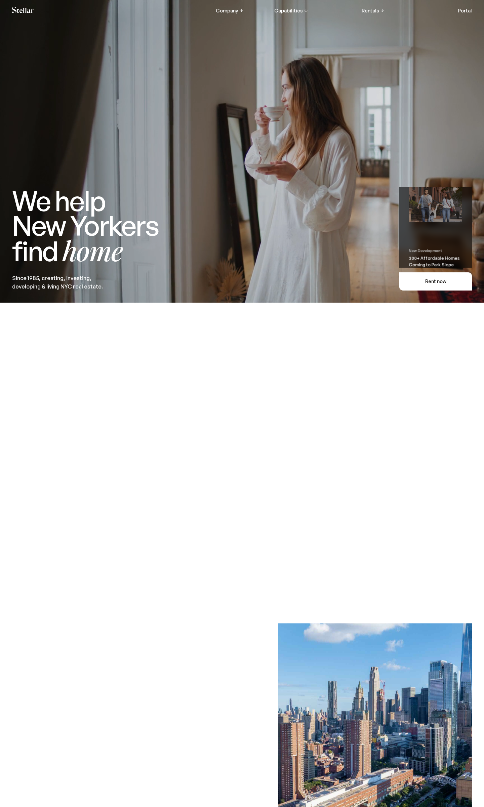
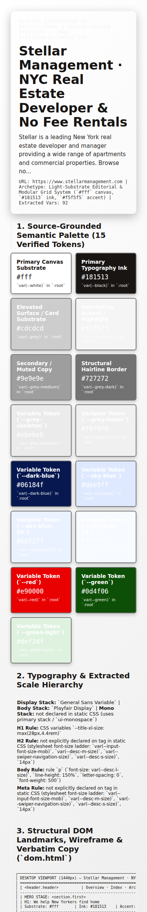

# UI Design System & Master Generation Blueprint: www-stellarmanagement-com

> **Stellar Management · NYC Real Estate Developer & No Fee Rentals** (https://www.stellarmanagement.com) — Stellar is a leading New York real estate developer and manager providing a wide range of apartments and commercial properties. Browse no...



---

## 1. Executive Visual Persona & Design Archetype

- **Brand Essence & Persona**: **Stellar Management · NYC Real Estate Developer & No Fee Rentals** (`https://www.stellarmanagement.com`). Stellar is a leading New York real estate developer and manager providing a wide range of apartments and commercial properties. Browse no...
- **Visual Archetype**: **Light-Substrate Editorial & Modular Grid System (`#fff` canvas, `#181513` ink, `#f5f5f5` accent)**.
- **Anti-AI-Slop Differentiators**:
  - **Source-Grounded Chromatic Polarity**: Anchors the viewport in `#fff` (`var(--white)` in `:root`) paired with `#181513` primary typography and `#f5f5f5` accents.
  - **Extracted Typographic Hierarchy**: Pairs `General Sans Variable` for display copy (`We help New Yorkers find home`) with `Playfair Display` and not declared in static CSS (uses primary stack / `ui-monospace`).
  - **Calibrated Spatial Grid & Motion**: Combines `1024px` container bounds (`gap: .8rem`, padding `1.5rem`) with `cubic-bezier(.28,.11,.32,1)` easing and Lenis Smooth Scroll (`data-lenis`), Three.js / WebGL Canvas Pipeline.

---

## 2. Spatial Architecture & Modular Grid Mathematics



### Viewport Allocation & Container Geometry
- **Captured Viewport Dimensions**: Desktop `1440×2400px` (`assets/desktop.png`, capped at 2400px multi-section capture), Mobile `390×2400px` (`assets/mobile.png`, capped at 2400px multi-section capture).
- **Master Container Bounds**: `1024px` extracted from `www-stellarmanagement-com` stylesheet.
- **Canvas Lateral Padding & Spacing**: `1.5rem` lateral canvas padding with `.8rem` grid gap.
- **Border Radius Scale**: `50%`, `2px`.

### Responsive Breakpoint Architecture
- **Desktop Layout**: Multi-column CSS Grid / Flexbox layout at `1440px` (`max-width: 1024px`, `gap: .8rem`).
- **Mobile Layout**: Single-column vertical stack at `390px` viewport width with `1.5rem` horizontal padding.
- **Extracted CSS Media Queries**: `@media screen and (max-width:1024px)`, `@media screen and (max-width:967px)`, `@media screen and (max-width:650px)`, `@media screen and (max-width:1200px)`.

---

## 3. Color System, Materiality & Atmospheric Lighting

### Semantic Palette & Source Grounding
| Semantic Role | Ground-Truth Value | Extracted CSS Source / Selector |
|---|---|---|
| **Primary Canvas Substrate** | `#fff` | `var(--white)` in `:root` |
| **Primary Typography Ink** | `#181513` | `var(--black)` in `:root` |
| **Elevated Surface / Card Substrate** | `#cdcdcd` | `var(--grey)` in `:root` |
| **Interactive Accent / Highlight** | `#f5f5f5` | `var(--grey-light)` in `:root` |
| **Secondary / Muted Copy** | `#9e9e9e` | `var(--grey-medium)` in `:root` |
| **Structural Hairline Border** | `#727272` | `var(--grey-dark)` in `:root` |
| **Variable Token (`--grey-skeleton`)** | `#ebebeb` | `var(--grey-skeleton)` in `:root` |
| **Variable Token (`--grey-hover`)** | `#f0f0f0` | `var(--grey-hover)` in `:root` |
| **Variable Token (`--dark-blue`)** | `#06184f` | `var(--dark-blue)` in `:root` |
| **Variable Token (`--sky-blue`)** | `#dee9ff` | `var(--sky-blue)` in `:root` |
| **Variable Token (`--sky-blue-60`)** | `#ebf2ff` | `var(--sky-blue-60)` in `:root` |
| **Variable Token (`--sky-blue-25`)** | `#f7faff` | `var(--sky-blue-25)` in `:root` |
| **Variable Token (`--red`)** | `#e90000` | `var(--red)` in `:root` |
| **Variable Token (`--green`)** | `#0d4f06` | `var(--green)` in `:root` |
| **Variable Token (`--green-light`)** | `#def2df` | `var(--green-light)` in `:root` |

### Sanitized Root CSS Variables (`ui-ux.md` Ground Truth)
| Variable Name | Extracted Value | Semantic Role |
|---|---|---|
| `--white` | `#fff` | Canvas / Surface Token |
| `--black` | `#181513` | Canvas / Surface Token |
| `--grey` | `#cdcdcd` | Color / Atmospheric Token |
| `--grey-light` | `#f5f5f5` | Canvas / Surface Token |
| `--grey-medium` | `#9e9e9e` | Color / Atmospheric Token |
| `--grey-dark` | `#727272` | Canvas / Surface Token |
| `--grey-skeleton` | `#ebebeb` | Color / Atmospheric Token |
| `--grey-hover` | `#f0f0f0` | Color / Atmospheric Token |
| `--dark-blue` | `#06184f` | Canvas / Surface Token |
| `--sky-blue` | `#dee9ff` | Color / Atmospheric Token |
| `--sky-blue-60` | `#ebf2ff` | Color / Atmospheric Token |
| `--sky-blue-25` | `#f7faff` | Color / Atmospheric Token |
| `--red` | `#e90000` | Color / Atmospheric Token |
| `--green` | `#0d4f06` | Color / Atmospheric Token |
| `--green-light` | `#def2df` | Canvas / Surface Token |
| `--black-opacity-l` | `rgba(0,0,0,.8)` | Canvas / Surface Token |

---

## 4. Typographic Scale & Editorial Hierarchy

### Font Family Stacks
- **Display Typography**: `General Sans Variable`.
- **Primary Body Stack**: `Playfair Display`.
- **Technical / Metadata Stack**: not declared in static CSS (uses primary stack / `ui-monospace`).

### Typographic Scale & Rules (Extracted from Stylesheet & Variables)
- **Hero Display (`H1`)**: CSS variables `--title-xl-size: max(28px,4.4rem)`.
- **Section Heading (`H2`)**: not explicitly declared on tag in static CSS (stylesheet font-size ladder: `var(--input-font-size-mob)`, `var(--desc-m-size)`, `var(--swiper-navigation-size)`, `var(--desc-s-size)`, `14px`).
- **Body Copy**: rule `p` (`font-size: var(--desc-l-size)`, `line-height: 150%`, `letter-spacing: 0`, `font-weight: 500`).
- **Metadata & Navigation Labels**: not explicitly declared on tag in static CSS (stylesheet font-size ladder: `var(--input-font-size-mob)`, `var(--desc-m-size)`, `var(--swiper-navigation-size)`, `var(--desc-s-size)`, `14px`).

---

## 5. Choreographed Motion & Interaction Physics

### Primary Easing Curves
- **Extracted Timing Functions**: `cubic-bezier(.28,.11,.32,1)`.

### Per-Element Transition & Choreography Rules
- **Selector `animation=image-scale] img[data-v...`**: `transition: .6s` extracted from `www-stellarmanagement-com` stylesheet.
- **Selector `body[data-v-e1bd4acb]`**: `transition: background-color var(--transition-slow)` extracted from `www-stellarmanagement-com` stylesheet.
- **Selector `svg[data-v-e1bd4acb]`**: `transition: color var(--transition-default)` extracted from `www-stellarmanagement-com` stylesheet.
- **Extracted Easing Curve (`cubic-bezier(.28,.11,.32,1)`)**: Governs interactive state transitions across `<header.header>` and `<section.block>`.
- **Runtime Interaction Engine**: Integrates Lenis Smooth Scroll (`data-lenis`), Three.js / WebGL Canvas Pipeline, Swiper Touch Carousel Engine with `prefers-reduced-motion: reduce` fallback guards.

---

## 6. Component Wireframe & Structural DOM Map

### Visual Layout Schematic (Grounded in `dom.html` — `1440px` Desktop & `390px` Mobile Reflow)
```
┌────────────────────────────────────────────────────────────────────────┐
│ DESKTOP VIEWPORT (1440px) — Stellar Management · NYC Real Estate Devel │
│ ====================================================================== │
│ [ <header.header>          | Overview · Index · Archive · About · C ]  │
│ ---------------------------------------------------------------------- │
│ | HERO STAGE: <section.first>                                      |   │
│ | H1: We help New Yorkers find home                                |   │
│ | Substrate: #fff       | Ink: #181513    | Accent: #f5f5f5        |   │
│ ---------------------------------------------------------------------- │
│ | SHOWCASE GRID (<section.block>           ) max-w: 1024px         |   │
│ | +------------------------------+  +------------------------------+ | │
│ | | From historic blocks to new  |  | Explore our backyard         | | │
│ | +------------------------------+  +------------------------------+ | │
│ ---------------------------------------------------------------------- │
│ | MOBILE VIEWPORT REFLOW (390px) — Single-Column Stack (gap: .8rem ) | │
│ | [<header.header>] -> [<section.first>] -> [<section.block>] |        │
│ ---------------------------------------------------------------------- │
│ [ FOOTER (<footer.footer>       ) | https://www.stellarmanagement.com  │
└────────────────────────────────────────────────────────────────────────┘
```

### Granular DOM Region Breakdown
1. **Brand Header & Navigation Bar (<header.header> — `www-stellarmanagement-com`)**:
   - Landmark `<header class="header">` hosting `Stellar Management · NYC Real Estate` navigation (`Overview · Index · Archive · About · Contact`), DOM attributes (`data-hid="page-vw"`, `data-gtag`, `data-v-d3185d1d`, `data-path="/"`), and stylesheet rule `root { --block-width-m:84rem;--search-sidebar-width:30rem }`.
2. **Hero Stage & Focal Lead (<section.first> — `We help New Yorkers find home`)**:
   - Landmark `<section class="first scroll-locked-fullscreen">` presenting display lead `We help New Yorkers find home` and copy excerpt *"R e n t w i t h u s R e n t w i t h u s"* over `#fff` canvas and `#181513` ink.
3. **Primary Showcase & Content Grid (<section.block> — `From historic blocks to new develo`)**:
   - Landmark `<section class="block">` rendering section `From historic blocks to new developments, we crea...` with copy *"R e n t w i t h u s"*, asset references (`entry.BO5l_mVZ.css`, `default.D_u9mJpK.css`, `filterMain.Dy3QUOs1.css`, `appInput.BLk3pTmz.css`), and grid rule `before { background:var(--white)!important }`.
4. **Interactive Detail & Feature Matrix (<section.neighborhoods> — `Explore our backyard`)**:
   - Landmark `<section class="neighborhoods neighborhoods-section">` framing `Explore our backyard` and `Where numbers reflect people, places, and purpose` (*"Since 1985, creating, investing, developing & living NYC real est"*) with `#cdcdcd` surface cards, `#f5f5f5` accents, and `focus-within { border-color:var(--dark-blue) }`.
5. **Colophon & Global Directory Footer (<footer.footer> — `https://www.stellarmanagement.com`)**:
   - Landmark `<footer class="footer">` anchoring `Stellar Management · NYC Real Es` footer links (`Overview · Index · Archive · About · Contact`), copy *"Approach The Way We Work, Defines Who We Are"*, and `#727272` structural dividers.

---

## 7. Master Zero-Shot AI Generation Prompt

```markdown
# Master Zero-Shot Frontend Generation Prompt: www-stellarmanagement-com (Stellar Management · NYC Real Estate Developer & No Fee Rentals)

You are a principal frontend architect and design systems engineer. Build a complete, production-ready web application replicating the exact design system, DOM landmarks, typographic hierarchy, color tokens, and motion physics of `www-stellarmanagement-com` (**Stellar Management · NYC Real Estate Developer & No Fee Rentals** — `https://www.stellarmanagement.com`).

### 1. Visual Archetype & Anti-AI-Slop Mandates
- **Archetype**: Light-Substrate Editorial & Modular Grid System (`#fff` canvas, `#181513` ink, `#f5f5f5` accent).
- **Identity & Domain Context**: Stellar is a leading New York real estate developer and manager providing a wide range of apartments and commercial properties. Browse no...
- **Primary Substrate**: `#fff` (`var(--white)` in `:root`), **Primary Ink**: `#181513`, **Accent / Highlight**: `#f5f5f5`.
- **Site-Specific Differentiators**:
  - **Source-Grounded Chromatic Polarity**: Anchors the viewport in `#fff` (`var(--white)` in `:root`) paired with `#181513` primary typography and `#f5f5f5` accents.
  - **Extracted Typographic Hierarchy**: Pairs `General Sans Variable` for display copy (`We help New Yorkers find home`) with `Playfair Display` and not declared in static CSS (uses primary stack / `ui-monospace`).
  - **Calibrated Spatial Grid & Motion**: Combines `1024px` container bounds (`gap: .8rem`, padding `1.5rem`) with `cubic-bezier(.28,.11,.32,1)` easing and Lenis Smooth Scroll (`data-lenis`), Three.js / WebGL Canvas Pipeline.

### 2. Ground-Truth CSS Variables (`:root` Token Contract)
Declare and consume these exact custom properties extracted from `www-stellarmanagement-com` in your global stylesheet:

:root {
  /* Stellar Management · NYC Real Estate Developer & No Fee Rentals (www-stellarmanagement-com) — Ground-Truth Extracted CSS Variables */
  --white: #fff; /* Canvas / Surface Token (www-stellarmanagement-com) */
  --black: #181513; /* Canvas / Surface Token (www-stellarmanagement-com) */
  --grey: #cdcdcd; /* Color / Atmospheric Token (www-stellarmanagement-com) */
  --grey-light: #f5f5f5; /* Canvas / Surface Token (www-stellarmanagement-com) */
  --grey-medium: #9e9e9e; /* Color / Atmospheric Token (www-stellarmanagement-com) */
  --grey-dark: #727272; /* Canvas / Surface Token (www-stellarmanagement-com) */
  --grey-skeleton: #ebebeb; /* Color / Atmospheric Token (www-stellarmanagement-com) */
  --grey-hover: #f0f0f0; /* Color / Atmospheric Token (www-stellarmanagement-com) */
  --dark-blue: #06184f; /* Canvas / Surface Token (www-stellarmanagement-com) */
  --sky-blue: #dee9ff; /* Color / Atmospheric Token (www-stellarmanagement-com) */
  --sky-blue-60: #ebf2ff; /* Color / Atmospheric Token (www-stellarmanagement-com) */
  --sky-blue-25: #f7faff; /* Color / Atmospheric Token (www-stellarmanagement-com) */
  --red: #e90000; /* Color / Atmospheric Token (www-stellarmanagement-com) */
  --green: #0d4f06; /* Color / Atmospheric Token (www-stellarmanagement-com) */
  --green-light: #def2df; /* Canvas / Surface Token (www-stellarmanagement-com) */
  --black-opacity-l: rgba(0,0,0,.8); /* Canvas / Surface Token (www-stellarmanagement-com) */
}

### 3. Semantic Color & Materiality Contract
Map every surface, ink, and border strictly to these source-grounded tokens:
- **Primary Canvas Substrate**: `#fff` — grounded in `var(--white)` in `:root`
- **Primary Typography Ink**: `#181513` — grounded in `var(--black)` in `:root`
- **Elevated Surface / Card Substrate**: `#cdcdcd` — grounded in `var(--grey)` in `:root`
- **Interactive Accent / Highlight**: `#f5f5f5` — grounded in `var(--grey-light)` in `:root`
- **Secondary / Muted Copy**: `#9e9e9e` — grounded in `var(--grey-medium)` in `:root`
- **Structural Hairline Border**: `#727272` — grounded in `var(--grey-dark)` in `:root`
- **Variable Token (`--grey-skeleton`)**: `#ebebeb` — grounded in `var(--grey-skeleton)` in `:root`
- **Variable Token (`--grey-hover`)**: `#f0f0f0` — grounded in `var(--grey-hover)` in `:root`
- **Variable Token (`--dark-blue`)**: `#06184f` — grounded in `var(--dark-blue)` in `:root`
- **Variable Token (`--sky-blue`)**: `#dee9ff` — grounded in `var(--sky-blue)` in `:root`
- **Variable Token (`--sky-blue-60`)**: `#ebf2ff` — grounded in `var(--sky-blue-60)` in `:root`
- **Variable Token (`--sky-blue-25`)**: `#f7faff` — grounded in `var(--sky-blue-25)` in `:root`
- **Variable Token (`--red`)**: `#e90000` — grounded in `var(--red)` in `:root`
- **Variable Token (`--green`)**: `#0d4f06` — grounded in `var(--green)` in `:root`
- **Variable Token (`--green-light`)**: `#def2df` — grounded in `var(--green-light)` in `:root`

### 4. Spatial Grid, Container Bounds & Responsive Breakpoints
- **Desktop Viewport Reference**: `1440×2400px` (capped at 2400px multi-section capture, `1440px` standard desktop width).
- **Mobile Viewport Reference**: `390×2400px` (capped at 2400px multi-section capture, `390px` standard mobile width).
- **Container Max-Width**: `1024px` extracted from `www-stellarmanagement-com` stylesheet
- **Padding & Gutters**: `1.5rem` lateral canvas padding with `.8rem` grid gap
- **Desktop Grid**: Multi-column CSS Grid / Flexbox layout at `1440px` (`max-width: 1024px`, `gap: .8rem`)
- **Mobile Adaptation**: Single-column vertical stack at `390px` viewport width with `1.5rem` horizontal padding
- **Media Queries**: `@media screen and (max-width:1024px)`, `@media screen and (max-width:967px)`, `@media screen and (max-width:650px)`, `@media screen and (max-width:1200px)`
- **Corner Radii**: `50%`, `2px`

### 5. Typography & Editorial Scale Contract
- **Display Font Stack**: `General Sans Variable`
- **Body Font Stack**: `Playfair Display`
- **Monospace / Technical Font Stack**: not declared in static CSS (uses primary stack / `ui-monospace`)
- **H1 Display Rule**: CSS variables `--title-xl-size: max(28px,4.4rem)`
- **H2 Section Rule**: not explicitly declared on tag in static CSS (stylesheet font-size ladder: `var(--input-font-size-mob)`, `var(--desc-m-size)`, `var(--swiper-navigation-size)`, `var(--desc-s-size)`, `14px`)
- **Body Copy Rule**: rule `p` (`font-size: var(--desc-l-size)`, `line-height: 150%`, `letter-spacing: 0`, `font-weight: 500`)
- **Metadata & Index Rule**: not explicitly declared on tag in static CSS (stylesheet font-size ladder: `var(--input-font-size-mob)`, `var(--desc-m-size)`, `var(--swiper-navigation-size)`, `var(--desc-s-size)`, `14px`)

### 6. Component Hierarchy, Verbatim Copy & Real DOM Landmarks
Scaffold `www-stellarmanagement-com` (`Stellar Management · NYC Real Estate Developer & No Fee Rentals`) with these exact structural regions, extracted copy, and CSS rules from `dom.html`:
1. **Brand Header & Navigation Bar (<header.header> — `www-stellarmanagement-com`)**:
   - DOM & Selectors: Landmark `<header class="header">` hosting `Stellar Management · NYC Real Estate` navigation (`Overview · Index · Archive · About · Contact`), DOM attributes (`data-hid="page-vw"`, `data-gtag`, `data-v-d3185d1d`, `data-path="/"`), and stylesheet rule `root { --block-width-m:84rem;--search-sidebar-width:30rem }`.
   - Responsive Contract: Header `Brand Header & Navigation Bar (<header.header> — `www-stellarmanagement-com`)` (`www-stellarmanagement-com`) adapts across `@media screen and (max-width:1024px)`, `@media screen and (max-width:967px)`, `@media screen and (max-width:650px)`, `@media screen and (max-width:1200px)` with `cubic-bezier(.28,.11,.32,1)` transitions and links `Overview · Index · Archive · About · Contact`.
2. **Hero Stage & Focal Lead (<section.first> — `We help New Yorkers find home`)**:
   - DOM & Selectors: Landmark `<section class="first scroll-locked-fullscreen">` presenting display lead `We help New Yorkers find home` and copy excerpt *"R e n t w i t h u s R e n t w i t h u s"* over `#fff` canvas and `#181513` ink.
   - Responsive Contract: Hero stage (`1440×2400px` desktop / `390×2400px` mobile) sets `#fff` background with `#181513` headline `We help New Yorkers find home`.
3. **Primary Showcase & Content Grid (<section.block> — `From historic blocks to new develo`)**:
   - DOM & Selectors: Landmark `<section class="block">` rendering section `From historic blocks to new developments, we crea...` with copy *"R e n t w i t h u s"*, asset references (`entry.BO5l_mVZ.css`, `default.D_u9mJpK.css`, `filterMain.Dy3QUOs1.css`, `appInput.BLk3pTmz.css`), and grid rule `before { background:var(--white)!important }`.
   - Responsive Contract: Showcase grid `Primary Showcase & Content Grid (<section.block> — `From historic blocks to new develo`)` applies Multi-column CSS Grid / Flexbox layout at `1440px` (`max-width: 1024px`, `gap: .8rem`) on desktop and Single-column vertical stack at `390px` viewport width with `1.5rem` horizontal padding on mobile.
4. **Interactive Detail & Feature Matrix (<section.neighborhoods> — `Explore our backyard`)**:
   - DOM & Selectors: Landmark `<section class="neighborhoods neighborhoods-section">` framing `Explore our backyard` and `Where numbers reflect people, places, and purpose` (*"Since 1985, creating, investing, developing & living NYC real est"*) with `#cdcdcd` surface cards, `#f5f5f5` accents, and `focus-within { border-color:var(--dark-blue) }`.
   - Responsive Contract: Detail module `Interactive Detail & Feature Matrix (<section.neighborhoods> — `Explore our backyard`)` uses `50%`, `2px` radii, `#f5f5f5` highlights, and assets (entry.BO5l_mVZ.css, default.D_u9mJpK.css, filterMain.Dy3QUOs1.css).
5. **Colophon & Global Directory Footer (<footer.footer> — `https://www.stellarmanagement.com`)**:
   - DOM & Selectors: Landmark `<footer class="footer">` anchoring `Stellar Management · NYC Real Es` footer links (`Overview · Index · Archive · About · Contact`), copy *"Approach The Way We Work, Defines Who We Are"*, and `#727272` structural dividers.
   - Responsive Contract: Footer `Colophon & Global Directory Footer (<footer.footer> — `https://www.stellarmanagement.com`)` aligns to `1024px` extracted from `www-stellarmanagement-com` stylesheet with `1.5rem` lateral canvas padding with `.8rem` grid gap and attributes (data-hid="page-vw", data-gtag, data-v-d3185d1d).

#### Verbatim DOM Copy Excerpts (`dom.html`)
- Copy Excerpt 1: *"R e n t w i t h u s R e n t w i t h u s"*
- Copy Excerpt 2: *"R e n t w i t h u s"*
- Copy Excerpt 3: *"Since 1985, creating, investing, developing & living NYC real estate."*
- Copy Excerpt 4: *"Approach The Way We Work, Defines Who We Are"*

### 7. Motion, Extracted Stylesheet Rules & Interaction Choreography
- **Primary Easing Functions**: `cubic-bezier(.28,.11,.32,1)`
- **Extracted Stylesheet Rules (`www-stellarmanagement-com`)**:
- `root { --block-width-m:84rem;--search-sidebar-width:30rem }`
- `before { background:var(--white)!important }`
- `focus-within { border-color:var(--dark-blue) }`
- `hover { border-color:var(--dark-blue) }`
- `webkit-scrollbar { background:transparent;width:0 }`
- **Per-Selector Transition Rules**:
- **Selector `animation=image-scale] img[data-v...`**: `transition: .6s` extracted from `www-stellarmanagement-com` stylesheet.
- **Selector `body[data-v-e1bd4acb]`**: `transition: background-color var(--transition-slow)` extracted from `www-stellarmanagement-com` stylesheet.
- **Selector `svg[data-v-e1bd4acb]`**: `transition: color var(--transition-default)` extracted from `www-stellarmanagement-com` stylesheet.
- **Extracted Easing Curve (`cubic-bezier(.28,.11,.32,1)`)**: Governs interactive state transitions across `<header.header>` and `<section.block>`.
- **Runtime Interaction Engine**: Integrates Lenis Smooth Scroll (`data-lenis`), Three.js / WebGL Canvas Pipeline, Swiper Touch Carousel Engine with `prefers-reduced-motion: reduce` fallback guards.

### 8. Technical Deliverables
- Implement in Next.js (App Router) with TypeScript and Tailwind CSS consuming the `:root` custom properties defined above for `www-stellarmanagement-com`.
- Reproduce both the `1440px` desktop architecture and `390px` mobile breakpoint transitions, preserving semantic HTML5 landmarks (`<header>`, `<nav>`, `<main>`, `<section>`, `<footer>`) and `prefers-reduced-motion` accessibility guards.
```
