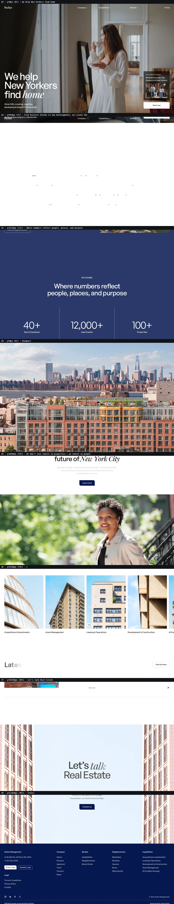

# UI Design System & Master Generation Blueprint: www-stellarmanagement-com

> **Stellar Management · NYC Real Estate Developer & No Fee Rentals** (https://www.stellarmanagement.com) — Stellar is a leading New York real estate developer and manager providing a wide range of apartments and commercial properties. Browse no...




---

## 1. Executive Visual Persona & Design Archetype

- **Brand Essence & Persona**: **Stellar Management · NYC Real Estate Developer & No Fee Rentals** (`https://www.stellarmanagement.com`). Stellar is a leading New York real estate developer and manager providing a wide range of apartments and commercial properties. Browse no...
- **Capture Provenance**: Live browser capture (`tier1_fast`, HTTP `200`, captured `2026-11-24`).
- **Visual Archetype**: **Light-Substrate Editorial & Modular Grid System (`#ffffff` canvas, `#181513` ink, `#0000ff` accent)**.
- **Anti-AI-Slop Differentiators**:
  - **Live-Computed Chromatic Polarity**: Anchors the viewport in `#ffffff` (live computed `body` `background-color` (`computed_styles.json`)) paired with `#181513` primary typography and `#0000ff` accents.
  - **Grounded Typographic Hierarchy**: Uses `General Sans Variable` across display (`We help New Yorkers find home`) and body copy.
  - **Calibrated Spatial Grid & Motion**: Combines `1368px` container bounds (`gap: normal 18px`, padding `36px`) with `cubic-bezier(.28,.11,.32,1)` easing and Lenis Smooth Scroll (`data-lenis`), Three.js / WebGL Canvas Pipeline.

---

## 2. Spatial Architecture & Modular Grid Mathematics

### Viewport Allocation & Container Geometry
- **Captured Journey Filmstrips**: Desktop `1280×6624px` (`assets/desktop-journey.webp`, `8` keyframes up to `y=11050px` / doc `12360px`), Mobile `390×872px` (`assets/mobile-journey.webp`, `1` keyframes).
- **Master Container Bounds**: `1368px` (measured widest bounded `<section>` landmark width on `1440px` desktop).
- **Canvas Lateral Padding & Spacing**: `36px` lateral canvas padding with `normal 18px` grid gap.
- **Border Radius Scale**: `50%`, `2px`.

### Responsive Breakpoint Architecture
- **Desktop Layout**: Multi-column CSS Grid / Flexbox layout at `1440px` (`max-width: 1368px`, `gap: normal 18px`).
- **Mobile Layout**: Single-column vertical stack at `390px` viewport width with `36px` horizontal padding.
- **Extracted CSS Media Queries**: `@media screen and (max-width:1024px)`, `@media screen and (max-width:967px)`, `@media screen and (max-width:650px)`, `@media screen and (min-width:968px)`.

---

## 3. Color System, Materiality & Atmospheric Lighting

### Semantic Palette & Source Grounding
| Semantic Role | Ground-Truth Value | Extracted Live / CSS Source |
|---|---|---|
| **Primary Canvas Substrate** | `#ffffff` | live computed `body` `background-color` (`computed_styles.json`) |
| **Primary Typography Ink** | `#181513` | live computed `main` `color` (`computed_styles.json`) |
| **Elevated Surface / Card Substrate** | `#808080` | `:before { background: grey }` (`#808080`) |
| **Interactive Accent / Highlight** | `#0000ff` | `.header-bottom .app-button { color: blue }` (`#0000ff`) |
| **Secondary / Muted Copy** | `#808080` | `.app-input .app-input-desc { color: grey }` (`#808080`) |
| **Structural Hairline Border** | `#0000ff` | `:hover { border-color: #0000ff }` |
| **Variable Token (`--grey`)** | `#cdcdcd` | `var(--grey)` in `:root` |
| **Variable Token (`--grey-light`)** | `#f5f5f5` | `var(--grey-light)` in `:root` |
| **Variable Token (`--grey-medium`)** | `#9e9e9e` | `var(--grey-medium)` in `:root` |
| **Variable Token (`--grey-dark`)** | `#727272` | `var(--grey-dark)` in `:root` |
| **Variable Token (`--grey-skeleton`)** | `#ebebeb` | `var(--grey-skeleton)` in `:root` |
| **Variable Token (`--grey-hover`)** | `#f0f0f0` | `var(--grey-hover)` in `:root` |
| **Variable Token (`--dark-blue`)** | `#06184f` | `var(--dark-blue)` in `:root` |
| **Variable Token (`--sky-blue`)** | `#dee9ff` | `var(--sky-blue)` in `:root` |
| **Variable Token (`--sky-blue-60`)** | `#ebf2ff` | `var(--sky-blue-60)` in `:root` |
| **Variable Token (`--sky-blue-25`)** | `#f7faff` | `var(--sky-blue-25)` in `:root` |
| **Variable Token (`--red`)** | `#e90000` | `var(--red)` in `:root` |
| **Variable Token (`--green`)** | `#0d4f06` | `var(--green)` in `:root` |
| **Variable Token (`--green-light`)** | `#def2df` | `var(--green-light)` in `:root` |

### Sanitized Root CSS Variables (`ui-ux.md` Ground Truth)
| Variable Name | Extracted Value | Semantic Role |
|---|---|---|
| `--white` | `#fff` | Canvas / Surface Token |
| `--black` | `#181513` | Canvas / Surface Token |
| `--grey` | `#cdcdcd` | Color / Atmospheric Token |
| `--grey-light` | `#f5f5f5` | Canvas / Surface Token |
| `--grey-medium` | `#9e9e9e` | Color / Atmospheric Token |
| `--grey-dark` | `#727272` | Canvas / Surface Token |
| `--grey-skeleton` | `#ebebeb` | Color / Atmospheric Token |
| `--grey-hover` | `#f0f0f0` | Color / Atmospheric Token |
| `--dark-blue` | `#06184f` | Canvas / Surface Token |
| `--sky-blue` | `#dee9ff` | Color / Atmospheric Token |
| `--sky-blue-60` | `#ebf2ff` | Color / Atmospheric Token |
| `--sky-blue-25` | `#f7faff` | Color / Atmospheric Token |
| `--red` | `#e90000` | Color / Atmospheric Token |
| `--green` | `#0d4f06` | Color / Atmospheric Token |
| `--green-light` | `#def2df` | Canvas / Surface Token |
| `--black-opacity-l` | `rgba(0,0,0,.8)` | Canvas / Surface Token |

---

## 4. Typographic Scale & Editorial Hierarchy

### Font Family Stacks
- **Display Typography**: `General Sans Variable`.
- **Primary Body Stack**: `General Sans Variable`.
- **Technical / Metadata Stack**: not declared in live computed styles (uses primary stack / `ui-monospace`).

### Typographic Scale & Rules (Live Computed & Stylesheet Grounded)
- **Hero Display (`H1`)**: live computed `h1` (`font-size: 81px`, `line-height: 72.9px`, `font-weight: 500`, `letter-spacing: -3.24px`); CSS variables `--title-xl-size: max(28px,4.4rem)`.
- **Section Heading (`H2`)**: live computed `h2` (`font-size: 70.2px`, `line-height: 77.22px`, `font-weight: 500`, `letter-spacing: -2.106px`).
- **Body Copy**: live computed `body` (`font-size: 9px`, `line-height: normal`, `font-weight: 500`); rule `p` (`font-size: var(--desc-l-size)`, `line-height: 150%`, `letter-spacing: 0`, `font-weight: 500`).
- **Metadata & Navigation Labels**: live computed `nav/a` (`font-size: 9px`, `line-height: normal`, `font-weight: 500`).

---

## 5. Choreographed Motion & Interaction Physics

### Primary Easing Curves
- **Extracted Timing Functions**: `cubic-bezier(.28,.11,.32,1)`.

### Per-Element Transition & Choreography Rules
- **Selector `animation=image-scale] img[data-v...`**: `transition: .6s` extracted from `www-stellarmanagement-com` stylesheet.
- **Selector `body[data-v-f3e39c51]`**: `transition: background-color var(--transition-slow)` extracted from `www-stellarmanagement-com` stylesheet.
- **Selector `svg[data-v-f3e39c51]`**: `transition: color var(--transition-default)` extracted from `www-stellarmanagement-com` stylesheet.
- **Extracted Easing Curve (`cubic-bezier(.28,.11,.32,1)`)**: Governs interactive state transitions across `<header.header>` and `<section.block>`.
- **Runtime Interaction Engine**: Integrates Lenis Smooth Scroll (`data-lenis`), Three.js / WebGL Canvas Pipeline, Swiper Touch Carousel Engine with `prefers-reduced-motion: reduce` fallback guards.
### Measured Runtime Scroll & Interaction Telemetry (`behavioral_journey_v2`)
- **Scroll Driver Mode**: `native` (max document height `12360px`, deepest scrollY reached `11050px` across `8` desktop keyframes).
- **Detected Scroll / Motion Libraries**: `Lenis`, `GSAP/ScrollTrigger`.
- **Hover Physics (`primary_cta` · `Approach The Way We Work, Defines...`)**: Computed transition `0.42s` / `cubic-bezier(0.28, 0.11, 0.32, 1)` (no static color/transform shift captured at rest).
- **Hover Physics (`first_card` · `New Development 300+ Affordable H...`)**: Computed transition `0.42s` / `cubic-bezier(0.28, 0.11, 0.32, 1)` (no static color/transform shift captured at rest).
- **Route Transition Architecture**: First internal navigation (`/no-fee-NYC-rentals/new-york-city-neighborhoods/Manhattan-rental-apartment-listings`) measured as `direct` in `3565ms`.

---

## 6. Component Wireframe & Structural DOM Map

### Visual Layout Schematic — Desktop (`1440px`, Grounded in `dom.html` & Landmark Bounding Boxes)
```
┌────────────────────────────────────────────────────────────────────────┐
│ DESKTOP VIEWPORT (1440px) — Stellar Management · NYC Real Estate Devel │
│ ====================================================================== │
│ [ <header.header> (1440x63px)         | Overview · Index · Archive · ] │
│ ---------------------------------------------------------------------- │
│ | HERO STAGE: <section.first> (w=1440px)                             | │
│ | H1: We help New Yorkers find home                                  | │
│ | Substrate: #ffffff | Ink: #181513 | Accent: #0000ff                | │
│ ---------------------------------------------------------------------- │
│ | SHOWCASE GRID (<section.block>) max-w: 1368px                      | │
│ | +------------------------------+  +------------------------------+ | │
│ | | We help New Yorkers find h o |  | From h i s t o r i c blocks  | | │
│ | +------------------------------+  +------------------------------+ | │
│ ---------------------------------------------------------------------- │
│ | DETAIL MODULE (<section.neighborhoods>) — Explore our b a c k y    | │
│ ---------------------------------------------------------------------- │
│ [ FOOTER (<footer.footer>     ) | https://www.stellarmanagement.com    │
└────────────────────────────────────────────────────────────────────────┘
```

### Visual Layout Schematic — Mobile Reflow (`390px`)
```
┌────────────────────────────────────────────────────────────────────────┐
│ MOBILE VIEWPORT REFLOW (390px) — Single-Column Stack (gap: normal 1)   │
│ ====================================================================== │
│ [ HEADER BAR (<header.header>         ) | Compact Menu (390px)         │
│ ---------------------------------------------------------------------- │
│ | HERO STAGE (<section.first>) — 390px Vertical Lead                 | │
│ | H1: We help New Yorkers find home                                  | │
│ ---------------------------------------------------------------------- │
│ | SHOWCASE STACK (<section.block>) — 1-Col Stack                     | │
│ | [ Item 1: We help New Yorkers find h o m e                       ] | │
│ | [ Item 2: From h i s t o r i c blocks to n e w developments...   ] | │
│ ---------------------------------------------------------------------- │
│ | DETAIL STACK (<section.neighborhoods>) — 1-Col (Explore our b a c )  │
│ ---------------------------------------------------------------------- │
│ [ FOOTER (<footer.footer>     ) | Stacked 390px Colophon               │
└────────────────────────────────────────────────────────────────────────┘
```

### Granular DOM Region Breakdown
1. **Brand Header & Navigation Bar (<header.header> — `www-stellarmanagement-com`)**:
   - Landmark `<header class="header">` (`1440x63px`) hosting `Stellar Management · NYC Real Estate` navigation (`Overview · Index · Archive · About · Contact`), DOM attributes (`data-hid="page-vw"`, `data-gtag`, `data-v-d3185d1d`, `data-path="/"`), and stylesheet rule `root { --block-width-m:84rem;--search-sidebar-width:30rem }`.
2. **Hero Stage & Focal Lead (<section.first> — `We help New Yorkers find home`)**:
   - Landmark `<section class="first scroll-locked-fullscreen">` presenting display lead `We help New Yorkers find home` and copy excerpt *"Since 1985, creating, investing, developing & living NYC real est"* over `#ffffff` canvas and `#181513` ink.
3. **Primary Showcase & Content Grid (<section.block> — `We help New Yorkers find h o m e`)**:
   - Landmark `<section class="block">` rendering section `We help New Yorkers find h o m e` with copy *"R e n t w i t h u s R e n t w i t h u s"*, asset references (`entry.BO5l_mVZ.css`, `default.D_u9mJpK.css`, `filterMain.Dy3QUOs1.css`, `appInput.BLk3pTmz.css`), and grid rule `before { background:var(--white)!important }`.
4. **Interactive Detail & Feature Matrix (<section.neighborhoods> — `From h i s t o r i c blocks to n e`)**:
   - Landmark `<section class="neighborhoods neighborhoods-section">` framing `From h i s t o r i c blocks to n e w developments...` and `Explore our b a c k y a r d` (*"R e n t w i t h u s"*) with `#808080` surface cards, `#0000ff` accents, and `hover { border-color:var(--dark-blue);color:var(--dark-blue) }`.
5. **Colophon & Global Directory Footer (<footer.footer> — `https://www.stellarmanagement.com`)**:
   - Landmark `<footer class="footer">` anchoring `Stellar Management · NYC Real Es` footer links (`Overview · Index · Archive · About · Contact`), copy *"The Way We Work, Defines Who We Are"*, and `#0000ff` structural dividers.
### Full Vertical Scroll Sequence (Desktop `1440×900` Keyframes)
- **Step 01** (`y=0px`, `0%`): Active landmark `We help New Yorkers find home` · sticky/fixed elements: `1`
- **Step 02** (`y=850px`, `7%`): Active landmark `From historic blocks to new developments, we crea...` · sticky/fixed elements: `1`
- **Step 03** (`y=2550px`, `22%`): Active landmark `Where numbers reflect people, places, and purpose` · sticky/fixed elements: `1`
- **Step 04** (`y=0px`, `0%`): Active landmark `Viewport` · sticky/fixed elements: `0`
- **Step 05** (`y=6800px`, `59%`): Active landmark `We don’t just invest in properties – we invest in...` · sticky/fixed elements: `1`
- **Step 06** (`y=8500px`, `74%`): Active landmark `L` · sticky/fixed elements: `1`
- **Step 07** (`y=10200px`, `89%`): Active landmark `Let’s talk Real Estate` · sticky/fixed elements: `1`
- **Step 08** (`y=11050px`, `96%`): Active landmark `Footer` · sticky/fixed elements: `1`

### Multi-Page Internal Route Map
- **Detail Route (`/no-fee-NYC-rentals/new-york-city-neighborhoods/Manhattan-rental-apartment-listings`)**: `https://www.stellarmanagement.com/no-fee-NYC-rentals/new-york-city-neighborhoods/Manhattan-rental-apartment-listings` — H1: `Apartments for Rent in Manhattan, NYC · Stellar M...`, scrollHeight `8582px`, transition `direct` (`3565ms`)
- **Detail Route (`/no-fee-NYC-rentals/new-york-city-neighborhoods/Brooklyn-rental-apartment-listings`)**: `https://www.stellarmanagement.com/no-fee-NYC-rentals/new-york-city-neighborhoods/Brooklyn-rental-apartment-listings` — H1: `Brooklyn`, scrollHeight `6977px`, transition `direct` (`1965ms`)
- **Detail Route (`/no-fee-NYC-rentals/new-york-city-neighborhoods/Queens-rental-apartment-listings`)**: `https://www.stellarmanagement.com/no-fee-NYC-rentals/new-york-city-neighborhoods/Queens-rental-apartment-listings` — H1: `Apartments for Rent in Queens, NYC · Stellar Mana...`, scrollHeight `6823px`, transition `direct` (`3584ms`)

---

## 7. Master Zero-Shot AI Generation Prompt

```markdown
# Master Zero-Shot Frontend Generation Prompt: www-stellarmanagement-com (Stellar Management · NYC Real Estate Developer & No Fee Rentals)

You are a principal frontend architect and design systems engineer. Build a complete, production-ready web application replicating the exact design system, DOM landmarks, typographic hierarchy, color tokens, and motion physics of `www-stellarmanagement-com` (**Stellar Management · NYC Real Estate Developer & No Fee Rentals** — `https://www.stellarmanagement.com`).

### 1. Visual Archetype & Anti-AI-Slop Mandates
- **Archetype**: Light-Substrate Editorial & Modular Grid System (`#ffffff` canvas, `#181513` ink, `#0000ff` accent).
- **Identity & Domain Context**: Stellar is a leading New York real estate developer and manager providing a wide range of apartments and commercial properties. Browse no...
- **Primary Substrate**: `#ffffff` (live computed `body` `background-color` (`computed_styles.json`)), **Primary Ink**: `#181513`, **Accent / Highlight**: `#0000ff`.
- **Site-Specific Differentiators**:
  - **Live-Computed Chromatic Polarity**: Anchors the viewport in `#ffffff` (live computed `body` `background-color` (`computed_styles.json`)) paired with `#181513` primary typography and `#0000ff` accents.
  - **Grounded Typographic Hierarchy**: Uses `General Sans Variable` across display (`We help New Yorkers find home`) and body copy.
  - **Calibrated Spatial Grid & Motion**: Combines `1368px` container bounds (`gap: normal 18px`, padding `36px`) with `cubic-bezier(.28,.11,.32,1)` easing and Lenis Smooth Scroll (`data-lenis`), Three.js / WebGL Canvas Pipeline.

### 2. Ground-Truth CSS Variables (`:root` Token Contract)
Declare and consume these exact custom properties extracted from `www-stellarmanagement-com` in your global stylesheet:

:root {
  /* Stellar Management · NYC Real Estate Developer & No Fee Rentals (www-stellarmanagement-com) — Live-Grounded CSS Variables */
  --white: #fff; /* Canvas / Surface Token (www-stellarmanagement-com) */
  --black: #181513; /* Canvas / Surface Token (www-stellarmanagement-com) */
  --grey: #cdcdcd; /* Color / Atmospheric Token (www-stellarmanagement-com) */
  --grey-light: #f5f5f5; /* Canvas / Surface Token (www-stellarmanagement-com) */
  --grey-medium: #9e9e9e; /* Color / Atmospheric Token (www-stellarmanagement-com) */
  --grey-dark: #727272; /* Canvas / Surface Token (www-stellarmanagement-com) */
  --grey-skeleton: #ebebeb; /* Color / Atmospheric Token (www-stellarmanagement-com) */
  --grey-hover: #f0f0f0; /* Color / Atmospheric Token (www-stellarmanagement-com) */
  --dark-blue: #06184f; /* Canvas / Surface Token (www-stellarmanagement-com) */
  --sky-blue: #dee9ff; /* Color / Atmospheric Token (www-stellarmanagement-com) */
  --sky-blue-60: #ebf2ff; /* Color / Atmospheric Token (www-stellarmanagement-com) */
  --sky-blue-25: #f7faff; /* Color / Atmospheric Token (www-stellarmanagement-com) */
  --red: #e90000; /* Color / Atmospheric Token (www-stellarmanagement-com) */
  --green: #0d4f06; /* Color / Atmospheric Token (www-stellarmanagement-com) */
  --green-light: #def2df; /* Canvas / Surface Token (www-stellarmanagement-com) */
  --black-opacity-l: rgba(0,0,0,.8); /* Canvas / Surface Token (www-stellarmanagement-com) */
}

### 3. Semantic Color & Materiality Contract
Map every surface, ink, and border strictly to these source-grounded tokens:
- **Primary Canvas Substrate**: `#ffffff` — grounded in live computed `body` `background-color` (`computed_styles.json`)
- **Primary Typography Ink**: `#181513` — grounded in live computed `main` `color` (`computed_styles.json`)
- **Elevated Surface / Card Substrate**: `#808080` — grounded in `:before { background: grey }` (`#808080`)
- **Interactive Accent / Highlight**: `#0000ff` — grounded in `.header-bottom .app-button { color: blue }` (`#0000ff`)
- **Secondary / Muted Copy**: `#808080` — grounded in `.app-input .app-input-desc { color: grey }` (`#808080`)
- **Structural Hairline Border**: `#0000ff` — grounded in `:hover { border-color: #0000ff }`
- **Variable Token (`--grey`)**: `#cdcdcd` — grounded in `var(--grey)` in `:root`
- **Variable Token (`--grey-light`)**: `#f5f5f5` — grounded in `var(--grey-light)` in `:root`
- **Variable Token (`--grey-medium`)**: `#9e9e9e` — grounded in `var(--grey-medium)` in `:root`
- **Variable Token (`--grey-dark`)**: `#727272` — grounded in `var(--grey-dark)` in `:root`
- **Variable Token (`--grey-skeleton`)**: `#ebebeb` — grounded in `var(--grey-skeleton)` in `:root`
- **Variable Token (`--grey-hover`)**: `#f0f0f0` — grounded in `var(--grey-hover)` in `:root`
- **Variable Token (`--dark-blue`)**: `#06184f` — grounded in `var(--dark-blue)` in `:root`
- **Variable Token (`--sky-blue`)**: `#dee9ff` — grounded in `var(--sky-blue)` in `:root`
- **Variable Token (`--sky-blue-60`)**: `#ebf2ff` — grounded in `var(--sky-blue-60)` in `:root`
- **Variable Token (`--sky-blue-25`)**: `#f7faff` — grounded in `var(--sky-blue-25)` in `:root`
- **Variable Token (`--red`)**: `#e90000` — grounded in `var(--red)` in `:root`
- **Variable Token (`--green`)**: `#0d4f06` — grounded in `var(--green)` in `:root`
- **Variable Token (`--green-light`)**: `#def2df` — grounded in `var(--green-light)` in `:root`

### 4. Spatial Grid, Container Bounds & Responsive Breakpoints
- **Desktop Viewport Reference**: `1280×6624px` (multi-frame vertical journey filmstrip (6624px), `1440px` standard desktop width).
- **Mobile Viewport Reference**: `390×872px` (full-page live capture (872px), `390px` standard mobile width).
- **Container Max-Width**: `1368px` (measured widest bounded `<section>` landmark width on `1440px` desktop)
- **Padding & Gutters**: `36px` lateral canvas padding with `normal 18px` grid gap
- **Desktop Grid**: Multi-column CSS Grid / Flexbox layout at `1440px` (`max-width: 1368px`, `gap: normal 18px`)
- **Mobile Adaptation**: Single-column vertical stack at `390px` viewport width with `36px` horizontal padding
- **Media Queries**: `@media screen and (max-width:1024px)`, `@media screen and (max-width:967px)`, `@media screen and (max-width:650px)`, `@media screen and (min-width:968px)`
- **Corner Radii**: `50%`, `2px`

### 5. Typography & Editorial Scale Contract
- **Display Font Stack**: `General Sans Variable`
- **Body Font Stack**: `General Sans Variable`
- **Monospace / Technical Font Stack**: not declared in live computed styles (uses primary stack / `ui-monospace`)
- **H1 Display Rule**: live computed `h1` (`font-size: 81px`, `line-height: 72.9px`, `font-weight: 500`, `letter-spacing: -3.24px`); CSS variables `--title-xl-size: max(28px,4.4rem)`
- **H2 Section Rule**: live computed `h2` (`font-size: 70.2px`, `line-height: 77.22px`, `font-weight: 500`, `letter-spacing: -2.106px`)
- **Body Copy Rule**: live computed `body` (`font-size: 9px`, `line-height: normal`, `font-weight: 500`); rule `p` (`font-size: var(--desc-l-size)`, `line-height: 150%`, `letter-spacing: 0`, `font-weight: 500`)
- **Metadata & Index Rule**: live computed `nav/a` (`font-size: 9px`, `line-height: normal`, `font-weight: 500`)

### 6. Component Hierarchy, Verbatim Copy & Real DOM Landmarks
Scaffold `www-stellarmanagement-com` (`Stellar Management · NYC Real Estate Developer & No Fee Rentals`) with these exact structural regions, extracted copy, and CSS rules from `dom.html`:
1. **Brand Header & Navigation Bar (<header.header> — `www-stellarmanagement-com`)**:
   - DOM & Selectors: Landmark `<header class="header">` (`1440x63px`) hosting `Stellar Management · NYC Real Estate` navigation (`Overview · Index · Archive · About · Contact`), DOM attributes (`data-hid="page-vw"`, `data-gtag`, `data-v-d3185d1d`, `data-path="/"`), and stylesheet rule `root { --block-width-m:84rem;--search-sidebar-width:30rem }`.
   - Responsive Contract: Header `Brand Header & Navigation Bar (<header.header> — `www-stellarmanagement-com`)` (`www-stellarmanagement-com`) adapts across `@media screen and (max-width:1024px)`, `@media screen and (max-width:967px)`, `@media screen and (max-width:650px)`, `@media screen and (min-width:968px)` with `cubic-bezier(.28,.11,.32,1)` transitions and links `Overview · Index · Archive · About · Contact`.
2. **Hero Stage & Focal Lead (<section.first> — `We help New Yorkers find home`)**:
   - DOM & Selectors: Landmark `<section class="first scroll-locked-fullscreen">` presenting display lead `We help New Yorkers find home` and copy excerpt *"Since 1985, creating, investing, developing & living NYC real est"* over `#ffffff` canvas and `#181513` ink.
   - Responsive Contract: Hero stage (`1280×6624px` desktop / `390×872px` mobile) sets `#ffffff` background with `#181513` headline `We help New Yorkers find home`.
3. **Primary Showcase & Content Grid (<section.block> — `We help New Yorkers find h o m e`)**:
   - DOM & Selectors: Landmark `<section class="block">` rendering section `We help New Yorkers find h o m e` with copy *"R e n t w i t h u s R e n t w i t h u s"*, asset references (`entry.BO5l_mVZ.css`, `default.D_u9mJpK.css`, `filterMain.Dy3QUOs1.css`, `appInput.BLk3pTmz.css`), and grid rule `before { background:var(--white)!important }`.
   - Responsive Contract: Showcase grid `Primary Showcase & Content Grid (<section.block> — `We help New Yorkers find h o m e`)` applies Multi-column CSS Grid / Flexbox layout at `1440px` (`max-width: 1368px`, `gap: normal 18px`) on desktop and Single-column vertical stack at `390px` viewport width with `36px` horizontal padding on mobile.
4. **Interactive Detail & Feature Matrix (<section.neighborhoods> — `From h i s t o r i c blocks to n e`)**:
   - DOM & Selectors: Landmark `<section class="neighborhoods neighborhoods-section">` framing `From h i s t o r i c blocks to n e w developments...` and `Explore our b a c k y a r d` (*"R e n t w i t h u s"*) with `#808080` surface cards, `#0000ff` accents, and `hover { border-color:var(--dark-blue);color:var(--dark-blue) }`.
   - Responsive Contract: Detail module `Interactive Detail & Feature Matrix (<section.neighborhoods> — `From h i s t o r i c blocks to n e`)` uses `50%`, `2px` radii, `#0000ff` highlights, and assets (entry.BO5l_mVZ.css, default.D_u9mJpK.css, filterMain.Dy3QUOs1.css).
5. **Colophon & Global Directory Footer (<footer.footer> — `https://www.stellarmanagement.com`)**:
   - DOM & Selectors: Landmark `<footer class="footer">` anchoring `Stellar Management · NYC Real Es` footer links (`Overview · Index · Archive · About · Contact`), copy *"The Way We Work, Defines Who We Are"*, and `#0000ff` structural dividers.
   - Responsive Contract: Footer `Colophon & Global Directory Footer (<footer.footer> — `https://www.stellarmanagement.com`)` aligns to `1368px` (measured widest bounded `<section>` landmark width on `1440px` desktop) with `36px` lateral canvas padding with `normal 18px` grid gap and attributes (data-hid="page-vw", data-gtag, data-v-d3185d1d).

#### Verbatim DOM Copy Excerpts (`dom.html`)
- Copy Excerpt 1: *"Since 1985, creating, investing, developing & living NYC real estate."*
- Copy Excerpt 2: *"R e n t w i t h u s R e n t w i t h u s"*
- Copy Excerpt 3: *"R e n t w i t h u s"*
- Copy Excerpt 4: *"The Way We Work, Defines Who We Are"*

### 7. Motion, Extracted Stylesheet Rules & Interaction Choreography
- **Primary Easing Functions**: `cubic-bezier(.28,.11,.32,1)`
- **Extracted Stylesheet Rules (`www-stellarmanagement-com`)**:
- `root { --block-width-m:84rem;--search-sidebar-width:30rem }`
- `before { background:var(--white)!important }`
- `hover { border-color:var(--dark-blue);color:var(--dark-blue) }`
- `.app-input { width:max(55px,9rem) }`
- `.app-input .app-input-desc { color:var(--grey-dark) }`
- **Per-Selector Transition Rules**:
- **Selector `animation=image-scale] img[data-v...`**: `transition: .6s` extracted from `www-stellarmanagement-com` stylesheet.
- **Selector `body[data-v-f3e39c51]`**: `transition: background-color var(--transition-slow)` extracted from `www-stellarmanagement-com` stylesheet.
- **Selector `svg[data-v-f3e39c51]`**: `transition: color var(--transition-default)` extracted from `www-stellarmanagement-com` stylesheet.
- **Extracted Easing Curve (`cubic-bezier(.28,.11,.32,1)`)**: Governs interactive state transitions across `<header.header>` and `<section.block>`.
- **Runtime Interaction Engine**: Integrates Lenis Smooth Scroll (`data-lenis`), Three.js / WebGL Canvas Pipeline, Swiper Touch Carousel Engine with `prefers-reduced-motion: reduce` fallback guards.
### 7b. Full-Page Scroll Choreography, Interactive States & Multi-Page Routes
- **Scroll Mechanics**: Implement `native` vertical progression up to `12360px` across 8 distinct viewport chapters using Lenis, GSAP/ScrollTrigger.
- **Vertical Chapter Sequence**: We help New Yorkers find home (0%) -> From historic blocks to new... (7%) -> Where numbers reflect peopl... (22%) -> Viewport (0%) -> We don’t just invest in pro... (59%) -> L (74%) -> Let’s talk Real Estate (89%) -> Footer (96%).
- **Multi-Page Routes**: Scaffold internal routes `/no-fee-NYC-rentals/new-york-city-neighborhoods/Manhattan-rental-apartment-listings` (detail, direct), `/no-fee-NYC-rentals/new-york-city-neighborhoods/Brooklyn-rental-apartment-listings` (detail, direct), `/no-fee-NYC-rentals/new-york-city-neighborhoods/Queens-rental-apartment-listings` (detail, direct) sharing the global header/footer shell and design tokens.

### 8. Technical Deliverables
- Implement in Next.js (App Router) with TypeScript and Tailwind CSS consuming the `:root` custom properties defined above for `www-stellarmanagement-com`.
- Reproduce both the `1440px` desktop architecture and `390px` mobile breakpoint transitions, preserving semantic HTML5 landmarks (`<header>`, `<nav>`, `<main>`, `<section>`, `<footer>`) and `prefers-reduced-motion` accessibility guards.
```
---

## 8. Full-Page Scroll Journey, Interactive States & Subpage Inventory

### Desktop Scroll Keyframes (`1440×900` WebP)
| Step | Scroll Y | Progress | Active Landmark / Section | Sticky/Fixed | Visual Asset |
| :---: | :---: | :---: | :--- | :---: | :--- |
| `#01` | `0px` | `0%` | We help New Yorkers find home | `1` | [desktop-step-01.webp](assets/desktop-step-01.webp) |
| `#02` | `850px` | `7%` | From historic blocks to new developments, we... | `1` | [desktop-step-02.webp](assets/desktop-step-02.webp) |
| `#03` | `2550px` | `22%` | Where numbers reflect people, places, and pur... | `1` | [desktop-step-03.webp](assets/desktop-step-03.webp) |
| `#04` | `0px` | `0%` | Viewport | `0` | [desktop-step-04.webp](assets/desktop-step-04.webp) |
| `#05` | `6800px` | `59%` | We don’t just invest in properties – we inves... | `1` | [desktop-step-05.webp](assets/desktop-step-05.webp) |
| `#06` | `8500px` | `74%` | L | `1` | [desktop-step-06.webp](assets/desktop-step-06.webp) |
| `#07` | `10200px` | `89%` | Let’s talk Real Estate | `1` | [desktop-step-07.webp](assets/desktop-step-07.webp) |
| `#08` | `11050px` | `96%` | Footer | `1` | [desktop-step-08.webp](assets/desktop-step-08.webp) |

### Mobile Condensed Keyframes (`390×844` WebP)
| Step | Scroll Y | Progress | Active Landmark | Visual Asset |
| :---: | :---: | :---: | :--- | :--- |
| `#01` | `0px` | `0%` | Hero | [mobile-step-01.webp](assets/mobile-step-01.webp) |

### Internal Subpage Filmstrips (`1080px` Wide WebP)
| # | Template | Route URL | H1 / Title | Scroll Height | Transition | Filmstrip Asset |
| :-: | :---: | :--- | :--- | :---: | :---: | :--- |
| `1` | `detail` | `https://www.stellarmanagement.com/no-fee-NYC-rentals/new-york-city-neighborhoods/Manhattan-rental-apartment-listings` | Apartments for Rent in Manhattan, NYC... | `8582px` | `direct` (`3565ms`) | [subpage-01-no-fee-nyc-rentals-new-york-city-nei.webp](assets/subpage-01-no-fee-nyc-rentals-new-york-city-nei.webp) |
| `2` | `detail` | `https://www.stellarmanagement.com/no-fee-NYC-rentals/new-york-city-neighborhoods/Brooklyn-rental-apartment-listings` | Brooklyn | `6977px` | `direct` (`1965ms`) | [subpage-02-no-fee-nyc-rentals-new-york-city-nei.webp](assets/subpage-02-no-fee-nyc-rentals-new-york-city-nei.webp) |
| `3` | `detail` | `https://www.stellarmanagement.com/no-fee-NYC-rentals/new-york-city-neighborhoods/Queens-rental-apartment-listings` | Apartments for Rent in Queens, NYC ·... | `6823px` | `direct` (`3584ms`) | [subpage-03-no-fee-nyc-rentals-new-york-city-nei.webp](assets/subpage-03-no-fee-nyc-rentals-new-york-city-nei.webp) |

