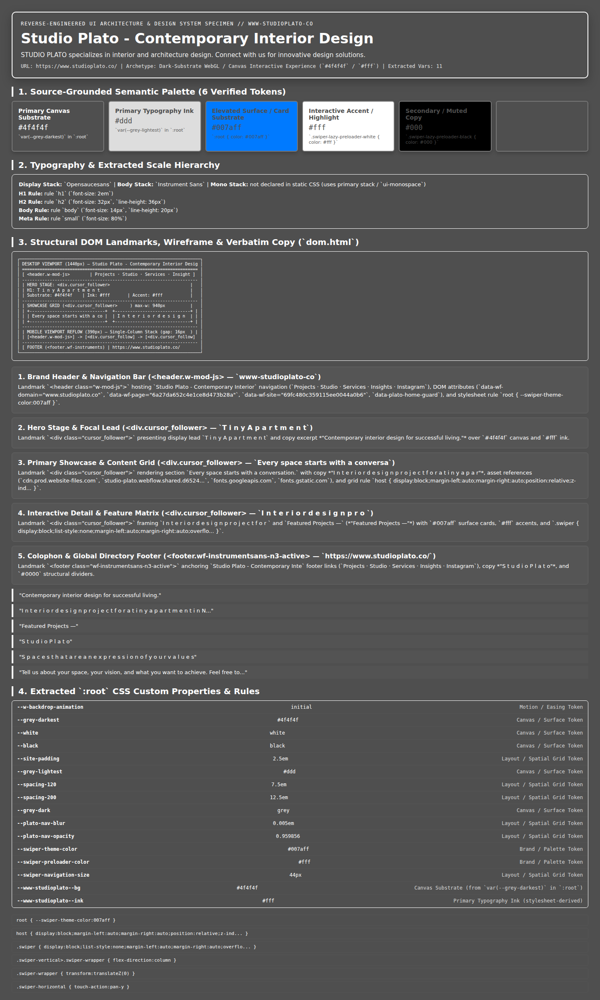
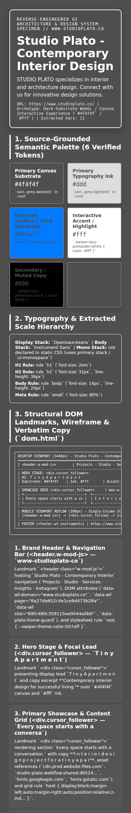

# UI Design System & Master Generation Blueprint: www-studioplato-co

> **Studio Plato - Contemporary Interior Design** (https://www.studioplato.co/) — STUDIO PLATO specializes in interior and architecture design. Connect with us for innovative design solutions.



---

## 1. Executive Visual Persona & Design Archetype

- **Brand Essence & Persona**: **Studio Plato - Contemporary Interior Design** (`https://www.studioplato.co/`). STUDIO PLATO specializes in interior and architecture design. Connect with us for innovative design solutions.
- **Visual Archetype**: **Dark-Substrate WebGL / Canvas Interactive Experience (`#4f4f4f` / `#fff`)**.
- **Anti-AI-Slop Differentiators**:
  - **Source-Grounded Chromatic Polarity**: Anchors the viewport in `#4f4f4f` (`var(--grey-darkest)` in `:root`) paired with `#fff` primary typography and `#fff` accents.
  - **Extracted Typographic Hierarchy**: Pairs `Opensaucesans` for display copy (`T i n y A p a r t m e n t`) with `Instrument Sans` and not declared in static CSS (uses primary stack / `ui-monospace`).
  - **Calibrated Spatial Grid & Motion**: Combines `940px` container bounds (`gap: 16px`, padding `9px`) with `cubic-bezier(.075,.82,.165,1)` easing and Lenis Smooth Scroll (`data-lenis`), GSAP Timeline & ScrollTrigger.

---

## 2. Spatial Architecture & Modular Grid Mathematics



### Viewport Allocation & Container Geometry
- **Captured Viewport Dimensions**: Desktop `1440×2400px` (`assets/desktop.png`, capped at 2400px multi-section capture), Mobile `390×2400px` (`assets/mobile.png`, capped at 2400px multi-section capture).
- **Master Container Bounds**: `940px` extracted from `www-studioplato-co` stylesheet.
- **Canvas Lateral Padding & Spacing**: `9px` lateral canvas padding with `16px` grid gap.
- **Border Radius Scale**: `50%`, `3px`, `100%`, `2px`.

### Responsive Breakpoint Architecture
- **Desktop Layout**: Multi-column CSS Grid / Flexbox layout at `1440px` (`max-width: 940px`, `gap: 16px`).
- **Mobile Layout**: Single-column vertical stack at `390px` viewport width with `9px` horizontal padding.
- **Extracted CSS Media Queries**: `@media screen and (max-width: 991px)`, `@media screen and (max-width: 767px)`, `@media screen and (max-width: 479px)`, `@media (min-width: 768px)`.

---

## 3. Color System, Materiality & Atmospheric Lighting

### Semantic Palette & Source Grounding
| Semantic Role | Ground-Truth Value | Extracted CSS Source / Selector |
|---|---|---|
| **Primary Canvas Substrate** | `#4f4f4f` | `var(--grey-darkest)` in `:root` |
| **Primary Typography Ink** | `#ddd` | `var(--grey-lightest)` in `:root` |
| **Elevated Surface / Card Substrate** | `#007aff` | `:root { color: #007aff }` |
| **Interactive Accent / Highlight** | `#fff` | `.swiper-lazy-preloader-white { color: #fff }` |
| **Secondary / Muted Copy** | `#000` | `.swiper-lazy-preloader-black { color: #000 }` |
| **Structural Hairline Border** | `#0000` | `a { background-color: #0000 }` |

### Sanitized Root CSS Variables (`ui-ux.md` Ground Truth)
| Variable Name | Extracted Value | Semantic Role |
|---|---|---|
| `--w-backdrop-animation` | `initial` | Motion / Easing Token |
| `--grey-darkest` | `#4f4f4f` | Canvas / Surface Token |
| `--white` | `white` | Canvas / Surface Token |
| `--black` | `black` | Canvas / Surface Token |
| `--site-padding` | `2.5em` | Layout / Spatial Grid Token |
| `--grey-lightest` | `#ddd` | Canvas / Surface Token |
| `--spacing-120` | `7.5em` | Layout / Spatial Grid Token |
| `--spacing-200` | `12.5em` | Layout / Spatial Grid Token |
| `--grey-dark` | `grey` | Canvas / Surface Token |
| `--plato-nav-blur` | `0.005em` | Layout / Spatial Grid Token |
| `--plato-nav-opacity` | `0.959856` | Layout / Spatial Grid Token |
| `--swiper-theme-color` | `#007aff` | Brand / Palette Token |
| `--swiper-preloader-color` | `#fff` | Brand / Palette Token |
| `--swiper-navigation-size` | `44px` | Layout / Spatial Grid Token |
| `--www-studioplato--bg` | `#4f4f4f` | Canvas Substrate (from `var(--grey-darkest)` in `:root`) |
| `--www-studioplato--ink` | `#fff` | Primary Typography Ink (stylesheet-derived) |

---

## 4. Typographic Scale & Editorial Hierarchy

### Font Family Stacks
- **Display Typography**: `Opensaucesans`.
- **Primary Body Stack**: `Instrument Sans`.
- **Technical / Metadata Stack**: not declared in static CSS (uses primary stack / `ui-monospace`).

### Typographic Scale & Rules (Extracted from Stylesheet & Variables)
- **Hero Display (`H1`)**: rule `h1` (`font-size: 2em`).
- **Section Heading (`H2`)**: rule `h2` (`font-size: 32px`, `line-height: 36px`).
- **Body Copy**: rule `body` (`font-size: 14px`, `line-height: 20px`).
- **Metadata & Navigation Labels**: rule `small` (`font-size: 80%`).

---

## 5. Choreographed Motion & Interaction Physics

### Primary Easing Curves
- **Extracted Timing Functions**: `cubic-bezier(.075,.82,.165,1)`, `cubic-bezier(.165,.84,.44,1)`, `cubic-bezier(0.645,0.045,0.355,1)`.

### Per-Element Transition & Choreography Rules
- **Selector `.swiper-wrapper`**: `transition: var(--swiper-wrapper-transition-timing-function,initial)` extracted from `www-studioplato-co` stylesheet.
- **Selector `.swiper-pagination`**: `transition: opacity .3s` extracted from `www-studioplato-co` stylesheet.
- **Selector `.swiper-pagination-bullets-dynamic`**: `transition: transform .2s,top .2s` extracted from `www-studioplato-co` stylesheet.
- **Extracted Easing Curve (`cubic-bezier(.075,.82,.165,1)`)**: Governs interactive state transitions across `<header.w-mod-js>` and `<div.cursor_follower>`.
- **Runtime Interaction Engine**: Integrates Lenis Smooth Scroll (`data-lenis`), GSAP Timeline & ScrollTrigger, Three.js / WebGL Canvas Pipeline, Swiper Touch Carousel Engine, Lottie Vector Animation Player with `prefers-reduced-motion: reduce` fallback guards.

---

## 6. Component Wireframe & Structural DOM Map

### Visual Layout Schematic (Grounded in `dom.html` — `1440px` Desktop & `390px` Mobile Reflow)
```
┌────────────────────────────────────────────────────────────────────────┐
│ DESKTOP VIEWPORT (1440px) — Studio Plato - Contemporary Interior Desig │
│ ====================================================================== │
│ [ <header.w-mod-js>        | Projects · Studio · Services · Insight ]  │
│ ---------------------------------------------------------------------- │
│ | HERO STAGE: <div.cursor_follower>                                |   │
│ | H1: T i n y A p a r t m e n t                                    |   │
│ | Substrate: #4f4f4f    | Ink: #fff       | Accent: #fff           |   │
│ ---------------------------------------------------------------------- │
│ | SHOWCASE GRID (<div.cursor_follower>     ) max-w: 940px          |   │
│ | +------------------------------+  +------------------------------+ | │
│ | | Every space starts with a co |  | I n t e r i o r d e s i g n  | | │
│ | +------------------------------+  +------------------------------+ | │
│ ---------------------------------------------------------------------- │
│ | MOBILE VIEWPORT REFLOW (390px) — Single-Column Stack (gap: 16px  ) | │
│ | [<header.w-mod-js>] -> [<div.cursor_follow] -> [<div.cursor_follow]  │
│ ---------------------------------------------------------------------- │
│ [ FOOTER (<footer.wf-instruments) | https://www.studioplato.co/        │
└────────────────────────────────────────────────────────────────────────┘
```

### Granular DOM Region Breakdown
1. **Brand Header & Navigation Bar (<header.w-mod-js> — `www-studioplato-co`)**:
   - Landmark `<header class="w-mod-js">` hosting `Studio Plato - Contemporary Interior` navigation (`Projects · Studio · Services · Insights · Instagram`), DOM attributes (`data-wf-domain="www.studioplato.co"`, `data-wf-page="6a27da652c4e1ce8d473b28a"`, `data-wf-site="69fc480c359115ee0044a0b6"`, `data-plato-home-guard`), and stylesheet rule `root { --swiper-theme-color:007aff }`.
2. **Hero Stage & Focal Lead (<div.cursor_follower> — `T i n y A p a r t m e n t`)**:
   - Landmark `<div class="cursor_follower">` presenting display lead `T i n y A p a r t m e n t` and copy excerpt *"Contemporary interior design for successful living."* over `#4f4f4f` canvas and `#fff` ink.
3. **Primary Showcase & Content Grid (<div.cursor_follower> — `Every space starts with a conversa`)**:
   - Landmark `<div class="cursor_follower">` rendering section `Every space starts with a conversation.` with copy *"I n t e r i o r d e s i g n p r o j e c t f o r a t i n y a p a r"*, asset references (`cdn.prod.website-files.com`, `studio-plato.webflow.shared.d6524...`, `fonts.googleapis.com`, `fonts.gstatic.com`), and grid rule `host { display:block;margin-left:auto;margin-right:auto;position:relative;z-ind... }`.
4. **Interactive Detail & Feature Matrix (<div.cursor_follower> — `I n t e r i o r d e s i g n p r o `)**:
   - Landmark `<div class="cursor_follower">` framing `I n t e r i o r d e s i g n p r o j e c t f o r ` and `Featured Projects —` (*"Featured Projects —"*) with `#007aff` surface cards, `#fff` accents, and `.swiper { display:block;list-style:none;margin-left:auto;margin-right:auto;overflo... }`.
5. **Colophon & Global Directory Footer (<footer.wf-instrumentsans-n3-active> — `https://www.studioplato.co/`)**:
   - Landmark `<footer class="wf-instrumentsans-n3-active">` anchoring `Studio Plato - Contemporary Inte` footer links (`Projects · Studio · Services · Insights · Instagram`), copy *"S t u d i o P l a t o"*, and `#0000` structural dividers.

---

## 7. Master Zero-Shot AI Generation Prompt

```markdown
# Master Zero-Shot Frontend Generation Prompt: www-studioplato-co (Studio Plato - Contemporary Interior Design)

You are a principal frontend architect and design systems engineer. Build a complete, production-ready web application replicating the exact design system, DOM landmarks, typographic hierarchy, color tokens, and motion physics of `www-studioplato-co` (**Studio Plato - Contemporary Interior Design** — `https://www.studioplato.co/`).

### 1. Visual Archetype & Anti-AI-Slop Mandates
- **Archetype**: Dark-Substrate WebGL / Canvas Interactive Experience (`#4f4f4f` / `#fff`).
- **Identity & Domain Context**: STUDIO PLATO specializes in interior and architecture design. Connect with us for innovative design solutions.
- **Primary Substrate**: `#4f4f4f` (`var(--grey-darkest)` in `:root`), **Primary Ink**: `#fff`, **Accent / Highlight**: `#fff`.
- **Site-Specific Differentiators**:
  - **Source-Grounded Chromatic Polarity**: Anchors the viewport in `#4f4f4f` (`var(--grey-darkest)` in `:root`) paired with `#fff` primary typography and `#fff` accents.
  - **Extracted Typographic Hierarchy**: Pairs `Opensaucesans` for display copy (`T i n y A p a r t m e n t`) with `Instrument Sans` and not declared in static CSS (uses primary stack / `ui-monospace`).
  - **Calibrated Spatial Grid & Motion**: Combines `940px` container bounds (`gap: 16px`, padding `9px`) with `cubic-bezier(.075,.82,.165,1)` easing and Lenis Smooth Scroll (`data-lenis`), GSAP Timeline & ScrollTrigger.

### 2. Ground-Truth CSS Variables (`:root` Token Contract)
Declare and consume these exact custom properties extracted from `www-studioplato-co` in your global stylesheet:

:root {
  /* Studio Plato - Contemporary Interior Design (www-studioplato-co) — Ground-Truth Extracted CSS Variables */
  --w-backdrop-animation: initial; /* Motion / Easing Token (www-studioplato-co) */
  --grey-darkest: #4f4f4f; /* Canvas / Surface Token (www-studioplato-co) */
  --white: white; /* Canvas / Surface Token (www-studioplato-co) */
  --black: black; /* Canvas / Surface Token (www-studioplato-co) */
  --site-padding: 2.5em; /* Layout / Spatial Grid Token (www-studioplato-co) */
  --grey-lightest: #ddd; /* Canvas / Surface Token (www-studioplato-co) */
  --spacing-120: 7.5em; /* Layout / Spatial Grid Token (www-studioplato-co) */
  --spacing-200: 12.5em; /* Layout / Spatial Grid Token (www-studioplato-co) */
  --grey-dark: grey; /* Canvas / Surface Token (www-studioplato-co) */
  --plato-nav-blur: 0.005em; /* Layout / Spatial Grid Token (www-studioplato-co) */
  --plato-nav-opacity: 0.959856; /* Layout / Spatial Grid Token (www-studioplato-co) */
  --swiper-theme-color: #007aff; /* Brand / Palette Token (www-studioplato-co) */
  --swiper-preloader-color: #fff; /* Brand / Palette Token (www-studioplato-co) */
  --swiper-navigation-size: 44px; /* Layout / Spatial Grid Token (www-studioplato-co) */
  --www-studioplato--bg: #4f4f4f; /* Canvas Substrate (from `var(--grey-darkest)` in `:root`) (www-studioplato-co) */
  --www-studioplato--ink: #fff; /* Primary Typography Ink (stylesheet-derived) (www-studioplato-co) */
}

### 3. Semantic Color & Materiality Contract
Map every surface, ink, and border strictly to these source-grounded tokens:
- **Primary Canvas Substrate**: `#4f4f4f` — grounded in `var(--grey-darkest)` in `:root`
- **Primary Typography Ink**: `#ddd` — grounded in `var(--grey-lightest)` in `:root`
- **Elevated Surface / Card Substrate**: `#007aff` — grounded in `:root { color: #007aff }`
- **Interactive Accent / Highlight**: `#fff` — grounded in `.swiper-lazy-preloader-white { color: #fff }`
- **Secondary / Muted Copy**: `#000` — grounded in `.swiper-lazy-preloader-black { color: #000 }`
- **Structural Hairline Border**: `#0000` — grounded in `a { background-color: #0000 }`

### 4. Spatial Grid, Container Bounds & Responsive Breakpoints
- **Desktop Viewport Reference**: `1440×2400px` (capped at 2400px multi-section capture, `1440px` standard desktop width).
- **Mobile Viewport Reference**: `390×2400px` (capped at 2400px multi-section capture, `390px` standard mobile width).
- **Container Max-Width**: `940px` extracted from `www-studioplato-co` stylesheet
- **Padding & Gutters**: `9px` lateral canvas padding with `16px` grid gap
- **Desktop Grid**: Multi-column CSS Grid / Flexbox layout at `1440px` (`max-width: 940px`, `gap: 16px`)
- **Mobile Adaptation**: Single-column vertical stack at `390px` viewport width with `9px` horizontal padding
- **Media Queries**: `@media screen and (max-width: 991px)`, `@media screen and (max-width: 767px)`, `@media screen and (max-width: 479px)`, `@media (min-width: 768px)`
- **Corner Radii**: `50%`, `3px`, `100%`, `2px`

### 5. Typography & Editorial Scale Contract
- **Display Font Stack**: `Opensaucesans`
- **Body Font Stack**: `Instrument Sans`
- **Monospace / Technical Font Stack**: not declared in static CSS (uses primary stack / `ui-monospace`)
- **H1 Display Rule**: rule `h1` (`font-size: 2em`)
- **H2 Section Rule**: rule `h2` (`font-size: 32px`, `line-height: 36px`)
- **Body Copy Rule**: rule `body` (`font-size: 14px`, `line-height: 20px`)
- **Metadata & Index Rule**: rule `small` (`font-size: 80%`)

### 6. Component Hierarchy, Verbatim Copy & Real DOM Landmarks
Scaffold `www-studioplato-co` (`Studio Plato - Contemporary Interior Design`) with these exact structural regions, extracted copy, and CSS rules from `dom.html`:
1. **Brand Header & Navigation Bar (<header.w-mod-js> — `www-studioplato-co`)**:
   - DOM & Selectors: Landmark `<header class="w-mod-js">` hosting `Studio Plato - Contemporary Interior` navigation (`Projects · Studio · Services · Insights · Instagram`), DOM attributes (`data-wf-domain="www.studioplato.co"`, `data-wf-page="6a27da652c4e1ce8d473b28a"`, `data-wf-site="69fc480c359115ee0044a0b6"`, `data-plato-home-guard`), and stylesheet rule `root { --swiper-theme-color:007aff }`.
   - Responsive Contract: Header `Brand Header & Navigation Bar (<header.w-mod-js> — `www-studioplato-co`)` (`www-studioplato-co`) adapts across `@media screen and (max-width: 991px)`, `@media screen and (max-width: 767px)`, `@media screen and (max-width: 479px)`, `@media (min-width: 768px)` with `cubic-bezier(.075,.82,.165,1)`, `cubic-bezier(.165,.84,.44,1)`, `cubic-bezier(0.645,0.045,0.355,1)` transitions and links `Projects · Studio · Services · Insights · Instagram`.
2. **Hero Stage & Focal Lead (<div.cursor_follower> — `T i n y A p a r t m e n t`)**:
   - DOM & Selectors: Landmark `<div class="cursor_follower">` presenting display lead `T i n y A p a r t m e n t` and copy excerpt *"Contemporary interior design for successful living."* over `#4f4f4f` canvas and `#fff` ink.
   - Responsive Contract: Hero stage (`1440×2400px` desktop / `390×2400px` mobile) sets `#4f4f4f` background with `#fff` headline `T i n y A p a r t m e n t`.
3. **Primary Showcase & Content Grid (<div.cursor_follower> — `Every space starts with a conversa`)**:
   - DOM & Selectors: Landmark `<div class="cursor_follower">` rendering section `Every space starts with a conversation.` with copy *"I n t e r i o r d e s i g n p r o j e c t f o r a t i n y a p a r"*, asset references (`cdn.prod.website-files.com`, `studio-plato.webflow.shared.d6524...`, `fonts.googleapis.com`, `fonts.gstatic.com`), and grid rule `host { display:block;margin-left:auto;margin-right:auto;position:relative;z-ind... }`.
   - Responsive Contract: Showcase grid `Primary Showcase & Content Grid (<div.cursor_follower> — `Every space starts with a conversa`)` applies Multi-column CSS Grid / Flexbox layout at `1440px` (`max-width: 940px`, `gap: 16px`) on desktop and Single-column vertical stack at `390px` viewport width with `9px` horizontal padding on mobile.
4. **Interactive Detail & Feature Matrix (<div.cursor_follower> — `I n t e r i o r d e s i g n p r o `)**:
   - DOM & Selectors: Landmark `<div class="cursor_follower">` framing `I n t e r i o r d e s i g n p r o j e c t f o r ` and `Featured Projects —` (*"Featured Projects —"*) with `#007aff` surface cards, `#fff` accents, and `.swiper { display:block;list-style:none;margin-left:auto;margin-right:auto;overflo... }`.
   - Responsive Contract: Detail module `Interactive Detail & Feature Matrix (<div.cursor_follower> — `I n t e r i o r d e s i g n p r o `)` uses `50%`, `3px`, `100%`, `2px` radii, `#fff` highlights, and assets (cdn.prod.website-files.com, studio-plato.webflow.shared.d6524..., fonts.googleapis.com).
5. **Colophon & Global Directory Footer (<footer.wf-instrumentsans-n3-active> — `https://www.studioplato.co/`)**:
   - DOM & Selectors: Landmark `<footer class="wf-instrumentsans-n3-active">` anchoring `Studio Plato - Contemporary Inte` footer links (`Projects · Studio · Services · Insights · Instagram`), copy *"S t u d i o P l a t o"*, and `#0000` structural dividers.
   - Responsive Contract: Footer `Colophon & Global Directory Footer (<footer.wf-instrumentsans-n3-active> — `https://www.studioplato.co/`)` aligns to `940px` extracted from `www-studioplato-co` stylesheet with `9px` lateral canvas padding with `16px` grid gap and attributes (data-wf-domain="www.studioplato.co", data-wf-page="6a27da652c4e1ce8d473b28a", data-wf-site="69fc480c359115ee0044a0b6").

#### Verbatim DOM Copy Excerpts (`dom.html`)
- Copy Excerpt 1: *"Contemporary interior design for successful living."*
- Copy Excerpt 2: *"I n t e r i o r d e s i g n p r o j e c t f o r a t i n y a p a r t m e n t i n N..."*
- Copy Excerpt 3: *"Featured Projects —"*
- Copy Excerpt 4: *"S t u d i o P l a t o"*

### 7. Motion, Extracted Stylesheet Rules & Interaction Choreography
- **Primary Easing Functions**: `cubic-bezier(.075,.82,.165,1)`, `cubic-bezier(.165,.84,.44,1)`, `cubic-bezier(0.645,0.045,0.355,1)`
- **Extracted Stylesheet Rules (`www-studioplato-co`)**:
- `root { --swiper-theme-color:007aff }`
- `host { display:block;margin-left:auto;margin-right:auto;position:relative;z-ind... }`
- `.swiper { display:block;list-style:none;margin-left:auto;margin-right:auto;overflo... }`
- `.swiper-vertical>.swiper-wrapper { flex-direction:column }`
- `.swiper-wrapper { transform:translateZ(0) }`
- **Per-Selector Transition Rules**:
- **Selector `.swiper-wrapper`**: `transition: var(--swiper-wrapper-transition-timing-function,initial)` extracted from `www-studioplato-co` stylesheet.
- **Selector `.swiper-pagination`**: `transition: opacity .3s` extracted from `www-studioplato-co` stylesheet.
- **Selector `.swiper-pagination-bullets-dynamic`**: `transition: transform .2s,top .2s` extracted from `www-studioplato-co` stylesheet.
- **Extracted Easing Curve (`cubic-bezier(.075,.82,.165,1)`)**: Governs interactive state transitions across `<header.w-mod-js>` and `<div.cursor_follower>`.
- **Runtime Interaction Engine**: Integrates Lenis Smooth Scroll (`data-lenis`), GSAP Timeline & ScrollTrigger, Three.js / WebGL Canvas Pipeline, Swiper Touch Carousel Engine, Lottie Vector Animation Player with `prefers-reduced-motion: reduce` fallback guards.

### 8. Technical Deliverables
- Implement in Next.js (App Router) with TypeScript and Tailwind CSS consuming the `:root` custom properties defined above for `www-studioplato-co`.
- Reproduce both the `1440px` desktop architecture and `390px` mobile breakpoint transitions, preserving semantic HTML5 landmarks (`<header>`, `<nav>`, `<main>`, `<section>`, `<footer>`) and `prefers-reduced-motion` accessibility guards.
```
