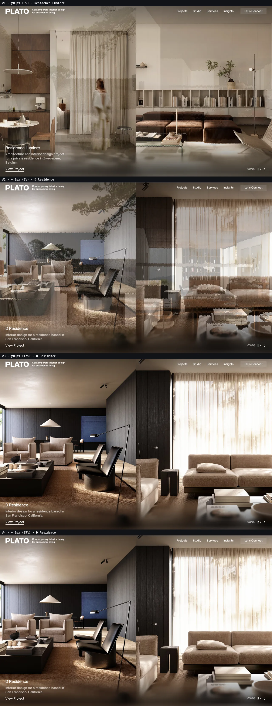
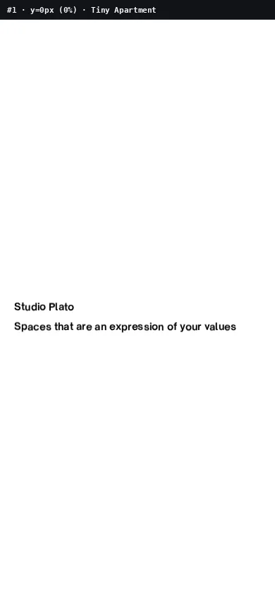

# UI Design System & Master Generation Blueprint: www-studioplato-co

> **Studio Plato - Contemporary Interior Design** (https://www.studioplato.co/) — STUDIO PLATO specializes in interior and architecture design. Connect with us for innovative design solutions.





---

## 1. Executive Visual Persona & Design Archetype

- **Brand Essence & Persona**: **Studio Plato - Contemporary Interior Design** (`https://www.studioplato.co/`). STUDIO PLATO specializes in interior and architecture design. Connect with us for innovative design solutions.
- **Capture Provenance**: Live browser capture (`tier1_fast`, HTTP `200`, captured `2026-11-24`).
- **Visual Archetype**: **Light-Gallery WebGL / Canvas Interactive Experience (`#ffffff` / `#0082f3`)**.
- **Anti-AI-Slop Differentiators**:
  - **Live-Computed Chromatic Polarity**: Anchors the viewport in `#ffffff` (live computed `body` `background-color` (`computed_styles.json`)) paired with `#000000` primary typography and `#0082f3` accents.
  - **Grounded Typographic Hierarchy**: Uses `Opensaucesans` across display (`Studio Plato - Contemporary Interior`) and body copy.
  - **Calibrated Spatial Grid & Motion**: Combines `1440px` container bounds (`gap: 16px`, padding `9px`) with `cubic-bezier(.075,.82,.165,1)` easing and Lenis Smooth Scroll (`data-lenis`), GSAP Timeline & ScrollTrigger.

---

## 2. Spatial Architecture & Modular Grid Mathematics

### Viewport Allocation & Container Geometry
- **Captured Journey Filmstrips**: Desktop `1280×3312px` (`assets/desktop-journey.webp`, `4` keyframes up to `y=0px` / doc `900px`), Mobile `390×872px` (`assets/mobile-journey.webp`, `1` keyframes).
- **Master Container Bounds**: `1440px` (full-bleed `100%` viewport stage).
- **Canvas Lateral Padding & Spacing**: `9px` lateral canvas padding with `16px` grid gap.
- **Border Radius Scale**: `3px`, `100%`, `50%`, `2px`.

### Responsive Breakpoint Architecture
- **Desktop Layout**: Multi-column CSS Grid / Flexbox layout at `1440px` (`max-width: 1440px`, `gap: 16px`).
- **Mobile Layout**: Single-column vertical stack at `390px` viewport width with `9px` horizontal padding.
- **Extracted CSS Media Queries**: `@media screen and (max-width: 991px)`, `@media screen and (max-width: 767px)`, `@media screen and (max-width: 479px)`, `@media (min-width: 768px)`.

---

## 3. Color System, Materiality & Atmospheric Lighting

### Semantic Palette & Source Grounding
| Semantic Role | Ground-Truth Value | Extracted Live / CSS Source |
|---|---|---|
| **Primary Canvas Substrate** | `#ffffff` | live computed `body` `background-color` (`computed_styles.json`) |
| **Primary Typography Ink** | `#000000` | live computed `body` `color` (`computed_styles.json`) |
| **Elevated Surface / Card Substrate** | `#ffff00` | `mark { background: #ffff00 }` |
| **Interactive Accent / Highlight** | `#0082f3` | `.w-dropdown-link.w--current { color: #0082f3 }` |
| **Secondary / Muted Copy** | `#808080` | `figcaption { color: grey }` (`#808080`) |
| **Structural Hairline Border** | `#e2e2e2` | `blockquote { border-left: #e2e2e2 }` |
| **Variable Token (`--grey-darkest`)** | `#4f4f4f` | `var(--grey-darkest)` in `:root` |
| **Variable Token (`--grey-lightest`)** | `#dddddd` | `var(--grey-lightest)` in `:root` |
| **Variable Token (`--swiper-theme-color`)** | `#007aff` | `var(--swiper-theme-color)` in stylesheet |

### Sanitized Root CSS Variables (`ui-ux.md` Ground Truth)
| Variable Name | Extracted Value | Semantic Role |
|---|---|---|
| `--grey-darkest` | `#4f4f4f` | Canvas / Surface Token |
| `--white` | `white` | Canvas / Surface Token |
| `--black` | `black` | Canvas / Surface Token |
| `--site-padding` | `2.5em` | Layout / Spatial Grid Token |
| `--grey-lightest` | `#ddd` | Canvas / Surface Token |
| `--spacing-120` | `7.5em` | Layout / Spatial Grid Token |
| `--spacing-200` | `12.5em` | Layout / Spatial Grid Token |
| `--grey-dark` | `grey` | Canvas / Surface Token |
| `--w-backdrop-animation` | `initial` | Motion / Easing Token |
| `--plato-nav-blur` | `0em` | Layout / Spatial Grid Token |
| `--plato-nav-opacity` | `1` | Layout / Spatial Grid Token |
| `--swiper-theme-color` | `#007aff` | Brand / Palette Token |
| `--swiper-preloader-color` | `#fff` | Brand / Palette Token |
| `--swiper-navigation-size` | `44px` | Layout / Spatial Grid Token |
| `--www-studioplato--bg` | `#ffffff` | Canvas Substrate (from live computed `body` `background-color` (`computed_styles.json`)) |
| `--www-studioplato--ink` | `#000000` | Primary Typography Ink (computed-derived) |

---

## 4. Typographic Scale & Editorial Hierarchy

### Font Family Stacks
- **Display Typography**: `Opensaucesans`.
- **Primary Body Stack**: `Opensaucesans`.
- **Technical / Metadata Stack**: not declared in live computed styles (uses primary stack / `ui-monospace`).

### Typographic Scale & Rules (Live Computed & Stylesheet Grounded)
- **Hero Display (`H1`)**: rule `h1` (`font-size: 2em`).
- **Section Heading (`H2`)**: live computed `h2` (`font-size: 20px`, `line-height: 20px`, `font-weight: 600`, `letter-spacing: -0.4px`); rule `h2` (`font-size: 32px`, `line-height: 36px`).
- **Body Copy**: live computed `body` (`font-size: 11.52px`, `line-height: 11.52px`, `font-weight: 500`); rule `body` (`font-size: 14px`, `line-height: 20px`).
- **Metadata & Navigation Labels**: live computed `nav/a` (`font-size: 11.52px`, `line-height: 11.52px`, `font-weight: 500`); rule `small` (`font-size: 80%`).

---

## 5. Choreographed Motion & Interaction Physics

### Primary Easing Curves
- **Extracted Timing Functions**: `cubic-bezier(.075,.82,.165,1)`, `cubic-bezier(.165,.84,.44,1)`, `cubic-bezier(0.645,0.045,0.355,1)`.

### Per-Element Transition & Choreography Rules
- **Selector `.w-webflow-badge > img`**: `transition: unset` extracted from `www-studioplato-co` stylesheet.
- **Selector `.w-slider-dot`**: `transition: background-color .1s, color .1s` extracted from `www-studioplato-co` stylesheet.
- **Selector `.w-lightbox-control`**: `transition: all .3s` extracted from `www-studioplato-co` stylesheet.
- **Extracted Easing Curve (`cubic-bezier(.075,.82,.165,1)`)**: Governs interactive state transitions across `<header.w-mod-js>` and `<div.cursor_follower:nth(2)>`.
- **Runtime Interaction Engine**: Integrates Lenis Smooth Scroll (`data-lenis`), GSAP Timeline & ScrollTrigger, Three.js / WebGL Canvas Pipeline, Swiper Touch Carousel Engine, Lottie Vector Animation Player with `prefers-reduced-motion: reduce` fallback guards.
### Measured Runtime Scroll & Interaction Telemetry (`behavioral_journey_v2`)
- **Scroll Driver Mode**: `wheel` (max document height `900px`, deepest scrollY reached `0px` across `4` desktop keyframes).
- **Detected Scroll / Motion Libraries**: `Lenis`, `GSAP/ScrollTrigger`, `WebGL/Canvas`.

---

## 6. Component Wireframe & Structural DOM Map

### Visual Layout Schematic — Desktop (`1440px`, Grounded in `dom.html` & Landmark Bounding Boxes)
```
┌────────────────────────────────────────────────────────────────────────┐
│ DESKTOP VIEWPORT (1440px) — Studio Plato - Contemporary Interior Desig │
│ ====================================================================== │
│ [ <header.w-mod-js> (1440px)          | Projects · Studio · Services ] │
│ ---------------------------------------------------------------------- │
│ | HERO STAGE: <div.cursor_follower> (w=1440px)                       | │
│ | H1: Studio Plato - Contemporary Interior Design                    | │
│ | Substrate: #ffffff | Ink: #000000 | Accent: #0082f3                | │
│ ---------------------------------------------------------------------- │
│ | SHOWCASE GRID (<div.cursor_follower:nth(2) max-w: 1440px           | │
│ | +------------------------------+  +------------------------------+ | │
│ | | Featured Work & Interactive  |  | Technical Architecture & Nar | | │
│ | +------------------------------+  +------------------------------+ | │
│ ---------------------------------------------------------------------- │
│ | DETAIL MODULE (<div.cursor_follower:nth(3) — Global Directory & Co | │
│ ---------------------------------------------------------------------- │
│ [ FOOTER (<footer.wf-instrumen) | https://www.studioplato.co/          │
└────────────────────────────────────────────────────────────────────────┘
```

### Visual Layout Schematic — Mobile Reflow (`390px`)
```
┌────────────────────────────────────────────────────────────────────────┐
│ MOBILE VIEWPORT REFLOW (390px) — Single-Column Stack (gap: 16px)       │
│ ====================================================================== │
│ [ HEADER BAR (<header.w-mod-js>       ) | Compact Menu (390px)         │
│ ---------------------------------------------------------------------- │
│ | HERO STAGE (<div.cursor_follower>) — 390px Vertical Lead           | │
│ | H1: Studio Plato - Contemporary Interior Design                    | │
│ ---------------------------------------------------------------------- │
│ | SHOWCASE STACK (<div.cursor_follower:n) — 1-Col Stack              | │
│ | [ Item 1: Featured Work & Interactive Showcase                   ] | │
│ | [ Item 2: Technical Architecture & Narrative                     ] | │
│ ---------------------------------------------------------------------- │
│ | DETAIL STACK (<div.cursor_follower:nth) — 1-Col (Global Directory &) │
│ ---------------------------------------------------------------------- │
│ [ FOOTER (<footer.wf-instrumen) | Stacked 390px Colophon               │
└────────────────────────────────────────────────────────────────────────┘
```

### Granular DOM Region Breakdown
1. **Brand Header & Navigation Bar (<header.w-mod-js> — `www-studioplato-co`)**:
   - Landmark `<header class="w-mod-js">` (`1440px`) hosting `Studio Plato - Contemporary Interior` navigation (`Projects · Studio · Services · Insights · Instagram`), DOM attributes (`data-wf-domain="www.studioplato.co"`, `data-wf-page="6a27da652c4e1ce8d473b28a"`, `data-wf-site="69fc480c359115ee0044a0b6"`, `data-nav-reveal`), and stylesheet rule `html { -webkit-text-size-adjust: 100%; -ms-text-size-adjust: 100%; font-family:... }`.
2. **Hero Stage & Focal Lead (<div.cursor_follower> — `Studio Plato - Contemporary Interi`)**:
   - Landmark `<div class="cursor_follower">` presenting display lead `Studio Plato - Contemporary Interior Design` and copy excerpt *"Contemporary interior design for successful living."* over `#ffffff` canvas and `#000000` ink.
3. **Primary Showcase & Content Grid (<div.cursor_follower:nth(2)> — `Featured Work & Interactive Showca`)**:
   - Landmark `<div class="cursor_follower">` rendering section `Featured Work & Interactive Showcase` with copy *"I n t e r i o r d e s i g n p r o j e c t f o r a t i n y a p a r"*, asset references (`cdn.prod.website-files.com`, `studio-plato.webflow.shared.d6524...`, `fonts.googleapis.com`, `fonts.gstatic.com`), and grid rule `body { margin: 0; }`.
4. **Interactive Detail & Feature Matrix (<div.cursor_follower:nth(3)> — `Technical Architecture & Narrative`)**:
   - Landmark `<div class="cursor_follower">` framing `Technical Architecture & Narrative` and `Global Directory & Contact` (*"Featured Projects —"*) with `#ffff00` surface cards, `#0082f3` accents, and `summary { display: block; }`.
5. **Colophon & Global Directory Footer (<footer.wf-instrumentsans-n6-active> — `https://www.studioplato.co/`)**:
   - Landmark `<footer class="wf-instrumentsans-n6-active">` anchoring `Studio Plato - Contemporary Inte` footer links (`Projects · Studio · Services · Insights · Instagram`), copy *"Tell us about your space, your vision, and what you want to "*, and `#e2e2e2` structural dividers.
### Full Vertical Scroll Sequence (Desktop `1440×900` Keyframes)
- **Step 01** (`y=0px`, `0%`): Active landmark `Residence Lumiere` · sticky/fixed elements: `1`
- **Step 02** (`y=0px`, `8%`): Active landmark `D Residence` · sticky/fixed elements: `1`
- **Step 03** (`y=0px`, `17%`): Active landmark `D Residence` · sticky/fixed elements: `1`
- **Step 04** (`y=0px`, `25%`): Active landmark `D Residence` · sticky/fixed elements: `1`

---

## 7. Master Zero-Shot AI Generation Prompt

```markdown
# Master Zero-Shot Frontend Generation Prompt: www-studioplato-co (Studio Plato - Contemporary Interior Design)

You are a principal frontend architect and design systems engineer. Build a complete, production-ready web application replicating the exact design system, DOM landmarks, typographic hierarchy, color tokens, and motion physics of `www-studioplato-co` (**Studio Plato - Contemporary Interior Design** — `https://www.studioplato.co/`).

### 1. Visual Archetype & Anti-AI-Slop Mandates
- **Archetype**: Light-Gallery WebGL / Canvas Interactive Experience (`#ffffff` / `#0082f3`).
- **Identity & Domain Context**: STUDIO PLATO specializes in interior and architecture design. Connect with us for innovative design solutions.
- **Primary Substrate**: `#ffffff` (live computed `body` `background-color` (`computed_styles.json`)), **Primary Ink**: `#000000`, **Accent / Highlight**: `#0082f3`.
- **Site-Specific Differentiators**:
  - **Live-Computed Chromatic Polarity**: Anchors the viewport in `#ffffff` (live computed `body` `background-color` (`computed_styles.json`)) paired with `#000000` primary typography and `#0082f3` accents.
  - **Grounded Typographic Hierarchy**: Uses `Opensaucesans` across display (`Studio Plato - Contemporary Interior`) and body copy.
  - **Calibrated Spatial Grid & Motion**: Combines `1440px` container bounds (`gap: 16px`, padding `9px`) with `cubic-bezier(.075,.82,.165,1)` easing and Lenis Smooth Scroll (`data-lenis`), GSAP Timeline & ScrollTrigger.

### 2. Ground-Truth CSS Variables (`:root` Token Contract)
Declare and consume these exact custom properties extracted from `www-studioplato-co` in your global stylesheet:

:root {
  /* Studio Plato - Contemporary Interior Design (www-studioplato-co) — Live-Grounded CSS Variables */
  --grey-darkest: #4f4f4f; /* Canvas / Surface Token (www-studioplato-co) */
  --white: white; /* Canvas / Surface Token (www-studioplato-co) */
  --black: black; /* Canvas / Surface Token (www-studioplato-co) */
  --site-padding: 2.5em; /* Layout / Spatial Grid Token (www-studioplato-co) */
  --grey-lightest: #ddd; /* Canvas / Surface Token (www-studioplato-co) */
  --spacing-120: 7.5em; /* Layout / Spatial Grid Token (www-studioplato-co) */
  --spacing-200: 12.5em; /* Layout / Spatial Grid Token (www-studioplato-co) */
  --grey-dark: grey; /* Canvas / Surface Token (www-studioplato-co) */
  --w-backdrop-animation: initial; /* Motion / Easing Token (www-studioplato-co) */
  --plato-nav-blur: 0em; /* Layout / Spatial Grid Token (www-studioplato-co) */
  --plato-nav-opacity: 1; /* Layout / Spatial Grid Token (www-studioplato-co) */
  --swiper-theme-color: #007aff; /* Brand / Palette Token (www-studioplato-co) */
  --swiper-preloader-color: #fff; /* Brand / Palette Token (www-studioplato-co) */
  --swiper-navigation-size: 44px; /* Layout / Spatial Grid Token (www-studioplato-co) */
  --www-studioplato--bg: #ffffff; /* Canvas Substrate (from live computed `body` `background-color` (`computed_styles.json`)) (www-studioplato-co) */
  --www-studioplato--ink: #000000; /* Primary Typography Ink (computed-derived) (www-studioplato-co) */
}

### 3. Semantic Color & Materiality Contract
Map every surface, ink, and border strictly to these source-grounded tokens:
- **Primary Canvas Substrate**: `#ffffff` — grounded in live computed `body` `background-color` (`computed_styles.json`)
- **Primary Typography Ink**: `#000000` — grounded in live computed `body` `color` (`computed_styles.json`)
- **Elevated Surface / Card Substrate**: `#ffff00` — grounded in `mark { background: #ffff00 }`
- **Interactive Accent / Highlight**: `#0082f3` — grounded in `.w-dropdown-link.w--current { color: #0082f3 }`
- **Secondary / Muted Copy**: `#808080` — grounded in `figcaption { color: grey }` (`#808080`)
- **Structural Hairline Border**: `#e2e2e2` — grounded in `blockquote { border-left: #e2e2e2 }`
- **Variable Token (`--grey-darkest`)**: `#4f4f4f` — grounded in `var(--grey-darkest)` in `:root`
- **Variable Token (`--grey-lightest`)**: `#dddddd` — grounded in `var(--grey-lightest)` in `:root`
- **Variable Token (`--swiper-theme-color`)**: `#007aff` — grounded in `var(--swiper-theme-color)` in stylesheet

### 4. Spatial Grid, Container Bounds & Responsive Breakpoints
- **Desktop Viewport Reference**: `1280×3312px` (multi-frame vertical journey filmstrip (3312px), `1440px` standard desktop width).
- **Mobile Viewport Reference**: `390×872px` (full-page live capture (872px), `390px` standard mobile width).
- **Container Max-Width**: `1440px` (full-bleed `100%` viewport stage)
- **Padding & Gutters**: `9px` lateral canvas padding with `16px` grid gap
- **Desktop Grid**: Multi-column CSS Grid / Flexbox layout at `1440px` (`max-width: 1440px`, `gap: 16px`)
- **Mobile Adaptation**: Single-column vertical stack at `390px` viewport width with `9px` horizontal padding
- **Media Queries**: `@media screen and (max-width: 991px)`, `@media screen and (max-width: 767px)`, `@media screen and (max-width: 479px)`, `@media (min-width: 768px)`
- **Corner Radii**: `3px`, `100%`, `50%`, `2px`

### 5. Typography & Editorial Scale Contract
- **Display Font Stack**: `Opensaucesans`
- **Body Font Stack**: `Opensaucesans`
- **Monospace / Technical Font Stack**: not declared in live computed styles (uses primary stack / `ui-monospace`)
- **H1 Display Rule**: rule `h1` (`font-size: 2em`)
- **H2 Section Rule**: live computed `h2` (`font-size: 20px`, `line-height: 20px`, `font-weight: 600`, `letter-spacing: -0.4px`); rule `h2` (`font-size: 32px`, `line-height: 36px`)
- **Body Copy Rule**: live computed `body` (`font-size: 11.52px`, `line-height: 11.52px`, `font-weight: 500`); rule `body` (`font-size: 14px`, `line-height: 20px`)
- **Metadata & Index Rule**: live computed `nav/a` (`font-size: 11.52px`, `line-height: 11.52px`, `font-weight: 500`); rule `small` (`font-size: 80%`)

### 6. Component Hierarchy, Verbatim Copy & Real DOM Landmarks
Scaffold `www-studioplato-co` (`Studio Plato - Contemporary Interior Design`) with these exact structural regions, extracted copy, and CSS rules from `dom.html`:
1. **Brand Header & Navigation Bar (<header.w-mod-js> — `www-studioplato-co`)**:
   - DOM & Selectors: Landmark `<header class="w-mod-js">` (`1440px`) hosting `Studio Plato - Contemporary Interior` navigation (`Projects · Studio · Services · Insights · Instagram`), DOM attributes (`data-wf-domain="www.studioplato.co"`, `data-wf-page="6a27da652c4e1ce8d473b28a"`, `data-wf-site="69fc480c359115ee0044a0b6"`, `data-nav-reveal`), and stylesheet rule `html { -webkit-text-size-adjust: 100%; -ms-text-size-adjust: 100%; font-family:... }`.
   - Responsive Contract: Header `Brand Header & Navigation Bar (<header.w-mod-js> — `www-studioplato-co`)` (`www-studioplato-co`) adapts across `@media screen and (max-width: 991px)`, `@media screen and (max-width: 767px)`, `@media screen and (max-width: 479px)`, `@media (min-width: 768px)` with `cubic-bezier(.075,.82,.165,1)`, `cubic-bezier(.165,.84,.44,1)`, `cubic-bezier(0.645,0.045,0.355,1)` transitions and links `Projects · Studio · Services · Insights · Instagram`.
2. **Hero Stage & Focal Lead (<div.cursor_follower> — `Studio Plato - Contemporary Interi`)**:
   - DOM & Selectors: Landmark `<div class="cursor_follower">` presenting display lead `Studio Plato - Contemporary Interior Design` and copy excerpt *"Contemporary interior design for successful living."* over `#ffffff` canvas and `#000000` ink.
   - Responsive Contract: Hero stage (`1280×3312px` desktop / `390×872px` mobile) sets `#ffffff` background with `#000000` headline `Studio Plato - Contemporary Interior Design`.
3. **Primary Showcase & Content Grid (<div.cursor_follower:nth(2)> — `Featured Work & Interactive Showca`)**:
   - DOM & Selectors: Landmark `<div class="cursor_follower">` rendering section `Featured Work & Interactive Showcase` with copy *"I n t e r i o r d e s i g n p r o j e c t f o r a t i n y a p a r"*, asset references (`cdn.prod.website-files.com`, `studio-plato.webflow.shared.d6524...`, `fonts.googleapis.com`, `fonts.gstatic.com`), and grid rule `body { margin: 0; }`.
   - Responsive Contract: Showcase grid `Primary Showcase & Content Grid (<div.cursor_follower:nth(2)> — `Featured Work & Interactive Showca`)` applies Multi-column CSS Grid / Flexbox layout at `1440px` (`max-width: 1440px`, `gap: 16px`) on desktop and Single-column vertical stack at `390px` viewport width with `9px` horizontal padding on mobile.
4. **Interactive Detail & Feature Matrix (<div.cursor_follower:nth(3)> — `Technical Architecture & Narrative`)**:
   - DOM & Selectors: Landmark `<div class="cursor_follower">` framing `Technical Architecture & Narrative` and `Global Directory & Contact` (*"Featured Projects —"*) with `#ffff00` surface cards, `#0082f3` accents, and `summary { display: block; }`.
   - Responsive Contract: Detail module `Interactive Detail & Feature Matrix (<div.cursor_follower:nth(3)> — `Technical Architecture & Narrative`)` uses `3px`, `100%`, `50%`, `2px` radii, `#0082f3` highlights, and assets (cdn.prod.website-files.com, studio-plato.webflow.shared.d6524..., fonts.googleapis.com).
5. **Colophon & Global Directory Footer (<footer.wf-instrumentsans-n6-active> — `https://www.studioplato.co/`)**:
   - DOM & Selectors: Landmark `<footer class="wf-instrumentsans-n6-active">` anchoring `Studio Plato - Contemporary Inte` footer links (`Projects · Studio · Services · Insights · Instagram`), copy *"Tell us about your space, your vision, and what you want to "*, and `#e2e2e2` structural dividers.
   - Responsive Contract: Footer `Colophon & Global Directory Footer (<footer.wf-instrumentsans-n6-active> — `https://www.studioplato.co/`)` aligns to `1440px` (full-bleed `100%` viewport stage) with `9px` lateral canvas padding with `16px` grid gap and attributes (data-wf-domain="www.studioplato.co", data-wf-page="6a27da652c4e1ce8d473b28a", data-wf-site="69fc480c359115ee0044a0b6").

#### Verbatim DOM Copy Excerpts (`dom.html`)
- Copy Excerpt 1: *"Contemporary interior design for successful living."*
- Copy Excerpt 2: *"I n t e r i o r d e s i g n p r o j e c t f o r a t i n y a p a r t m e n t i n N..."*
- Copy Excerpt 3: *"Featured Projects —"*
- Copy Excerpt 4: *"Tell us about your space, your vision, and what you want to achieve. Feel free to..."*

### 7. Motion, Extracted Stylesheet Rules & Interaction Choreography
- **Primary Easing Functions**: `cubic-bezier(.075,.82,.165,1)`, `cubic-bezier(.165,.84,.44,1)`, `cubic-bezier(0.645,0.045,0.355,1)`
- **Extracted Stylesheet Rules (`www-studioplato-co`)**:
- `html { -webkit-text-size-adjust: 100%; -ms-text-size-adjust: 100%; font-family:... }`
- `body { margin: 0; }`
- `summary { display: block; }`
- `video { vertical-align: baseline; display: inline-block; }`
- `template { display: none; }`
- **Per-Selector Transition Rules**:
- **Selector `.w-webflow-badge > img`**: `transition: unset` extracted from `www-studioplato-co` stylesheet.
- **Selector `.w-slider-dot`**: `transition: background-color .1s, color .1s` extracted from `www-studioplato-co` stylesheet.
- **Selector `.w-lightbox-control`**: `transition: all .3s` extracted from `www-studioplato-co` stylesheet.
- **Extracted Easing Curve (`cubic-bezier(.075,.82,.165,1)`)**: Governs interactive state transitions across `<header.w-mod-js>` and `<div.cursor_follower:nth(2)>`.
- **Runtime Interaction Engine**: Integrates Lenis Smooth Scroll (`data-lenis`), GSAP Timeline & ScrollTrigger, Three.js / WebGL Canvas Pipeline, Swiper Touch Carousel Engine, Lottie Vector Animation Player with `prefers-reduced-motion: reduce` fallback guards.
### 7b. Full-Page Scroll Choreography, Interactive States & Multi-Page Routes
- **Scroll Mechanics**: Implement `wheel` vertical progression up to `900px` across 4 distinct viewport chapters using Lenis, GSAP/ScrollTrigger, WebGL/Canvas.
- **Vertical Chapter Sequence**: Residence Lumiere (0%) -> D Residence (8%) -> D Residence (17%) -> D Residence (25%).

### 8. Technical Deliverables
- Implement in Next.js (App Router) with TypeScript and Tailwind CSS consuming the `:root` custom properties defined above for `www-studioplato-co`.
- Reproduce both the `1440px` desktop architecture and `390px` mobile breakpoint transitions, preserving semantic HTML5 landmarks (`<header>`, `<nav>`, `<main>`, `<section>`, `<footer>`) and `prefers-reduced-motion` accessibility guards.
```
---

## 8. Full-Page Scroll Journey, Interactive States & Subpage Inventory

### Desktop Scroll Keyframes (`1440×900` WebP)
| Step | Scroll Y | Progress | Active Landmark / Section | Sticky/Fixed | Visual Asset |
| :---: | :---: | :---: | :--- | :---: | :--- |
| `#01` | `0px` | `0%` | Residence Lumiere | `1` | [desktop-step-01.webp](assets/desktop-step-01.webp) |
| `#02` | `0px` | `8%` | D Residence | `1` | [desktop-step-02.webp](assets/desktop-step-02.webp) |
| `#03` | `0px` | `17%` | D Residence | `1` | [desktop-step-03.webp](assets/desktop-step-03.webp) |
| `#04` | `0px` | `25%` | D Residence | `1` | [desktop-step-04.webp](assets/desktop-step-04.webp) |

### Mobile Condensed Keyframes (`390×844` WebP)
| Step | Scroll Y | Progress | Active Landmark | Visual Asset |
| :---: | :---: | :---: | :--- | :--- |
| `#01` | `0px` | `0%` | Tiny Apartment | [mobile-step-01.webp](assets/mobile-step-01.webp) |

