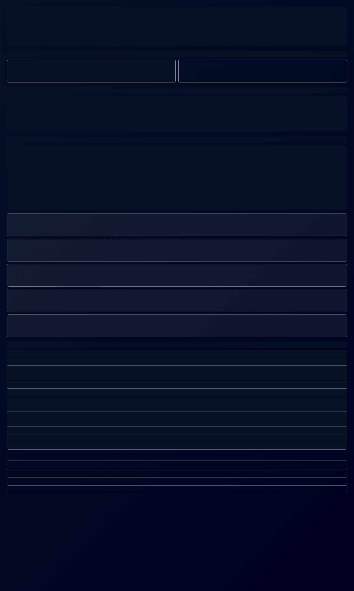
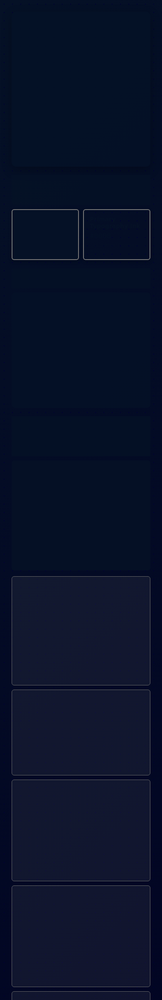

# UI Design System & Master Generation Blueprint: www-sztanki-com

> **Portfolio of Attila Sztankovics** (https://www.sztanki.com/) — I’m an interactive designer and creative technologist based in Austin, with over 15 years of experience working with agencies, global bra...



---

## 1. Executive Visual Persona & Design Archetype

- **Brand Essence & Persona**: **Portfolio of Attila Sztankovics** (`https://www.sztanki.com/`). I’m an interactive designer and creative technologist based in Austin, with over 15 years of experience working with agencies, global bra...
- **Visual Archetype**: **Dark-Substrate WebGL / Canvas Interactive Experience (`#051126` / `#0000`)**.
- **Anti-AI-Slop Differentiators**:
  - **Source-Grounded Chromatic Polarity**: Anchors the viewport in `#051126` (`html { background-color: #051126 }`) paired with `#0000` primary typography and `#0000` accents.
  - **Extracted Typographic Hierarchy**: Pairs `system-ui, -apple-system, sans-serif` (no custom `@font-face` extracted) for display copy (`Portfolio of Attila Sztankovics`) with `system-ui, -apple-system, sans-serif` (no custom `@font-face` extracted) and not declared in static CSS (uses primary stack / `ui-monospace`).
  - **Calibrated Spatial Grid & Motion**: Combines `none (full-bleed `100%` viewport stage)` container bounds (`gap: 0px (flush layout)`, padding `1rem`) with `cubic-bezier(0.25,0.1,0.25,1)` easing and Three.js / WebGL Canvas Pipeline.

---

## 2. Spatial Architecture & Modular Grid Mathematics



### Viewport Allocation & Container Geometry
- **Captured Viewport Dimensions**: Desktop `1440×2400px` (`assets/desktop.png`, capped at 2400px multi-section capture), Mobile `390×2400px` (`assets/mobile.png`, capped at 2400px multi-section capture).
- **Master Container Bounds**: `none (full-bleed `100%` viewport stage)` extracted from `www-sztanki-com` stylesheet.
- **Canvas Lateral Padding & Spacing**: `1rem` lateral canvas padding with `0px (flush layout)` grid gap.
- **Border Radius Scale**: `4rem`.

### Responsive Breakpoint Architecture
- **Desktop Layout**: Multi-column CSS Grid / Flexbox layout at `1440px` (`max-width: none (full-bleed `100%` viewport stage)`, `gap: 0px (flush layout)`).
- **Mobile Layout**: Single-column vertical stack at `390px` viewport width with `1rem` horizontal padding.
- **Extracted CSS Media Queries**: no `@media` queries in static stylesheet (fluid viewport scaling).

---

## 3. Color System, Materiality & Atmospheric Lighting

### Semantic Palette & Source Grounding
| Semantic Role | Ground-Truth Value | Extracted CSS Source / Selector |
|---|---|---|
| **Primary Canvas Substrate** | `#051126` | `html { background-color: #051126 }` |
| **Primary Typography Ink** | `#0000` | `.ui .button { border: #0000 }` |

### Sanitized Root CSS Variables (`ui-ux.md` Ground Truth)
| Variable Name | Extracted Value | Semantic Role |
|---|---|---|
| `--inner-height` | `900px` | Layout / Spatial Grid Token |
| `--www-sztanki-com-bg` | `#051126` | Canvas Substrate (from `html { background-color: #051126 }`) |
| `--www-sztanki-com-ink` | `#0000` | Primary Typography Ink (stylesheet-derived) |
| `--www-sztanki-com-surface` | `#051126` | Surface Substrate (stylesheet-derived) |
| `--www-sztanki-com-accent` | `#0000` | Interactive Accent (stylesheet-derived) |
| `--www-sztanki-com-muted` | `#0000` | Secondary Ink (stylesheet-derived) |
| `--www-sztanki-com-border` | `#0000` | Structural Border (stylesheet-derived) |
| `--www-sztanki-com-container` | `none` | Container Bound (stylesheet-derived) |
| `--www-sztanki-com-gap` | `0px` | Grid Gutter (stylesheet-derived) |
| `--www-sztanki-com-pad` | `1rem` | Lateral Padding (stylesheet-derived) |
| `--www-sztanki-com-ease` | `cubic-bezier(0.25,0.1,0.25,1)` | Primary Easing Function |
| `--www-sztanki-com-radius` | `4rem` | Corner Radius (stylesheet-derived) |
| `--www-sztanki-com-fs-base` | `10px` | Observed Font Size Token |

---

## 4. Typographic Scale & Editorial Hierarchy

### Font Family Stacks
- **Display Typography**: `system-ui, -apple-system, sans-serif` (no custom `@font-face` extracted).
- **Primary Body Stack**: `system-ui, -apple-system, sans-serif` (no custom `@font-face` extracted).
- **Technical / Metadata Stack**: not declared in static CSS (uses primary stack / `ui-monospace`).

### Typographic Scale & Rules (Extracted from Stylesheet & Variables)
- **Hero Display (`H1`)**: not explicitly declared on tag in static CSS (stylesheet font-size ladder: `10px`).
- **Section Heading (`H2`)**: not explicitly declared on tag in static CSS (stylesheet font-size ladder: `10px`).
- **Body Copy**: not explicitly declared on tag in static CSS (stylesheet font-size ladder: `10px`).
- **Metadata & Navigation Labels**: not explicitly declared on tag in static CSS (stylesheet font-size ladder: `10px`).

---

## 5. Choreographed Motion & Interaction Physics

### Primary Easing Curves
- **Extracted Timing Functions**: `cubic-bezier(0.25,0.1,0.25,1)`.

### Per-Element Transition & Choreography Rules
- **Standard CSS Easing (`cubic-bezier(0.25,0.1,0.25,1)`)**: Default timing curve (no custom `cubic-bezier()` declared in static CSS).
- **Runtime Interaction Engine**: Integrates Three.js / WebGL Canvas Pipeline with `prefers-reduced-motion: reduce` fallback guards.

---

## 6. Component Wireframe & Structural DOM Map

### Visual Layout Schematic (Grounded in `dom.html` — `1440px` Desktop & `390px` Mobile Reflow)
```
┌────────────────────────────────────────────────────────────────────────┐
│ DESKTOP VIEWPORT (1440px) — Portfolio of Attila Sztankovics            │
│ ====================================================================== │
│ [ <header.webgl>           | Overview · Index · Archive · About · C ]  │
│ ---------------------------------------------------------------------- │
│ | HERO STAGE: <div.webgl>                                          |   │
│ | H1: Portfolio of Attila Sztankovics                              |   │
│ | Substrate: #051126    | Ink: #0000      | Accent: #0000          |   │
│ ---------------------------------------------------------------------- │
│ | SHOWCASE GRID (<div.webgl>               ) max-w: none (full-ble |   │
│ | +------------------------------+  +------------------------------+ | │
│ | | Featured Work & Interactive  |  | Technical Architecture & Nar | | │
│ | +------------------------------+  +------------------------------+ | │
│ ---------------------------------------------------------------------- │
│ | MOBILE VIEWPORT REFLOW (390px) — Single-Column Stack (gap: 0px (f) | │
│ | [<header.webgl>] -> [<div.webgl>] -> [<div.webgl>] |                 │
│ ---------------------------------------------------------------------- │
│ [ FOOTER (<footer>              ) | https://www.sztanki.com/           │
└────────────────────────────────────────────────────────────────────────┘
```

### Granular DOM Region Breakdown
1. **Brand Header & Navigation Bar (<header.webgl> — `www-sztanki-com`)**:
   - Landmark `<header class="webgl">` hosting `Portfolio of Attila Sztankovics` navigation (`Overview · Index · Archive · About · Contact`), DOM attributes (`data-engine="three.js r186 webgpu"`), and stylesheet rule `body { overscroll-behavior:none;touch-action:none;margin:0;padding:0;overflow:h... }`.
2. **Hero Stage & Focal Lead (<div.webgl> — `Portfolio of Attila Sztankovics`)**:
   - Landmark `<div class="webgl fixed">` presenting display lead `Portfolio of Attila Sztankovics` and copy excerpt *"I’m an interactive designer and creative technologist based in Au"* over `#051126` canvas and `#0000` ink.
3. **Primary Showcase & Content Grid (<div.webgl> — `Featured Work & Interactive Showca`)**:
   - Landmark `<div class="webgl fixed">` rendering section `Featured Work & Interactive Showcase` with copy *"Portfolio of Attila Sztankovics"*, asset references (`favicon.ico`, `index-Dk_P2Bqq.js`, `three.core-pMzhgeqv.js`, `three.webgpu-xtJ5CzXe.js`), and grid rule `html { background-color:051126;font-size:10px }`.
4. **Interactive Detail & Feature Matrix (<div.webgl> — `Technical Architecture & Narrative`)**:
   - Landmark `<div class="webgl fixed">` framing `Technical Architecture & Narrative` and `Global Directory & Contact` (*"Featured Work & Interactive Showcase"*) with `#051126` surface cards, `#0000` accents, and `.webgl { -webkit-user-select:none;user-select:none;width:100dvw;height:100dvh;pos... }`.
5. **Colophon & Global Directory Footer (<footer> — `https://www.sztanki.com/`)**:
   - Landmark `<footer>` landmark anchoring `Portfolio of Attila Sztankovics` footer links (`Overview · Index · Archive · About · Contact`), copy *"Technical Architecture & Narrative"*, and `#0000` structural dividers.

---

## 7. Master Zero-Shot AI Generation Prompt

```markdown
# Master Zero-Shot Frontend Generation Prompt: www-sztanki-com (Portfolio of Attila Sztankovics)

You are a principal frontend architect and design systems engineer. Build a complete, production-ready web application replicating the exact design system, DOM landmarks, typographic hierarchy, color tokens, and motion physics of `www-sztanki-com` (**Portfolio of Attila Sztankovics** — `https://www.sztanki.com/`).

### 1. Visual Archetype & Anti-AI-Slop Mandates
- **Archetype**: Dark-Substrate WebGL / Canvas Interactive Experience (`#051126` / `#0000`).
- **Identity & Domain Context**: I’m an interactive designer and creative technologist based in Austin, with over 15 years of experience working with agencies, global bra...
- **Primary Substrate**: `#051126` (`html { background-color: #051126 }`), **Primary Ink**: `#0000`, **Accent / Highlight**: `#0000`.
- **Site-Specific Differentiators**:
  - **Source-Grounded Chromatic Polarity**: Anchors the viewport in `#051126` (`html { background-color: #051126 }`) paired with `#0000` primary typography and `#0000` accents.
  - **Extracted Typographic Hierarchy**: Pairs `system-ui, -apple-system, sans-serif` (no custom `@font-face` extracted) for display copy (`Portfolio of Attila Sztankovics`) with `system-ui, -apple-system, sans-serif` (no custom `@font-face` extracted) and not declared in static CSS (uses primary stack / `ui-monospace`).
  - **Calibrated Spatial Grid & Motion**: Combines `none (full-bleed `100%` viewport stage)` container bounds (`gap: 0px (flush layout)`, padding `1rem`) with `cubic-bezier(0.25,0.1,0.25,1)` easing and Three.js / WebGL Canvas Pipeline.

### 2. Ground-Truth CSS Variables (`:root` Token Contract)
Declare and consume these exact custom properties extracted from `www-sztanki-com` in your global stylesheet:

:root {
  /* Portfolio of Attila Sztankovics (www-sztanki-com) — Ground-Truth Extracted CSS Variables */
  --inner-height: 900px; /* Layout / Spatial Grid Token (www-sztanki-com) */
  --www-sztanki-com-bg: #051126; /* Canvas Substrate (from `html { background-color: #051126 }`) (www-sztanki-com) */
  --www-sztanki-com-ink: #0000; /* Primary Typography Ink (stylesheet-derived) (www-sztanki-com) */
  --www-sztanki-com-surface: #051126; /* Surface Substrate (stylesheet-derived) (www-sztanki-com) */
  --www-sztanki-com-accent: #0000; /* Interactive Accent (stylesheet-derived) (www-sztanki-com) */
  --www-sztanki-com-muted: #0000; /* Secondary Ink (stylesheet-derived) (www-sztanki-com) */
  --www-sztanki-com-border: #0000; /* Structural Border (stylesheet-derived) (www-sztanki-com) */
  --www-sztanki-com-container: none; /* Container Bound (stylesheet-derived) (www-sztanki-com) */
  --www-sztanki-com-gap: 0px; /* Grid Gutter (stylesheet-derived) (www-sztanki-com) */
  --www-sztanki-com-pad: 1rem; /* Lateral Padding (stylesheet-derived) (www-sztanki-com) */
  --www-sztanki-com-ease: cubic-bezier(0.25,0.1,0.25,1); /* Primary Easing Function (www-sztanki-com) */
  --www-sztanki-com-radius: 4rem; /* Corner Radius (stylesheet-derived) (www-sztanki-com) */
  --www-sztanki-com-fs-base: 10px; /* Observed Font Size Token (www-sztanki-com) */
}

### 3. Semantic Color & Materiality Contract
Map every surface, ink, and border strictly to these source-grounded tokens:
- **Primary Canvas Substrate**: `#051126` — grounded in `html { background-color: #051126 }`
- **Primary Typography Ink**: `#0000` — grounded in `.ui .button { border: #0000 }`

### 4. Spatial Grid, Container Bounds & Responsive Breakpoints
- **Desktop Viewport Reference**: `1440×2400px` (capped at 2400px multi-section capture, `1440px` standard desktop width).
- **Mobile Viewport Reference**: `390×2400px` (capped at 2400px multi-section capture, `390px` standard mobile width).
- **Container Max-Width**: `none (full-bleed `100%` viewport stage)` extracted from `www-sztanki-com` stylesheet
- **Padding & Gutters**: `1rem` lateral canvas padding with `0px (flush layout)` grid gap
- **Desktop Grid**: Multi-column CSS Grid / Flexbox layout at `1440px` (`max-width: none (full-bleed `100%` viewport stage)`, `gap: 0px (flush layout)`)
- **Mobile Adaptation**: Single-column vertical stack at `390px` viewport width with `1rem` horizontal padding
- **Media Queries**: no `@media` queries in static stylesheet (fluid viewport scaling)
- **Corner Radii**: `4rem`

### 5. Typography & Editorial Scale Contract
- **Display Font Stack**: `system-ui, -apple-system, sans-serif` (no custom `@font-face` extracted)
- **Body Font Stack**: `system-ui, -apple-system, sans-serif` (no custom `@font-face` extracted)
- **Monospace / Technical Font Stack**: not declared in static CSS (uses primary stack / `ui-monospace`)
- **H1 Display Rule**: not explicitly declared on tag in static CSS (stylesheet font-size ladder: `10px`)
- **H2 Section Rule**: not explicitly declared on tag in static CSS (stylesheet font-size ladder: `10px`)
- **Body Copy Rule**: not explicitly declared on tag in static CSS (stylesheet font-size ladder: `10px`)
- **Metadata & Index Rule**: not explicitly declared on tag in static CSS (stylesheet font-size ladder: `10px`)

### 6. Component Hierarchy, Verbatim Copy & Real DOM Landmarks
Scaffold `www-sztanki-com` (`Portfolio of Attila Sztankovics`) with these exact structural regions, extracted copy, and CSS rules from `dom.html`:
1. **Brand Header & Navigation Bar (<header.webgl> — `www-sztanki-com`)**:
   - DOM & Selectors: Landmark `<header class="webgl">` hosting `Portfolio of Attila Sztankovics` navigation (`Overview · Index · Archive · About · Contact`), DOM attributes (`data-engine="three.js r186 webgpu"`), and stylesheet rule `body { overscroll-behavior:none;touch-action:none;margin:0;padding:0;overflow:h... }`.
   - Responsive Contract: Header `Brand Header & Navigation Bar (<header.webgl> — `www-sztanki-com`)` (`www-sztanki-com`) adapts across no `@media` queries in static stylesheet (fluid viewport scaling) with `cubic-bezier(0.25,0.1,0.25,1)` transitions and links `Overview · Index · Archive · About · Contact`.
2. **Hero Stage & Focal Lead (<div.webgl> — `Portfolio of Attila Sztankovics`)**:
   - DOM & Selectors: Landmark `<div class="webgl fixed">` presenting display lead `Portfolio of Attila Sztankovics` and copy excerpt *"I’m an interactive designer and creative technologist based in Au"* over `#051126` canvas and `#0000` ink.
   - Responsive Contract: Hero stage (`1440×2400px` desktop / `390×2400px` mobile) sets `#051126` background with `#0000` headline `Portfolio of Attila Sztankovics`.
3. **Primary Showcase & Content Grid (<div.webgl> — `Featured Work & Interactive Showca`)**:
   - DOM & Selectors: Landmark `<div class="webgl fixed">` rendering section `Featured Work & Interactive Showcase` with copy *"Portfolio of Attila Sztankovics"*, asset references (`favicon.ico`, `index-Dk_P2Bqq.js`, `three.core-pMzhgeqv.js`, `three.webgpu-xtJ5CzXe.js`), and grid rule `html { background-color:051126;font-size:10px }`.
   - Responsive Contract: Showcase grid `Primary Showcase & Content Grid (<div.webgl> — `Featured Work & Interactive Showca`)` applies Multi-column CSS Grid / Flexbox layout at `1440px` (`max-width: none (full-bleed `100%` viewport stage)`, `gap: 0px (flush layout)`) on desktop and Single-column vertical stack at `390px` viewport width with `1rem` horizontal padding on mobile.
4. **Interactive Detail & Feature Matrix (<div.webgl> — `Technical Architecture & Narrative`)**:
   - DOM & Selectors: Landmark `<div class="webgl fixed">` framing `Technical Architecture & Narrative` and `Global Directory & Contact` (*"Featured Work & Interactive Showcase"*) with `#051126` surface cards, `#0000` accents, and `.webgl { -webkit-user-select:none;user-select:none;width:100dvw;height:100dvh;pos... }`.
   - Responsive Contract: Detail module `Interactive Detail & Feature Matrix (<div.webgl> — `Technical Architecture & Narrative`)` uses `4rem` radii, `#0000` highlights, and assets (favicon.ico, index-Dk_P2Bqq.js, three.core-pMzhgeqv.js).
5. **Colophon & Global Directory Footer (<footer> — `https://www.sztanki.com/`)**:
   - DOM & Selectors: Landmark `<footer>` landmark anchoring `Portfolio of Attila Sztankovics` footer links (`Overview · Index · Archive · About · Contact`), copy *"Technical Architecture & Narrative"*, and `#0000` structural dividers.
   - Responsive Contract: Footer `Colophon & Global Directory Footer (<footer> — `https://www.sztanki.com/`)` aligns to `none (full-bleed `100%` viewport stage)` extracted from `www-sztanki-com` stylesheet with `1rem` lateral canvas padding with `0px (flush layout)` grid gap and attributes (data-engine="three.js r186 webgpu").

#### Verbatim DOM Copy Excerpts (`dom.html`)
- Lead Copy: *"I’m an interactive designer and creative technologist based in Austin, with over 15 years of experience working with agencies, global bra..."*

### 7. Motion, Extracted Stylesheet Rules & Interaction Choreography
- **Primary Easing Functions**: `cubic-bezier(0.25,0.1,0.25,1)`
- **Extracted Stylesheet Rules (`www-sztanki-com`)**:
- `body { overscroll-behavior:none;touch-action:none;margin:0;padding:0;overflow:h... }`
- `html { background-color:051126;font-size:10px }`
- `.webgl { -webkit-user-select:none;user-select:none;width:100dvw;height:100dvh;pos... }`
- `.ui { justify-content:space-between;width:100%;padding:1rem;display:flex;posit... }`
- `.ui .button img { opacity:.8;width:100%;height:100%;padding:1rem }`
- **Per-Selector Transition Rules**:
- **Standard CSS Easing (`cubic-bezier(0.25,0.1,0.25,1)`)**: Default timing curve (no custom `cubic-bezier()` declared in static CSS).
- **Runtime Interaction Engine**: Integrates Three.js / WebGL Canvas Pipeline with `prefers-reduced-motion: reduce` fallback guards.

### 8. Technical Deliverables
- Implement in Next.js (App Router) with TypeScript and Tailwind CSS consuming the `:root` custom properties defined above for `www-sztanki-com`.
- Reproduce both the `1440px` desktop architecture and `390px` mobile breakpoint transitions, preserving semantic HTML5 landmarks (`<header>`, `<nav>`, `<main>`, `<section>`, `<footer>`) and `prefers-reduced-motion` accessibility guards.
```
