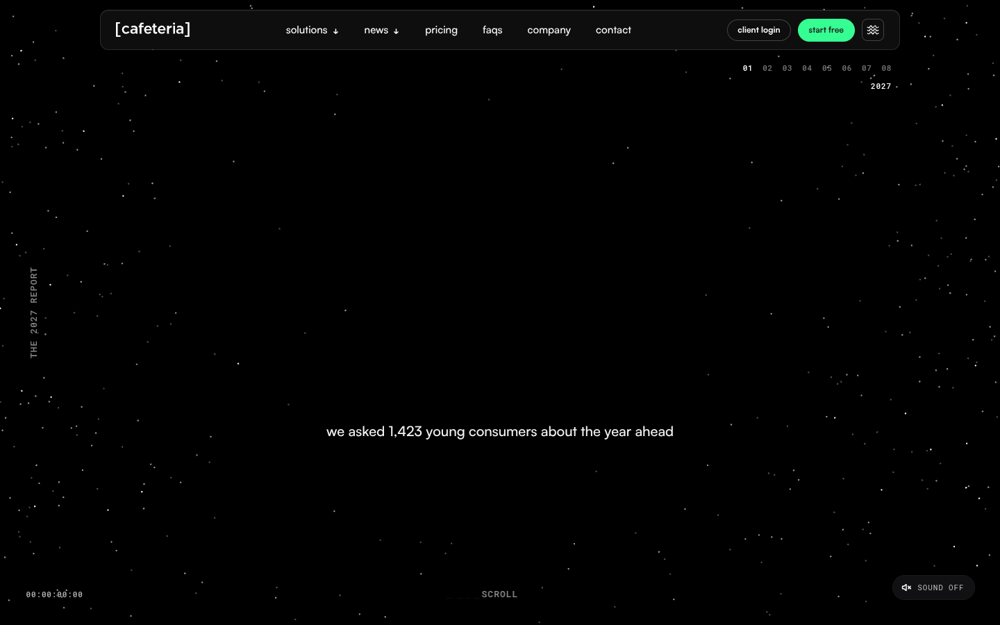
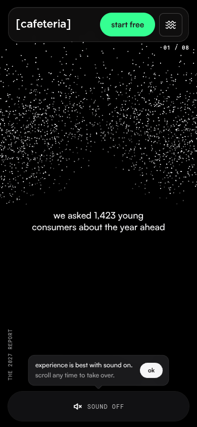

# UI Design System & Master Generation Blueprint: www-teamcafeteria-com_2027

> **2027 — a [cafeteria] report** (https://www.teamcafeteria.com/2027) — 1,423 people told us what 2027 looks like. A scroll-driven [cafeteria] report.



---

## 1. Executive Visual Persona & Design Archetype

- **Brand Essence & Persona**: **2027 — a [cafeteria] report** (`https://www.teamcafeteria.com/2027`). 1,423 people told us what 2027 looks like. A scroll-driven [cafeteria] report.
- **Visual Archetype**: **Dark-Substrate WebGL / Canvas Interactive Experience (`#171515` / `#8a8f90`)**.
- **Anti-AI-Slop Differentiators**:
  - **Source-Grounded Chromatic Polarity**: Anchors the viewport in `#171515` (`var(--ink)` in `:root`) paired with `#f4f4f5` primary typography and `#8a8f90` accents.
  - **Extracted Typographic Hierarchy**: Pairs `Satoshi 2027` for display copy (`2027 — a [cafeteria] report`) with `Anton` and `Rubik Mono One`.
  - **Calibrated Spatial Grid & Motion**: Combines `760px` container bounds (`gap: 24px`, padding `4px`) with `cubic-bezier(.65,0,.35,1)` easing and Three.js / WebGL Canvas Pipeline.

---

## 2. Spatial Architecture & Modular Grid Mathematics



### Viewport Allocation & Container Geometry
- **Captured Viewport Dimensions**: Desktop `1440×2400px` (`assets/desktop.png`, capped at 2400px multi-section capture), Mobile `390×2400px` (`assets/mobile.png`, capped at 2400px multi-section capture).
- **Master Container Bounds**: `760px` extracted from `www-teamcafeteria-com_2027` stylesheet.
- **Canvas Lateral Padding & Spacing**: `4px` lateral canvas padding with `24px` grid gap.
- **Border Radius Scale**: `22%`, `40px`, `50%`, `99px`.

### Responsive Breakpoint Architecture
- **Desktop Layout**: Multi-column CSS Grid / Flexbox layout at `1440px` (`max-width: 760px`, `gap: 24px`).
- **Mobile Layout**: Single-column vertical stack at `390px` viewport width with `4px` horizontal padding.
- **Extracted CSS Media Queries**: `@media (min-width:761px)`, `@media (max-width:760px)`, `@media (prefers-reduced-motion:reduce)`, `@media (max-width:1100px)`.

---

## 3. Color System, Materiality & Atmospheric Lighting

### Semantic Palette & Source Grounding
| Semantic Role | Ground-Truth Value | Extracted CSS Source / Selector |
|---|---|---|
| **Primary Canvas Substrate** | `#171515` | `var(--ink)` in `:root` |
| **Primary Typography Ink** | `#f4f4f5` | `var(--white)` in `:root` |
| **Elevated Surface / Card Substrate** | `#eff0f6` | `var(--paper)` in `:root` |
| **Interactive Accent / Highlight** | `#8a8f90` | `var(--meta)` in `:root` |
| **Secondary / Muted Copy** | `#b4bcbd` | `var(--body)` in `:root` |
| **Structural Hairline Border** | `#2f6bff` | `var(--blue)` in `:root` |
| **Variable Token (`--bg`)** | `#000` | `var(--bg)` in `:root` |

### Sanitized Root CSS Variables (`ui-ux.md` Ground Truth)
| Variable Name | Extracted Value | Semantic Role |
|---|---|---|
| `--ink` | `#171515` | Typography Ink Token |
| `--white` | `#f4f4f5` | Canvas / Surface Token |
| `--paper` | `#eff0f6` | Canvas / Surface Token |
| `--meta` | `#8a8f90` | Color / Atmospheric Token |
| `--body` | `#b4bcbd` | Color / Atmospheric Token |
| `--blue` | `#2f6bff` | Color / Atmospheric Token |
| `--fg` | `#f4f4f5` | Typography Ink Token |
| `--bg` | `#000` | Canvas / Surface Token |
| `--pad` | `clamp(16px,2.6vw,40px)` | Layout / Spatial Grid Token |
| `--mono` | `"Roboto Mono 2027",ui-monospace,Menlo,monospace` | Typography / Scale Token |
| `--sans` | `"Satoshi 2027",system-ui,-apple-system,"Helvetica Neue",Arial,sans-serif` | Typography / Scale Token |
| `--mw` | `15em` | Dimension / Scale Token |
| `--rg` | `rgba(255,255,255,.1)` | Color / Atmospheric Token |
| `--page-bg` | `#000` | Canvas / Surface Token |
| `--nav-w` | `80%` | Layout / Spatial Grid Token |
| `--c-nav-bg` | `rgba(255, 255, 255, .66)` | Canvas / Surface Token |

---

## 4. Typographic Scale & Editorial Hierarchy

### Font Family Stacks
- **Display Typography**: `Satoshi 2027`.
- **Primary Body Stack**: `Anton`.
- **Technical / Metadata Stack**: `Rubik Mono One`.

### Typographic Scale & Rules (Extracted from Stylesheet & Variables)
- **Hero Display (`H1`)**: rule `h1` (`font-size: clamp(2rem,5vw,3rem)`, `line-height: 1.1`, `font-weight: 700`).
- **Section Heading (`H2`)**: rule `h2` (`font-size: clamp(1.5rem,3.5vw,2rem)`, `line-height: 1.2`, `font-weight: 700`).
- **Body Copy**: CSS variables `--body: #b4bcbd`, `--font-size-vw-body: 1.5vw`, `--font-size-body: clamp(1.125rem, var(--font-size-vw-body), 1.5rem)`; rule `p` (`font-weight: 500`).
- **Metadata & Navigation Labels**: CSS variables `--meta: #8a8f90`, `--mono: "Roboto Mono 2027",ui-monospace,Menlo,monospace`, `--font-family-mono: "Roboto Mono", monospace`; rule `,.label` (`font-size: var(--font-size-lg)`).

---

## 5. Choreographed Motion & Interaction Physics

### Primary Easing Curves
- **Extracted Timing Functions**: `cubic-bezier(.65,0,.35,1)`, `cubic-bezier(.22,1,.36,1)`, `cubic-bezier(.4,0,.2,1)`.

### Per-Element Transition & Choreography Rules
- **Selector `body.report2027-page .rw>i`**: `transition: transform .5s cubic-bezier(.65,0,.35,1) calc(var(--i,0)*70ms)` extracted from `www-teamcafeteria-com_2027` stylesheet.
- **Selector `body.report2027-page #nav button`**: `transition: opacity .3s` extracted from `www-teamcafeteria-com_2027` stylesheet.
- **Selector `body.report2027-page #nav .navt .tx`**: `transition: transform .55s cubic-bezier(.65,0,.35,1),opacity .4s` extracted from `www-teamcafeteria-com_2027` stylesheet.
- **Extracted Easing Curve (`cubic-bezier(.65,0,.35,1)`)**: Governs interactive state transitions across `<header.site-header>` and `<section.fact>`.
- **Runtime Interaction Engine**: Integrates Three.js / WebGL Canvas Pipeline with `prefers-reduced-motion: reduce` fallback guards.

---

## 6. Component Wireframe & Structural DOM Map

### Visual Layout Schematic (Grounded in `dom.html` — `1440px` Desktop & `390px` Mobile Reflow)
```
┌────────────────────────────────────────────────────────────────────────┐
│ DESKTOP VIEWPORT (1440px) — 2027 — a [cafeteria] report                │
│ ====================================================================== │
│ [ <header.site-header>     | ask AI → · studies →                   ]  │
│ ---------------------------------------------------------------------- │
│ | HERO STAGE: <article.report-doc>                                 |   │
│ | H1: 2027 — a [cafeteria] report                                  |   │
│ | Substrate: #171515    | Ink: #f4f4f5    | Accent: #8a8f90        |   │
│ ---------------------------------------------------------------------- │
│ | SHOWCASE GRID (<section.fact>            ) max-w: 760px          |   │
│ | +------------------------------+  +------------------------------+ | │
│ | | Shoes                        |  | Spend                        | | │
│ | +------------------------------+  +------------------------------+ | │
│ ---------------------------------------------------------------------- │
│ | MOBILE VIEWPORT REFLOW (390px) — Single-Column Stack (gap: 24px  ) | │
│ | [<header.site-heade] -> [<article.report-do] -> [<section.fact>] |   │
│ ---------------------------------------------------------------------- │
│ [ FOOTER (<footer.footer>       ) | https://www.teamcafeteria.com/2027 │
└────────────────────────────────────────────────────────────────────────┘
```

### Granular DOM Region Breakdown
1. **Brand Header & Navigation Bar (<header.site-header> — `www-teamcafeteria-com_2027`)**:
   - Landmark `<header class="site-header">` hosting `2027 — a [cafeteria] report` navigation (`ask AI → · studies →`), DOM attributes (`data-nav-flow-ready="true"`, `data-nav-pill-ready="true"`, `data-cta-location="use_cases_menu"`, `data-track-cta`), and stylesheet rule `font-face { font-family:Anton;font-weight:100 900;font-display:swap;src:url(/_astro/... }`.
2. **Hero Stage & Focal Lead (<article.report-doc> — `2027 — a [cafeteria] report`)**:
   - Landmark `<article class="report-doc">` presenting display lead `2027 — a [cafeteria] report` and copy excerpt *"Read this report as text"* over `#171515` canvas and `#f4f4f5` ink.
3. **Primary Showcase & Content Grid (<section.fact> — `Shoes`)**:
   - Landmark `<section class="fact">` rendering section `Shoes` with copy *"solutions always-on data S/NTH → Always-on Gen Next data. Ask a q"*, asset references (`favicon.svg`, `Satoshi-Medium.dlbj618m.woff2`, `Satoshi-Bold.BRirVCsc.woff2`, `Satoshi-Black.BWj4aoZT.woff2`), and grid rule `body.report2027-page .report2027 { line-height:normal }`.
4. **Interactive Detail & Feature Matrix (<section.fact> — `Spend`)**:
   - Landmark `<section class="fact">` framing `Spend` and `Collabs` (*"always-on data S/NTH → Always-on Gen Next data. Ask a question, g"*) with `#eff0f6` surface cards, `#8a8f90` accents, and `track { position:relative;width:1px;pointer-events:none }`.
5. **Colophon & Global Directory Footer (<footer.footer> — `https://www.teamcafeteria.com/2027`)**:
   - Landmark `<footer class="footer theme-dark">` anchoring `2027 — a [cafeteria] report` footer links (`ask AI → · studies →`), copy *"Always-on Gen Next data. Ask a question, get an answer cited"*, and `#2f6bff` structural dividers.

---

## 7. Master Zero-Shot AI Generation Prompt

```markdown
# Master Zero-Shot Frontend Generation Prompt: www-teamcafeteria-com_2027 (2027 — a [cafeteria] report)

You are a principal frontend architect and design systems engineer. Build a complete, production-ready web application replicating the exact design system, DOM landmarks, typographic hierarchy, color tokens, and motion physics of `www-teamcafeteria-com_2027` (**2027 — a [cafeteria] report** — `https://www.teamcafeteria.com/2027`).

### 1. Visual Archetype & Anti-AI-Slop Mandates
- **Archetype**: Dark-Substrate WebGL / Canvas Interactive Experience (`#171515` / `#8a8f90`).
- **Identity & Domain Context**: 1,423 people told us what 2027 looks like. A scroll-driven [cafeteria] report.
- **Primary Substrate**: `#171515` (`var(--ink)` in `:root`), **Primary Ink**: `#f4f4f5`, **Accent / Highlight**: `#8a8f90`.
- **Site-Specific Differentiators**:
  - **Source-Grounded Chromatic Polarity**: Anchors the viewport in `#171515` (`var(--ink)` in `:root`) paired with `#f4f4f5` primary typography and `#8a8f90` accents.
  - **Extracted Typographic Hierarchy**: Pairs `Satoshi 2027` for display copy (`2027 — a [cafeteria] report`) with `Anton` and `Rubik Mono One`.
  - **Calibrated Spatial Grid & Motion**: Combines `760px` container bounds (`gap: 24px`, padding `4px`) with `cubic-bezier(.65,0,.35,1)` easing and Three.js / WebGL Canvas Pipeline.

### 2. Ground-Truth CSS Variables (`:root` Token Contract)
Declare and consume these exact custom properties extracted from `www-teamcafeteria-com_2027` in your global stylesheet:

:root {
  /* 2027 — a [cafeteria] report (www-teamcafeteria-com_2027) — Ground-Truth Extracted CSS Variables */
  --ink: #171515; /* Typography Ink Token (www-teamcafeteria-com_2027) */
  --white: #f4f4f5; /* Canvas / Surface Token (www-teamcafeteria-com_2027) */
  --paper: #eff0f6; /* Canvas / Surface Token (www-teamcafeteria-com_2027) */
  --meta: #8a8f90; /* Color / Atmospheric Token (www-teamcafeteria-com_2027) */
  --body: #b4bcbd; /* Color / Atmospheric Token (www-teamcafeteria-com_2027) */
  --blue: #2f6bff; /* Color / Atmospheric Token (www-teamcafeteria-com_2027) */
  --fg: #f4f4f5; /* Typography Ink Token (www-teamcafeteria-com_2027) */
  --bg: #000; /* Canvas / Surface Token (www-teamcafeteria-com_2027) */
  --pad: clamp(16px,2.6vw,40px); /* Layout / Spatial Grid Token (www-teamcafeteria-com_2027) */
  --mono: "Roboto Mono 2027",ui-monospace,Menlo,monospace; /* Typography / Scale Token (www-teamcafeteria-com_2027) */
  --sans: "Satoshi 2027",system-ui,-apple-system,"Helvetica Neue",Arial,sans-serif; /* Typography / Scale Token (www-teamcafeteria-com_2027) */
  --mw: 15em; /* Dimension / Scale Token (www-teamcafeteria-com_2027) */
  --rg: rgba(255,255,255,.1); /* Color / Atmospheric Token (www-teamcafeteria-com_2027) */
  --page-bg: #000; /* Canvas / Surface Token (www-teamcafeteria-com_2027) */
  --nav-w: 80%; /* Layout / Spatial Grid Token (www-teamcafeteria-com_2027) */
  --c-nav-bg: rgba(255, 255, 255, .66); /* Canvas / Surface Token (www-teamcafeteria-com_2027) */
}

### 3. Semantic Color & Materiality Contract
Map every surface, ink, and border strictly to these source-grounded tokens:
- **Primary Canvas Substrate**: `#171515` — grounded in `var(--ink)` in `:root`
- **Primary Typography Ink**: `#f4f4f5` — grounded in `var(--white)` in `:root`
- **Elevated Surface / Card Substrate**: `#eff0f6` — grounded in `var(--paper)` in `:root`
- **Interactive Accent / Highlight**: `#8a8f90` — grounded in `var(--meta)` in `:root`
- **Secondary / Muted Copy**: `#b4bcbd` — grounded in `var(--body)` in `:root`
- **Structural Hairline Border**: `#2f6bff` — grounded in `var(--blue)` in `:root`
- **Variable Token (`--bg`)**: `#000` — grounded in `var(--bg)` in `:root`

### 4. Spatial Grid, Container Bounds & Responsive Breakpoints
- **Desktop Viewport Reference**: `1440×2400px` (capped at 2400px multi-section capture, `1440px` standard desktop width).
- **Mobile Viewport Reference**: `390×2400px` (capped at 2400px multi-section capture, `390px` standard mobile width).
- **Container Max-Width**: `760px` extracted from `www-teamcafeteria-com_2027` stylesheet
- **Padding & Gutters**: `4px` lateral canvas padding with `24px` grid gap
- **Desktop Grid**: Multi-column CSS Grid / Flexbox layout at `1440px` (`max-width: 760px`, `gap: 24px`)
- **Mobile Adaptation**: Single-column vertical stack at `390px` viewport width with `4px` horizontal padding
- **Media Queries**: `@media (min-width:761px)`, `@media (max-width:760px)`, `@media (prefers-reduced-motion:reduce)`, `@media (max-width:1100px)`
- **Corner Radii**: `22%`, `40px`, `50%`, `99px`

### 5. Typography & Editorial Scale Contract
- **Display Font Stack**: `Satoshi 2027`
- **Body Font Stack**: `Anton`
- **Monospace / Technical Font Stack**: `Rubik Mono One`
- **H1 Display Rule**: rule `h1` (`font-size: clamp(2rem,5vw,3rem)`, `line-height: 1.1`, `font-weight: 700`)
- **H2 Section Rule**: rule `h2` (`font-size: clamp(1.5rem,3.5vw,2rem)`, `line-height: 1.2`, `font-weight: 700`)
- **Body Copy Rule**: CSS variables `--body: #b4bcbd`, `--font-size-vw-body: 1.5vw`, `--font-size-body: clamp(1.125rem, var(--font-size-vw-body), 1.5rem)`; rule `p` (`font-weight: 500`)
- **Metadata & Index Rule**: CSS variables `--meta: #8a8f90`, `--mono: "Roboto Mono 2027",ui-monospace,Menlo,monospace`, `--font-family-mono: "Roboto Mono", monospace`; rule `,.label` (`font-size: var(--font-size-lg)`)

### 6. Component Hierarchy, Verbatim Copy & Real DOM Landmarks
Scaffold `www-teamcafeteria-com_2027` (`2027 — a [cafeteria] report`) with these exact structural regions, extracted copy, and CSS rules from `dom.html`:
1. **Brand Header & Navigation Bar (<header.site-header> — `www-teamcafeteria-com_2027`)**:
   - DOM & Selectors: Landmark `<header class="site-header">` hosting `2027 — a [cafeteria] report` navigation (`ask AI → · studies →`), DOM attributes (`data-nav-flow-ready="true"`, `data-nav-pill-ready="true"`, `data-cta-location="use_cases_menu"`, `data-track-cta`), and stylesheet rule `font-face { font-family:Anton;font-weight:100 900;font-display:swap;src:url(/_astro/... }`.
   - Responsive Contract: Header `Brand Header & Navigation Bar (<header.site-header> — `www-teamcafeteria-com_2027`)` (`www-teamcafeteria-com_2027`) adapts across `@media (min-width:761px)`, `@media (max-width:760px)`, `@media (prefers-reduced-motion:reduce)`, `@media (max-width:1100px)` with `cubic-bezier(.65,0,.35,1)`, `cubic-bezier(.22,1,.36,1)`, `cubic-bezier(.4,0,.2,1)` transitions and links `ask AI → · studies →`.
2. **Hero Stage & Focal Lead (<article.report-doc> — `2027 — a [cafeteria] report`)**:
   - DOM & Selectors: Landmark `<article class="report-doc">` presenting display lead `2027 — a [cafeteria] report` and copy excerpt *"Read this report as text"* over `#171515` canvas and `#f4f4f5` ink.
   - Responsive Contract: Hero stage (`1440×2400px` desktop / `390×2400px` mobile) sets `#171515` background with `#f4f4f5` headline `2027 — a [cafeteria] report`.
3. **Primary Showcase & Content Grid (<section.fact> — `Shoes`)**:
   - DOM & Selectors: Landmark `<section class="fact">` rendering section `Shoes` with copy *"solutions always-on data S/NTH → Always-on Gen Next data. Ask a q"*, asset references (`favicon.svg`, `Satoshi-Medium.dlbj618m.woff2`, `Satoshi-Bold.BRirVCsc.woff2`, `Satoshi-Black.BWj4aoZT.woff2`), and grid rule `body.report2027-page .report2027 { line-height:normal }`.
   - Responsive Contract: Showcase grid `Primary Showcase & Content Grid (<section.fact> — `Shoes`)` applies Multi-column CSS Grid / Flexbox layout at `1440px` (`max-width: 760px`, `gap: 24px`) on desktop and Single-column vertical stack at `390px` viewport width with `4px` horizontal padding on mobile.
4. **Interactive Detail & Feature Matrix (<section.fact> — `Spend`)**:
   - DOM & Selectors: Landmark `<section class="fact">` framing `Spend` and `Collabs` (*"always-on data S/NTH → Always-on Gen Next data. Ask a question, g"*) with `#eff0f6` surface cards, `#8a8f90` accents, and `track { position:relative;width:1px;pointer-events:none }`.
   - Responsive Contract: Detail module `Interactive Detail & Feature Matrix (<section.fact> — `Spend`)` uses `22%`, `40px`, `50%`, `99px` radii, `#8a8f90` highlights, and assets (favicon.svg, Satoshi-Medium.dlbj618m.woff2, Satoshi-Bold.BRirVCsc.woff2).
5. **Colophon & Global Directory Footer (<footer.footer> — `https://www.teamcafeteria.com/2027`)**:
   - DOM & Selectors: Landmark `<footer class="footer theme-dark">` anchoring `2027 — a [cafeteria] report` footer links (`ask AI → · studies →`), copy *"Always-on Gen Next data. Ask a question, get an answer cited"*, and `#2f6bff` structural dividers.
   - Responsive Contract: Footer `Colophon & Global Directory Footer (<footer.footer> — `https://www.teamcafeteria.com/2027`)` aligns to `760px` extracted from `www-teamcafeteria-com_2027` stylesheet with `4px` lateral canvas padding with `24px` grid gap and attributes (data-nav-flow-ready="true", data-nav-pill-ready="true", data-cta-location="use_cases_menu").

#### Verbatim DOM Copy Excerpts (`dom.html`)
- Copy Excerpt 1: *"Read this report as text"*
- Copy Excerpt 2: *"solutions always-on data S/NTH → Always-on Gen Next data. Ask a question, get an a..."*
- Copy Excerpt 3: *"always-on data S/NTH → Always-on Gen Next data. Ask a question, get an answer cite..."*
- Copy Excerpt 4: *"Always-on Gen Next data. Ask a question, get an answer cited to real voices."*

### 7. Motion, Extracted Stylesheet Rules & Interaction Choreography
- **Primary Easing Functions**: `cubic-bezier(.65,0,.35,1)`, `cubic-bezier(.22,1,.36,1)`, `cubic-bezier(.4,0,.2,1)`
- **Extracted Stylesheet Rules (`www-teamcafeteria-com_2027`)**:
- `font-face { font-family:Anton;font-weight:100 900;font-display:swap;src:url(/_astro/... }`
- `body.report2027-page .report2027 { line-height:normal }`
- `track { position:relative;width:1px;pointer-events:none }`
- `stage { position:fixed;left:0;top:0;width:100vw;height:100vh;height:100lvh;overf... }`
- `pc { position:absolute;left:0;top:0;width:100%;height:100%;display:block }`
- **Per-Selector Transition Rules**:
- **Selector `body.report2027-page .rw>i`**: `transition: transform .5s cubic-bezier(.65,0,.35,1) calc(var(--i,0)*70ms)` extracted from `www-teamcafeteria-com_2027` stylesheet.
- **Selector `body.report2027-page #nav button`**: `transition: opacity .3s` extracted from `www-teamcafeteria-com_2027` stylesheet.
- **Selector `body.report2027-page #nav .navt .tx`**: `transition: transform .55s cubic-bezier(.65,0,.35,1),opacity .4s` extracted from `www-teamcafeteria-com_2027` stylesheet.
- **Extracted Easing Curve (`cubic-bezier(.65,0,.35,1)`)**: Governs interactive state transitions across `<header.site-header>` and `<section.fact>`.
- **Runtime Interaction Engine**: Integrates Three.js / WebGL Canvas Pipeline with `prefers-reduced-motion: reduce` fallback guards.

### 8. Technical Deliverables
- Implement in Next.js (App Router) with TypeScript and Tailwind CSS consuming the `:root` custom properties defined above for `www-teamcafeteria-com_2027`.
- Reproduce both the `1440px` desktop architecture and `390px` mobile breakpoint transitions, preserving semantic HTML5 landmarks (`<header>`, `<nav>`, `<main>`, `<section>`, `<footer>`) and `prefers-reduced-motion` accessibility guards.
```
