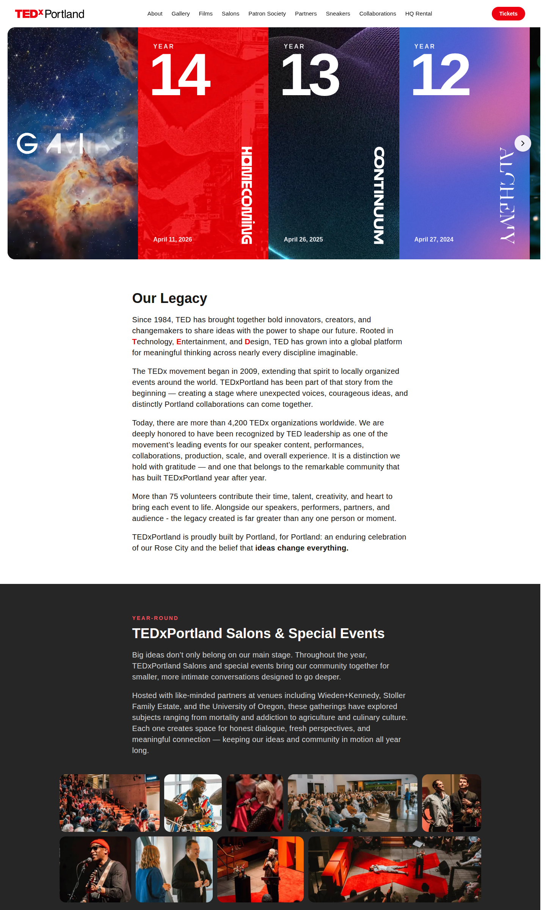
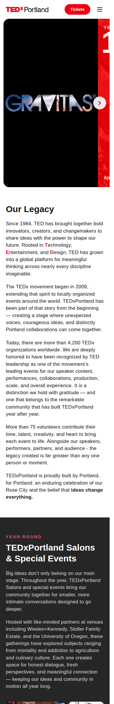

# UI Design System & Master Generation Blueprint: www-tedxportland-com

> **TEDxPortland** (https://www.tedxportland.com/) — TEDxPortland is a nonprofit organization in Portland, OR that seeks to build community and provide a platform for every discipline and cu...



---

## 1. Executive Visual Persona & Design Archetype

- **Brand Essence & Persona**: **TEDxPortland** (`https://www.tedxportland.com/`). TEDxPortland is a nonprofit organization in Portland, OR that seeks to build community and provide a platform for every discipline and cu...
- **Capture Provenance**: Live browser capture (`tier1_fast`, HTTP `200`, captured `2026-11-23`).
- **Visual Archetype**: **Light-Gallery WebGL / Canvas Interactive Experience (`#ffffff` / `#ff0000`)**.
- **Anti-AI-Slop Differentiators**:
  - **Live-Computed Chromatic Polarity**: Anchors the viewport in `#ffffff` (live computed `body` `background-color` (`computed_styles.json`)) paired with `#151515` primary typography and `#ff0000` accents.
  - **Grounded Typographic Hierarchy**: Pairs `Helvetica Neue` for display copy (`Our Legacy`) with `Helvetica Neue` and `SFMono-Regular`.
  - **Calibrated Spatial Grid & Motion**: Combines `1440px` container bounds (`gap: 24px`, padding `var(--spacing)`) with `cubic-bezier(0.4,0,1,1)` easing and Lottie Vector Animation Player, HTML5 `<canvas>` Interactive Viewport Surface.

---

## 2. Spatial Architecture & Modular Grid Mathematics



### Viewport Allocation & Container Geometry
- **Captured Viewport Dimensions**: Desktop `1440×2400px` (`assets/desktop.png`, clamped at 2400px live multi-section capture), Mobile `390×2400px` (`assets/mobile.png`, clamped at 2400px live multi-section capture).
- **Master Container Bounds**: `1440px` (full-bleed `100%` desktop stage measured on `1440px` viewport).
- **Canvas Lateral Padding & Spacing**: `var(--spacing)` lateral canvas padding with `24px` grid gap.
- **Border Radius Scale**: `3.35544e+07px`, `0.25rem`, `var(--radius-2xl)`, `1.75rem`.

### Responsive Breakpoint Architecture
- **Desktop Layout**: Multi-column CSS Grid / Flexbox layout at `1440px` (`max-width: 1440px`, `gap: 24px`).
- **Mobile Layout**: Single-column vertical stack at `390px` viewport width with `var(--spacing)` horizontal padding.
- **Extracted CSS Media Queries**: `@media (width >= 40rem)`, `@media (width >= 48rem)`, `@media (width >= 64rem)`, `@media (width >= 80rem)`.

---

## 3. Color System, Materiality & Atmospheric Lighting

### Semantic Palette & Source Grounding
| Semantic Role | Ground-Truth Value | Extracted Live / CSS Source |
|---|---|---|
| **Primary Canvas Substrate** | `#ffffff` | live computed `body` `background-color` (`computed_styles.json`) |
| **Primary Typography Ink** | `#151515` | live computed `h1` `color` (`computed_styles.json`) |
| **Elevated Surface / Card Substrate** | `#808080` | `.bg-dark-grey { background-color: grey }` (`#808080`) |
| **Interactive Accent / Highlight** | `#ff0000` | `.bg-ted-red { background-color: red }` (`#ff0000`) |
| **Secondary / Muted Copy** | `#808080` | `.text-dark-grey { color: grey }` (`#808080`) |
| **Structural Hairline Border** | `#000000` | `.border-ted-black { border-color: #000000 }` |

### Sanitized Root CSS Variables (`ui-ux.md` Ground Truth)
| Variable Name | Extracted Value | Semantic Role |
|---|---|---|
| `--font-sans` | `'Helvetica Neue', Helvetica, Inter, Arial, sans-serif` | Typography / Scale Token |
| `--font-mono` | `ui-monospace, SFMono-Regular, Menlo, Monaco, Consolas, "Liberation Mono",` | Typography / Scale Token |
| `--color-amber-50` | `oklch(98.7% 0.022 95.277)` | Brand / Palette Token |
| `--color-amber-300` | `oklch(87.9% 0.169 91.605)` | Brand / Palette Token |
| `--color-amber-800` | `oklch(47.3% 0.137 46.201)` | Brand / Palette Token |
| `--color-green-600` | `oklch(62.7% 0.194 149.214)` | Brand / Palette Token |
| `--color-sky-50` | `oklch(97.7% 0.013 236.62)` | Brand / Palette Token |
| `--color-sky-300` | `oklch(82.8% 0.111 230.318)` | Brand / Palette Token |
| `--color-sky-800` | `oklch(44.3% 0.11 240.79)` | Brand / Palette Token |
| `--color-black` | `#000` | Canvas / Surface Token |
| `--color-white` | `#fff` | Canvas / Surface Token |
| `--spacing` | `0.25rem` | Layout / Spatial Grid Token |
| `--container-md` | `28rem` | Layout / Spatial Grid Token |
| `--container-2xl` | `42rem` | Layout / Spatial Grid Token |
| `--container-3xl` | `48rem` | Layout / Spatial Grid Token |
| `--container-4xl` | `56rem` | Layout / Spatial Grid Token |

---

## 4. Typographic Scale & Editorial Hierarchy

### Font Family Stacks
- **Display Typography**: `Helvetica Neue`.
- **Primary Body Stack**: `Helvetica Neue`.
- **Technical / Metadata Stack**: `SFMono-Regular`.

### Typographic Scale & Rules (Live Computed & Stylesheet Grounded)
- **Hero Display (`H1`)**: live computed `h1` (`font-size: 36px`, `line-height: 45px`, `font-weight: 700`); CSS variables `--text-4xl: 2.25rem`, `--text-4xl--line-height: calc(2.5 / 2.25)`, `--text-5xl: 3rem`.
- **Section Heading (`H2`)**: live computed `h2` (`font-size: 36px`, `line-height: 45px`, `font-weight: 700`); CSS variables `--text-2xl: 1.5rem`, `--text-2xl--line-height: calc(2 / 1.5)`, `--text-3xl: 1.875rem`; rule `h2` (`font-size: 1.5rem`).
- **Body Copy**: live computed `body` (`font-size: 20px`, `line-height: 29px`, `font-weight: 400`); CSS variables `--text-base: 1rem`, `--text-base--line-height: calc(1.5 / 1)`; rule `body` (`font-size: clamp(1.05rem, 0.95rem + 0.35...`, `line-height: 1.45`).
- **Metadata & Navigation Labels**: live computed `nav/a` (`font-size: 20px`, `line-height: 29px`, `font-weight: 400`); CSS variables `--font-mono: ui-monospace, SFMono-Regular, Menlo, Monaco, Consolas, "Liberation Mono",`, `--text-xs: 0.75rem`, `--text-xs--line-height: calc(1 / 0.75)`; rule `small` (`font-size: 80%`).

---

## 5. Choreographed Motion & Interaction Physics

### Primary Easing Curves
- **Extracted Timing Functions**: `cubic-bezier(0.4,0,1,1)`, `cubic-bezier(0,0,0.2,1)`, `cubic-bezier(0.4,0,0.2,1)`.

### Per-Element Transition & Choreography Rules
- **Selector `layer theme`**: `transition: 150ms` extracted from `www-tedxportland-com` stylesheet.
- **Selector `.transition`**: `transition: var(--tw-ease, var(--default-transition-timing-function))` extracted from `www-tedxportland-com` stylesheet.
- **Selector `box-shadow\]`**: `transition: var(--tw-ease, var(--default-transition-timing-function))` extracted from `www-tedxportland-com` stylesheet.
- **Extracted Easing Curve (`cubic-bezier(0.4,0,1,1)`)**: Governs interactive state transitions across `<header.site-header>` and `<section.scroll-mt-20>`.
- **Runtime Interaction Engine**: Integrates Lottie Vector Animation Player, HTML5 `<canvas>` Interactive Viewport Surface with `prefers-reduced-motion: reduce` fallback guards.

---

## 6. Component Wireframe & Structural DOM Map

### Visual Layout Schematic — Desktop (`1440px`, Grounded in `dom.html` & Landmark Bounding Boxes)
```
┌────────────────────────────────────────────────────────────────────────┐
│ DESKTOP VIEWPORT (1440px) — TEDxPortland                               │
│ ====================================================================== │
│ [ <header.site-header> (1425x72px)    | About · Gallery · Films · Sa ] │
│ ---------------------------------------------------------------------- │
│ | HERO STAGE: <section.relative> (w=1425px)                          | │
│ | H1: Our Legacy                                                     | │
│ | Substrate: #ffffff | Ink: #151515 | Accent: #ff0000                | │
│ ---------------------------------------------------------------------- │
│ | SHOWCASE GRID (<section.scroll-mt-20>) max-w: 1440px               | │
│ | +------------------------------+  +------------------------------+ | │
│ | | Tickets On Sale Now:         |  | TEDxPortland Salons & Specia | | │
│ | +------------------------------+  +------------------------------+ | │
│ ---------------------------------------------------------------------- │
│ | DETAIL MODULE (<section.bg-white>) — Support TEDxPortland          | │
│ ---------------------------------------------------------------------- │
│ [ FOOTER (<footer.mt-16>      ) | https://www.tedxportland.com/        │
└────────────────────────────────────────────────────────────────────────┘
```

### Visual Layout Schematic — Mobile Reflow (`390px`)
```
┌────────────────────────────────────────────────────────────────────────┐
│ MOBILE VIEWPORT REFLOW (390px) — Single-Column Stack (gap: 24px)       │
│ ====================================================================== │
│ [ HEADER BAR (<header.site-header>    ) | Compact Menu (390px)         │
│ ---------------------------------------------------------------------- │
│ | HERO STAGE (<section.relative>) — 390px Vertical Lead              | │
│ | H1: Our Legacy                                                     | │
│ ---------------------------------------------------------------------- │
│ | SHOWCASE STACK (<section.scroll-mt-20>) — 1-Col Stack              | │
│ | [ Item 1: Tickets On Sale Now:                                   ] | │
│ | [ Item 2: TEDxPortland Salons & Special Events                   ] | │
│ ---------------------------------------------------------------------- │
│ | DETAIL STACK (<section.bg-white>) — 1-Col (Support TEDxPortla)     | │
│ ---------------------------------------------------------------------- │
│ [ FOOTER (<footer.mt-16>      ) | Stacked 390px Colophon               │
└────────────────────────────────────────────────────────────────────────┘
```

### Granular DOM Region Breakdown
1. **Brand Header & Navigation Bar (<header.site-header> — `www-tedxportland-com`)**:
   - Landmark `<header class="site-header top-0">` (`1425x72px`) hosting `TEDxPortland` navigation (`About · Gallery · Films · Salons · Patron Society`), DOM attributes (`data-nav="wide"`, `data-header-row`, `data-primary-nav`, `data-evt-event="Tickets on sale for M..."`), and stylesheet rule `file-selector-button { box-sizing: border-box; margin: 0; padding: 0; border: 0 solid; }`.
2. **Hero Stage & Focal Lead (<section.relative> — `Our Legacy`)**:
   - Landmark `<section class="relative z-30">` presenting display lead `Our Legacy` and copy excerpt *"Since 1984, TED has brought together bold innovators, creators, a"* over `#ffffff` canvas and `#151515` ink.
3. **Primary Showcase & Content Grid (<section.scroll-mt-20> — `Tickets On Sale Now:`)**:
   - Landmark `<section class="scroll-mt-20 px-3">` rendering section `Tickets On Sale Now:` with copy *"Tickets on sale for May 29, 2027"*, asset references (`0f458eb0-7b6e-4fd8-8afb-49134387e...`, `favicon-16x16.png`, `favicon-32x32.png`, `favicon-96x96.png`), and grid rule `hr { height: 0; color: inherit; border-top-width: 1px; }`.
4. **Interactive Detail & Feature Matrix (<section.bg-white> — `TEDxPortland Salons & Special Even`)**:
   - Landmark `<section class="scroll-mt-20 bg-white">` framing `TEDxPortland Salons & Special Events` and `Support TEDxPortland` (*"May 29th, 2027 Year 15 - THEME-NOT-YET-REVEALED Portland Art Muse"*) with `#808080` surface cards, `#ff0000` accents, and `h6 { font-size: inherit; font-weight: inherit; }`.
5. **Colophon & Global Directory Footer (<footer.mt-16> — `https://www.tedxportland.com/`)**:
   - Landmark `<footer class="mt-16 bg-ted-black">` anchoring `TEDxPortland` footer links (`About · Gallery · Films · Salons · Patron Society`), copy *"The TEDx movement began in 2009, extending that spirit to lo"*, and `#000000` structural dividers.

---

## 7. Master Zero-Shot AI Generation Prompt

```markdown
# Master Zero-Shot Frontend Generation Prompt: www-tedxportland-com (TEDxPortland)

You are a principal frontend architect and design systems engineer. Build a complete, production-ready web application replicating the exact design system, DOM landmarks, typographic hierarchy, color tokens, and motion physics of `www-tedxportland-com` (**TEDxPortland** — `https://www.tedxportland.com/`).

### 1. Visual Archetype & Anti-AI-Slop Mandates
- **Archetype**: Light-Gallery WebGL / Canvas Interactive Experience (`#ffffff` / `#ff0000`).
- **Identity & Domain Context**: TEDxPortland is a nonprofit organization in Portland, OR that seeks to build community and provide a platform for every discipline and cu...
- **Primary Substrate**: `#ffffff` (live computed `body` `background-color` (`computed_styles.json`)), **Primary Ink**: `#151515`, **Accent / Highlight**: `#ff0000`.
- **Site-Specific Differentiators**:
  - **Live-Computed Chromatic Polarity**: Anchors the viewport in `#ffffff` (live computed `body` `background-color` (`computed_styles.json`)) paired with `#151515` primary typography and `#ff0000` accents.
  - **Grounded Typographic Hierarchy**: Pairs `Helvetica Neue` for display copy (`Our Legacy`) with `Helvetica Neue` and `SFMono-Regular`.
  - **Calibrated Spatial Grid & Motion**: Combines `1440px` container bounds (`gap: 24px`, padding `var(--spacing)`) with `cubic-bezier(0.4,0,1,1)` easing and Lottie Vector Animation Player, HTML5 `<canvas>` Interactive Viewport Surface.

### 2. Ground-Truth CSS Variables (`:root` Token Contract)
Declare and consume these exact custom properties extracted from `www-tedxportland-com` in your global stylesheet:

:root {
  /* TEDxPortland (www-tedxportland-com) — Live-Grounded CSS Variables */
  --font-sans: 'Helvetica Neue', Helvetica, Inter, Arial, sans-serif; /* Typography / Scale Token (www-tedxportland-com) */
  --font-mono: ui-monospace, SFMono-Regular, Menlo, Monaco, Consolas, "Liberation Mono",; /* Typography / Scale Token (www-tedxportland-com) */
  --color-amber-50: oklch(98.7% 0.022 95.277); /* Brand / Palette Token (www-tedxportland-com) */
  --color-amber-300: oklch(87.9% 0.169 91.605); /* Brand / Palette Token (www-tedxportland-com) */
  --color-amber-800: oklch(47.3% 0.137 46.201); /* Brand / Palette Token (www-tedxportland-com) */
  --color-green-600: oklch(62.7% 0.194 149.214); /* Brand / Palette Token (www-tedxportland-com) */
  --color-sky-50: oklch(97.7% 0.013 236.62); /* Brand / Palette Token (www-tedxportland-com) */
  --color-sky-300: oklch(82.8% 0.111 230.318); /* Brand / Palette Token (www-tedxportland-com) */
  --color-sky-800: oklch(44.3% 0.11 240.79); /* Brand / Palette Token (www-tedxportland-com) */
  --color-black: #000; /* Canvas / Surface Token (www-tedxportland-com) */
  --color-white: #fff; /* Canvas / Surface Token (www-tedxportland-com) */
  --spacing: 0.25rem; /* Layout / Spatial Grid Token (www-tedxportland-com) */
  --container-md: 28rem; /* Layout / Spatial Grid Token (www-tedxportland-com) */
  --container-2xl: 42rem; /* Layout / Spatial Grid Token (www-tedxportland-com) */
  --container-3xl: 48rem; /* Layout / Spatial Grid Token (www-tedxportland-com) */
  --container-4xl: 56rem; /* Layout / Spatial Grid Token (www-tedxportland-com) */
}

### 3. Semantic Color & Materiality Contract
Map every surface, ink, and border strictly to these source-grounded tokens:
- **Primary Canvas Substrate**: `#ffffff` — grounded in live computed `body` `background-color` (`computed_styles.json`)
- **Primary Typography Ink**: `#151515` — grounded in live computed `h1` `color` (`computed_styles.json`)
- **Elevated Surface / Card Substrate**: `#808080` — grounded in `.bg-dark-grey { background-color: grey }` (`#808080`)
- **Interactive Accent / Highlight**: `#ff0000` — grounded in `.bg-ted-red { background-color: red }` (`#ff0000`)
- **Secondary / Muted Copy**: `#808080` — grounded in `.text-dark-grey { color: grey }` (`#808080`)
- **Structural Hairline Border**: `#000000` — grounded in `.border-ted-black { border-color: #000000 }`

### 4. Spatial Grid, Container Bounds & Responsive Breakpoints
- **Desktop Viewport Reference**: `1440×2400px` (clamped at 2400px live multi-section capture, `1440px` standard desktop width).
- **Mobile Viewport Reference**: `390×2400px` (clamped at 2400px live multi-section capture, `390px` standard mobile width).
- **Container Max-Width**: `1440px` (full-bleed `100%` desktop stage measured on `1440px` viewport)
- **Padding & Gutters**: `var(--spacing)` lateral canvas padding with `24px` grid gap
- **Desktop Grid**: Multi-column CSS Grid / Flexbox layout at `1440px` (`max-width: 1440px`, `gap: 24px`)
- **Mobile Adaptation**: Single-column vertical stack at `390px` viewport width with `var(--spacing)` horizontal padding
- **Media Queries**: `@media (width >= 40rem)`, `@media (width >= 48rem)`, `@media (width >= 64rem)`, `@media (width >= 80rem)`
- **Corner Radii**: `3.35544e+07px`, `0.25rem`, `var(--radius-2xl)`, `1.75rem`

### 5. Typography & Editorial Scale Contract
- **Display Font Stack**: `Helvetica Neue`
- **Body Font Stack**: `Helvetica Neue`
- **Monospace / Technical Font Stack**: `SFMono-Regular`
- **H1 Display Rule**: live computed `h1` (`font-size: 36px`, `line-height: 45px`, `font-weight: 700`); CSS variables `--text-4xl: 2.25rem`, `--text-4xl--line-height: calc(2.5 / 2.25)`, `--text-5xl: 3rem`
- **H2 Section Rule**: live computed `h2` (`font-size: 36px`, `line-height: 45px`, `font-weight: 700`); CSS variables `--text-2xl: 1.5rem`, `--text-2xl--line-height: calc(2 / 1.5)`, `--text-3xl: 1.875rem`; rule `h2` (`font-size: 1.5rem`)
- **Body Copy Rule**: live computed `body` (`font-size: 20px`, `line-height: 29px`, `font-weight: 400`); CSS variables `--text-base: 1rem`, `--text-base--line-height: calc(1.5 / 1)`; rule `body` (`font-size: clamp(1.05rem, 0.95rem + 0.35...`, `line-height: 1.45`)
- **Metadata & Index Rule**: live computed `nav/a` (`font-size: 20px`, `line-height: 29px`, `font-weight: 400`); CSS variables `--font-mono: ui-monospace, SFMono-Regular, Menlo, Monaco, Consolas, "Liberation Mono",`, `--text-xs: 0.75rem`, `--text-xs--line-height: calc(1 / 0.75)`; rule `small` (`font-size: 80%`)

### 6. Component Hierarchy, Verbatim Copy & Real DOM Landmarks
Scaffold `www-tedxportland-com` (`TEDxPortland`) with these exact structural regions, extracted copy, and CSS rules from `dom.html`:
1. **Brand Header & Navigation Bar (<header.site-header> — `www-tedxportland-com`)**:
   - DOM & Selectors: Landmark `<header class="site-header top-0">` (`1425x72px`) hosting `TEDxPortland` navigation (`About · Gallery · Films · Salons · Patron Society`), DOM attributes (`data-nav="wide"`, `data-header-row`, `data-primary-nav`, `data-evt-event="Tickets on sale for M..."`), and stylesheet rule `file-selector-button { box-sizing: border-box; margin: 0; padding: 0; border: 0 solid; }`.
   - Responsive Contract: Header `Brand Header & Navigation Bar (<header.site-header> — `www-tedxportland-com`)` (`www-tedxportland-com`) adapts across `@media (width >= 40rem)`, `@media (width >= 48rem)`, `@media (width >= 64rem)`, `@media (width >= 80rem)` with `cubic-bezier(0.4,0,1,1)`, `cubic-bezier(0,0,0.2,1)`, `cubic-bezier(0.4,0,0.2,1)` transitions and links `About · Gallery · Films · Salons · Patron Society`.
2. **Hero Stage & Focal Lead (<section.relative> — `Our Legacy`)**:
   - DOM & Selectors: Landmark `<section class="relative z-30">` presenting display lead `Our Legacy` and copy excerpt *"Since 1984, TED has brought together bold innovators, creators, a"* over `#ffffff` canvas and `#151515` ink.
   - Responsive Contract: Hero stage (`1440×2400px` desktop / `390×2400px` mobile) sets `#ffffff` background with `#151515` headline `Our Legacy`.
3. **Primary Showcase & Content Grid (<section.scroll-mt-20> — `Tickets On Sale Now:`)**:
   - DOM & Selectors: Landmark `<section class="scroll-mt-20 px-3">` rendering section `Tickets On Sale Now:` with copy *"Tickets on sale for May 29, 2027"*, asset references (`0f458eb0-7b6e-4fd8-8afb-49134387e...`, `favicon-16x16.png`, `favicon-32x32.png`, `favicon-96x96.png`), and grid rule `hr { height: 0; color: inherit; border-top-width: 1px; }`.
   - Responsive Contract: Showcase grid `Primary Showcase & Content Grid (<section.scroll-mt-20> — `Tickets On Sale Now:`)` applies Multi-column CSS Grid / Flexbox layout at `1440px` (`max-width: 1440px`, `gap: 24px`) on desktop and Single-column vertical stack at `390px` viewport width with `var(--spacing)` horizontal padding on mobile.
4. **Interactive Detail & Feature Matrix (<section.bg-white> — `TEDxPortland Salons & Special Even`)**:
   - DOM & Selectors: Landmark `<section class="scroll-mt-20 bg-white">` framing `TEDxPortland Salons & Special Events` and `Support TEDxPortland` (*"May 29th, 2027 Year 15 - THEME-NOT-YET-REVEALED Portland Art Muse"*) with `#808080` surface cards, `#ff0000` accents, and `h6 { font-size: inherit; font-weight: inherit; }`.
   - Responsive Contract: Detail module `Interactive Detail & Feature Matrix (<section.bg-white> — `TEDxPortland Salons & Special Even`)` uses `3.35544e+07px`, `0.25rem`, `var(--radius-2xl)`, `1.75rem` radii, `#ff0000` highlights, and assets (0f458eb0-7b6e-4fd8-8afb-49134387e..., favicon-16x16.png, favicon-32x32.png).
5. **Colophon & Global Directory Footer (<footer.mt-16> — `https://www.tedxportland.com/`)**:
   - DOM & Selectors: Landmark `<footer class="mt-16 bg-ted-black">` anchoring `TEDxPortland` footer links (`About · Gallery · Films · Salons · Patron Society`), copy *"The TEDx movement began in 2009, extending that spirit to lo"*, and `#000000` structural dividers.
   - Responsive Contract: Footer `Colophon & Global Directory Footer (<footer.mt-16> — `https://www.tedxportland.com/`)` aligns to `1440px` (full-bleed `100%` desktop stage measured on `1440px` viewport) with `var(--spacing)` lateral canvas padding with `24px` grid gap and attributes (data-nav="wide", data-header-row, data-primary-nav).

#### Verbatim DOM Copy Excerpts (`dom.html`)
- Copy Excerpt 1: *"Since 1984, TED has brought together bold innovators, creators, and changemakers t..."*
- Copy Excerpt 2: *"Tickets on sale for May 29, 2027"*
- Copy Excerpt 3: *"May 29th, 2027 Year 15 - THEME-NOT-YET-REVEALED Portland Art Museum"*
- Copy Excerpt 4: *"The TEDx movement began in 2009, extending that spirit to locally organized events..."*

### 7. Motion, Extracted Stylesheet Rules & Interaction Choreography
- **Primary Easing Functions**: `cubic-bezier(0.4,0,1,1)`, `cubic-bezier(0,0,0.2,1)`, `cubic-bezier(0.4,0,0.2,1)`
- **Extracted Stylesheet Rules (`www-tedxportland-com`)**:
- `file-selector-button { box-sizing: border-box; margin: 0; padding: 0; border: 0 solid; }`
- `hr { height: 0; color: inherit; border-top-width: 1px; }`
- `h6 { font-size: inherit; font-weight: inherit; }`
- `strong { font-weight: bolder; }`
- `small { font-size: 80%; }`
- **Per-Selector Transition Rules**:
- **Selector `layer theme`**: `transition: 150ms` extracted from `www-tedxportland-com` stylesheet.
- **Selector `.transition`**: `transition: var(--tw-ease, var(--default-transition-timing-function))` extracted from `www-tedxportland-com` stylesheet.
- **Selector `box-shadow\]`**: `transition: var(--tw-ease, var(--default-transition-timing-function))` extracted from `www-tedxportland-com` stylesheet.
- **Extracted Easing Curve (`cubic-bezier(0.4,0,1,1)`)**: Governs interactive state transitions across `<header.site-header>` and `<section.scroll-mt-20>`.
- **Runtime Interaction Engine**: Integrates Lottie Vector Animation Player, HTML5 `<canvas>` Interactive Viewport Surface with `prefers-reduced-motion: reduce` fallback guards.

### 8. Technical Deliverables
- Implement in Next.js (App Router) with TypeScript and Tailwind CSS consuming the `:root` custom properties defined above for `www-tedxportland-com`.
- Reproduce both the `1440px` desktop architecture and `390px` mobile breakpoint transitions, preserving semantic HTML5 landmarks (`<header>`, `<nav>`, `<main>`, `<section>`, `<footer>`) and `prefers-reduced-motion` accessibility guards.
```
