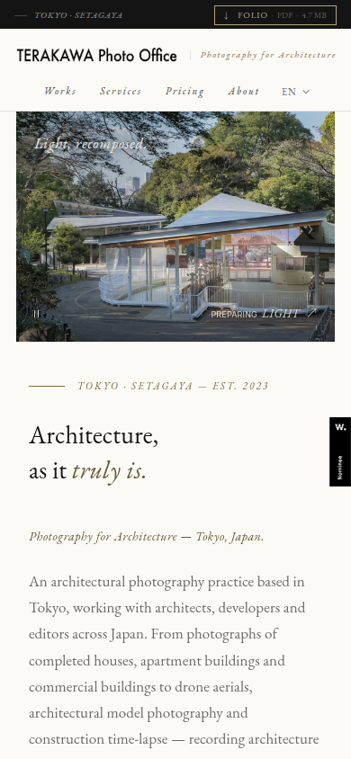

# UI Design System & Master Generation Blueprint: www-terakawaoffice-com_en

> **Architectural Photographer in Tokyo, Japan · TERAKAWA Photo Office** (https://www.terakawaoffice.com/en/) — Tokyo architectural photographer Naoki Terakawa. Completion photography, drone aerials, models, time-lapse — for architects and developer...


---

## 1. Executive Visual Persona & Design Archetype

- **Brand Essence & Persona**: **Architectural Photographer in Tokyo, Japan · TERAKAWA Photo Office** (`https://www.terakawaoffice.com/en/`). Tokyo architectural photographer Naoki Terakawa. Completion photography, drone aerials, models, time-lapse — for architects and developer...
- **Visual Archetype**: **Dark-Substrate WebGL / Canvas Interactive Experience (`#141414` / `#6d6d6d`)**.
- **Anti-AI-Slop Differentiators**:
  - **Source-Grounded Chromatic Polarity**: Anchors the viewport in `#141414` (`var(--ink)` in `:root`) paired with `#efede7` primary typography and `#6d6d6d` accents.
  - **Extracted Typographic Hierarchy**: Pairs `EB Garamond` for display copy (`Architecture, as it truly is.`) with `Inter` and not declared in static CSS (uses primary stack / `ui-monospace`).
  - **Calibrated Spatial Grid & Motion**: Combines `900px` container bounds (`gap: 36px`, padding `6px`) with `cubic-bezier(.2,.6,.3,1)` easing and Three.js / WebGL Canvas Pipeline.

---

## 2. Spatial Architecture & Modular Grid Mathematics



### Viewport Allocation & Container Geometry
- **Captured Viewport Dimensions**: Desktop `1440×14537px` (`assets/desktop.png`, full-page scroll capture), Mobile `390×2400px` (`assets/mobile.png`, capped at 2400px multi-section capture).
- **Master Container Bounds**: `900px` extracted from `www-terakawaoffice-com_en` stylesheet.
- **Canvas Lateral Padding & Spacing**: `6px` lateral canvas padding with `36px` grid gap.
- **Border Radius Scale**: `50%`, `2px`, `1px`, `999px`.

### Responsive Breakpoint Architecture
- **Desktop Layout**: Multi-column CSS Grid / Flexbox layout at `1440px` (`max-width: 900px`, `gap: 36px`).
- **Mobile Layout**: Single-column vertical stack at `390px` viewport width with `6px` horizontal padding.
- **Extracted CSS Media Queries**: `@media (max-width:900px),(orientation:portrait) and (max-width:1...`, `@media (prefers-reduced-motion:reduce)`, `@media (max-width:600px)`, `@media (min-width:1024px) and (orientation:landscape)`.

---

## 3. Color System, Materiality & Atmospheric Lighting

### Semantic Palette & Source Grounding
| Semantic Role | Ground-Truth Value | Extracted CSS Source / Selector |
|---|---|---|
| **Primary Canvas Substrate** | `#141414` | `var(--ink)` in `:root` |
| **Primary Typography Ink** | `#3a3a3a` | `var(--ink-2)` in `:root` |
| **Elevated Surface / Card Substrate** | `#6b6b6b` | `var(--ink-soft)` in `:root` |
| **Interactive Accent / Highlight** | `#6d6d6d` | `var(--ink-mute)` in `:root` |
| **Secondary / Muted Copy** | `#e4e2dc` | `var(--line)` in `:root` |
| **Structural Hairline Border** | `#efede7` | `var(--line-soft)` in `:root` |
| **Variable Token (`--paper`)** | `#fbfaf7` | `var(--paper)` in `:root` |
| **Variable Token (`--paper-warm`)** | `#f5f2ea` | `var(--paper-warm)` in `:root` |
| **Variable Token (`--accent`)** | `#7e6538` | `var(--accent)` in `:root` |

### Sanitized Root CSS Variables (`ui-ux.md` Ground Truth)
| Variable Name | Extracted Value | Semantic Role |
|---|---|---|
| `--bh-fill` | `0` | Design System Custom Token |
| `--bh-caption-gap` | `36px` | Layout / Spatial Grid Token |
| `--tx-text` | `var(--serif-en)` | Typography Ink Token |
| `--tx-rule` | `rgba(20,20,20,.16)` | Color / Atmospheric Token |
| `--tx-label` | `'Inter',-apple-system,'Helvetica Neue',sans-serif` | Dimension / Scale Token |
| `--tpo-ease` | `cubic-bezier(.16,1,.3,1)` | Motion / Easing Token |
| `--fin` | `20px` | Dimension / Scale Token |
| `--ink` | `#141414` | Typography Ink Token |
| `--ink-2` | `#3a3a3a` | Typography Ink Token |
| `--ink-soft` | `#6b6b6b` | Typography Ink Token |
| `--ink-mute` | `#6d6d6d` | Typography Ink Token |
| `--line` | `#e4e2dc` | Color / Atmospheric Token |
| `--line-soft` | `#efede7` | Color / Atmospheric Token |
| `--paper` | `#fbfaf7` | Canvas / Surface Token |
| `--paper-warm` | `#f5f2ea` | Canvas / Surface Token |
| `--accent` | `#7e6538` | Brand / Palette Token |

---

## 4. Typographic Scale & Editorial Hierarchy

### Font Family Stacks
- **Display Typography**: `EB Garamond`.
- **Primary Body Stack**: `Inter`.
- **Technical / Metadata Stack**: not declared in static CSS (uses primary stack / `ui-monospace`).

### Typographic Scale & Rules (Extracted from Stylesheet & Variables)
- **Hero Display (`H1`)**: not explicitly declared on tag in static CSS (stylesheet font-size ladder: `16px`, `9px`, `13px`, `14px`, `10px`).
- **Section Heading (`H2`)**: not explicitly declared on tag in static CSS (stylesheet font-size ladder: `16px`, `9px`, `13px`, `14px`, `10px`).
- **Body Copy**: rule `p` (`font-size: 17px`, `line-height: 1.65`).
- **Metadata & Navigation Labels**: CSS variables `--bh-caption-gap: 36px`, `--tx-label: 'Inter',-apple-system,'Helvetica Neue',sans-serif`; rule `small` (`letter-spacing: .035em`).

---

## 5. Choreographed Motion & Interaction Physics

### Primary Easing Curves
- **Extracted Timing Functions**: `cubic-bezier(.2,.6,.3,1)`, `cubic-bezier(.7,0,.3,1)`, `cubic-bezier(.65,0,.25,1)`.

### Per-Element Transition & Choreography Rules
- **Selector `.hero-visual[data-blue-hour] .bh-...`**: `transition: opacity .24s ease` extracted from `www-terakawaoffice-com_en` stylesheet.
- **Selector `.hero-visual[data-blue-hour] .tpo...`**: `transition: opacity .25s ease` extracted from `www-terakawaoffice-com_en` stylesheet.
- **Selector `-visual[data-blue-hour] .tpo-bh-g...`**: `transition: transform .4s cubic-bezier(.2,.6,.3,1)` extracted from `www-terakawaoffice-com_en` stylesheet.
- **Extracted Easing Curve (`cubic-bezier(.2,.6,.3,1)`)**: Governs interactive state transitions across `<header.tpo-js>` and `<section.trust-bar>`.
- **Runtime Interaction Engine**: Integrates Three.js / WebGL Canvas Pipeline with `prefers-reduced-motion: reduce` fallback guards.

---

## 6. Component Wireframe & Structural DOM Map

### Visual Layout Schematic (Grounded in `dom.html` — `1440px` Desktop & `390px` Mobile Reflow)
```
┌────────────────────────────────────────────────────────────────────────┐
│ DESKTOP VIEWPORT (1440px) — Architectural Photographer in Tokyo, Japan │
│ ====================================================================== │
│ [ <header.tpo-js>          | Works · Services · Pricing · About · C ]  │
│ ---------------------------------------------------------------------- │
│ | HERO STAGE: <section.hero>                                       |   │
│ | H1: Architecture, as it truly is.                                |   │
│ | Substrate: #141414    | Ink: #efede7    | Accent: #6d6d6d        |   │
│ ---------------------------------------------------------------------- │
│ | SHOWCASE GRID (<section.trust-bar>       ) max-w: 900px          |   │
│ | +------------------------------+  +------------------------------+ | │
│ | | Space and intent, in a singl |  | Three reasons to work with T | | │
│ | +------------------------------+  +------------------------------+ | │
│ ---------------------------------------------------------------------- │
│ | MOBILE VIEWPORT REFLOW (390px) — Single-Column Stack (gap: 36px  ) | │
│ | [<header.tpo-js>] -> [<section.hero>] -> [<section.trust-bar] |      │
│ ---------------------------------------------------------------------- │
│ [ FOOTER (<footer.site-footer>  ) | https://www.terakawaoffice.com/en/ │
└────────────────────────────────────────────────────────────────────────┘
```

### Granular DOM Region Breakdown
1. **Brand Header & Navigation Bar (<header.tpo-js> — `www-terakawaoffice-com_en`)**:
   - Landmark `<header class="tpo-js">` hosting `Architectural Photographer in Tokyo,` navigation (`Works · Services · Pricing · About · Contact`), DOM attributes (`data-tpo-field-worker`, `data-blue-hour`, `data-bh-mode="idle"`, `data-work-title="Nogeyama Zoological P..."`), and stylesheet rule `.tpo-bh-frame { position:absolute;left:0;right:0;top:var(--bh-frame-top,0px);bottom:0;ov... }`.
2. **Hero Stage & Focal Lead (<section.hero> — `Architecture, as it truly is.`)**:
   - Landmark `<section class="hero">` presenting display lead `Architecture, as it truly is.` and copy excerpt *"Skip to main content"* over `#141414` canvas and `#efede7` ink.
3. **Primary Showcase & Content Grid (<section.trust-bar> — `Space and intent, in a single fram`)**:
   - Landmark `<section class="trust-bar">` rendering section `Space and intent, in a single frame.` with copy *"↓ Folio PDF 4.7 MB"*, asset references (`favicon.ico`, `favicon-96.png`, `favicon.svg`, `apple-touch-icon.png`), and grid rule `.hero-visual-caption { display:none!important }`.
4. **Interactive Detail & Feature Matrix (<section.works-index> — `Three reasons to work with TERAKAW`)**:
   - Landmark `<section class="works-index">` framing `Three reasons to work with TERAKAWA.` and `Fine detail, faithfully recorded.` (*"EN Language × 日本語 English 中文（简体） Español Français Português (Bras"*) with `#6b6b6b` surface cards, `#6d6d6d` accents, and `.hero-still { animation:none!important;transform:none!important;opacity:1;clip-path:in... }`.
5. **Colophon & Global Directory Footer (<footer.site-footer> — `https://www.terakawaoffice.com/en/`)**:
   - Landmark `<footer class="site-footer">` anchoring `Architectural Photographer in To` footer links (`Works · Services · Pricing · About · Contact`), copy *"Português (Brasil)"*, and `#efede7` structural dividers.

---

## 7. Master Zero-Shot AI Generation Prompt

```markdown
# Master Zero-Shot Frontend Generation Prompt: www-terakawaoffice-com_en (Architectural Photographer in Tokyo, Japan · TERAKAWA Photo Office)

You are a principal frontend architect and design systems engineer. Build a complete, production-ready web application replicating the exact design system, DOM landmarks, typographic hierarchy, color tokens, and motion physics of `www-terakawaoffice-com_en` (**Architectural Photographer in Tokyo, Japan · TERAKAWA Photo Office** — `https://www.terakawaoffice.com/en/`).

### 1. Visual Archetype & Anti-AI-Slop Mandates
- **Archetype**: Dark-Substrate WebGL / Canvas Interactive Experience (`#141414` / `#6d6d6d`).
- **Identity & Domain Context**: Tokyo architectural photographer Naoki Terakawa. Completion photography, drone aerials, models, time-lapse — for architects and developer...
- **Primary Substrate**: `#141414` (`var(--ink)` in `:root`), **Primary Ink**: `#efede7`, **Accent / Highlight**: `#6d6d6d`.
- **Site-Specific Differentiators**:
  - **Source-Grounded Chromatic Polarity**: Anchors the viewport in `#141414` (`var(--ink)` in `:root`) paired with `#efede7` primary typography and `#6d6d6d` accents.
  - **Extracted Typographic Hierarchy**: Pairs `EB Garamond` for display copy (`Architecture, as it truly is.`) with `Inter` and not declared in static CSS (uses primary stack / `ui-monospace`).
  - **Calibrated Spatial Grid & Motion**: Combines `900px` container bounds (`gap: 36px`, padding `6px`) with `cubic-bezier(.2,.6,.3,1)` easing and Three.js / WebGL Canvas Pipeline.

### 2. Ground-Truth CSS Variables (`:root` Token Contract)
Declare and consume these exact custom properties extracted from `www-terakawaoffice-com_en` in your global stylesheet:

:root {
  /* Architectural Photographer in Tokyo, Japan · TERAKAWA Photo Office (www-terakawaoffice-com_en) — Ground-Truth Extracted CSS Variables */
  --bh-fill: 0; /* Design System Custom Token (www-terakawaoffice-com_en) */
  --bh-caption-gap: 36px; /* Layout / Spatial Grid Token (www-terakawaoffice-com_en) */
  --tx-text: var(--serif-en); /* Typography Ink Token (www-terakawaoffice-com_en) */
  --tx-rule: rgba(20,20,20,.16); /* Color / Atmospheric Token (www-terakawaoffice-com_en) */
  --tx-label: 'Inter',-apple-system,'Helvetica Neue',sans-serif; /* Dimension / Scale Token (www-terakawaoffice-com_en) */
  --tpo-ease: cubic-bezier(.16,1,.3,1); /* Motion / Easing Token (www-terakawaoffice-com_en) */
  --fin: 20px; /* Dimension / Scale Token (www-terakawaoffice-com_en) */
  --ink: #141414; /* Typography Ink Token (www-terakawaoffice-com_en) */
  --ink-2: #3a3a3a; /* Typography Ink Token (www-terakawaoffice-com_en) */
  --ink-soft: #6b6b6b; /* Typography Ink Token (www-terakawaoffice-com_en) */
  --ink-mute: #6d6d6d; /* Typography Ink Token (www-terakawaoffice-com_en) */
  --line: #e4e2dc; /* Color / Atmospheric Token (www-terakawaoffice-com_en) */
  --line-soft: #efede7; /* Color / Atmospheric Token (www-terakawaoffice-com_en) */
  --paper: #fbfaf7; /* Canvas / Surface Token (www-terakawaoffice-com_en) */
  --paper-warm: #f5f2ea; /* Canvas / Surface Token (www-terakawaoffice-com_en) */
  --accent: #7e6538; /* Brand / Palette Token (www-terakawaoffice-com_en) */
}

### 3. Semantic Color & Materiality Contract
Map every surface, ink, and border strictly to these source-grounded tokens:
- **Primary Canvas Substrate**: `#141414` — grounded in `var(--ink)` in `:root`
- **Primary Typography Ink**: `#3a3a3a` — grounded in `var(--ink-2)` in `:root`
- **Elevated Surface / Card Substrate**: `#6b6b6b` — grounded in `var(--ink-soft)` in `:root`
- **Interactive Accent / Highlight**: `#6d6d6d` — grounded in `var(--ink-mute)` in `:root`
- **Secondary / Muted Copy**: `#e4e2dc` — grounded in `var(--line)` in `:root`
- **Structural Hairline Border**: `#efede7` — grounded in `var(--line-soft)` in `:root`
- **Variable Token (`--paper`)**: `#fbfaf7` — grounded in `var(--paper)` in `:root`
- **Variable Token (`--paper-warm`)**: `#f5f2ea` — grounded in `var(--paper-warm)` in `:root`
- **Variable Token (`--accent`)**: `#7e6538` — grounded in `var(--accent)` in `:root`

### 4. Spatial Grid, Container Bounds & Responsive Breakpoints
- **Desktop Viewport Reference**: `1440×14537px` (full-page scroll capture, `1440px` standard desktop width).
- **Mobile Viewport Reference**: `390×2400px` (capped at 2400px multi-section capture, `390px` standard mobile width).
- **Container Max-Width**: `900px` extracted from `www-terakawaoffice-com_en` stylesheet
- **Padding & Gutters**: `6px` lateral canvas padding with `36px` grid gap
- **Desktop Grid**: Multi-column CSS Grid / Flexbox layout at `1440px` (`max-width: 900px`, `gap: 36px`)
- **Mobile Adaptation**: Single-column vertical stack at `390px` viewport width with `6px` horizontal padding
- **Media Queries**: `@media (max-width:900px),(orientation:portrait) and (max-width:1...`, `@media (prefers-reduced-motion:reduce)`, `@media (max-width:600px)`, `@media (min-width:1024px) and (orientation:landscape)`
- **Corner Radii**: `50%`, `2px`, `1px`, `999px`

### 5. Typography & Editorial Scale Contract
- **Display Font Stack**: `EB Garamond`
- **Body Font Stack**: `Inter`
- **Monospace / Technical Font Stack**: not declared in static CSS (uses primary stack / `ui-monospace`)
- **H1 Display Rule**: not explicitly declared on tag in static CSS (stylesheet font-size ladder: `16px`, `9px`, `13px`, `14px`, `10px`)
- **H2 Section Rule**: not explicitly declared on tag in static CSS (stylesheet font-size ladder: `16px`, `9px`, `13px`, `14px`, `10px`)
- **Body Copy Rule**: rule `p` (`font-size: 17px`, `line-height: 1.65`)
- **Metadata & Index Rule**: CSS variables `--bh-caption-gap: 36px`, `--tx-label: 'Inter',-apple-system,'Helvetica Neue',sans-serif`; rule `small` (`letter-spacing: .035em`)

### 6. Component Hierarchy, Verbatim Copy & Real DOM Landmarks
Scaffold `www-terakawaoffice-com_en` (`Architectural Photographer in Tokyo, Japan · TERAKAWA Photo Office`) with these exact structural regions, extracted copy, and CSS rules from `dom.html`:
1. **Brand Header & Navigation Bar (<header.tpo-js> — `www-terakawaoffice-com_en`)**:
   - DOM & Selectors: Landmark `<header class="tpo-js">` hosting `Architectural Photographer in Tokyo,` navigation (`Works · Services · Pricing · About · Contact`), DOM attributes (`data-tpo-field-worker`, `data-blue-hour`, `data-bh-mode="idle"`, `data-work-title="Nogeyama Zoological P..."`), and stylesheet rule `.tpo-bh-frame { position:absolute;left:0;right:0;top:var(--bh-frame-top,0px);bottom:0;ov... }`.
   - Responsive Contract: Header `Brand Header & Navigation Bar (<header.tpo-js> — `www-terakawaoffice-com_en`)` (`www-terakawaoffice-com_en`) adapts across `@media (max-width:900px),(orientation:portrait) and (max-width:1...`, `@media (prefers-reduced-motion:reduce)`, `@media (max-width:600px)`, `@media (min-width:1024px) and (orientation:landscape)` with `cubic-bezier(.2,.6,.3,1)`, `cubic-bezier(.7,0,.3,1)`, `cubic-bezier(.65,0,.25,1)` transitions and links `Works · Services · Pricing · About · Contact`.
2. **Hero Stage & Focal Lead (<section.hero> — `Architecture, as it truly is.`)**:
   - DOM & Selectors: Landmark `<section class="hero">` presenting display lead `Architecture, as it truly is.` and copy excerpt *"Skip to main content"* over `#141414` canvas and `#efede7` ink.
   - Responsive Contract: Hero stage (`1440×14537px` desktop / `390×2400px` mobile) sets `#141414` background with `#efede7` headline `Architecture, as it truly is.`.
3. **Primary Showcase & Content Grid (<section.trust-bar> — `Space and intent, in a single fram`)**:
   - DOM & Selectors: Landmark `<section class="trust-bar">` rendering section `Space and intent, in a single frame.` with copy *"↓ Folio PDF 4.7 MB"*, asset references (`favicon.ico`, `favicon-96.png`, `favicon.svg`, `apple-touch-icon.png`), and grid rule `.hero-visual-caption { display:none!important }`.
   - Responsive Contract: Showcase grid `Primary Showcase & Content Grid (<section.trust-bar> — `Space and intent, in a single fram`)` applies Multi-column CSS Grid / Flexbox layout at `1440px` (`max-width: 900px`, `gap: 36px`) on desktop and Single-column vertical stack at `390px` viewport width with `6px` horizontal padding on mobile.
4. **Interactive Detail & Feature Matrix (<section.works-index> — `Three reasons to work with TERAKAW`)**:
   - DOM & Selectors: Landmark `<section class="works-index">` framing `Three reasons to work with TERAKAWA.` and `Fine detail, faithfully recorded.` (*"EN Language × 日本語 English 中文（简体） Español Français Português (Bras"*) with `#6b6b6b` surface cards, `#6d6d6d` accents, and `.hero-still { animation:none!important;transform:none!important;opacity:1;clip-path:in... }`.
   - Responsive Contract: Detail module `Interactive Detail & Feature Matrix (<section.works-index> — `Three reasons to work with TERAKAW`)` uses `50%`, `2px`, `1px`, `999px` radii, `#6d6d6d` highlights, and assets (favicon.ico, favicon-96.png, favicon.svg).
5. **Colophon & Global Directory Footer (<footer.site-footer> — `https://www.terakawaoffice.com/en/`)**:
   - DOM & Selectors: Landmark `<footer class="site-footer">` anchoring `Architectural Photographer in To` footer links (`Works · Services · Pricing · About · Contact`), copy *"Português (Brasil)"*, and `#efede7` structural dividers.
   - Responsive Contract: Footer `Colophon & Global Directory Footer (<footer.site-footer> — `https://www.terakawaoffice.com/en/`)` aligns to `900px` extracted from `www-terakawaoffice-com_en` stylesheet with `6px` lateral canvas padding with `36px` grid gap and attributes (data-tpo-field-worker, data-blue-hour, data-bh-mode="idle").

#### Verbatim DOM Copy Excerpts (`dom.html`)
- Copy Excerpt 1: *"Skip to main content"*
- Copy Excerpt 2: *"↓ Folio PDF 4.7 MB"*
- Copy Excerpt 3: *"EN Language × 日本語 English 中文（简体） Español Français Português (Brasil) العربية Deuts..."*
- Copy Excerpt 4: *"Português (Brasil)"*

### 7. Motion, Extracted Stylesheet Rules & Interaction Choreography
- **Primary Easing Functions**: `cubic-bezier(.2,.6,.3,1)`, `cubic-bezier(.7,0,.3,1)`, `cubic-bezier(.65,0,.25,1)`
- **Extracted Stylesheet Rules (`www-terakawaoffice-com_en`)**:
- `.tpo-bh-frame { position:absolute;left:0;right:0;top:var(--bh-frame-top,0px);bottom:0;ov... }`
- `.hero-visual-caption { display:none!important }`
- `.hero-still { animation:none!important;transform:none!important;opacity:1;clip-path:in... }`
- `.hero-still::after { background:none }`
- `.tpo-bh-title { display:block;font:400 23px/1.25 var(--serif-en,'EB Garamond',Georgia,se... }`
- **Per-Selector Transition Rules**:
- **Selector `.hero-visual[data-blue-hour] .bh-...`**: `transition: opacity .24s ease` extracted from `www-terakawaoffice-com_en` stylesheet.
- **Selector `.hero-visual[data-blue-hour] .tpo...`**: `transition: opacity .25s ease` extracted from `www-terakawaoffice-com_en` stylesheet.
- **Selector `-visual[data-blue-hour] .tpo-bh-g...`**: `transition: transform .4s cubic-bezier(.2,.6,.3,1)` extracted from `www-terakawaoffice-com_en` stylesheet.
- **Extracted Easing Curve (`cubic-bezier(.2,.6,.3,1)`)**: Governs interactive state transitions across `<header.tpo-js>` and `<section.trust-bar>`.
- **Runtime Interaction Engine**: Integrates Three.js / WebGL Canvas Pipeline with `prefers-reduced-motion: reduce` fallback guards.

### 8. Technical Deliverables
- Implement in Next.js (App Router) with TypeScript and Tailwind CSS consuming the `:root` custom properties defined above for `www-terakawaoffice-com_en`.
- Reproduce both the `1440px` desktop architecture and `390px` mobile breakpoint transitions, preserving semantic HTML5 landmarks (`<header>`, `<nav>`, `<main>`, `<section>`, `<footer>`) and `prefers-reduced-motion` accessibility guards.
```
