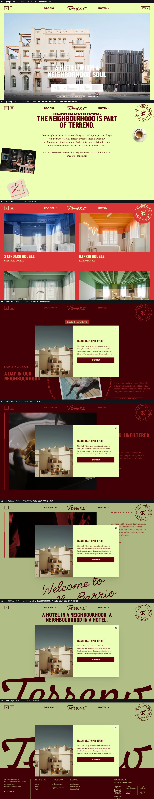
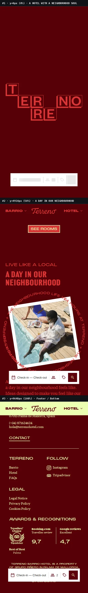

# UI Design System & Master Generation Blueprint: www-terrenohotel-com_en

> **Terreno Barrio Hotel · Boutique hotel in Palma de Mallorca** (https://www.terrenohotel.com/en/) — Boutique hotel in Palma de Mallorca with Mediterranean design, local character, rooftop moments and direct booking benefits on the offici...





---

## 1. Executive Visual Persona & Design Archetype

- **Brand Essence & Persona**: **Terreno Barrio Hotel · Boutique hotel in Palma de Mallorca** (`https://www.terrenohotel.com/en/`). Boutique hotel in Palma de Mallorca with Mediterranean design, local character, rooftop moments and direct booking benefits on the offici...
- **Capture Provenance**: Live browser capture (`tier1_fast`, HTTP `200`, captured `2026-11-24`).
- **Visual Archetype**: **Light-Substrate Editorial & Modular Grid System (`#ecffb3` canvas, `#570007` ink, `#cc3224` accent)**.
- **Anti-AI-Slop Differentiators**:
  - **Live-Computed Chromatic Polarity**: Anchors the viewport in `#ecffb3` (live computed `body` `background-color` (`computed_styles.json`)) paired with `#570007` primary typography and `#cc3224` accents.
  - **Grounded Typographic Hierarchy**: Pairs `WT Central Avenue` for display copy (`A HOTEL WITH A NEIGHBORHOOD SOUL`) with `Tiempos Text`.
  - **Calibrated Spatial Grid & Motion**: Combines `1026px` container bounds (`gap: 10px`, padding `var(--mirai-ui-tooltip-space)`) with `cubic-bezier(.68,-.55,.27,1.55)` easing and Swiper Touch Carousel Engine.

---

## 2. Spatial Architecture & Modular Grid Mathematics

### Viewport Allocation & Container Geometry
- **Captured Journey Filmstrips**: Desktop `1280×6624px` (`assets/desktop-journey.webp`, `8` keyframes up to `y=9725px` / doc `10842px`), Mobile `390×2616px` (`assets/mobile-journey.webp`, `3` keyframes).
- **Master Container Bounds**: `1026px` (measured widest bounded `<section>` landmark width on `1440px` desktop).
- **Canvas Lateral Padding & Spacing**: `var(--mirai-ui-tooltip-space)` lateral canvas padding with `10px` grid gap.
- **Border Radius Scale**: `var(--mirai-ui-checkbox-border-radius)`, `var(--mirai-ui-input-text-radius)`, `50%`, `var(--mirai-ui-switch-border-radius)`.

### Responsive Breakpoint Architecture
- **Desktop Layout**: 2-column persistent left sidebar (`280px`, <aside.e-intro>) + `1440px` main content stage at `1440px` (`max-width: 1026px`, `gap: 10px`).
- **Mobile Layout**: Single-column vertical stack at `390px` viewport width with collapsed `<aside.e-intro>` drawer navigation and `var(--mirai-ui-tooltip-space)` horizontal padding.
- **Extracted CSS Media Queries**: `@media only screen and (max-width:480px)`, `@media only screen and (min-width:481px)`, `@media only screen and (min-width:481px) and (max-width:1179px)`, `@media only screen and (max-height:480px)`.

---

## 3. Color System, Materiality & Atmospheric Lighting

### Semantic Palette & Source Grounding
| Semantic Role | Ground-Truth Value | Extracted Live / CSS Source |
|---|---|---|
| **Primary Canvas Substrate** | `#ecffb3` | live computed `body` `background-color` (`computed_styles.json`) |
| **Primary Typography Ink** | `#570007` | live computed `main` `color` (`computed_styles.json`) |
| **Elevated Surface / Card Substrate** | `#f6f6f6` | `var(--mirai-ui-content-background)` in `:root` |
| **Interactive Accent / Highlight** | `#cc3224` | `.cookiescript_vendor_name a:hover { color: #cc3224 }` |
| **Secondary / Muted Copy** | `#7d7e81` | `#capacalendario .cabeceracal .n... { color: #7d7e81 }` |
| **Structural Hairline Border** | `#dddddd` | `var(--mirai-ui-content-border)` in `:root` |

### Sanitized Root CSS Variables (`ui-ux.md` Ground Truth)
| Variable Name | Extracted Value | Semantic Role |
|---|---|---|
| `--mirai-ui-font-weight` | `400` | Typography / Scale Token |
| `--mirai-ui-font-medium` | `var(--mirai-ui-font)` | Typography / Scale Token |
| `--mirai-ui-font-medium-weight` | `500` | Typography / Scale Token |
| `--mirai-ui-font-bold` | `var(--mirai-ui-font)` | Typography / Scale Token |
| `--mirai-ui-font-bold-weight` | `700` | Typography / Scale Token |
| `--mirai-ui-font-size-headline-1` | `32px` | Typography / Scale Token |
| `--mirai-ui-line-height-headline-1` | `40px` | Typography / Scale Token |
| `--mirai-ui-font-size-headline-2` | `24px` | Typography / Scale Token |
| `--mirai-ui-line-height-headline-2` | `32px` | Typography / Scale Token |
| `--mirai-ui-font-size-headline-3` | `20px` | Typography / Scale Token |
| `--mirai-ui-line-height-headline-3` | `24px` | Typography / Scale Token |
| `--mirai-ui-font-size-paragraph` | `16px` | Typography / Scale Token |
| `--mirai-ui-line-height-paragraph` | `20px` | Typography / Scale Token |
| `--mirai-ui-font-size-action` | `14px` | Typography / Scale Token |
| `--mirai-ui-line-height-action` | `18px` | Typography / Scale Token |
| `--mirai-ui-font-size-small` | `12px` | Typography / Scale Token |

---

## 4. Typographic Scale & Editorial Hierarchy

### Font Family Stacks
- **Display Typography**: `WT Central Avenue`.
- **Primary Body Stack**: `Tiempos Text`.
- **Technical / Metadata Stack**: not declared in live computed styles (uses primary stack / `ui-monospace`).

### Typographic Scale & Rules (Live Computed & Stylesheet Grounded)
- **Hero Display (`H1`)**: live computed `h1` (`font-size: 68px`, `line-height: 60px`, `font-weight: 700`); rule `.title` (`font-size: 3.6rem`, `line-height: 3.6rem`, `letter-spacing: 2.4%`, `font-weight: 700`).
- **Section Heading (`H2`)**: live computed `h2` (`font-size: 68px`, `line-height: 60px`, `font-weight: 700`); CSS variables `--subtitle-fs: 1.8rem`, `--subtitle-lh: 2.6rem`, `--subtitle-g: 0.8rem`.
- **Body Copy**: live computed `body` (`font-size: 10px`, `line-height: normal`, `font-weight: 400`); CSS variables `--mirai-ui-font-size-paragraph: 16px`, `--mirai-ui-line-height-paragraph: 20px`; rule `body` (`font-weight: 400`).
- **Metadata & Navigation Labels**: live computed `nav/a` (`font-size: 10px`, `line-height: normal`, `font-weight: 400`); CSS variables `--mirai-ui-font-size-small: 12px`, `--mirai-ui-line-height-small: 16px`, `--mirai-ui-button-small-height: calc(var(--mirai-ui-space-XL) - var(--mirai-ui-space-M))`; rule `small` (`font-size: 12px`, `line-height: 14px`).

---

## 5. Choreographed Motion & Interaction Physics

### Primary Easing Curves
- **Extracted Timing Functions**: `cubic-bezier(.68,-.55,.27,1.55)`, `cubic-bezier(.1,.1,.25,.9)`, `cubic-bezier(0.4,0,0.22,1)`.

### Per-Element Transition & Choreography Rules
- **Selector `._3qK-PW_checkbox input`**: `transition: background-color var(--mirai-ui-motion-collapse)var(--mirai-ui...` extracted from `www-terrenohotel-com_en` stylesheet.
- **Selector `t.I2Uiuq_input:focus:required:inv...`**: `transition: none` extracted from `www-terrenohotel-com_en` stylesheet.
- **Selector `input.I2Uiuq_input:-webkit-autofill`**: `transition: none` extracted from `www-terrenohotel-com_en` stylesheet.
- **Extracted Easing Curve (`cubic-bezier(.68,-.55,.27,1.55)`)**: Governs interactive state transitions across `<header.mdl-header>` and `<article.e-slide>`.
- **Runtime Interaction Engine**: Integrates Swiper Touch Carousel Engine with `prefers-reduced-motion: reduce` fallback guards.
### Measured Runtime Scroll & Interaction Telemetry (`behavioral_journey_v2`)
- **Scroll Driver Mode**: `native` (max document height `10842px`, deepest scrollY reached `9725px` across `8` desktop keyframes).
- **Detected Scroll / Motion Libraries**: Native browser scroll / standard CSS transitions.
- **Nav / Drawer Probe (`header [role="button"]`)**: Triggered visual change (pixel diff `53.608`, captured in `assets/state-nav.webp`); revealed links: (+34) 871624624, Español, Català, Deutsch, SCROLL TO DISCOVER TE....
- **Hover Physics (`primary_cta` · `Español`)**: Computed transition `0s` / `ease` (no static color/transform shift captured at rest).
- **Route Transition Architecture**: First internal navigation (`/en/neighbourhood/`) measured as `direct` in `3025ms`.

---

## 6. Component Wireframe & Structural DOM Map

### Visual Layout Schematic — Desktop (`1440px`, Grounded in `dom.html` & Landmark Bounding Boxes)
```
┌────────────────────────────────────────────────────────────────────────┐
│ DESKTOP VIEWPORT (1440px) — Sidebar (280px) + Main (1440px)            │
│ ====================================================================== │
│ +--[ SIDEBAR (280px) ]--+--[ MAIN CONTENT STAGE (1440px) ]-----------+ │
│ | <aside.e-intro>       | [ <header.mdl-heade | Overview · Index · ] | │
│ | - Overview            | ------------------------------------------ | │
│ | - Index               | HERO STAGE: <section.m-experiencias>       | │
│ | - Archive             | H1: A HOTEL WITH A NEIGHBORHOOD SOUL       | │
│ | - About               | Bg:#ecffb3 Ink:#570007 Acc:#cc3224         | │
│ | x=32 h=752px rail     | ------------------------------------------ | │
│ |                       | SHOWCASE: <article.e-slide> max:1026px     | │
│ |                       | [a hotel with a nei] [TERRENO IS PART OF]  | │
│ |                       | DETAIL: <article.swiper-slide>             | │
│ +-----------------------+--------------------------------------------+ │
│ [ FOOTER (<footer.module-foote) | https://www.terrenohotel.com/en/     │
└────────────────────────────────────────────────────────────────────────┘
```

### Visual Layout Schematic — Mobile Reflow (`390px`)
```
┌────────────────────────────────────────────────────────────────────────┐
│ MOBILE VIEWPORT REFLOW (390px) — Collapsed Sidebar + 1-Col Stack       │
│ ====================================================================== │
│ [ DRAWER (<aside.e-intro>       ) | <header.mdl-header>                │
│ ---------------------------------------------------------------------- │
│ | HERO STAGE (<section.m-experiencias>) — 390px Full-Width           | │
│ | H1: A HOTEL WITH A NEIGHBORHOOD SOUL                               | │
│ ---------------------------------------------------------------------- │
│ | SHOWCASE STACK (<article.e-slide>) — 1-Col (gap: 10px)             | │
│ | [ Card 1: a hotel with a neighborhood soul                       ] | │
│ | [ Card 2: TERRENO IS PART OF THE NEIGHBOURHOOD. THE NEIGHBO...   ] | │
│ ---------------------------------------------------------------------- │
│ | DETAIL STACK (<article.swiper-slide>) — 1-Col (THE PLACE TO STAY)  | │
│ ---------------------------------------------------------------------- │
│ [ FOOTER (<footer.module-footer>) | Stacked 390px Colophon             │
└────────────────────────────────────────────────────────────────────────┘
```

### Granular DOM Region Breakdown
1. **Persistent Left Sidebar Navigation (<aside.e-intro> — `280×752px` at `x=32`)**:
   - Fixed/sticky left rail `<aside class="e-intro">` (`280px` wide) paired with top bar `<header class="mdl-header color-scheme-burgundy">` hosting `Terreno Barrio Hotel · Boutiqu` navigation (`Overview · Index · Archive · About · Contact`), DOM attributes (`data-ueto="ueto_d4a75505ed"`, `data-mirai-id="100380929"`, `data-type="hotel"`, `data-title="Header"`), and rule `._3qK-PW_checkbox { position:relative }`.
2. **Hero Stage & Focal Lead (<section.m-experiencias> — `A HOTEL WITH A NEIGHBORHOOD SOUL`)**:
   - Landmark `<section class="m-experiencias color-scheme-burgundy">` inside `1440px` main stage presenting display lead `A HOTEL WITH A NEIGHBORHOOD SOUL` and copy excerpt *"Some neighbourhoods have something you can’t quite put your finge"* over `#ecffb3` canvas and `#570007` ink.
3. **Primary Showcase & Content Grid (<article.e-slide> — `a hotel with a neighborhood soul`)**:
   - Landmark `<article class="e-slide swiper-slide">` rendering section `a hotel with a neighborhood soul` with copy *"LIVE BARRIO AGENDA SPA"*, asset references (`favicon-ios-7f1277496f8279e6f805a...`, `favicon-ios-3a0235b9e158e0432cb3d...`, `clientParamBuilder.bundle.js`, `0.8.77`), and grid rule `._3qK-PW_checkbox input:disabled { border-color:var(--mirai-ui-checkbox-background-disabled) }`.
4. **Interactive Detail & Feature Matrix (<article.swiper-slide> — `TERRENO IS PART OF THE NEIGHBOURHO`)**:
   - Landmark `<article class="e-slide swiper-slide">` framing `TERRENO IS PART OF THE NEIGHBOURHOOD. THE NEIGHBO...` and `THE PLACE TO STAY` (*"DRINK EL TERRADO Club"*) with `#f6f6f6` surface cards, `#cc3224` accents, and `checkbox input:disabled._3qK-PW_c... { background-color:var(--mirai-ui-checkbox-background-disabled) }`.
5. **Colophon & Global Directory Footer (<footer.module-footer> — `https://www.terrenohotel.com/en/`)**:
   - Landmark `<footer class="module-footer">` anchoring `Terreno Barrio Hotel · Boutique ` footer links (`Overview · Index · Archive · About · Contact`), copy *"24 HOURS IN TERRENO"*, and `#dddddd` structural dividers.
### Full Vertical Scroll Sequence (Desktop `1440×900` Keyframes)
- **Step 01** (`y=0px`, `0%`): Active landmark `A HOTEL WITH A NEIGHBORHOOD SOUL` · sticky/fixed elements: `1`
- **Step 02** (`y=850px`, `9%`): Active landmark `TERRENO IS PART OF THE NEIGHBOURHOOD. THE NEIGHBO...` · sticky/fixed elements: `1`
- **Step 03** (`y=2550px`, `26%`): Active landmark `Section @ 26%` · sticky/fixed elements: `1`
- **Step 04** (`y=4250px`, `44%`): Active landmark `A DAY IN OUR NEIGHBOURHOOD` · sticky/fixed elements: `1`
- **Step 05** (`y=5950px`, `61%`): Active landmark `FOOD, UNFILTERED` · sticky/fixed elements: `1`
- **Step 06** (`y=7650px`, `77%`): Active landmark `WHATEVER YOUR BODY FEELS LIKE` · sticky/fixed elements: `1`
- **Step 07** (`y=9350px`, `94%`): Active landmark `A HOTEL IN A NEIGHBOURHOOD. A NEIGHBOURHOOD IN A...` · sticky/fixed elements: `1`
- **Step 08** (`y=9725px`, `98%`): Active landmark `Footer / Bottom` · sticky/fixed elements: `1`

### Multi-Page Internal Route Map
- **Detail Route (`/en/neighbourhood/`)**: `https://www.terrenohotel.com/en/neighbourhood/` — H1: `WE’VE GOT THE NEIGHBOURHOOD INSIDE US`, scrollHeight `7386px`, transition `direct` (`3025ms`)
- **Detail Route (`/en/history/`)**: `https://www.terrenohotel.com/en/history/` — H1: `THE HISTORY OF A NEIGHBOURHOOD OPEN TO NEW IDEAS`, scrollHeight `3171px`, transition `direct` (`1185ms`)
- **Detail Route (`/en/destape-restaurante-palma/`)**: `https://www.terrenohotel.com/en/destape-restaurante-palma/` — H1: `RESTAURANT AND BAR IN PALMA`, scrollHeight `8136px`, transition `direct` (`2079ms`)

---

## 7. Master Zero-Shot AI Generation Prompt

```markdown
# Master Zero-Shot Frontend Generation Prompt: www-terrenohotel-com_en (Terreno Barrio Hotel · Boutique hotel in Palma de Mallorca)

You are a principal frontend architect and design systems engineer. Build a complete, production-ready web application replicating the exact design system, DOM landmarks, typographic hierarchy, color tokens, and motion physics of `www-terrenohotel-com_en` (**Terreno Barrio Hotel · Boutique hotel in Palma de Mallorca** — `https://www.terrenohotel.com/en/`).

### 1. Visual Archetype & Anti-AI-Slop Mandates
- **Archetype**: Light-Substrate Editorial & Modular Grid System (`#ecffb3` canvas, `#570007` ink, `#cc3224` accent).
- **Identity & Domain Context**: Boutique hotel in Palma de Mallorca with Mediterranean design, local character, rooftop moments and direct booking benefits on the offici...
- **Primary Substrate**: `#ecffb3` (live computed `body` `background-color` (`computed_styles.json`)), **Primary Ink**: `#570007`, **Accent / Highlight**: `#cc3224`.
- **Site-Specific Differentiators**:
  - **Live-Computed Chromatic Polarity**: Anchors the viewport in `#ecffb3` (live computed `body` `background-color` (`computed_styles.json`)) paired with `#570007` primary typography and `#cc3224` accents.
  - **Grounded Typographic Hierarchy**: Pairs `WT Central Avenue` for display copy (`A HOTEL WITH A NEIGHBORHOOD SOUL`) with `Tiempos Text`.
  - **Calibrated Spatial Grid & Motion**: Combines `1026px` container bounds (`gap: 10px`, padding `var(--mirai-ui-tooltip-space)`) with `cubic-bezier(.68,-.55,.27,1.55)` easing and Swiper Touch Carousel Engine.

### 2. Ground-Truth CSS Variables (`:root` Token Contract)
Declare and consume these exact custom properties extracted from `www-terrenohotel-com_en` in your global stylesheet:

:root {
  /* Terreno Barrio Hotel · Boutique hotel in Palma de Mallorca (www-terrenohotel-com_en) — Live-Grounded CSS Variables */
  --mirai-ui-font-weight: 400; /* Typography / Scale Token (www-terrenohotel-com_en) */
  --mirai-ui-font-medium: var(--mirai-ui-font); /* Typography / Scale Token (www-terrenohotel-com_en) */
  --mirai-ui-font-medium-weight: 500; /* Typography / Scale Token (www-terrenohotel-com_en) */
  --mirai-ui-font-bold: var(--mirai-ui-font); /* Typography / Scale Token (www-terrenohotel-com_en) */
  --mirai-ui-font-bold-weight: 700; /* Typography / Scale Token (www-terrenohotel-com_en) */
  --mirai-ui-font-size-headline-1: 32px; /* Typography / Scale Token (www-terrenohotel-com_en) */
  --mirai-ui-line-height-headline-1: 40px; /* Typography / Scale Token (www-terrenohotel-com_en) */
  --mirai-ui-font-size-headline-2: 24px; /* Typography / Scale Token (www-terrenohotel-com_en) */
  --mirai-ui-line-height-headline-2: 32px; /* Typography / Scale Token (www-terrenohotel-com_en) */
  --mirai-ui-font-size-headline-3: 20px; /* Typography / Scale Token (www-terrenohotel-com_en) */
  --mirai-ui-line-height-headline-3: 24px; /* Typography / Scale Token (www-terrenohotel-com_en) */
  --mirai-ui-font-size-paragraph: 16px; /* Typography / Scale Token (www-terrenohotel-com_en) */
  --mirai-ui-line-height-paragraph: 20px; /* Typography / Scale Token (www-terrenohotel-com_en) */
  --mirai-ui-font-size-action: 14px; /* Typography / Scale Token (www-terrenohotel-com_en) */
  --mirai-ui-line-height-action: 18px; /* Typography / Scale Token (www-terrenohotel-com_en) */
  --mirai-ui-font-size-small: 12px; /* Typography / Scale Token (www-terrenohotel-com_en) */
}

### 3. Semantic Color & Materiality Contract
Map every surface, ink, and border strictly to these source-grounded tokens:
- **Primary Canvas Substrate**: `#ecffb3` — grounded in live computed `body` `background-color` (`computed_styles.json`)
- **Primary Typography Ink**: `#570007` — grounded in live computed `main` `color` (`computed_styles.json`)
- **Elevated Surface / Card Substrate**: `#f6f6f6` — grounded in `var(--mirai-ui-content-background)` in `:root`
- **Interactive Accent / Highlight**: `#cc3224` — grounded in `.cookiescript_vendor_name a:hover { color: #cc3224 }`
- **Secondary / Muted Copy**: `#7d7e81` — grounded in `#capacalendario .cabeceracal .n... { color: #7d7e81 }`
- **Structural Hairline Border**: `#dddddd` — grounded in `var(--mirai-ui-content-border)` in `:root`

### 4. Spatial Grid, Container Bounds & Responsive Breakpoints
- **Desktop Viewport Reference**: `1280×6624px` (multi-frame vertical journey filmstrip (6624px), `1440px` standard desktop width).
- **Mobile Viewport Reference**: `390×2616px` (multi-frame vertical journey filmstrip (2616px), `390px` standard mobile width).
- **Container Max-Width**: `1026px` (measured widest bounded `<section>` landmark width on `1440px` desktop)
- **Padding & Gutters**: `var(--mirai-ui-tooltip-space)` lateral canvas padding with `10px` grid gap
- **Desktop Grid**: 2-column persistent left sidebar (`280px`, <aside.e-intro>) + `1440px` main content stage at `1440px` (`max-width: 1026px`, `gap: 10px`)
- **Mobile Adaptation**: Single-column vertical stack at `390px` viewport width with collapsed `<aside.e-intro>` drawer navigation and `var(--mirai-ui-tooltip-space)` horizontal padding
- **Media Queries**: `@media only screen and (max-width:480px)`, `@media only screen and (min-width:481px)`, `@media only screen and (min-width:481px) and (max-width:1179px)`, `@media only screen and (max-height:480px)`
- **Corner Radii**: `var(--mirai-ui-checkbox-border-radius)`, `var(--mirai-ui-input-text-radius)`, `50%`, `var(--mirai-ui-switch-border-radius)`

### 5. Typography & Editorial Scale Contract
- **Display Font Stack**: `WT Central Avenue`
- **Body Font Stack**: `Tiempos Text`
- **Monospace / Technical Font Stack**: not declared in live computed styles (uses primary stack / `ui-monospace`)
- **H1 Display Rule**: live computed `h1` (`font-size: 68px`, `line-height: 60px`, `font-weight: 700`); rule `.title` (`font-size: 3.6rem`, `line-height: 3.6rem`, `letter-spacing: 2.4%`, `font-weight: 700`)
- **H2 Section Rule**: live computed `h2` (`font-size: 68px`, `line-height: 60px`, `font-weight: 700`); CSS variables `--subtitle-fs: 1.8rem`, `--subtitle-lh: 2.6rem`, `--subtitle-g: 0.8rem`
- **Body Copy Rule**: live computed `body` (`font-size: 10px`, `line-height: normal`, `font-weight: 400`); CSS variables `--mirai-ui-font-size-paragraph: 16px`, `--mirai-ui-line-height-paragraph: 20px`; rule `body` (`font-weight: 400`)
- **Metadata & Index Rule**: live computed `nav/a` (`font-size: 10px`, `line-height: normal`, `font-weight: 400`); CSS variables `--mirai-ui-font-size-small: 12px`, `--mirai-ui-line-height-small: 16px`, `--mirai-ui-button-small-height: calc(var(--mirai-ui-space-XL) - var(--mirai-ui-space-M))`; rule `small` (`font-size: 12px`, `line-height: 14px`)

### 6. Component Hierarchy, Verbatim Copy & Real DOM Landmarks
Scaffold `www-terrenohotel-com_en` (`Terreno Barrio Hotel · Boutique hotel in Palma de Mallorca`) with these exact structural regions, extracted copy, and CSS rules from `dom.html`:
1. **Persistent Left Sidebar Navigation (<aside.e-intro> — `280×752px` at `x=32`)**:
   - DOM & Selectors: Fixed/sticky left rail `<aside class="e-intro">` (`280px` wide) paired with top bar `<header class="mdl-header color-scheme-burgundy">` hosting `Terreno Barrio Hotel · Boutiqu` navigation (`Overview · Index · Archive · About · Contact`), DOM attributes (`data-ueto="ueto_d4a75505ed"`, `data-mirai-id="100380929"`, `data-type="hotel"`, `data-title="Header"`), and rule `._3qK-PW_checkbox { position:relative }`.
   - Responsive Contract: Header `Persistent Left Sidebar Navigation (<aside.e-intro> — `280×752px` at `x=32`)` (`www-terrenohotel-com_en`) adapts across `@media only screen and (max-width:480px)`, `@media only screen and (min-width:481px)`, `@media only screen and (min-width:481px) and (max-width:1179px)`, `@media only screen and (max-height:480px)` with `cubic-bezier(.68,-.55,.27,1.55)`, `cubic-bezier(.1,.1,.25,.9)`, `cubic-bezier(0.4,0,0.22,1)` transitions and links `Overview · Index · Archive · About · Contact`.
2. **Hero Stage & Focal Lead (<section.m-experiencias> — `A HOTEL WITH A NEIGHBORHOOD SOUL`)**:
   - DOM & Selectors: Landmark `<section class="m-experiencias color-scheme-burgundy">` inside `1440px` main stage presenting display lead `A HOTEL WITH A NEIGHBORHOOD SOUL` and copy excerpt *"Some neighbourhoods have something you can’t quite put your finge"* over `#ecffb3` canvas and `#570007` ink.
   - Responsive Contract: Hero stage (`1280×6624px` desktop / `390×2616px` mobile) sets `#ecffb3` background with `#570007` headline `A HOTEL WITH A NEIGHBORHOOD SOUL`.
3. **Primary Showcase & Content Grid (<article.e-slide> — `a hotel with a neighborhood soul`)**:
   - DOM & Selectors: Landmark `<article class="e-slide swiper-slide">` rendering section `a hotel with a neighborhood soul` with copy *"LIVE BARRIO AGENDA SPA"*, asset references (`favicon-ios-7f1277496f8279e6f805a...`, `favicon-ios-3a0235b9e158e0432cb3d...`, `clientParamBuilder.bundle.js`, `0.8.77`), and grid rule `._3qK-PW_checkbox input:disabled { border-color:var(--mirai-ui-checkbox-background-disabled) }`.
   - Responsive Contract: Showcase grid `Primary Showcase & Content Grid (<article.e-slide> — `a hotel with a neighborhood soul`)` applies 2-column persistent left sidebar (`280px`, <aside.e-intro>) + `1440px` main content stage at `1440px` (`max-width: 1026px`, `gap: 10px`) on desktop and Single-column vertical stack at `390px` viewport width with collapsed `<aside.e-intro>` drawer navigation and `var(--mirai-ui-tooltip-space)` horizontal padding on mobile.
4. **Interactive Detail & Feature Matrix (<article.swiper-slide> — `TERRENO IS PART OF THE NEIGHBOURHO`)**:
   - DOM & Selectors: Landmark `<article class="e-slide swiper-slide">` framing `TERRENO IS PART OF THE NEIGHBOURHOOD. THE NEIGHBO...` and `THE PLACE TO STAY` (*"DRINK EL TERRADO Club"*) with `#f6f6f6` surface cards, `#cc3224` accents, and `checkbox input:disabled._3qK-PW_c... { background-color:var(--mirai-ui-checkbox-background-disabled) }`.
   - Responsive Contract: Detail module `Interactive Detail & Feature Matrix (<article.swiper-slide> — `TERRENO IS PART OF THE NEIGHBOURHO`)` uses `var(--mirai-ui-checkbox-border-radius)`, `var(--mirai-ui-input-text-radius)`, `50%`, `var(--mirai-ui-switch-border-radius)` radii, `#cc3224` highlights, and assets (favicon-ios-7f1277496f8279e6f805a..., favicon-ios-3a0235b9e158e0432cb3d..., clientParamBuilder.bundle.js).
5. **Colophon & Global Directory Footer (<footer.module-footer> — `https://www.terrenohotel.com/en/`)**:
   - DOM & Selectors: Landmark `<footer class="module-footer">` anchoring `Terreno Barrio Hotel · Boutique ` footer links (`Overview · Index · Archive · About · Contact`), copy *"24 HOURS IN TERRENO"*, and `#dddddd` structural dividers.
   - Responsive Contract: Footer `Colophon & Global Directory Footer (<footer.module-footer> — `https://www.terrenohotel.com/en/`)` aligns to `1026px` (measured widest bounded `<section>` landmark width on `1440px` desktop) with `var(--mirai-ui-tooltip-space)` lateral canvas padding with `10px` grid gap and attributes (data-ueto="ueto_d4a75505ed", data-mirai-id="100380929", data-type="hotel").

#### Verbatim DOM Copy Excerpts (`dom.html`)
- Copy Excerpt 1: *"Some neighbourhoods have something you can’t quite put your finger on. You just fe..."*
- Copy Excerpt 2: *"LIVE BARRIO AGENDA SPA"*
- Copy Excerpt 3: *"DRINK EL TERRADO Club"*
- Copy Excerpt 4: *"24 HOURS IN TERRENO"*

### 7. Motion, Extracted Stylesheet Rules & Interaction Choreography
- **Primary Easing Functions**: `cubic-bezier(.68,-.55,.27,1.55)`, `cubic-bezier(.1,.1,.25,.9)`, `cubic-bezier(0.4,0,0.22,1)`
- **Extracted Stylesheet Rules (`www-terrenohotel-com_en`)**:
- `._3qK-PW_checkbox { position:relative }`
- `._3qK-PW_checkbox input:disabled { border-color:var(--mirai-ui-checkbox-background-disabled) }`
- `checkbox input:disabled._3qK-PW_c... { background-color:var(--mirai-ui-checkbox-background-disabled) }`
- `._3qK-PW_checked { background-color:var(--mirai-ui-checkbox-background-checked);border-colo... }`
- `._3qK-PW_error { border-color:var(--mirai-ui-error);box-shadow:var(--mirai-ui-input-shado... }`
- **Per-Selector Transition Rules**:
- **Selector `._3qK-PW_checkbox input`**: `transition: background-color var(--mirai-ui-motion-collapse)var(--mirai-ui...` extracted from `www-terrenohotel-com_en` stylesheet.
- **Selector `t.I2Uiuq_input:focus:required:inv...`**: `transition: none` extracted from `www-terrenohotel-com_en` stylesheet.
- **Selector `input.I2Uiuq_input:-webkit-autofill`**: `transition: none` extracted from `www-terrenohotel-com_en` stylesheet.
- **Extracted Easing Curve (`cubic-bezier(.68,-.55,.27,1.55)`)**: Governs interactive state transitions across `<header.mdl-header>` and `<article.e-slide>`.
- **Runtime Interaction Engine**: Integrates Swiper Touch Carousel Engine with `prefers-reduced-motion: reduce` fallback guards.
### 7b. Full-Page Scroll Choreography, Interactive States & Multi-Page Routes
- **Scroll Mechanics**: Implement `native` vertical progression up to `10842px` across 8 distinct viewport chapters.
- **Vertical Chapter Sequence**: A HOTEL WITH A NEIGHBORHOOD... (0%) -> TERRENO IS PART OF THE NEIG... (9%) -> Section @ 26% (26%) -> A DAY IN OUR NEIGHBOURHOOD (44%) -> FOOD, UNFILTERED (61%) -> WHATEVER YOUR BODY FEELS LIKE (77%) -> A HOTEL IN A NEIGHBOURHOOD.... (94%) -> Footer / Bottom (98%).
- **Navigation Drawer / Menu State**: Replicate interactive menu toggle (`header [role="button"]`) with Escape-to-close keyboard handling.
- **Multi-Page Routes**: Scaffold internal routes `/en/neighbourhood/` (detail, direct), `/en/history/` (detail, direct), `/en/destape-restaurante-palma/` (detail, direct) sharing the global header/footer shell and design tokens.

### 8. Technical Deliverables
- Implement in Next.js (App Router) with TypeScript and Tailwind CSS consuming the `:root` custom properties defined above for `www-terrenohotel-com_en`.
- Reproduce both the `1440px` desktop architecture and `390px` mobile breakpoint transitions, preserving semantic HTML5 landmarks (`<header>`, `<nav>`, `<main>`, `<section>`, `<footer>`) and `prefers-reduced-motion` accessibility guards.
```
---

## 8. Full-Page Scroll Journey, Interactive States & Subpage Inventory

### Desktop Scroll Keyframes (`1440×900` WebP)
| Step | Scroll Y | Progress | Active Landmark / Section | Sticky/Fixed | Visual Asset |
| :---: | :---: | :---: | :--- | :---: | :--- |
| `#01` | `0px` | `0%` | A HOTEL WITH A NEIGHBORHOOD SOUL | `1` | [desktop-step-01.webp](assets/desktop-step-01.webp) |
| `#02` | `850px` | `9%` | TERRENO IS PART OF THE NEIGHBOURHOOD. THE NEI... | `1` | [desktop-step-02.webp](assets/desktop-step-02.webp) |
| `#03` | `2550px` | `26%` | Section @ 26% | `1` | [desktop-step-03.webp](assets/desktop-step-03.webp) |
| `#04` | `4250px` | `44%` | A DAY IN OUR NEIGHBOURHOOD | `1` | [desktop-step-04.webp](assets/desktop-step-04.webp) |
| `#05` | `5950px` | `61%` | FOOD, UNFILTERED | `1` | [desktop-step-05.webp](assets/desktop-step-05.webp) |
| `#06` | `7650px` | `77%` | WHATEVER YOUR BODY FEELS LIKE | `1` | [desktop-step-06.webp](assets/desktop-step-06.webp) |
| `#07` | `9350px` | `94%` | A HOTEL IN A NEIGHBOURHOOD. A NEIGHBOURHOOD I... | `1` | [desktop-step-07.webp](assets/desktop-step-07.webp) |
| `#08` | `9725px` | `98%` | Footer / Bottom | `1` | [desktop-step-08.webp](assets/desktop-step-08.webp) |

### Mobile Condensed Keyframes (`390×844` WebP)
| Step | Scroll Y | Progress | Active Landmark | Visual Asset |
| :---: | :---: | :---: | :--- | :--- |
| `#01` | `0px` | `0%` | A HOTEL WITH A NEIGHBORHOOD SOUL | [mobile-step-01.webp](assets/mobile-step-01.webp) |
| `#02` | `4914px` | `50%` | A DAY IN OUR NEIGHBOURHOOD | [mobile-step-02.webp](assets/mobile-step-02.webp) |
| `#03` | `9648px` | `100%` | Footer / Bottom | [mobile-step-03.webp](assets/mobile-step-03.webp) |

### Interactive UI State Captures (`1440×900` WebP)
| State Type | Trigger / Observation | Visual Asset |
| :--- | :--- | :--- |
| `nav_menu` | Nav/Menu opened (`header [role="button"]`, diff `53.608`) | [state-nav.webp](assets/state-nav.webp) |

### Internal Subpage Filmstrips (`1080px` Wide WebP)
| # | Template | Route URL | H1 / Title | Scroll Height | Transition | Filmstrip Asset |
| :-: | :---: | :--- | :--- | :---: | :---: | :--- |
| `1` | `detail` | `https://www.terrenohotel.com/en/neighbourhood/` | WE’VE GOT THE NEIGHBOURHOOD INSIDE US | `7386px` | `direct` (`3025ms`) | [subpage-01-en-neighbourhood.webp](assets/subpage-01-en-neighbourhood.webp) |
| `2` | `detail` | `https://www.terrenohotel.com/en/history/` | THE HISTORY OF A NEIGHBOURHOOD OPEN T... | `3171px` | `direct` (`1185ms`) | [subpage-02-en-history.webp](assets/subpage-02-en-history.webp) |
| `3` | `detail` | `https://www.terrenohotel.com/en/destape-restaurante-palma/` | RESTAURANT AND BAR IN PALMA | `8136px` | `direct` (`2079ms`) | [subpage-03-en-destape-restaurante-palma.webp](assets/subpage-03-en-destape-restaurante-palma.webp) |

