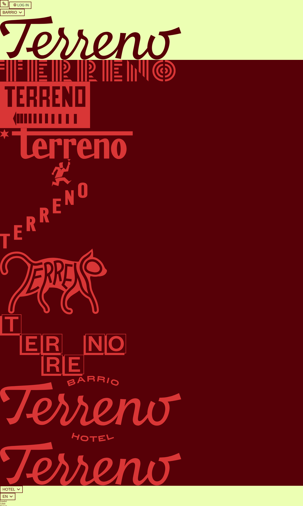
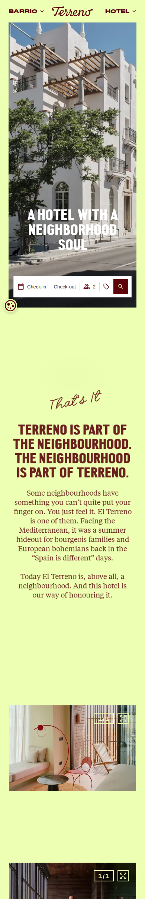

# UI Design System & Master Generation Blueprint: www-terrenohotel-com_en

> **Terreno Barrio Hotel · Boutique hotel in Palma de Mallorca** (https://www.terrenohotel.com/en/) — Boutique hotel in Palma de Mallorca with Mediterranean design, local character, rooftop moments and direct booking benefits on the offici...



---

## 1. Executive Visual Persona & Design Archetype

- **Brand Essence & Persona**: **Terreno Barrio Hotel · Boutique hotel in Palma de Mallorca** (`https://www.terrenohotel.com/en/`). Boutique hotel in Palma de Mallorca with Mediterranean design, local character, rooftop moments and direct booking benefits on the offici...
- **Visual Archetype**: **Light-Substrate Editorial & Modular Grid System (`#ecffb3` canvas, `#570007` ink, `#fff` accent)**.
- **Anti-AI-Slop Differentiators**:
  - **Source-Grounded Chromatic Polarity**: Anchors the viewport in `#ecffb3` (`var(--hover-c)` in `:root`) paired with `#570007` primary typography and `#fff` accents.
  - **Extracted Typographic Hierarchy**: Pairs `PP Monument Extended` for display copy (`a hotel with a neighborhood soul`) with `Tiempos Text` and not declared in static CSS (uses primary stack / `ui-monospace`).
  - **Calibrated Spatial Grid & Motion**: Combines `160rem` container bounds (`gap: 0.8rem`, padding `var(--p)`) with `cubic-bezier(0.4,0,0.22,1)` easing and Swiper Touch Carousel Engine.

---

## 2. Spatial Architecture & Modular Grid Mathematics



### Viewport Allocation & Container Geometry
- **Captured Viewport Dimensions**: Desktop `1440×2400px` (`assets/desktop.png`, capped at 2400px multi-section capture), Mobile `390×2400px` (`assets/mobile.png`, capped at 2400px multi-section capture).
- **Master Container Bounds**: `160rem` extracted from `www-terrenohotel-com_en` stylesheet.
- **Canvas Lateral Padding & Spacing**: `var(--p)` lateral canvas padding with `0.8rem` grid gap.
- **Border Radius Scale**: `50%`, `12px`, `2px`, `4px`.

### Responsive Breakpoint Architecture
- **Desktop Layout**: Multi-column CSS Grid / Flexbox layout at `1440px` (`max-width: 160rem`, `gap: 0.8rem`).
- **Mobile Layout**: Single-column vertical stack at `390px` viewport width with `var(--p)` horizontal padding.
- **Extracted CSS Media Queries**: `@media (min-width: 768px)`, `@media (min-width: 1280px)`, `@media (min-width: 1280px) and (min-width: 768px)`, `@media (min-width: 1280px) and (min-width: 1280px)`.

---

## 3. Color System, Materiality & Atmospheric Lighting

### Semantic Palette & Source Grounding
| Semantic Role | Ground-Truth Value | Extracted CSS Source / Selector |
|---|---|---|
| **Primary Canvas Substrate** | `#ecffb3` | `var(--hover-c)` in `:root` |
| **Primary Typography Ink** | `#570007` | `var(--home-active-color)` in `:root` |
| **Elevated Surface / Card Substrate** | `#334155` | `var(--fancybox-color)` in `:root` |
| **Interactive Accent / Highlight** | `#fff` | `var(--fancybox-bg)` in `:root` |
| **Secondary / Muted Copy** | `#6b7280` | `var(--fancybox-content-color)` in `:root` |
| **Structural Hairline Border** | `#e5e7eb` | `var(--carousel-button-bg)` in `:root` |

### Sanitized Root CSS Variables (`ui-ux.md` Ground Truth)
| Variable Name | Extracted Value | Semantic Role |
|---|---|---|
| `--icon-w` | `1.6rem` | Dimension / Scale Token |
| `--px` | `1rem` | Dimension / Scale Token |
| `--bg-c` | `transparent` | Canvas / Surface Token |
| `--border-c` | `var(--c)` | Elevation / Border Token |
| `--hover-c` | `#ecffb3` | Color / Atmospheric Token |
| `--gap` | `0.8rem` | Layout / Spatial Grid Token |
| `--hover-bg-c` | `var(--c)` | Canvas / Surface Token |
| `--size` | `4rem` | Layout / Spatial Grid Token |
| `--home-active-bg` | `#ecffb3` | Canvas / Surface Token |
| `--home-active-color` | `#570007` | Brand / Palette Token |
| `--home-active-altcolor` | `#ecffb3` | Brand / Palette Token |
| `--current-scheme-color` | `var(--home-active-color)` | Brand / Palette Token |
| `--current-scheme-bgcolor` | `var(--home-active-bg)` | Canvas / Surface Token |
| `--current-scheme-altcolor` | `var(--home-active-altcolor)` | Brand / Palette Token |
| `--home-cta-overlap` | `18rem` | Brand / Palette Token |
| `--home-rotate-progress` | `0` | Design System Custom Token |

---

## 4. Typographic Scale & Editorial Hierarchy

### Font Family Stacks
- **Display Typography**: `PP Monument Extended`.
- **Primary Body Stack**: `Tiempos Text`.
- **Technical / Metadata Stack**: not declared in static CSS (uses primary stack / `ui-monospace`).

### Typographic Scale & Rules (Extracted from Stylesheet & Variables)
- **Hero Display (`H1`)**: rule `.title` (`font-size: 3.6rem`, `line-height: 3.6rem`, `letter-spacing: 2.4%`, `font-weight: 700`).
- **Section Heading (`H2`)**: CSS variables `--subtitle-fs: 1.8rem`, `--subtitle-lh: 2.6rem`, `--subtitle-g: 0.8rem`.
- **Body Copy**: CSS variables `--mirai-ui-font-size-paragraph: 16px`, `--mirai-ui-line-height-paragraph: 20px`, `--experiencias-body-bg: #ecffb3`; rule `body` (`font-weight: 400`).
- **Metadata & Navigation Labels**: CSS variables `--mirai-ui-font-size-small: 12px`, `--mirai-ui-line-height-small: 16px`, `--mirai-ui-button-small-height: calc(var(--mirai-ui-space-XL) - var(--mirai-ui-space-M))`; rule `small` (`font-size: 12px`, `line-height: 14px`).

---

## 5. Choreographed Motion & Interaction Physics

### Primary Easing Curves
- **Extracted Timing Functions**: `cubic-bezier(0.4,0,0.22,1)`, `cubic-bezier(.68,-.55,.27,1.55)`, `cubic-bezier(.1,.1,.25,.9)`.

### Per-Element Transition & Choreography Rules
- **Selector `.swiper-wrapper`**: `transition: var(--swiper-wrapper-transition-timing-function,initial)` extracted from `www-terrenohotel-com_en` stylesheet.
- **Selector `.swiper-pagination`**: `transition: opacity .3s` extracted from `www-terrenohotel-com_en` stylesheet.
- **Selector `.swiper-pagination-bullets-dynamic`**: `transition: transform .2s,top .2s` extracted from `www-terrenohotel-com_en` stylesheet.
- **Extracted Easing Curve (`cubic-bezier(0.4,0,0.22,1)`)**: Governs interactive state transitions across `<header.mdl-header>` and `<article.e-slide>`.
- **Runtime Interaction Engine**: Integrates Swiper Touch Carousel Engine with `prefers-reduced-motion: reduce` fallback guards.

---

## 6. Component Wireframe & Structural DOM Map

### Visual Layout Schematic (Grounded in `dom.html` — `1440px` Desktop & `390px` Mobile Reflow)
```
┌────────────────────────────────────────────────────────────────────────┐
│ DESKTOP VIEWPORT (1440px) — Terreno Barrio Hotel · Boutique hotel in P │
│ ====================================================================== │
│ [ <header.mdl-header>      | Overview · Index · Archive · About · C ]  │
│ ---------------------------------------------------------------------- │
│ | HERO STAGE: <section.m-experiencias>                             |   │
│ | H1: a hotel with a neighborhood soul                             |   │
│ | Substrate: #ecffb3    | Ink: #570007    | Accent: #fff           |   │
│ ---------------------------------------------------------------------- │
│ | SHOWCASE GRID (<article.e-slide>         ) max-w: 160rem         |   │
│ | +------------------------------+  +------------------------------+ | │
│ | | TERRENO IS PART OF THE NEIGH |  | OUR ROOMS                    | | │
│ | +------------------------------+  +------------------------------+ | │
│ ---------------------------------------------------------------------- │
│ | MOBILE VIEWPORT REFLOW (390px) — Single-Column Stack (gap: 0.8rem) | │
│ | [<header.mdl-header] -> [<section.m-experie] -> [<article.e-slide>]  │
│ ---------------------------------------------------------------------- │
│ [ FOOTER (<footer.module-footer>) | https://www.terrenohotel.com/en/   │
└────────────────────────────────────────────────────────────────────────┘
```

### Granular DOM Region Breakdown
1. **Brand Header & Navigation Bar (<header.mdl-header> — `www-terrenohotel-com_en`)**:
   - Landmark `<header class="mdl-header color-scheme-burgundy">` hosting `Terreno Barrio Hotel · Boutique hote` navigation (`Overview · Index · Archive · About · Contact`), DOM attributes (`data-mirai-id="100380929"`, `data-type="hotel"`, `data-role="view"`, `data-title="Header"`), and stylesheet rule `root { --swiper-theme-color:007aff }`.
2. **Hero Stage & Focal Lead (<section.m-experiencias> — `a hotel with a neighborhood soul`)**:
   - Landmark `<section class="m-experiencias color-scheme-burgundy">` presenting display lead `a hotel with a neighborhood soul` and copy excerpt *"LIVE BARRIO AGENDA SPA"* over `#ecffb3` canvas and `#570007` ink.
3. **Primary Showcase & Content Grid (<article.e-slide> — `TERRENO IS PART OF THE NEIGHBOURHO`)**:
   - Landmark `<article class="e-slide swiper-slide">` rendering section `TERRENO IS PART OF THE NEIGHBOURHOOD. THE NEIGHBO...` with copy *"DRINK EL TERRADO Club"*, asset references (`favicon-ios-7f1277496f8279e6f805a...`, `favicon-ios-3a0235b9e158e0432cb3d...`, `ed9704c669f04d459f5fd2ad1e298a56.js`, `gtm.js`), and grid rule `host { display:block;margin-left:auto;margin-right:auto;position:relative;z-ind... }`.
4. **Interactive Detail & Feature Matrix (<article.e-slide> — `OUR ROOMS`)**:
   - Landmark `<article class="e-slide swiper-slide">` framing `OUR ROOMS` and `THE PLACE TO STAY` (*"24 HOURS IN TERRENO"*) with `#334155` surface cards, `#fff` accents, and `.swiper { display:block;list-style:none;margin-left:auto;margin-right:auto;overflo... }`.
5. **Colophon & Global Directory Footer (<footer.module-footer> — `https://www.terrenohotel.com/en/`)**:
   - Landmark `<footer class="module-footer">` anchoring `Terreno Barrio Hotel · Boutique ` footer links (`Overview · Index · Archive · About · Contact`), copy *"descubre 24h en el barrio"*, and `#e5e7eb` structural dividers.

---

## 7. Master Zero-Shot AI Generation Prompt

```markdown
# Master Zero-Shot Frontend Generation Prompt: www-terrenohotel-com_en (Terreno Barrio Hotel · Boutique hotel in Palma de Mallorca)

You are a principal frontend architect and design systems engineer. Build a complete, production-ready web application replicating the exact design system, DOM landmarks, typographic hierarchy, color tokens, and motion physics of `www-terrenohotel-com_en` (**Terreno Barrio Hotel · Boutique hotel in Palma de Mallorca** — `https://www.terrenohotel.com/en/`).

### 1. Visual Archetype & Anti-AI-Slop Mandates
- **Archetype**: Light-Substrate Editorial & Modular Grid System (`#ecffb3` canvas, `#570007` ink, `#fff` accent).
- **Identity & Domain Context**: Boutique hotel in Palma de Mallorca with Mediterranean design, local character, rooftop moments and direct booking benefits on the offici...
- **Primary Substrate**: `#ecffb3` (`var(--hover-c)` in `:root`), **Primary Ink**: `#570007`, **Accent / Highlight**: `#fff`.
- **Site-Specific Differentiators**:
  - **Source-Grounded Chromatic Polarity**: Anchors the viewport in `#ecffb3` (`var(--hover-c)` in `:root`) paired with `#570007` primary typography and `#fff` accents.
  - **Extracted Typographic Hierarchy**: Pairs `PP Monument Extended` for display copy (`a hotel with a neighborhood soul`) with `Tiempos Text` and not declared in static CSS (uses primary stack / `ui-monospace`).
  - **Calibrated Spatial Grid & Motion**: Combines `160rem` container bounds (`gap: 0.8rem`, padding `var(--p)`) with `cubic-bezier(0.4,0,0.22,1)` easing and Swiper Touch Carousel Engine.

### 2. Ground-Truth CSS Variables (`:root` Token Contract)
Declare and consume these exact custom properties extracted from `www-terrenohotel-com_en` in your global stylesheet:

:root {
  /* Terreno Barrio Hotel · Boutique hotel in Palma de Mallorca (www-terrenohotel-com_en) — Ground-Truth Extracted CSS Variables */
  --icon-w: 1.6rem; /* Dimension / Scale Token (www-terrenohotel-com_en) */
  --px: 1rem; /* Dimension / Scale Token (www-terrenohotel-com_en) */
  --bg-c: transparent; /* Canvas / Surface Token (www-terrenohotel-com_en) */
  --border-c: var(--c); /* Elevation / Border Token (www-terrenohotel-com_en) */
  --hover-c: #ecffb3; /* Color / Atmospheric Token (www-terrenohotel-com_en) */
  --gap: 0.8rem; /* Layout / Spatial Grid Token (www-terrenohotel-com_en) */
  --hover-bg-c: var(--c); /* Canvas / Surface Token (www-terrenohotel-com_en) */
  --size: 4rem; /* Layout / Spatial Grid Token (www-terrenohotel-com_en) */
  --home-active-bg: #ecffb3; /* Canvas / Surface Token (www-terrenohotel-com_en) */
  --home-active-color: #570007; /* Brand / Palette Token (www-terrenohotel-com_en) */
  --home-active-altcolor: #ecffb3; /* Brand / Palette Token (www-terrenohotel-com_en) */
  --current-scheme-color: var(--home-active-color); /* Brand / Palette Token (www-terrenohotel-com_en) */
  --current-scheme-bgcolor: var(--home-active-bg); /* Canvas / Surface Token (www-terrenohotel-com_en) */
  --current-scheme-altcolor: var(--home-active-altcolor); /* Brand / Palette Token (www-terrenohotel-com_en) */
  --home-cta-overlap: 18rem; /* Brand / Palette Token (www-terrenohotel-com_en) */
  --home-rotate-progress: 0; /* Design System Custom Token (www-terrenohotel-com_en) */
}

### 3. Semantic Color & Materiality Contract
Map every surface, ink, and border strictly to these source-grounded tokens:
- **Primary Canvas Substrate**: `#ecffb3` — grounded in `var(--hover-c)` in `:root`
- **Primary Typography Ink**: `#570007` — grounded in `var(--home-active-color)` in `:root`
- **Elevated Surface / Card Substrate**: `#334155` — grounded in `var(--fancybox-color)` in `:root`
- **Interactive Accent / Highlight**: `#fff` — grounded in `var(--fancybox-bg)` in `:root`
- **Secondary / Muted Copy**: `#6b7280` — grounded in `var(--fancybox-content-color)` in `:root`
- **Structural Hairline Border**: `#e5e7eb` — grounded in `var(--carousel-button-bg)` in `:root`

### 4. Spatial Grid, Container Bounds & Responsive Breakpoints
- **Desktop Viewport Reference**: `1440×2400px` (capped at 2400px multi-section capture, `1440px` standard desktop width).
- **Mobile Viewport Reference**: `390×2400px` (capped at 2400px multi-section capture, `390px` standard mobile width).
- **Container Max-Width**: `160rem` extracted from `www-terrenohotel-com_en` stylesheet
- **Padding & Gutters**: `var(--p)` lateral canvas padding with `0.8rem` grid gap
- **Desktop Grid**: Multi-column CSS Grid / Flexbox layout at `1440px` (`max-width: 160rem`, `gap: 0.8rem`)
- **Mobile Adaptation**: Single-column vertical stack at `390px` viewport width with `var(--p)` horizontal padding
- **Media Queries**: `@media (min-width: 768px)`, `@media (min-width: 1280px)`, `@media (min-width: 1280px) and (min-width: 768px)`, `@media (min-width: 1280px) and (min-width: 1280px)`
- **Corner Radii**: `50%`, `12px`, `2px`, `4px`

### 5. Typography & Editorial Scale Contract
- **Display Font Stack**: `PP Monument Extended`
- **Body Font Stack**: `Tiempos Text`
- **Monospace / Technical Font Stack**: not declared in static CSS (uses primary stack / `ui-monospace`)
- **H1 Display Rule**: rule `.title` (`font-size: 3.6rem`, `line-height: 3.6rem`, `letter-spacing: 2.4%`, `font-weight: 700`)
- **H2 Section Rule**: CSS variables `--subtitle-fs: 1.8rem`, `--subtitle-lh: 2.6rem`, `--subtitle-g: 0.8rem`
- **Body Copy Rule**: CSS variables `--mirai-ui-font-size-paragraph: 16px`, `--mirai-ui-line-height-paragraph: 20px`, `--experiencias-body-bg: #ecffb3`; rule `body` (`font-weight: 400`)
- **Metadata & Index Rule**: CSS variables `--mirai-ui-font-size-small: 12px`, `--mirai-ui-line-height-small: 16px`, `--mirai-ui-button-small-height: calc(var(--mirai-ui-space-XL) - var(--mirai-ui-space-M))`; rule `small` (`font-size: 12px`, `line-height: 14px`)

### 6. Component Hierarchy, Verbatim Copy & Real DOM Landmarks
Scaffold `www-terrenohotel-com_en` (`Terreno Barrio Hotel · Boutique hotel in Palma de Mallorca`) with these exact structural regions, extracted copy, and CSS rules from `dom.html`:
1. **Brand Header & Navigation Bar (<header.mdl-header> — `www-terrenohotel-com_en`)**:
   - DOM & Selectors: Landmark `<header class="mdl-header color-scheme-burgundy">` hosting `Terreno Barrio Hotel · Boutique hote` navigation (`Overview · Index · Archive · About · Contact`), DOM attributes (`data-mirai-id="100380929"`, `data-type="hotel"`, `data-role="view"`, `data-title="Header"`), and stylesheet rule `root { --swiper-theme-color:007aff }`.
   - Responsive Contract: Header `Brand Header & Navigation Bar (<header.mdl-header> — `www-terrenohotel-com_en`)` (`www-terrenohotel-com_en`) adapts across `@media (min-width: 768px)`, `@media (min-width: 1280px)`, `@media (min-width: 1280px) and (min-width: 768px)`, `@media (min-width: 1280px) and (min-width: 1280px)` with `cubic-bezier(0.4,0,0.22,1)`, `cubic-bezier(.68,-.55,.27,1.55)`, `cubic-bezier(.1,.1,.25,.9)` transitions and links `Overview · Index · Archive · About · Contact`.
2. **Hero Stage & Focal Lead (<section.m-experiencias> — `a hotel with a neighborhood soul`)**:
   - DOM & Selectors: Landmark `<section class="m-experiencias color-scheme-burgundy">` presenting display lead `a hotel with a neighborhood soul` and copy excerpt *"LIVE BARRIO AGENDA SPA"* over `#ecffb3` canvas and `#570007` ink.
   - Responsive Contract: Hero stage (`1440×2400px` desktop / `390×2400px` mobile) sets `#ecffb3` background with `#570007` headline `a hotel with a neighborhood soul`.
3. **Primary Showcase & Content Grid (<article.e-slide> — `TERRENO IS PART OF THE NEIGHBOURHO`)**:
   - DOM & Selectors: Landmark `<article class="e-slide swiper-slide">` rendering section `TERRENO IS PART OF THE NEIGHBOURHOOD. THE NEIGHBO...` with copy *"DRINK EL TERRADO Club"*, asset references (`favicon-ios-7f1277496f8279e6f805a...`, `favicon-ios-3a0235b9e158e0432cb3d...`, `ed9704c669f04d459f5fd2ad1e298a56.js`, `gtm.js`), and grid rule `host { display:block;margin-left:auto;margin-right:auto;position:relative;z-ind... }`.
   - Responsive Contract: Showcase grid `Primary Showcase & Content Grid (<article.e-slide> — `TERRENO IS PART OF THE NEIGHBOURHO`)` applies Multi-column CSS Grid / Flexbox layout at `1440px` (`max-width: 160rem`, `gap: 0.8rem`) on desktop and Single-column vertical stack at `390px` viewport width with `var(--p)` horizontal padding on mobile.
4. **Interactive Detail & Feature Matrix (<article.e-slide> — `OUR ROOMS`)**:
   - DOM & Selectors: Landmark `<article class="e-slide swiper-slide">` framing `OUR ROOMS` and `THE PLACE TO STAY` (*"24 HOURS IN TERRENO"*) with `#334155` surface cards, `#fff` accents, and `.swiper { display:block;list-style:none;margin-left:auto;margin-right:auto;overflo... }`.
   - Responsive Contract: Detail module `Interactive Detail & Feature Matrix (<article.e-slide> — `OUR ROOMS`)` uses `50%`, `12px`, `2px`, `4px` radii, `#fff` highlights, and assets (favicon-ios-7f1277496f8279e6f805a..., favicon-ios-3a0235b9e158e0432cb3d..., ed9704c669f04d459f5fd2ad1e298a56.js).
5. **Colophon & Global Directory Footer (<footer.module-footer> — `https://www.terrenohotel.com/en/`)**:
   - DOM & Selectors: Landmark `<footer class="module-footer">` anchoring `Terreno Barrio Hotel · Boutique ` footer links (`Overview · Index · Archive · About · Contact`), copy *"descubre 24h en el barrio"*, and `#e5e7eb` structural dividers.
   - Responsive Contract: Footer `Colophon & Global Directory Footer (<footer.module-footer> — `https://www.terrenohotel.com/en/`)` aligns to `160rem` extracted from `www-terrenohotel-com_en` stylesheet with `var(--p)` lateral canvas padding with `0.8rem` grid gap and attributes (data-mirai-id="100380929", data-type="hotel", data-role="view").

#### Verbatim DOM Copy Excerpts (`dom.html`)
- Copy Excerpt 1: *"LIVE BARRIO AGENDA SPA"*
- Copy Excerpt 2: *"DRINK EL TERRADO Club"*
- Copy Excerpt 3: *"24 HOURS IN TERRENO"*
- Copy Excerpt 4: *"descubre 24h en el barrio"*

### 7. Motion, Extracted Stylesheet Rules & Interaction Choreography
- **Primary Easing Functions**: `cubic-bezier(0.4,0,0.22,1)`, `cubic-bezier(.68,-.55,.27,1.55)`, `cubic-bezier(.1,.1,.25,.9)`
- **Extracted Stylesheet Rules (`www-terrenohotel-com_en`)**:
- `root { --swiper-theme-color:007aff }`
- `host { display:block;margin-left:auto;margin-right:auto;position:relative;z-ind... }`
- `.swiper { display:block;list-style:none;margin-left:auto;margin-right:auto;overflo... }`
- `.swiper-vertical>.swiper-wrapper { flex-direction:column }`
- `.swiper-wrapper { transform:translateZ(0) }`
- **Per-Selector Transition Rules**:
- **Selector `.swiper-wrapper`**: `transition: var(--swiper-wrapper-transition-timing-function,initial)` extracted from `www-terrenohotel-com_en` stylesheet.
- **Selector `.swiper-pagination`**: `transition: opacity .3s` extracted from `www-terrenohotel-com_en` stylesheet.
- **Selector `.swiper-pagination-bullets-dynamic`**: `transition: transform .2s,top .2s` extracted from `www-terrenohotel-com_en` stylesheet.
- **Extracted Easing Curve (`cubic-bezier(0.4,0,0.22,1)`)**: Governs interactive state transitions across `<header.mdl-header>` and `<article.e-slide>`.
- **Runtime Interaction Engine**: Integrates Swiper Touch Carousel Engine with `prefers-reduced-motion: reduce` fallback guards.

### 8. Technical Deliverables
- Implement in Next.js (App Router) with TypeScript and Tailwind CSS consuming the `:root` custom properties defined above for `www-terrenohotel-com_en`.
- Reproduce both the `1440px` desktop architecture and `390px` mobile breakpoint transitions, preserving semantic HTML5 landmarks (`<header>`, `<nav>`, `<main>`, `<section>`, `<footer>`) and `prefers-reduced-motion` accessibility guards.
```
