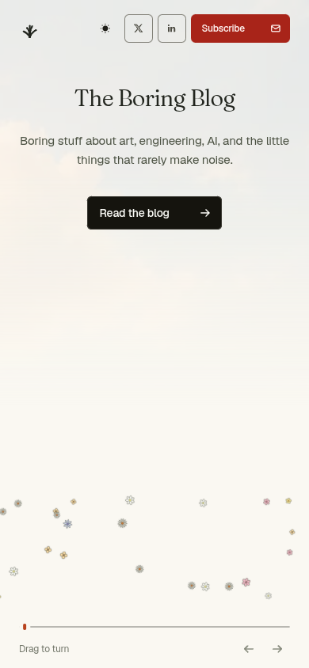

# UI Design System & Master Generation Blueprint: www-theboringblog-ai

> **The Boring Blog — art, engineering and AI** (http://www.theboringblog.ai/) — Boring stuff about art, engineering, AI, and the little things that rarely make noise.


---

## 1. Executive Visual Persona & Design Archetype

- **Brand Essence & Persona**: **The Boring Blog — art, engineering and AI** (`http://www.theboringblog.ai/`). Boring stuff about art, engineering, AI, and the little things that rarely make noise.
- **Capture Provenance**: Live browser capture (`tier2_webgl`, HTTP `200`, captured `2026-11-23`).
- **Visual Archetype**: **Light-Gallery WebGL / Canvas Interactive Experience (`#ffffff` / `#ff0000`)**.
- **Anti-AI-Slop Differentiators**:
  - **Live-Computed Chromatic Polarity**: Anchors the viewport in `#ffffff` (live computed `browser-default` `background-color` (`computed_styles.json`)) paired with `#0b0a06` primary typography and `#ff0000` accents.
  - **Grounded Typographic Hierarchy**: Pairs `Fraunces` for display copy (`The Boring Blog`) with `GeistSans` and `SF Mono`.
  - **Calibrated Spatial Grid & Motion**: Combines `96rem` container bounds (`gap: 64px`, padding `64px`) with `cubic-bezier(0,0,.2,1)` easing and Three.js / WebGL Canvas Pipeline.

---

## 2. Spatial Architecture & Modular Grid Mathematics



### Viewport Allocation & Container Geometry
- **Captured Viewport Dimensions**: Desktop `1440×900px` (`assets/desktop.png`, single-viewport 100vh live capture (900px)), Mobile `390×844px` (`assets/mobile.png`, single-viewport 100vh live capture (844px)).
- **Master Container Bounds**: `96rem` (non-`@media` desktop container stylesheet rule).
- **Canvas Lateral Padding & Spacing**: `64px` lateral canvas padding with `64px` grid gap.
- **Border Radius Scale**: `6px`, `var(--radius-full)`, `.25rem`, `3px`.

### Responsive Breakpoint Architecture
- **Desktop Layout**: Multi-column CSS Grid / Flexbox layout at `1440px` (`max-width: 96rem`, `gap: 64px`).
- **Mobile Layout**: Single-column vertical stack at `390px` viewport width with `64px` horizontal padding.
- **Extracted CSS Media Queries**: `@media (min-width:40rem)`, `@media (min-width:48rem)`, `@media (min-width:64rem)`, `@media (min-width:80rem)`.

---

## 3. Color System, Materiality & Atmospheric Lighting

### Semantic Palette & Source Grounding
| Semantic Role | Ground-Truth Value | Extracted Live / CSS Source |
|---|---|---|
| **Primary Canvas Substrate** | `#ffffff` | live computed `browser-default` `background-color` (`computed_styles.json`) |
| **Primary Typography Ink** | `#0b0a06` | `var(--color-ink-950)` in `:root` |
| **Elevated Surface / Card Substrate** | `#faf8f2` | `var(--paper-day)` in `:root` |
| **Interactive Accent / Highlight** | `#ff0000` | `.track__keys button:active { color: red }` (`#ff0000`) |
| **Secondary / Muted Copy** | `#818077` | `var(--color-ink-500)` in `:root` |
| **Structural Hairline Border** | `#ddd9cb` | `var(--line-day)` in `:root` |
| **Variable Token (`--color-context-figure`)** | `#d4d4d4` | `var(--color-context-figure)` in `:root` |
| **Variable Token (`--color-avatar-pink`)** | `#f9c2db` | `var(--color-avatar-pink)` in `:root` |
| **Variable Token (`--color-avatar-pink-text`)** | `#36222b` | `var(--color-avatar-pink-text)` in `:root` |
| **Variable Token (`--color-avatar-purple`)** | `#d7ccfe` | `var(--color-avatar-purple)` in `:root` |
| **Variable Token (`--color-avatar-purple-text`)** | `#2a2538` | `var(--color-avatar-purple-text)` in `:root` |
| **Variable Token (`--color-avatar-red`)** | `#ffc3c1` | `var(--color-avatar-red)` in `:root` |
| **Variable Token (`--color-avatar-red-text`)** | `#382222` | `var(--color-avatar-red-text)` in `:root` |
| **Variable Token (`--color-avatar-blue`)** | `#bcd8f5` | `var(--color-avatar-blue)` in `:root` |
| **Variable Token (`--color-avatar-blue-text`)** | `#1b2a3a` | `var(--color-avatar-blue-text)` in `:root` |
| **Variable Token (`--color-avatar-coral`)** | `#fdc6af` | `var(--color-avatar-coral)` in `:root` |
| **Variable Token (`--color-avatar-coral-text`)** | `#37231a` | `var(--color-avatar-coral-text)` in `:root` |

### Sanitized Root CSS Variables (`ui-ux.md` Ground Truth)
| Variable Name | Extracted Value | Semantic Role |
|---|---|---|
| `--omnibar-width` | `calc(var(--spacing) * 140)` | Layout / Spatial Grid Token |
| `--omnibar-bar` | `calc(var(--spacing) * 10 + var(--stroke-hairline) * 2)` | Design System Custom Token |
| `--radius-swatch` | `var(--radius-xs)` | Brand / Palette Token |
| `--radius-chrome` | `calc(var(--radius-control) + .25rem)` | Elevation / Border Token |
| `--color-context-figure` | `#d4d4d4` | Typography Ink Token |
| `--lightningcss-light` | `initial` | Canvas / Surface Token |
| `--color-avatar-pink` | `#f9c2db` | Typography Ink Token |
| `--color-avatar-pink-text` | `#36222b` | Typography Ink Token |
| `--color-avatar-purple` | `#d7ccfe` | Brand / Palette Token |
| `--color-avatar-purple-text` | `#2a2538` | Typography Ink Token |
| `--color-avatar-red` | `#ffc3c1` | Brand / Palette Token |
| `--color-avatar-red-text` | `#382222` | Typography Ink Token |
| `--color-avatar-blue` | `#bcd8f5` | Brand / Palette Token |
| `--color-avatar-blue-text` | `#1b2a3a` | Typography Ink Token |
| `--color-avatar-coral` | `#fdc6af` | Brand / Palette Token |
| `--color-avatar-coral-text` | `#37231a` | Typography Ink Token |

---

## 4. Typographic Scale & Editorial Hierarchy

### Font Family Stacks
- **Display Typography**: `Fraunces`.
- **Primary Body Stack**: `GeistSans`.
- **Technical / Metadata Stack**: `SF Mono`.

### Typographic Scale & Rules (Live Computed & Stylesheet Grounded)
- **Hero Display (`H1`)**: live computed `h1` (`font-size: 84.8px`, `line-height: 84.8px`, `font-weight: 400`, `letter-spacing: -2.3744px`); CSS variables `--font-display: "Fraunces", "Fraunces Fallback"`, `--text-display-sm: 1.75rem`, `--text-display-sm--line-height: 1.15`.
- **Section Heading (`H2`)**: CSS variables `--text-2xl: 1.5rem`, `--text-2xl--line-height: calc(2 / 1.5)`; rule `h2` (`font-size: clamp(1.7rem,5vw,2.7rem)`, `line-height: 1.06`, `letter-spacing: -.024em`, `font-weight: 400`).
- **Body Copy**: live computed `body` (`font-size: 16px`, `line-height: 24px`, `font-weight: 400`, `letter-spacing: -0.24px`); CSS variables `--text-base: 1rem`, `--text-base--line-height: calc(1.5 / 1)`; rule `p` (`font-size: var(--text-sm)`, `line-height: 1.6`).
- **Metadata & Navigation Labels**: live computed `nav/a` (`font-size: 16px`, `line-height: 24px`, `font-weight: 400`, `letter-spacing: -0.24px`); CSS variables `--font-mono: var(--font-geist-mono), ui-monospace, "SF Mono", "Cascadia Code", monospace`, `--text-xs: .75rem`, `--text-xs--line-height: calc(1 / .75)`; rule `small` (`font-size: inherit`).

---

## 5. Choreographed Motion & Interaction Physics

### Primary Easing Curves
- **Extracted Timing Functions**: `cubic-bezier(0,0,.2,1)`, `cubic-bezier(.4,0,.2,1)`, `cubic-bezier(.4,0,.6,1)`.

### Per-Element Transition & Choreography Rules
- **Selector `layer theme`**: `transition: .15s` extracted from `www-theboringblog-ai` stylesheet.
- **Selector `:autofill:active)`**: `transition: background-color 0s 2147480s,color 0s 2147480s` extracted from `www-theboringblog-ai` stylesheet.
- **Selector `.focus-bar:after`**: `transition: width var(--duration-fast) var(--ease-standard)` extracted from `www-theboringblog-ai` stylesheet.
- **Extracted Easing Curve (`cubic-bezier(0,0,.2,1)`)**: Governs interactive state transitions across `<header.mast>` and `<section.hero:nth(2)>`.
- **Runtime Interaction Engine**: Integrates Three.js / WebGL Canvas Pipeline with `prefers-reduced-motion: reduce` fallback guards.

---

## 6. Component Wireframe & Structural DOM Map

### Visual Layout Schematic — Desktop (`1440px`, Grounded in `dom.html` & Landmark Bounding Boxes)
```
┌────────────────────────────────────────────────────────────────────────┐
│ DESKTOP VIEWPORT (1440px) — The Boring Blog — art, engineering and AI  │
│ ====================================================================== │
│ [ <header.mast> (1440x97px)           | Overview · Index · Archive · ] │
│ ---------------------------------------------------------------------- │
│ | HERO STAGE: <section.hero> (w=1440px)                              | │
│ | H1: The Boring Blog                                                | │
│ | Substrate: #ffffff | Ink: #0b0a06 | Accent: #ff0000                | │
│ ---------------------------------------------------------------------- │
│ | SHOWCASE GRID (<section.hero:nth(2)>) max-w: 96rem                 | │
│ | +------------------------------+  +------------------------------+ | │
│ | | T h e n o t B o r i n g B l  |  | T h e n o t B o r i n g B l  | | │
│ | +------------------------------+  +------------------------------+ | │
│ ---------------------------------------------------------------------- │
│ | DETAIL MODULE (<section.hero:nth(3)>) — B o r i n g s t u f f      | │
│ ---------------------------------------------------------------------- │
│ [ FOOTER (<footer.hero__word> ) | http://www.theboringblog.ai/         │
└────────────────────────────────────────────────────────────────────────┘
```

### Visual Layout Schematic — Mobile Reflow (`390px`)
```
┌────────────────────────────────────────────────────────────────────────┐
│ MOBILE VIEWPORT REFLOW (390px) — Single-Column Stack (gap: 64px)       │
│ ====================================================================== │
│ [ HEADER BAR (<header.mast>           ) | Compact Menu (390px)         │
│ ---------------------------------------------------------------------- │
│ | HERO STAGE (<section.hero>) — 390px Vertical Lead                  | │
│ | H1: The Boring Blog                                                | │
│ ---------------------------------------------------------------------- │
│ | SHOWCASE STACK (<section.hero:nth(2)>) — 1-Col Stack               | │
│ | [ Item 1: T h e n o t B o r i n g B l o g ?                      ] | │
│ | [ Item 2: T h e n o t B o r i n g B l o g ?                      ] | │
│ ---------------------------------------------------------------------- │
│ | DETAIL STACK (<section.hero:nth(3)>) — 1-Col (B o r i n g s t u )  | │
│ ---------------------------------------------------------------------- │
│ [ FOOTER (<footer.hero__word> ) | Stacked 390px Colophon               │
└────────────────────────────────────────────────────────────────────────┘
```

### Granular DOM Region Breakdown
1. **Brand Header & Navigation Bar (<header.mast> — `www-theboringblog-ai`)**:
   - Landmark `<header class="mast">` (`1440x97px`) hosting `The Boring Blog — art, engineering a` navigation (`Overview · Index · Archive · About · Contact`), DOM attributes (`data-precedence="next"`, `data-precedence="next"`, `data-precedence="next"`, `data-precedence="next"`), and stylesheet rule `nces_3053e531-module__RZoG-q__cla... { font-family:Fraunces,Fraunces Fallback }`.
2. **Hero Stage & Focal Lead (<section.hero> — `The Boring Blog`)**:
   - Landmark `<section class="hero">` presenting display lead `The Boring Blog` and copy excerpt *"Boring stuff about art, engineering, AI, and the little things th"* over `#ffffff` canvas and `#0b0a06` ink.
3. **Primary Showcase & Content Grid (<section.hero:nth(2)> — `T h e n o t B o r i n g B l o g ?`)**:
   - Landmark `<section class="hero">` rendering section `T h e n o t B o r i n g B l o g ?` with copy *"T h e n o t B o r i n g B l o g ?"*, asset references (`2cu5yowomccdq.css`, `3njp7nmul3k7y.css`, `1g5rc0qzmf3ta.css`, `1l3760h_x0b06.css`), and grid rule `unces_3053e531-module__RZoG-q__va... { --font-display:"Fraunces", "Fraunces Fallback" }`.
4. **Interactive Detail & Feature Matrix (<section.hero:nth(3)> — `T h e n o t B o r i n g B l o g ?`)**:
   - Landmark `<section class="hero">` framing `T h e n o t B o r i n g B l o g ?` and `B o r i n g s t u f f a b o u t a r t , e n g i ` (*"B o r i n g s t u f f a b o u t a r t , e n g i n e e r i n g , A"*) with `#faf8f2` surface cards, `#ff0000` accents, and `sans_d5a4f12f-module__7QEr8W__cla... { font-family:GeistSans,GeistSans Fallback }`.
5. **Colophon & Global Directory Footer (<footer.hero__word> — `http://www.theboringblog.ai/`)**:
   - Landmark `<footer class="hero__word">` anchoring `The Boring Blog — art, engineeri` footer links (`Overview · Index · Archive · About · Contact`), copy *"e n g i n e e r i n g ,"*, and `#ddd9cb` structural dividers.

---

## 7. Master Zero-Shot AI Generation Prompt

```markdown
# Master Zero-Shot Frontend Generation Prompt: www-theboringblog-ai (The Boring Blog — art, engineering and AI)

You are a principal frontend architect and design systems engineer. Build a complete, production-ready web application replicating the exact design system, DOM landmarks, typographic hierarchy, color tokens, and motion physics of `www-theboringblog-ai` (**The Boring Blog — art, engineering and AI** — `http://www.theboringblog.ai/`).

### 1. Visual Archetype & Anti-AI-Slop Mandates
- **Archetype**: Light-Gallery WebGL / Canvas Interactive Experience (`#ffffff` / `#ff0000`).
- **Identity & Domain Context**: Boring stuff about art, engineering, AI, and the little things that rarely make noise.
- **Primary Substrate**: `#ffffff` (live computed `browser-default` `background-color` (`computed_styles.json`)), **Primary Ink**: `#0b0a06`, **Accent / Highlight**: `#ff0000`.
- **Site-Specific Differentiators**:
  - **Live-Computed Chromatic Polarity**: Anchors the viewport in `#ffffff` (live computed `browser-default` `background-color` (`computed_styles.json`)) paired with `#0b0a06` primary typography and `#ff0000` accents.
  - **Grounded Typographic Hierarchy**: Pairs `Fraunces` for display copy (`The Boring Blog`) with `GeistSans` and `SF Mono`.
  - **Calibrated Spatial Grid & Motion**: Combines `96rem` container bounds (`gap: 64px`, padding `64px`) with `cubic-bezier(0,0,.2,1)` easing and Three.js / WebGL Canvas Pipeline.

### 2. Ground-Truth CSS Variables (`:root` Token Contract)
Declare and consume these exact custom properties extracted from `www-theboringblog-ai` in your global stylesheet:

:root {
  /* The Boring Blog — art, engineering and AI (www-theboringblog-ai) — Live-Grounded CSS Variables */
  --omnibar-width: calc(var(--spacing) * 140); /* Layout / Spatial Grid Token (www-theboringblog-ai) */
  --omnibar-bar: calc(var(--spacing) * 10 + var(--stroke-hairline) * 2); /* Design System Custom Token (www-theboringblog-ai) */
  --radius-swatch: var(--radius-xs); /* Brand / Palette Token (www-theboringblog-ai) */
  --radius-chrome: calc(var(--radius-control) + .25rem); /* Elevation / Border Token (www-theboringblog-ai) */
  --color-context-figure: #d4d4d4; /* Typography Ink Token (www-theboringblog-ai) */
  --lightningcss-light: initial; /* Canvas / Surface Token (www-theboringblog-ai) */
  --color-avatar-pink: #f9c2db; /* Typography Ink Token (www-theboringblog-ai) */
  --color-avatar-pink-text: #36222b; /* Typography Ink Token (www-theboringblog-ai) */
  --color-avatar-purple: #d7ccfe; /* Brand / Palette Token (www-theboringblog-ai) */
  --color-avatar-purple-text: #2a2538; /* Typography Ink Token (www-theboringblog-ai) */
  --color-avatar-red: #ffc3c1; /* Brand / Palette Token (www-theboringblog-ai) */
  --color-avatar-red-text: #382222; /* Typography Ink Token (www-theboringblog-ai) */
  --color-avatar-blue: #bcd8f5; /* Brand / Palette Token (www-theboringblog-ai) */
  --color-avatar-blue-text: #1b2a3a; /* Typography Ink Token (www-theboringblog-ai) */
  --color-avatar-coral: #fdc6af; /* Brand / Palette Token (www-theboringblog-ai) */
  --color-avatar-coral-text: #37231a; /* Typography Ink Token (www-theboringblog-ai) */
}

### 3. Semantic Color & Materiality Contract
Map every surface, ink, and border strictly to these source-grounded tokens:
- **Primary Canvas Substrate**: `#ffffff` — grounded in live computed `browser-default` `background-color` (`computed_styles.json`)
- **Primary Typography Ink**: `#0b0a06` — grounded in `var(--color-ink-950)` in `:root`
- **Elevated Surface / Card Substrate**: `#faf8f2` — grounded in `var(--paper-day)` in `:root`
- **Interactive Accent / Highlight**: `#ff0000` — grounded in `.track__keys button:active { color: red }` (`#ff0000`)
- **Secondary / Muted Copy**: `#818077` — grounded in `var(--color-ink-500)` in `:root`
- **Structural Hairline Border**: `#ddd9cb` — grounded in `var(--line-day)` in `:root`
- **Variable Token (`--color-context-figure`)**: `#d4d4d4` — grounded in `var(--color-context-figure)` in `:root`
- **Variable Token (`--color-avatar-pink`)**: `#f9c2db` — grounded in `var(--color-avatar-pink)` in `:root`
- **Variable Token (`--color-avatar-pink-text`)**: `#36222b` — grounded in `var(--color-avatar-pink-text)` in `:root`
- **Variable Token (`--color-avatar-purple`)**: `#d7ccfe` — grounded in `var(--color-avatar-purple)` in `:root`
- **Variable Token (`--color-avatar-purple-text`)**: `#2a2538` — grounded in `var(--color-avatar-purple-text)` in `:root`
- **Variable Token (`--color-avatar-red`)**: `#ffc3c1` — grounded in `var(--color-avatar-red)` in `:root`
- **Variable Token (`--color-avatar-red-text`)**: `#382222` — grounded in `var(--color-avatar-red-text)` in `:root`
- **Variable Token (`--color-avatar-blue`)**: `#bcd8f5` — grounded in `var(--color-avatar-blue)` in `:root`
- **Variable Token (`--color-avatar-blue-text`)**: `#1b2a3a` — grounded in `var(--color-avatar-blue-text)` in `:root`
- **Variable Token (`--color-avatar-coral`)**: `#fdc6af` — grounded in `var(--color-avatar-coral)` in `:root`
- **Variable Token (`--color-avatar-coral-text`)**: `#37231a` — grounded in `var(--color-avatar-coral-text)` in `:root`

### 4. Spatial Grid, Container Bounds & Responsive Breakpoints
- **Desktop Viewport Reference**: `1440×900px` (single-viewport 100vh live capture (900px), `1440px` standard desktop width).
- **Mobile Viewport Reference**: `390×844px` (single-viewport 100vh live capture (844px), `390px` standard mobile width).
- **Container Max-Width**: `96rem` (non-`@media` desktop container stylesheet rule)
- **Padding & Gutters**: `64px` lateral canvas padding with `64px` grid gap
- **Desktop Grid**: Multi-column CSS Grid / Flexbox layout at `1440px` (`max-width: 96rem`, `gap: 64px`)
- **Mobile Adaptation**: Single-column vertical stack at `390px` viewport width with `64px` horizontal padding
- **Media Queries**: `@media (min-width:40rem)`, `@media (min-width:48rem)`, `@media (min-width:64rem)`, `@media (min-width:80rem)`
- **Corner Radii**: `6px`, `var(--radius-full)`, `.25rem`, `3px`

### 5. Typography & Editorial Scale Contract
- **Display Font Stack**: `Fraunces`
- **Body Font Stack**: `GeistSans`
- **Monospace / Technical Font Stack**: `SF Mono`
- **H1 Display Rule**: live computed `h1` (`font-size: 84.8px`, `line-height: 84.8px`, `font-weight: 400`, `letter-spacing: -2.3744px`); CSS variables `--font-display: "Fraunces", "Fraunces Fallback"`, `--text-display-sm: 1.75rem`, `--text-display-sm--line-height: 1.15`
- **H2 Section Rule**: CSS variables `--text-2xl: 1.5rem`, `--text-2xl--line-height: calc(2 / 1.5)`; rule `h2` (`font-size: clamp(1.7rem,5vw,2.7rem)`, `line-height: 1.06`, `letter-spacing: -.024em`, `font-weight: 400`)
- **Body Copy Rule**: live computed `body` (`font-size: 16px`, `line-height: 24px`, `font-weight: 400`, `letter-spacing: -0.24px`); CSS variables `--text-base: 1rem`, `--text-base--line-height: calc(1.5 / 1)`; rule `p` (`font-size: var(--text-sm)`, `line-height: 1.6`)
- **Metadata & Index Rule**: live computed `nav/a` (`font-size: 16px`, `line-height: 24px`, `font-weight: 400`, `letter-spacing: -0.24px`); CSS variables `--font-mono: var(--font-geist-mono), ui-monospace, "SF Mono", "Cascadia Code", monospace`, `--text-xs: .75rem`, `--text-xs--line-height: calc(1 / .75)`; rule `small` (`font-size: inherit`)

### 6. Component Hierarchy, Verbatim Copy & Real DOM Landmarks
Scaffold `www-theboringblog-ai` (`The Boring Blog — art, engineering and AI`) with these exact structural regions, extracted copy, and CSS rules from `dom.html`:
1. **Brand Header & Navigation Bar (<header.mast> — `www-theboringblog-ai`)**:
   - DOM & Selectors: Landmark `<header class="mast">` (`1440x97px`) hosting `The Boring Blog — art, engineering a` navigation (`Overview · Index · Archive · About · Contact`), DOM attributes (`data-precedence="next"`, `data-precedence="next"`, `data-precedence="next"`, `data-precedence="next"`), and stylesheet rule `nces_3053e531-module__RZoG-q__cla... { font-family:Fraunces,Fraunces Fallback }`.
   - Responsive Contract: Header `Brand Header & Navigation Bar (<header.mast> — `www-theboringblog-ai`)` (`www-theboringblog-ai`) adapts across `@media (min-width:40rem)`, `@media (min-width:48rem)`, `@media (min-width:64rem)`, `@media (min-width:80rem)` with `cubic-bezier(0,0,.2,1)`, `cubic-bezier(.4,0,.2,1)`, `cubic-bezier(.4,0,.6,1)` transitions and links `Overview · Index · Archive · About · Contact`.
2. **Hero Stage & Focal Lead (<section.hero> — `The Boring Blog`)**:
   - DOM & Selectors: Landmark `<section class="hero">` presenting display lead `The Boring Blog` and copy excerpt *"Boring stuff about art, engineering, AI, and the little things th"* over `#ffffff` canvas and `#0b0a06` ink.
   - Responsive Contract: Hero stage (`1440×900px` desktop / `390×844px` mobile) sets `#ffffff` background with `#0b0a06` headline `The Boring Blog`.
3. **Primary Showcase & Content Grid (<section.hero:nth(2)> — `T h e n o t B o r i n g B l o g ?`)**:
   - DOM & Selectors: Landmark `<section class="hero">` rendering section `T h e n o t B o r i n g B l o g ?` with copy *"T h e n o t B o r i n g B l o g ?"*, asset references (`2cu5yowomccdq.css`, `3njp7nmul3k7y.css`, `1g5rc0qzmf3ta.css`, `1l3760h_x0b06.css`), and grid rule `unces_3053e531-module__RZoG-q__va... { --font-display:"Fraunces", "Fraunces Fallback" }`.
   - Responsive Contract: Showcase grid `Primary Showcase & Content Grid (<section.hero:nth(2)> — `T h e n o t B o r i n g B l o g ?`)` applies Multi-column CSS Grid / Flexbox layout at `1440px` (`max-width: 96rem`, `gap: 64px`) on desktop and Single-column vertical stack at `390px` viewport width with `64px` horizontal padding on mobile.
4. **Interactive Detail & Feature Matrix (<section.hero:nth(3)> — `T h e n o t B o r i n g B l o g ?`)**:
   - DOM & Selectors: Landmark `<section class="hero">` framing `T h e n o t B o r i n g B l o g ?` and `B o r i n g s t u f f a b o u t a r t , e n g i ` (*"B o r i n g s t u f f a b o u t a r t , e n g i n e e r i n g , A"*) with `#faf8f2` surface cards, `#ff0000` accents, and `sans_d5a4f12f-module__7QEr8W__cla... { font-family:GeistSans,GeistSans Fallback }`.
   - Responsive Contract: Detail module `Interactive Detail & Feature Matrix (<section.hero:nth(3)> — `T h e n o t B o r i n g B l o g ?`)` uses `6px`, `var(--radius-full)`, `.25rem`, `3px` radii, `#ff0000` highlights, and assets (2cu5yowomccdq.css, 3njp7nmul3k7y.css, 1g5rc0qzmf3ta.css).
5. **Colophon & Global Directory Footer (<footer.hero__word> — `http://www.theboringblog.ai/`)**:
   - DOM & Selectors: Landmark `<footer class="hero__word">` anchoring `The Boring Blog — art, engineeri` footer links (`Overview · Index · Archive · About · Contact`), copy *"e n g i n e e r i n g ,"*, and `#ddd9cb` structural dividers.
   - Responsive Contract: Footer `Colophon & Global Directory Footer (<footer.hero__word> — `http://www.theboringblog.ai/`)` aligns to `96rem` (non-`@media` desktop container stylesheet rule) with `64px` lateral canvas padding with `64px` grid gap and attributes (data-precedence="next", data-precedence="next", data-precedence="next").

#### Verbatim DOM Copy Excerpts (`dom.html`)
- Copy Excerpt 1: *"Boring stuff about art, engineering, AI, and the little things that rarely make no..."*
- Copy Excerpt 2: *"T h e n o t B o r i n g B l o g ?"*
- Copy Excerpt 3: *"B o r i n g s t u f f a b o u t a r t , e n g i n e e r i n g , A I , a n d t h e..."*
- Copy Excerpt 4: *"e n g i n e e r i n g ,"*

### 7. Motion, Extracted Stylesheet Rules & Interaction Choreography
- **Primary Easing Functions**: `cubic-bezier(0,0,.2,1)`, `cubic-bezier(.4,0,.2,1)`, `cubic-bezier(.4,0,.6,1)`
- **Extracted Stylesheet Rules (`www-theboringblog-ai`)**:
- `nces_3053e531-module__RZoG-q__cla... { font-family:Fraunces,Fraunces Fallback }`
- `unces_3053e531-module__RZoG-q__va... { --font-display:"Fraunces", "Fraunces Fallback" }`
- `sans_d5a4f12f-module__7QEr8W__cla... { font-family:GeistSans,GeistSans Fallback }`
- `tsans_d5a4f12f-module__7QEr8W__va... { --font-geist-sans:"GeistSans", "GeistSans Fallback" }`
- `host { --omnibar-bar:0px;--night:0;--gold:0 }`
- **Per-Selector Transition Rules**:
- **Selector `layer theme`**: `transition: .15s` extracted from `www-theboringblog-ai` stylesheet.
- **Selector `:autofill:active)`**: `transition: background-color 0s 2147480s,color 0s 2147480s` extracted from `www-theboringblog-ai` stylesheet.
- **Selector `.focus-bar:after`**: `transition: width var(--duration-fast) var(--ease-standard)` extracted from `www-theboringblog-ai` stylesheet.
- **Extracted Easing Curve (`cubic-bezier(0,0,.2,1)`)**: Governs interactive state transitions across `<header.mast>` and `<section.hero:nth(2)>`.
- **Runtime Interaction Engine**: Integrates Three.js / WebGL Canvas Pipeline with `prefers-reduced-motion: reduce` fallback guards.

### 8. Technical Deliverables
- Implement in Next.js (App Router) with TypeScript and Tailwind CSS consuming the `:root` custom properties defined above for `www-theboringblog-ai`.
- Reproduce both the `1440px` desktop architecture and `390px` mobile breakpoint transitions, preserving semantic HTML5 landmarks (`<header>`, `<nav>`, `<main>`, `<section>`, `<footer>`) and `prefers-reduced-motion` accessibility guards.
```
