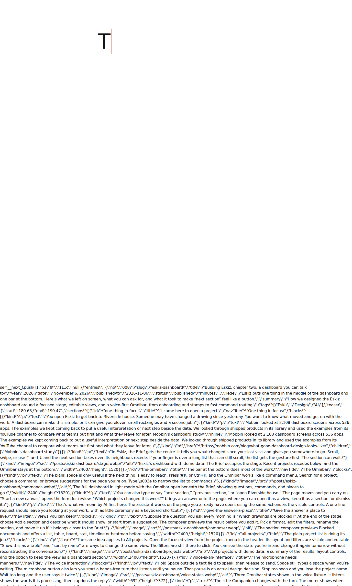

# UI Design System & Master Generation Blueprint: www-theboringblog-ai

> **The Boring Blog — art, engineering and AI** (http://www.theboringblog.ai/) — Boring stuff about art, engineering, AI, and the little things that rarely make noise.



---

## 1. Executive Visual Persona & Design Archetype

- **Brand Essence & Persona**: **The Boring Blog — art, engineering and AI** (`http://www.theboringblog.ai/`). Boring stuff about art, engineering, AI, and the little things that rarely make noise.
- **Visual Archetype**: **Light-Gallery WebGL / Canvas Interactive Experience (`#fff` / `#f5f4ee`)**.
- **Anti-AI-Slop Differentiators**:
  - **Source-Grounded Chromatic Polarity**: Anchors the viewport in `#fff` (`var(--color-ink-0)` in `:root`) paired with `#e4e3db` primary typography and `#f5f4ee` accents.
  - **Extracted Typographic Hierarchy**: Pairs `Fraunces` for display copy (`T h e n o t B o r i n g B l o g ?`) with `Fraunces Fallback` and `SFMono-Regular`.
  - **Calibrated Spatial Grid & Motion**: Combines `600px` container bounds (`gap: 4px`, padding `var(--gutter)`) with `cubic-bezier(.16,1,.3,1)` easing and Three.js / WebGL Canvas Pipeline.

---

## 2. Spatial Architecture & Modular Grid Mathematics


### Viewport Allocation & Container Geometry
- **Captured Viewport Dimensions**: Desktop `1440×2400px` (`assets/desktop.png`, capped at 2400px multi-section capture), Mobile `390×2400px` (`assets/mobile.png`, capped at 2400px multi-section capture).
- **Master Container Bounds**: `600px` extracted from `www-theboringblog-ai` stylesheet.
- **Canvas Lateral Padding & Spacing**: `var(--gutter)` lateral canvas padding with `4px` grid gap.
- **Border Radius Scale**: `var(--radius-control)`, `3px`, `999px`, `50%`.

### Responsive Breakpoint Architecture
- **Desktop Layout**: Multi-column CSS Grid / Flexbox layout at `1440px` (`max-width: 600px`, `gap: 4px`).
- **Mobile Layout**: Single-column vertical stack at `390px` viewport width with `var(--gutter)` horizontal padding.
- **Extracted CSS Media Queries**: `@media (max-width:600px)`, `@media (max-width:40rem)`, `@media (prefers-reduced-motion:reduce)`, `@media (min-width:60rem)`.

---

## 3. Color System, Materiality & Atmospheric Lighting

### Semantic Palette & Source Grounding
| Semantic Role | Ground-Truth Value | Extracted CSS Source / Selector |
|---|---|---|
| **Primary Canvas Substrate** | `#fff` | `var(--color-ink-0)` in `:root` |
| **Primary Typography Ink** | `#fcfbf6` | `var(--color-ink-25)` in `:root` |
| **Elevated Surface / Card Substrate** | `#fafaf6` | `var(--color-ink-50)` in `:root` |
| **Interactive Accent / Highlight** | `#f5f4ee` | `var(--color-ink-100)` in `:root` |
| **Secondary / Muted Copy** | `#eeede6` | `var(--color-ink-200)` in `:root` |
| **Structural Hairline Border** | `#e4e3db` | `var(--color-ink-300)` in `:root` |

### Sanitized Root CSS Variables (`ui-ux.md` Ground Truth)
| Variable Name | Extracted Value | Semantic Role |
|---|---|---|
| `--rail` | `calc(2px + var(--reach,0) * 2px)` | Dimension / Scale Token |
| `--walk` | `0` | Design System Custom Token |
| `--clip-to` | `inset(-.5rem round var(--radius-control))` | Dimension / Scale Token |
| `--omnibar-bar` | `0px` | Dimension / Scale Token |
| `--night` | `0` | Design System Custom Token |
| `--gold` | `0` | Design System Custom Token |
| `--font-mono` | `var(--font-geist-mono), ui-monospace, "SF Mono", "Cascadia Code", monospace` | Typography / Scale Token |
| `--spacing` | `.25rem` | Layout / Spatial Grid Token |
| `--container-xs` | `20rem` | Layout / Spatial Grid Token |
| `--container-sm` | `24rem` | Layout / Spatial Grid Token |
| `--container-md` | `28rem` | Layout / Spatial Grid Token |
| `--container-lg` | `32rem` | Layout / Spatial Grid Token |
| `--container-xl` | `36rem` | Layout / Spatial Grid Token |
| `--container-3xl` | `48rem` | Layout / Spatial Grid Token |
| `--container-6xl` | `72rem` | Layout / Spatial Grid Token |
| `--text-xs` | `.75rem` | Typography Ink Token |

---

## 4. Typographic Scale & Editorial Hierarchy

### Font Family Stacks
- **Display Typography**: `Fraunces`.
- **Primary Body Stack**: `Fraunces Fallback`.
- **Technical / Metadata Stack**: `SFMono-Regular`.

### Typographic Scale & Rules (Extracted from Stylesheet & Variables)
- **Hero Display (`H1`)**: CSS variables `--text-display-sm: 1.75rem`, `--text-display-sm--line-height: 1.15`, `--text-display-sm--letter-spacing: -.025em`.
- **Section Heading (`H2`)**: CSS variables `--text-2xl: 1.5rem`, `--text-2xl--line-height: calc(2 / 1.5)`; rule `h2` (`font-size: clamp(1.7rem,5vw,2.7rem)`, `line-height: 1.06`, `letter-spacing: -.024em`, `font-weight: 400`).
- **Body Copy**: CSS variables `--text-base: 1rem`, `--text-base--line-height: calc(1.5 / 1)`; rule `p` (`font-size: var(--text-sm)`, `line-height: 1.6`).
- **Metadata & Navigation Labels**: CSS variables `--font-mono: var(--font-geist-mono), ui-monospace, "SF Mono", "Cascadia Code", monospace`, `--text-xs: .75rem`, `--text-xs--line-height: calc(1 / .75)`; rule `small` (`font-size: inherit`).

---

## 5. Choreographed Motion & Interaction Physics

### Primary Easing Curves
- **Extracted Timing Functions**: `cubic-bezier(.16,1,.3,1)`, `cubic-bezier(0,0,.2,1)`, `cubic-bezier(.4,0,.2,1)`.

### Per-Element Transition & Choreography Rules
- **Selector `.track__seg`**: `transition: clip-path var(--duration-slower) var(--ease-settle), inset-blo...` extracted from `www-theboringblog-ai` stylesheet.
- **Selector `.track__thumb`**: `transition: translate var(--duration-slower) var(--ease-settle), block-siz...` extracted from `www-theboringblog-ai` stylesheet.
- **Selector `.thumb-layer.is-dragging .track__...`**: `transition: none` extracted from `www-theboringblog-ai` stylesheet.
- **Extracted Easing Curve (`cubic-bezier(.16,1,.3,1)`)**: Governs interactive state transitions across `<header.mast>` and `<section.hero>`.
- **Runtime Interaction Engine**: Integrates Three.js / WebGL Canvas Pipeline with `prefers-reduced-motion: reduce` fallback guards.

---

## 6. Component Wireframe & Structural DOM Map

### Visual Layout Schematic (Grounded in `dom.html` — `1440px` Desktop & `390px` Mobile Reflow)
```
┌────────────────────────────────────────────────────────────────────────┐
│ DESKTOP VIEWPORT (1440px) — The Boring Blog — art, engineering and AI  │
│ ====================================================================== │
│ [ <header.mast>            | Overview · Index · Archive · About · C ]  │
│ ---------------------------------------------------------------------- │
│ | HERO STAGE: <section.hero>                                       |   │
│ | H1: T h e n o t B o r i n g B l o g ?                            |   │
│ | Substrate: #fff       | Ink: #e4e3db    | Accent: #f5f4ee        |   │
│ ---------------------------------------------------------------------- │
│ | SHOWCASE GRID (<section.hero>            ) max-w: 600px          |   │
│ | +------------------------------+  +------------------------------+ | │
│ | | T h e n o t B o r i n g B l  |  | B o r i n g s t u f f a b o  | | │
│ | +------------------------------+  +------------------------------+ | │
│ ---------------------------------------------------------------------- │
│ | MOBILE VIEWPORT REFLOW (390px) — Single-Column Stack (gap: 4px   ) | │
│ | [<header.mast>] -> [<section.hero>] -> [<section.hero>] |            │
│ ---------------------------------------------------------------------- │
│ [ FOOTER (<footer.hero__word>   ) | http://www.theboringblog.ai/       │
└────────────────────────────────────────────────────────────────────────┘
```

### Granular DOM Region Breakdown
1. **Brand Header & Navigation Bar (<header.mast> — `www-theboringblog-ai`)**:
   - Landmark `<header class="mast">` hosting `The Boring Blog — art, engineering a` navigation (`Overview · Index · Archive · About · Contact`), DOM attributes (`data-precedence="next"`, `data-precedence="next"`, `data-precedence="next"`, `data-precedence="next"`), and stylesheet rule `.number-demo .demo__stage { padding:calc(var(--spacing) * 6);overflow:visible }`.
2. **Hero Stage & Focal Lead (<section.hero> — `T h e n o t B o r i n g B l o g ?`)**:
   - Landmark `<section class="hero">` presenting display lead `T h e n o t B o r i n g B l o g ?` and copy excerpt *"T h e n o t B o r i n g B l o g ?"* over `#fff` canvas and `#e4e3db` ink.
3. **Primary Showcase & Content Grid (<section.hero> — `T h e n o t B o r i n g B l o g ?`)**:
   - Landmark `<section class="hero">` rendering section `T h e n o t B o r i n g B l o g ?` with copy *"B o r i n g s t u f f a b o u t a r t , e n g i n e e r i n g , A"*, asset references (`3u9ew09158abr.css`, `331x1juguzcku.css`, `1g5rc0qzmf3ta.css`, `1l3760h_x0b06.css`), and grid rule `.number-demo .demo__frame { overflow:visible }`.
4. **Interactive Detail & Feature Matrix (<section.hero> — `B o r i n g s t u f f a b o u t a `)**:
   - Landmark `<section class="hero">` framing `B o r i n g s t u f f a b o u t a r t , e n g i ` and `e n g i n e e r i n g ,` (*"e n g i n e e r i n g ,"*) with `#fafaf6` surface cards, `#f5f4ee` accents, and `.number-demo__states { gap:calc(var(--spacing) * 6);grid-template-columns:repeat(2,minmax(0,1fr... }`.
5. **Colophon & Global Directory Footer (<footer.hero__word> — `http://www.theboringblog.ai/`)**:
   - Landmark `<footer class="hero__word">` anchoring `The Boring Blog — art, engineeri` footer links (`Overview · Index · Archive · About · Contact`), copy *"B o r i n g s t u f f a b o u t a r t , e n g i "*, and `#e4e3db` structural dividers.

---

## 7. Master Zero-Shot AI Generation Prompt

```markdown
# Master Zero-Shot Frontend Generation Prompt: www-theboringblog-ai (The Boring Blog — art, engineering and AI)

You are a principal frontend architect and design systems engineer. Build a complete, production-ready web application replicating the exact design system, DOM landmarks, typographic hierarchy, color tokens, and motion physics of `www-theboringblog-ai` (**The Boring Blog — art, engineering and AI** — `http://www.theboringblog.ai/`).

### 1. Visual Archetype & Anti-AI-Slop Mandates
- **Archetype**: Light-Gallery WebGL / Canvas Interactive Experience (`#fff` / `#f5f4ee`).
- **Identity & Domain Context**: Boring stuff about art, engineering, AI, and the little things that rarely make noise.
- **Primary Substrate**: `#fff` (`var(--color-ink-0)` in `:root`), **Primary Ink**: `#e4e3db`, **Accent / Highlight**: `#f5f4ee`.
- **Site-Specific Differentiators**:
  - **Source-Grounded Chromatic Polarity**: Anchors the viewport in `#fff` (`var(--color-ink-0)` in `:root`) paired with `#e4e3db` primary typography and `#f5f4ee` accents.
  - **Extracted Typographic Hierarchy**: Pairs `Fraunces` for display copy (`T h e n o t B o r i n g B l o g ?`) with `Fraunces Fallback` and `SFMono-Regular`.
  - **Calibrated Spatial Grid & Motion**: Combines `600px` container bounds (`gap: 4px`, padding `var(--gutter)`) with `cubic-bezier(.16,1,.3,1)` easing and Three.js / WebGL Canvas Pipeline.

### 2. Ground-Truth CSS Variables (`:root` Token Contract)
Declare and consume these exact custom properties extracted from `www-theboringblog-ai` in your global stylesheet:

:root {
  /* The Boring Blog — art, engineering and AI (www-theboringblog-ai) — Ground-Truth Extracted CSS Variables */
  --rail: calc(2px + var(--reach,0) * 2px); /* Dimension / Scale Token (www-theboringblog-ai) */
  --walk: 0; /* Design System Custom Token (www-theboringblog-ai) */
  --clip-to: inset(-.5rem round var(--radius-control)); /* Dimension / Scale Token (www-theboringblog-ai) */
  --omnibar-bar: 0px; /* Dimension / Scale Token (www-theboringblog-ai) */
  --night: 0; /* Design System Custom Token (www-theboringblog-ai) */
  --gold: 0; /* Design System Custom Token (www-theboringblog-ai) */
  --font-mono: var(--font-geist-mono), ui-monospace, "SF Mono", "Cascadia Code", monospace; /* Typography / Scale Token (www-theboringblog-ai) */
  --spacing: .25rem; /* Layout / Spatial Grid Token (www-theboringblog-ai) */
  --container-xs: 20rem; /* Layout / Spatial Grid Token (www-theboringblog-ai) */
  --container-sm: 24rem; /* Layout / Spatial Grid Token (www-theboringblog-ai) */
  --container-md: 28rem; /* Layout / Spatial Grid Token (www-theboringblog-ai) */
  --container-lg: 32rem; /* Layout / Spatial Grid Token (www-theboringblog-ai) */
  --container-xl: 36rem; /* Layout / Spatial Grid Token (www-theboringblog-ai) */
  --container-3xl: 48rem; /* Layout / Spatial Grid Token (www-theboringblog-ai) */
  --container-6xl: 72rem; /* Layout / Spatial Grid Token (www-theboringblog-ai) */
  --text-xs: .75rem; /* Typography Ink Token (www-theboringblog-ai) */
}

### 3. Semantic Color & Materiality Contract
Map every surface, ink, and border strictly to these source-grounded tokens:
- **Primary Canvas Substrate**: `#fff` — grounded in `var(--color-ink-0)` in `:root`
- **Primary Typography Ink**: `#fcfbf6` — grounded in `var(--color-ink-25)` in `:root`
- **Elevated Surface / Card Substrate**: `#fafaf6` — grounded in `var(--color-ink-50)` in `:root`
- **Interactive Accent / Highlight**: `#f5f4ee` — grounded in `var(--color-ink-100)` in `:root`
- **Secondary / Muted Copy**: `#eeede6` — grounded in `var(--color-ink-200)` in `:root`
- **Structural Hairline Border**: `#e4e3db` — grounded in `var(--color-ink-300)` in `:root`

### 4. Spatial Grid, Container Bounds & Responsive Breakpoints
- **Desktop Viewport Reference**: `1440×2400px` (capped at 2400px multi-section capture, `1440px` standard desktop width).
- **Mobile Viewport Reference**: `390×2400px` (capped at 2400px multi-section capture, `390px` standard mobile width).
- **Container Max-Width**: `600px` extracted from `www-theboringblog-ai` stylesheet
- **Padding & Gutters**: `var(--gutter)` lateral canvas padding with `4px` grid gap
- **Desktop Grid**: Multi-column CSS Grid / Flexbox layout at `1440px` (`max-width: 600px`, `gap: 4px`)
- **Mobile Adaptation**: Single-column vertical stack at `390px` viewport width with `var(--gutter)` horizontal padding
- **Media Queries**: `@media (max-width:600px)`, `@media (max-width:40rem)`, `@media (prefers-reduced-motion:reduce)`, `@media (min-width:60rem)`
- **Corner Radii**: `var(--radius-control)`, `3px`, `999px`, `50%`

### 5. Typography & Editorial Scale Contract
- **Display Font Stack**: `Fraunces`
- **Body Font Stack**: `Fraunces Fallback`
- **Monospace / Technical Font Stack**: `SFMono-Regular`
- **H1 Display Rule**: CSS variables `--text-display-sm: 1.75rem`, `--text-display-sm--line-height: 1.15`, `--text-display-sm--letter-spacing: -.025em`
- **H2 Section Rule**: CSS variables `--text-2xl: 1.5rem`, `--text-2xl--line-height: calc(2 / 1.5)`; rule `h2` (`font-size: clamp(1.7rem,5vw,2.7rem)`, `line-height: 1.06`, `letter-spacing: -.024em`, `font-weight: 400`)
- **Body Copy Rule**: CSS variables `--text-base: 1rem`, `--text-base--line-height: calc(1.5 / 1)`; rule `p` (`font-size: var(--text-sm)`, `line-height: 1.6`)
- **Metadata & Index Rule**: CSS variables `--font-mono: var(--font-geist-mono), ui-monospace, "SF Mono", "Cascadia Code", monospace`, `--text-xs: .75rem`, `--text-xs--line-height: calc(1 / .75)`; rule `small` (`font-size: inherit`)

### 6. Component Hierarchy, Verbatim Copy & Real DOM Landmarks
Scaffold `www-theboringblog-ai` (`The Boring Blog — art, engineering and AI`) with these exact structural regions, extracted copy, and CSS rules from `dom.html`:
1. **Brand Header & Navigation Bar (<header.mast> — `www-theboringblog-ai`)**:
   - DOM & Selectors: Landmark `<header class="mast">` hosting `The Boring Blog — art, engineering a` navigation (`Overview · Index · Archive · About · Contact`), DOM attributes (`data-precedence="next"`, `data-precedence="next"`, `data-precedence="next"`, `data-precedence="next"`), and stylesheet rule `.number-demo .demo__stage { padding:calc(var(--spacing) * 6);overflow:visible }`.
   - Responsive Contract: Header `Brand Header & Navigation Bar (<header.mast> — `www-theboringblog-ai`)` (`www-theboringblog-ai`) adapts across `@media (max-width:600px)`, `@media (max-width:40rem)`, `@media (prefers-reduced-motion:reduce)`, `@media (min-width:60rem)` with `cubic-bezier(.16,1,.3,1)`, `cubic-bezier(0,0,.2,1)`, `cubic-bezier(.4,0,.2,1)` transitions and links `Overview · Index · Archive · About · Contact`.
2. **Hero Stage & Focal Lead (<section.hero> — `T h e n o t B o r i n g B l o g ?`)**:
   - DOM & Selectors: Landmark `<section class="hero">` presenting display lead `T h e n o t B o r i n g B l o g ?` and copy excerpt *"T h e n o t B o r i n g B l o g ?"* over `#fff` canvas and `#e4e3db` ink.
   - Responsive Contract: Hero stage (`1440×2400px` desktop / `390×2400px` mobile) sets `#fff` background with `#e4e3db` headline `T h e n o t B o r i n g B l o g ?`.
3. **Primary Showcase & Content Grid (<section.hero> — `T h e n o t B o r i n g B l o g ?`)**:
   - DOM & Selectors: Landmark `<section class="hero">` rendering section `T h e n o t B o r i n g B l o g ?` with copy *"B o r i n g s t u f f a b o u t a r t , e n g i n e e r i n g , A"*, asset references (`3u9ew09158abr.css`, `331x1juguzcku.css`, `1g5rc0qzmf3ta.css`, `1l3760h_x0b06.css`), and grid rule `.number-demo .demo__frame { overflow:visible }`.
   - Responsive Contract: Showcase grid `Primary Showcase & Content Grid (<section.hero> — `T h e n o t B o r i n g B l o g ?`)` applies Multi-column CSS Grid / Flexbox layout at `1440px` (`max-width: 600px`, `gap: 4px`) on desktop and Single-column vertical stack at `390px` viewport width with `var(--gutter)` horizontal padding on mobile.
4. **Interactive Detail & Feature Matrix (<section.hero> — `B o r i n g s t u f f a b o u t a `)**:
   - DOM & Selectors: Landmark `<section class="hero">` framing `B o r i n g s t u f f a b o u t a r t , e n g i ` and `e n g i n e e r i n g ,` (*"e n g i n e e r i n g ,"*) with `#fafaf6` surface cards, `#f5f4ee` accents, and `.number-demo__states { gap:calc(var(--spacing) * 6);grid-template-columns:repeat(2,minmax(0,1fr... }`.
   - Responsive Contract: Detail module `Interactive Detail & Feature Matrix (<section.hero> — `B o r i n g s t u f f a b o u t a `)` uses `var(--radius-control)`, `3px`, `999px`, `50%` radii, `#f5f4ee` highlights, and assets (3u9ew09158abr.css, 331x1juguzcku.css, 1g5rc0qzmf3ta.css).
5. **Colophon & Global Directory Footer (<footer.hero__word> — `http://www.theboringblog.ai/`)**:
   - DOM & Selectors: Landmark `<footer class="hero__word">` anchoring `The Boring Blog — art, engineeri` footer links (`Overview · Index · Archive · About · Contact`), copy *"B o r i n g s t u f f a b o u t a r t , e n g i "*, and `#e4e3db` structural dividers.
   - Responsive Contract: Footer `Colophon & Global Directory Footer (<footer.hero__word> — `http://www.theboringblog.ai/`)` aligns to `600px` extracted from `www-theboringblog-ai` stylesheet with `var(--gutter)` lateral canvas padding with `4px` grid gap and attributes (data-precedence="next", data-precedence="next", data-precedence="next").

#### Verbatim DOM Copy Excerpts (`dom.html`)
- Copy Excerpt 1: *"T h e n o t B o r i n g B l o g ?"*
- Copy Excerpt 2: *"B o r i n g s t u f f a b o u t a r t , e n g i n e e r i n g , A I , a n d t h e..."*
- Copy Excerpt 3: *"e n g i n e e r i n g ,"*

### 7. Motion, Extracted Stylesheet Rules & Interaction Choreography
- **Primary Easing Functions**: `cubic-bezier(.16,1,.3,1)`, `cubic-bezier(0,0,.2,1)`, `cubic-bezier(.4,0,.2,1)`
- **Extracted Stylesheet Rules (`www-theboringblog-ai`)**:
- `.number-demo .demo__stage { padding:calc(var(--spacing) * 6);overflow:visible }`
- `.number-demo .demo__frame { overflow:visible }`
- `.number-demo__states { gap:calc(var(--spacing) * 6);grid-template-columns:repeat(2,minmax(0,1fr... }`
- `.number-demo__state { gap:calc(var(--spacing) * 3);flex-direction:column;min-width:0;display:flex }`
- `.number-demo__hint { font-size:var(--text-sm);color:var(--color-text-mid);line-height:1.6 }`
- **Per-Selector Transition Rules**:
- **Selector `.track__seg`**: `transition: clip-path var(--duration-slower) var(--ease-settle), inset-blo...` extracted from `www-theboringblog-ai` stylesheet.
- **Selector `.track__thumb`**: `transition: translate var(--duration-slower) var(--ease-settle), block-siz...` extracted from `www-theboringblog-ai` stylesheet.
- **Selector `.thumb-layer.is-dragging .track__...`**: `transition: none` extracted from `www-theboringblog-ai` stylesheet.
- **Extracted Easing Curve (`cubic-bezier(.16,1,.3,1)`)**: Governs interactive state transitions across `<header.mast>` and `<section.hero>`.
- **Runtime Interaction Engine**: Integrates Three.js / WebGL Canvas Pipeline with `prefers-reduced-motion: reduce` fallback guards.

### 8. Technical Deliverables
- Implement in Next.js (App Router) with TypeScript and Tailwind CSS consuming the `:root` custom properties defined above for `www-theboringblog-ai`.
- Reproduce both the `1440px` desktop architecture and `390px` mobile breakpoint transitions, preserving semantic HTML5 landmarks (`<header>`, `<nav>`, `<main>`, `<section>`, `<footer>`) and `prefers-reduced-motion` accessibility guards.
```
