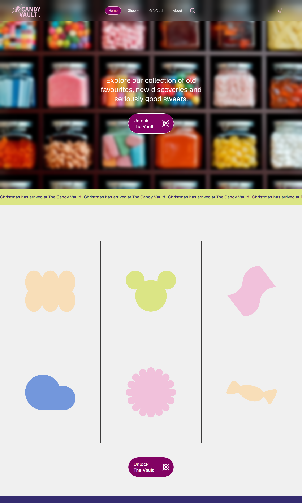

# UI Design System & Master Generation Blueprint: www-thecandyvault-com-au

> **The Candy Vault · Buy Sweets Online · Australia** (https://www.thecandyvault.com.au/) — Shop delicious lollies, chocolates and sweet treats online at The Candy Vault. Discover a colourful range of favourites delivered across...



---

## 1. Executive Visual Persona & Design Archetype

- **Brand Essence & Persona**: **The Candy Vault · Buy Sweets Online · Australia** (`https://www.thecandyvault.com.au/`). Shop delicious lollies, chocolates and sweet treats online at The Candy Vault. Discover a colourful range of favourites delivered across...
- **Capture Provenance**: Live browser capture (`tier1_fast`, HTTP `200`, captured `2026-11-23`).
- **Visual Archetype**: **Light-Substrate Editorial & Modular Grid System (`#ffffff` canvas, `#000000` ink, `#0000ee` accent)**.
- **Anti-AI-Slop Differentiators**:
  - **Live-Computed Chromatic Polarity**: Anchors the viewport in `#ffffff` (live computed `browser-default` `background-color` (`computed_styles.json`)) paired with `#000000` primary typography and `#0000ee` accents.
  - **Grounded Typographic Hierarchy**: Pairs `bricolage-grotesque` for display copy (`Fancy a sweet raid?`) with `wfont_e0cabf_4a14a20dcc7e4329bafffebe1c...` and not declared in live computed styles (uses primary stack / `ui-monospace`).
  - **Calibrated Spatial Grid & Motion**: Combines `1368px` container bounds (`gap: var(--menu-items-main-axis-gap)`, padding `12px`) with `cubic-bezier(.83,0,.17,1)` easing and Three.js / WebGL Canvas Pipeline, Swiper Touch Carousel Engine.

---

## 2. Spatial Architecture & Modular Grid Mathematics


### Viewport Allocation & Container Geometry
- **Captured Viewport Dimensions**: Desktop `1440×2400px` (`assets/desktop.png`, clamped at 2400px live multi-section capture), Mobile `390×2400px` (`assets/mobile.png`, clamped at 2400px live multi-section capture).
- **Master Container Bounds**: `1368px` (measured widest bounded `<section>` landmark width on `1440px` desktop).
- **Canvas Lateral Padding & Spacing**: `12px` lateral canvas padding with `var(--menu-items-main-axis-gap)` grid gap.
- **Border Radius Scale**: `var(--corvid-border-radius)`, `24px`, `var(--overflow-wrapper-border-radius)`, `50%`.

### Responsive Breakpoint Architecture
- **Desktop Layout**: Multi-column CSS Grid / Flexbox layout at `1440px` (`max-width: 1368px`, `gap: var(--menu-items-main-axis-gap)`).
- **Mobile Layout**: Single-column vertical stack at `390px` viewport width with `12px` horizontal padding.
- **Extracted CSS Media Queries**: `@media (prefers-reduced-motion:reduce)`, `@media (max-width:749px)`, `@media (min-width:750px)`, `@media screen and (min-width: 1px) and (max-width: 750px)`.

---

## 3. Color System, Materiality & Atmospheric Lighting

### Semantic Palette & Source Grounding
| Semantic Role | Ground-Truth Value | Extracted Live / CSS Source |
|---|---|---|
| **Primary Canvas Substrate** | `#ffffff` | live computed `browser-default` `background-color` (`computed_styles.json`) |
| **Primary Typography Ink** | `#000000` | live computed `main` `color` (`computed_styles.json`) |
| **Elevated Surface / Card Substrate** | `#cccccc` | `.eTBpzs:before { background-color: #cccccc }` |
| **Interactive Accent / Highlight** | `#0000ee` | live computed `a` `color` (`computed_styles.json`) |
| **Secondary / Muted Copy** | `#f1c1db` | live computed `h1` `color` (`computed_styles.json`) |
| **Structural Hairline Border** | `#5e97ff` | `var(--stroke)` in `:root` |

### Sanitized Root CSS Variables (`ui-ux.md` Ground Truth)
| Variable Name | Extracted Value | Semantic Role |
|---|---|---|
| `--one-unit` | `1vw` | Dimension / Scale Token |
| `--section-max-width` | `9999px` | Layout / Spatial Grid Token |
| `--spx-stopper-max` | `9999px` | Dimension / Scale Token |
| `--spx-stopper-min` | `0px` | Dimension / Scale Token |
| `--browser-zoom` | `1` | Design System Custom Token |
| `--wst-button-color-fill-primary` | `rgb(var(--color_48))` | Brand / Palette Token |
| `--wst-button-color-border-primary` | `rgb(var(--color_49))` | Brand / Palette Token |
| `--wst-button-color-text-primary` | `rgb(var(--color_50))` | Typography Ink Token |
| `--wst-button-color-fill-primary-hover` | `rgb(var(--color_51))` | Brand / Palette Token |
| `--wst-button-color-border-primary-hover` | `rgb(var(--color_52))` | Brand / Palette Token |
| `--wst-button-color-text-primary-hover` | `rgb(var(--color_53))` | Typography Ink Token |
| `--wst-button-color-fill-primary-disabled` | `rgb(var(--color_54))` | Brand / Palette Token |
| `--wst-button-color-border-primary-disabled` | `rgb(var(--color_55))` | Brand / Palette Token |
| `--wst-button-color-text-primary-disabled` | `rgb(var(--color_56))` | Typography Ink Token |
| `--wst-button-color-fill-secondary` | `rgb(var(--color_57))` | Brand / Palette Token |
| `--wst-button-color-border-secondary` | `rgb(var(--color_58))` | Brand / Palette Token |

---

## 4. Typographic Scale & Editorial Hierarchy

### Font Family Stacks
- **Display Typography**: `bricolage-grotesque`.
- **Primary Body Stack**: `wfont_e0cabf_4a14a20dcc7e4329bafffebe1c...`.
- **Technical / Metadata Stack**: not declared in live computed styles (uses primary stack / `ui-monospace`).

### Typographic Scale & Rules (Live Computed & Stylesheet Grounded)
- **Hero Display (`H1`)**: live computed `h1` (`font-size: 112.5px`, `line-height: 112.5px`, `font-weight: 700`, `letter-spacing: -3.375px`); CSS variables `--display: inline-block`, `--wbu-heading-h1-font-size: 32px`, `--wbu-heading-h1-line-height: 40px`.
- **Section Heading (`H2`)**: live computed `h2` (`font-size: 33.75px`, `line-height: 43.875px`, `font-weight: 400`); CSS variables `--wst-font-style-h2: var(--font_2)`, `--wbu-heading-h2-font-size: 24px`, `--wbu-heading-h2-line-height: 32px`.
- **Body Copy**: live computed `body` (`font-size: 10px`, `line-height: normal`, `font-weight: 400`); CSS variables `--wst-font-style-body-large: var(--font_7)`, `--wst-font-style-body-medium: var(--font_8)`, `--wst-font-style-body-small: var(--font_9)`.
- **Metadata & Navigation Labels**: live computed `nav/a` (`font-size: 10px`, `line-height: normal`, `font-weight: 400`); CSS variables `--wst-font-style-body-small: var(--font_9)`, `--wst-font-style-body-x-small: var(--font_10)`, `--wbu-text-small-size: 12px`.

---

## 5. Choreographed Motion & Interaction Physics

### Primary Easing Curves
- **Extracted Timing Functions**: `cubic-bezier(.83,0,.17,1)`, `cubic-bezier(.22,1,.36,1)`, `cubic-bezier(.64,0,.78,0)`.

### Per-Element Transition & Choreography Rules
- **Selector `id^=oldHoverBox-]`**: `transition: opacity .5s,visibility .5s` extracted from `www-thecandyvault-com-au` stylesheet.
- **Selector `.bWoigz`**: `transition: opacity var(--transition-duration) cubic-bezier(.83,0,.17,1)` extracted from `www-thecandyvault-com-au` stylesheet.
- **Selector `.sAGPNe`**: `transition: opacity var(--transition-duration) cubic-bezier(.83,0,.17,1)` extracted from `www-thecandyvault-com-au` stylesheet.
- **Extracted Easing Curve (`cubic-bezier(.83,0,.17,1)`)**: Governs interactive state transitions across `<header.comp-kbgakxea>` and `<section.comp-mu19a2q3>`.
- **Runtime Interaction Engine**: Integrates Three.js / WebGL Canvas Pipeline, Swiper Touch Carousel Engine, Lottie Vector Animation Player with `prefers-reduced-motion: reduce` fallback guards.

---

## 6. Component Wireframe & Structural DOM Map

### Visual Layout Schematic — Desktop (`1440px`, Grounded in `dom.html` & Landmark Bounding Boxes)
```
┌────────────────────────────────────────────────────────────────────────┐
│ DESKTOP VIEWPORT (1440px) — The Candy Vault · Buy Sweets Online · Aust │
│ ====================================================================== │
│ [ <header.comp-kbgakxea> (1440x101px) | Home · All Products · Gummie ] │
│ ---------------------------------------------------------------------- │
│ | HERO STAGE: <section.ke5pl1> (w=1440px)                            | │
│ | H1: Fancy a sweet raid?                                            | │
│ | Substrate: #ffffff | Ink: #000000 | Accent: #0000ee                | │
│ ---------------------------------------------------------------------- │
│ | SHOWCASE GRID (<section.comp-mu19a2q3>) max-w: 1368px              | │
│ | +------------------------------+  +------------------------------+ | │
│ | | Explore our collection of ol |  | Too Sweet to Spook           | | │
│ | +------------------------------+  +------------------------------+ | │
│ ---------------------------------------------------------------------- │
│ | DETAIL MODULE (<section.comp-mu43swgv-con) — What Are You Craving? | │
│ ---------------------------------------------------------------------- │
│ [ FOOTER (<footer.comp-mu93k1t) | https://www.thecandyvault.com.au/    │
└────────────────────────────────────────────────────────────────────────┘
```

### Visual Layout Schematic — Mobile Reflow (`390px`)
```
┌────────────────────────────────────────────────────────────────────────┐
│ MOBILE VIEWPORT REFLOW (390px) — Single-Column Stack (gap: var(--me)   │
│ ====================================================================== │
│ [ HEADER BAR (<header.comp-kbgakxea>  ) | Compact Menu (390px)         │
│ ---------------------------------------------------------------------- │
│ | HERO STAGE (<section.ke5pl1>) — 390px Vertical Lead                | │
│ | H1: Fancy a sweet raid?                                            | │
│ ---------------------------------------------------------------------- │
│ | SHOWCASE STACK (<section.comp-mu19a2q3) — 1-Col Stack              | │
│ | [ Item 1: Explore our collection of old favourites, new dis...   ] | │
│ | [ Item 2: Too Sweet to Spook                                     ] | │
│ ---------------------------------------------------------------------- │
│ | DETAIL STACK (<section.comp-mu43swgv-c) — 1-Col (What Are You Cravi) │
│ ---------------------------------------------------------------------- │
│ [ FOOTER (<footer.comp-mu93k1t) | Stacked 390px Colophon               │
└────────────────────────────────────────────────────────────────────────┘
```

### Granular DOM Region Breakdown
1. **Brand Header & Navigation Bar (<header.comp-kbgakxea> — `www-thecandyvault-com-au`)**:
   - Landmark `<header class="comp-kbgakxea S829f_">` (`1440x101px`) hosting `The Candy Vault · Buy Sweets Online ` navigation (`Home · All Products · Gummies & Jellies · Sour & Fizzy · Straps & Cables`), DOM attributes (`data-url="https://static.parast..."`, `data-url="https://static.parast..."`, `data-url="https://static.parast..."`, `data-url="https://static.parast..."`), and stylesheet rule `root:active-view-transition { view-transition-name:none }`.
2. **Hero Stage & Focal Lead (<section.ke5pl1> — `Fancy a sweet raid?`)**:
   - Landmark `<section class="ke5pl1 comp-mu3xtrpz">` presenting display lead `Fancy a sweet raid?` and copy excerpt *"Christmas has arrived at The Candy Vault!"* over `#ffffff` canvas and `#000000` ink.
3. **Primary Showcase & Content Grid (<section.comp-mu19a2q3> — `Explore our collection of old favo`)**:
   - Landmark `<section class="ke5pl1 comp-mu19a2q3">` rendering section `Explore our collection of old favourites, new dis...` with copy *"Too Sweet to Spook"*, asset references (`f415e2_d11d56bae7454bc98dfbe3e86d...`, `bundle.tracing.es5.min.js`, `www.thecandyvault.com.au`, `wix-image-kit.90dfe90c.bundle.min.js`), and grid rule `root::view-transition { pointer-events:none }`.
4. **Interactive Detail & Feature Matrix (<section.comp-mu43swgv-container> — `Too Sweet to Spook`)**:
   - Landmark `<section class="ke5pl1 comp-mu43swgv-container">` framing `Too Sweet to Spook` and `What Are You Craving?` (*"Get ready for little monsters at the door with our collection of "*) with `#cccccc` surface cards, `#0000ee` accents, and `SITE_HEADER { view-transition-name:header-group }`.
5. **Colophon & Global Directory Footer (<footer.comp-mu93k1t9> — `https://www.thecandyvault.com.au/`)**:
   - Landmark `<footer class="comp-mu93k1t9 S829f_">` anchoring `The Candy Vault · Buy Sweets Onl` footer links (`Home · All Products · Gummies & Jellies · Sour & Fizzy · Straps & Cables`), copy *"Stock Up for Halloween"*, and `#5e97ff` structural dividers.

---

## 7. Master Zero-Shot AI Generation Prompt

```markdown
# Master Zero-Shot Frontend Generation Prompt: www-thecandyvault-com-au (The Candy Vault · Buy Sweets Online · Australia)

You are a principal frontend architect and design systems engineer. Build a complete, production-ready web application replicating the exact design system, DOM landmarks, typographic hierarchy, color tokens, and motion physics of `www-thecandyvault-com-au` (**The Candy Vault · Buy Sweets Online · Australia** — `https://www.thecandyvault.com.au/`).

### 1. Visual Archetype & Anti-AI-Slop Mandates
- **Archetype**: Light-Substrate Editorial & Modular Grid System (`#ffffff` canvas, `#000000` ink, `#0000ee` accent).
- **Identity & Domain Context**: Shop delicious lollies, chocolates and sweet treats online at The Candy Vault. Discover a colourful range of favourites delivered across...
- **Primary Substrate**: `#ffffff` (live computed `browser-default` `background-color` (`computed_styles.json`)), **Primary Ink**: `#000000`, **Accent / Highlight**: `#0000ee`.
- **Site-Specific Differentiators**:
  - **Live-Computed Chromatic Polarity**: Anchors the viewport in `#ffffff` (live computed `browser-default` `background-color` (`computed_styles.json`)) paired with `#000000` primary typography and `#0000ee` accents.
  - **Grounded Typographic Hierarchy**: Pairs `bricolage-grotesque` for display copy (`Fancy a sweet raid?`) with `wfont_e0cabf_4a14a20dcc7e4329bafffebe1c...` and not declared in live computed styles (uses primary stack / `ui-monospace`).
  - **Calibrated Spatial Grid & Motion**: Combines `1368px` container bounds (`gap: var(--menu-items-main-axis-gap)`, padding `12px`) with `cubic-bezier(.83,0,.17,1)` easing and Three.js / WebGL Canvas Pipeline, Swiper Touch Carousel Engine.

### 2. Ground-Truth CSS Variables (`:root` Token Contract)
Declare and consume these exact custom properties extracted from `www-thecandyvault-com-au` in your global stylesheet:

:root {
  /* The Candy Vault · Buy Sweets Online · Australia (www-thecandyvault-com-au) — Live-Grounded CSS Variables */
  --one-unit: 1vw; /* Dimension / Scale Token (www-thecandyvault-com-au) */
  --section-max-width: 9999px; /* Layout / Spatial Grid Token (www-thecandyvault-com-au) */
  --spx-stopper-max: 9999px; /* Dimension / Scale Token (www-thecandyvault-com-au) */
  --spx-stopper-min: 0px; /* Dimension / Scale Token (www-thecandyvault-com-au) */
  --browser-zoom: 1; /* Design System Custom Token (www-thecandyvault-com-au) */
  --wst-button-color-fill-primary: rgb(var(--color_48)); /* Brand / Palette Token (www-thecandyvault-com-au) */
  --wst-button-color-border-primary: rgb(var(--color_49)); /* Brand / Palette Token (www-thecandyvault-com-au) */
  --wst-button-color-text-primary: rgb(var(--color_50)); /* Typography Ink Token (www-thecandyvault-com-au) */
  --wst-button-color-fill-primary-hover: rgb(var(--color_51)); /* Brand / Palette Token (www-thecandyvault-com-au) */
  --wst-button-color-border-primary-hover: rgb(var(--color_52)); /* Brand / Palette Token (www-thecandyvault-com-au) */
  --wst-button-color-text-primary-hover: rgb(var(--color_53)); /* Typography Ink Token (www-thecandyvault-com-au) */
  --wst-button-color-fill-primary-disabled: rgb(var(--color_54)); /* Brand / Palette Token (www-thecandyvault-com-au) */
  --wst-button-color-border-primary-disabled: rgb(var(--color_55)); /* Brand / Palette Token (www-thecandyvault-com-au) */
  --wst-button-color-text-primary-disabled: rgb(var(--color_56)); /* Typography Ink Token (www-thecandyvault-com-au) */
  --wst-button-color-fill-secondary: rgb(var(--color_57)); /* Brand / Palette Token (www-thecandyvault-com-au) */
  --wst-button-color-border-secondary: rgb(var(--color_58)); /* Brand / Palette Token (www-thecandyvault-com-au) */
}

### 3. Semantic Color & Materiality Contract
Map every surface, ink, and border strictly to these source-grounded tokens:
- **Primary Canvas Substrate**: `#ffffff` — grounded in live computed `browser-default` `background-color` (`computed_styles.json`)
- **Primary Typography Ink**: `#000000` — grounded in live computed `main` `color` (`computed_styles.json`)
- **Elevated Surface / Card Substrate**: `#cccccc` — grounded in `.eTBpzs:before { background-color: #cccccc }`
- **Interactive Accent / Highlight**: `#0000ee` — grounded in live computed `a` `color` (`computed_styles.json`)
- **Secondary / Muted Copy**: `#f1c1db` — grounded in live computed `h1` `color` (`computed_styles.json`)
- **Structural Hairline Border**: `#5e97ff` — grounded in `var(--stroke)` in `:root`

### 4. Spatial Grid, Container Bounds & Responsive Breakpoints
- **Desktop Viewport Reference**: `1440×2400px` (clamped at 2400px live multi-section capture, `1440px` standard desktop width).
- **Mobile Viewport Reference**: `390×2400px` (clamped at 2400px live multi-section capture, `390px` standard mobile width).
- **Container Max-Width**: `1368px` (measured widest bounded `<section>` landmark width on `1440px` desktop)
- **Padding & Gutters**: `12px` lateral canvas padding with `var(--menu-items-main-axis-gap)` grid gap
- **Desktop Grid**: Multi-column CSS Grid / Flexbox layout at `1440px` (`max-width: 1368px`, `gap: var(--menu-items-main-axis-gap)`)
- **Mobile Adaptation**: Single-column vertical stack at `390px` viewport width with `12px` horizontal padding
- **Media Queries**: `@media (prefers-reduced-motion:reduce)`, `@media (max-width:749px)`, `@media (min-width:750px)`, `@media screen and (min-width: 1px) and (max-width: 750px)`
- **Corner Radii**: `var(--corvid-border-radius)`, `24px`, `var(--overflow-wrapper-border-radius)`, `50%`

### 5. Typography & Editorial Scale Contract
- **Display Font Stack**: `bricolage-grotesque`
- **Body Font Stack**: `wfont_e0cabf_4a14a20dcc7e4329bafffebe1c...`
- **Monospace / Technical Font Stack**: not declared in live computed styles (uses primary stack / `ui-monospace`)
- **H1 Display Rule**: live computed `h1` (`font-size: 112.5px`, `line-height: 112.5px`, `font-weight: 700`, `letter-spacing: -3.375px`); CSS variables `--display: inline-block`, `--wbu-heading-h1-font-size: 32px`, `--wbu-heading-h1-line-height: 40px`
- **H2 Section Rule**: live computed `h2` (`font-size: 33.75px`, `line-height: 43.875px`, `font-weight: 400`); CSS variables `--wst-font-style-h2: var(--font_2)`, `--wbu-heading-h2-font-size: 24px`, `--wbu-heading-h2-line-height: 32px`
- **Body Copy Rule**: live computed `body` (`font-size: 10px`, `line-height: normal`, `font-weight: 400`); CSS variables `--wst-font-style-body-large: var(--font_7)`, `--wst-font-style-body-medium: var(--font_8)`, `--wst-font-style-body-small: var(--font_9)`
- **Metadata & Index Rule**: live computed `nav/a` (`font-size: 10px`, `line-height: normal`, `font-weight: 400`); CSS variables `--wst-font-style-body-small: var(--font_9)`, `--wst-font-style-body-x-small: var(--font_10)`, `--wbu-text-small-size: 12px`

### 6. Component Hierarchy, Verbatim Copy & Real DOM Landmarks
Scaffold `www-thecandyvault-com-au` (`The Candy Vault · Buy Sweets Online · Australia`) with these exact structural regions, extracted copy, and CSS rules from `dom.html`:
1. **Brand Header & Navigation Bar (<header.comp-kbgakxea> — `www-thecandyvault-com-au`)**:
   - DOM & Selectors: Landmark `<header class="comp-kbgakxea S829f_">` (`1440x101px`) hosting `The Candy Vault · Buy Sweets Online ` navigation (`Home · All Products · Gummies & Jellies · Sour & Fizzy · Straps & Cables`), DOM attributes (`data-url="https://static.parast..."`, `data-url="https://static.parast..."`, `data-url="https://static.parast..."`, `data-url="https://static.parast..."`), and stylesheet rule `root:active-view-transition { view-transition-name:none }`.
   - Responsive Contract: Header `Brand Header & Navigation Bar (<header.comp-kbgakxea> — `www-thecandyvault-com-au`)` (`www-thecandyvault-com-au`) adapts across `@media (prefers-reduced-motion:reduce)`, `@media (max-width:749px)`, `@media (min-width:750px)`, `@media screen and (min-width: 1px) and (max-width: 750px)` with `cubic-bezier(.83,0,.17,1)`, `cubic-bezier(.22,1,.36,1)`, `cubic-bezier(.64,0,.78,0)` transitions and links `Home · All Products · Gummies & Jellies · Sour & Fizzy · Straps & Cables`.
2. **Hero Stage & Focal Lead (<section.ke5pl1> — `Fancy a sweet raid?`)**:
   - DOM & Selectors: Landmark `<section class="ke5pl1 comp-mu3xtrpz">` presenting display lead `Fancy a sweet raid?` and copy excerpt *"Christmas has arrived at The Candy Vault!"* over `#ffffff` canvas and `#000000` ink.
   - Responsive Contract: Hero stage (`1440×2400px` desktop / `390×2400px` mobile) sets `#ffffff` background with `#000000` headline `Fancy a sweet raid?`.
3. **Primary Showcase & Content Grid (<section.comp-mu19a2q3> — `Explore our collection of old favo`)**:
   - DOM & Selectors: Landmark `<section class="ke5pl1 comp-mu19a2q3">` rendering section `Explore our collection of old favourites, new dis...` with copy *"Too Sweet to Spook"*, asset references (`f415e2_d11d56bae7454bc98dfbe3e86d...`, `bundle.tracing.es5.min.js`, `www.thecandyvault.com.au`, `wix-image-kit.90dfe90c.bundle.min.js`), and grid rule `root::view-transition { pointer-events:none }`.
   - Responsive Contract: Showcase grid `Primary Showcase & Content Grid (<section.comp-mu19a2q3> — `Explore our collection of old favo`)` applies Multi-column CSS Grid / Flexbox layout at `1440px` (`max-width: 1368px`, `gap: var(--menu-items-main-axis-gap)`) on desktop and Single-column vertical stack at `390px` viewport width with `12px` horizontal padding on mobile.
4. **Interactive Detail & Feature Matrix (<section.comp-mu43swgv-container> — `Too Sweet to Spook`)**:
   - DOM & Selectors: Landmark `<section class="ke5pl1 comp-mu43swgv-container">` framing `Too Sweet to Spook` and `What Are You Craving?` (*"Get ready for little monsters at the door with our collection of "*) with `#cccccc` surface cards, `#0000ee` accents, and `SITE_HEADER { view-transition-name:header-group }`.
   - Responsive Contract: Detail module `Interactive Detail & Feature Matrix (<section.comp-mu43swgv-container> — `Too Sweet to Spook`)` uses `var(--corvid-border-radius)`, `24px`, `var(--overflow-wrapper-border-radius)`, `50%` radii, `#0000ee` highlights, and assets (f415e2_d11d56bae7454bc98dfbe3e86d..., bundle.tracing.es5.min.js, www.thecandyvault.com.au).
5. **Colophon & Global Directory Footer (<footer.comp-mu93k1t9> — `https://www.thecandyvault.com.au/`)**:
   - DOM & Selectors: Landmark `<footer class="comp-mu93k1t9 S829f_">` anchoring `The Candy Vault · Buy Sweets Onl` footer links (`Home · All Products · Gummies & Jellies · Sour & Fizzy · Straps & Cables`), copy *"Stock Up for Halloween"*, and `#5e97ff` structural dividers.
   - Responsive Contract: Footer `Colophon & Global Directory Footer (<footer.comp-mu93k1t9> — `https://www.thecandyvault.com.au/`)` aligns to `1368px` (measured widest bounded `<section>` landmark width on `1440px` desktop) with `12px` lateral canvas padding with `var(--menu-items-main-axis-gap)` grid gap and attributes (data-url="https://static.parast...", data-url="https://static.parast...", data-url="https://static.parast...").

#### Verbatim DOM Copy Excerpts (`dom.html`)
- Copy Excerpt 1: *"Christmas has arrived at The Candy Vault!"*
- Copy Excerpt 2: *"Too Sweet to Spook"*
- Copy Excerpt 3: *"Get ready for little monsters at the door with our collection of Halloween-themed..."*
- Copy Excerpt 4: *"Stock Up for Halloween"*

### 7. Motion, Extracted Stylesheet Rules & Interaction Choreography
- **Primary Easing Functions**: `cubic-bezier(.83,0,.17,1)`, `cubic-bezier(.22,1,.36,1)`, `cubic-bezier(.64,0,.78,0)`
- **Extracted Stylesheet Rules (`www-thecandyvault-com-au`)**:
- `root:active-view-transition { view-transition-name:none }`
- `root::view-transition { pointer-events:none }`
- `SITE_HEADER { view-transition-name:header-group }`
- `WIX_ADS { view-transition-name:wix-ads-group }`
- `SITE_FOOTER { view-transition-name:footer-group }`
- **Per-Selector Transition Rules**:
- **Selector `id^=oldHoverBox-]`**: `transition: opacity .5s,visibility .5s` extracted from `www-thecandyvault-com-au` stylesheet.
- **Selector `.bWoigz`**: `transition: opacity var(--transition-duration) cubic-bezier(.83,0,.17,1)` extracted from `www-thecandyvault-com-au` stylesheet.
- **Selector `.sAGPNe`**: `transition: opacity var(--transition-duration) cubic-bezier(.83,0,.17,1)` extracted from `www-thecandyvault-com-au` stylesheet.
- **Extracted Easing Curve (`cubic-bezier(.83,0,.17,1)`)**: Governs interactive state transitions across `<header.comp-kbgakxea>` and `<section.comp-mu19a2q3>`.
- **Runtime Interaction Engine**: Integrates Three.js / WebGL Canvas Pipeline, Swiper Touch Carousel Engine, Lottie Vector Animation Player with `prefers-reduced-motion: reduce` fallback guards.

### 8. Technical Deliverables
- Implement in Next.js (App Router) with TypeScript and Tailwind CSS consuming the `:root` custom properties defined above for `www-thecandyvault-com-au`.
- Reproduce both the `1440px` desktop architecture and `390px` mobile breakpoint transitions, preserving semantic HTML5 landmarks (`<header>`, `<nav>`, `<main>`, `<section>`, `<footer>`) and `prefers-reduced-motion` accessibility guards.
```
