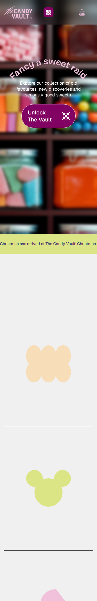

# UI Design System & Master Generation Blueprint: www-thecandyvault-com-au

> **The Candy Vault · Buy Sweets Online · Australia** (https://www.thecandyvault.com.au/) — Shop delicious lollies, chocolates and sweet treats online at The Candy Vault. Discover a colourful range of favourites delivered across...


---

## 1. Executive Visual Persona & Design Archetype

- **Brand Essence & Persona**: **The Candy Vault · Buy Sweets Online · Australia** (`https://www.thecandyvault.com.au/`). Shop delicious lollies, chocolates and sweet treats online at The Candy Vault. Discover a colourful range of favourites delivered across...
- **Visual Archetype**: **High-Contrast Obsidian / Atmospheric Design System (`#0f2ccf` canvas, `#eaefff` ink, `#acbeff` accent)**.
- **Anti-AI-Slop Differentiators**:
  - **Source-Grounded Chromatic Polarity**: Anchors the viewport in `#0f2ccf` (`var(--wbu-color-blue-0)` in `:root`) paired with `#eaefff` primary typography and `#acbeff` accents.
  - **Extracted Typographic Hierarchy**: Pairs `wf_4a14a20dcc7e4329bafffebe1` for display copy (`Fancy a sweet raid?`) with `bricolage-grotesque` and not declared in static CSS (uses primary stack / `ui-monospace`).
  - **Calibrated Spatial Grid & Motion**: Combines `9999px` container bounds (`gap: var(--menu-items-main-axis-gap)`, padding `12px`) with `cubic-bezier(.83,0,.17,1)` easing and Three.js / WebGL Canvas Pipeline, Swiper Touch Carousel Engine.

---

## 2. Spatial Architecture & Modular Grid Mathematics



### Viewport Allocation & Container Geometry
- **Captured Viewport Dimensions**: Desktop `1440×6419px` (`assets/desktop.png`, full-page scroll capture), Mobile `390×2400px` (`assets/mobile.png`, capped at 2400px multi-section capture).
- **Master Container Bounds**: `9999px` extracted from `www-thecandyvault-com-au` stylesheet.
- **Canvas Lateral Padding & Spacing**: `12px` lateral canvas padding with `var(--menu-items-main-axis-gap)` grid gap.
- **Border Radius Scale**: `var(--corvid-border-radius)`, `24px`, `var(--overflow-wrapper-border-radius)`, `50%`.

### Responsive Breakpoint Architecture
- **Desktop Layout**: Multi-column CSS Grid / Flexbox layout at `1440px` (`max-width: 9999px`, `gap: var(--menu-items-main-axis-gap)`).
- **Mobile Layout**: Single-column vertical stack at `390px` viewport width with `12px` horizontal padding.
- **Extracted CSS Media Queries**: `@media (prefers-reduced-motion:reduce)`, `@media (max-width:749px)`, `@media (min-width:750px)`, `@media screen and (min-width: 1px) and (max-width: 750px)`.

---

## 3. Color System, Materiality & Atmospheric Lighting

### Semantic Palette & Source Grounding
| Semantic Role | Ground-Truth Value | Extracted CSS Source / Selector |
|---|---|---|
| **Primary Canvas Substrate** | `#0f2ccf` | `var(--wbu-color-blue-0)` in `:root` |
| **Primary Typography Ink** | `#2f5dff` | `var(--wbu-color-blue-100)` in `:root` |
| **Elevated Surface / Card Substrate** | `#597dff` | `var(--wbu-color-blue-200)` in `:root` |
| **Interactive Accent / Highlight** | `#acbeff` | `var(--wbu-color-blue-300)` in `:root` |
| **Secondary / Muted Copy** | `#d5dfff` | `var(--wbu-color-blue-400)` in `:root` |
| **Structural Hairline Border** | `#eaefff` | `var(--wbu-color-blue-500)` in `:root` |

### Sanitized Root CSS Variables (`ui-ux.md` Ground Truth)
| Variable Name | Extracted Value | Semantic Role |
|---|---|---|
| `--scrollbar-width` | `0px` | Layout / Spatial Grid Token |
| `--one-unit` | `1vw` | Dimension / Scale Token |
| `--section-max-width` | `9999px` | Layout / Spatial Grid Token |
| `--spx-stopper-max` | `9999px` | Dimension / Scale Token |
| `--spx-stopper-min` | `0px` | Dimension / Scale Token |
| `--browser-zoom` | `1` | Design System Custom Token |
| `--safari-sticky-fix` | `opacity` | Design System Custom Token |
| `--experimental-safari-sticky-fix` | `translateZ(0)` | Design System Custom Token |
| `--wst-button-color-fill-primary` | `rgb(var(--color_48))` | Brand / Palette Token |
| `--wst-button-color-border-primary` | `rgb(var(--color_49))` | Brand / Palette Token |
| `--wst-button-color-text-primary` | `rgb(var(--color_50))` | Typography Ink Token |
| `--wst-button-color-fill-primary-hover` | `rgb(var(--color_51))` | Brand / Palette Token |
| `--wst-button-color-border-primary-hover` | `rgb(var(--color_52))` | Brand / Palette Token |
| `--wst-button-color-text-primary-hover` | `rgb(var(--color_53))` | Typography Ink Token |
| `--wst-button-color-fill-primary-disabled` | `rgb(var(--color_54))` | Brand / Palette Token |
| `--wst-button-color-border-primary-disabled` | `rgb(var(--color_55))` | Brand / Palette Token |

---

## 4. Typographic Scale & Editorial Hierarchy

### Font Family Stacks
- **Display Typography**: `wf_4a14a20dcc7e4329bafffebe1`.
- **Primary Body Stack**: `bricolage-grotesque`.
- **Technical / Metadata Stack**: not declared in static CSS (uses primary stack / `ui-monospace`).

### Typographic Scale & Rules (Extracted from Stylesheet & Variables)
- **Hero Display (`H1`)**: CSS variables `--display: inline-block`, `--wbu-heading-h1-font-size: 32px`, `--wbu-heading-h1-line-height: 40px`.
- **Section Heading (`H2`)**: CSS variables `--wst-color-subtitle: rgb(var(--color_46))`, `--wst-font-style-h2: var(--font_2)`, `--wbu-heading-h2-font-size: 24px`.
- **Body Copy**: CSS variables `--wst-font-style-body-large: var(--font_7)`, `--wst-font-style-body-medium: var(--font_8)`, `--wst-font-style-body-small: var(--font_9)`.
- **Metadata & Navigation Labels**: CSS variables `--wst-font-style-body-small: var(--font_9)`, `--wst-font-style-body-x-small: var(--font_10)`, `--wbu-text-small-size: 12px`.

---

## 5. Choreographed Motion & Interaction Physics

### Primary Easing Curves
- **Extracted Timing Functions**: `cubic-bezier(.83,0,.17,1)`, `cubic-bezier(.22,1,.36,1)`, `cubic-bezier(.64,0,.78,0)`.

### Per-Element Transition & Choreography Rules
- **Selector `id^=oldHoverBox-]`**: `transition: opacity .5s,visibility .5s` extracted from `www-thecandyvault-com-au` stylesheet.
- **Selector `.bWoigz`**: `transition: opacity var(--transition-duration) cubic-bezier(.83,0,.17,1)` extracted from `www-thecandyvault-com-au` stylesheet.
- **Selector `.sAGPNe`**: `transition: opacity var(--transition-duration) cubic-bezier(.83,0,.17,1)` extracted from `www-thecandyvault-com-au` stylesheet.
- **Extracted Easing Curve (`cubic-bezier(.83,0,.17,1)`)**: Governs interactive state transitions across `<header.comp-kbgakxea>` and `<section.ke5pl1>`.
- **Runtime Interaction Engine**: Integrates Three.js / WebGL Canvas Pipeline, Swiper Touch Carousel Engine, Lottie Vector Animation Player with `prefers-reduced-motion: reduce` fallback guards.

---

## 6. Component Wireframe & Structural DOM Map

### Visual Layout Schematic (Grounded in `dom.html` — `1440px` Desktop & `390px` Mobile Reflow)
```
┌────────────────────────────────────────────────────────────────────────┐
│ DESKTOP VIEWPORT (1440px) — The Candy Vault · Buy Sweets Online · Aust │
│ ====================================================================== │
│ [ <header.comp-kbgakxea>   | Home · All Products · Gummies & Jellie ]  │
│ ---------------------------------------------------------------------- │
│ | HERO STAGE: <section.ke5pl1>                                     |   │
│ | H1: Fancy a sweet raid?                                          |   │
│ | Substrate: #0f2ccf    | Ink: #eaefff    | Accent: #acbeff        |   │
│ ---------------------------------------------------------------------- │
│ | SHOWCASE GRID (<section.ke5pl1>          ) max-w: 9999px         |   │
│ | +------------------------------+  +------------------------------+ | │
│ | | Explore our collection of ol |  | Too Sweet to Spook           | | │
│ | +------------------------------+  +------------------------------+ | │
│ ---------------------------------------------------------------------- │
│ | MOBILE VIEWPORT REFLOW (390px) — Single-Column Stack (gap: var(--) | │
│ | [<header.comp-kbgak] -> [<section.ke5pl1>] -> [<section.ke5pl1>] |   │
│ ---------------------------------------------------------------------- │
│ [ FOOTER (<footer.comp-mu93k1t9>) | https://www.thecandyvault.com.au/  │
└────────────────────────────────────────────────────────────────────────┘
```

### Granular DOM Region Breakdown
1. **Brand Header & Navigation Bar (<header.comp-kbgakxea> — `www-thecandyvault-com-au`)**:
   - Landmark `<header class="comp-kbgakxea S829f_">` hosting `The Candy Vault · Buy Sweets Online ` navigation (`Home · All Products · Gummies & Jellies · Sour & Fizzy · Straps & Cables`), DOM attributes (`data-url="https://static.parast..."`, `data-url="https://static.parast..."`, `data-url="https://static.parast..."`, `data-url="https://static.parast..."`), and stylesheet rule `root:active-view-transition { view-transition-name:none }`.
2. **Hero Stage & Focal Lead (<section.ke5pl1> — `Fancy a sweet raid?`)**:
   - Landmark `<section class="ke5pl1 comp-kbgakxea_r_comp-kbgajy18">` presenting display lead `Fancy a sweet raid?` and copy excerpt *"Skip to Main Content"* over `#0f2ccf` canvas and `#eaefff` ink.
3. **Primary Showcase & Content Grid (<section.ke5pl1> — `Explore our collection of old favo`)**:
   - Landmark `<section class="ke5pl1 comp-mu3xtrpz">` rendering section `Explore our collection of old favourites, new dis...` with copy *"Shop All Products Gummies & Jellies Sour & Fizzy Straps & Cables "*, asset references (`f415e2_d11d56bae7454bc98dfbe3e86d...`, `bundle.tracing.es5.min.js`, `minified.js`, `focus-within-polyfill.js`), and grid rule `root::view-transition { pointer-events:none }`.
4. **Interactive Detail & Feature Matrix (<section.ke5pl1> — `Too Sweet to Spook`)**:
   - Landmark `<section class="ke5pl1 comp-mu19a2q3">` framing `Too Sweet to Spook` and `What Are You Craving?` (*"Lollipops & Individually Wrapped"*) with `#597dff` surface cards, `#acbeff` accents, and `SITE_HEADER { view-transition-name:header-group }`.
5. **Colophon & Global Directory Footer (<footer.comp-mu93k1t9> — `https://www.thecandyvault.com.au/`)**:
   - Landmark `<footer class="comp-mu93k1t9 S829f_">` anchoring `The Candy Vault · Buy Sweets Onl` footer links (`Home · All Products · Gummies & Jellies · Sour & Fizzy · Straps & Cables`), copy *"30% off Black Friday ✦ Stay Tuned ✦"*, and `#eaefff` structural dividers.

---

## 7. Master Zero-Shot AI Generation Prompt

```markdown
# Master Zero-Shot Frontend Generation Prompt: www-thecandyvault-com-au (The Candy Vault · Buy Sweets Online · Australia)

You are a principal frontend architect and design systems engineer. Build a complete, production-ready web application replicating the exact design system, DOM landmarks, typographic hierarchy, color tokens, and motion physics of `www-thecandyvault-com-au` (**The Candy Vault · Buy Sweets Online · Australia** — `https://www.thecandyvault.com.au/`).

### 1. Visual Archetype & Anti-AI-Slop Mandates
- **Archetype**: High-Contrast Obsidian / Atmospheric Design System (`#0f2ccf` canvas, `#eaefff` ink, `#acbeff` accent).
- **Identity & Domain Context**: Shop delicious lollies, chocolates and sweet treats online at The Candy Vault. Discover a colourful range of favourites delivered across...
- **Primary Substrate**: `#0f2ccf` (`var(--wbu-color-blue-0)` in `:root`), **Primary Ink**: `#eaefff`, **Accent / Highlight**: `#acbeff`.
- **Site-Specific Differentiators**:
  - **Source-Grounded Chromatic Polarity**: Anchors the viewport in `#0f2ccf` (`var(--wbu-color-blue-0)` in `:root`) paired with `#eaefff` primary typography and `#acbeff` accents.
  - **Extracted Typographic Hierarchy**: Pairs `wf_4a14a20dcc7e4329bafffebe1` for display copy (`Fancy a sweet raid?`) with `bricolage-grotesque` and not declared in static CSS (uses primary stack / `ui-monospace`).
  - **Calibrated Spatial Grid & Motion**: Combines `9999px` container bounds (`gap: var(--menu-items-main-axis-gap)`, padding `12px`) with `cubic-bezier(.83,0,.17,1)` easing and Three.js / WebGL Canvas Pipeline, Swiper Touch Carousel Engine.

### 2. Ground-Truth CSS Variables (`:root` Token Contract)
Declare and consume these exact custom properties extracted from `www-thecandyvault-com-au` in your global stylesheet:

:root {
  /* The Candy Vault · Buy Sweets Online · Australia (www-thecandyvault-com-au) — Ground-Truth Extracted CSS Variables */
  --scrollbar-width: 0px; /* Layout / Spatial Grid Token (www-thecandyvault-com-au) */
  --one-unit: 1vw; /* Dimension / Scale Token (www-thecandyvault-com-au) */
  --section-max-width: 9999px; /* Layout / Spatial Grid Token (www-thecandyvault-com-au) */
  --spx-stopper-max: 9999px; /* Dimension / Scale Token (www-thecandyvault-com-au) */
  --spx-stopper-min: 0px; /* Dimension / Scale Token (www-thecandyvault-com-au) */
  --browser-zoom: 1; /* Design System Custom Token (www-thecandyvault-com-au) */
  --safari-sticky-fix: opacity; /* Design System Custom Token (www-thecandyvault-com-au) */
  --experimental-safari-sticky-fix: translateZ(0); /* Design System Custom Token (www-thecandyvault-com-au) */
  --wst-button-color-fill-primary: rgb(var(--color_48)); /* Brand / Palette Token (www-thecandyvault-com-au) */
  --wst-button-color-border-primary: rgb(var(--color_49)); /* Brand / Palette Token (www-thecandyvault-com-au) */
  --wst-button-color-text-primary: rgb(var(--color_50)); /* Typography Ink Token (www-thecandyvault-com-au) */
  --wst-button-color-fill-primary-hover: rgb(var(--color_51)); /* Brand / Palette Token (www-thecandyvault-com-au) */
  --wst-button-color-border-primary-hover: rgb(var(--color_52)); /* Brand / Palette Token (www-thecandyvault-com-au) */
  --wst-button-color-text-primary-hover: rgb(var(--color_53)); /* Typography Ink Token (www-thecandyvault-com-au) */
  --wst-button-color-fill-primary-disabled: rgb(var(--color_54)); /* Brand / Palette Token (www-thecandyvault-com-au) */
  --wst-button-color-border-primary-disabled: rgb(var(--color_55)); /* Brand / Palette Token (www-thecandyvault-com-au) */
}

### 3. Semantic Color & Materiality Contract
Map every surface, ink, and border strictly to these source-grounded tokens:
- **Primary Canvas Substrate**: `#0f2ccf` — grounded in `var(--wbu-color-blue-0)` in `:root`
- **Primary Typography Ink**: `#2f5dff` — grounded in `var(--wbu-color-blue-100)` in `:root`
- **Elevated Surface / Card Substrate**: `#597dff` — grounded in `var(--wbu-color-blue-200)` in `:root`
- **Interactive Accent / Highlight**: `#acbeff` — grounded in `var(--wbu-color-blue-300)` in `:root`
- **Secondary / Muted Copy**: `#d5dfff` — grounded in `var(--wbu-color-blue-400)` in `:root`
- **Structural Hairline Border**: `#eaefff` — grounded in `var(--wbu-color-blue-500)` in `:root`

### 4. Spatial Grid, Container Bounds & Responsive Breakpoints
- **Desktop Viewport Reference**: `1440×6419px` (full-page scroll capture, `1440px` standard desktop width).
- **Mobile Viewport Reference**: `390×2400px` (capped at 2400px multi-section capture, `390px` standard mobile width).
- **Container Max-Width**: `9999px` extracted from `www-thecandyvault-com-au` stylesheet
- **Padding & Gutters**: `12px` lateral canvas padding with `var(--menu-items-main-axis-gap)` grid gap
- **Desktop Grid**: Multi-column CSS Grid / Flexbox layout at `1440px` (`max-width: 9999px`, `gap: var(--menu-items-main-axis-gap)`)
- **Mobile Adaptation**: Single-column vertical stack at `390px` viewport width with `12px` horizontal padding
- **Media Queries**: `@media (prefers-reduced-motion:reduce)`, `@media (max-width:749px)`, `@media (min-width:750px)`, `@media screen and (min-width: 1px) and (max-width: 750px)`
- **Corner Radii**: `var(--corvid-border-radius)`, `24px`, `var(--overflow-wrapper-border-radius)`, `50%`

### 5. Typography & Editorial Scale Contract
- **Display Font Stack**: `wf_4a14a20dcc7e4329bafffebe1`
- **Body Font Stack**: `bricolage-grotesque`
- **Monospace / Technical Font Stack**: not declared in static CSS (uses primary stack / `ui-monospace`)
- **H1 Display Rule**: CSS variables `--display: inline-block`, `--wbu-heading-h1-font-size: 32px`, `--wbu-heading-h1-line-height: 40px`
- **H2 Section Rule**: CSS variables `--wst-color-subtitle: rgb(var(--color_46))`, `--wst-font-style-h2: var(--font_2)`, `--wbu-heading-h2-font-size: 24px`
- **Body Copy Rule**: CSS variables `--wst-font-style-body-large: var(--font_7)`, `--wst-font-style-body-medium: var(--font_8)`, `--wst-font-style-body-small: var(--font_9)`
- **Metadata & Index Rule**: CSS variables `--wst-font-style-body-small: var(--font_9)`, `--wst-font-style-body-x-small: var(--font_10)`, `--wbu-text-small-size: 12px`

### 6. Component Hierarchy, Verbatim Copy & Real DOM Landmarks
Scaffold `www-thecandyvault-com-au` (`The Candy Vault · Buy Sweets Online · Australia`) with these exact structural regions, extracted copy, and CSS rules from `dom.html`:
1. **Brand Header & Navigation Bar (<header.comp-kbgakxea> — `www-thecandyvault-com-au`)**:
   - DOM & Selectors: Landmark `<header class="comp-kbgakxea S829f_">` hosting `The Candy Vault · Buy Sweets Online ` navigation (`Home · All Products · Gummies & Jellies · Sour & Fizzy · Straps & Cables`), DOM attributes (`data-url="https://static.parast..."`, `data-url="https://static.parast..."`, `data-url="https://static.parast..."`, `data-url="https://static.parast..."`), and stylesheet rule `root:active-view-transition { view-transition-name:none }`.
   - Responsive Contract: Header `Brand Header & Navigation Bar (<header.comp-kbgakxea> — `www-thecandyvault-com-au`)` (`www-thecandyvault-com-au`) adapts across `@media (prefers-reduced-motion:reduce)`, `@media (max-width:749px)`, `@media (min-width:750px)`, `@media screen and (min-width: 1px) and (max-width: 750px)` with `cubic-bezier(.83,0,.17,1)`, `cubic-bezier(.22,1,.36,1)`, `cubic-bezier(.64,0,.78,0)` transitions and links `Home · All Products · Gummies & Jellies · Sour & Fizzy · Straps & Cables`.
2. **Hero Stage & Focal Lead (<section.ke5pl1> — `Fancy a sweet raid?`)**:
   - DOM & Selectors: Landmark `<section class="ke5pl1 comp-kbgakxea_r_comp-kbgajy18">` presenting display lead `Fancy a sweet raid?` and copy excerpt *"Skip to Main Content"* over `#0f2ccf` canvas and `#eaefff` ink.
   - Responsive Contract: Hero stage (`1440×6419px` desktop / `390×2400px` mobile) sets `#0f2ccf` background with `#eaefff` headline `Fancy a sweet raid?`.
3. **Primary Showcase & Content Grid (<section.ke5pl1> — `Explore our collection of old favo`)**:
   - DOM & Selectors: Landmark `<section class="ke5pl1 comp-mu3xtrpz">` rendering section `Explore our collection of old favourites, new dis...` with copy *"Shop All Products Gummies & Jellies Sour & Fizzy Straps & Cables "*, asset references (`f415e2_d11d56bae7454bc98dfbe3e86d...`, `bundle.tracing.es5.min.js`, `minified.js`, `focus-within-polyfill.js`), and grid rule `root::view-transition { pointer-events:none }`.
   - Responsive Contract: Showcase grid `Primary Showcase & Content Grid (<section.ke5pl1> — `Explore our collection of old favo`)` applies Multi-column CSS Grid / Flexbox layout at `1440px` (`max-width: 9999px`, `gap: var(--menu-items-main-axis-gap)`) on desktop and Single-column vertical stack at `390px` viewport width with `12px` horizontal padding on mobile.
4. **Interactive Detail & Feature Matrix (<section.ke5pl1> — `Too Sweet to Spook`)**:
   - DOM & Selectors: Landmark `<section class="ke5pl1 comp-mu19a2q3">` framing `Too Sweet to Spook` and `What Are You Craving?` (*"Lollipops & Individually Wrapped"*) with `#597dff` surface cards, `#acbeff` accents, and `SITE_HEADER { view-transition-name:header-group }`.
   - Responsive Contract: Detail module `Interactive Detail & Feature Matrix (<section.ke5pl1> — `Too Sweet to Spook`)` uses `var(--corvid-border-radius)`, `24px`, `var(--overflow-wrapper-border-radius)`, `50%` radii, `#acbeff` highlights, and assets (f415e2_d11d56bae7454bc98dfbe3e86d..., bundle.tracing.es5.min.js, minified.js).
5. **Colophon & Global Directory Footer (<footer.comp-mu93k1t9> — `https://www.thecandyvault.com.au/`)**:
   - DOM & Selectors: Landmark `<footer class="comp-mu93k1t9 S829f_">` anchoring `The Candy Vault · Buy Sweets Onl` footer links (`Home · All Products · Gummies & Jellies · Sour & Fizzy · Straps & Cables`), copy *"30% off Black Friday ✦ Stay Tuned ✦"*, and `#eaefff` structural dividers.
   - Responsive Contract: Footer `Colophon & Global Directory Footer (<footer.comp-mu93k1t9> — `https://www.thecandyvault.com.au/`)` aligns to `9999px` extracted from `www-thecandyvault-com-au` stylesheet with `12px` lateral canvas padding with `var(--menu-items-main-axis-gap)` grid gap and attributes (data-url="https://static.parast...", data-url="https://static.parast...", data-url="https://static.parast...").

#### Verbatim DOM Copy Excerpts (`dom.html`)
- Copy Excerpt 1: *"Skip to Main Content"*
- Copy Excerpt 2: *"Shop All Products Gummies & Jellies Sour & Fizzy Straps & Cables Clouds Retro Favo..."*
- Copy Excerpt 3: *"Lollipops & Individually Wrapped"*
- Copy Excerpt 4: *"30% off Black Friday ✦ Stay Tuned ✦"*

### 7. Motion, Extracted Stylesheet Rules & Interaction Choreography
- **Primary Easing Functions**: `cubic-bezier(.83,0,.17,1)`, `cubic-bezier(.22,1,.36,1)`, `cubic-bezier(.64,0,.78,0)`
- **Extracted Stylesheet Rules (`www-thecandyvault-com-au`)**:
- `root:active-view-transition { view-transition-name:none }`
- `root::view-transition { pointer-events:none }`
- `SITE_HEADER { view-transition-name:header-group }`
- `WIX_ADS { view-transition-name:wix-ads-group }`
- `SITE_FOOTER { view-transition-name:footer-group }`
- **Per-Selector Transition Rules**:
- **Selector `id^=oldHoverBox-]`**: `transition: opacity .5s,visibility .5s` extracted from `www-thecandyvault-com-au` stylesheet.
- **Selector `.bWoigz`**: `transition: opacity var(--transition-duration) cubic-bezier(.83,0,.17,1)` extracted from `www-thecandyvault-com-au` stylesheet.
- **Selector `.sAGPNe`**: `transition: opacity var(--transition-duration) cubic-bezier(.83,0,.17,1)` extracted from `www-thecandyvault-com-au` stylesheet.
- **Extracted Easing Curve (`cubic-bezier(.83,0,.17,1)`)**: Governs interactive state transitions across `<header.comp-kbgakxea>` and `<section.ke5pl1>`.
- **Runtime Interaction Engine**: Integrates Three.js / WebGL Canvas Pipeline, Swiper Touch Carousel Engine, Lottie Vector Animation Player with `prefers-reduced-motion: reduce` fallback guards.

### 8. Technical Deliverables
- Implement in Next.js (App Router) with TypeScript and Tailwind CSS consuming the `:root` custom properties defined above for `www-thecandyvault-com-au`.
- Reproduce both the `1440px` desktop architecture and `390px` mobile breakpoint transitions, preserving semantic HTML5 landmarks (`<header>`, `<nav>`, `<main>`, `<section>`, `<footer>`) and `prefers-reduced-motion` accessibility guards.
```
