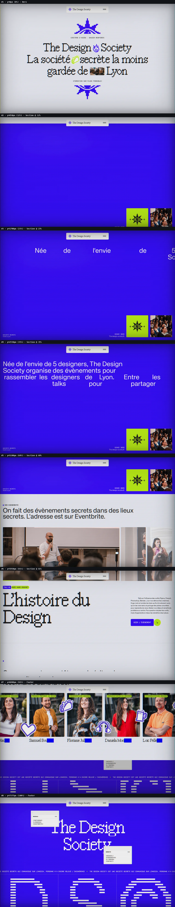
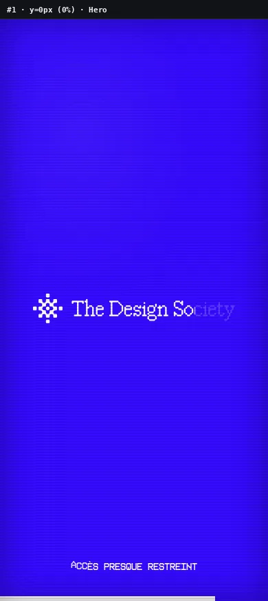

# UI Design System & Master Generation Blueprint: www-thedesignsociety-fr

> **The Design Society Lyon — la communauté des designers** (https://www.thedesignsociety.fr/) — L'association qui réunit les designers de Lyon autour de talks et d'apéros. Une société secrète si mal gardée qu'on a fait un site. Proch...





---

## 1. Executive Visual Persona & Design Archetype

- **Brand Essence & Persona**: **The Design Society Lyon — la communauté des designers** (`https://www.thedesignsociety.fr/`). L'association qui réunit les designers de Lyon autour de talks et d'apéros. Une société secrète si mal gardée qu'on a fait un site. Proch...
- **Capture Provenance**: Live browser capture (`tier1_fast`, HTTP `200`, captured `2026-11-24`).
- **Visual Archetype**: **High-Contrast Obsidian / Atmospheric Design System (`#350aff` canvas, `#ffffff` ink, `#0082f3` accent)**.
- **Anti-AI-Slop Differentiators**:
  - **Live-Computed Chromatic Polarity**: Anchors the viewport in `#350aff` (live computed `body` `background-color` (`computed_styles.json`)) paired with `#ffffff` primary typography and `#0082f3` accents.
  - **Grounded Typographic Hierarchy**: Uses `Helvetica Neue` across display (`The Design Society — La société secr`) and body copy.
  - **Calibrated Spatial Grid & Motion**: Combines `1392px` container bounds (`gap: 16px`, padding `9px`) with `cubic-bezier(0.625,0.05,0,1)` easing and Lenis Smooth Scroll (`data-lenis`), GSAP Timeline & ScrollTrigger.

---

## 2. Spatial Architecture & Modular Grid Mathematics

### Viewport Allocation & Container Geometry
- **Captured Journey Filmstrips**: Desktop `1280×6624px` (`assets/desktop-journey.webp`, `8` keyframes up to `y=7377px` / doc `8277px`), Mobile `390×872px` (`assets/mobile-journey.webp`, `1` keyframes).
- **Master Container Bounds**: `1392px` (measured widest bounded `<section>` landmark width on `1440px` desktop).
- **Canvas Lateral Padding & Spacing**: `9px` lateral canvas padding with `16px` grid gap.
- **Border Radius Scale**: `3px`, `100%`, `50%`, `var(--radius--radius-s)`.

### Responsive Breakpoint Architecture
- **Desktop Layout**: Multi-column CSS Grid / Flexbox layout at `1440px` (`max-width: 1392px`, `gap: 16px`).
- **Mobile Layout**: Single-column vertical stack at `390px` viewport width with `9px` horizontal padding.
- **Extracted CSS Media Queries**: `@media screen and (max-width: 991px)`, `@media screen and (max-width: 767px)`, `@media screen and (max-width: 479px)`, `@media (min-width: 768px)`.

---

## 3. Color System, Materiality & Atmospheric Lighting

### Semantic Palette & Source Grounding
| Semantic Role | Ground-Truth Value | Extracted Live / CSS Source |
|---|---|---|
| **Primary Canvas Substrate** | `#350aff` | live computed `body` `background-color` (`computed_styles.json`) |
| **Primary Typography Ink** | `#ffffff` | live computed `p` `color` (`computed_styles.json`) |
| **Elevated Surface / Card Substrate** | `#0b0e01` | `var(--green--background)` in `:root` |
| **Interactive Accent / Highlight** | `#0082f3` | `.w-dropdown-link.w--current { color: #0082f3 }` |
| **Secondary / Muted Copy** | `#999999` | `var(--green--content-subtle)` in `:root` |
| **Structural Hairline Border** | `#310ddd` | `var(--border)` in `:root` (`1d1d1d26`) |
| **Variable Token (`--background`)** | `#ebedf5` | `var(--background)` in `:root` |
| **Variable Token (`--border`)** | `#1d1d1d` | `var(--border)` in `:root` |
| **Variable Token (`--blue--content`)** | `#f0f0f0` | `var(--blue--content)` in `:root` |
| **Variable Token (`--brand-color-1`)** | `#bcf015` | `var(--brand-color-1)` in `:root` |

### Sanitized Root CSS Variables (`ui-ux.md` Ground Truth)
| Variable Name | Extracted Value | Semantic Role |
|---|---|---|
| `--background` | `#ebedf5` | Canvas / Surface Token |
| `--_theme---content` | `var(--content)` | Brand / Palette Token |
| `--radius--radius-s` | `4px` | Elevation / Border Token |
| `--border` | `#1d1d1d26` | Elevation / Border Token |
| `--radius--radius-m` | `6px` | Elevation / Border Token |
| `--_theme---background-accent` | `var(--background-accent)` | Canvas / Surface Token |
| `--_theme---brand-color-2` | `var(--brand-color-2)` | Brand / Palette Token |
| `--_responsive---hero--padding-top` | `10em` | Layout / Spatial Grid Token |
| `--blue--content` | `#f0f0f0` | Color / Atmospheric Token |
| `--_responsive---hero--title-marquee` | `10em` | Dimension / Scale Token |
| `--brand-color-2` | `#350aff` | Brand / Palette Token |
| `--brand-color-1` | `#bcf015` | Brand / Palette Token |
| `--_responsive---hero--eye` | `150px` | Dimension / Scale Token |
| `--_responsive---hero--margin` | `var(--size--m)` | Layout / Spatial Grid Token |
| `--_theme---border` | `var(--border)` | Brand / Palette Token |
| `--_theme---content-subtle` | `var(--content-subtle)` | Brand / Palette Token |

---

## 4. Typographic Scale & Editorial Hierarchy

### Font Family Stacks
- **Display Typography**: `Helvetica Neue`.
- **Primary Body Stack**: `Helvetica Neue`.
- **Technical / Metadata Stack**: not declared in live computed styles (uses primary stack / `ui-monospace`).

### Typographic Scale & Rules (Live Computed & Stylesheet Grounded)
- **Hero Display (`H1`)**: live computed `h1` (`font-size: 38px`, `line-height: 44px`, `font-weight: 700`); rule `h1` (`font-size: 2em`).
- **Section Heading (`H2`)**: rule `h2` (`font-size: 32px`, `line-height: 36px`).
- **Body Copy**: live computed `body` (`font-size: 14px`, `line-height: 20px`, `font-weight: 400`); rule `body` (`font-size: 14px`, `line-height: 20px`).
- **Metadata & Navigation Labels**: live computed `nav/a` (`font-size: 14px`, `line-height: 20px`, `font-weight: 400`); rule `small` (`font-size: 80%`).

---

## 5. Choreographed Motion & Interaction Physics

### Primary Easing Curves
- **Extracted Timing Functions**: `cubic-bezier(0.625,0.05,0,1)`, `cubic-bezier(0.22,1,0.36,1)`, `cubic-bezier(0.7,0,0.3,1)`.

### Per-Element Transition & Choreography Rules
- **Selector `.w-webflow-badge > img`**: `transition: unset` extracted from `www-thedesignsociety-fr` stylesheet.
- **Selector `.w-slider-dot`**: `transition: background-color .1s, color .1s` extracted from `www-thedesignsociety-fr` stylesheet.
- **Selector `.w-lightbox-control`**: `transition: all .3s` extracted from `www-thedesignsociety-fr` stylesheet.
- **Extracted Easing Curve (`cubic-bezier(0.625,0.05,0,1)`)**: Governs interactive state transitions across `<nav.twostep-nav>` and `<section.mwg005>`.
- **Runtime Interaction Engine**: Integrates Lenis Smooth Scroll (`data-lenis`), GSAP Timeline & ScrollTrigger, Barba.js Page Transition Router with `prefers-reduced-motion: reduce` fallback guards.
### Measured Runtime Scroll & Interaction Telemetry (`behavioral_journey_v2`)
- **Scroll Driver Mode**: `native` (max document height `8277px`, deepest scrollY reached `7377px` across `8` desktop keyframes).
- **Detected Scroll / Motion Libraries**: `Lenis`, `GSAP/ScrollTrigger`.
- **Route Transition Architecture**: First internal navigation (`/contact`) measured as `direct` in `621ms`.

---

## 6. Component Wireframe & Structural DOM Map

### Visual Layout Schematic — Desktop (`1440px`, Grounded in `dom.html` & Landmark Bounding Boxes)
```
┌────────────────────────────────────────────────────────────────────────┐
│ DESKTOP VIEWPORT (1440px) — The Design Society Lyon — la communauté de │
│ ====================================================================== │
│ [ <nav.twostep-nav> (1440x900px)      | A c c u e i l · É v è n e m  ] │
│ ---------------------------------------------------------------------- │
│ | HERO STAGE: <section.mwg020> (w=1440px)                            | │
│ | H1: The Design Society — La société secrète la moins...            | │
│ | Substrate: #350aff | Ink: #ffffff | Accent: #0082f3                | │
│ ---------------------------------------------------------------------- │
│ | SHOWCASE GRID (<section.mwg005>) max-w: 1392px                     | │
│ | +------------------------------+  +------------------------------+ | │
│ | | Née de l'envie de 5 designer |  | THE DESIGN SOCIETY EST UNE S | | │
│ | +------------------------------+  +------------------------------+ | │
│ ---------------------------------------------------------------------- │
│ | DETAIL MODULE (<section.section-6>) — É v è n e m e n t s          | │
│ ---------------------------------------------------------------------- │
│ [ FOOTER (<footer.footer>     ) | https://www.thedesignsociety.fr/     │
└────────────────────────────────────────────────────────────────────────┘
```

### Visual Layout Schematic — Mobile Reflow (`390px`)
```
┌────────────────────────────────────────────────────────────────────────┐
│ MOBILE VIEWPORT REFLOW (390px) — Single-Column Stack (gap: 16px)       │
│ ====================================================================== │
│ [ HEADER BAR (<nav.twostep-nav>       ) | Compact Menu (390px)         │
│ ---------------------------------------------------------------------- │
│ | HERO STAGE (<section.mwg020>) — 390px Vertical Lead                | │
│ | H1: The Design Society — La société secrète la moins...            | │
│ ---------------------------------------------------------------------- │
│ | SHOWCASE STACK (<section.mwg005>) — 1-Col Stack                    | │
│ | [ Item 1: Née de l'envie de 5 designers, The Design Societ       ] | │
│ | [ Item 2: THE DESIGN SOCIETY EST UNE SOCIÉTÉ SECRÈTE QUI C       ] | │
│ ---------------------------------------------------------------------- │
│ | DETAIL STACK (<section.section-6>) — 1-Col (É v è n e m e n t )    | │
│ ---------------------------------------------------------------------- │
│ [ FOOTER (<footer.footer>     ) | Stacked 390px Colophon               │
└────────────────────────────────────────────────────────────────────────┘
```

### Granular DOM Region Breakdown
1. **Brand Header & Navigation Bar (<nav.twostep-nav> — `www-thedesignsociety-fr`)**:
   - Landmark `<nav class="twostep-nav">` (`1440x900px`) hosting `The Design Society Lyon — la communa` navigation (`A c c u e i l · É v è n e m e n t s · A p r o p o s · C o n t a c t · I n s t a g r a m`), DOM attributes (`data-wf-domain="www.thedesignsociety.fr"`, `data-wf-page="698de82380130d2fe9cadaf6"`, `data-wf-site="698de82080130d2fe9cada54"`, `data-barba="wrapper"`), and stylesheet rule `html { -webkit-text-size-adjust: 100%; -ms-text-size-adjust: 100%; font-family:... }`.
2. **Hero Stage & Focal Lead (<section.mwg020> — `The Design Society — La société se`)**:
   - Landmark `<section class="mwg020">` presenting display lead `The Design Society — La société secrète la moins...` and copy excerpt *"Née de l'envie de 5 designers, The Design Society organise des év"* over `#350aff` canvas and `#ffffff` ink.
3. **Primary Showcase & Content Grid (<section.mwg005> — `Née de l'envie de 5 designers, The`)**:
   - Landmark `<section class="mwg005">` rendering section `Née de l'envie de 5 designers, The Design Societ` with copy *"THE DESIGN SOCIETY EST UNE SOCIÉTÉ SECRÈTE QUI COMMUNIQUE SUR LIN"*, asset references (`cdn.prod.website-files.com`, `the-design-society-22535e.webflow...`, `6a96a56caf2dbc50ad13753b_webclip.png`, `6a96a56c5cc7207fcb2e955c_webclip.png`), and grid rule `body { margin: 0; }`.
4. **Interactive Detail & Feature Matrix (<section.section-6> — `THE DESIGN SOCIETY EST UNE SOCIÉTÉ`)**:
   - Landmark `<section class="section-6">` framing `THE DESIGN SOCIETY EST UNE SOCIÉTÉ SECRÈTE QUI C` and `É v è n e m e n t s` (*"É v è n e m e n t s"*) with `#0b0e01` surface cards, `#0082f3` accents, and `summary { display: block; }`.
5. **Colophon & Global Directory Footer (<footer.footer> — `https://www.thedesignsociety.fr/`)**:
   - Landmark `<footer class="footer">` anchoring `The Design Society Lyon — la com` footer links (`A c c u e i l · É v è n e m e n t s · A p r o p o s · C o n t a c t · I n s t a g r a m`), copy *"E v e n t b r i t e"*, and `#310ddd` structural dividers.
### Full Vertical Scroll Sequence (Desktop `1440×900` Keyframes)
- **Step 01** (`y=0px`, `0%`): Active landmark `Hero` · sticky/fixed elements: `2`
- **Step 02** (`y=850px`, `12%`): Active landmark `Section @ 12%` · sticky/fixed elements: `2`
- **Step 03** (`y=1700px`, `23%`): Active landmark `Section @ 23%` · sticky/fixed elements: `3`
- **Step 04** (`y=2550px`, `35%`): Active landmark `Section @ 35%` · sticky/fixed elements: `3`
- **Step 05** (`y=5100px`, `69%`): Active landmark `Section @ 69%` · sticky/fixed elements: `2`
- **Step 06** (`y=5950px`, `81%`): Active landmark `Section @ 81%` · sticky/fixed elements: `2`
- **Step 07** (`y=6800px`, `92%`): Active landmark `Footer` · sticky/fixed elements: `2`
- **Step 08** (`y=7377px`, `100%`): Active landmark `Footer` · sticky/fixed elements: `2`

### Multi-Page Internal Route Map
- **About Route (`/contact`)**: `https://www.thedesignsociety.fr/contact` — H1: `(Pssst) Un message ?`, scrollHeight `900px`, transition `direct` (`621ms`)
- **Other Route (`/evenements`)**: `https://www.thedesignsociety.fr/evenements` — H1: `Apéro designers`, scrollHeight `2537px`, transition `direct` (`397ms`)
- **Other Route (`/a-propos`)**: `https://www.thedesignsociety.fr/a-propos` — H1: `L'ordre des cinq`, scrollHeight `6352px`, transition `direct` (`2556ms`)

---

## 7. Master Zero-Shot AI Generation Prompt

```markdown
# Master Zero-Shot Frontend Generation Prompt: www-thedesignsociety-fr (The Design Society Lyon — la communauté des designers)

You are a principal frontend architect and design systems engineer. Build a complete, production-ready web application replicating the exact design system, DOM landmarks, typographic hierarchy, color tokens, and motion physics of `www-thedesignsociety-fr` (**The Design Society Lyon — la communauté des designers** — `https://www.thedesignsociety.fr/`).

### 1. Visual Archetype & Anti-AI-Slop Mandates
- **Archetype**: High-Contrast Obsidian / Atmospheric Design System (`#350aff` canvas, `#ffffff` ink, `#0082f3` accent).
- **Identity & Domain Context**: L'association qui réunit les designers de Lyon autour de talks et d'apéros. Une société secrète si mal gardée qu'on a fait un site. Proch...
- **Primary Substrate**: `#350aff` (live computed `body` `background-color` (`computed_styles.json`)), **Primary Ink**: `#ffffff`, **Accent / Highlight**: `#0082f3`.
- **Site-Specific Differentiators**:
  - **Live-Computed Chromatic Polarity**: Anchors the viewport in `#350aff` (live computed `body` `background-color` (`computed_styles.json`)) paired with `#ffffff` primary typography and `#0082f3` accents.
  - **Grounded Typographic Hierarchy**: Uses `Helvetica Neue` across display (`The Design Society — La société secr`) and body copy.
  - **Calibrated Spatial Grid & Motion**: Combines `1392px` container bounds (`gap: 16px`, padding `9px`) with `cubic-bezier(0.625,0.05,0,1)` easing and Lenis Smooth Scroll (`data-lenis`), GSAP Timeline & ScrollTrigger.

### 2. Ground-Truth CSS Variables (`:root` Token Contract)
Declare and consume these exact custom properties extracted from `www-thedesignsociety-fr` in your global stylesheet:

:root {
  /* The Design Society Lyon — la communauté des designers (www-thedesignsociety-fr) — Live-Grounded CSS Variables */
  --background: #ebedf5; /* Canvas / Surface Token (www-thedesignsociety-fr) */
  --_theme---content: var(--content); /* Brand / Palette Token (www-thedesignsociety-fr) */
  --radius--radius-s: 4px; /* Elevation / Border Token (www-thedesignsociety-fr) */
  --border: #1d1d1d26; /* Elevation / Border Token (www-thedesignsociety-fr) */
  --radius--radius-m: 6px; /* Elevation / Border Token (www-thedesignsociety-fr) */
  --_theme---background-accent: var(--background-accent); /* Canvas / Surface Token (www-thedesignsociety-fr) */
  --_theme---brand-color-2: var(--brand-color-2); /* Brand / Palette Token (www-thedesignsociety-fr) */
  --_responsive---hero--padding-top: 10em; /* Layout / Spatial Grid Token (www-thedesignsociety-fr) */
  --blue--content: #f0f0f0; /* Color / Atmospheric Token (www-thedesignsociety-fr) */
  --_responsive---hero--title-marquee: 10em; /* Dimension / Scale Token (www-thedesignsociety-fr) */
  --brand-color-2: #350aff; /* Brand / Palette Token (www-thedesignsociety-fr) */
  --brand-color-1: #bcf015; /* Brand / Palette Token (www-thedesignsociety-fr) */
  --_responsive---hero--eye: 150px; /* Dimension / Scale Token (www-thedesignsociety-fr) */
  --_responsive---hero--margin: var(--size--m); /* Layout / Spatial Grid Token (www-thedesignsociety-fr) */
  --_theme---border: var(--border); /* Brand / Palette Token (www-thedesignsociety-fr) */
  --_theme---content-subtle: var(--content-subtle); /* Brand / Palette Token (www-thedesignsociety-fr) */
}

### 3. Semantic Color & Materiality Contract
Map every surface, ink, and border strictly to these source-grounded tokens:
- **Primary Canvas Substrate**: `#350aff` — grounded in live computed `body` `background-color` (`computed_styles.json`)
- **Primary Typography Ink**: `#ffffff` — grounded in live computed `p` `color` (`computed_styles.json`)
- **Elevated Surface / Card Substrate**: `#0b0e01` — grounded in `var(--green--background)` in `:root`
- **Interactive Accent / Highlight**: `#0082f3` — grounded in `.w-dropdown-link.w--current { color: #0082f3 }`
- **Secondary / Muted Copy**: `#999999` — grounded in `var(--green--content-subtle)` in `:root`
- **Structural Hairline Border**: `#310ddd` — grounded in `var(--border)` in `:root` (`1d1d1d26`)
- **Variable Token (`--background`)**: `#ebedf5` — grounded in `var(--background)` in `:root`
- **Variable Token (`--border`)**: `#1d1d1d` — grounded in `var(--border)` in `:root`
- **Variable Token (`--blue--content`)**: `#f0f0f0` — grounded in `var(--blue--content)` in `:root`
- **Variable Token (`--brand-color-1`)**: `#bcf015` — grounded in `var(--brand-color-1)` in `:root`

### 4. Spatial Grid, Container Bounds & Responsive Breakpoints
- **Desktop Viewport Reference**: `1280×6624px` (multi-frame vertical journey filmstrip (6624px), `1440px` standard desktop width).
- **Mobile Viewport Reference**: `390×872px` (full-page live capture (872px), `390px` standard mobile width).
- **Container Max-Width**: `1392px` (measured widest bounded `<section>` landmark width on `1440px` desktop)
- **Padding & Gutters**: `9px` lateral canvas padding with `16px` grid gap
- **Desktop Grid**: Multi-column CSS Grid / Flexbox layout at `1440px` (`max-width: 1392px`, `gap: 16px`)
- **Mobile Adaptation**: Single-column vertical stack at `390px` viewport width with `9px` horizontal padding
- **Media Queries**: `@media screen and (max-width: 991px)`, `@media screen and (max-width: 767px)`, `@media screen and (max-width: 479px)`, `@media (min-width: 768px)`
- **Corner Radii**: `3px`, `100%`, `50%`, `var(--radius--radius-s)`

### 5. Typography & Editorial Scale Contract
- **Display Font Stack**: `Helvetica Neue`
- **Body Font Stack**: `Helvetica Neue`
- **Monospace / Technical Font Stack**: not declared in live computed styles (uses primary stack / `ui-monospace`)
- **H1 Display Rule**: live computed `h1` (`font-size: 38px`, `line-height: 44px`, `font-weight: 700`); rule `h1` (`font-size: 2em`)
- **H2 Section Rule**: rule `h2` (`font-size: 32px`, `line-height: 36px`)
- **Body Copy Rule**: live computed `body` (`font-size: 14px`, `line-height: 20px`, `font-weight: 400`); rule `body` (`font-size: 14px`, `line-height: 20px`)
- **Metadata & Index Rule**: live computed `nav/a` (`font-size: 14px`, `line-height: 20px`, `font-weight: 400`); rule `small` (`font-size: 80%`)

### 6. Component Hierarchy, Verbatim Copy & Real DOM Landmarks
Scaffold `www-thedesignsociety-fr` (`The Design Society Lyon — la communauté des designers`) with these exact structural regions, extracted copy, and CSS rules from `dom.html`:
1. **Brand Header & Navigation Bar (<nav.twostep-nav> — `www-thedesignsociety-fr`)**:
   - DOM & Selectors: Landmark `<nav class="twostep-nav">` (`1440x900px`) hosting `The Design Society Lyon — la communa` navigation (`A c c u e i l · É v è n e m e n t s · A p r o p o s · C o n t a c t · I n s t a g r a m`), DOM attributes (`data-wf-domain="www.thedesignsociety.fr"`, `data-wf-page="698de82380130d2fe9cadaf6"`, `data-wf-site="698de82080130d2fe9cada54"`, `data-barba="wrapper"`), and stylesheet rule `html { -webkit-text-size-adjust: 100%; -ms-text-size-adjust: 100%; font-family:... }`.
   - Responsive Contract: Header `Brand Header & Navigation Bar (<nav.twostep-nav> — `www-thedesignsociety-fr`)` (`www-thedesignsociety-fr`) adapts across `@media screen and (max-width: 991px)`, `@media screen and (max-width: 767px)`, `@media screen and (max-width: 479px)`, `@media (min-width: 768px)` with `cubic-bezier(0.625,0.05,0,1)`, `cubic-bezier(0.22,1,0.36,1)`, `cubic-bezier(0.7,0,0.3,1)` transitions and links `A c c u e i l · É v è n e m e n t s · A p r o p o s · C o n t a c t · I n s t a g r a m`.
2. **Hero Stage & Focal Lead (<section.mwg020> — `The Design Society — La société se`)**:
   - DOM & Selectors: Landmark `<section class="mwg020">` presenting display lead `The Design Society — La société secrète la moins...` and copy excerpt *"Née de l'envie de 5 designers, The Design Society organise des év"* over `#350aff` canvas and `#ffffff` ink.
   - Responsive Contract: Hero stage (`1280×6624px` desktop / `390×872px` mobile) sets `#350aff` background with `#ffffff` headline `The Design Society — La société secrète la moins...`.
3. **Primary Showcase & Content Grid (<section.mwg005> — `Née de l'envie de 5 designers, The`)**:
   - DOM & Selectors: Landmark `<section class="mwg005">` rendering section `Née de l'envie de 5 designers, The Design Societ` with copy *"THE DESIGN SOCIETY EST UNE SOCIÉTÉ SECRÈTE QUI COMMUNIQUE SUR LIN"*, asset references (`cdn.prod.website-files.com`, `the-design-society-22535e.webflow...`, `6a96a56caf2dbc50ad13753b_webclip.png`, `6a96a56c5cc7207fcb2e955c_webclip.png`), and grid rule `body { margin: 0; }`.
   - Responsive Contract: Showcase grid `Primary Showcase & Content Grid (<section.mwg005> — `Née de l'envie de 5 designers, The`)` applies Multi-column CSS Grid / Flexbox layout at `1440px` (`max-width: 1392px`, `gap: 16px`) on desktop and Single-column vertical stack at `390px` viewport width with `9px` horizontal padding on mobile.
4. **Interactive Detail & Feature Matrix (<section.section-6> — `THE DESIGN SOCIETY EST UNE SOCIÉTÉ`)**:
   - DOM & Selectors: Landmark `<section class="section-6">` framing `THE DESIGN SOCIETY EST UNE SOCIÉTÉ SECRÈTE QUI C` and `É v è n e m e n t s` (*"É v è n e m e n t s"*) with `#0b0e01` surface cards, `#0082f3` accents, and `summary { display: block; }`.
   - Responsive Contract: Detail module `Interactive Detail & Feature Matrix (<section.section-6> — `THE DESIGN SOCIETY EST UNE SOCIÉTÉ`)` uses `3px`, `100%`, `50%`, `var(--radius--radius-s)` radii, `#0082f3` highlights, and assets (cdn.prod.website-files.com, the-design-society-22535e.webflow..., 6a96a56caf2dbc50ad13753b_webclip.png).
5. **Colophon & Global Directory Footer (<footer.footer> — `https://www.thedesignsociety.fr/`)**:
   - DOM & Selectors: Landmark `<footer class="footer">` anchoring `The Design Society Lyon — la com` footer links (`A c c u e i l · É v è n e m e n t s · A p r o p o s · C o n t a c t · I n s t a g r a m`), copy *"E v e n t b r i t e"*, and `#310ddd` structural dividers.
   - Responsive Contract: Footer `Colophon & Global Directory Footer (<footer.footer> — `https://www.thedesignsociety.fr/`)` aligns to `1392px` (measured widest bounded `<section>` landmark width on `1440px` desktop) with `9px` lateral canvas padding with `16px` grid gap and attributes (data-wf-domain="www.thedesignsociety.fr", data-wf-page="698de82380130d2fe9cadaf6", data-wf-site="698de82080130d2fe9cada54").

#### Verbatim DOM Copy Excerpts (`dom.html`)
- Copy Excerpt 1: *"Née de l'envie de 5 designers, The Design Society organise des évènements pour ras..."*
- Copy Excerpt 2: *"THE DESIGN SOCIETY EST UNE SOCIÉTÉ SECRÈTE QUI COMMUNIQUE SUR LINKEDIN, PERSONNE N..."*
- Copy Excerpt 3: *"É v è n e m e n t s"*
- Copy Excerpt 4: *"E v e n t b r i t e"*

### 7. Motion, Extracted Stylesheet Rules & Interaction Choreography
- **Primary Easing Functions**: `cubic-bezier(0.625,0.05,0,1)`, `cubic-bezier(0.22,1,0.36,1)`, `cubic-bezier(0.7,0,0.3,1)`
- **Extracted Stylesheet Rules (`www-thedesignsociety-fr`)**:
- `html { -webkit-text-size-adjust: 100%; -ms-text-size-adjust: 100%; font-family:... }`
- `body { margin: 0; }`
- `summary { display: block; }`
- `video { vertical-align: baseline; display: inline-block; }`
- `template { display: none; }`
- **Per-Selector Transition Rules**:
- **Selector `.w-webflow-badge > img`**: `transition: unset` extracted from `www-thedesignsociety-fr` stylesheet.
- **Selector `.w-slider-dot`**: `transition: background-color .1s, color .1s` extracted from `www-thedesignsociety-fr` stylesheet.
- **Selector `.w-lightbox-control`**: `transition: all .3s` extracted from `www-thedesignsociety-fr` stylesheet.
- **Extracted Easing Curve (`cubic-bezier(0.625,0.05,0,1)`)**: Governs interactive state transitions across `<nav.twostep-nav>` and `<section.mwg005>`.
- **Runtime Interaction Engine**: Integrates Lenis Smooth Scroll (`data-lenis`), GSAP Timeline & ScrollTrigger, Barba.js Page Transition Router with `prefers-reduced-motion: reduce` fallback guards.
### 7b. Full-Page Scroll Choreography, Interactive States & Multi-Page Routes
- **Scroll Mechanics**: Implement `native` vertical progression up to `8277px` across 8 distinct viewport chapters using Lenis, GSAP/ScrollTrigger.
- **Vertical Chapter Sequence**: Hero (0%) -> Section @ 12% (12%) -> Section @ 23% (23%) -> Section @ 35% (35%) -> Section @ 69% (69%) -> Section @ 81% (81%) -> Footer (92%) -> Footer (100%).
- **Multi-Page Routes**: Scaffold internal routes `/contact` (about, direct), `/evenements` (other, direct), `/a-propos` (other, direct) sharing the global header/footer shell and design tokens.

### 8. Technical Deliverables
- Implement in Next.js (App Router) with TypeScript and Tailwind CSS consuming the `:root` custom properties defined above for `www-thedesignsociety-fr`.
- Reproduce both the `1440px` desktop architecture and `390px` mobile breakpoint transitions, preserving semantic HTML5 landmarks (`<header>`, `<nav>`, `<main>`, `<section>`, `<footer>`) and `prefers-reduced-motion` accessibility guards.
```
---

## 8. Full-Page Scroll Journey, Interactive States & Subpage Inventory

### Desktop Scroll Keyframes (`1440×900` WebP)
| Step | Scroll Y | Progress | Active Landmark / Section | Sticky/Fixed | Visual Asset |
| :---: | :---: | :---: | :--- | :---: | :--- |
| `#01` | `0px` | `0%` | Hero | `2` | [desktop-step-01.webp](assets/desktop-step-01.webp) |
| `#02` | `850px` | `12%` | Section @ 12% | `2` | [desktop-step-02.webp](assets/desktop-step-02.webp) |
| `#03` | `1700px` | `23%` | Section @ 23% | `3` | [desktop-step-03.webp](assets/desktop-step-03.webp) |
| `#04` | `2550px` | `35%` | Section @ 35% | `3` | [desktop-step-04.webp](assets/desktop-step-04.webp) |
| `#05` | `5100px` | `69%` | Section @ 69% | `2` | [desktop-step-05.webp](assets/desktop-step-05.webp) |
| `#06` | `5950px` | `81%` | Section @ 81% | `2` | [desktop-step-06.webp](assets/desktop-step-06.webp) |
| `#07` | `6800px` | `92%` | Footer | `2` | [desktop-step-07.webp](assets/desktop-step-07.webp) |
| `#08` | `7377px` | `100%` | Footer | `2` | [desktop-step-08.webp](assets/desktop-step-08.webp) |

### Mobile Condensed Keyframes (`390×844` WebP)
| Step | Scroll Y | Progress | Active Landmark | Visual Asset |
| :---: | :---: | :---: | :--- | :--- |
| `#01` | `0px` | `0%` | Hero | [mobile-step-01.webp](assets/mobile-step-01.webp) |

### Internal Subpage Filmstrips (`1080px` Wide WebP)
| # | Template | Route URL | H1 / Title | Scroll Height | Transition | Filmstrip Asset |
| :-: | :---: | :--- | :--- | :---: | :---: | :--- |
| `1` | `about` | `https://www.thedesignsociety.fr/contact` | (Pssst) Un message ? | `900px` | `direct` (`621ms`) | [subpage-01-contact.webp](assets/subpage-01-contact.webp) |
| `2` | `other` | `https://www.thedesignsociety.fr/evenements` | Apéro designers | `2537px` | `direct` (`397ms`) | [subpage-02-evenements.webp](assets/subpage-02-evenements.webp) |
| `3` | `other` | `https://www.thedesignsociety.fr/a-propos` | L'ordre des cinq | `6352px` | `direct` (`2556ms`) | [subpage-03-a-propos.webp](assets/subpage-03-a-propos.webp) |

