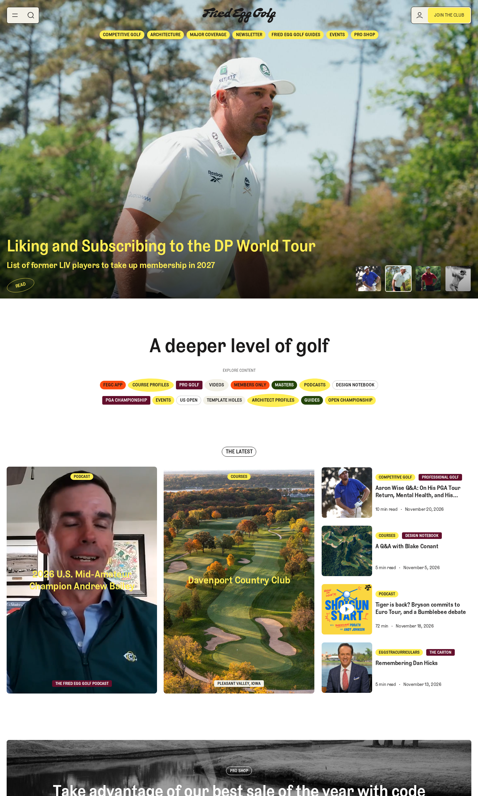
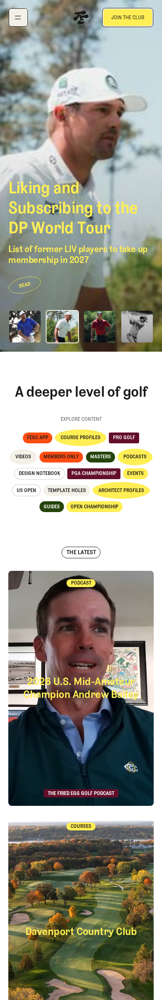

# UI Design System & Master Generation Blueprint: www-thefriedegg-com

> **Fried Egg Golf** (https://www.thefriedegg.com/) — Visit Fried Egg Golf for in-depth golf course profiles, entertaining podcasts, premium event access, and all of the merch you never knew...



---

## 1. Executive Visual Persona & Design Archetype

- **Brand Essence & Persona**: **Fried Egg Golf** (`https://www.thefriedegg.com/`). Visit Fried Egg Golf for in-depth golf course profiles, entertaining podcasts, premium event access, and all of the merch you never knew...
- **Capture Provenance**: Live browser capture (`tier1_fast`, HTTP `200`, captured `2026-11-23`).
- **Visual Archetype**: **Light-Substrate Editorial & Modular Grid System (`#ffffff` canvas, `#1b1a1a` ink, `#ffa500` accent)**.
- **Anti-AI-Slop Differentiators**:
  - **Live-Computed Chromatic Polarity**: Anchors the viewport in `#ffffff` (live computed `body` `background-color` (`computed_styles.json`)) paired with `#1b1a1a` primary typography and `#ffa500` accents.
  - **Grounded Typographic Hierarchy**: Pairs `Grey` for display copy (`A deeper level of golf`) with `Grey` and not declared in live computed styles (uses primary stack / `ui-monospace`).
  - **Calibrated Spatial Grid & Motion**: Combines `1440px` container bounds (`gap: 16px`, padding `9px`) with `cubic-bezier(.645,.045,.355,1)` easing and GSAP Timeline & ScrollTrigger, Three.js / WebGL Canvas Pipeline.

---

## 2. Spatial Architecture & Modular Grid Mathematics



### Viewport Allocation & Container Geometry
- **Captured Viewport Dimensions**: Desktop `1440×2400px` (`assets/desktop.png`, clamped at 2400px live multi-section capture), Mobile `390×2400px` (`assets/mobile.png`, clamped at 2400px live multi-section capture).
- **Master Container Bounds**: `1440px` (full-bleed `100%` desktop stage measured on `1440px` viewport).
- **Canvas Lateral Padding & Spacing**: `9px` lateral canvas padding with `16px` grid gap.
- **Border Radius Scale**: `6.4px`, `3px`, `100%`, `50%`.

### Responsive Breakpoint Architecture
- **Desktop Layout**: Multi-column CSS Grid / Flexbox layout at `1440px` (`max-width: 1440px`, `gap: 16px`).
- **Mobile Layout**: Single-column vertical stack at `390px` viewport width with `9px` horizontal padding.
- **Extracted CSS Media Queries**: `@media screen and (max-width:991px)`, `@media screen and (max-width:767px)`, `@media screen and (max-width:479px)`, `@media (min-width:768px)`.

---

## 3. Color System, Materiality & Atmospheric Lighting

### Semantic Palette & Source Grounding
| Semantic Role | Ground-Truth Value | Extracted Live / CSS Source |
|---|---|---|
| **Primary Canvas Substrate** | `#ffffff` | live computed `body` `background-color` (`computed_styles.json`) |
| **Primary Typography Ink** | `#1b1a1a` | live computed `h1` `color` (`computed_styles.json`) |
| **Elevated Surface / Card Substrate** | `#f3f1e7` | live computed `a` `background-color` (`computed_styles.json`) |
| **Interactive Accent / Highlight** | `#ffa500` | `.upvote-btn-icon.is-upvoted { background-color: orange }` (`#ffa500`) |
| **Secondary / Muted Copy** | `#ffee54` | live computed `p` `color` (`computed_styles.json`) |
| **Structural Hairline Border** | `#e2e2e2` | `blockquote { border-left: #e2e2e2 }` |

### Sanitized Root CSS Variables (`ui-ux.md` Ground Truth)
| Variable Name | Extracted Value | Semantic Role |
|---|---|---|
| `--_theme---background` | `var(--_colours---base--white)` | Canvas / Surface Token |
| `--_text-style---font-family` | `var(--_typography---font--primary-family)` | Typography Ink Token |
| `--_theme---text` | `var(--_colours---base--black)` | Typography Ink Token |
| `--_text-style---font-size` | `var(--_typography---font-size--text-main)` | Typography Ink Token |
| `--_text-style---line-height` | `var(--_typography---line-height--1-4)` | Typography Ink Token |
| `--_text-style---font-weight` | `var(--_typography---font--primary-regular)` | Typography Ink Token |
| `--_text-style---letter-spacing` | `var(--_typography---letter-spacing--0em)` | Typography Ink Token |
| `--_spacing---space--5` | `1.25rem` | Layout / Spatial Grid Token |
| `--_typography---font--primary-medium` | `500` | Brand / Palette Token |
| `--size--0-5rem` | `.5rem` | Layout / Spatial Grid Token |
| `--size--2rem` | `2rem` | Layout / Spatial Grid Token |
| `--size--1-5rem` | `1.5rem` | Layout / Spatial Grid Token |
| `--size--1rem` | `1rem` | Layout / Spatial Grid Token |
| `--_typography---font--secondary-family` | `Stanley,Arial,sans-serif` | Brand / Palette Token |
| `--_typography---font-size--text-medium` | `1.125rem` | Typography Ink Token |
| `--_typography---line-height--1-6` | `1.6` | Typography / Scale Token |

---

## 4. Typographic Scale & Editorial Hierarchy

### Font Family Stacks
- **Display Typography**: `Grey`.
- **Primary Body Stack**: `Grey`.
- **Technical / Metadata Stack**: not declared in live computed styles (uses primary stack / `ui-monospace`).

### Typographic Scale & Rules (Live Computed & Stylesheet Grounded)
- **Hero Display (`H1`)**: live computed `h1` (`font-size: 59.9984px`, `line-height: 71.9981px`, `font-weight: 500`, `letter-spacing: -1.19997px`); CSS variables `--_typography---font-size--h1: 5rem`, `--_typography---font-size--display: 6rem`; rule `h1` (`font-size: var(--_text-style---font-size)`, `line-height: var(--_text-style---l...`, `letter-spacing: var(--_text-style---l...`, `font-weight: var(--_text-s...`).
- **Section Heading (`H2`)**: live computed `h2` (`font-size: 50px`, `line-height: 60px`, `font-weight: 500`, `letter-spacing: -1px`); CSS variables `--_typography---font-size--h2: 4rem`; rule `h2` (`font-size: var(--_text-style---font-size)`, `line-height: var(--_text-style---l...`, `letter-spacing: var(--_text-style---l...`, `font-weight: var(--_text-s...`).
- **Body Copy**: live computed `body` (`font-size: 15.9888px`, `line-height: 22.3843px`, `font-weight: 400`); rule `p` (`font-size: var(--_typography---font-size...`, `line-height: var(--_typography---l...`, `letter-spacing: var(--_typography---l...`).
- **Metadata & Navigation Labels**: live computed `nav/a` (`font-size: 15.9888px`, `line-height: 22.3843px`, `font-weight: 400`); CSS variables `--_text-style---letter-spacing: var(--_typography---letter-spacing--0em)`, `--_typography---letter-spacing--0-03em: -.03em`, `--radius--small: .5rem`; rule `small` (`font-size: 0.75rem`, `letter-spacing: 0.06em`).

---

## 5. Choreographed Motion & Interaction Physics

### Primary Easing Curves
- **Extracted Timing Functions**: `cubic-bezier(.645,.045,.355,1)`.

### Per-Element Transition & Choreography Rules
- **Selector `.w-webflow-badge>img`**: `transition: unset` extracted from `www-thefriedegg-com` stylesheet.
- **Selector `.w-slider-dot`**: `transition: background-color .1s,color .1s` extracted from `www-thefriedegg-com` stylesheet.
- **Selector `.w-lightbox-control`**: `transition: all .3s` extracted from `www-thefriedegg-com` stylesheet.
- **Extracted Easing Curve (`cubic-bezier(.645,.045,.355,1)`)**: Governs interactive state transitions across `<header.header_main_wrap>` and `<section.latest_wrap>`.
- **Runtime Interaction Engine**: Integrates GSAP Timeline & ScrollTrigger, Three.js / WebGL Canvas Pipeline, Swiper Touch Carousel Engine, Lottie Vector Animation Player with `prefers-reduced-motion: reduce` fallback guards.

---

## 6. Component Wireframe & Structural DOM Map

### Visual Layout Schematic — Desktop (`1440px`, Grounded in `dom.html` & Landmark Bounding Boxes)
```
┌────────────────────────────────────────────────────────────────────────┐
│ DESKTOP VIEWPORT (1440px) — Fried Egg Golf                             │
│ ====================================================================== │
│ [ <header.header_main_wr (1440x900px) | Newsletter · Pro Shop · Arch ] │
│ ---------------------------------------------------------------------- │
│ | HERO STAGE: <section.explore_content_wrap> (w=1440px)              | │
│ | H1: A deeper level of golf                                         | │
│ | Substrate: #ffffff | Ink: #1b1a1a | Accent: #ffa500                | │
│ ---------------------------------------------------------------------- │
│ | SHOWCASE GRID (<section.latest_wrap>) max-w: 1440px                | │
│ | +------------------------------+  +------------------------------+ | │
│ | | 2026 U.S. Mid-Amateur Champi |  | Davenport Country Club       | | │
│ | +------------------------------+  +------------------------------+ | │
│ ---------------------------------------------------------------------- │
│ | DETAIL MODULE (<section.major_cta_wrap>) — Aaron Wise Q&A: On Hi   | │
│ ---------------------------------------------------------------------- │
│ [ FOOTER (<footer.footer_wrap>) | https://www.thefriedegg.com/         │
└────────────────────────────────────────────────────────────────────────┘
```

### Visual Layout Schematic — Mobile Reflow (`390px`)
```
┌────────────────────────────────────────────────────────────────────────┐
│ MOBILE VIEWPORT REFLOW (390px) — Single-Column Stack (gap: 16px)       │
│ ====================================================================== │
│ [ HEADER BAR (<header.header_main_wrap) | Compact Menu (390px)         │
│ ---------------------------------------------------------------------- │
│ | HERO STAGE (<section.explore_content) — 390px Vertical Lead        | │
│ | H1: A deeper level of golf                                         | │
│ ---------------------------------------------------------------------- │
│ | SHOWCASE STACK (<section.latest_wrap>) — 1-Col Stack               | │
│ | [ Item 1: 2026 U.S. Mid-Amateur Champion Andrew Bailey           ] | │
│ | [ Item 2: Davenport Country Club                                 ] | │
│ ---------------------------------------------------------------------- │
│ | DETAIL STACK (<section.major_cta_wrap>) — 1-Col (Aaron Wise Q&A: On) │
│ ---------------------------------------------------------------------- │
│ [ FOOTER (<footer.footer_wrap>) | Stacked 390px Colophon               │
└────────────────────────────────────────────────────────────────────────┘
```

### Granular DOM Region Breakdown
1. **Brand Header & Navigation Bar (<header.header_main_wrap> — `www-thefriedegg-com`)**:
   - Landmark `<header class="header_main_wrap">` (`1440x900px`) hosting `Fried Egg Golf` navigation (`Newsletter · Pro Shop · Architecture · Course Profiles · Architect Profiles`), DOM attributes (`data-wf-domain="www.thefriedegg.com"`, `data-wf-page="67ab6ef769ff843db623d6fa"`, `data-wf-site="67ab6ef769ff843db623d6f5"`, `data-hubspot-styled-components`), and stylesheet rule `html { -webkit-text-size-adjust:100%;-ms-text-size-adjust:100%;font-family:sans... }`.
2. **Hero Stage & Focal Lead (<section.explore_content_wrap> — `A deeper level of golf`)**:
   - Landmark `<section class="explore_content_wrap">` presenting display lead `A deeper level of golf` and copy excerpt *"List of former LIV players to take up membership in 2027"* over `#ffffff` canvas and `#1b1a1a` ink.
3. **Primary Showcase & Content Grid (<section.latest_wrap> — `2026 U.S. Mid-Amateur Champion And`)**:
   - Landmark `<section class="latest_wrap">` rendering section `2026 U.S. Mid-Amateur Champion Andrew Bailey` with copy *"Q&A with Aaron Wise"*, asset references (`cdn.prod.website-files.com`, `friedegg-staging.shared.feb62e49d...`, `iframe_api.bc7198a0fbd8d2409df5.js`, `www-widgetapi.js`), and grid rule `summary { display:block }`.
4. **Interactive Detail & Feature Matrix (<section.major_cta_wrap> — `Davenport Country Club`)**:
   - Landmark `<section class="major_cta_wrap">` framing `Davenport Country Club` and `Aaron Wise Q&A: On His PGA Tour Return, Mental He...` (*"On his PGA Tour return, mental health, and more"*) with `#f3f1e7` surface cards, `#ffa500` accents, and `video { vertical-align:baseline;display:inline-block }`.
5. **Colophon & Global Directory Footer (<footer.footer_wrap> — `https://www.thefriedegg.com/`)**:
   - Landmark `<footer class="footer_wrap">` anchoring `Fried Egg Golf` footer links (`Newsletter · Pro Shop · Architecture · Course Profiles · Architect Profiles`), copy *"Liking and Subscribing to the DP World Tour"*, and `#e2e2e2` structural dividers.

---

## 7. Master Zero-Shot AI Generation Prompt

```markdown
# Master Zero-Shot Frontend Generation Prompt: www-thefriedegg-com (Fried Egg Golf)

You are a principal frontend architect and design systems engineer. Build a complete, production-ready web application replicating the exact design system, DOM landmarks, typographic hierarchy, color tokens, and motion physics of `www-thefriedegg-com` (**Fried Egg Golf** — `https://www.thefriedegg.com/`).

### 1. Visual Archetype & Anti-AI-Slop Mandates
- **Archetype**: Light-Substrate Editorial & Modular Grid System (`#ffffff` canvas, `#1b1a1a` ink, `#ffa500` accent).
- **Identity & Domain Context**: Visit Fried Egg Golf for in-depth golf course profiles, entertaining podcasts, premium event access, and all of the merch you never knew...
- **Primary Substrate**: `#ffffff` (live computed `body` `background-color` (`computed_styles.json`)), **Primary Ink**: `#1b1a1a`, **Accent / Highlight**: `#ffa500`.
- **Site-Specific Differentiators**:
  - **Live-Computed Chromatic Polarity**: Anchors the viewport in `#ffffff` (live computed `body` `background-color` (`computed_styles.json`)) paired with `#1b1a1a` primary typography and `#ffa500` accents.
  - **Grounded Typographic Hierarchy**: Pairs `Grey` for display copy (`A deeper level of golf`) with `Grey` and not declared in live computed styles (uses primary stack / `ui-monospace`).
  - **Calibrated Spatial Grid & Motion**: Combines `1440px` container bounds (`gap: 16px`, padding `9px`) with `cubic-bezier(.645,.045,.355,1)` easing and GSAP Timeline & ScrollTrigger, Three.js / WebGL Canvas Pipeline.

### 2. Ground-Truth CSS Variables (`:root` Token Contract)
Declare and consume these exact custom properties extracted from `www-thefriedegg-com` in your global stylesheet:

:root {
  /* Fried Egg Golf (www-thefriedegg-com) — Live-Grounded CSS Variables */
  --_theme---background: var(--_colours---base--white); /* Canvas / Surface Token (www-thefriedegg-com) */
  --_text-style---font-family: var(--_typography---font--primary-family); /* Typography Ink Token (www-thefriedegg-com) */
  --_theme---text: var(--_colours---base--black); /* Typography Ink Token (www-thefriedegg-com) */
  --_text-style---font-size: var(--_typography---font-size--text-main); /* Typography Ink Token (www-thefriedegg-com) */
  --_text-style---line-height: var(--_typography---line-height--1-4); /* Typography Ink Token (www-thefriedegg-com) */
  --_text-style---font-weight: var(--_typography---font--primary-regular); /* Typography Ink Token (www-thefriedegg-com) */
  --_text-style---letter-spacing: var(--_typography---letter-spacing--0em); /* Typography Ink Token (www-thefriedegg-com) */
  --_spacing---space--5: 1.25rem; /* Layout / Spatial Grid Token (www-thefriedegg-com) */
  --_typography---font--primary-medium: 500; /* Brand / Palette Token (www-thefriedegg-com) */
  --size--0-5rem: .5rem; /* Layout / Spatial Grid Token (www-thefriedegg-com) */
  --size--2rem: 2rem; /* Layout / Spatial Grid Token (www-thefriedegg-com) */
  --size--1-5rem: 1.5rem; /* Layout / Spatial Grid Token (www-thefriedegg-com) */
  --size--1rem: 1rem; /* Layout / Spatial Grid Token (www-thefriedegg-com) */
  --_typography---font--secondary-family: Stanley,Arial,sans-serif; /* Brand / Palette Token (www-thefriedegg-com) */
  --_typography---font-size--text-medium: 1.125rem; /* Typography Ink Token (www-thefriedegg-com) */
  --_typography---line-height--1-6: 1.6; /* Typography / Scale Token (www-thefriedegg-com) */
}

### 3. Semantic Color & Materiality Contract
Map every surface, ink, and border strictly to these source-grounded tokens:
- **Primary Canvas Substrate**: `#ffffff` — grounded in live computed `body` `background-color` (`computed_styles.json`)
- **Primary Typography Ink**: `#1b1a1a` — grounded in live computed `h1` `color` (`computed_styles.json`)
- **Elevated Surface / Card Substrate**: `#f3f1e7` — grounded in live computed `a` `background-color` (`computed_styles.json`)
- **Interactive Accent / Highlight**: `#ffa500` — grounded in `.upvote-btn-icon.is-upvoted { background-color: orange }` (`#ffa500`)
- **Secondary / Muted Copy**: `#ffee54` — grounded in live computed `p` `color` (`computed_styles.json`)
- **Structural Hairline Border**: `#e2e2e2` — grounded in `blockquote { border-left: #e2e2e2 }`

### 4. Spatial Grid, Container Bounds & Responsive Breakpoints
- **Desktop Viewport Reference**: `1440×2400px` (clamped at 2400px live multi-section capture, `1440px` standard desktop width).
- **Mobile Viewport Reference**: `390×2400px` (clamped at 2400px live multi-section capture, `390px` standard mobile width).
- **Container Max-Width**: `1440px` (full-bleed `100%` desktop stage measured on `1440px` viewport)
- **Padding & Gutters**: `9px` lateral canvas padding with `16px` grid gap
- **Desktop Grid**: Multi-column CSS Grid / Flexbox layout at `1440px` (`max-width: 1440px`, `gap: 16px`)
- **Mobile Adaptation**: Single-column vertical stack at `390px` viewport width with `9px` horizontal padding
- **Media Queries**: `@media screen and (max-width:991px)`, `@media screen and (max-width:767px)`, `@media screen and (max-width:479px)`, `@media (min-width:768px)`
- **Corner Radii**: `6.4px`, `3px`, `100%`, `50%`

### 5. Typography & Editorial Scale Contract
- **Display Font Stack**: `Grey`
- **Body Font Stack**: `Grey`
- **Monospace / Technical Font Stack**: not declared in live computed styles (uses primary stack / `ui-monospace`)
- **H1 Display Rule**: live computed `h1` (`font-size: 59.9984px`, `line-height: 71.9981px`, `font-weight: 500`, `letter-spacing: -1.19997px`); CSS variables `--_typography---font-size--h1: 5rem`, `--_typography---font-size--display: 6rem`; rule `h1` (`font-size: var(--_text-style---font-size)`, `line-height: var(--_text-style---l...`, `letter-spacing: var(--_text-style---l...`, `font-weight: var(--_text-s...`)
- **H2 Section Rule**: live computed `h2` (`font-size: 50px`, `line-height: 60px`, `font-weight: 500`, `letter-spacing: -1px`); CSS variables `--_typography---font-size--h2: 4rem`; rule `h2` (`font-size: var(--_text-style---font-size)`, `line-height: var(--_text-style---l...`, `letter-spacing: var(--_text-style---l...`, `font-weight: var(--_text-s...`)
- **Body Copy Rule**: live computed `body` (`font-size: 15.9888px`, `line-height: 22.3843px`, `font-weight: 400`); rule `p` (`font-size: var(--_typography---font-size...`, `line-height: var(--_typography---l...`, `letter-spacing: var(--_typography---l...`)
- **Metadata & Index Rule**: live computed `nav/a` (`font-size: 15.9888px`, `line-height: 22.3843px`, `font-weight: 400`); CSS variables `--_text-style---letter-spacing: var(--_typography---letter-spacing--0em)`, `--_typography---letter-spacing--0-03em: -.03em`, `--radius--small: .5rem`; rule `small` (`font-size: 0.75rem`, `letter-spacing: 0.06em`)

### 6. Component Hierarchy, Verbatim Copy & Real DOM Landmarks
Scaffold `www-thefriedegg-com` (`Fried Egg Golf`) with these exact structural regions, extracted copy, and CSS rules from `dom.html`:
1. **Brand Header & Navigation Bar (<header.header_main_wrap> — `www-thefriedegg-com`)**:
   - DOM & Selectors: Landmark `<header class="header_main_wrap">` (`1440x900px`) hosting `Fried Egg Golf` navigation (`Newsletter · Pro Shop · Architecture · Course Profiles · Architect Profiles`), DOM attributes (`data-wf-domain="www.thefriedegg.com"`, `data-wf-page="67ab6ef769ff843db623d6fa"`, `data-wf-site="67ab6ef769ff843db623d6f5"`, `data-hubspot-styled-components`), and stylesheet rule `html { -webkit-text-size-adjust:100%;-ms-text-size-adjust:100%;font-family:sans... }`.
   - Responsive Contract: Header `Brand Header & Navigation Bar (<header.header_main_wrap> — `www-thefriedegg-com`)` (`www-thefriedegg-com`) adapts across `@media screen and (max-width:991px)`, `@media screen and (max-width:767px)`, `@media screen and (max-width:479px)`, `@media (min-width:768px)` with `cubic-bezier(.645,.045,.355,1)` transitions and links `Newsletter · Pro Shop · Architecture · Course Profiles · Architect Profiles`.
2. **Hero Stage & Focal Lead (<section.explore_content_wrap> — `A deeper level of golf`)**:
   - DOM & Selectors: Landmark `<section class="explore_content_wrap">` presenting display lead `A deeper level of golf` and copy excerpt *"List of former LIV players to take up membership in 2027"* over `#ffffff` canvas and `#1b1a1a` ink.
   - Responsive Contract: Hero stage (`1440×2400px` desktop / `390×2400px` mobile) sets `#ffffff` background with `#1b1a1a` headline `A deeper level of golf`.
3. **Primary Showcase & Content Grid (<section.latest_wrap> — `2026 U.S. Mid-Amateur Champion And`)**:
   - DOM & Selectors: Landmark `<section class="latest_wrap">` rendering section `2026 U.S. Mid-Amateur Champion Andrew Bailey` with copy *"Q&A with Aaron Wise"*, asset references (`cdn.prod.website-files.com`, `friedegg-staging.shared.feb62e49d...`, `iframe_api.bc7198a0fbd8d2409df5.js`, `www-widgetapi.js`), and grid rule `summary { display:block }`.
   - Responsive Contract: Showcase grid `Primary Showcase & Content Grid (<section.latest_wrap> — `2026 U.S. Mid-Amateur Champion And`)` applies Multi-column CSS Grid / Flexbox layout at `1440px` (`max-width: 1440px`, `gap: 16px`) on desktop and Single-column vertical stack at `390px` viewport width with `9px` horizontal padding on mobile.
4. **Interactive Detail & Feature Matrix (<section.major_cta_wrap> — `Davenport Country Club`)**:
   - DOM & Selectors: Landmark `<section class="major_cta_wrap">` framing `Davenport Country Club` and `Aaron Wise Q&A: On His PGA Tour Return, Mental He...` (*"On his PGA Tour return, mental health, and more"*) with `#f3f1e7` surface cards, `#ffa500` accents, and `video { vertical-align:baseline;display:inline-block }`.
   - Responsive Contract: Detail module `Interactive Detail & Feature Matrix (<section.major_cta_wrap> — `Davenport Country Club`)` uses `6.4px`, `3px`, `100%`, `50%` radii, `#ffa500` highlights, and assets (cdn.prod.website-files.com, friedegg-staging.shared.feb62e49d..., iframe_api.bc7198a0fbd8d2409df5.js).
5. **Colophon & Global Directory Footer (<footer.footer_wrap> — `https://www.thefriedegg.com/`)**:
   - DOM & Selectors: Landmark `<footer class="footer_wrap">` anchoring `Fried Egg Golf` footer links (`Newsletter · Pro Shop · Architecture · Course Profiles · Architect Profiles`), copy *"Liking and Subscribing to the DP World Tour"*, and `#e2e2e2` structural dividers.
   - Responsive Contract: Footer `Colophon & Global Directory Footer (<footer.footer_wrap> — `https://www.thefriedegg.com/`)` aligns to `1440px` (full-bleed `100%` desktop stage measured on `1440px` viewport) with `9px` lateral canvas padding with `16px` grid gap and attributes (data-wf-domain="www.thefriedegg.com", data-wf-page="67ab6ef769ff843db623d6fa", data-wf-site="67ab6ef769ff843db623d6f5").

#### Verbatim DOM Copy Excerpts (`dom.html`)
- Copy Excerpt 1: *"List of former LIV players to take up membership in 2027"*
- Copy Excerpt 2: *"Q&A with Aaron Wise"*
- Copy Excerpt 3: *"On his PGA Tour return, mental health, and more"*
- Copy Excerpt 4: *"Liking and Subscribing to the DP World Tour"*

### 7. Motion, Extracted Stylesheet Rules & Interaction Choreography
- **Primary Easing Functions**: `cubic-bezier(.645,.045,.355,1)`
- **Extracted Stylesheet Rules (`www-thefriedegg-com`)**:
- `html { -webkit-text-size-adjust:100%;-ms-text-size-adjust:100%;font-family:sans... }`
- `summary { display:block }`
- `video { vertical-align:baseline;display:inline-block }`
- `template { display:none }`
- `strong { font-weight:700 }`
- **Per-Selector Transition Rules**:
- **Selector `.w-webflow-badge>img`**: `transition: unset` extracted from `www-thefriedegg-com` stylesheet.
- **Selector `.w-slider-dot`**: `transition: background-color .1s,color .1s` extracted from `www-thefriedegg-com` stylesheet.
- **Selector `.w-lightbox-control`**: `transition: all .3s` extracted from `www-thefriedegg-com` stylesheet.
- **Extracted Easing Curve (`cubic-bezier(.645,.045,.355,1)`)**: Governs interactive state transitions across `<header.header_main_wrap>` and `<section.latest_wrap>`.
- **Runtime Interaction Engine**: Integrates GSAP Timeline & ScrollTrigger, Three.js / WebGL Canvas Pipeline, Swiper Touch Carousel Engine, Lottie Vector Animation Player with `prefers-reduced-motion: reduce` fallback guards.

### 8. Technical Deliverables
- Implement in Next.js (App Router) with TypeScript and Tailwind CSS consuming the `:root` custom properties defined above for `www-thefriedegg-com`.
- Reproduce both the `1440px` desktop architecture and `390px` mobile breakpoint transitions, preserving semantic HTML5 landmarks (`<header>`, `<nav>`, `<main>`, `<section>`, `<footer>`) and `prefers-reduced-motion` accessibility guards.
```
