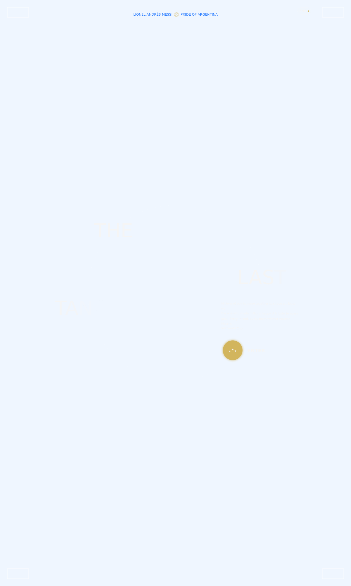
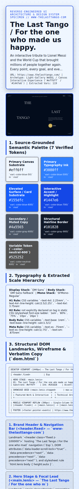

# UI Design System & Master Generation Blueprint: www-thelasttango-com

> **The Last Tango / For the one who made us happy.** (https://www.thelasttango.com/) — An interactive tribute to Lionel Messi and the World Cup that brought millions of people together again. Every point, every goal, and eve...



---

## 1. Executive Visual Persona & Design Archetype

- **Brand Essence & Persona**: **The Last Tango / For the one who made us happy.** (`https://www.thelasttango.com/`). An interactive tribute to Lionel Messi and the World Cup that brought millions of people together again. Every point, every goal, and eve...
- **Visual Archetype**: **Light-Gallery WebGL / Canvas Interactive Experience (`#eff6ff` / `#1447e6`)**.
- **Anti-AI-Slop Differentiators**:
  - **Source-Grounded Chromatic Polarity**: Anchors the viewport in `#eff6ff` (`var(--color-blue-50)` in `:root`) paired with `#101828` primary typography and `#1447e6` accents.
  - **Extracted Typographic Hierarchy**: Pairs `DM Sans` for display copy (`The Last Tango / For the one who mad`) with `DM Sans Fallback` and `SFMono-Regular`.
  - **Calibrated Spatial Grid & Motion**: Combines `480px` container bounds (`gap: var(--spacing-2)`, padding `var(--spacing-1)`) with `cubic-bezier(0,0,.2,1)` easing and Lenis Smooth Scroll (`data-lenis`), Three.js / WebGL Canvas Pipeline.

---

## 2. Spatial Architecture & Modular Grid Mathematics



### Viewport Allocation & Container Geometry
- **Captured Viewport Dimensions**: Desktop `1440×2400px` (`assets/desktop.png`, capped at 2400px multi-section capture), Mobile `390×2400px` (`assets/mobile.png`, capped at 2400px multi-section capture).
- **Master Container Bounds**: `480px` extracted from `www-thelasttango-com` stylesheet.
- **Canvas Lateral Padding & Spacing**: `var(--spacing-1)` lateral canvas padding with `var(--spacing-2)` grid gap.
- **Border Radius Scale**: `.25rem`, `var(--radius-2xl)`, `16px`, `var(--radius-lg)`.

### Responsive Breakpoint Architecture
- **Desktop Layout**: Multi-column CSS Grid / Flexbox layout at `1440px` (`max-width: 480px`, `gap: var(--spacing-2)`).
- **Mobile Layout**: Single-column vertical stack at `390px` viewport width with `var(--spacing-1)` horizontal padding.
- **Extracted CSS Media Queries**: `@media (min-width:480px)`, `@media (min-width:640px)`, `@media (min-width:650px)`, `@media (min-width:768px)`.

---

## 3. Color System, Materiality & Atmospheric Lighting

### Semantic Palette & Source Grounding
| Semantic Role | Ground-Truth Value | Extracted CSS Source / Selector |
|---|---|---|
| **Primary Canvas Substrate** | `#eff6ff` | `var(--color-blue-50)` in `:root` |
| **Primary Typography Ink** | `#3080ff` | `var(--color-blue-500)` in `:root` |
| **Elevated Surface / Card Substrate** | `#155dfc` | `var(--color-blue-600)` in `:root` |
| **Interactive Accent / Highlight** | `#1447e6` | `var(--color-blue-700)` in `:root` |
| **Secondary / Muted Copy** | `#4a5565` | `var(--color-gray-600)` in `:root` |
| **Structural Hairline Border** | `#101828` | `var(--color-gray-900)` in `:root` |
| **Variable Token (`--color-neutral-600`)** | `#525252` | `var(--color-neutral-600)` in `:root` |

### Sanitized Root CSS Variables (`ui-ux.md` Ground Truth)
| Variable Name | Extracted Value | Semantic Role |
|---|---|---|
| `--font-dm-sans` | `"DM Sans", "DM Sans Fallback"` | Typography / Scale Token |
| `--font-cormorant-garamond` | `"Cormorant Garamond", "Cormorant Garamond Fallback"` | Typography / Scale Token |
| `--font-darker-grotesque` | `"Darker Grotesque", "Darker Grotesque Fallback"` | Canvas / Surface Token |
| `--ctrl-desktop-max-w` | `1920px` | Layout / Spatial Grid Token |
| `--ctrl-tablet-max-w` | `100vw` | Layout / Spatial Grid Token |
| `--ctrl-mobile-max-w` | `100vw` | Layout / Spatial Grid Token |
| `--ctrl-desktop-max-h` | `100vh` | Dimension / Scale Token |
| `--ctrl-tablet-max-h` | `100vh` | Dimension / Scale Token |
| `--ctrl-mobile-max-h` | `90vh` | Dimension / Scale Token |
| `--color-blue-50` | `#eff6ff` | Brand / Palette Token |
| `--color-blue-500` | `#3080ff` | Brand / Palette Token |
| `--color-blue-600` | `#155dfc` | Brand / Palette Token |
| `--color-blue-700` | `#1447e6` | Brand / Palette Token |
| `--color-gray-600` | `#4a5565` | Brand / Palette Token |
| `--color-gray-900` | `#101828` | Brand / Palette Token |
| `--color-neutral-600` | `#525252` | Brand / Palette Token |

---

## 4. Typographic Scale & Editorial Hierarchy

### Font Family Stacks
- **Display Typography**: `DM Sans`.
- **Primary Body Stack**: `DM Sans Fallback`.
- **Technical / Metadata Stack**: `SFMono-Regular`.

### Typographic Scale & Rules (Extracted from Stylesheet & Variables)
- **Hero Display (`H1`)**: CSS variables `--text-4xl: 2.25rem`, `--text-4xl--line-height: calc(2.5/2.25)`, `--text-6xl: 3.75rem`.
- **Section Heading (`H2`)**: not explicitly declared on tag in static CSS (stylesheet font-size ladder: `1em`, `80%`, `75%`, `10px`, `16px`).
- **Body Copy**: CSS variables `--text-base: 1rem`, `--text-base--line-height: calc(1.5/1)`.
- **Metadata & Navigation Labels**: CSS variables `--text-xs: .75rem`, `--text-xs--line-height: calc(1/.75)`, `--text-sm: .875rem`.

---

## 5. Choreographed Motion & Interaction Physics

### Primary Easing Curves
- **Extracted Timing Functions**: `cubic-bezier(0,0,.2,1)`, `cubic-bezier(.4,0,.2,1)`, `cubic-bezier(.48,.04,.52,.96)`.

### Per-Element Transition & Choreography Rules
- **Selector `.lenis.lenis-autoToggle`**: `transition: 1ms` extracted from `www-thelasttango-com` stylesheet.
- **Selector `layer theme`**: `transition: .15s` extracted from `www-thelasttango-com` stylesheet.
- **Selector `.transition`**: `transition: var(--tw-ease,var(--default-transition-timing-function))` extracted from `www-thelasttango-com` stylesheet.
- **Extracted Easing Curve (`cubic-bezier(0,0,.2,1)`)**: Governs interactive state transitions across `<header.fixed>` and `<main.lenis-stopped>`.
- **Runtime Interaction Engine**: Integrates Lenis Smooth Scroll (`data-lenis`), Three.js / WebGL Canvas Pipeline with `prefers-reduced-motion: reduce` fallback guards.

---

## 6. Component Wireframe & Structural DOM Map

### Visual Layout Schematic (Grounded in `dom.html` — `1440px` Desktop & `390px` Mobile Reflow)
```
┌────────────────────────────────────────────────────────────────────────┐
│ DESKTOP VIEWPORT (1440px) — The Last Tango / For the one who made us h │
│ ====================================================================== │
│ [ <header.fixed>           | Esp                                    ]  │
│ ---------------------------------------------------------------------- │
│ | HERO STAGE: <main.lenis>                                         |   │
│ | H1: The Last Tango / For the one who made us happy.              |   │
│ | Substrate: #eff6ff    | Ink: #101828    | Accent: #1447e6        |   │
│ ---------------------------------------------------------------------- │
│ | SHOWCASE GRID (<main.lenis-stopped>      ) max-w: 480px          |   │
│ | +------------------------------+  +------------------------------+ | │
│ | | Featured Work & Interactive  |  | Technical Architecture & Nar | | │
│ | +------------------------------+  +------------------------------+ | │
│ ---------------------------------------------------------------------- │
│ | MOBILE VIEWPORT REFLOW (390px) — Single-Column Stack (gap: var(--) | │
│ | [<header.fixed>] -> [<main.lenis>] -> [<main.lenis-stoppe] |         │
│ ---------------------------------------------------------------------- │
│ [ FOOTER (<footer.pointer-events) | https://www.thelasttango.com/      │
└────────────────────────────────────────────────────────────────────────┘
```

### Granular DOM Region Breakdown
1. **Brand Header & Navigation Bar (<header.fixed> — `www-thelasttango-com`)**:
   - Landmark `<header class="fixed z-100000">` hosting `The Last Tango / For the one who mad` navigation (`Esp`), DOM attributes (`data-loader-scroll-lock="true"`, `data-precedence="next"`, `data-precedence="next"`, `data-precedence="next"`), and stylesheet rule `html.lenis body { height:auto }`.
2. **Hero Stage & Focal Lead (<main.lenis> — `The Last Tango / For the one who m`)**:
   - Landmark `<main class="lenis">` presenting display lead `The Last Tango / For the one who made us happy.` and copy excerpt *"Lionel Andrés Messi"* over `#eff6ff` canvas and `#101828` ink.
3. **Primary Showcase & Content Grid (<main.lenis-stopped> — `Featured Work & Interactive Showca`)**:
   - Landmark `<main class="lenis-stopped">` rendering section `Featured Work & Interactive Showcase` with copy *"Pride of Argentina"*, asset references (`187cmj4q350mm.css`, `0eqspdm2dt5_-.css`, `0kkv0xwvqoa86.css`, `14~g0x6k9zzx2.js`), and grid rule `.lenis-stopped { overflow:clip }`.
4. **Interactive Detail & Feature Matrix (<main.fonts-loaded> — `Technical Architecture & Narrative`)**:
   - Landmark `<main class="fonts-loaded">` framing `Technical Architecture & Narrative` and `Global Directory & Contact` (*"Millions of points come together to shape a tribute for"*) with `#155dfc` surface cards, `#1447e6` accents, and `.lenis.lenis-smooth iframe { pointer-events:none }`.
5. **Colophon & Global Directory Footer (<footer.pointer-events-auto> — `https://www.thelasttango.com/`)**:
   - Landmark `<footer class="pointer-events-auto">` anchoring `The Last Tango / For the one who` footer links (`Esp`), copy *"the one who made millions happy. A tribute to every"*, and `#101828` structural dividers.

---

## 7. Master Zero-Shot AI Generation Prompt

```markdown
# Master Zero-Shot Frontend Generation Prompt: www-thelasttango-com (The Last Tango / For the one who made us happy.)

You are a principal frontend architect and design systems engineer. Build a complete, production-ready web application replicating the exact design system, DOM landmarks, typographic hierarchy, color tokens, and motion physics of `www-thelasttango-com` (**The Last Tango / For the one who made us happy.** — `https://www.thelasttango.com/`).

### 1. Visual Archetype & Anti-AI-Slop Mandates
- **Archetype**: Light-Gallery WebGL / Canvas Interactive Experience (`#eff6ff` / `#1447e6`).
- **Identity & Domain Context**: An interactive tribute to Lionel Messi and the World Cup that brought millions of people together again. Every point, every goal, and eve...
- **Primary Substrate**: `#eff6ff` (`var(--color-blue-50)` in `:root`), **Primary Ink**: `#101828`, **Accent / Highlight**: `#1447e6`.
- **Site-Specific Differentiators**:
  - **Source-Grounded Chromatic Polarity**: Anchors the viewport in `#eff6ff` (`var(--color-blue-50)` in `:root`) paired with `#101828` primary typography and `#1447e6` accents.
  - **Extracted Typographic Hierarchy**: Pairs `DM Sans` for display copy (`The Last Tango / For the one who mad`) with `DM Sans Fallback` and `SFMono-Regular`.
  - **Calibrated Spatial Grid & Motion**: Combines `480px` container bounds (`gap: var(--spacing-2)`, padding `var(--spacing-1)`) with `cubic-bezier(0,0,.2,1)` easing and Lenis Smooth Scroll (`data-lenis`), Three.js / WebGL Canvas Pipeline.

### 2. Ground-Truth CSS Variables (`:root` Token Contract)
Declare and consume these exact custom properties extracted from `www-thelasttango-com` in your global stylesheet:

:root {
  /* The Last Tango / For the one who made us happy. (www-thelasttango-com) — Ground-Truth Extracted CSS Variables */
  --font-dm-sans: "DM Sans", "DM Sans Fallback"; /* Typography / Scale Token (www-thelasttango-com) */
  --font-cormorant-garamond: "Cormorant Garamond", "Cormorant Garamond Fallback"; /* Typography / Scale Token (www-thelasttango-com) */
  --font-darker-grotesque: "Darker Grotesque", "Darker Grotesque Fallback"; /* Canvas / Surface Token (www-thelasttango-com) */
  --ctrl-desktop-max-w: 1920px; /* Layout / Spatial Grid Token (www-thelasttango-com) */
  --ctrl-tablet-max-w: 100vw; /* Layout / Spatial Grid Token (www-thelasttango-com) */
  --ctrl-mobile-max-w: 100vw; /* Layout / Spatial Grid Token (www-thelasttango-com) */
  --ctrl-desktop-max-h: 100vh; /* Dimension / Scale Token (www-thelasttango-com) */
  --ctrl-tablet-max-h: 100vh; /* Dimension / Scale Token (www-thelasttango-com) */
  --ctrl-mobile-max-h: 90vh; /* Dimension / Scale Token (www-thelasttango-com) */
  --color-blue-50: #eff6ff; /* Brand / Palette Token (www-thelasttango-com) */
  --color-blue-500: #3080ff; /* Brand / Palette Token (www-thelasttango-com) */
  --color-blue-600: #155dfc; /* Brand / Palette Token (www-thelasttango-com) */
  --color-blue-700: #1447e6; /* Brand / Palette Token (www-thelasttango-com) */
  --color-gray-600: #4a5565; /* Brand / Palette Token (www-thelasttango-com) */
  --color-gray-900: #101828; /* Brand / Palette Token (www-thelasttango-com) */
  --color-neutral-600: #525252; /* Brand / Palette Token (www-thelasttango-com) */
}

### 3. Semantic Color & Materiality Contract
Map every surface, ink, and border strictly to these source-grounded tokens:
- **Primary Canvas Substrate**: `#eff6ff` — grounded in `var(--color-blue-50)` in `:root`
- **Primary Typography Ink**: `#3080ff` — grounded in `var(--color-blue-500)` in `:root`
- **Elevated Surface / Card Substrate**: `#155dfc` — grounded in `var(--color-blue-600)` in `:root`
- **Interactive Accent / Highlight**: `#1447e6` — grounded in `var(--color-blue-700)` in `:root`
- **Secondary / Muted Copy**: `#4a5565` — grounded in `var(--color-gray-600)` in `:root`
- **Structural Hairline Border**: `#101828` — grounded in `var(--color-gray-900)` in `:root`
- **Variable Token (`--color-neutral-600`)**: `#525252` — grounded in `var(--color-neutral-600)` in `:root`

### 4. Spatial Grid, Container Bounds & Responsive Breakpoints
- **Desktop Viewport Reference**: `1440×2400px` (capped at 2400px multi-section capture, `1440px` standard desktop width).
- **Mobile Viewport Reference**: `390×2400px` (capped at 2400px multi-section capture, `390px` standard mobile width).
- **Container Max-Width**: `480px` extracted from `www-thelasttango-com` stylesheet
- **Padding & Gutters**: `var(--spacing-1)` lateral canvas padding with `var(--spacing-2)` grid gap
- **Desktop Grid**: Multi-column CSS Grid / Flexbox layout at `1440px` (`max-width: 480px`, `gap: var(--spacing-2)`)
- **Mobile Adaptation**: Single-column vertical stack at `390px` viewport width with `var(--spacing-1)` horizontal padding
- **Media Queries**: `@media (min-width:480px)`, `@media (min-width:640px)`, `@media (min-width:650px)`, `@media (min-width:768px)`
- **Corner Radii**: `.25rem`, `var(--radius-2xl)`, `16px`, `var(--radius-lg)`

### 5. Typography & Editorial Scale Contract
- **Display Font Stack**: `DM Sans`
- **Body Font Stack**: `DM Sans Fallback`
- **Monospace / Technical Font Stack**: `SFMono-Regular`
- **H1 Display Rule**: CSS variables `--text-4xl: 2.25rem`, `--text-4xl--line-height: calc(2.5/2.25)`, `--text-6xl: 3.75rem`
- **H2 Section Rule**: not explicitly declared on tag in static CSS (stylesheet font-size ladder: `1em`, `80%`, `75%`, `10px`, `16px`)
- **Body Copy Rule**: CSS variables `--text-base: 1rem`, `--text-base--line-height: calc(1.5/1)`
- **Metadata & Index Rule**: CSS variables `--text-xs: .75rem`, `--text-xs--line-height: calc(1/.75)`, `--text-sm: .875rem`

### 6. Component Hierarchy, Verbatim Copy & Real DOM Landmarks
Scaffold `www-thelasttango-com` (`The Last Tango / For the one who made us happy.`) with these exact structural regions, extracted copy, and CSS rules from `dom.html`:
1. **Brand Header & Navigation Bar (<header.fixed> — `www-thelasttango-com`)**:
   - DOM & Selectors: Landmark `<header class="fixed z-100000">` hosting `The Last Tango / For the one who mad` navigation (`Esp`), DOM attributes (`data-loader-scroll-lock="true"`, `data-precedence="next"`, `data-precedence="next"`, `data-precedence="next"`), and stylesheet rule `html.lenis body { height:auto }`.
   - Responsive Contract: Header `Brand Header & Navigation Bar (<header.fixed> — `www-thelasttango-com`)` (`www-thelasttango-com`) adapts across `@media (min-width:480px)`, `@media (min-width:640px)`, `@media (min-width:650px)`, `@media (min-width:768px)` with `cubic-bezier(0,0,.2,1)`, `cubic-bezier(.4,0,.2,1)`, `cubic-bezier(.48,.04,.52,.96)` transitions and links `Esp`.
2. **Hero Stage & Focal Lead (<main.lenis> — `The Last Tango / For the one who m`)**:
   - DOM & Selectors: Landmark `<main class="lenis">` presenting display lead `The Last Tango / For the one who made us happy.` and copy excerpt *"Lionel Andrés Messi"* over `#eff6ff` canvas and `#101828` ink.
   - Responsive Contract: Hero stage (`1440×2400px` desktop / `390×2400px` mobile) sets `#eff6ff` background with `#101828` headline `The Last Tango / For the one who made us happy.`.
3. **Primary Showcase & Content Grid (<main.lenis-stopped> — `Featured Work & Interactive Showca`)**:
   - DOM & Selectors: Landmark `<main class="lenis-stopped">` rendering section `Featured Work & Interactive Showcase` with copy *"Pride of Argentina"*, asset references (`187cmj4q350mm.css`, `0eqspdm2dt5_-.css`, `0kkv0xwvqoa86.css`, `14~g0x6k9zzx2.js`), and grid rule `.lenis-stopped { overflow:clip }`.
   - Responsive Contract: Showcase grid `Primary Showcase & Content Grid (<main.lenis-stopped> — `Featured Work & Interactive Showca`)` applies Multi-column CSS Grid / Flexbox layout at `1440px` (`max-width: 480px`, `gap: var(--spacing-2)`) on desktop and Single-column vertical stack at `390px` viewport width with `var(--spacing-1)` horizontal padding on mobile.
4. **Interactive Detail & Feature Matrix (<main.fonts-loaded> — `Technical Architecture & Narrative`)**:
   - DOM & Selectors: Landmark `<main class="fonts-loaded">` framing `Technical Architecture & Narrative` and `Global Directory & Contact` (*"Millions of points come together to shape a tribute for"*) with `#155dfc` surface cards, `#1447e6` accents, and `.lenis.lenis-smooth iframe { pointer-events:none }`.
   - Responsive Contract: Detail module `Interactive Detail & Feature Matrix (<main.fonts-loaded> — `Technical Architecture & Narrative`)` uses `.25rem`, `var(--radius-2xl)`, `16px`, `var(--radius-lg)` radii, `#1447e6` highlights, and assets (187cmj4q350mm.css, 0eqspdm2dt5_-.css, 0kkv0xwvqoa86.css).
5. **Colophon & Global Directory Footer (<footer.pointer-events-auto> — `https://www.thelasttango.com/`)**:
   - DOM & Selectors: Landmark `<footer class="pointer-events-auto">` anchoring `The Last Tango / For the one who` footer links (`Esp`), copy *"the one who made millions happy. A tribute to every"*, and `#101828` structural dividers.
   - Responsive Contract: Footer `Colophon & Global Directory Footer (<footer.pointer-events-auto> — `https://www.thelasttango.com/`)` aligns to `480px` extracted from `www-thelasttango-com` stylesheet with `var(--spacing-1)` lateral canvas padding with `var(--spacing-2)` grid gap and attributes (data-loader-scroll-lock="true", data-precedence="next", data-precedence="next").

#### Verbatim DOM Copy Excerpts (`dom.html`)
- Copy Excerpt 1: *"Lionel Andrés Messi"*
- Copy Excerpt 2: *"Pride of Argentina"*
- Copy Excerpt 3: *"Millions of points come together to shape a tribute for"*
- Copy Excerpt 4: *"the one who made millions happy. A tribute to every"*

### 7. Motion, Extracted Stylesheet Rules & Interaction Choreography
- **Primary Easing Functions**: `cubic-bezier(0,0,.2,1)`, `cubic-bezier(.4,0,.2,1)`, `cubic-bezier(.48,.04,.52,.96)`
- **Extracted Stylesheet Rules (`www-thelasttango-com`)**:
- `html.lenis body { height:auto }`
- `.lenis-stopped { overflow:clip }`
- `.lenis.lenis-smooth iframe { pointer-events:none }`
- `.lenis.lenis-autoToggle { transition-behavior:allow-discrete;transition-property:overflow;transiti... }`
- `sans_cb3f8f9-module__hFI80a__clas... { font-family:DM Sans,DM Sans Fallback;font-style:normal }`
- **Per-Selector Transition Rules**:
- **Selector `.lenis.lenis-autoToggle`**: `transition: 1ms` extracted from `www-thelasttango-com` stylesheet.
- **Selector `layer theme`**: `transition: .15s` extracted from `www-thelasttango-com` stylesheet.
- **Selector `.transition`**: `transition: var(--tw-ease,var(--default-transition-timing-function))` extracted from `www-thelasttango-com` stylesheet.
- **Extracted Easing Curve (`cubic-bezier(0,0,.2,1)`)**: Governs interactive state transitions across `<header.fixed>` and `<main.lenis-stopped>`.
- **Runtime Interaction Engine**: Integrates Lenis Smooth Scroll (`data-lenis`), Three.js / WebGL Canvas Pipeline with `prefers-reduced-motion: reduce` fallback guards.

### 8. Technical Deliverables
- Implement in Next.js (App Router) with TypeScript and Tailwind CSS consuming the `:root` custom properties defined above for `www-thelasttango-com`.
- Reproduce both the `1440px` desktop architecture and `390px` mobile breakpoint transitions, preserving semantic HTML5 landmarks (`<header>`, `<nav>`, `<main>`, `<section>`, `<footer>`) and `prefers-reduced-motion` accessibility guards.
```
